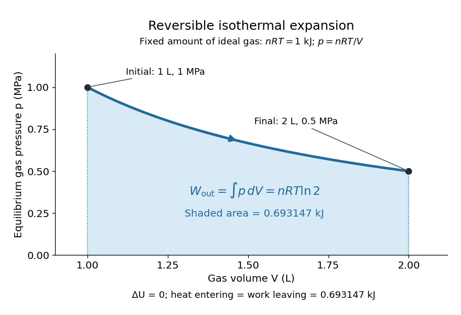
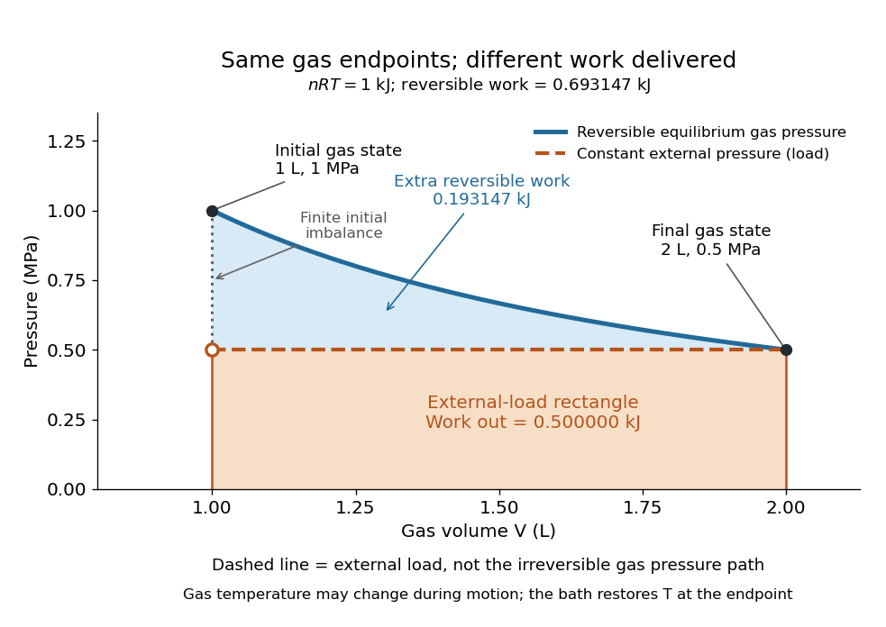

# Quasistatic process

↑ **Parent:** [Thermodynamics](thermodynamics-split.md)

A quasistatic process is an ideal limit in which a changing [thermodynamic system](thermodynamic-system.md) passes through a sequence of states arbitrarily close to [thermodynamic equilibrium](thermodynamic-equilibrium.md). Its intermediate [pressure](pressure-split.md), [temperature](temperature-split.md) and [volume](volume-thermodynamics.md) are therefore well defined and obey its [equation of state](equation-of-state.md). Driving must be slow compared with the system's own equilibration, rather than merely taking a long time on a clock. A [reversible thermodynamic process](reversible-thermodynamic-process.md) additionally allows both system and surroundings to be restored without net change; [friction](friction.md) can produce [entropy](entropy-split.md) even in a [quasistatic process](quasistatic-process.md).[§§4.2–4.3: quasi-static and reversible processes](statistical-physics-by-david-tong/4-classical-thermodynamics.md)

For a computed example, take a fixed [amount of substance](amount-of-substance.md) $n$ of [ideal gas](ideal-gas-split.md) in a sealed cylinder with a frictionless piston, in contact with a [heat bath](heat-bath.md) at absolute [temperature](temperature-split.md) $T$. Reduce the external load in infinitesimal steps so that the piston expands from $V_0$ to $2V_0$. In the reversible limit, the gas [pressure](pressure-split.md) exceeds the external [pressure](pressure-split.md) by an infinitesimal amount during expansion, and the [heat transfer](heat-transfer.md) occurs across an infinitesimal [temperature](temperature-split.md) difference. Exact [mechanical equilibrium](mechanical-equilibrium.md) would give no driving [force](force-split.md); the limiting imbalance supplies motion while preserving equilibrium intermediate states.[§3.4: a piston unloaded in infinitesimal steps](university-physics-volume-2-by-samuel-j-ling-and-others/3-4-thermodynamic-processes.md)

Along this reversible [isothermal expansion](isothermal-expansion.md), the [ideal gas law](ideal-gas-law.md) gives

$$
p(V)=\frac{nRT}{V},\qquad nRT=1\,\mathrm{kJ},\qquad V_0=1\,\mathrm L=10^{-3}\,\mathrm{m^3},\qquad
p_0=\frac{nRT}{V_0}=1\,\mathrm{MPa}.
$$

Here $R$ is the [molar gas constant](molar-gas-constant.md); specifying $nRT$ fixes an [energy](energy-split.md) scale, without choosing $n$ and $T$ separately. The initial and final equilibrium states are $(V_0,p_0,T)$ and $(2V_0,p_0/2,T)$. Count [work](work.md) delivered to the surroundings as positive. The reversible [work](work.md) is the shaded [area](surface-area.md) beneath the [pressure](pressure-split.md)-[volume](volume-thermodynamics.md) curve:

$$
W_{\rm out,rev}=\int_{V_0}^{2V_0}p(V)\,dV
=nRT\ln2\approx0.693147\,\mathrm{kJ}.
$$

The [integral](integral-split.md) of $1/V$ supplies the [natural logarithm](natural-logarithm.md). Since [internal energy of an ideal gas](internal-energy-of-an-ideal-gas.md) depends only on [temperature](temperature-split.md), $\Delta U=0$; the [first law of thermodynamics](first-law-of-thermodynamics-split.md), $\Delta U=Q_{\rm in}-W_{\rm out}$, gives $Q_{\rm in,rev}=0.693147\,\mathrm{kJ}$ to the displayed precision. The [heat bath](heat-bath.md) replaces the [energy](energy-split.md) delivered as [work](work.md).[§3.2: pressure-volume work and the isothermal integral](university-physics-volume-2-by-samuel-j-ling-and-others/3-2-work-heat-and-internal-energy.md)

**[Figure 1](#image-reversible-isothermal-expansion-work-is-the-area-beneath-the-equilibrium-pressure-curve). Reversible isothermal expansion: work is the area beneath the equilibrium pressure curve**. Fixed [amount of substance](amount-of-substance.md) of [ideal gas](ideal-gas-split.md), with $nRT=1\,\mathrm{kJ}$ and $V_0=1\,\mathrm L$. The blue curve gives every intermediate equilibrium state; its shaded [area](surface-area.md) is $0.693147\,\mathrm{kJ}$. The arrow indicates expansion, without specifying a time dependence.

Now start from the same initial state, but abruptly lower the external [pressure](pressure-split.md) to the constant value $p_{\rm ext}=p_0/2=0.5\,\mathrm{MPa}$. There is a finite initial [pressure](pressure-split.md) imbalance, so this is an irreversible expansion rather than a [quasistatic process](quasistatic-process.md). Assume the piston begins and ends at rest, has no net change in stored [energy](energy-split.md), and has no external [friction](friction.md); relaxation occurs within the [gas](gas.md) and its [heat bath](heat-bath.md). After motion has settled and the [heat bath](heat-bath.md) has restored [temperature](temperature-split.md) $T$, [mechanical equilibrium](mechanical-equilibrium.md) and the [ideal gas law](ideal-gas-law.md) give $V_f=nRT/p_{\rm ext}=2V_0$. The [work](work.md) delivered to the constant load is

$$
W_{\rm out,load}=p_{\rm ext}(V_f-V_0)
=(0.5\,\mathrm{MPa})(1\,\mathrm L)=0.5\,\mathrm{kJ},\qquad
\Delta U=0,\qquad Q_{\rm in,load}=0.5\,\mathrm{kJ}.
$$

This [work](work.md) follows directly from load [force](force-split.md) times piston [displacement](displacement.md), using $dV=A\,dx$ for piston [area](surface-area.md) $A$. Intermediate gas states need not have a single equilibrium [pressure](pressure-split.md) or [temperature](temperature-split.md). In particular, neither $p(V)=nRT/V$ at the bath [temperature](temperature-split.md) nor $p(V)=p_{\rm ext}$ describes the actual gas during this irreversible motion. The rectangle below plots the known external load; its upper edge is not an equilibrium gas path.

**[Figure 2](#image-the-same-equilibrium-endpoints-give-different-work-for-reversible-and-constant-load-expansion). The same equilibrium endpoints give different work for reversible and constant-load expansion**. The blue curve is the reversible [ideal gas](ideal-gas-split.md) path. The dashed orange line is constant external [pressure](pressure-split.md), whose rectangle gives $0.5\,\mathrm{kJ}$ of load [work](work.md). The additional blue shading is $0.193147\,\mathrm{kJ}$ available in the reversible case. Black points mark the common gas endpoints; the open orange point marks the initial external load, and the dotted gap indicates the initial imbalance. No irreversible internal gas path is drawn.

The [entropy](entropy-split.md) accounting makes the difference precise. Because [entropy](entropy-split.md) is a [state function](state-function.md), both expansions have the same gas [entropy](entropy-split.md) change, computed along the reversible [isothermal expansion](isothermal-expansion.md):

$$
\Delta S_{\rm gas}=\int_{V_0}^{2V_0}\frac{\delta Q_{\rm rev}}{T}=nR\ln2.
$$

The [thermal reservoir](heat-bath.md) stays at $T$ and loses [heat](heat-split.md) $Q_{\rm in}=W_{\rm out}$, so $\Delta S_{\rm bath}=-W_{\rm out}/T$. Assume the ideal load stores [work](work.md) without an [entropy](entropy-split.md) change. The combined [entropy production](entropy-production.md) is therefore

$$
\Delta S_{\rm total}=nR\ln2-\frac{W_{\rm out}}{T}
=\begin{cases}
0,&\text{reversible expansion},\\
nR(\ln2-1/2)>0,&\text{constant external load}.
\end{cases}
$$

No numerical [entropy](entropy-split.md) unit is implied by $nRT=1\,\mathrm{kJ}$ alone: $nR$ or $T$ must also be specified. The lost [work](work.md) opportunity is $T\Delta S_{\rm total}=0.193147\,\mathrm{kJ}$ for this comparison. This calculation uses equilibrium endpoints and the reservoir's [temperature](temperature-split.md), without assigning equilibrium intermediate states to the irreversible gas. [OpenStax, §4.6: entropy as a state function and reversible reference paths](https://openstax.org/books/university-physics-volume-2/pages/4-6-entropy)

For another boundary choice, let the same [ideal gas](ideal-gas-split.md) expand into an initially evacuated compartment of [volume](volume-thermodynamics.md) $V_0$ inside a rigid, insulated vessel of total [volume](volume-thermodynamics.md) $2V_0$. Removing the partition causes [free expansion](free-expansion.md): no load is moved and no [heat](heat-split.md) crosses the outer boundary, so $W_{\rm out}=Q_{\rm in}=0$ and $\Delta U=0$. After equilibration the [temperature](temperature-split.md) is again $T$, the [pressure](pressure-split.md) is $p_0/2$, and the gas [entropy](entropy-split.md) has increased by $nR\ln2$. The outer vessel has fixed [volume](volume-thermodynamics.md); the gas's accessible [volume](volume-thermodynamics.md) doubles. Restoring the initial gas state requires compression and removal of [heat](heat-split.md), changing the surroundings. Equal endpoints do not make [free expansion](free-expansion.md) reversible. [OpenStax, §4.1: insulated free expansion and restoration](https://openstax.org/books/university-physics-volume-2/pages/4-1-reversible-and-irreversible-processes)

A slowly moving piston with dry [friction](friction.md) supplies a different caution: its gas can remain arbitrarily close to [thermodynamic equilibrium](thermodynamic-equilibrium.md), yet rubbing still converts [work](work.md) into [heat](heat-split.md) and produces [entropy](entropy-split.md). If the frictional [force](force-split.md) has a nonzero slow-motion limit, its dissipated [energy](energy-split.md) over a fixed travel does not vanish with speed. Reversing the motion reverses [friction](friction.md), so infinitesimally changing the external load cannot retrace the same operation and restore the surroundings. The [heat capacity](heat-capacity.md) calculations additionally exclude [friction](friction.md) and other dissipative [work](work.md).[§3.4: a quasi-static piston with friction](university-physics-volume-2-by-samuel-j-ling-and-others/3-4-thermodynamic-processes.md)

The usefulness of a [quasistatic process](quasistatic-process.md) is that it replaces detailed motion by a readable sequence of equilibrium states. An [equation of state](equation-of-state.md) and an [integral](integral-split.md) then turn a [pressure](pressure-split.md)-[volume](volume-thermodynamics.md) drawing into an [energy](energy-split.md) budget. The beautiful distinction is that [internal energy](internal-energy-split.md) and [entropy](entropy-split.md) depend on the endpoints, while [heat](heat-split.md) and [work](work.md) record how the change was performed. Reversible benchmarks expose how much [work](work.md) an irreversible device sacrifices, while [entropy production](entropy-production.md) explains why simply making it slower need not recover that opportunity.

## ↑ Ancestors (5)

1. [Thermodynamics](thermodynamics-split.md)
2. [Statistical physics](statistical-physics-split.md)
3. [Branches of physics](branches-of-physics.md)
4. [Physics](physics-split.md)
5. [Codex Wiki](split.md)

## ← Incoming links (15)

- [Adiabatic compression](adiabatic-compression.md)
- [Adiabatic process](adiabatic-process.md)
- [Enthalpy](enthalpy-split.md)
- [Free expansion](free-expansion.md)
- [Heat capacity](heat-capacity.md)
- [Heat capacity at constant pressure](heat-capacity-at-constant-pressure.md)
- [Heat capacity at constant volume](heat-capacity-at-constant-volume.md)
- [Isothermal process](isothermal-process.md)
- [Solution](past-exam-of-the-mphil-in-nuclear-energy-course-of-the-university-of-cambridge/2019/paper-ne1/3/d/solution.md)
- [Power coefficient of reactivity](power-coefficient-of-reactivity.md)
- [Quasistatic process](quasistatic-process.md)
- [Sensible heat](sensible-heat.md)
- [State function](state-function.md)
- [Static friction on an inclined plane](static-friction-on-an-inclined-plane.md)
- [Thermodynamic process](thermodynamic-process.md)
