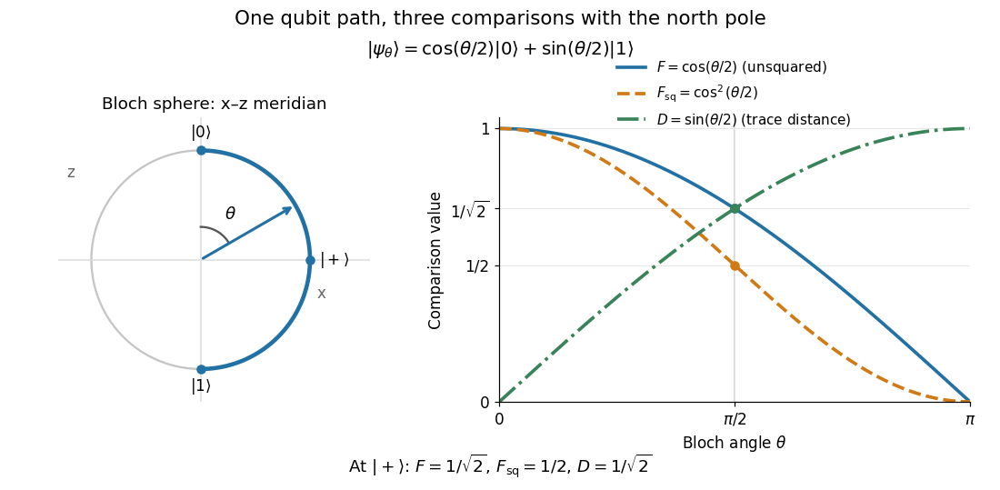

# Qubit fidelity along a Bloch meridian

↑ **Parent:** [Pure-state trace distance and fidelity identity](pure-state-trace-distance-and-fidelity-identity.md)

Compare the [qubit](qubit.md) [pure state](pure-state.md)

$$
|\psi_\theta\rangle=\cos(\theta/2)|0\rangle+\sin(\theta/2)|1\rangle,\qquad 0\leq\theta\leq\pi,
$$

with $|0\rangle$, using the [computational basis](computational-basis.md). Its [Bloch vector](bloch-vector.md) is $(\sin\theta,0,\cos\theta)$: it follows a meridian of the [Bloch sphere](bloch-sphere.md) from the north pole $|0\rangle$ through $|+\rangle$ to the south pole $|1\rangle$. The [inner product](inner-product.md) with $|0\rangle$ is $\cos(\theta/2)$, nonnegative on this interval. Consequently [quantum fidelity](fidelity-of-quantum-states.md), [squared quantum fidelity](squared-quantum-fidelity.md), and [trace distance](trace-distance.md) are

$$
F=\cos(\theta/2),\qquad F_{\mathrm{sq}}=\cos^2(\theta/2),\qquad D=\sin(\theta/2).
$$

At $\theta=0$ the triple $(F,F_{\mathrm{sq}},D)$ is $(1,1,0)$; at $\theta=\pi/2$ it is $(1/\sqrt2,1/2,1/\sqrt2)$; at $\theta=\pi$ it is $(0,0,1)$. The angle between the [Bloch vectors](bloch-vector.md) is $\theta$, while the [quantum fidelity](fidelity-of-quantum-states.md) uses its half-angle. The [pure-state trace distance and fidelity identity](pure-state-trace-distance-and-fidelity-identity.md) becomes the familiar relation $\cos^2(\theta/2)+\sin^2(\theta/2)=1$.

**[Figure 2](#image-a-bloch-sphere-meridian-and-the-corresponding-unsquared-fidelity-f-squared-fidelity-fsq-and-trace-distance-d-relative-to-the-north-pole-state). A Bloch sphere meridian and the corresponding unsquared fidelity F, squared fidelity Fsq, and trace distance D relative to the north-pole state**.

For equal prior [probabilities](probability.md), the [Holevo–Helstrom theorem](holevo-helstrom-theorem.md) gives optimal [quantum state discrimination](quantum-state-discrimination.md) success $P_{\mathrm{succ}}=(1+D)/2$. Along this meridian it rises from $1/2$ to one, with $(1+1/\sqrt2)/2\approx0.8536$ at $|+\rangle$. This connects the geometric [trace distance](trace-distance.md) to the best possible decision from a single preparation; it is a different measurement task from the target-acceptance [probability](probability.md) defining [squared quantum fidelity](squared-quantum-fidelity.md).

// Target: quantum-information-theory.bigb

## ↑ Ancestors (7)

1. [Pure-state trace distance and fidelity identity](pure-state-trace-distance-and-fidelity-identity.md)
2. [Fidelity of quantum states](fidelity-of-quantum-states.md)
3. [Quantum information theory](quantum-information-theory-split.md)
4. [Quantum theory](quantum-theory-split.md)
5. [Branches of physics](branches-of-physics.md)
6. [Physics](physics-split.md)
7. [Codex Wiki](split.md)
