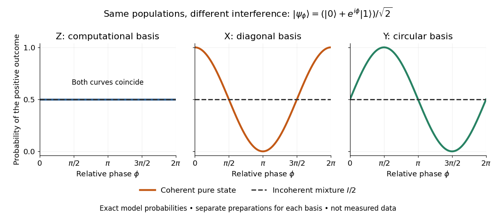

# Qubit state

↑ **Parent:** [Qubit](qubit.md)

A [qubit state](qubit-state.md) specifies measurement [probabilities](probability.md), rather than a pre-existing answer to every possible measurement. For a [pure state](pure-state.md), normalized vectors differing by a [global phase](global-phase.md) represent the same physical state:

$$
|\psi\rangle\sim e^{i\gamma}|\psi\rangle,\qquad \gamma\in\mathbb R.
$$

Equivalently, the [pure state](pure-state.md) is a ray: the one-dimensional complex [linear subspace](vector-subspace.md) spanned by any nonzero representative. Dividing a nonzero vector by its [norm](norm.md) fixes its length, but leaves the [global phase](global-phase.md) free. The [density operator](density-matrix.md) is unchanged because $(e^{i\gamma}|\psi\rangle)(e^{i\gamma}|\psi\rangle)^\dagger=|\psi\rangle\langle\psi|$. In contrast, multiplying only one nonzero component by $e^{i\phi}$ changes a relative [quantum phase](quantum-phase.md) and can change measurement [probabilities](probability.md). [Preskill, Physics 229 notes, sections 2.1 and 2.2.1, state rays and qubit parametrization](https://www.preskill.caltech.edu/ph229/notes/chap2.pdf).

After choosing a [global phase](global-phase.md), every [pure state](pure-state.md) of a [qubit](qubit.md) can be written

$$
|\psi(\theta,\phi)\rangle=\cos(\theta/2)|0\rangle+e^{i\phi}\sin(\theta/2)|1\rangle,
\qquad 0\leq\theta\leq\pi,\quad 0\leq\phi<2\pi.
$$

At $\theta=0$ or $\pi$, the parameter $\phi$ does not distinguish physical states: only one component survives. Elsewhere it is the relative [quantum phase](quantum-phase.md). The corresponding unit [Bloch vector](bloch-vector.md) is $\mathbf r=(\sin\theta\cos\phi,\sin\theta\sin\phi,\cos\theta)$ on the existing [Bloch sphere](bloch-sphere.md). Its angles describe a space of states; for a [photon polarization](photon-polarization.md) [qubit](qubit.md) they are not the photon's position or direction of travel. [Preskill, Physics 229 notes, section 2.3.2, equations (2.62)–(2.68)](https://www.preskill.caltech.edu/ph229/notes/chap2.pdf).

The [Born rule](born-rule.md) in the [computational basis](computational-basis.md) gives $P(0)=\cos^2(\theta/2)$ and $P(1)=\sin^2(\theta/2)$. These [probabilities](probability.md) discard $\phi$. In the [Hadamard basis](hadamard-basis.md) $|\pm\rangle=(|0\rangle\pm|1\rangle)/\sqrt2$, adding or subtracting the [probability amplitudes](probability-amplitude.md) instead gives

$$
P_X(\pm)=\frac12|\alpha\pm\beta|^2
=\frac12\pm\operatorname{Re}(\alpha^*\beta)
=\frac12\bigl(1\pm\sin\theta\cos\phi\bigr).
$$

This last equality follows by substituting the angular representative. In the basis $|\pm i\rangle=(|0\rangle\pm i|1\rangle)/\sqrt2$, the same calculation gives

$$
P_Y(\pm)=\frac12|\alpha\mp i\beta|^2
=\frac12\pm\operatorname{Im}(\alpha^*\beta)
=\frac12\bigl(1\pm\sin\theta\sin\phi\bigr).
$$

Thus both the real and imaginary parts of [quantum coherence](quantum-coherence-in-a-specified-basis.md) can be observed, using different measurement settings. For example, $(|0\rangle+|1\rangle)/\sqrt2$ and $(|0\rangle-|1\rangle)/\sqrt2$ both give $P(0)=P(1)=1/2$, but the first gives $P_X(+)=1$ and the second $P_X(+)=0$. A [global phase](global-phase.md) could never cause this difference.

**[Figure 12](#image-identical-computational-basis-probabilities-can-hide-different-relative-phases-and-coherence). Identical computational-basis probabilities can hide different relative phases and coherence**. Exact model probabilities for $(|0\rangle+e^{i\phi}|1\rangle)/\sqrt2$, compared with the incoherent mixture $I/2$. Each curve requires repeated preparations measured in the indicated basis; these are not experimental data.

For a general [qubit state](qubit-state.md), write its [density matrix](density-matrix.md) in the [computational basis](computational-basis.md) as

$$
\rho=\begin{pmatrix}p&c\\c^*&1-p\end{pmatrix},\qquad
p\in\mathbb R,\quad c\in\mathbb C,\quad
0\leq p\leq1,\quad |c|^2\leq p(1-p).
$$

These are exactly the [Hermitian](hermitian-operator.md), unit-[trace](matrix-trace.md), [positive semidefinite](positive-semidefinite-matrix.md) constraints. Positivity means every [eigenvalue](eigenvalue.md) is nonnegative, not that every matrix entry is nonnegative. The general definition is given in [density matrix](density-matrix.md). [Watrous, IBM Quantum Learning, Density matrix basics, Definition and Connection to quantum state vectors](https://quantum.cloud.ibm.com/learning/en/courses/general-formulation-of-quantum-information/density-matrices/density-matrix-basics).

For this two-by-two [matrix](matrix.md), the explicit constraint follows from its [determinant](determinant.md), $\det\rho=p(1-p)-|c|^2$: with [trace](matrix-trace.md) one, a nonnegative [determinant](determinant.md) and real [eigenvalues](eigenvalue.md) rule out a negative [eigenvalue](eigenvalue.md). Its [eigenvalues](eigenvalue.md) are

$$
\lambda_\pm=\frac12\left(1\pm\sqrt{(2p-1)^2+4|c|^2}\right).
$$

The [pure states](pure-state.md) have $|c|^2=p(1-p)$ and [eigenvalues](eigenvalue.md) $1,0$; the [mixed states](mixed-state.md) have strict inequality and two positive [eigenvalues](eigenvalue.md). For a normalized representative, $p=|\alpha|^2$ and $c=\alpha\beta^*$. A statistical preparation $\rho=\sum_j w_j|\psi_j\rangle\langle\psi_j|$, with $w_j\geq0$ and $\sum_jw_j=1$, averages [probabilities](probability.md), rather than adding [probability amplitudes](probability-amplitude.md). Such a preparation is mixed if the positive-weight vectors do not all represent the same ray. A [reduced density matrix](reduced-density-matrix.md) of an entangled pair can also be mixed even when the pair has a [pure state](pure-state.md). [Watrous, IBM Quantum Learning, Density matrix basics, Interpretation of density matrices](https://quantum.cloud.ibm.com/learning/en/courses/general-formulation-of-quantum-information/density-matrices/density-matrix-basics).

For a concrete check, the [pure state](pure-state.md) $(\sqrt3|0\rangle+|1\rangle)/2$ and the [mixed state](mixed-state.md) obtained by preparing $|0\rangle$ with [probability](probability.md) $3/4$ and $|1\rangle$ with [probability](probability.md) $1/4$ have

$$
\rho_{\mathrm{pure}}=\begin{pmatrix}3/4&\sqrt3/4\\\sqrt3/4&1/4\end{pmatrix},\qquad
\rho_{\mathrm{mix}}=\begin{pmatrix}3/4&0\\0&1/4\end{pmatrix}.
$$

Both have [trace](matrix-trace.md) one and the same [computational-basis measurement](quantum-measurement-in-the-computational-basis.md) [probabilities](probability.md). Their [eigenvalues](eigenvalue.md) are respectively $(1,0)$ and $(3/4,1/4)$; the respective values of their [purity of a density operator](purity-of-a-density-operator.md) $\operatorname{Tr}(\rho^2)$ are $1$ and $5/8$. Their [Hadamard basis](hadamard-basis.md) plus [probabilities](probability.md) are respectively $1/2+\sqrt3/4\approx0.9330$ and $1/2$. By contrast, setting $p=3/4,c=1/2$ would give [determinant](determinant.md) $-1/16$ and [eigenvalue](eigenvalue.md) $(2-\sqrt5)/4<0$: normalized diagonal entries alone do not make a valid [qubit state](qubit-state.md).

The same constraints become especially beautiful in the [Bloch ball](bloch-ball.md) representation. With the [Pauli matrices](pauli-matrices.md) $\boldsymbol\sigma=(X,Y,Z)$ and the [identity operator](identity-operator.md) $I$,

$$
\rho=\tfrac12(I+r_xX+r_yY+r_zZ),\qquad
\mathbf r=(2\operatorname{Re}c,-2\operatorname{Im}c,2p-1),\qquad |\mathbf r|\leq1.
$$

The [eigenvalues](eigenvalue.md) are $(1\pm|\mathbf r|)/2$, so the [Bloch sphere](bloch-sphere.md) is precisely the [pure state](pure-state.md) boundary, and $I/2$ is the maximally mixed centre. For each axis $j$, the [Born rule](born-rule.md) gives $P_j(\pm)=(1\pm r_j)/2$. This unifies a geometric picture, matrix positivity, and experimental frequencies in one description. For the equatorial family in the phase diagram, $p=1/2,c=e^{-i\phi}/2$ and $\mathbf r=(\cos\phi,\sin\phi,0)$; replacing it by $I/2$ erases the transverse components and every fringe. See [quantum state tomography](quantum-state-tomography.md) for how independent ensembles measured along the three axes estimate these components. [Preskill, Physics 229 notes, section 2.3.2, equations (2.62)–(2.70)](https://www.preskill.caltech.edu/ph229/notes/chap2.pdf).

## ↑ Ancestors (7)

1. [Qubit](qubit.md)
2. [Quantum state](quantum-state.md)
3. [Quantum system](quantum-system.md)
4. [Quantum mechanics](quantum-mechanics-split.md)
5. [Branches of physics](branches-of-physics.md)
6. [Physics](physics-split.md)
7. [Codex Wiki](split.md)

## ← Incoming links (2)

- [Qubit](qubit.md)
- [Qubit state](qubit-state.md)
