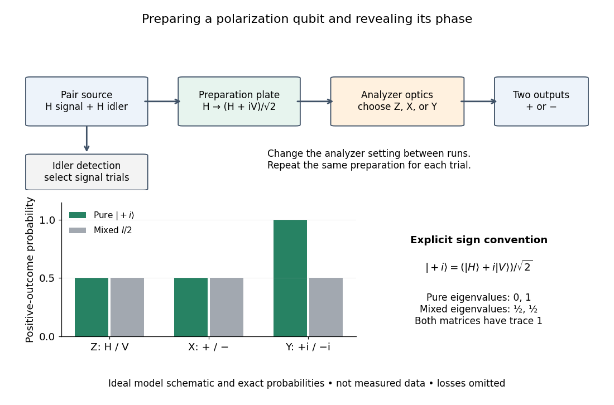

# Qubit

↑ **Parent:** [Quantum state](quantum-state.md)  
ⓦ [Wiki](https://en.wikipedia.org/wiki/Qubit)

A [qubit](qubit.md), or quantum bit, is a [quantum system](quantum-system-split.md) whose state space is a two-dimensional complex [Hilbert space](hilbert-space-split.md). Choose an [orthonormal basis](orthonormal-basis.md) $|0\rangle,|1\rangle$, called the [computational basis](computational-basis.md). A [pure state](pure-state.md) has a normalized representative $|\psi\rangle=\alpha|0\rangle+\beta|1\rangle$, where $\alpha,\beta$ are complex [probability amplitudes](probability-amplitude.md) and $|\alpha|^2+|\beta|^2=1$. General [qubit states](qubit-state.md), including [mixed states](mixed-state.md), require a [density matrix](density-matrix-split.md). [Watrous, IBM Quantum Learning, Quantum information, Quantum state vectors](https://quantum.cloud.ibm.com/learning/en/courses/basics-of-quantum-information/single-systems/quantum-information).

The abstract [qubit](qubit.md) describes the chosen degree of freedom: for [spin one-half](spin-one-half.md), $|0\rangle,|1\rangle$ can label spin up and down along a specified axis; for [photon polarization](photon-polarization.md) in a fixed propagation mode, they can label horizontal and vertical polarization, $|H\rangle,|V\rangle$. These implementations share the same two-dimensional [linear algebra](linear-algebra-split.md), but their preparation and [measurement in quantum mechanics](quantum-measurement-split.md) use different apparatus. A [qubit](qubit.md) therefore need not be an entire two-level particle. [Preskill, Physics 229 notes, sections 2.2.1–2.2.2, spin and photon polarization examples](foundations-i-states-and-ensembles-by-john-preskill.md).

The usefulness of a [qubit](qubit.md) lies in controlling [quantum superpositions](quantum-superposition.md) and their relative [quantum phases](quantum-phase.md), then converting them into outcome [probabilities](probability.md) with [quantum gates](quantum-logic-gate.md) and an appropriate measurement. One ideal [computational-basis measurement](quantum-measurement-in-the-computational-basis.md) returns one label, zero or one. It does not reveal both [probability amplitudes](probability-amplitude.md), their relative [quantum phase](quantum-phase.md), or all the bits of a larger register's expansion. [Quantum state tomography](quantum-state-tomography.md) instead estimates a [qubit state](qubit-state.md) using many repetitions of the preparation and suitable measurement settings. [Watrous, IBM Quantum Learning, Quantum information, Measuring quantum states](https://quantum.cloud.ibm.com/learning/en/courses/basics-of-quantum-information/single-systems/quantum-information).

An actual preparation and measurement example is Dederick and Beck's 2014 teaching-laboratory experiment. A 405-nm laser pumped two nonlinear crystals, producing signal and idler [photons](photon.md) near 810 nm. In their non-entangled run the source produced $|H\rangle_s|H\rangle_i$; a quarter-wave plate in the signal arm changed its [photon polarization](photon-polarization.md) to $|L\rangle=(|H\rangle+i|V\rangle)/\sqrt2$ in their convention. The plate supplies a relative [quantum phase](quantum-phase.md) between polarization components. An idler detection selected the signal trials; signal detectors measured horizontal/vertical, diagonal, and [circular polarization](circular-polarization.md) bases on separate runs. Before the polarization analyzer, a half-wave plate at $22.5$ degrees selected the diagonal basis, and a quarter-wave plate at $45$ degrees selected the circular basis. Coincidence counts $N_{AB},N_{AB'}$ gave the conditional positive-outcome frequency $N_{AB}/(N_{AB}+N_{AB'})$. The reconstructed [density matrix](density-matrix-split.md) for conditioning on detector $A$ had [squared quantum fidelity](squared-quantum-fidelity.md) $0.96$ with $|L\rangle$ and [purity of a density operator](purity-of-a-density-operator.md) $0.98$: close to the intended [pure state](pure-state.md), rather than an exact ideal preparation. [Dederick and Beck, Exploring entanglement with the help of quantum state measurement, American Journal of Physics 82, 962–971 (2014), sections II D and III A–B](https://people.reed.edu/~beckm/papers/Dederick_ajp.pdf).

**[Figure 3](#image-ideal-polarization-qubit-preparation-and-measurements-in-three-separate-settings). Ideal polarization-qubit preparation and measurements in three separate settings**. Original model schematic and exact Born-rule probabilities, not measured data or a reproduction of the experimental apparatus. The circular-basis sign uses the explicitly defined state $(|H\rangle+i|V\rangle)/\sqrt2$.

The model diagram explains why those settings matter. With $|0\rangle=|H\rangle$ and $|1\rangle=|V\rangle$, the intended $|L\rangle$ gives equal [probabilities](probability.md) in both the horizontal/vertical [computational basis](computational-basis.md) and diagonal [Hadamard basis](hadamard-basis.md), just as the [mixed state](mixed-state.md) $I/2$ does. In the circular basis $|\pm i\rangle=(|0\rangle\pm i|1\rangle)/\sqrt2$, however, the ideal $|L\rangle=|+i\rangle$ always gives the plus outcome, whereas $I/2$ still gives equal [probabilities](probability.md). These are deductions from the [Born rule](born-rule.md), not the paper's measured counts. Unequal detector efficiencies and finite samples must be accounted for when interpreting experimental frequencies; the ideal comparison assumes equally efficient detection.

**Table of contents**

- [Qubit state](qubit-state.md)

## ↑ Ancestors (6)

1. [Quantum state](quantum-state.md)
2. [Quantum system](quantum-system-split.md)
3. [Quantum mechanics](quantum-mechanics-split.md)
4. [Branches of physics](branches-of-physics.md)
5. [Physics](physics-split.md)
6. [Codex Wiki](split.md)

## ← Incoming links (235)

- [Amplitude damping channel](amplitude-damping-channel.md)
- [Asymptotic remote state preparation by block indexing](asymptotic-remote-state-preparation-by-block-indexing.md)
- [Bell correlations versus a classical mixture](bell-correlations-versus-a-classical-mixture.md)
- [Bell pair](bell-pair.md)
- [Berry phase](berry-phase.md)
- [Berry-phase interference with a reference path](berry-phase-interference-with-a-reference-path.md)
- [Berry phase of a Bloch-sphere latitude](berry-phase-of-a-bloch-sphere-latitude.md)
- [Binary phase representation of a Pauli string](binary-phase-representation-of-a-pauli-string.md)
- [Bit-flip repetition code](bit-flip-repetition-code.md)
- [Bloch sphere](bloch-sphere.md)
- [Born rule](born-rule.md)
- [Cesium-beam clock procedure](cesium-beam-clock-procedure.md)
- [Clean subset superposition preparation](clean-subset-superposition-preparation.md)
- [Coherent preparation and incoherent mixing](coherent-preparation-and-incoherent-mixing.md)
- [Concatenated quantum error-correcting code](concatenated-quantum-error-correcting-code.md)
- [Concurrence of a two-qubit Werner state](concurrence-of-a-two-qubit-werner-state.md)
- [Correction implies detection at twice the weight](correction-implies-detection-at-twice-the-weight.md)
- [CSS code](css-code.md)
- [Dephased Bell-state mixture](dephased-bell-state-mixture.md)
- [Dephasing channel](dephasing-channel.md)
- [Deutsch algorithm](deutsch-algorithm.md)
- [Deutsch algorithm with pure dephasing](deutsch-algorithm-with-pure-dephasing.md)
- [Dicke-resource telecloning](dicke-resource-telecloning.md)
- [Dicke state](dicke-state.md)
- [Distance of a quantum error-correcting code](distance-of-a-quantum-error-correcting-code.md)
- [DiVincenzo criteria](divincenzo-criteria.md)
- [Equal-prior discrimination of qubit states](equal-prior-discrimination-of-qubit-states.md)
- [Exact teleportation resource criterion](exact-teleportation-resource-criterion.md)
- [Fidelity of commuting mixed states](fidelity-of-commuting-mixed-states.md)
- [Five-qubit error correcting code](five-qubit-error-correcting-code.md)
- [GHZ preparation with Hadamard and controlled-Z gates](ghz-preparation-with-hadamard-and-controlled-z-gates.md)
- [Hadamard transform](hadamard-transform.md)
- [Helstrom measurement for the zero and plus states](helstrom-measurement-for-the-zero-and-plus-states.md)
- [Heralded remote preparation of an arbitrary qubit](heralded-remote-preparation-of-an-arbitrary-qubit.md)
- [Impulsive quantum kick](impulsive-quantum-kick.md)
- [Interferometric polarization tomography](interferometric-polarization-tomography.md)
- [Logical depth of a measurement pattern](logical-depth-of-a-measurement-pattern.md)
- [Logical failure of the three-qubit bit-flip repetition code](logical-failure-of-the-three-qubit-bit-flip-repetition-code.md)
- [Logical qubit](logical-qubit.md)
- [Magic basis](magic-basis.md)
- [Martinis-Devoret-Clarke circuit experiments](martinis-devoret-clarke-circuit-experiments.md)
- [Measurement-based quantum computation](measurement-based-quantum-computation.md)
- [Measurement pattern](measurement-pattern.md)
- [Mixed state](mixed-state.md)
- [Mixed-state concurrence of two qubits](mixed-state-concurrence-of-two-qubits.md)
- [Mixed-state Hadamard-test quadratures](mixed-state-hadamard-test-quadratures.md)
- [One-bit teleportation](one-bit-teleportation.md)
- [Parallel phase multiplication by coherent fanout](parallel-phase-multiplication-by-coherent-fanout.md)
- [Parity computation by CNOT gates](parity-computation-by-cnot-gates.md)
- [Solution](past-exam-of-the-atomic-and-optical-physics-course-of-the-university-of-cambridge/2012/paper-1/3/b/solution.md)
- [Solution](past-exam-of-the-atomic-and-optical-physics-course-of-the-university-of-cambridge/2013/paper-1/3/b/solution.md)
- [Solution](past-exam-of-the-mathematics-course-of-the-university-of-cambridge/2001/iii/paper-61/1/solution.md)
- [Solution](past-exam-of-the-mathematics-course-of-the-university-of-cambridge/2001/iii/paper-61/2/solution.md)
- [Solution](past-exam-of-the-mathematics-course-of-the-university-of-cambridge/2001/iii/paper-61/3/solution.md)
- [Solution](past-exam-of-the-mathematics-course-of-the-university-of-cambridge/2002/iii/paper-33/1/b/solution.md)
- [Solution](past-exam-of-the-mathematics-course-of-the-university-of-cambridge/2002/iii/paper-33/2/solution.md)
- [Solution](past-exam-of-the-mathematics-course-of-the-university-of-cambridge/2002/iii/paper-33/5/solution.md)
- [Solution](past-exam-of-the-mathematics-course-of-the-university-of-cambridge/2003/iii/paper-35/1/solution.md)
- [Solution](past-exam-of-the-mathematics-course-of-the-university-of-cambridge/2003/iii/paper-35/2/solution.md)
- [Solution](past-exam-of-the-mathematics-course-of-the-university-of-cambridge/2003/iii/paper-35/5/solution.md)
- [Solution](past-exam-of-the-mathematics-course-of-the-university-of-cambridge/2003/iii/paper-47/1/solution.md)
- [Solution](past-exam-of-the-mathematics-course-of-the-university-of-cambridge/2003/iii/paper-47/2/solution.md)
- [Solution](past-exam-of-the-mathematics-course-of-the-university-of-cambridge/2003/iii/paper-47/3/solution.md)
- [Solution](past-exam-of-the-mathematics-course-of-the-university-of-cambridge/2004/iii/paper-32/1/solution.md)
- [Solution](past-exam-of-the-mathematics-course-of-the-university-of-cambridge/2004/iii/paper-53/1/solution.md)
- [Solution](past-exam-of-the-mathematics-course-of-the-university-of-cambridge/2004/iii/paper-53/2/1/solution.md)
- [Solution](past-exam-of-the-mathematics-course-of-the-university-of-cambridge/2004/iii/paper-54/1/solution.md)
- [Solution](past-exam-of-the-mathematics-course-of-the-university-of-cambridge/2004/iii/paper-54/2/solution.md)
- [Solution](past-exam-of-the-mathematics-course-of-the-university-of-cambridge/2004/iii/paper-54/4/solution.md)
- [Solution](past-exam-of-the-mathematics-course-of-the-university-of-cambridge/2005/iii/paper-37/4/b/solution.md)
- [Solution](past-exam-of-the-mathematics-course-of-the-university-of-cambridge/2005/iii/paper-37/5/a/solution.md)
- [Solution](past-exam-of-the-mathematics-course-of-the-university-of-cambridge/2005/iii/paper-58/1/ii/solution.md)
- [Solution](past-exam-of-the-mathematics-course-of-the-university-of-cambridge/2005/iii/paper-58/3/ii/solution.md)
- [Solution](past-exam-of-the-mathematics-course-of-the-university-of-cambridge/2005/iii/paper-58/3/iii/solution.md)
- [Solution](past-exam-of-the-mathematics-course-of-the-university-of-cambridge/2006/iii/paper-33/1/solution.md)
- [Solution](past-exam-of-the-mathematics-course-of-the-university-of-cambridge/2006/iii/paper-33/2/solution.md)
- [Solution](past-exam-of-the-mathematics-course-of-the-university-of-cambridge/2006/iii/paper-58/1/b/solution.md)
- [Solution](past-exam-of-the-mathematics-course-of-the-university-of-cambridge/2006/iii/paper-58/1/c/solution.md)
- [Solution](past-exam-of-the-mathematics-course-of-the-university-of-cambridge/2006/iii/paper-58/1/d/solution.md)
- [Solution](past-exam-of-the-mathematics-course-of-the-university-of-cambridge/2006/iii/paper-58/2/a/solution.md)
- [Solution](past-exam-of-the-mathematics-course-of-the-university-of-cambridge/2006/iii/paper-58/2/b/solution.md)
- [Solution](past-exam-of-the-mathematics-course-of-the-university-of-cambridge/2006/iii/paper-58/2/c/solution.md)
- [Solution](past-exam-of-the-mathematics-course-of-the-university-of-cambridge/2006/iii/paper-58/3/a/solution.md)
- [Solution](past-exam-of-the-mathematics-course-of-the-university-of-cambridge/2006/iii/paper-59/2/solution.md)
- [Solution](past-exam-of-the-mathematics-course-of-the-university-of-cambridge/2007/iii/paper-60/3/b/solution.md)
- [Solution](past-exam-of-the-mathematics-course-of-the-university-of-cambridge/2007/iii/paper-60/3/e/solution.md)
- [Solution](past-exam-of-the-mathematics-course-of-the-university-of-cambridge/2007/iii/paper-60/3/f/solution.md)
- [Solution](past-exam-of-the-mathematics-course-of-the-university-of-cambridge/2008/iii/paper-57/1/b/solution.md)
- [Solution](past-exam-of-the-mathematics-course-of-the-university-of-cambridge/2008/iii/paper-57/1/c/solution.md)
- [Solution](past-exam-of-the-mathematics-course-of-the-university-of-cambridge/2008/iii/paper-57/2/d/solution.md)
- [Solution](past-exam-of-the-mathematics-course-of-the-university-of-cambridge/2008/iii/paper-57/3/c/solution.md)
- [Solution](past-exam-of-the-mathematics-course-of-the-university-of-cambridge/2008/iii/paper-57/3/d/solution.md)
- [Solution](past-exam-of-the-mathematics-course-of-the-university-of-cambridge/2008/iii/paper-57/4/a/solution.md)
- [Solution](past-exam-of-the-mathematics-course-of-the-university-of-cambridge/2008/iii/paper-57/4/d/solution.md)
- [Solution](past-exam-of-the-mathematics-course-of-the-university-of-cambridge/2008/iii/paper-58/1/ii/solution.md)
- [Solution](past-exam-of-the-mathematics-course-of-the-university-of-cambridge/2008/iii/paper-58/3/ii/solution.md)
- [Solution](past-exam-of-the-mathematics-course-of-the-university-of-cambridge/2008/iii/paper-60/2/solution.md)
- [Solution](past-exam-of-the-mathematics-course-of-the-university-of-cambridge/2009/iii/paper-50/1/b/solution.md)
- [Solution](past-exam-of-the-mathematics-course-of-the-university-of-cambridge/2009/iii/paper-50/1/c/solution.md)
- [Solution](past-exam-of-the-mathematics-course-of-the-university-of-cambridge/2009/iii/paper-50/1/d/solution.md)
- [Solution](past-exam-of-the-mathematics-course-of-the-university-of-cambridge/2009/iii/paper-50/4/a/solution.md)
- [Solution](past-exam-of-the-mathematics-course-of-the-university-of-cambridge/2009/iii/paper-51/1/a/solution.md)
- [Solution](past-exam-of-the-mathematics-course-of-the-university-of-cambridge/2009/iii/paper-51/1/b/solution.md)
- [Solution](past-exam-of-the-mathematics-course-of-the-university-of-cambridge/2009/iii/paper-51/1/d/solution.md)
- [Solution](past-exam-of-the-mathematics-course-of-the-university-of-cambridge/2009/iii/paper-51/2/d/solution.md)
- [Solution](past-exam-of-the-mathematics-course-of-the-university-of-cambridge/2009/iii/paper-51/3/b/solution.md)
- [Solution](past-exam-of-the-mathematics-course-of-the-university-of-cambridge/2009/iii/paper-51/3/c/solution.md)
- [Solution](past-exam-of-the-mathematics-course-of-the-university-of-cambridge/2009/iii/paper-51/3/d/solution.md)
- [Solution](past-exam-of-the-mathematics-course-of-the-university-of-cambridge/2009/iii/paper-51/4/c/solution.md)
- [Solution](past-exam-of-the-mathematics-course-of-the-university-of-cambridge/2009/iii/paper-51/4/e/solution.md)
- [Solution](past-exam-of-the-mathematics-course-of-the-university-of-cambridge/2010/iii/paper-49/2/b/solution.md)
- [Solution](past-exam-of-the-mathematics-course-of-the-university-of-cambridge/2010/iii/paper-49/4/d/solution.md)
- [Solution](past-exam-of-the-mathematics-course-of-the-university-of-cambridge/2010/iii/paper-50/1/b/solution.md)
- [Solution](past-exam-of-the-mathematics-course-of-the-university-of-cambridge/2010/iii/paper-51/1/a/solution.md)
- [Solution](past-exam-of-the-mathematics-course-of-the-university-of-cambridge/2011/ii/paper-4/4g/solution.md)
- [Solution](past-exam-of-the-mathematics-course-of-the-university-of-cambridge/2012/iii/paper-66/1/c/solution.md)
- [Solution](past-exam-of-the-mathematics-course-of-the-university-of-cambridge/2012/iii/paper-66/2/a/solution.md)
- [Solution](past-exam-of-the-mathematics-course-of-the-university-of-cambridge/2012/iii/paper-66/2/b/solution.md)
- [Solution](past-exam-of-the-mathematics-course-of-the-university-of-cambridge/2012/iii/paper-66/3/c/solution.md)
- [Solution](past-exam-of-the-mathematics-course-of-the-university-of-cambridge/2012/iii/paper-67/3/a/solution.md)
- [Solution](past-exam-of-the-mathematics-course-of-the-university-of-cambridge/2012/iii/paper-67/4/a/solution.md)
- [Solution](past-exam-of-the-mathematics-course-of-the-university-of-cambridge/2012/iii/paper-67/4/d/solution.md)
- [Solution](past-exam-of-the-mathematics-course-of-the-university-of-cambridge/2013/iii/paper-57/3/a/solution.md)
- [Solution](past-exam-of-the-mathematics-course-of-the-university-of-cambridge/2013/iii/paper-58/1/b/solution.md)
- [Solution](past-exam-of-the-mathematics-course-of-the-university-of-cambridge/2013/iii/paper-58/3/a/solution.md)
- [Solution](past-exam-of-the-mathematics-course-of-the-university-of-cambridge/2013/iii/paper-58/4/a/i/solution.md)
- [Solution](past-exam-of-the-mathematics-course-of-the-university-of-cambridge/2013/iii/paper-58/4/b/ii/solution.md)
- [Solution](past-exam-of-the-mathematics-course-of-the-university-of-cambridge/2013/iii/paper-58/4/b/iii/solution.md)
- [Solution](past-exam-of-the-mathematics-course-of-the-university-of-cambridge/2014/iii/paper-61/1/b/i/solution.md)
- [Solution](past-exam-of-the-mathematics-course-of-the-university-of-cambridge/2014/iii/paper-61/1/b/ii/solution.md)
- [Solution](past-exam-of-the-mathematics-course-of-the-university-of-cambridge/2014/iii/paper-61/2/iii/solution.md)
- [Solution](past-exam-of-the-mathematics-course-of-the-university-of-cambridge/2014/iii/paper-61/2/iv/solution.md)
- [Solution](past-exam-of-the-mathematics-course-of-the-university-of-cambridge/2014/iii/paper-61/3/i/solution.md)
- [Solution](past-exam-of-the-mathematics-course-of-the-university-of-cambridge/2014/iii/paper-61/4/a/i/solution.md)
- [Solution](past-exam-of-the-mathematics-course-of-the-university-of-cambridge/2014/iii/paper-61/4/b/solution.md)
- [Solution](past-exam-of-the-mathematics-course-of-the-university-of-cambridge/2014/iii/paper-62/1/solution.md)
- [Solution](past-exam-of-the-mathematics-course-of-the-university-of-cambridge/2014/iii/paper-62/2/solution.md)
- [Solution](past-exam-of-the-mathematics-course-of-the-university-of-cambridge/2015/iii/paper-66/2/i/solution.md)
- [Solution](past-exam-of-the-mathematics-course-of-the-university-of-cambridge/2015/iii/paper-66/2/ii/solution.md)
- [Solution](past-exam-of-the-mathematics-course-of-the-university-of-cambridge/2015/iii/paper-67/2/c/solution.md)
- [Solution](past-exam-of-the-mathematics-course-of-the-university-of-cambridge/2015/iii/paper-67/3/a/solution.md)
- [Solution](past-exam-of-the-mathematics-course-of-the-university-of-cambridge/2015/iii/paper-67/3/c/solution.md)
- [Solution](past-exam-of-the-mathematics-course-of-the-university-of-cambridge/2015/iii/paper-67/3/d/solution.md)
- [Solution](past-exam-of-the-mathematics-course-of-the-university-of-cambridge/2015/iii/paper-67/4/d/solution.md)
- [Solution](past-exam-of-the-mathematics-course-of-the-university-of-cambridge/2016/iii/paper-324/1/ii/solution.md)
- [Solution](past-exam-of-the-mathematics-course-of-the-university-of-cambridge/2016/iii/paper-324/2/b/solution.md)
- [Solution](past-exam-of-the-mathematics-course-of-the-university-of-cambridge/2016/iii/paper-324/3/i/solution.md)
- [Solution](past-exam-of-the-mathematics-course-of-the-university-of-cambridge/2016/iii/paper-324/3/ii/solution.md)
- [Solution](past-exam-of-the-mathematics-course-of-the-university-of-cambridge/2016/iii/paper-324/3/iii/solution.md)
- [Solution](past-exam-of-the-mathematics-course-of-the-university-of-cambridge/2016/iii/paper-324/3/iv/solution.md)
- [Solution](past-exam-of-the-mathematics-course-of-the-university-of-cambridge/2016/iii/paper-324/4/ii/solution.md)
- [Solution](past-exam-of-the-mathematics-course-of-the-university-of-cambridge/2017/iii/paper-324/3/a/solution.md)
- [Solution](past-exam-of-the-mathematics-course-of-the-university-of-cambridge/2017/iii/paper-324/3/b/ii/solution.md)
- [Solution](past-exam-of-the-mathematics-course-of-the-university-of-cambridge/2017/iii/paper-324/4/a/i/solution.md)
- [Solution](past-exam-of-the-mathematics-course-of-the-university-of-cambridge/2017/iii/paper-324/4/a/iii/solution.md)
- [Solution](past-exam-of-the-mathematics-course-of-the-university-of-cambridge/2017/iii/paper-324/4/a/iv/solution.md)
- [Solution](past-exam-of-the-mathematics-course-of-the-university-of-cambridge/2017/iii/paper-324/4/b/solution.md)
- [Solution](past-exam-of-the-mathematics-course-of-the-university-of-cambridge/2019/ii/paper-2/10d/a/solution.md)
- [Solution](past-exam-of-the-mathematics-course-of-the-university-of-cambridge/2019/ii/paper-2/10d/b/solution.md)
- [Solution](past-exam-of-the-mathematics-course-of-the-university-of-cambridge/2019/iii/paper-324/3/a/i/solution.md)
- [Solution](past-exam-of-the-mathematics-course-of-the-university-of-cambridge/2019/iii/paper-324/3/a/iii/solution.md)
- [Solution](past-exam-of-the-mathematics-course-of-the-university-of-cambridge/2024/iii/paper-324/3/b/solution.md)
- [Solution](past-exam-of-the-mathematics-course-of-the-university-of-cambridge/2024/iii/paper-324/3/c/solution.md)
- [Solution](past-exam-of-the-physics-a-course-of-the-university-of-cambridge/2015/paper-1/section-c/c10/solution.md)
- [Solution](past-exam-of-the-physics-of-nanoelectronic-systems-course-of-the-university-of-cambridge/2013/paper-1/3/a/solution.md)
- [Solution](past-exam-of-the-physics-of-nanoelectronic-systems-course-of-the-university-of-cambridge/2015/paper-1/3/b/solution.md)
- [Solution](past-exam-of-the-quantum-information-course-of-the-university-of-cambridge/2012/paper-1/3/a/solution.md)
- [Solution](past-exam-of-the-quantum-information-course-of-the-university-of-cambridge/2012/paper-1/3/b/solution.md)
- [Solution](past-exam-of-the-quantum-information-course-of-the-university-of-cambridge/2012/paper-1/3/c/solution.md)
- [Solution](past-exam-of-the-quantum-information-course-of-the-university-of-cambridge/2013/paper-1/3/a/solution.md)
- [Solution](past-exam-of-the-quantum-information-course-of-the-university-of-cambridge/2014/paper-1/3/b/solution.md)
- [Solution](past-exam-of-the-quantum-information-course-of-the-university-of-cambridge/2015/paper-1/3/b/solution.md)
- [Solution](past-exam-of-the-quantum-information-course-of-the-university-of-cambridge/2016/paper-1/3/b/solution.md)
- [Pauli decomposition of a qubit-environment isometry](pauli-decomposition-of-a-qubit-environment-isometry.md)
- [Pauli expansion of a quantum error](pauli-expansion-of-a-quantum-error.md)
- [Pauli frame](pauli-frame.md)
- [Pauli gate](pauli-gate.md)
- [Perfect quantum state transfer](perfect-quantum-state-transfer.md)
- [Perfect two-basis discrimination would allow superluminal signalling](perfect-two-basis-discrimination-would-allow-superluminal-signalling.md)
- [Photon-number measurement backaction](photon-number-measurement-backaction.md)
- [Photon-number reference for a Hadamard gate](photon-number-reference-for-a-hadamard-gate.md)
- [Photon polarization](photon-polarization.md)
- [Polarization preparation and dephasing experiment](polarization-preparation-and-dephasing-experiment.md)
- [Positive operator-valued measure](positive-operator-valued-measure.md)
- [Probability amplitude](probability-amplitude.md)
- [Projective measurement](projective-measurement.md)
- [Purity of a density operator](purity-of-a-density-operator.md)
- [Quantum Computation with Quantum Dots by Daniel Loss and David P. DiVincenzo](quantum-computation-with-quantum-dots-by-daniel-loss-and-david-p-divincenzo.md)
- [Quantum erasure correction](quantum-erasure-correction.md)
- [Quantum error correction](quantum-error-correction-split.md)
- [Quantum information](quantum-information.md)
- [Quantum information theory](quantum-information-theory-split.md)
- [Quantum logic gate](quantum-logic-gate.md)
- [Measurement in quantum mechanics](quantum-measurement-split.md)
- [Quantum phase estimation tail bound](quantum-phase-estimation-tail-bound.md)
- [Quantum random access code](quantum-random-access-code.md)
- [Quantum register](quantum-register.md)
- [Quantum Singleton bound](quantum-singleton-bound.md)
- [Quantum state](quantum-state.md)
- [Quantum state tomography](quantum-state-tomography.md)
- [Quantum superposition](quantum-superposition.md)
- [Qubit](qubit.md)
- [Qubit fidelity along a Bloch meridian](qubit-fidelity-along-a-bloch-meridian.md)
- [Qubit precession under a constant Hamiltonian](qubit-precession-under-a-constant-hamiltonian.md)
- [Qubit state](qubit-state.md)
- [Qudit](qudit.md)
- [Qutrit](qutrit.md)
- [Ramsey interferometry](ramsey-interferometry.md)
- [Real local-unitary representation in the magic basis](real-local-unitary-representation-in-the-magic-basis.md)
- [Remote state preparation](remote-state-preparation.md)
- [Shor code](shor-code.md)
- [Shor-code phase-flip syndrome](shor-code-phase-flip-syndrome.md)
- [Single-qubit interference with conditional environment states](single-qubit-interference-with-conditional-environment-states.md)
- [Single-qubit process tomography](single-qubit-process-tomography.md)
- [Singular obstruction to normalized quantum matrix multiplication](singular-obstruction-to-normalized-quantum-matrix-multiplication.md)
- [Spin qubit in a gated quantum dot](spin-qubit-in-a-gated-quantum-dot.md)
- [Spin uncertainty state dependence](spin-uncertainty-state-dependence.md)
- [Square root of the SWAP gate](square-root-of-the-swap-gate.md)
- [Stabilizer code](stabilizer-code.md)
- [Symmetric-arm reduction of an exchange Hamiltonian](symmetric-arm-reduction-of-an-exchange-hamiltonian.md)
- [Tensor-power reduction of PBR overlap](tensor-power-reduction-of-pbr-overlap.md)
- [Three-qubit bit-flip syndrome table](three-qubit-bit-flip-syndrome-table.md)
- [Three-vertex graph-state wire](three-vertex-graph-state-wire.md)
- [Trace distance](trace-distance.md)
- [Trace distance between qubit states](trace-distance-between-qubit-states.md)
- [Trace distance for qubit dephasing](trace-distance-for-qubit-dephasing.md)
- [Trapped-ion internal and motional states](trapped-ion-internal-and-motional-states.md)
- [Trine qubit POVM](trine-qubit-povm.md)
- [Tripartite Schmidt projection entanglement concentration](tripartite-schmidt-projection-entanglement-concentration.md)
- [Two-level sudden quench](two-level-sudden-quench.md)
- [Two-outcome LOCC dilution of a Bell pair](two-outcome-locc-dilution-of-a-bell-pair.md)
- [Two-qubit gate](two-qubit-gate.md)
- [Uniform pure-qubit average](uniform-pure-qubit-average.md)
- [W state](w-state.md)
- [XY exchange interaction](xy-exchange-interaction.md)
