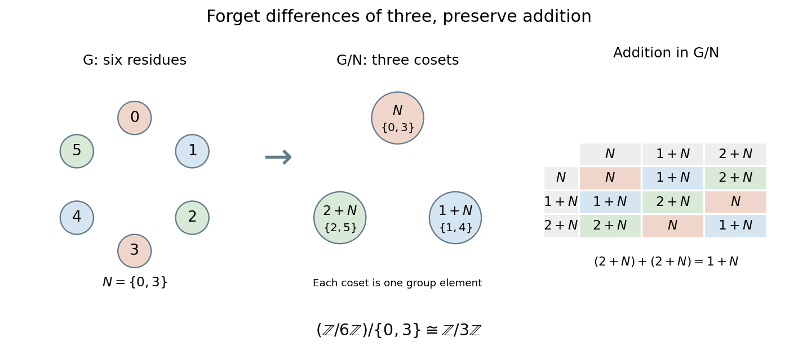

# Quotient group

↑ **Parent:** [Group theory](group-theory-split.md)  
ⓦ [Wiki](https://en.wikipedia.org/wiki/Quotient_group)

For a [group](group-split.md) $G$ and a [normal subgroup](normal-subgroup.md) $N$, the [quotient group](quotient-group.md) $G/N$ is the [set](set-split.md) of [cosets](coset.md) $gN$, with operation

$$
(gN)(hN)=(gh)N.
$$

Its [identity element](identity-element.md) is the [coset](coset.md) $N$, and the [inverse element](inverse-element.md) of $gN$ is $g^{-1}N$. A [quotient group](quotient-group.md) treats all elements within one [coset](coset.md) as the same input while retaining a consistent operation on the classes. The [normal subgroup](normal-subgroup.md) condition is what makes this operation independent of which representatives are chosen. [McKernan, MIT 18.703, Theorem 9.1: quotient-group construction](https://ocw.mit.edu/courses/18-703-modern-algebra-spring-2013/ecdbd211f736b3ac92379dea05b34491_MIT18_703S13_pra_l_9.pdf).

Take the additive [group](group-split.md) $G=\mathbb Z/6\mathbb Z$ and $N=\{0,3\}$. Since $G$ is an [abelian group](abelian-group.md), $N$ is a [normal subgroup](normal-subgroup.md). There are three elements in the [quotient group](quotient-group.md):

$$
N=\{0,3\},\qquad 1+N=\{1,4\},\qquad 2+N=\{2,5\}.
$$

Adding two copies of $2+N$ gives $4+N=1+N$; adding $1+N$ and $2+N$ gives $3+N=N$. Hence the [quotient group](quotient-group.md) has the addition table of $\mathbb Z/3\mathbb Z$. It does not select one representative and discard the others: its elements are the entire [cosets](coset.md).

**[Figure 17](#image-identifying-residues-differing-by-three-turns-a-six-element-cyclic-group-into-a-three-element-quotient-group). Identifying residues differing by three turns a six-element cyclic group into a three-element quotient group**.

This is useful whenever distinctions within a [normal subgroup](normal-subgroup.md) should be ignored. For example, the [sign of a permutation](sign-of-a-permutation.md) retains only even or odd parity of a [permutation](permutation.md) in $S_3$. Its [group kernel](kernel-of-a-group-homomorphism.md) is the [alternating group](alternating-group.md) $A_3$, and the [quotient group](quotient-group.md) $S_3/A_3$ has two elements. The [first isomorphism theorem](first-isomorphism-theorem.md) explains why a [group homomorphism](group-homomorphism.md)'s image is a [quotient group](quotient-group.md) of its domain.

**Table of contents**

- [Quotient map of groups](quotient-map-of-groups.md)
- [Coset multiplication is well-defined exactly for normal subgroups](coset-multiplication-is-well-defined-exactly-for-normal-subgroups.md)
- [Universal property of a quotient group](universal-property-of-a-quotient-group.md)
- [Subgroup correspondence for a surjective group homomorphism](subgroup-correspondence-for-a-surjective-group-homomorphism.md)
- [Finite quotient of a group](finite-quotient-of-a-group.md)
- [Abelian quotient](abelian-quotient.md)

## ↑ Ancestors (5)

1. [Group theory](group-theory-split.md)
2. [Algebra](algebra-split.md)
3. [Area of mathematics](area-of-mathematics.md)
4. [Mathematics](mathematics-split.md)
5. [Codex Wiki](split.md)

## ← Incoming links (70)

- [Abelian quotient](abelian-quotient.md)
- [Abelianization](abelianization.md)
- [Abelianization of the square symmetry group](abelianization-of-the-square-symmetry-group.md)
- [Absolute residue degree](absolute-residue-degree.md)
- [Annihilator of a subgroup of a finite abelian group](annihilator-of-a-subgroup-of-a-finite-abelian-group.md)
- [Cayley's theorem](cayley-s-theorem.md)
- [Center of a group](center-of-a-group.md)
- [Center quotient of the real Heisenberg group](center-quotient-of-the-real-heisenberg-group.md)
- [Centralizer and normalizer](centralizer-and-normalizer.md)
- [Commutator subgroup](commutator-subgroup.md)
- [Conjugate subgroup](conjugate-subgroup.md)
- [Coset](coset.md)
- [Fiber-counting lemma for a quotient map](fiber-counting-lemma-for-a-quotient-map.md)
- [First isomorphism theorem](first-isomorphism-theorem.md)
- [Inflation of a group representation](inflation-of-a-group-representation.md)
- [Isomorphism theorems](isomorphism-theorems.md)
- [Lagrange's theorem](lagrange-s-theorem.md)
- [Modular Heisenberg group](modular-heisenberg-group.md)
- [Nontrivial-quotient closure of two-involution groups](nontrivial-quotient-closure-of-two-involution-groups.md)
- [Normal subgroup](normal-subgroup.md)
- [Normalizer](normalizer.md)
- [Solution](past-exam-of-the-mathematics-course-of-the-university-of-cambridge/2001/iii/paper-2/4/iv/solution.md)
- [Solution](past-exam-of-the-mathematics-course-of-the-university-of-cambridge/2002/iii/paper-1/2/solution.md)
- [Solution](past-exam-of-the-mathematics-course-of-the-university-of-cambridge/2002/iii/paper-24/4/c/solution.md)
- [Solution](past-exam-of-the-mathematics-course-of-the-university-of-cambridge/2002/iii/paper-4/1/ii/solution.md)
- [Solution](past-exam-of-the-mathematics-course-of-the-university-of-cambridge/2003/iii/paper-4/3/solution.md)
- [Solution](past-exam-of-the-mathematics-course-of-the-university-of-cambridge/2004/ia/paper-3/1d/solution.md)
- [Solution](past-exam-of-the-mathematics-course-of-the-university-of-cambridge/2004/ia/paper-3/5d/iii/solution.md)
- [Solution](past-exam-of-the-mathematics-course-of-the-university-of-cambridge/2004/ib/paper-2/13f/solution.md)
- [Solution](past-exam-of-the-mathematics-course-of-the-university-of-cambridge/2004/iii/paper-2/2/solution.md)
- [Solution](past-exam-of-the-mathematics-course-of-the-university-of-cambridge/2006/ia/paper-3/6d/solution.md)
- [Solution](past-exam-of-the-mathematics-course-of-the-university-of-cambridge/2006/iii/paper-3/3/a/solution.md)
- [Solution](past-exam-of-the-mathematics-course-of-the-university-of-cambridge/2006/iii/paper-3/5/solution.md)
- [Solution](past-exam-of-the-mathematics-course-of-the-university-of-cambridge/2007/ia/paper-3/6d/i/solution.md)
- [Solution](past-exam-of-the-mathematics-course-of-the-university-of-cambridge/2007/ia/paper-3/6d/iii/solution.md)
- [Solution](past-exam-of-the-mathematics-course-of-the-university-of-cambridge/2007/ia/paper-3/6d/iv/solution.md)
- [Solution](past-exam-of-the-mathematics-course-of-the-university-of-cambridge/2007/ia/paper-3/6d/solution.md)
- [Solution](past-exam-of-the-mathematics-course-of-the-university-of-cambridge/2007/iii/paper-7/1/i/solution.md)
- [Solution](past-exam-of-the-mathematics-course-of-the-university-of-cambridge/2007/iii/paper-7/1/ii/solution.md)
- [Solution](past-exam-of-the-mathematics-course-of-the-university-of-cambridge/2008/ia/paper-3/5e/i/solution.md)
- [Solution](past-exam-of-the-mathematics-course-of-the-university-of-cambridge/2008/ia/paper-3/5e/solution.md)
- [Solution](past-exam-of-the-mathematics-course-of-the-university-of-cambridge/2009/iii/paper-1/1/a/solution.md)
- [Solution](past-exam-of-the-mathematics-course-of-the-university-of-cambridge/2010/iii/paper-26/2/ii/solution.md)
- [Solution](past-exam-of-the-mathematics-course-of-the-university-of-cambridge/2013/ia/paper-3/8d/solution.md)
- [Solution](past-exam-of-the-mathematics-course-of-the-university-of-cambridge/2013/iii/paper-3/1/b/solution.md)
- [Solution](past-exam-of-the-mathematics-course-of-the-university-of-cambridge/2014/ia/paper-3/8d/b/i/solution.md)
- [Solution](past-exam-of-the-mathematics-course-of-the-university-of-cambridge/2014/ia/paper-3/8d/b/ii/solution.md)
- [Solution](past-exam-of-the-mathematics-course-of-the-university-of-cambridge/2014/ia/paper-3/8d/b/iii/solution.md)
- [Solution](past-exam-of-the-mathematics-course-of-the-university-of-cambridge/2014/ib/paper-4/2e/solution.md)
- [Solution](past-exam-of-the-mathematics-course-of-the-university-of-cambridge/2015/ia/paper-3/1d/iii/solution.md)
- [Solution](past-exam-of-the-mathematics-course-of-the-university-of-cambridge/2015/ia/paper-3/8d/b/solution.md)
- [Solution](past-exam-of-the-mathematics-course-of-the-university-of-cambridge/2015/ia/paper-3/8d/c/solution.md)
- [Solution](past-exam-of-the-mathematics-course-of-the-university-of-cambridge/2016/ia/paper-3/1d/i/solution.md)
- [Solution](past-exam-of-the-mathematics-course-of-the-university-of-cambridge/2016/ia/paper-3/1d/ii/solution.md)
- [Solution](past-exam-of-the-mathematics-course-of-the-university-of-cambridge/2017/ia/paper-3/2e/solution.md)
- [Solution](past-exam-of-the-mathematics-course-of-the-university-of-cambridge/2017/ia/paper-3/5e/solution.md)
- [Solution](past-exam-of-the-mathematics-course-of-the-university-of-cambridge/2017/ib/paper-4/2e/solution.md)
- [Solution](past-exam-of-the-mathematics-course-of-the-university-of-cambridge/2017/iii/paper-137/5/b/solution.md)
- [Solution](past-exam-of-the-mathematics-course-of-the-university-of-cambridge/2018/ia/paper-3/7d/solution.md)
- [Solution](past-exam-of-the-mathematics-course-of-the-university-of-cambridge/2019/ii/paper-3/20f/a/solution.md)
- [Solution](past-exam-of-the-mathematics-course-of-the-university-of-cambridge/2022/ia/paper-3/7e/solution.md)
- [Solution](past-exam-of-the-mathematics-course-of-the-university-of-cambridge/2023/iii/paper-342/1/d/solution.md)
- [Solution](past-exam-of-the-mathematics-course-of-the-university-of-cambridge/2025/iii/paper-302/1/d/iii/solution.md)
- [Quotient group](quotient-group.md)
- [Relative chain complex](relative-chain-complex.md)
- [Subgroups and quotients of a cyclic group](subgroups-and-quotients-of-a-cyclic-group.md)
- [Torsion test using a deep formal logarithm subgroup](torsion-test-using-a-deep-formal-logarithm-subgroup.md)
- [Universal property of a quotient group](universal-property-of-a-quotient-group.md)
- [Universal property of abelianization](universal-property-of-abelianization.md)
- [Zassenhaus butterfly lemma](zassenhaus-butterfly-lemma.md)
