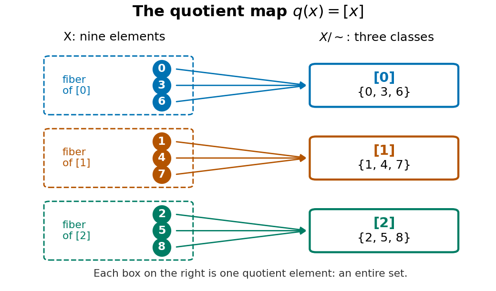

# Quotient set

↑ **Parent:** [Equivalence relation](equivalence-relation.md)  
ⓦ [Wiki](https://en.wikipedia.org/wiki/Quotient_set)

A quotient set packages each [equivalence class](equivalence-class.md) as a single new [set element](element-of-a-set.md). It remembers which class an original [set element](element-of-a-set.md) belongs to and forgets which member of that class it was. For an [equivalence relation](equivalence-relation.md) $\sim$ on a [set](set-split.md) $X$,

$$
X/{\sim}=\{[x]:x\in X\}.
$$

Each [set element](element-of-a-set.md) of the quotient set is itself a nonempty [subset](subset.md) of $X$. The [canonical projection of a quotient set](canonical-projection-of-a-quotient-set.md) sends an original [set element](element-of-a-set.md) to this entire [equivalence class](equivalence-class.md). [Patrick Brosnan, Undergraduate Algebra, §2.10, Definitions 2.78 and 2.80](https://www.math.umd.edu/~pbrosnan/notes/ugalg/sect0018.html)

For [integer congruence](integer-congruence.md) modulo three restricted to $X=\{0,1,\ldots,8\}$, the quotient set is

$$
X/{\sim}=\bigl\{\{0,3,6\},\{1,4,7\},\{2,5,8\}\bigr\}
=\{[0],[1],[2]\}.
$$

It has [cardinality](cardinality.md) three. The [set](set-split.md) $\{0,1,2\}$ is a choice of [equivalence class representatives](equivalence-class-representative.md), not literally this quotient set: $0$ is an [integer](integer-split.md), while $[0]=\{0,3,6\}$ is a [set](set-split.md). The [function](function-split.md) sending each chosen [equivalence class representative](equivalence-class-representative.md) to its [equivalence class](equivalence-class.md) is a [bijection](bijection.md) between these two different [sets](set-split.md).

**[Figure 2](#image-the-quotient-projection-sends-nine-elements-to-three-classes-with-each-class-appearing-as-one-fiber). The quotient projection sends nine elements to three classes, with each class appearing as one fiber**.

A quotient set alone specifies no arithmetic. To obtain the familiar [modular arithmetic](modular-arithmetic-split.md) example with [addition](addition.md), use [integer congruence](integer-congruence.md) on the whole [set](set-split.md) of [integers](integer-split.md). Its quotient set is $\mathbb Z/3\mathbb Z=\{[0]_3,[1]_3,[2]_3\}$, where $[a]_3=\{a+3k:k\in\mathbb Z\}$ is an infinite [residue class](residue-class.md). Define [addition](addition.md) by

$$
[a]_3+[b]_3=[a+b]_3.
$$

The answer must be independent of the [equivalence class representatives](equivalence-class-representative.md). If $a'=a+3k$ and $b'=b+3\ell$, then $a'+b'=a+b+3(k+\ell)$, so both sums have the same [residue class](residue-class.md). This is what it means for the [group operation](group-operation.md) to be well-defined. With this [addition](addition.md), the quotient set is a [cyclic group](cyclic-group.md), with identity $[0]_3$ and inverse $[-a]_3$ for $[a]_3$. [Karl-Dieter Crisman, Number Theory: In Context and Interactive, §4.3, Proposition 4.3.2: congruence arithmetic is well-defined](https://math-cs.gordon.edu/ntic/ntic2017/section-cong-props.html)

For example, $[2]_3+[2]_3=[4]_3=[1]_3$. Choosing $5$ and $-1$ as different [representatives of an equivalence class](equivalence-class-representative.md) for $[2]_3$ gives the same sum; choosing $8$ and $5$ gives $[13]_3=[1]_3$ again. These calculations use [residue classes](residue-class.md) of all [integers](integer-split.md). Raw [addition](addition.md) on the finite $X=\{0,\ldots,8\}$ does not stay in $X$: $8+8=16\notin X$. The formula for [addition](addition.md) on $\mathbb Z/3\mathbb Z$ therefore cannot be applied as a raw inherited operation on that finite example.

**Table of contents**

- [Canonical projection of a quotient set](canonical-projection-of-a-quotient-set.md)

## ↑ Ancestors (7)

1. [Equivalence relation](equivalence-relation.md)
2. [Binary relation](binary-relation.md)
3. [Set theory](set-theory-split.md)
4. [Foundations of mathematics](foundations-of-mathematics-split.md)
5. [Area of mathematics](area-of-mathematics.md)
6. [Mathematics](mathematics-split.md)
7. [Codex Wiki](split.md)

## ← Incoming links (7)

- [Canonical projection of a quotient set](canonical-projection-of-a-quotient-set.md)
- [Equivalence class representative](equivalence-class-representative.md)
- [Equivalence relation](equivalence-relation.md)
- [Fiber of a function](fiber-of-a-function.md)
- [Solution](past-exam-of-the-mathematics-course-of-the-university-of-cambridge/2021/iii/paper-220/1/b/solution.md)
- [Quotient topological space](quotient-topological-space.md)
- [Quotient topology](quotient-topology.md)
