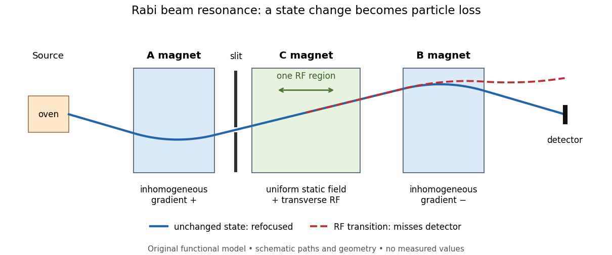

# Rabi molecular beam magnetic resonance experiment

↑ **Parent:** [Rabi cycle](rabi-cycle.md)

In 1938, [Isidor Isaac Rabi](isidor-isaac-rabi.md), [Jerrold Zacharias](jerrold-r-zacharias.md), [Sidney Millman](sidney-millman.md) and [Polykarp Kusch](polykarp-kusch.md) introduced molecular-beam magnetic resonance. Their 1939 account describes a heated oven, [vacuum](vacuum.md) slits, inhomogeneous A/B [magnetic fields](magnetic-field-split.md) with opposite [gradients](gradient.md), and a uniform static C [magnetic field](magnetic-field-split.md). Conductors supplied transverse oscillatory radiofrequency (RF) fields. Transitions spoiled refocusing, reducing the tungsten-filament detector signal. Alignment compared A-only and B-only attenuation; C-field sweeps at fixed RF [frequency](frequency.md) limited oscillator pickup. Matching frequency/field ratios across compounds checked nuclear assignments. [Magnetic field](magnetic-field-split.md) calibration limited absolute [magnetic moments](magnetic-dipole-moment.md); weak intervening fields caused unwanted transitions.[Rabi, Millman, Kusch and Zacharias, Physical Review 55 (1939), pp. 526–533; Figs. 1–5; Apparatus, Procedure and Results; p. 526 references to the 1938 reports](the-molecular-beam-resonance-method-for-measuring-nuclear-magnetic-moments-by-isidor-isaac-rabi-and-others.md)

**[Figure 13](#image-functional-beam-selector-unchanged-states-refocus-rf-transitions-cause-detector-loss). Functional beam selector: unchanged states refocus; RF transitions cause detector loss**. Original functional diagram of the [Rabi molecular beam magnetic resonance experiment](rabi-molecular-beam-magnetic-resonance-experiment.md); paths are schematic and not to scale.

The readout has a useful logical structure: A and the apertures admit trajectories correlated with a [magnetic moment](magnetic-dipole-moment.md) projection; B tests whether that projection has survived C. The two deflectors compensate for unchanged states, whereas a changed projection experiences a different force in B. A dip followed by recovery as the static [magnetic field](magnetic-field-split.md) passes through resonance is therefore a population-sensitive signal. A comparison with RF absent or far from resonance is the natural baseline in this functional model; RF pickup, drift or background loss must not be mistaken for a state transition. A dip alone does not establish a pure initial [quantum state](quantum-state.md) or resolve an entire time-domain [Rabi cycle](rabi-cycle.md).

This beam method measures transmitted particles after state-dependent deflection. The later bulk [nuclear magnetic resonance](nuclear-magnetic-resonance-split.md) methods of [Felix Bloch](felix-bloch.md) and [Edward Mills Purcell](edward-mills-purcell.md) instead use a macroscopic sample and detect nuclear induction or RF absorption; [NMR spectroscopy](nuclear-magnetic-resonance-split.md) builds on that bulk setting. The common resonant coupling does not make their preparations or readouts interchangeable.[Physics Department, Our History, The Middle 1930s through the 1960s, paragraphs on nuclear induction in condensed matter and spectroscopy](our-history-by-stanford-university-physics-department.md)[Harvard’s Nobel Laureates in Physics, Edward M. Purcell section, nuclear magnetic resonance absorption](harvard%E2%80%99s-nobel-laureates-in-physics-by-harvard-university.md)

**Table of contents**

- [Rabi transit-time and field averaging](rabi-transit-time-and-field-averaging.md)

## ↑ Ancestors (10)

1. [Rabi cycle](rabi-cycle.md)
2. [Unitary time evolution](unitary-time-evolution.md)
3. [Hamiltonian (quantum mechanics)](hamiltonian-quantum-mechanics.md)
4. [Observable](observable.md)
5. [Quantum state](quantum-state.md)
6. [Quantum system](quantum-system-split.md)
7. [Quantum mechanics](quantum-mechanics-split.md)
8. [Branches of physics](branches-of-physics.md)
9. [Physics](physics-split.md)
10. [Codex Wiki](split.md)

## ← Incoming links (4)

- [Kusch-Foley magnetic moment experiment](kusch-foley-magnetic-moment-experiment.md)
- [Nuclear magnetic resonance](nuclear-magnetic-resonance-split.md)
- [Rabi molecular beam magnetic resonance experiment](rabi-molecular-beam-magnetic-resonance-experiment.md)
- [Ramsey separated oscillatory fields experiment](ramsey-separated-oscillatory-fields-experiment.md)
