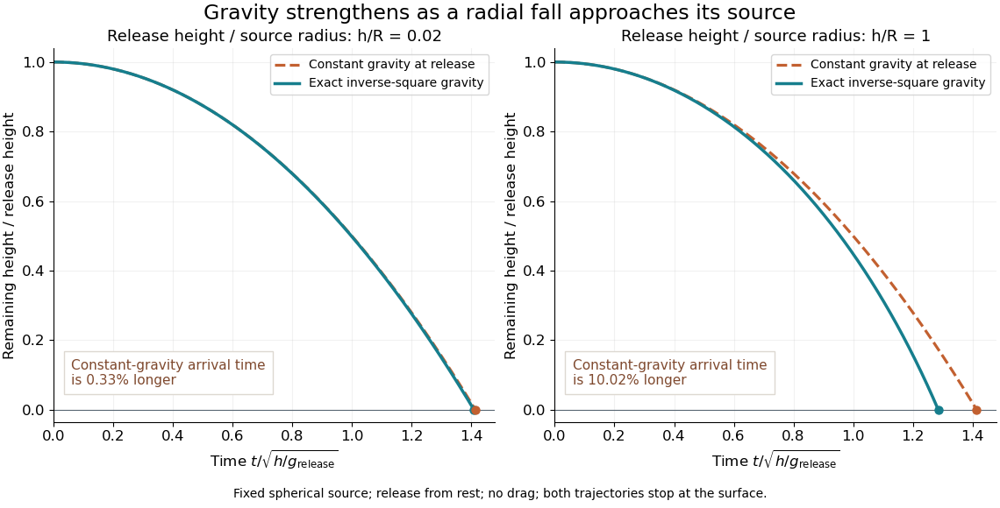

# Radial free fall from rest

↑ **Parent:** [Free fall](free-fall.md)

Let a [test particle](test-particle.md) start at rest at radius $r_0$ outside a fixed spherically symmetric source. The [spherical shell theorem](spherical-shell-theorem.md) gives the exterior [Newtonian gravitational potential](newtonian-gravitational-potential.md) $\Phi(r)=-\mu/r$, where $\mu=GM$ is the source's [standard gravitational parameter](standard-gravitational-parameter.md). Zero initial transverse [velocity](velocity.md) makes the motion radial. [Conservation of mechanical energy](conservation-of-mechanical-energy.md) per unit [mass](mass.md) gives

$$
\frac{\dot r^2}{2}-\frac{\mu}{r}=-\frac{\mu}{r_0},\qquad
\dot r=-\sqrt{2\mu\left(\frac1r-\frac1{r_0}\right)}.
$$

The minus sign selects inward motion; the positive square root is its [speed](speed.md). For a fall from $r_0=2R$ to the surface $r=R$, that [speed](speed.md) is $\sqrt{\mu/R}$. In the limit of release from rest infinitely far away, the familiar [free-fall speed](free-fall-speed.md) is $\sqrt{2\mu/r}$, equal in magnitude to the local [escape velocity](escape-velocity.md). A finite starting radius gives a smaller speed.

The arrival time follows from the same first integral. Set $r=r_0\cos^2\eta$. Then

$$
t(\eta)=\sqrt{\frac{r_0^3}{2\mu}}\left(\eta+\sin\eta\cos\eta\right),\qquad
\eta=\arccos\sqrt{\frac r{r_0}},\qquad 0\leq\eta<\frac\pi2.
$$

For arrival at $R>0$ this is finite, and the field formula is used only outside the source. For $r_0=2R$, $\eta=\pi/4$ gives

$$
t_{\mathrm{arrival}}=\left(1+\frac\pi2\right)\sqrt{\frac{R^3}{\mu}}\approx2.570796\sqrt{\frac{R^3}{\mu}}.
$$

Keeping the smaller initial gravitational magnitude $g(r_0)=\mu/(4R^2)$ constant would predict $\sqrt8\,\sqrt{R^3/\mu}$, about $10.0\%$ longer. The actual [acceleration](acceleration.md) increases during the fall.

**[Figure 1](#image-radial-free-fall-height-and-arrival-time-compared-with-constant-gravity-at-the-release-point). Radial free-fall height and arrival time compared with constant gravity at the release point**.

The curves compare a shallow fall, $h/R=0.02$, with a fall from $r_0=2R$, so $h/R=1$. Each comparison holds the release height and initial gravitational magnitude fixed. The constant-gravity model is close for the shallow fall and increasingly inaccurate for the larger one. This is also a practical use of [nondimensionalization](nondimensionalization.md): the normalized trajectories depend on $h/R$, while $\sqrt{R^3/\mu}$ supplies the dimensional time scale.

## ↑ Ancestors (6)

1. [Free fall](free-fall.md)
2. [Newton's law of universal gravitation](newton-s-law-of-universal-gravitation-split.md)
3. [Classical mechanics](classical-mechanics-split.md)
4. [Branches of physics](branches-of-physics.md)
5. [Physics](physics-split.md)
6. [Codex Wiki](split.md)

## ← Incoming links (2)

- [Free fall](free-fall.md)
- [Standard gravitational parameter](standard-gravitational-parameter.md)
