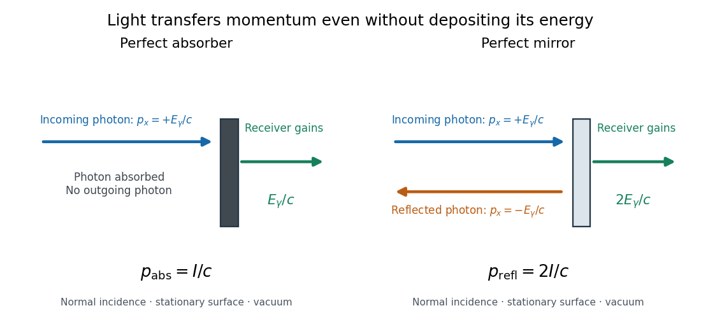

# Radiation pressure of a directed beam

↑ **Parent:** [Radiation pressure](radiation-pressure.md)

For normal incidence in [vacuum](vacuum.md), a uniform beam delivers [energy](energy-split.md) $IA\,\Delta t$ to an illuminated [surface area](surface-area.md) $A$ during time $\Delta t$. A perfect absorber receives [momentum](momentum-split.md) $IA\,\Delta t/c$, so [force](force-split.md) divided by [surface area](surface-area.md) gives $p_{\rm abs}=I/c$. A perfect stationary mirror sends the [photons](photon.md) back with reversed [momentum](momentum-split.md), so [momentum conservation](momentum-conservation.md) gives twice the normal transfer, $p_{\rm refl}=2I/c$. These are time-averaged [pressures](pressure-split.md); the microscopic arrivals need not be uniform.

**[Figure 1](#image-photon-momentum-transfer-to-an-absorber-and-a-mirror). Photon momentum transfer to an absorber and a mirror**. Original idealized normal-incidence diagram. Blue arrows show the incoming [photon](photon.md) [momentum](momentum-split.md); orange shows the reflected [photon](photon.md) [momentum](momentum-split.md). The green arrow is the [momentum](momentum-split.md) delivered to the receiver, not another outgoing [photon](photon.md). The mirror reverses the incoming [momentum](momentum-split.md) and therefore receives twice as much.

For a stipulated model [light intensity](light-intensity.md) $I=1000\,\mathrm{W\,m^{-2}}$ and the exact [SI](international-system-of-units.md) [speed of light](speed-of-light.md) $c=299792458\,\mathrm{m\,s^{-1}}$,

$$
p_{\rm abs}=3.335640952\times10^{-6}\,\mathrm{Pa}\simeq3.3356\,\mu\mathrm{Pa},\qquad
p_{\rm refl}=6.671281904\times10^{-6}\,\mathrm{Pa}\simeq6.6713\,\mu\mathrm{Pa}.
$$

These are computed predictions, not measured data or a universal sunlight value. If the beam fully covers a normally oriented [surface area](surface-area.md) $A=0.010\,\mathrm{m^2}$, the intercepted [radiant flux](radiant-flux.md) is $\Phi=IA=10\,\mathrm W$ and the absorber's [force](force-split.md) is $\Phi/c\simeq33.356\,\mathrm{nN}$. Using the total source [power](power.md) would be wrong if only part of its beam reaches the receiver. The absorption prediction assumes complete [photon absorption](photon-absorption.md), while the reflection prediction assumes complete [specular reflection](specular-reflection.md); transmission, [scattering of light](scattering-of-light.md) and directed thermal [photon emission](photon-emission.md) require their own outgoing [momentum](momentum-split.md) accounting.

Measure the [angle of incidence](angle-of-incidence.md) $\theta$ between the incoming path and the surface's normal line, with $0\leq\theta<\pi/2$. There are two separate [cosine](cosine.md) factors. A fixed actual [surface area](surface-area.md) $A$ intercepts only its [projected area](projected-area.md) $A\cos\theta$, so $\Phi=IA\cos\theta$. Each incoming [photon](photon.md) supplies normal [momentum](momentum-split.md) $(E_\gamma/c)\cos\theta$ on absorption, or twice that on [specular reflection](specular-reflection.md). Thus, for [radiometric absorptance](radiometric-absorptance.md) $a$ and reflected [power](power.md) fraction $R$,

$$
F_\perp=(a+2R)\frac{\Phi}{c}\cos\theta,\qquad
p_\perp=\frac{F_\perp}{A}=(a+2R)\frac{I}{c}\cos^2\theta.
$$

This model assumes transmitted [light](light.md) continues straight in the same medium and carries away its original [momentum](momentum-split.md). It omits thermal recoil and assumes a stationary receiver. At $\theta=60^\circ$, fixed beam [light intensity](light-intensity.md) therefore gives one quarter of the normal-incidence [pressure](pressure-split.md). For fixed intercepted [radiant flux](radiant-flux.md) $\Phi$, however, the normal [force](force-split.md) has only one [cosine](cosine.md) factor. Equivalently, if the given quantity is receiving-surface [irradiance](irradiance.md) $E_{\rm inc}=I\cos\theta$, then $p_\perp=(a+2R)E_{\rm inc}\cos\theta/c$. The distinction matters when interpreting an experiment's angle scan. [Williams and collaborators, Use of radiation pressure for measurement of high-power laser emission, equation (1): force expressed using intercepted optical power and the incidence-angle cosine](use-of-radiation-pressure-for-measurement-of-high-power-laser-emission-by-paul-a-williams-and-others.md)

Absorption also transfers a tangential [momentum](momentum-split.md) component at oblique incidence. It contributes a tangential [force](force-split.md), rather than normal [pressure](pressure-split.md). Ideal [specular reflection](specular-reflection.md) preserves the tangential [momentum](momentum-split.md) component, so it transfers only normal [momentum](momentum-split.md).

## ↑ Ancestors (7)

1. [Radiation pressure](radiation-pressure.md)
2. [Pressure](pressure-split.md)
3. [Thermodynamics](thermodynamics-split.md)
4. [Statistical physics](statistical-physics-split.md)
5. [Branches of physics](branches-of-physics.md)
6. [Physics](physics-split.md)
7. [Codex Wiki](split.md)
