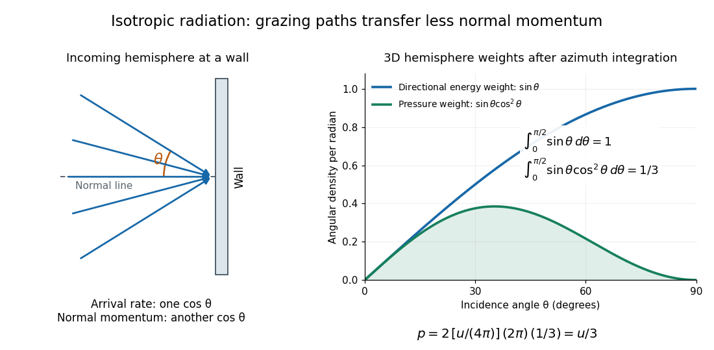

# Radiation pressure of an isotropic photon gas

↑ **Parent:** [Radiation pressure](radiation-pressure.md)

For radiation in [vacuum](vacuum.md) with [isotropy](isotropy.md), [energy](energy-split.md) is distributed equally per [solid angle](solid-angle.md): write $u_\Omega=u/(4\pi)$ for [energy density](energy-density.md) per unit [solid angle](solid-angle.md). Let $\theta$ be the [angle](angle.md) between a ray's path and the wall normal. Its normal [velocity](velocity.md) $c\cos\theta$ determines the arrival rate, while normal [momentum](momentum-split.md) per [energy](energy-split.md) is $\cos\theta/c$. Their product is $\cos^2\theta$. For a perfectly reflecting cavity wall,

$$
p_{\rm rad}=2\int_{\rm incoming\ hemisphere}u_\Omega\cos^2\theta\,d\Omega
=\frac{2u}{4\pi}\int_0^{2\pi}d\varphi\int_0^{\pi/2}\cos^2\theta\sin\theta\,d\theta
=\frac u3.
$$

The leading two is the normal [momentum](momentum-split.md) reversal; the incoming [hemisphere](hemisphere.md) contains half of the field's directional [energy density](energy-density.md). This is also the normal component of the bulk [pressure tensor](pressure-tensor.md), $P_{nn}=\int_{4\pi}u_\Omega\cos^2\theta\,d\Omega=u/3$. [Isotropy](isotropy.md) makes all three diagonal components equal, while their sum is $u$ because the squared direction components sum to one. The factor one third therefore depends on three-dimensional angular geometry, not on the shape of the [blackbody radiation](black-body-radiation.md) spectrum.

**[Figure 2](#image-isotropic-radiation-angular-energy-weights-and-normal-momentum-flux). Isotropic radiation: angular energy weights and normal momentum flux**. Original angular model of a reflecting cavity wall. The left panel shows representative incoming paths, not a literal two-dimensional [photon gas](photon-gas.md). The right panel uses the correct three-dimensional [solid angle](solid-angle.md) weight, normalized on an incoming [hemisphere](hemisphere.md): $\sin\theta$. The normal [pressure](pressure-split.md) contribution adds $\cos^2\theta$, giving total weight $\int_0^{\pi/2}\sin\theta\cos^2\theta\,d\theta=1/3$.

A perfectly absorbing wall exposed to this incoming [hemisphere](hemisphere.md) receives only $u/6$ from absorption. If it is in [thermal equilibrium](thermal-equilibrium-split.md) with the [isotropic](isotropy.md) radiation, its outgoing emission supplies another $u/6$ of recoil, recovering $u/3$. A cold absorber before equilibrium is a different boundary condition. Similarly, the one-way incident [energy flux](energy-flux.md) is $cu/4$, whereas the net [energy flux](energy-flux.md) across a plane in the undisturbed [isotropic](isotropy.md) field is zero. Dividing $cu/4$ by $c$ misses the extra normal-[momentum](momentum-split.md) projection and does not give the cavity [pressure](pressure-split.md).

For a stipulated isotropic radiation [energy density](energy-density.md) $u=6\,\mu\mathrm{J\,m^{-3}}$, the bulk [pressure](pressure-split.md) is $2\,\mu\mathrm{Pa}$ regardless of its spectral shape. In [thermal equilibrium](thermal-equilibrium-split.md), [blackbody radiation](black-body-radiation.md) supplies $u=a_{\rm rad}T^4$ with [radiation constant](radiation-constant.md) $a_{\rm rad}=4\sigma/c$, so $p_{\rm rad}=a_{\rm rad}T^4/3$; [Stefan–Boltzmann law](stefan-boltzmann-law.md) defines $\sigma$. The equilibrium [photon gas](photon-gas.md) derives this same [equation of state](equation-of-state.md) from its [free energy](thermodynamic-free-energy.md).[§3.2, pressure immediately after the photon free-energy formula: $p=E/(3V)$](statistical-physics-by-david-tong/3-quantum-gases.md)

## ↑ Ancestors (7)

1. [Radiation pressure](radiation-pressure.md)
2. [Pressure](pressure-split.md)
3. [Thermodynamics](thermodynamics-split.md)
4. [Statistical physics](statistical-physics-split.md)
5. [Branches of physics](branches-of-physics.md)
6. [Physics](physics-split.md)
7. [Codex Wiki](split.md)
