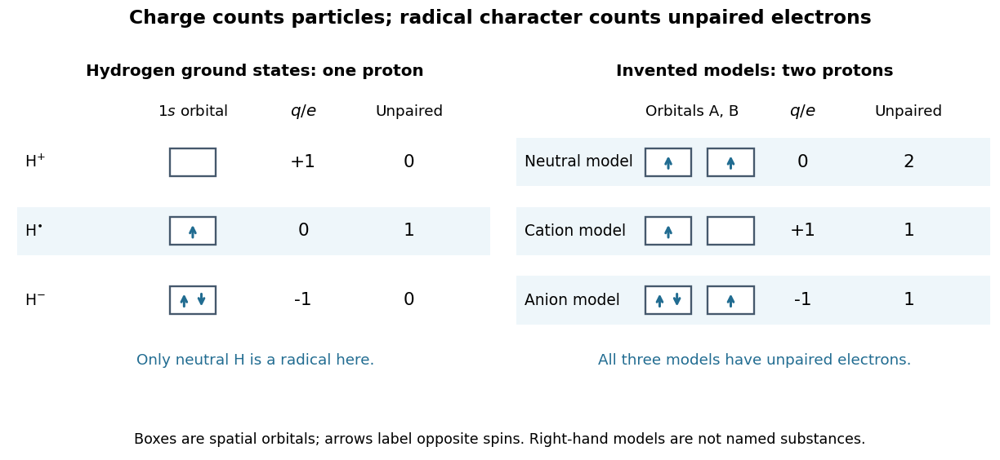

# Radical (chemistry)

↑ **Parent:** [Chemistry](chemistry-split.md)  
ⓦ [Wiki](https://en.wikipedia.org/wiki/Radical_(chemistry))

A [radical](radical-chemistry.md) has one or more unpaired [electrons](electron.md). In a simple [atomic orbital](atomic-orbital.md) or [molecular orbital](molecular-orbital.md) occupancy picture, an unpaired [electron](electron.md) occupies a spatial orbital without an opposite-[spin](spin.md) partner in that orbital. A dot such as $\mathrm H^{\bullet}$ marks this electronic property; it does not mean a missing [electron](electron.md) or positive [electric charge](electric-charge-split.md). [Free radicals](radical-chemistry.md) can be neutral or charged. Terminology also has a boundary: metal [ions](ion.md) exhibiting [paramagnetism](paramagnetism.md) are not normally called [free radicals](radical-chemistry.md) just because they have unpaired [electrons](electron.md).[Glossary of Terms Used in Physical Organic Chemistry, IUPAC Recommendations 1994: radical (or free radical), opening definition and metal-ion qualification](glossary-of-terms-used-in-physical-organic-chemistry-iupac-recommendations-1994-r-entries-by-international-union-of-pure-and-applied-chemistry.md)

Compare three species containing the same single [proton](proton.md). The [hydrogen atom](hydrogen-atom.md) $\mathrm H^{\bullet}$ has one [electron](electron.md) in its $1s$ [atomic orbital](atomic-orbital.md), and is a neutral [radical](radical-chemistry.md). The [hydrogen](hydrogen.md) [cation](cation.md) $\mathrm H^+$ has no [electrons](electron.md), so no unpaired [electron](electron.md). The [hydrogen anion](hydrogen-anion.md) $\mathrm H^-$ has two [electrons](electron.md) paired in its $1s$ [atomic orbital](atomic-orbital.md). It is charged but is not a [radical](radical-chemistry.md) in its [ground state](ground-state.md). With $N_p$ [protons](proton.md), $N_e$ [electrons](electron.md), and positive [elementary charge](elementary-charge.md) $e$, the independent [electric charge](electric-charge-split.md) count is

$$
q=(N_p-N_e)e;\qquad
\mathrm H^+:q=+e,\quad \mathrm H^{\bullet}:q=0,\quad \mathrm H^-:q=-e.
$$

The [electron pair](electron-pair.md) and [electric charge](electric-charge-split.md) questions require different information. An odd $N_e$ ensures that not all [electrons](electron.md) can be paired; an even $N_e$ alone does not ensure pairing, as the [molecular orbital](molecular-orbital.md) description of [molecular oxygen](molecular-oxygen.md) illustrates.

**[Figure 1](#image-radical-charge-and-orbital-occupancy). Electric charge and unpaired electrons are different properties**. Left: actual [ground state](ground-state.md) $1s$ occupancies of $\mathrm H^+$, $\mathrm H^{\bullet}$, and $\mathrm H^-$. Right: stipulated two-orbital models with fixed $N_p=2$ illustrate neutral, positive, and negative [free radicals](radical-chemistry.md); those boxes are not assignments for particular [chemical substances](chemical-substance-split.md). Arrows label [spin](spin.md) occupancy, not particle trajectories.

The distinction matters whenever a [chemical reaction](chemical-reaction-split.md) mechanism uses dots and charge signs together. [Homolysis](homolysis.md) gives one bonding [electron](electron.md) to each fragment, while [heterolysis](heterolysis.md) assigns both to one fragment. A [radical chain reaction](radical-chain-reaction.md) can pass an unpaired [electron](electron.md) from one species to another without generating net [electric charge](electric-charge-split.md). Detection then exploits the unpaired [electron](electron.md)'s [spin](spin.md) and [magnetic moment](magnetic-dipole-moment.md), rather than merely measuring whether the sample carries an [electric charge](electric-charge-split.md).

**Table of contents**

- [Peroxyl radical](peroxyl-radical.md)
- [Chlorine monoxide](chlorine-monoxide.md)
  - [ClOOCl dimer](cloocl-dimer.md)
- [Nitrate radical](nitrate-radical.md)
- [Alkoxy radical](alkoxy-radical.md)
- [Peroxy radical](peroxy-radical.md)
- [Hydroperoxyl radical](hydroperoxyl-radical.md)
- [Hydroxyl radical](hydroxyl-radical.md)
- [Imidogen](imidogen.md)
- [Methylidyne](methylidyne.md)
- [Methyl radical](methyl-radical.md)
- [Radical ion](radical-ion.md)
  - [Radical cation](radical-cation.md)
  - [Radical anion](radical-anion.md)
- [Radical chain reaction](radical-chain-reaction.md)
  - [Radical termination](radical-termination.md)
  - [Radical chain termination](radical-chain-termination.md)
  - [Radical chain propagation](radical-chain-propagation.md)
  - [Radical chain initiation](radical-chain-initiation.md)
  - [Hydrogen–chlorine chain reaction](hydrogen-chlorine-chain-reaction.md)
  - [Methane chlorination chain](methane-chlorination-chain.md)
- [Stable radical](stable-radical.md)
  - [2,2-Diphenyl-1-picrylhydrazyl](2-2-diphenyl-1-picrylhydrazyl.md)
    - [DPPH electron spin resonance experiment](dpph-electron-spin-resonance-experiment.md)

## ↑ Ancestors (2)

1. [Chemistry](chemistry-split.md)
2. [Codex Wiki](split.md)

## ← Incoming links (11)

- [2,2-Diphenyl-1-picrylhydrazyl](2-2-diphenyl-1-picrylhydrazyl.md)
- [Chlorine monoxide](chlorine-monoxide.md)
- [DPPH electron spin resonance experiment](dpph-electron-spin-resonance-experiment.md)
- [Homolysis](homolysis.md)
- [Methane chlorination chain](methane-chlorination-chain.md)
- [Methyl radical](methyl-radical.md)
- [Solution](past-exam-of-the-chemistry-b-course-of-the-university-of-cambridge/2022/paper-1/b1/a/iii/solution.md)
- [Radical chain reaction](radical-chain-reaction.md)
- [Radical (chemistry)](radical-chemistry.md)
- [Radical ion](radical-ion.md)
- [Stable radical](stable-radical.md)
