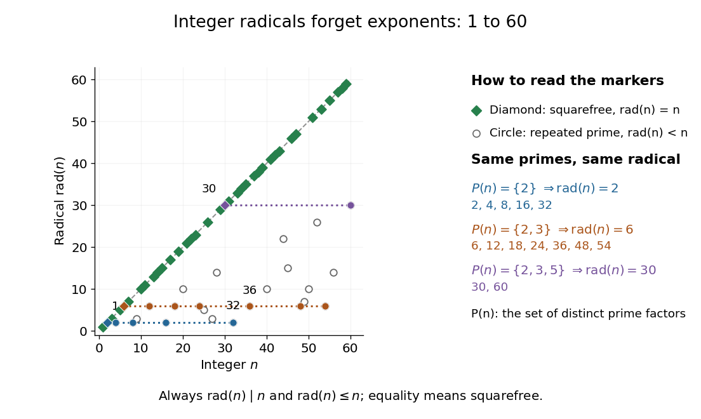

# Radical of an integer

↑ **Parent:** [Arithmetic function](arithmetic-function-split.md)  
ⓦ [Wiki](https://en.wikipedia.org/wiki/Radical_of_an_integer)

The [radical of an integer](radical-of-an-integer.md) $n>0$ is the [product](product-of-numbers.md) of its distinct [prime factors](prime-factor.md), each included exactly once. If the [prime factorization](fundamental-theorem-of-arithmetic.md) is $n=p_1^{a_1}\cdots p_r^{a_r}$ with distinct [prime numbers](prime-number-split.md) $p_i$ and positive [integer](integer-split.md) exponents $a_i$, then

$$
\operatorname{rad}(n)=p_1\cdots p_r=\prod_{p\mid n}p.
$$

Thus the [radical of an integer](radical-of-an-integer.md) remembers which [prime factors](prime-factor.md) occur and forgets their [prime valuations](prime-valuation.md). At $n=1$, the [empty product](empty-product.md) gives $\operatorname{rad}(1)=1$. The [domain of a function](domain-of-a-function.md) here is the [positive integers](positive-integer.md); zero is excluded. [Jan-Hendrik Evertse, Diophantine approximation, Homework IV, Exercise 20: definition of the integer radical](https://pub.math.leidenuniv.nl/~evertsejh/dio12-ex4.pdf)

For example, $72=2^3\cdot3^2$ has distinct [prime factors](prime-factor.md) $2,3$, so $\operatorname{rad}(72)=2\cdot3=6$. Similarly,

$$
\operatorname{rad}(30)=30,\qquad
\operatorname{rad}(32)=2,\qquad
\operatorname{rad}(36)=6,
$$

using the [prime factorizations](fundamental-theorem-of-arithmetic.md) $30=2\cdot3\cdot5$, $32=2^5$ and $36=2^2\cdot3^2$. The [prime omega function](prime-omega-function.md) counts the retained [prime factors](prime-factor.md), while the [total number of prime factors](total-number-of-prime-factors.md) counts their occurrences before repetitions are removed.

The [radical of an integer](radical-of-an-integer.md) is its largest [squarefree divisor](squarefree-divisor.md). Indeed, a [squarefree divisor](squarefree-divisor.md) chooses at most one copy of each [prime factor](prime-factor.md), so it divides $\operatorname{rad}(n)$; the [radical of an integer](radical-of-an-integer.md) itself is a [squarefree divisor](squarefree-divisor.md). Consequently,

$$
\operatorname{rad}(n)\mid n,\qquad
\operatorname{rad}(n)\le n,\qquad
\operatorname{rad}(n)=n\ \Longleftrightarrow\ n\text{ is squarefree}.
$$

The last statement follows because every nonzero [prime valuation](prime-valuation.md) is then one. It includes $n=1$, a [squarefree integer](square-free-integer.md). Applying the [radical of an integer](radical-of-an-integer.md) twice also changes nothing: $\operatorname{rad}(\operatorname{rad}(n))=\operatorname{rad}(n)$.

**[Figure 1](#image-the-radical-of-an-integer-for-1-le-n-le60-squarefree-integers-lie-on-the-diagonal-and-horizontal-families-share-their-prime-support-of-an-integer). The radical of an integer for $1\le n\le60$: squarefree integers lie on the diagonal, and horizontal families share their prime support of an integer**.

For any [positive integers](positive-integer.md) $a,b$, the exact [product](product-of-numbers.md) rule is

$$
\operatorname{rad}(ab)=\frac{\operatorname{rad}(a)\operatorname{rad}(b)}{\operatorname{rad}(\gcd(a,b))}.
$$

To prove it, a [prime factor](prime-factor.md) dividing just one input occurs once in the numerator and not in the denominator. A [prime factor](prime-factor.md) dividing both occurs twice in the numerator and once in the denominator, since it divides their [greatest common divisor](greatest-common-divisor.md). Each [prime factor](prime-factor.md) of $ab$ therefore remains exactly once. For [coprime integers](coprime-integers.md), the denominator is $\operatorname{rad}(1)=1$, proving the [radical of an integer](radical-of-an-integer.md) is a [multiplicative function](multiplicative-function.md). It is not a [completely multiplicative function](completely-multiplicative-function.md): $\operatorname{rad}(4)=2\ne4=\operatorname{rad}(2)^2$.

For a worked example with shared [prime factors](prime-factor.md), take $a=12$ and $b=18$. Their [greatest common divisor](greatest-common-divisor.md) is $6$, and $ab=216=2^3\cdot3^3$, so

$$
\operatorname{rad}(216)=\frac{6\cdot6}{6}=6.
$$

This explains why [prime support of an integer](prime-support-of-an-integer.md) is useful: questions about the presence of [prime factors](prime-factor.md) can discard their multiplicities. For example, the [squarefree divisors](squarefree-divisor.md) of $72$ are exactly the [integer divisors](divisor.md) of $\operatorname{rad}(72)=6$, namely $1,2,3,6$. Also $\gcd(m,n)=1$ if and only if $\gcd(m,\operatorname{rad}(n))=1$, because [coprimality](coprime-integers.md) depends only on shared [prime factors](prime-factor.md).

A further characterization uses mutual [divisibility](divisibility-split.md) of powers: for [positive integers](positive-integer.md) $a,b$,

$$
\operatorname{rad}(a)=\operatorname{rad}(b)
\quad\Longleftrightarrow\quad
\text{there exist }k,\ell\ge1\text{ with }a\mid b^k\text{ and }b\mid a^\ell.
$$

If their [prime supports of an integer](prime-support-of-an-integer.md) agree, sufficiently large $k,\ell$ make all the required [prime valuations](prime-valuation.md) large enough. Conversely, these two [divisibility](divisibility-split.md) relations force each [prime factor](prime-factor.md) of either input to divide the other. For $72$ and $36$, one can take $k=2$ and $\ell=1$: $72\mid36^2$ and $36\mid72$.

**Table of contents**

- [Prime support of an integer](prime-support-of-an-integer.md)

## ↑ Ancestors (5)

1. [Arithmetic function](arithmetic-function-split.md)
2. [Number theory](number-theory-split.md)
3. [Area of mathematics](area-of-mathematics.md)
4. [Mathematics](mathematics-split.md)
5. [Codex Wiki](split.md)

## ← Incoming links (11)

- [Abc-hit](abc-hit.md)
- [Coprime integers](coprime-integers.md)
- [Solution](past-exam-of-the-mathematics-course-of-the-university-of-cambridge/2015/ia/paper-4/5e/ii/solution.md)
- [Prime omega function](prime-omega-function.md)
- [Prime-support equivalence relation](prime-support-equivalence-relation.md)
- [Prime support of an integer](prime-support-of-an-integer.md)
- [Radical of an integer](radical-of-an-integer.md)
- [Square-free integer](square-free-integer.md)
- [Squarefree part](squarefree-part.md)
- [Three to the distinct-prime-factor count](three-to-the-distinct-prime-factor-count.md)
- [Total number of prime factors](total-number-of-prime-factors.md)
