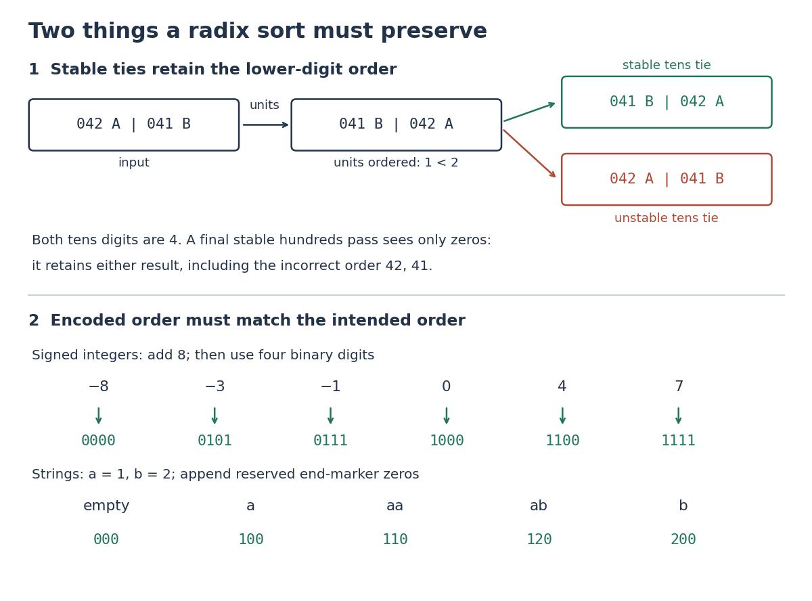

# Radix sort key encoding

↑ **Parent:** [Radix sort](radix-sort.md)

An encoding for [radix sort](radix-sort.md) must make the intended [total order](total-order.md) of [sort keys](sort-key.md) agree with the [lexicographic order](lexicographic-order.md) of its fixed-width [numerical digit](numerical-digit.md) [tuples](finite-tuple.md). The [positional notation](positional-notation.md) for bounded nonnegative [integers](integer-split.md) has this property. At the most significant differing position $m$, a one-unit [numerical digit](numerical-digit.md) difference contributes $R^m$, while all lower positions together contribute at most

$$
(R-1)\sum_{j=0}^{m-1}R^j=R^m-1.
$$

This [geometric series](geometric-series.md) shows why lower [numerical digits](numerical-digit.md) cannot reverse that comparison. Leading zero padding works here because it preserves [place values](place-value.md) and the represented [integer](integer-split.md).

For signed [integers](integer-split.md) in a known [integer interval](integer-interval.md) $L\le x\le U$, encode $e(x)=x-L$ and choose $d$ with $U-L<R^d$. This [order-preserving function](order-preserving-function.md) is also [injective](injective-function.md): $x<y$ exactly when $e(x)<e(y)$. For $-8\le x\le7$, the four-[bit](bit.md) encodings of $-8,-3,-1,0,4,7$ are $0000,0101,0111,1000,1100,1111$ after adding eight. Restore the original signed [sort keys](sort-key.md) when displaying the complete [sorting records](sorting-record.md); the encoding need not replace their data. Sorting the unsigned values of raw [two's complement](two-s-complement.md) [bit](bit.md) patterns would put nonnegative [integers](integer-split.md) before negative ones, so their representation alone is not this ordered encoding.

For variable-length [strings](string.md), first specify the [alphabet](alphabet.md) order and whether a proper prefix precedes its extensions. As an original construction, use $a<b$, let every [string](string.md) have length at most three, encode $a$ as one and $b$ as two, and append zeros to width three. Zero is reserved for an end marker strictly below every real symbol. The [strings](string.md) $\varepsilon,a,aa,ab,b$ encode as $000,100,110,120,200$ in [radix](radix.md) three, which preserves their [lexicographic order](lexicographic-order.md). A differing real symbol decides the comparison; at a prefix boundary, the shorter [string](string.md)'s zero comes before the extension's one or two. Left padding would instead encode $b$ as $002$ and $aa$ as $011$, reversing $aa<b$. Padding raw [bytes](byte.md) with zero also fails if zero is an allowed data symbol: distinct [strings](string.md) can then receive the same encoding. A reserved end marker and an explicit symbol ordering are essential; byte order alone does not establish a desired human text order.

**[Figure 23](#image-stable-ties-preserve-lower-digits-suitable-encodings-preserve-the-intended-order). Stable ties preserve lower digits; suitable encodings preserve the intended order**. Original counterexample above: reversing a tens tie destroys the units order and a later stable hundreds pass cannot repair it. Below: signed [integer](integer-split.md) offsets and a reserved end marker for bounded [strings](string.md) produce increasing fixed-width encodings. All entries are exact constructed examples.

## ↑ Ancestors (5)

1. [Radix sort](radix-sort.md)
2. [Sorting algorithm](sorting-algorithm.md)
3. [Algorithm](algorithm-split.md)
4. [Computer science](computer-science-split.md)
5. [Codex Wiki](split.md)

## ← Incoming links (1)

- [Lexicographic order](lexicographic-order.md)
