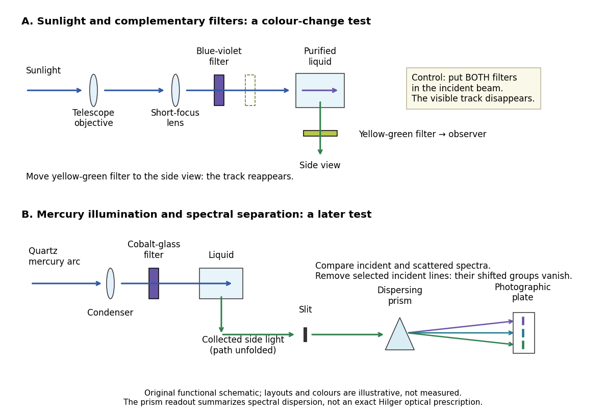

# Raman and Krishnan light-scattering experiment

↑ **Parent:** [Raman scattering](raman-scattering.md)

[Chandrasekhara Venkata Raman](chandrasekhara-venkata-raman.md) and [Kariamanikkam Srinivasa Krishnan](kariamanikkam-srinivasa-krishnan.md) jointly reported the effect in 1928. Their letter describes [light](light.md) from the [Sun](sun.md) concentrated by an $18\,\mathrm{cm}$-[aperture](aperture.md), $230\,\mathrm{cm}$-[focal length](focal-length.md) telescope objective and a second [optical lens](lens-optics.md) onto a liquid purified by repeated [vacuum distillation](vacuum-distillation.md). With blue-violet and yellow-green [optical filters](optical-filter.md) together in the incident beam, the visible track disappeared; moving the yellow-green [optical filter](optical-filter.md) between liquid and observer restored it. The complementary arrangement rejected unchanged-colour [scattering of light](scattering-of-light.md) while admitting newly generated [light](light.md). Persistence after purification and strong [wave polarization](polarization-waves.md) in many liquids argued against ordinary fluorescent contamination.[Raman and Krishnan, A New Type of Secondary Radiation, Nature 121, pp. 501–502; letter reproduced on PDF page 5 at dkasc.ac.in](a-new-type-of-secondary-radiation-by-chandrasekhara-venkata-raman-and-kariamanikkam-srinivasa-krishnan.md)

In his 1930 lecture, [Chandrasekhara Venkata Raman](chandrasekhara-venkata-raman.md) describes a cobalt-glass [optical filter](optical-filter.md) selecting indigo-violet [light](light.md) from the [Sun](sun.md), with a separated blue-green band in the scattered [optical spectrum](optical-spectrum.md). Substituting a quartz mercury arc and condenser gave sharp new [spectral lines](spectral-line.md). Small Hilger quartz [spectrographs](spectrograph.md) recorded them photographically; [Kariamanikkam Srinivasa Krishnan](kariamanikkam-srinivasa-krishnan.md) obtained more precise records with a larger instrument and established violet-displaced lines. The [optical prism](prism-optics.md) disperses [wavelengths](wavelength.md) for spatial readout; it does not create the [Raman shift](raman-shift.md). The diagram gives functional optical paths rather than a reconstruction of a specific Hilger instrument.[Nobel Lectures, Physics 1922–1941; Raman, The molecular scattering of light, Nobel lecture, 11 December 1930, printed pp. 271–273, spectroscopic examination and photographic recording; inspected in a reproduction of the complete lecture](nobel-lectures-physics-1922-1941/the-molecular-scattering-of-light-by-chandrasekhara-venkata-raman.md)

**[Figure 17](#image-complementary-optical-filters-and-a-dispersive-readout-test-different-parts-of-the-raman-scattering-evidence). Complementary optical filters and a dispersive readout test different parts of the Raman scattering evidence**. [Source](raman-filter-and-prism-apparatus.py). Original functional schematic of the filter test and later spectral test. Side collection is unfolded for readability. The [optical prism](prism-optics.md), [spectrograph slit](optical-slit.md) and [photographic plate](photographic-plate.md) indicate dispersion and recording; the sketch supplies no historical distances, exact optical prescription or measured colour intensities.

Their May 1928 report strengthens the comparison: filtered mercury illumination of [toluene](toluene.md) produced extra [spectral lines](spectral-line.md). Removing the $4358\,\text{Å}$ incident line removed its associated longer-[wavelength](wavelength.md) group; a quinine filter removing the $4047$, $4078$ and $4109\,\text{Å}$ group removed a different shifted group while preserving the one associated with $4358\,\text{Å}$. These are actual selective-excitation controls, rather than inferred colours.[Raman and Krishnan, The Optical Analogue of the Compton Effect, Nature 121, p. 711, Fig. 1 description and removal of individual incident-line groups](the-optical-analogue-of-the-compton-effect-by-chandrasekhara-venkata-raman-and-kariamanikkam-srinivasa-krishnan.md)

The inference has limits. A complementary-filter test alone establishes newly admitted [wavelengths](wavelength.md), not their precise spacing or a unique microscopic mechanism. [Fluorescence](fluorescence-split.md) can also survive purification when intrinsic to the liquid, and [fluorescence](fluorescence-split.md) can be polarized. Useful distinctions therefore combine resolved [spectral lines](spectral-line.md), excitation dependence, [wave polarization](polarization-waves.md) and sample preparation. A proposed modern extension is to change a single incident [frequency](frequency.md): a molecular [Raman shift](raman-shift.md) should follow the same internal [energy](energy-split.md) gap, whereas ordinary relaxed molecular [fluorescence](fluorescence-split.md) usually retains approximately its emission-band positions. This is a diagnostic under stated conditions, not a universal theorem about every fluorescent material or resonant scattering process. [Raman scattering](raman-scattering.md) need not involve a populated, relaxed electronic [excited state](excited-state.md) as ordinary molecular [fluorescence](fluorescence-split.md) does; neither a redder photon nor the word Stokes identifies the mechanism by itself.

The 1930 [Nobel Prize in Physics](nobel-prize-in-physics-split.md) went to [Chandrasekhara Venkata Raman](chandrasekhara-venkata-raman.md) alone for his work on [scattering of light](scattering-of-light.md) and the discovery of the effect. That award allocation should be distinguished from the joint experimental report with [Kariamanikkam Srinivasa Krishnan](kariamanikkam-srinivasa-krishnan.md).[Nobel Foundation prize record: sole laureate and award motivation, Physics 1930](the-nobel-prize-in-physics-1930-by-nobel-foundation.md)

## ↑ Ancestors (6)

1. [Raman scattering](raman-scattering.md)
2. [Scattering of light](scattering-of-light.md)
3. [Optics](optics-split.md)
4. [Branches of physics](branches-of-physics.md)
5. [Physics](physics-split.md)
6. [Codex Wiki](split.md)

## ← Incoming links (1)

- [Nobel Prize in Physics in 1930](nobel-prize-in-physics-in-1930.md)
