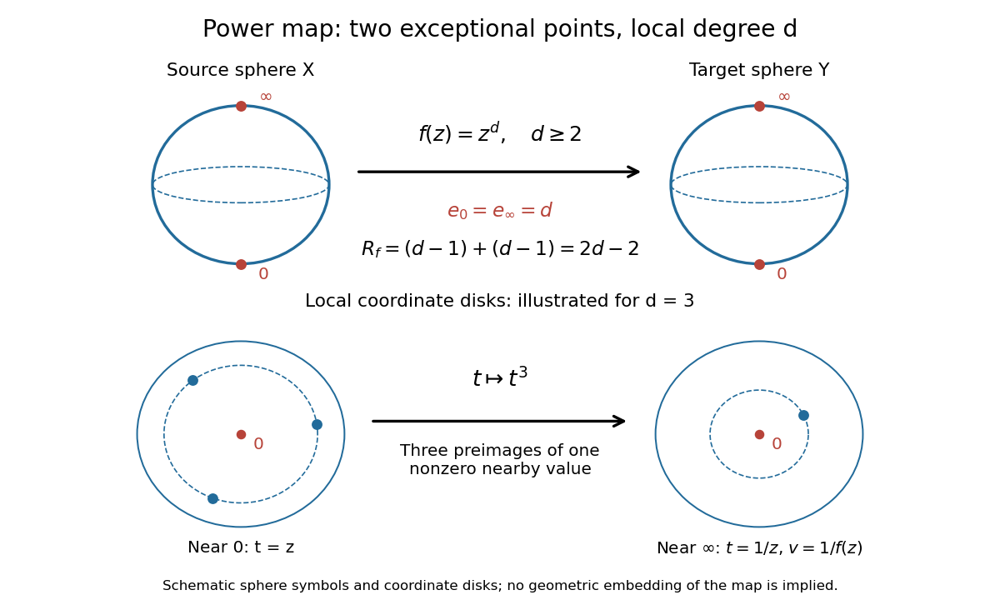

# Ramification of a power map of the Riemann sphere

↑ **Parent:** [Riemann-Hurwitz formula](riemann-hurwitz-formula.md)

For an integer $d\geq2$, extend $f(z)=z^d$ to a [holomorphic map](holomorphic-map.md) from the [Riemann sphere](riemann-sphere.md) to itself with $f(\infty)=\infty$. A nonzero finite [regular value](regular-value.md) has $d$ distinct preimages, so the [degree of a holomorphic map](degree-of-a-holomorphic-map.md) is $d$. At zero the [analytic ramification index](ramification-index-of-a-holomorphic-map.md) is $d$. At infinity, use [local coordinates](local-coordinate.md) $u=1/z$ upstairs and $v=1/f(z)$ downstairs: the same [holomorphic map](holomorphic-map.md) becomes $v=u^d$, so $e_\infty=d$ too. Everywhere else the [derivative](derivative.md) $dz^{d-1}$ is nonzero.

**[Figure 12](#image-schematic-of-the-sphere-power-map-and-its-local-degree-zero-and-infinity-both-have-ramification-index-d). Schematic of the sphere power map and its local degree: zero and infinity both have ramification index d**.

There are two distinct [ramification points](ramification-point-of-a-holomorphic-map.md) and two distinct [branch values of a holomorphic map](branch-value-of-a-holomorphic-map.md), but

$$
R_f=(d-1)+(d-1)=2d-2,\qquad -2=d(-2)+2d-2.
$$

For $d=3$, the [total ramification of a holomorphic map](total-ramification-of-a-holomorphic-map.md) is four, not two. The local-circle panel shows three nearby preimages converging to the single [ramification point](ramification-point-of-a-holomorphic-map.md). For $d=1$ the [holomorphic map](holomorphic-map.md) is the identity and neither zero nor infinity is ramified.

## ↑ Ancestors (7)

1. [Riemann-Hurwitz formula](riemann-hurwitz-formula.md)
2. [Riemann surfaces](riemann-surfaces.md)
3. [Complex analysis](complex-analysis-split.md)
4. [Analysis](analysis-split.md)
5. [Area of mathematics](area-of-mathematics.md)
6. [Mathematics](mathematics-split.md)
7. [Codex Wiki](split.md)

## ← Incoming links (1)

- [Riemann-Hurwitz formula](riemann-hurwitz-formula.md)
