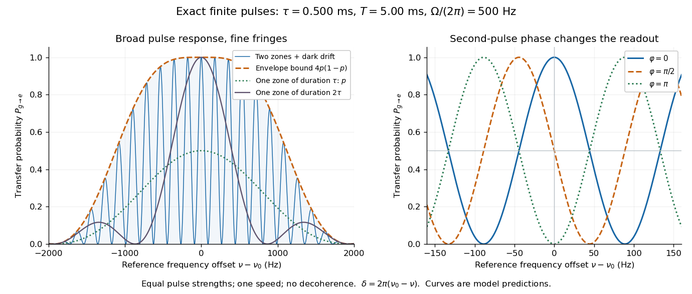

# Ramsey fringe envelope

↑ **Parent:** [Finite-pulse Ramsey transition probability](finite-pulse-ramsey-transition-probability.md)

The exact [finite-pulse Ramsey transition probability](finite-pulse-ramsey-transition-probability.md) separates a slowly varying pulse response from rapid [quantum interference](quantum-interference.md). Define the single-zone transfer [probability](probability.md) $p$ and a pulse-induced [quantum phase](quantum-phase.md) $\theta$ by

$$
p=\frac{\Omega^2}{q^2}s_p^2,\qquad b=\frac{\delta}{q}s_p,\qquad
\theta=\operatorname{atan2}(b,c_p).
$$

Since $c_p^2+b^2=1-p$, factorizing the real bracket in the original formula gives

$$
P_{g\to e}=4p(1-p)\cos^2\!\left(\frac{\delta T}{2}+\theta\right).
$$

Where $c_p=b=0$, the [probability](probability.md) is zero and $\theta$ need not be defined. Elsewhere this identity proves the envelope bound without a weak-drive assumption. The envelope $4p(1-p)$ is not the single-zone response $p$: two equal coherent interactions have different transfer weights. A contiguous resonant [Rabi pi pulse](rabi-pi-pulse.md) of duration $2\tau$ provides another useful comparison with the same total drive duration, but no dark interval. Its line is broad because it has no long flight phase.

**[Figure 10](#image-finite-pulses-set-the-envelope-while-dark-flight-sets-the-fine-fringes). Finite pulses set the envelope while dark flight sets the fine fringes**. Original exact [two-level system](two-level-system.md) predictions for $\tau=0.500\,\mathrm{ms}$, $T=5.00\,\mathrm{ms}$ and $\Omega=2\pi\times500\,\mathrm{rad\,s^{-1}}$, matching the existing [velocity-averaged Ramsey line](velocity-averaged-ramsey-line.md) reference particle. The envelope is a bound, not a measured curve or the single-zone line. The central panel changes only the second pulse's [oscillation phase](phase-waves.md). No velocity average or experimental data are plotted.

## ↑ Ancestors (15)

1. [Finite-pulse Ramsey transition probability](finite-pulse-ramsey-transition-probability.md)
2. [Ramsey separated oscillatory fields experiment](ramsey-separated-oscillatory-fields-experiment.md)
3. [Ramsey interferometry](ramsey-interferometry.md)
4. [Qubit precession under a constant Hamiltonian](qubit-precession-under-a-constant-hamiltonian.md)
5. [Energy populations and evolving relative phases](energy-populations-and-evolving-relative-phases.md)
6. [Time-evolution operator](time-evolution-operator.md)
7. [Unitary time evolution](unitary-time-evolution.md)
8. [Hamiltonian (quantum mechanics)](hamiltonian-quantum-mechanics.md)
9. [Observable](observable.md)
10. [Quantum state](quantum-state.md)
11. [Quantum system](quantum-system-split.md)
12. [Quantum mechanics](quantum-mechanics-split.md)
13. [Branches of physics](branches-of-physics.md)
14. [Physics](physics-split.md)
15. [Codex Wiki](split.md)

## ← Incoming links (1)

- [Finite-pulse Ramsey phase response](finite-pulse-ramsey-phase-response.md)
