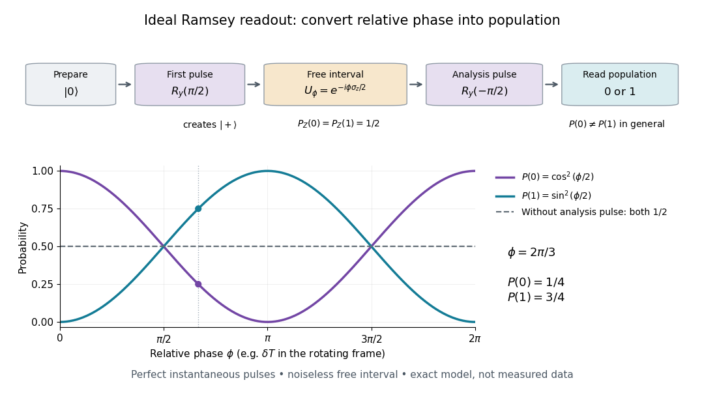

# Ramsey interferometry

↑ **Parent:** [Qubit precession under a constant Hamiltonian](qubit-precession-under-a-constant-hamiltonian.md)  
ⓦ [Wiki](https://en.wikipedia.org/wiki/Ramsey_interferometry)

[Ramsey interferometry](ramsey-interferometry.md) uses two coherent pulses with a free interval between them: the first creates a [quantum superposition](quantum-superposition.md), the interval accumulates relative [quantum phase](quantum-phase.md), and the second converts that [quantum phase](quantum-phase.md) into measurement [probabilities](probability.md). Its attraction is that an ordinary population readout can reveal the [quantum coherence](quantum-coherence-in-a-specified-basis.md) hidden from an [energy measurement](energy-measurement.md) during the free interval.

Here is an ideal [qubit](qubit.md) model with an explicit pulse convention. Let $R_y(\theta)=\exp(-i\theta\sigma_y/2)$, prepare $|0\rangle$, apply $R_y(\pi/2)$, evolve freely with $U_\phi=\exp(-i\phi\sigma_z/2)$, and apply the inverse pulse $R_y(-\pi/2)$ before a [computational-basis measurement](quantum-measurement-in-the-computational-basis.md). The first pulse gives $|+\rangle$. Direct [matrix multiplication](matrix-multiplication.md) gives

$$
R_y(\theta)=\begin{pmatrix}\cos(\theta/2)&-\sin(\theta/2)\\\sin(\theta/2)&\cos(\theta/2)\end{pmatrix},\qquad
R_y(-\pi/2)U_\phi R_y(\pi/2)|0\rangle
=\cos(\phi/2)|0\rangle+i\sin(\phi/2)|1\rangle.
$$

Thus the [Born rule](born-rule.md) gives $P(0)=\cos^2(\phi/2)$ and $P(1)=\sin^2(\phi/2)$. Before the second pulse, the same [computational-basis measurement](quantum-measurement-in-the-computational-basis.md) would give $1/2$ for both outcomes for every $\phi$. At $\phi=2\pi/3$, the second pulse changes these [probabilities](probability.md) to $1/4$ and $3/4$. If the two pulses have the same sign instead, the output labels interchange: the pulse convention is part of the prediction.

**[Figure 8](#image-an-ideal-ramsey-sequence-turns-relative-phase-into-population). An ideal Ramsey sequence turns relative phase into population**. Original pulse-sequence schematic and exact probabilities for $R_y(-\pi/2)U_\phi R_y(\pi/2)|0\rangle$. Dashed lines show a separate readout with the second pulse omitted. Instantaneous perfect pulses and noiseless free evolution are idealizations, not experimental measurements.

In a pulse experiment the phase is measured relative to the oscillator supplying the coherent pulses. In a [rotating frame](rotating-reference-frame.md), write the free [Hamiltonian operator](hamiltonian-quantum-mechanics.md) as $H_{\mathrm{rot}}=\hbar\delta\sigma_z/2$ with signed [angular frequency](angular-frequency.md) difference $\delta$ in the chosen labeling convention. A free interval $T$ then accumulates $\phi=\delta T$; changing the second pulse's phase changes the analysis direction. This comparison makes [Ramsey interferometry](ramsey-interferometry.md) useful for measuring [frequency](frequency.md) differences and diagnosing loss of [quantum coherence](quantum-coherence-in-a-specified-basis.md).

For example, suppose the first pulse has prepared a [density matrix](density-matrix-split.md) with equal populations and transverse [Bloch vector](bloch-vector.md) length $0\leq V\leq1$:

$$
\rho_\phi=\frac12\begin{pmatrix}1&Ve^{-i\phi}\\Ve^{i\phi}&1\end{pmatrix}.
$$

The same inverse analysis pulse yields $P(0)=(1+V\cos\phi)/2$. The [pure state](pure-state.md) case $V=1$ gives the full ideal fringe; the [mixed state](mixed-state.md) $I/2$ gives the flat result $1/2$. This is a controlled mathematical comparison, not a fit to an experiment. Experimental contrast alone does not identify [quantum decoherence](quantum-decoherence.md): imperfect preparation, pulse errors and readout errors can also reduce it.

**Table of contents**

- [Initial-state dependence of Ramsey contrast](initial-state-dependence-of-ramsey-contrast.md)
- [Ramsey ensemble coherence](ramsey-ensemble-coherence.md)
- [Quantronium Ramsey interference experiment](quantronium-ramsey-interference-experiment.md)
- [Ramsey separated oscillatory fields experiment](ramsey-separated-oscillatory-fields-experiment.md)
  - [Ramsey spectroscopy](ramsey-spectroscopy.md)
    - [Ramsey frequency precision](ramsey-frequency-precision.md)
  - [Finite-pulse Ramsey transition probability](finite-pulse-ramsey-transition-probability.md)
    - [Ramsey fringe envelope](ramsey-fringe-envelope.md)
    - [Finite-pulse Ramsey phase response](finite-pulse-ramsey-phase-response.md)
    - [Velocity-averaged Ramsey line](velocity-averaged-ramsey-line.md)

## ↑ Ancestors (12)

1. [Qubit precession under a constant Hamiltonian](qubit-precession-under-a-constant-hamiltonian.md)
2. [Energy populations and evolving relative phases](energy-populations-and-evolving-relative-phases.md)
3. [Time-evolution operator](time-evolution-operator.md)
4. [Unitary time evolution](unitary-time-evolution.md)
5. [Hamiltonian (quantum mechanics)](hamiltonian-quantum-mechanics.md)
6. [Observable](observable.md)
7. [Quantum state](quantum-state.md)
8. [Quantum system](quantum-system-split.md)
9. [Quantum mechanics](quantum-mechanics-split.md)
10. [Branches of physics](branches-of-physics.md)
11. [Physics](physics-split.md)
12. [Codex Wiki](split.md)

## ← Incoming links (13)

- [Finite-pulse Ramsey transition probability](finite-pulse-ramsey-transition-probability.md)
- [Haroche cavity photon nondemolition experiment](haroche-cavity-photon-nondemolition-experiment.md)
- [Solution](past-exam-of-the-atomic-and-optical-physics-course-of-the-university-of-cambridge/2012/paper-1/2/a/solution.md)
- [Solution](past-exam-of-the-atomic-and-optical-physics-course-of-the-university-of-cambridge/2012/paper-1/2/b/solution.md)
- [Solution](past-exam-of-the-atomic-and-optical-physics-course-of-the-university-of-cambridge/2012/paper-1/2/c/solution.md)
- [Solution](past-exam-of-the-atomic-and-optical-physics-course-of-the-university-of-cambridge/2012/paper-1/2/solution.md)
- [Photon-number measurement backaction](photon-number-measurement-backaction.md)
- [Quantronium Ramsey interference experiment](quantronium-ramsey-interference-experiment.md)
- [Rabi cycle](rabi-cycle.md)
- [Rabi transit-time and field averaging](rabi-transit-time-and-field-averaging.md)
- [Ramsey interferometry](ramsey-interferometry.md)
- [Ramsey separated oscillatory fields experiment](ramsey-separated-oscillatory-fields-experiment.md)
- [Unitary time evolution](unitary-time-evolution.md)
