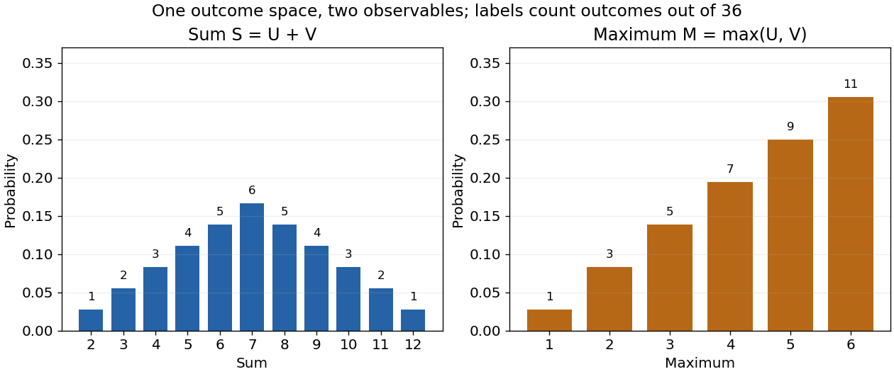
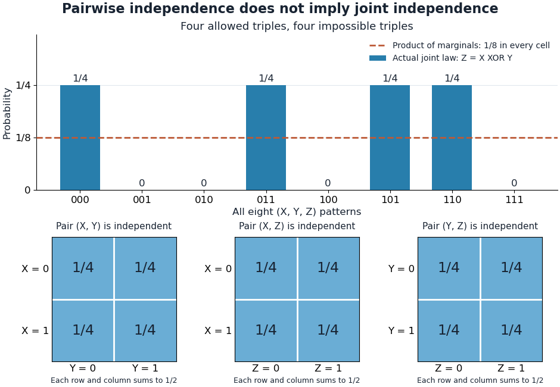
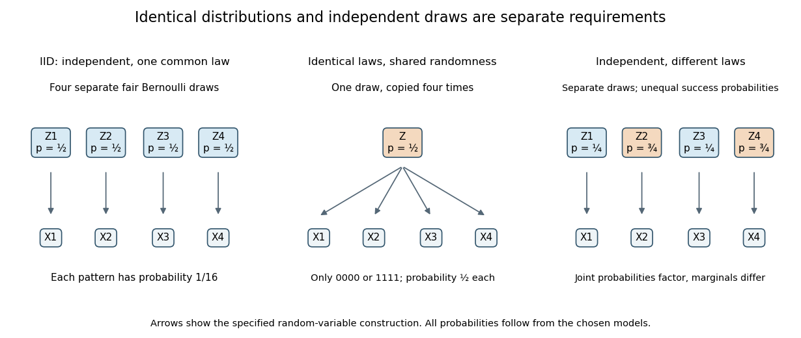
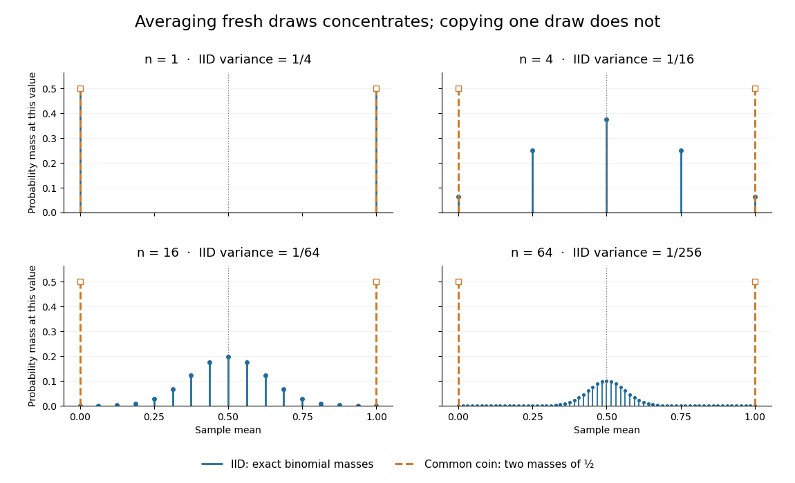

# Random variable

↑ **Parent:** [Probability theory](probability-theory.md)  
ⓦ [Wiki](https://en.wikipedia.org/wiki/Random_variable)

A real-valued random variable is a [measurable function](measure-theory.md#measurable-function) $X$ from a [probability space](probability-space.md) $(\Omega,\mathcal F,\mathbb P)$ to the [real numbers](arithmetic.md#real-number) with their [Borel sigma-algebra](measure-theory.md#borel-sigma-algebra). More general targets give [random elements](#random-element). For every [Borel set](measure-theory.md#borel-set) $A$, measurability ensures that $\{\omega:X(\omega)\in A\}$ is an [event](probability-space.md#event), so the question "does the observed value lie in $A$?" has a defined [probability](probability-theory.md#probability).

The [function](function.md) $X$ is fixed; its input outcome is uncertain. This separates what we measure from how the uncertainty is modeled. A [probability distribution](probability-distribution.md) is the resulting [pushforward measure](measure.md#pushforward-measure), $\mathbb P_X(A)=\mathbb P(X\in A)$. A [cumulative distribution function](probability-distribution.md#cumulative-distribution-function), [probability mass function](probability-distribution.md#probability-mass-function), or [probability density function](continuous-probability-distribution.md#probability-density-function) describes that [measure](measure.md) in an appropriate setting. The random variable and its [probability distribution](probability-distribution.md) are different objects: the former also retains its relationship to other measurements on the same [sample space](probability-space.md#sample-space).

For two independent uniform dice, let $U,V$ record their results and define $S=U+V$ and $M=\max(U,V)$. The 36 ordered pairs are equally likely, but the resulting [probability mass functions](probability-distribution.md#probability-mass-function) differ:

$$
\mathbb P(S=s)=\frac{6-|s-7|}{36}\quad(2\leq s\leq12),\qquad
\mathbb P(M=m)=\frac{2m-1}{36}\quad(1\leq m\leq6).
$$

For the sum, count the diagonal of the outcome grid having total $s$. For the maximum, subtract the $(m-1)^2$ pairs with both results below $m$ from the $m^2$ pairs with both results at most $m$. These examples show how a deterministic [function](function.md) transforms a simple input [probability distribution](probability-distribution.md) into a nonuniform output one.

**[Figure 1](#image-different-random-variables-on-the-same-equally-likely-dice-outcome-space). Different random variables on the same equally likely dice outcome space**.

The corresponding [expected values](expected-value.md) are $\mathbb E S=7$ and $\mathbb E M=161/36$. The first follows immediately from [linearity of expectation](expected-value.md#linearity-of-expectation); the second follows from $\sum_{m=1}^6m(2m-1)/36$. Neither number must be an attainable result. An [expected value](expected-value.md) describes an average under the [probability measure](probability-space.md#probability-measure), not a prediction that the next observation will equal it.

The distinction between a random variable and its [probability distribution](probability-distribution.md) matters for dependence. $U$ and $V$ have the same [discrete uniform distribution](discrete-probability-distribution.md#discrete-uniform-distribution) and are [independent random variables](#independent-random-variables). $U$ and a second copy of $U$ also have that same marginal [probability distribution](probability-distribution.md), but they always agree. Their joint [probability distribution](probability-distribution.md) is concentrated on the diagonal; the marginals alone cannot say which relationship holds. This is why a model for several measurements must specify their joint law or an appropriate [independence](#independent-random-variables) assumption.

[Indicator random variables](expected-value.md#indicator-random-variable) turn [events](probability-space.md#event) into numbers: $\mathbf1_A$ equals one on $A$ and zero elsewhere, and $\mathbb E\mathbf1_A=\mathbb P(A)$. This connects event counting with [expected value](expected-value.md) and [variance](variance.md), and lets tools for [random variables](random-variable.md) answer questions about [probabilities](probability-theory.md#probability). More complicated [functions](function.md) of observations can describe totals, waiting times, or estimation errors using the same framework.

**Table of contents**

- [Constant random variable](#constant-random-variable)
- [Random element](#random-element)
- [Statistical dependence](#statistical-dependence)
- [Random sum](#random-sum)
  - [Transform composition for an independent random sum](#transform-composition-for-an-independent-random-sum)
- [Discrete random variable](#discrete-random-variable)
- [Random vector](#random-vector)
  - [Planar projection of an isotropic random vector](#planar-projection-of-an-isotropic-random-vector)
  - [Joint probability mass function](#joint-probability-mass-function)
- [Hilbert-space-valued random variable](#hilbert-space-valued-random-variable)
  - [Covariance operator](#covariance-operator)
    - [Covariance kernel](#covariance-kernel)
      - [Brownian covariance kernel](#brownian-covariance-kernel)
        - [Brownian covariance from an integrated orthonormal basis](#brownian-covariance-from-an-integrated-orthonormal-basis)
      - [Brownian bridge covariance kernel](#brownian-bridge-covariance-kernel)
    - [Empirical covariance operator](#empirical-covariance-operator)
      - [Pooled covariance operator](#pooled-covariance-operator)
  - [Gaussian random element](#gaussian-random-element)
- [Independent random variables](#independent-random-variables)
  - [Pairwise independent random variables](#pairwise-independent-random-variables)
    - [Pairwise independence does not imply joint independence](#pairwise-independence-does-not-imply-joint-independence)
  - [Conditional independence](#conditional-independence)
    - [Conditioning can destroy independence](#conditioning-can-destroy-independence)
    - [Conditioning on a sum can create dependence](#conditioning-on-a-sum-can-create-dependence)
    - [Covariance induced by a shared latent variable](#covariance-induced-by-a-shared-latent-variable)
    - [Conditional independence graph](#conditional-independence-graph)
      - [Nodewise regression](#nodewise-regression)
        - [Profiling intercepts in nodewise regression](#profiling-intercepts-in-nodewise-regression)
        - [AND rule for nodewise graph selection](#and-rule-for-nodewise-graph-selection)
        - [OR rule for nodewise graph selection](#or-rule-for-nodewise-graph-selection)
      - [Gaussian graphical model](#gaussian-graphical-model)
      - [Neighbourhood selection](#neighbourhood-selection)
      - [Moral graph equals the conditional independence graph under faithfulness](#moral-graph-equals-the-conditional-independence-graph-under-faithfulness)
    - [Contraction axiom for conditional independence](#contraction-axiom-for-conditional-independence)
    - [Decomposition axiom for conditional independence](#decomposition-axiom-for-conditional-independence)
    - [Generalized covariance measure statistic](#generalized-covariance-measure-statistic)
      - [Studentization of the generalized covariance measure statistic](#studentization-of-the-generalized-covariance-measure-statistic)
  - [Orthogonality of independent centered Hilbert-space random variables](#orthogonality-of-independent-centered-hilbert-space-random-variables)
  - [Independent and identically distributed random variables](#independent-and-identically-distributed-random-variables)
    - [Sample mean of iid Bernoulli variables](#sample-mean-of-iid-bernoulli-variables)
    - [Common-coin averaging](#common-coin-averaging)
    - [IID does not imply finite moments](#iid-does-not-imply-finite-moments)
    - [Sampling without replacement need not be independent](#sampling-without-replacement-need-not-be-independent)
- [Transformation of a random variable](#transformation-of-a-random-variable)

## Constant random variable

↑ **Parent:** [Random variable](random-variable.md)

A [constant random variable](#constant-random-variable) takes the same fixed [real number](arithmetic.md#real-number) $c$ at every outcome in its [sample space](probability-space.md#sample-space). Its [probability distribution](probability-distribution.md) puts mass one at $c$. An [almost surely](convergence-of-random-variables.md#almost-sure-convergence) constant [random variable](random-variable.md) may differ on an [event](probability-space.md#event) of [probability](probability-theory.md#probability) zero, while having the same [probability distribution](probability-distribution.md).

## Random element

↑ **Parent:** [Random variable](random-variable.md)

A random element is a [measurable function](measure-theory.md#measurable-function) from a [probability space](probability-space.md) $(\Omega,\mathcal F,\mathbb P)$ to a [measurable space](measure-theory.md#measurable-space) $(E,\mathcal E)$. Its law is the [pushforward measure](measure.md#pushforward-measure) $\mathbb P_X(A)=\mathbb P(X^{-1}(A))$ for $A\in\mathcal E$. Real-valued [random variables](random-variable.md) and vector-valued random variables are examples; a stochastic sample path can also be a random element when its path-space sigma-algebra is specified. For a [Polish space](topological-analysis.md#polish-space) $E$, the usual choice is its [Borel sigma-algebra](measure-theory.md#borel-sigma-algebra). A [large deviation principle](convergence-of-random-variables.md#large-deviation-principle) concerns the laws of a family of such random elements.

## Statistical dependence

↑ **Parent:** [Random variable](random-variable.md)

Two [random variables](random-variable.md) are statistically dependent when their joint [probability distribution](probability-distribution.md) differs from the product of their marginal [probability distributions](probability-distribution.md). Equivalently, some events determined by the two variables violate the product rule that defines [independence](#independent-random-variables). Nonzero [covariance](variance.md#covariance) implies statistical dependence when the moments exist, but zero [covariance](variance.md#covariance) does not in general imply [independence](#independent-random-variables).

## Random sum

↑ **Parent:** [Random variable](random-variable.md)

A [random sum](#random-sum) has a random number $N$ of summands, usually with $N$ a nonnegative integer-valued [random variable](random-variable.md). The empty sum is zero. The dependence between $N$ and the summands must be stated; independent summands do not by themselves imply independence from $N$.

### Transform composition for an independent random sum

↑ **Parent:** [Random sum](#random-sum)

For independent identically distributed summands, independent also of the count $N$, conditioning on $N=n$ gives $\mathbb E[e^{tZ}\mid N=n]=M_Y(t)^n$. The [law of total expectation](measure-theory.md#law-of-total-expectation) gives the composition of the count's [probability generating function](probability-distribution.md#probability-generating-function) with the summand's [moment-generating function](probability-distribution.md#moment-generating-function). This identity is valid as an extended nonnegative expectation; finiteness near zero requires additional exponential-integrability assumptions.

## Discrete random variable

↑ **Parent:** [Random variable](random-variable.md)

A [random variable](random-variable.md) is discrete when some finite or [countable set](cardinal-number.md#countable-set) $D\subseteq\mathbb R$ has $\mathbb P(X\in D)=1$. Its [probability mass function](probability-distribution.md#probability-mass-function) is $p_X(x)=\mathbb P(X=x)$; these nonnegative masses sum to one. An [event](probability-space.md#event) determined by the value has [probability](probability-theory.md#probability) $\mathbb P(X\in A)=\sum_{x\in A\cap D}p_X(x)$. Values outside $D$ may still occur on a [zero-probability event](probability-space.md#zero-probability-event) without changing this definition.

Countable support need not consist of [integers](integer.md): a random variable constantly equal to $3/2$ is discrete. Integer-indexed [tail-sum formulas](expected-value.md#tail-sum-formula) therefore require a separate integer-valued hypothesis. For the dice sum in [random variable](random-variable.md), the [expected value](expected-value.md) is $\sum_{s=2}^{12}s\,p_S(s)=7$ and the [variance](variance.md) is $\sum_{s=2}^{12}(s-7)^2p_S(s)=35/6$; the same answer follows by adding the [variances](variance.md) of its [independent](#independent-random-variables) summands.

## Random vector

↑ **Parent:** [Random variable](random-variable.md)  
ⓦ [Wiki](https://en.wikipedia.org/wiki/Random_vector)

A random vector is a [random variable](random-variable.md) whose values are vectors or, equivalently, an ordered tuple of scalar random variables on one probability space.

### Planar projection of an isotropic random vector

↑ **Parent:** [Random vector](#random-vector)

For an isotropic three-dimensional [random vector](#random-vector), its direction is uniform on the [sphere](euclidean-geometry.md#sphere) and independent of its length. Projection onto a fixed plane gives $R_\perp=R\sin\theta$. The solid-angle averages are $\mathbb E\sin\theta=(1/2)\int_0^\pi\sin^2\theta\,d\theta=\pi/4$ and $\mathbb E\sin^2\theta=(1/2)\int_0^\pi\sin^3\theta\,d\theta=2/3$. This proves the two formulas whenever the corresponding moments exist. The mean-length factor and root-mean-square factor are different. Both are independent of the radial distribution, so projection preserves a polymer's chain-length scaling exponent.

### Joint probability mass function

↑ **Parent:** [Random vector](#random-vector)

For [discrete random variables](#discrete-random-variable) $X,Y$, their joint probability mass function assigns a [probability](probability-theory.md#probability) to each possible ordered pair. Its entries are nonnegative and sum to one. [Marginalization](probability-distribution.md#marginalization) gives the [probability mass functions](probability-distribution.md#probability-mass-function) $p_X(x)=\sum_y p_{X,Y}(x,y)$ and $p_Y(y)=\sum_x p_{X,Y}(x,y)$. In a table with rows indexed by $x$ and columns by $y$, these are the row and column totals. The [joint probability distribution](probability-distribution.md#joint-probability-distribution) records how the coordinates occur together, while the [marginal distributions](probability-distribution.md#marginal-distribution) describe each separately.

## Hilbert-space-valued random variable

↑ **Parent:** [Random variable](random-variable.md)

A Hilbert-space-valued random variable is a measurable map into a [Hilbert space](hilbert-space.md). It is square-integrable when $\mathbb E\lVert X\rVert^2<\infty$, in which case its mean is defined by the [Bochner integral](measure-theory.md#bochner-integral).

### Covariance operator

↑ **Parent:** [Hilbert-space-valued random variable](#hilbert-space-valued-random-variable)  
ⓦ [Wiki](https://en.wikipedia.org/wiki/Covariance_operator)

For a square-integrable centered [Hilbert-space-valued random variable](#hilbert-space-valued-random-variable) $X$, its covariance operator is

$$
C_Xh=\mathbb E[\langle X,h\rangle X]=\mathbb E[X\otimes X]h.
$$

It is a positive self-adjoint [trace-class operator](compact-operator.md#trace-class-operator), and $\operatorname{tr}C_X=\mathbb E\lVert X\rVert^2$.

#### Covariance kernel

↑ **Parent:** [Covariance operator](#covariance-operator)

When a [covariance operator](#covariance-operator) on a function space is an [integral operator](functional-analysis.md#integral-operator), its covariance kernel satisfies $(C_Xf)(s)=\int c_X(s,t)f(t)dt$. For a centered process, $c_X(s,t)=\mathbb E[X(s)X(t)]$ whenever point evaluation is meaningful.

##### Brownian covariance kernel

↑ **Parent:** [Covariance kernel](#covariance-kernel)

The covariance kernel of standard [Brownian motion](brownian-motion.md) on $[0,1]$ is $c(s,t)=\min(s,t)$. Its integral operator has eigenfunctions $\sqrt2\sin((k-\tfrac12)\pi t)$ and eigenvalues $((k-\tfrac12)\pi)^{-2}$.

###### Brownian covariance from an integrated orthonormal basis

↑ **Parent:** [Brownian covariance kernel](#brownian-covariance-kernel)

For a complete [orthonormal basis](inner-product.md#orthonormal-basis) of $L^2(\mathbb R_+)$, the [Parseval identity for a Hilbertian basis](hilbert-space.md#parseval-identity-for-a-hilbertian-basis) identifies the sum of the feature products with $\langle1_{[0,s]},1_{[0,t]}\rangle=\min(s,t)$. The [Cauchy-Schwarz inequality](probability-and-statistics.md#cauchy-schwarz-inequality) gives absolute convergence.

##### Brownian bridge covariance kernel

↑ **Parent:** [Covariance kernel](#covariance-kernel)

The covariance kernel of a standard [Brownian bridge](brownian-motion.md#brownian-bridge) on $[0,1]$ is $c(s,t)=\min(s,t)-st$. Its integral operator has eigenfunctions $\sqrt2\sin(k\pi t)$ and eigenvalues $(k\pi)^{-2}$ for $k\geq1$.

#### Empirical covariance operator

↑ **Parent:** [Covariance operator](#covariance-operator)

For observations $X_1,\ldots,X_n$ and a chosen center $m$, the empirical covariance operator is $\widehat C_m=n^{-1}\sum_i(X_i-m)\otimes(X_i-m)$. Its expectation equals the population covariance plus the rank-one operator formed from the centering error.

##### Pooled covariance operator

↑ **Parent:** [Empirical covariance operator](#empirical-covariance-operator)

A pooled covariance operator averages the within-group empirical covariance operators from several samples that are assumed to share one population covariance. Centering within each group prevents differences between group means from contaminating the covariance estimate.

### Gaussian random element

↑ **Parent:** [Hilbert-space-valued random variable](#hilbert-space-valued-random-variable)

A random element $G$ of a [Hilbert space](hilbert-space.md) is Gaussian when every continuous linear functional of $G$ has a [normal distribution](probability-distribution.md#normal-distribution). Its mean and [covariance operator](#covariance-operator) determine its distribution.

## Independent random variables

↑ **Parent:** [Random variable](random-variable.md)

[Random variables](random-variable.md) $X_1,\ldots,X_n$ are independent when, for every choice of [Borel sets](measure-theory.md#borel-set) $A_1,\ldots,A_n$,

$$
\mathbb P\!\left(\bigcap_{i=1}^n\{X_i\in A_i\}\right)
=\prod_{i=1}^n\mathbb P(X_i\in A_i).
$$

The requirement covers all these [events](probability-space.md#event), not only one selected combination of values. Equivalently, the generated [sigma-algebras](measure-theory.md#sigma-algebra) are [independent sigma-algebras](probability-theory.md#independent-sigma-algebras), or the [joint probability distribution](probability-distribution.md#joint-probability-distribution) is the [product measure](probability-theory.md#product-measure) of the [marginal distributions](probability-distribution.md#marginal-distribution). For an infinite family, the same condition must hold for every finite subfamily. For [random elements](#random-element), replace [Borel sets](measure-theory.md#borel-set) by [measurable sets](measure-theory.md#measurable-set) in their specified target spaces.

For [discrete random variables](#discrete-random-variable), checking every entry of the [joint probability mass function](#joint-probability-mass-function) is enough:

$$
p_{X_1,\ldots,X_n}(x_1,\ldots,x_n)=\prod_{i=1}^n p_{X_i}(x_i).
$$

Summing this identity over the desired sets proves the event formulation. For general real-valued [random variables](random-variable.md), checking point [probabilities](probability-theory.md#probability) alone can say nothing: a pair with no point masses has $\mathbb P(X=x,Y=y)=\mathbb P(X=x)\mathbb P(Y=y)=0$ even when $Y=X$. The all-set definition avoids that trap. See [Gautam Iyer, Conditional Probability and Independence, definitions 12, 16 and 18 and proposition 19](https://www.math.cmu.edu/~gautam/c/2026-425/notes/independence.html), with the continuous case treated in his [Continuous Random Variables notes](https://www.math.cmu.edu/~gautam/c/2026-425/notes/cts-rvs.html).

For a concrete comparison, let $X,Y$ be [independent](#independent-random-variables) fair [bits](information-theory.md#bit): each has a [Bernoulli distribution](discrete-probability-distribution.md#bernoulli-distribution) with parameter $1/2$. Their [joint probability mass function](#joint-probability-mass-function), with rows $X=0,1$ and columns $Y=0,1$, is

$$
J_{\mathrm{ind}}=\begin{pmatrix}1/4&1/4\\1/4&1/4\end{pmatrix}.
$$

All four entries equal the product of the corresponding row and column totals, $(1/2)(1/2)$. For example, $\mathbb P(Y=1\mid X=0)=1/2$: learning one [bit](information-theory.md#bit) leaves the other one's [probability distribution](probability-distribution.md) unchanged.

Now keep a fair $X$ but set $Y=X$. The same [marginal distributions](probability-distribution.md#marginal-distribution) give the same product table, yet the actual [joint probability mass function](#joint-probability-mass-function) is

$$
J_{\mathrm{same}}=\begin{pmatrix}1/2&0\\0&1/2\end{pmatrix}.
$$

Here $\mathbb P(X=0,Y=1)=0$ differs from $(1/2)(1/2)=1/4$, and $\mathbb P(Y=1\mid X=1)=1$. Thus matching [marginal distributions](probability-distribution.md#marginal-distribution) does not establish [independence](#independent-random-variables). Grinstead and Snell formulate the discrete product criterion in [Introduction to Probability, section 4.1, definition 4.4, printed page 143](https://chance.dartmouth.edu/teaching_aids/books_articles/probability_book/Chapter4.pdf).

**[Figure 2](#image-independence-compares-every-joint-probability-with-the-product-of-the-marginals). Independence compares every joint probability with the product of the marginals**. Each row compares an actual [joint probability mass function](#joint-probability-mass-function) with its product of [marginal distributions](probability-distribution.md#marginal-distribution). Marginal totals are shown at the right and bottom of every table; each whole table sums to one. The last example has zero [covariance](variance.md#covariance) but a visibly different joint table.

[Independence](#independent-random-variables) is stronger than zero [covariance](variance.md#covariance). For [square-integrable](measure-theory.md#square-integrable-function) [independent random variables](#independent-random-variables), $\mathbb E[XY]=\mathbb E[X]\mathbb E[Y]$, so they are [uncorrelated random variables](variance.md#uncorrelated-random-variables). The converse fails: take $X$ with a [discrete uniform distribution](discrete-probability-distribution.md#discrete-uniform-distribution) on $\{-1,0,1\}$ and $Y=X^2$. Direct calculation gives

$$
\mathbb E[X]=0,\qquad \mathbb E[Y]=2/3,\qquad
\mathbb E[XY]=\mathbb E[X^3]=0,\qquad
\operatorname{Cov}(X,Y)=0.
$$

Nevertheless, $Y$ is a nonconstant [function](function.md) determined by $X$. The [event](probability-space.md#event) $X=0$ is exactly the [event](probability-space.md#event) $Y=0$, so $\mathbb P(X=0,Y=0)=1/3$, whereas $\mathbb P(X=0)\mathbb P(Y=0)=1/9$. The positive and negative contributions to the [covariance](variance.md#covariance) cancel without erasing the [statistical dependence](#statistical-dependence).

The usefulness of [independence](#independent-random-variables) is that a large [joint probability distribution](probability-distribution.md#joint-probability-distribution) can be assembled from small pieces. For $n$ fair [independent](#independent-random-variables) [bits](information-theory.md#bit), each of the $2^n$ patterns has [probability](probability-theory.md#probability) $2^{-n}$. Products also simplify [expected values](expected-value.md), and vanishing cross [covariances](variance.md#covariance) simplify the [variance of a sum](variance.md#variance-of-a-sum). Separate [measurable functions](measure-theory.md#measurable-function) of [independent random variables](#independent-random-variables) remain [independent](#independent-random-variables): each output [event](probability-space.md#event) is already an input [event](probability-space.md#event), so the defining product rule still applies. These are consequences of a model's [independence](#independent-random-variables) assumption; whether the assumption describes actual observations is a question for [statistical inference](statistical-inference.md).

### Pairwise independent random variables

↑ **Parent:** [Independent random variables](#independent-random-variables)

[Random variables](random-variable.md) are pairwise independent when every two distinct members are [independent random variables](#independent-random-variables). Each pair's [joint probability distribution](probability-distribution.md#joint-probability-distribution) must factor for all its [events](probability-space.md#event); examining only a pair's [covariance](variance.md#covariance) is insufficient. Full [independence](#independent-random-variables) implies pairwise independence by taking the other sets in the definition to be the whole target spaces. The reverse implication fails once there are three or more variables.

Pairwise independence is enough to add [variances](variance.md): for a finite family of [square-integrable](measure-theory.md#square-integrable-function) pairwise independent [random variables](random-variable.md),

$$
\operatorname{Var}\!\left(\sum_{i=1}^n X_i\right)=\sum_{i=1}^n\operatorname{Var}(X_i),
$$

because all cross [covariances](variance.md#covariance) vanish in the [variance of a sum](variance.md#variance-of-a-sum). Thus pairwise independence can support calculations about the size of fluctuations while failing to determine the full [joint probability distribution](probability-distribution.md#joint-probability-distribution). The following example makes that distinction visible.

#### Pairwise independence does not imply joint independence

↑ **Parent:** [Pairwise independent random variables](#pairwise-independent-random-variables)

Let $X,Y$ be [independent](#independent-random-variables) fair [bits](information-theory.md#bit), and let $Z=X\mathbin\oplus Y$ be their [exclusive or](theoretical-computer-science.md#exclusive-or): $Z=1$ precisely when $X\ne Y$. The four possible triples are $000,011,101,110$, each with [probability](probability-theory.md#probability) $1/4$. Each coordinate is a fair [bit](information-theory.md#bit). Writing out all eight patterns gives

$$
\begin{array}{c|cccccccc}
(x,y,z)&000&001&010&011&100&101&110&111\\\hline
p_{X,Y,Z}(x,y,z)&1/4&0&0&1/4&0&1/4&1/4&0\\
p_X(x)p_Y(y)p_Z(z)&1/8&1/8&1/8&1/8&1/8&1/8&1/8&1/8
\end{array}
$$

Every pair has all four cells $00,01,10,11$ with [probability](probability-theory.md#probability) $1/4$:

$$
J_{X,Y}=J_{X,Z}=J_{Y,Z}
=\begin{pmatrix}1/4&1/4\\1/4&1/4\end{pmatrix}.
$$

For $(X,Z)$, the four allowed triples project to $00,01,11,10$; for $(Y,Z)$ they project to $00,11,01,10$. Each projection lists each pair exactly once, proving pairwise independence. But $\mathbb P(X=0,Y=0,Z=0)=1/4$ differs from the product $1/8$, so the three are not [independent random variables](#independent-random-variables). Indeed, any two determine the third. A single coordinate reveals nothing about another, while two coordinates together reveal it completely.

**[Figure 3](#image-the-xor-example-hides-joint-dependence-from-every-pairwise-probability-table). The XOR example hides joint dependence from every pairwise probability table**. The bars show all eight triple patterns against the $1/8$ reference for three [independent](#independent-random-variables) fair [bits](information-theory.md#bit). Below, all three pairwise [joint probability mass functions](#joint-probability-mass-function) have four equal cells of $1/4$.

The [exclusive or](theoretical-computer-science.md#exclusive-or) example is the complementary-bit version of the two-toss exercise in [Grinstead and Snell, Introduction to Probability, section 4.1, exercise 7, printed page 151](https://chance.dartmouth.edu/teaching_aids/books_articles/probability_book/Chapter4.pdf). It is a compact reason to check the full product rule whenever a calculation uses three-way or higher [events](probability-space.md#event).

### Conditional independence

↑ **Parent:** [Independent random variables](#independent-random-variables)  
ⓦ [Wiki](https://en.wikipedia.org/wiki/Conditional_independence)

[Random variables](random-variable.md) $X$ and $Y$ are conditionally independent given $Z$ when, for every pair of [Borel sets](measure-theory.md#borel-set) $A,B$, the following identity holds [almost surely](convergence-of-random-variables.md#almost-sure-convergence):

$$
\mathbb P(X\in A,Y\in B\mid Z)
=\mathbb P(X\in A\mid Z)\mathbb P(Y\in B\mid Z).
$$

Here [conditional probabilities](probability-theory.md#conditional-probability) are [conditional expectations](measure-theory.md#conditional-expectation) of the corresponding [indicator random variables](expected-value.md#indicator-random-variable) given the [sigma-algebra](measure-theory.md#sigma-algebra) generated by $Z$. This defines the condition even when $\mathbb P(Z=z)=0$. In terms of [regular conditional distributions](probability-theory.md#regular-conditional-distribution), the conditional joint law is the product of the conditional [marginal distributions](probability-distribution.md#marginal-distribution) for almost every conditioning value.

For [discrete random variables](#discrete-random-variable), at every $z$ with $\mathbb P(Z=z)>0$, the condition becomes

$$
p_{X,Y\mid Z=z}(x,y)=p_{X\mid Z=z}(x)p_{Y\mid Z=z}(y).
$$

Where $\mathbb P(X=x,Z=z)>0$, this is equivalent to $\mathbb P(Y=y\mid X=x,Z=z)=\mathbb P(Y=y\mid Z=z)$. Once $Z$ is known, observing $X$ provides no further information about $Y$.[Information Theory I — Scene Setting and Statistical Applications, Lecture 9, section Conditional independence and conditional mutual information: conditional factorization and predictive irrelevance](mathematics-bibliography.md#information-theory-i-scene-setting-and-statistical-applications-lecture-9)

For a worked example, suppose a [latent variable](latent-variable.md) $T$ chooses between two environments with $\mathbb P(T=0)=\mathbb P(T=1)=1/2$. Given $T=t$, take $X,Y$ to be [independent and identically distributed](#independent-and-identically-distributed-random-variables) with a [Bernoulli distribution](discrete-probability-distribution.md#bernoulli-distribution) of parameter $p_t$, where $p_0=0.1$ and $p_1=0.9$. Think of two separate trials run under the same quiet or active environment. Their conditional [joint probability mass functions](#joint-probability-mass-function), with rows $X=0,1$ and columns $Y=0,1$, are

$$
J_0=\begin{pmatrix}0.81&0.09\\0.09&0.01\end{pmatrix},\qquad
J_1=\begin{pmatrix}0.01&0.09\\0.09&0.81\end{pmatrix}.
$$

Each is exactly the product of its own conditional [marginal distributions](probability-distribution.md#marginal-distribution): $(0.9,0.1)$ for $T=0$, and $(0.1,0.9)$ for $T=1$. Thus $X,Y$ are [conditionally independent](#conditional-independence) given $T$.

If the environment is unobserved, the [law of total probability](probability-space.md#law-of-total-probability) averages the two tables:

$$
J=\tfrac12J_0+\tfrac12J_1
=\begin{pmatrix}0.41&0.09\\0.09&0.41\end{pmatrix}.
$$

Both unconditional [marginal distributions](probability-distribution.md#marginal-distribution) are fair, but $0.41\ne0.5\times0.5$. The [law of total expectation](measure-theory.md#law-of-total-expectation) gives

$$
\mathbb E[X]=\mathbb E[Y]=0.5,\qquad
\mathbb E[XY]=\tfrac12(0.1^2+0.9^2)=0.41,\qquad
\operatorname{Cov}(X,Y)=0.41-0.25=0.16.
$$

**[Figure 4](#image-an-unobserved-shared-environment-creates-statistical-dependence-between-conditionally-independent-trials). An unobserved shared environment creates statistical dependence between conditionally independent trials**. The first two tables show independent [Bernoulli trials](discrete-probability-distribution.md#bernoulli-trial) at conditional success [probabilities](probability-theory.md#probability) $0.1$ and $0.9$. Averaging them with equal weights gives the third table. The fourth table is the product of the resulting unconditional [marginal distributions](probability-distribution.md#marginal-distribution), which differs from the actual joint table. These are stipulated model probabilities, not observed frequencies.

Observing $X=1$ makes the active environment more plausible, so it raises $\mathbb P(Y=1\mid X=1)$ to $0.41/0.5=0.82$. Knowing the actual environment removes this source of [statistical dependence](#statistical-dependence). The [covariance induced by a shared latent variable](#covariance-induced-by-a-shared-latent-variable) lemma explains the calculation without listing all the outcomes.

This is why [conditional independence](#conditional-independence) is useful in [statistical modelling](statistical-modelling.md): a model can multiply simple conditional laws and then average over a shared [latent variable](latent-variable.md). The resulting observations can remain statistically dependent. [Conditional independence graphs](#conditional-independence-graph) organize such information relations; their interpretation as causes requires additional assumptions from [causal inference](causal-inference.md). Conditioning describes the information available to an observer. It does not, by itself, describe what would happen if an experimenter changed a variable.

#### Conditioning can destroy independence

↑ **Parent:** [Conditional independence](#conditional-independence)

Return to [pairwise independence does not imply joint independence](#pairwise-independence-does-not-imply-joint-independence), where $X,Y$ are [independent](#independent-random-variables) fair [bits](information-theory.md#bit) and $Z=X\mathbin\oplus Y$ is their [exclusive or](theoretical-computer-science.md#exclusive-or). Given $Z=0$, only $000$ and $110$ remain, each with conditional [probability](probability-theory.md#probability) $1/2$. Given $Z=1$, only $011$ and $101$ remain, again each with conditional [probability](probability-theory.md#probability) $1/2$. Consequently,

$$
J_{X,Y\mid Z=0}=\begin{pmatrix}1/2&0\\0&1/2\end{pmatrix},\qquad
J_{X,Y\mid Z=1}=\begin{pmatrix}0&1/2\\1/2&0\end{pmatrix}.
$$

The conditional [marginal distributions](probability-distribution.md#marginal-distribution) are still fair, so their product has four entries $1/4$ in either case. The actual tables differ: $Y=X$ given $Z=0$, and $Y=1-X$ given $Z=1$. Thus unconditional [independence](#independent-random-variables) need not survive conditioning. Observing whether two [bits](information-theory.md#bit) agree restricts their possible combinations; no physical interaction between the original trials is required to produce that information constraint.

#### Conditioning on a sum can create dependence

↑ **Parent:** [Conditional independence](#conditional-independence)

Let $X,Y$ be [independent random variables](#independent-random-variables), each with a [Bernoulli distribution](discrete-probability-distribution.md#bernoulli-distribution) of parameter $1/2$, and put $S=X+Y$. Unconditionally, the four ordered pairs $(0,0),(0,1),(1,0),(1,1)$ each have [probability](probability-theory.md#probability) $1/4$. On the [event](probability-space.md#event) $S=1$, only $(0,1)$ and $(1,0)$ remain, each with [conditional probability](probability-theory.md#conditional-probability) $1/2$. Thus

$$
\mathbb P(X=1,Y=1\mid S=1)=0
\ne\mathbb P(X=1\mid S=1)\mathbb P(Y=1\mid S=1)=\frac14.
$$

Knowing that exactly one trial succeeded makes observing one outcome informative about the other. This violates [conditional independence](#conditional-independence) given $S$, even though the original [random variables](random-variable.md) are independent. Given $S=0$ or $S=2$, both variables are [constant random variables](#constant-random-variable) and are [conditionally independent](#conditional-independence) there; that does not repair the failure at $S=1$, an [event](probability-space.md#event) of positive [probability](probability-theory.md#probability).

**[Figure 5](#image-selecting-pairs-with-exactly-one-success-makes-independent-trials-dependent). Selecting pairs with exactly one success makes independent trials dependent**. Left: four equally probable outcomes of independent fair [Bernoulli trials](discrete-probability-distribution.md#bernoulli-trial). The selection $S=X+Y=1$ retains exactly two pairs. Right: their conditional joint table has zero mass on the diagonal and $1/2$ off it. Within this selected model the [conditional covariance](variance.md#conditional-covariance) is $-1/4$; the two conditional [marginal distributions](probability-distribution.md#marginal-distribution) remain fair.

The [conditional covariance](variance.md#conditional-covariance) here is $\mathbb E[XY\mid S=1]-\mathbb E[X\mid S=1]\mathbb E[Y\mid S=1]=0-1/4=-1/4$. Both conditional [variances](variance.md) are $1/4$, so the conditional [correlation coefficient](variance.md#pearson-correlation-coefficient) is $-1$: within the selected group, $Y=1-X$. These conclusions follow from restricting a finite [sample space](probability-space.md#sample-space), without positing any physical interaction between the trials.

This example and the shared-environment example establish both logical directions: [independent random variables](#independent-random-variables) need not be [conditionally independent](#conditional-independence), and [conditionally independent](#conditional-independence) variables need not be independent. When $S$ is represented as the joint result of two inputs in a [causal directed acyclic graph](causal-inference.md#causal-directed-acyclic-graph), conditioning on it has the [collider](combinatorics.md#collider) structure associated with [collider bias](causal-inference.md#collider-bias). A probability calculation by itself establishes a dependence relation, not a physical causal mechanism or an [intervention](causal-inference.md#treatment).

#### Covariance induced by a shared latent variable

↑ **Parent:** [Conditional independence](#conditional-independence)

Let $A,B$ be [indicator random variables](expected-value.md#indicator-random-variable) with [conditional independence](#conditional-independence) given a [latent variable](latent-variable.md) $T$, and suppose $\mathbb E[A\mid T]=\mathbb E[B\mid T]=g(T)$. Then

$$
\operatorname{Cov}(A,B)=\operatorname{Var}(g(T))\geq0.
$$

For a short proof, [conditional independence](#conditional-independence) gives $\mathbb E[AB\mid T]=g(T)^2$. The [law of total expectation](measure-theory.md#law-of-total-expectation) gives $\mathbb E[AB]=\mathbb E[g(T)^2]$ and $\mathbb E[A]=\mathbb E[B]=\mathbb E[g(T)]$. Subtract their product to obtain the claimed [variance](variance.md). Since $0\leq g(T)\leq1$, all the required [expected values](expected-value.md) exist.

In the two-environment example of [conditional independence](#conditional-independence), $g(T)$ is $0.1$ or $0.9$ with equal [probabilities](probability-theory.md#probability). Hence $\mathbb E[g(T)]=0.5$ and $\operatorname{Var}(g(T))=((0.1-0.5)^2+(0.9-0.5)^2)/2=0.16$. The two trials have zero [conditional covariance](variance.md#conditional-covariance) in either environment, yet their unconditional [covariance](variance.md#covariance) is positive because their success [probabilities](probability-theory.md#probability) rise and fall together.

More generally, [square-integrable](measure-theory.md#square-integrable-function) [conditionally independent](#conditional-independence) [random variables](random-variable.md) satisfy

$$
\operatorname{Cov}(A,B)
=\operatorname{Cov}\bigl(\mathbb E[A\mid T],\mathbb E[B\mid T]\bigr)
$$

by the [law of total covariance](variance.md#law-of-total-covariance). Equal conditional means reduce this to the displayed [variance](variance.md); unequal conditional means need not give a nonnegative [covariance](variance.md#covariance). The equal-mean result explains correlated component evolutionary states in a [coeval binary population](stellar-astrophysics.md#coeval-binary-population) without correlation between initial masses: variation in a shared environment can supply the entire [covariance](variance.md#covariance).

#### Conditional independence graph

↑ **Parent:** [Conditional independence](#conditional-independence)

For a random vector indexed by vertices $V$, its conditional independence graph is the undirected graph with $u-v$ absent exactly when $Z_u\perp Z_v\mid Z_{V\setminus\{u,v\}}$. In a nonsingular [multivariate normal distribution](probability-and-statistics.md#multivariate-normal-distribution), its edges are the nonzero off-diagonal entries of the [precision matrix](variance.md#precision-matrix).

##### Nodewise regression

↑ **Parent:** [Conditional independence graph](#conditional-independence-graph)

Fit the conditional law of each variable given all others and use its predictor support to estimate its neighbours. In a [Gaussian graphical model](#gaussian-graphical-model), this is linear regression with coefficients given by [conditional regression coefficients from a Gaussian precision matrix](variance.md#conditional-regression-coefficients-from-a-gaussian-precision-matrix). The [Nodewise Lasso](lasso.md#nodewise-lasso) supplies sparse fits; the [OR rule for nodewise graph selection](#or-rule-for-nodewise-graph-selection) and [AND rule for nodewise graph selection](#and-rule-for-nodewise-graph-selection) combine possibly disagreeing directional supports into an undirected graph.

###### Profiling intercepts in nodewise regression

↑ **Parent:** [Nodewise regression](#nodewise-regression)

Minimizing the squared error over each free regression intercept gives the displayed formula. Substitution replaces all data columns by centred columns. The regression intercept is generally not the marginal mean of the response when predictor means are nonzero; the distinction matters in [conditional regression coefficients from a Gaussian precision matrix](variance.md#conditional-regression-coefficients-from-a-gaussian-precision-matrix).

###### AND rule for nodewise graph selection

↑ **Parent:** [Nodewise regression](#nodewise-regression)

The intersection rule retains an edge only when both directions of [nodewise regression](#nodewise-regression) select it. It is more conservative than the [OR rule for nodewise graph selection](#or-rule-for-nodewise-graph-selection); the distinction matters because separate finite-sample fits can disagree.

###### OR rule for nodewise graph selection

↑ **Parent:** [Nodewise regression](#nodewise-regression)

The union rule retains an edge whenever either of the two [nodewise regression](#nodewise-regression) fits selects the other variable. It is more inclusive than the [AND rule for nodewise graph selection](#and-rule-for-nodewise-graph-selection) and makes an undirected edge decision from potentially asymmetric estimated neighbourhoods.

##### Gaussian graphical model

↑ **Parent:** [Conditional independence graph](#conditional-independence-graph)

For a nondegenerate [multivariate normal distribution](probability-and-statistics.md#multivariate-normal-distribution), the [conditional independence graph](#conditional-independence-graph) is read from zeros in its [precision matrix](variance.md#precision-matrix). Conditional independence of two components given all others is equivalent to a zero cross term in their conditional Gaussian quadratic density, hence to $\Omega_{jk}=0$. It does not generally correspond to a zero in the [covariance matrix](variance.md#covariance-matrix).

##### Neighbourhood selection

↑ **Parent:** [Conditional independence graph](#conditional-independence-graph)

For Gaussian data, regress each variable on all remaining variables using [Lasso](lasso.md). Nonzero coefficients estimate its neighbours in the [conditional independence graph](#conditional-independence-graph). Symmetrize the separate regressions using either the union or the intersection of their selected directed neighbourhoods.

##### Moral graph equals the conditional independence graph under faithfulness

↑ **Parent:** [Conditional independence graph](#conditional-independence-graph)

If [D-separation](combinatorics.md#d-separation) and [conditional independence](#conditional-independence) are equivalent for a [Directed acyclic graph](combinatorics.md#directed-acyclic-graph), its [moral graph](combinatorics.md#moral-graph) is its [conditional independence graph](#conditional-independence-graph). After conditioning on all other vertices, an active path can only be a direct edge or a two-edge collider through a common child: two adjacent interior vertices cannot both be colliders. These are exactly the moral edges.

#### Contraction axiom for conditional independence

↑ **Parent:** [Conditional independence](#conditional-independence)

The contraction axiom says that

$$
X\perp Y\mid Z
\quad\text{and}\quad
X\perp W\mid(Y,Z)
\quad\Longrightarrow\quad
X\perp(Y,W)\mid Z.
$$

It follows directly by multiplying the corresponding conditional-density factorizations.

#### Decomposition axiom for conditional independence

↑ **Parent:** [Conditional independence](#conditional-independence)

The decomposition axiom says that $X\perp(Y,W)\mid Z$ implies both $X\perp Y\mid Z$ and $X\perp W\mid Z$. It follows by marginalizing the joint conditional distribution over the discarded variable.

#### Generalized covariance measure statistic

↑ **Parent:** [Conditional independence](#conditional-independence)

To test $X\mathrel{\perp\!\!\!\perp}Y\mid Z$, regress $X$ and $Y$ on $Z$ and average the products of their residuals. Dividing the scaled average by its empirical second moment produces the generalized covariance measure statistic. Small mean-square nuisance-regression errors and a product-rate condition make it asymptotically pivotal.

##### Studentization of the generalized covariance measure statistic

↑ **Parent:** [Generalized covariance measure statistic](#generalized-covariance-measure-statistic)

If the numerator of the [generalized covariance measure statistic](#generalized-covariance-measure-statistic) obeys a [central limit theorem](convergence-of-random-variables.md#central-limit-theorem) with variance $\mathbb E(\varepsilon^2\xi^2)$ and its empirical residual-product second moment converges in probability to the same positive quantity, the [Slutsky theorem](statistical-inference.md#slutsky-theorem) makes the studentized statistic converge in distribution to $N(0,1)$.

### Orthogonality of independent centered Hilbert-space random variables

↑ **Parent:** [Independent random variables](#independent-random-variables)

If $X_i$ are independent centered square-integrable random variables in a Hilbert space, then $\mathbb E\langle X_i,X_j\rangle=0$ for $i\ne j$, and hence

$$
\mathbb E\left\lVert\sum_iX_i\right\rVert^2
=\sum_i\mathbb E\lVert X_i\rVert^2.
$$

### Independent and identically distributed random variables

↑ **Parent:** [Independent random variables](#independent-random-variables)  
ⓦ [Wiki](https://en.wikipedia.org/wiki/Independent_and_identically_distributed_random_variables)

An [independent and identically distributed sequence](#independent-and-identically-distributed-random-variables) combines two conditions: its members are [independent random variables](#independent-random-variables), and every member has the same [probability distribution](probability-distribution.md). For a finite [sequence](sequence-and-series.md#sequence) $X_1,\ldots,X_n$ with common law $\nu$, this means that for all [measurable sets](measure-theory.md#measurable-set) $B_1,\ldots,B_n$,

$$
\boxed{\mathbb P(X_1\in B_1,\ldots,X_n\in B_n)=\prod_{i=1}^n\nu(B_i).}
$$

For an infinite [sequence](sequence-and-series.md#sequence), require this condition for every finite collection of distinct indices. Equal [marginal distributions](probability-distribution.md#marginal-distribution) supply the common law; [independence](#independent-random-variables) supplies the [product](arithmetic.md#product-of-numbers). Neither condition supplies the other. Grinstead and Snell call the combination an independent trials process.[§4.1, Definitions 4.4–4.5, printed pp. 143–144: mutual independence and a common distribution](mathematics-bibliography.md#introduction-to-probability-by-charles-m-grinstead-and-j-laurie-snell)

Choose a [Bernoulli distribution](discrete-probability-distribution.md#bernoulli-distribution) with success [probability](probability-theory.md#probability) $1/2$. Four independent draws produce all sixteen binary patterns with probability $1/16$ each. If instead $X_1=X_2=X_3=X_4=Z$ for one fair [Bernoulli random variable](discrete-probability-distribution.md#bernoulli-distribution) $Z$, every member still has that same [Bernoulli distribution](discrete-probability-distribution.md#bernoulli-distribution), but only patterns `0000` and `1111` occur. Conversely, independently drawn [Bernoulli random variables](discrete-probability-distribution.md#bernoulli-distribution) with success probabilities $1/4,3/4,1/4,3/4$ have a product [joint probability distribution](probability-distribution.md#joint-probability-distribution) but unequal [marginal distributions](probability-distribution.md#marginal-distribution).

**[Figure 6](#image-iid-sampling-combines-a-common-distribution-with-separate-independent-draws). IID sampling combines a common distribution with separate independent draws**. Original constructions of four [Bernoulli random variables](discrete-probability-distribution.md#bernoulli-distribution). Separate arrows in the first and third panels represent explicitly independent source draws; the middle panel copies one shared draw. Dependence and marginal laws are specified by the chosen models.

The combination is useful because one [probability distribution](probability-distribution.md) describes each observation, while a [product measure](probability-theory.md#product-measure) describes the full [IID sample](#independent-and-identically-distributed-random-variables). In particular, an [IID sample](#independent-and-identically-distributed-random-variables) of finite-[variance](variance.md), real-valued observations has a predictable [sample mean](variance.md#sample-mean): its [expected value](expected-value.md) stays at the population [expected value](expected-value.md), while its [variance of a sample mean](expected-value.md#variance-of-a-sample-mean) decreases as $1/n$. This is a mechanism behind [Monte Carlo integration](monte-carlo-method.md#monte-carlo-integration) and the finite-variance [weak law of large numbers](convergence-of-random-variables.md#weak-law-of-large-numbers). Whether real observations satisfy the [independence](#independent-random-variables) and common-law assumptions is a separate modelling question.

#### Sample mean of iid Bernoulli variables

↑ **Parent:** [Independent and identically distributed random variables](#independent-and-identically-distributed-random-variables)

For $n\geq1$ [independent and identically distributed](#independent-and-identically-distributed-random-variables) [Bernoulli random variables](discrete-probability-distribution.md#bernoulli-distribution) with success probability $p$, the [sum](arithmetic.md#sum) $K=\sum_iX_i$ has a [binomial distribution](discrete-probability-distribution.md#binomial-distribution). Every length-$n$ pattern with $k$ successes has [probability](probability-theory.md#probability) $p^k(1-p)^{n-k}$, and the [binomial coefficient](binomial-coefficient.md) counts its $\binom nk$ possible success positions. Therefore

$$
\mathbb P(\overline X=k/n)=\binom nk p^k(1-p)^{n-k},\qquad
\mathbb E[\overline X]=p,\qquad
\operatorname{Var}(\overline X)=\frac{p(1-p)}n.
$$

The usual endpoint convention includes $p=0$ and $p=1$ as deterministic cases. For $p=1/2$ and $n=4$, the five [probability masses](probability-distribution.md#probability-mass) are $1,4,6,4,1$ divided by $16$. The [sample mean](variance.md#sample-mean) takes values $0,1/4,1/2,3/4,1$, with [variance](variance.md) $1/16$ and [standard deviation](variance.md#standard-deviation) $1/4$. At $n=64$, its variance is $1/256$ and its standard deviation is $1/16$.

**[Figure 7](#image-exact-sample-mean-distributions-distinguish-fresh-iid-draws-from-a-copied-common-coin). Exact sample-mean distributions distinguish fresh IID draws from a copied common coin**. Original exact [binomial distribution](discrete-probability-distribution.md#binomial-distribution) probabilities for sample sizes $1,4,16,64$. Blue marks give the mass at each possible mean under independent fair draws. Orange marks give the masses for the same fair draw copied $n$ times: $1/2$ at zero and $1/2$ at one for every $n$. These are discrete [probability masses](probability-distribution.md#probability-mass), not density values or measured histograms.

#### Common-coin averaging

↑ **Parent:** [Independent and identically distributed random variables](#independent-and-identically-distributed-random-variables)

In the copied-coin model, $X_i=Z$ for every $i$, so the [sample mean](variance.md#sample-mean) is exactly $Z$, however large $n$ is. Its [expected value](expected-value.md) is $1/2$ and its [variance](variance.md) is $1/4$, matching each observation's marginal variance. The off-diagonal [covariances](variance.md#covariance) in the [variance of a sum](variance.md#variance-of-a-sum) explain the difference:

$$
\operatorname{Var}(\overline X)=\frac1{n^2}\sum_{i,j=1}^n\operatorname{Cov}(X_i,X_j)=\frac1{n^2}\sum_{i,j=1}^n\frac14=\frac14.
$$

For an [IID sample](#independent-and-identically-distributed-random-variables), those off-diagonal terms are zero. Repeating the same random input therefore does not create the reduction in fluctuations obtained from fresh independent draws. The general common-plus-individual structure is described by [compound-symmetry covariance](variance.md#compound-symmetry-covariance).

#### IID does not imply finite moments

↑ **Parent:** [Independent and identically distributed random variables](#independent-and-identically-distributed-random-variables)

The [IID sample](#independent-and-identically-distributed-random-variables) property places no integrability condition on its common [probability distribution](probability-distribution.md). An [IID sample](#independent-and-identically-distributed-random-variables) with the standard [Cauchy distribution](probability-distribution.md#cauchy-distribution) has no finite [expected value](expected-value.md) or [variance](variance.md). The [Cauchy sample mean stability](probability-distribution.md#cauchy-sample-mean-has-an-unchanged-distribution) result shows that its averages keep that same [Cauchy distribution](probability-distribution.md#cauchy-distribution) for every sample size. Thus increasing $n$ need not concentrate an [IID sample](#independent-and-identically-distributed-random-variables) around a population [mean](expected-value.md) that does not exist. The finite-variance bound below applies only when its hypotheses hold.

#### Sampling without replacement need not be independent

↑ **Parent:** [Independent and identically distributed random variables](#independent-and-identically-distributed-random-variables)

Draw two different labels uniformly from $\{1,2,3,4\}$ using [sampling without replacement](statistical-inference.md#sampling-without-replacement). Each position has a [uniform distribution on a finite set](discrete-probability-distribution.md#discrete-uniform-distribution), but $\mathbb P(X_1=X_2)=0$. Two [independent random variables](#independent-random-variables) with those same [marginal distributions](probability-distribution.md#marginal-distribution) would match with probability $1/4$. Equal marginal laws therefore do not make this sample an [IID sample](#independent-and-identically-distributed-random-variables). Mark some of those four labels as successes. Their count in the two draws has a [hypergeometric distribution](discrete-probability-distribution.md#hypergeometric-distribution); independent [Bernoulli trials](discrete-probability-distribution.md#bernoulli-trial) with a common success probability give a [binomial distribution](discrete-probability-distribution.md#binomial-distribution).

## Transformation of a random variable

↑ **Parent:** [Random variable](random-variable.md)

A [measurable function](measure-theory.md#measurable-function) $g$ applied to a [random variable](random-variable.md) $X$ defines a new [random variable](random-variable.md) $Y=g(X)$. Its [probability distribution](probability-distribution.md) is the [pushforward measure](measure.md#pushforward-measure) under $g$.

## ↑ Ancestors (5)

1. [Probability theory](probability-theory.md)
2. [Probability and statistics](probability-and-statistics.md)
3. [Area of mathematics](mathematics.md#area-of-mathematics)
4. [Mathematics](mathematics.md)
5. [Codex Wiki](README.md)

## ← Incoming links (325)

- [Absolute moment](expected-value.md#absolute-moment)
- [Bayesian network](statistical-model.md#bayesian-network)
- [Benford law](discrete-probability-distribution.md#benford-law)
- [Benford law from logarithmic uniformity](discrete-probability-distribution.md#benford-law-from-logarithmic-uniformity)
- [Bernoulli coupling by a shared uniform random variable](probability-and-statistics.md#bernoulli-coupling-by-a-shared-uniform-random-variable)
- [Bernstein moment condition](probability-and-statistics.md#bernstein-moment-condition)
- [Beta distribution](probability-distribution.md#beta-distribution)
- [Birthday collision count](probability-and-statistics.md#birthday-collision-count)
- [Birthday probability for hash outputs](computer-science.md#birthday-probability-for-hash-outputs)
- [Boundedness in probability](convergence-of-random-variables.md#boundedness-in-probability)
- [Canonical pseudometric of a Gaussian process](gaussian-process.md#canonical-pseudometric-of-a-gaussian-process)
- [Cantelli inequality](probability-inequality.md#cantelli-inequality)
- [Cauchy random variable](probability-distribution.md#cauchy-random-variable)
- [Chain rule for information entropy](information-entropy.md#chain-rule-for-information-entropy)
- [Change of variables for probability densities](continuous-probability-distribution.md#change-of-variables-for-probability-densities)
- [Characteristic function](characteristic-function.md)
- [Characteristic function of a sum of independent variables](characteristic-function.md#characteristic-function-of-a-sum-of-independent-variables)
- [Chebyshev's inequality](probability-inequality.md#chebyshev-s-inequality)
- [Chordal graph](graph-theory.md#chordal-graph)
- [Coefficient recovery and factorial moments of a probability generating function](probability-distribution.md#coefficient-recovery-and-factorial-moments-of-a-probability-generating-function)
- [Complement rule of probability](probability-theory.md#complement-rule-of-probability)
- [Complex covariance](variance.md#complex-covariance)
- [Composition of absolutely summable time-series filters](time-series.md#composition-of-absolutely-summable-time-series-filters)
- [Concentration inequality](probability-inequality.md#concentration-inequality)
- [Conditional characteristic function](characteristic-function.md#conditional-characteristic-function)
- [Conditional expectation](measure-theory.md#conditional-expectation)
- [Conditional expectation preserving a distribution](measure-theory.md#conditional-expectation-preserving-a-distribution)
- [Conditional independence](#conditional-independence)
- [Conditional Jensen inequality](measure-theory.md#conditional-jensen-inequality)
- [Conditional probability](probability-theory.md#conditional-probability)
- [Conditional variance](variance.md#conditional-variance)
- [Conditioning on a sum can create dependence](#conditioning-on-a-sum-can-create-dependence)
- [Constant random variable](#constant-random-variable)
- [Contingent claim payoff](fundamental-theorem-of-asset-pricing.md#contingent-claim-payoff)
- [Continuity of probability](probability-space.md#continuity-of-probability)
- [Control variates](monte-carlo-method.md#control-variates)
- [Coupling](probability-and-statistics.md#coupling)
- [Coupling characterization of total variation distance](probability-and-statistics.md#coupling-characterization-of-total-variation-distance)
- [Coupling inequality for total variation](probability-and-statistics.md#coupling-inequality-for-total-variation)
- [Covariance](variance.md#covariance)
- [Covariance criterion for diversification of factor residuals](mathematical-finance.md#covariance-criterion-for-diversification-of-factor-residuals)
- [Covariance induced by a shared latent variable](#covariance-induced-by-a-shared-latent-variable)
- [Cumulative distribution function](probability-distribution.md#cumulative-distribution-function)
- [Cylindrical Brownian motion](brownian-motion.md#cylindrical-brownian-motion)
- [Decision-tree query cost](theoretical-computer-science.md#decision-tree-query-cost)
- [Differential entropy](information-entropy.md#differential-entropy)
- [Dirichlet probability generating function](probability-distribution.md#dirichlet-probability-generating-function)
- [Discrete Gaussian white noise](time-series.md#discrete-gaussian-white-noise)
- [Discrete probability distribution](discrete-probability-distribution.md)
- [Discrete random variable](#discrete-random-variable)
- [Discrete-time Markov chain](markov-chain.md#discrete-time-markov-chain)
- [Discrete uniform distribution](discrete-probability-distribution.md#discrete-uniform-distribution)
- [Disjoint observation windows](probability-theory.md#disjoint-observation-windows)
- [Dvoretzky-Kiefer-Wolfowitz inequality](probability-distribution.md#dvoretzky-kiefer-wolfowitz-inequality)
- [Elementary outcome](probability-space.md#elementary-outcome)
- [Entropy submodularity](information-theory.md#entropy-submodularity)
- [Epsilon-sufficient set](information-entropy.md#epsilon-sufficient-set)
- [Equality case for conditional second moments](measure-theory.md#equality-case-for-conditional-second-moments)
- [Equality in Markov's inequality](probability-inequality.md#equality-in-markov-s-inequality)
- [Error function and the normal distribution](integral.md#error-function-and-the-normal-distribution)
- [Events determined by a random variable](probability-space.md#events-determined-by-a-random-variable)
- [Exchangeable random variables](probability-distribution.md#exchangeable-random-variables)
- [Expectation of an absolutely summable random series](expected-value.md#expectation-of-an-absolutely-summable-random-series)
- [Expectation value](quantum-system.md#expectation-value)
- [Expected value](expected-value.md)
- [Expected value of a capped nonnegative random variable](expected-value.md#expected-value-of-a-capped-nonnegative-random-variable)
- [Expected value premium principle](actuarial-statistics.md#expected-value-premium-principle)
- [Exponential Markov bound](probability-inequality.md#exponential-markov-bound)
- [Extreme value theory](extreme-value-theory.md)
- [Factorial-moment criterion for Poisson convergence](continuous-time-markov-chain.md#factorial-moment-criterion-for-poisson-convergence)
- [Factorial-moment inversion](continuous-time-markov-chain.md#factorial-moment-inversion)
- [Financial asset](mathematical-finance.md#financial-asset)
- [Finite-prefix invariance of tail events](probability-theory.md#finite-prefix-invariance-of-tail-events)
- [First moment method](probability-inequality.md#first-moment-method)
- [Gaussian random variable](probability-distribution.md#gaussian-random-variable)
- [Gaussian scale mixture](statistical-modelling.md#gaussian-scale-mixture)
- [Gumbel distribution](extreme-value-theory.md#gumbel-distribution)
- [Hoeffding inequality](probability-inequality.md#hoeffding-inequality)
- [Hoeffding lemma](probability-inequality.md#hoeffding-lemma)
- [Independent increments](stochastic-process.md#independent-increments)
- [Independent random variables](#independent-random-variables)
- [Indicator random variable](expected-value.md#indicator-random-variable)
- [Infinite divisibility (probability)](probability-distribution.md#infinite-divisibility-probability)
- [Integrability](measure-theory.md#integrability)
- [Integrable random variable](expected-value.md#integrable-random-variable)
- [Integrated cumulative distribution function on a bounded interval](probability-distribution.md#integrated-cumulative-distribution-function-on-a-bounded-interval)
- [Jensen's inequality](real-analysis.md#jensen-s-inequality)
- [Joint entropy](information-entropy.md#joint-entropy)
- [Joint probability distribution](probability-distribution.md#joint-probability-distribution)
- [Kolmogorov extension theorem](stochastic-process.md#kolmogorov-extension-theorem)
- [Kullback-Leibler divergence](f-divergence.md#kullback-leibler-divergence)
- [Kurtosis](probability-distribution.md#kurtosis)
- [Laplace transform of a nonnegative random variable](probability-theory.md#laplace-transform-of-a-nonnegative-random-variable)
- [Law of the unconscious statistician](expected-value.md#law-of-the-unconscious-statistician)
- [Law of total variance](probability-theory.md#law-of-total-variance)
- [Lebesgue integral](measure-theory.md#lebesgue-integral)
- [Limsup of events](probability-space.md#limsup-of-events)
- [Lindeberg-Feller central limit theorem](convergence-of-random-variables.md#lindeberg-feller-central-limit-theorem)
- [Linearity of expectation](expected-value.md#linearity-of-expectation)
- [Littlewood interpolation inequality](functional-analysis.md#littlewood-interpolation-inequality)
- [Lyapunov condition](convergence-of-random-variables.md#lyapunov-condition)
- [Lyapunov moment inequality](probability-inequality.md#lyapunov-moment-inequality)
- [Markov's inequality](probability-inequality.md#markov-s-inequality)
- [Maximum-likelihood estimator](maximum-likelihood-estimation.md#maximum-likelihood-estimator)
- [Mean residual life](survival-analysis.md#mean-residual-life)
- [Mean-square integral](measure-theory.md#mean-square-integral)
- [Method of moments (probability theory)](convergence-of-random-variables.md#method-of-moments-probability-theory)
- [Minimal martingale measure in a one-period market](fundamental-theorem-of-asset-pricing.md#minimal-martingale-measure-in-a-one-period-market)
- [Moment matching for a beta prior](probability-distribution.md#moment-matching-for-a-beta-prior)
- [Monotonicity of normalized subset entropies](f-divergence.md#monotonicity-of-normalized-subset-entropies)
- [Multiplicative entropy power inequality](information-entropy.md#multiplicative-entropy-power-inequality)
- [Negative binomial distribution](discrete-probability-distribution.md#negative-binomial-distribution)
- [Nondecreasing function](calculus.md#nondecreasing-function)
- [Normal distribution](probability-distribution.md#normal-distribution)
- [On-off X-ray photon counting](astrophysics.md#on-off-x-ray-photon-counting)
- [One-sided maximal inequality for a centered square-integrable martingale](martingale.md#one-sided-maximal-inequality-for-a-centered-square-integrable-martingale)
- [Order statistic](probability-theory.md#order-statistic)
- [Overlap in the union bound](probability-inequality.md#overlap-in-the-union-bound)
- [Pairwise independent random variables](#pairwise-independent-random-variables)
- [Pareto distribution](continuous-probability-distribution.md#pareto-distribution)
- [Pareto moment threshold](continuous-probability-distribution.md#pareto-moment-threshold)
- [Pareto top shares and the 80/20 rule](continuous-probability-distribution.md#pareto-top-shares-and-the-80-20-rule)
- [Parity construction of pairwise independent bits](probability-theory.md#parity-construction-of-pairwise-independent-bits)
- [Solution](past-exam-of-the-mathematics-course-of-the-university-of-cambridge/2001/iii/paper-21.md#1/solution)
- [Solution](past-exam-of-the-mathematics-course-of-the-university-of-cambridge/2001/iii/paper-23.md#2/d/solution)
- [Solution](past-exam-of-the-mathematics-course-of-the-university-of-cambridge/2001/iii/paper-23.md#4/a/solution)
- [Solution](past-exam-of-the-mathematics-course-of-the-university-of-cambridge/2002/ia/paper-2.md#10f/a/solution)
- [Solution](past-exam-of-the-mathematics-course-of-the-university-of-cambridge/2002/iii/paper-27.md#1/solution)
- [Solution](past-exam-of-the-mathematics-course-of-the-university-of-cambridge/2002/iii/paper-29.md#1/solution)
- [Solution](past-exam-of-the-mathematics-course-of-the-university-of-cambridge/2002/iii/paper-40.md#1/a/i/solution)
- [Solution](past-exam-of-the-mathematics-course-of-the-university-of-cambridge/2003/ia/paper-2.md#3f/a/solution)
- [Solution](past-exam-of-the-mathematics-course-of-the-university-of-cambridge/2003/iii/paper-29.md#1/a/solution)
- [Solution](past-exam-of-the-mathematics-course-of-the-university-of-cambridge/2003/iii/paper-29.md#1/c/solution)
- [Solution](past-exam-of-the-mathematics-course-of-the-university-of-cambridge/2003/iii/paper-31.md#1/solution)
- [Solution](past-exam-of-the-mathematics-course-of-the-university-of-cambridge/2003/iii/paper-79.md#1/e/solution)
- [Solution](past-exam-of-the-mathematics-course-of-the-university-of-cambridge/2004/ia/paper-2.md#3f/b/solution)
- [Solution](past-exam-of-the-mathematics-course-of-the-university-of-cambridge/2004/ia/paper-2.md#3f/solution)
- [Solution](past-exam-of-the-mathematics-course-of-the-university-of-cambridge/2004/iii/paper-11.md#3/solution)
- [Solution](past-exam-of-the-mathematics-course-of-the-university-of-cambridge/2004/iii/paper-28.md#6/a/solution)
- [Solution](past-exam-of-the-mathematics-course-of-the-university-of-cambridge/2004/iii/paper-28.md#6/b/solution)
- [Solution](past-exam-of-the-mathematics-course-of-the-university-of-cambridge/2004/iii/paper-29.md#2/solution)
- [Solution](past-exam-of-the-mathematics-course-of-the-university-of-cambridge/2005/iii/paper-12.md#1/solution)
- [Solution](past-exam-of-the-mathematics-course-of-the-university-of-cambridge/2005/iii/paper-12.md#4/solution)
- [Solution](past-exam-of-the-mathematics-course-of-the-university-of-cambridge/2005/iii/paper-39.md#1/solution)
- [Solution](past-exam-of-the-mathematics-course-of-the-university-of-cambridge/2005/iii/paper-45.md#1/iii/solution)
- [Solution](past-exam-of-the-mathematics-course-of-the-university-of-cambridge/2006/ia/paper-2.md#3f/solution)
- [Solution](past-exam-of-the-mathematics-course-of-the-university-of-cambridge/2006/iii/paper-14.md#4/a/solution)
- [Solution](past-exam-of-the-mathematics-course-of-the-university-of-cambridge/2006/iii/paper-32.md#6/a/solution)
- [Solution](past-exam-of-the-mathematics-course-of-the-university-of-cambridge/2006/iii/paper-36.md#2/b/i/solution)
- [Solution](past-exam-of-the-mathematics-course-of-the-university-of-cambridge/2006/iii/paper-39.md#1/solution)
- [Solution](past-exam-of-the-mathematics-course-of-the-university-of-cambridge/2007/ia/paper-2.md#10f/solution)
- [Solution](past-exam-of-the-mathematics-course-of-the-university-of-cambridge/2007/ia/paper-2.md#4f/solution)
- [Solution](past-exam-of-the-mathematics-course-of-the-university-of-cambridge/2007/ia/paper-2.md#9f/solution)
- [Solution](past-exam-of-the-mathematics-course-of-the-university-of-cambridge/2007/ii/paper-2.md#25j/b/solution)
- [Solution](past-exam-of-the-mathematics-course-of-the-university-of-cambridge/2007/ii/paper-2.md#25j/e/solution)
- [Solution](past-exam-of-the-mathematics-course-of-the-university-of-cambridge/2007/iii/paper-35.md#5/solution)
- [Solution](past-exam-of-the-mathematics-course-of-the-university-of-cambridge/2007/iii/paper-9.md#2/solution)
- [Solution](past-exam-of-the-mathematics-course-of-the-university-of-cambridge/2008/ia/paper-2.md#4f/solution)
- [Solution](past-exam-of-the-mathematics-course-of-the-university-of-cambridge/2008/ii/paper-1.md#12g/solution)
- [Solution](past-exam-of-the-mathematics-course-of-the-university-of-cambridge/2008/iii/paper-34.md#1/solution)
- [Solution](past-exam-of-the-mathematics-course-of-the-university-of-cambridge/2008/iii/paper-34.md#2/c/solution)
- [Solution](past-exam-of-the-mathematics-course-of-the-university-of-cambridge/2008/iii/paper-34.md#3/a/solution)
- [Solution](past-exam-of-the-mathematics-course-of-the-university-of-cambridge/2008/iii/paper-34.md#3/b/solution)
- [Solution](past-exam-of-the-mathematics-course-of-the-university-of-cambridge/2008/iii/paper-34.md#4/b/solution)
- [Solution](past-exam-of-the-mathematics-course-of-the-university-of-cambridge/2008/iii/paper-34.md#5/a/solution)
- [Solution](past-exam-of-the-mathematics-course-of-the-university-of-cambridge/2008/iii/paper-34.md#5/b/solution)
- [Solution](past-exam-of-the-mathematics-course-of-the-university-of-cambridge/2008/iii/paper-34.md#6/solution)
- [Solution](past-exam-of-the-mathematics-course-of-the-university-of-cambridge/2008/iii/paper-39.md#1/iii/solution)
- [Solution](past-exam-of-the-mathematics-course-of-the-university-of-cambridge/2009/iii/paper-101.md#5/b/solution)
- [Solution](past-exam-of-the-mathematics-course-of-the-university-of-cambridge/2010/ia/paper-2.md#10f/a/solution)
- [Solution](past-exam-of-the-mathematics-course-of-the-university-of-cambridge/2010/ia/paper-2.md#3f/a/solution)
- [Solution](past-exam-of-the-mathematics-course-of-the-university-of-cambridge/2010/ia/paper-2.md#4f/a/solution)
- [Solution](past-exam-of-the-mathematics-course-of-the-university-of-cambridge/2010/ia/paper-2.md#4f/b/i/solution)
- [Solution](past-exam-of-the-mathematics-course-of-the-university-of-cambridge/2010/ii/paper-3.md#29i/solution)
- [Solution](past-exam-of-the-mathematics-course-of-the-university-of-cambridge/2010/iii/paper-12.md#2/i/solution)
- [Solution](past-exam-of-the-mathematics-course-of-the-university-of-cambridge/2010/iii/paper-12.md#4/i/solution)
- [Solution](past-exam-of-the-mathematics-course-of-the-university-of-cambridge/2010/iii/paper-28.md#1/b/ii/solution)
- [Solution](past-exam-of-the-mathematics-course-of-the-university-of-cambridge/2010/iii/paper-28.md#2/b/i/solution)
- [Solution](past-exam-of-the-mathematics-course-of-the-university-of-cambridge/2010/iii/paper-28.md#4/a/solution)
- [Solution](past-exam-of-the-mathematics-course-of-the-university-of-cambridge/2011/ia/paper-2.md#10f/a/solution)
- [Solution](past-exam-of-the-mathematics-course-of-the-university-of-cambridge/2011/ia/paper-2.md#3f/a/solution)
- [Solution](past-exam-of-the-mathematics-course-of-the-university-of-cambridge/2012/ia/paper-2.md#12f/solution)
- [Solution](past-exam-of-the-mathematics-course-of-the-university-of-cambridge/2012/ia/paper-2.md#4f/solution)
- [Solution](past-exam-of-the-mathematics-course-of-the-university-of-cambridge/2012/ia/paper-2.md#9f/i/solution)
- [Solution](past-exam-of-the-mathematics-course-of-the-university-of-cambridge/2012/iii/paper-30.md#4/solution)
- [Solution](past-exam-of-the-mathematics-course-of-the-university-of-cambridge/2012/iii/paper-73.md#2/iii/solution)
- [Solution](past-exam-of-the-mathematics-course-of-the-university-of-cambridge/2013/iii/paper-24.md#4/c/solution)
- [Solution](past-exam-of-the-mathematics-course-of-the-university-of-cambridge/2013/iii/paper-24.md#4/d/solution)
- [Solution](past-exam-of-the-mathematics-course-of-the-university-of-cambridge/2013/iii/paper-24.md#5/b/solution)
- [Solution](past-exam-of-the-mathematics-course-of-the-university-of-cambridge/2014/iii/paper-26.md#1/1/solution)
- [Solution](past-exam-of-the-mathematics-course-of-the-university-of-cambridge/2014/iii/paper-26.md#1/3/solution)
- [Solution](past-exam-of-the-mathematics-course-of-the-university-of-cambridge/2014/iii/paper-26.md#2/1/solution)
- [Solution](past-exam-of-the-mathematics-course-of-the-university-of-cambridge/2014/iii/paper-26.md#2/3/solution)
- [Solution](past-exam-of-the-mathematics-course-of-the-university-of-cambridge/2014/iii/paper-26.md#5/solution)
- [Solution](past-exam-of-the-mathematics-course-of-the-university-of-cambridge/2015/ia/paper-2.md#11f/solution)
- [Solution](past-exam-of-the-mathematics-course-of-the-university-of-cambridge/2015/ii/paper-4.md#22j/a/solution)
- [Solution](past-exam-of-the-mathematics-course-of-the-university-of-cambridge/2015/iii/paper-12.md#1/i/solution)
- [Solution](past-exam-of-the-mathematics-course-of-the-university-of-cambridge/2015/iii/paper-13.md#2/i/solution)
- [Solution](past-exam-of-the-mathematics-course-of-the-university-of-cambridge/2015/iii/paper-13.md#3/i/solution)
- [Solution](past-exam-of-the-mathematics-course-of-the-university-of-cambridge/2015/iii/paper-33.md#5/a/i/solution)
- [Solution](past-exam-of-the-mathematics-course-of-the-university-of-cambridge/2015/iii/paper-35.md#3/f/solution)
- [Solution](past-exam-of-the-mathematics-course-of-the-university-of-cambridge/2015/iii/paper-66.md#4/i/solution)
- [Solution](past-exam-of-the-mathematics-course-of-the-university-of-cambridge/2016/ia/paper-2.md#11f/b/solution)
- [Solution](past-exam-of-the-mathematics-course-of-the-university-of-cambridge/2016/ia/paper-2.md#12f/a/solution)
- [Solution](past-exam-of-the-mathematics-course-of-the-university-of-cambridge/2016/ia/paper-2.md#12f/b/solution)
- [Solution](past-exam-of-the-mathematics-course-of-the-university-of-cambridge/2016/ia/paper-2.md#12f/c/solution)
- [Solution](past-exam-of-the-mathematics-course-of-the-university-of-cambridge/2016/ia/paper-2.md#4f/solution)
- [Solution](past-exam-of-the-mathematics-course-of-the-university-of-cambridge/2016/iii/paper-112.md#3/i/solution)
- [Solution](past-exam-of-the-mathematics-course-of-the-university-of-cambridge/2016/iii/paper-124.md#5/c/solution)
- [Solution](past-exam-of-the-mathematics-course-of-the-university-of-cambridge/2016/iii/paper-204.md#1/b/solution)
- [Solution](past-exam-of-the-mathematics-course-of-the-university-of-cambridge/2016/iii/paper-204.md#3/c/solution)
- [Solution](past-exam-of-the-mathematics-course-of-the-university-of-cambridge/2016/iii/paper-209.md#3/solution)
- [Solution](past-exam-of-the-mathematics-course-of-the-university-of-cambridge/2016/iii/paper-211.md#3/a/solution)
- [Solution](past-exam-of-the-mathematics-course-of-the-university-of-cambridge/2017/ia/paper-2.md#10f/a/solution)
- [Solution](past-exam-of-the-mathematics-course-of-the-university-of-cambridge/2017/ia/paper-2.md#4f/ii/solution)
- [Solution](past-exam-of-the-mathematics-course-of-the-university-of-cambridge/2017/ia/paper-2.md#9f/a/solution)
- [Solution](past-exam-of-the-mathematics-course-of-the-university-of-cambridge/2017/ii/paper-2.md#11g/solution)
- [Solution](past-exam-of-the-mathematics-course-of-the-university-of-cambridge/2017/ii/paper-2.md#27j/c/solution)
- [Solution](past-exam-of-the-mathematics-course-of-the-university-of-cambridge/2017/iii/paper-201.md#4/b/solution)
- [Solution](past-exam-of-the-mathematics-course-of-the-university-of-cambridge/2017/iii/paper-202.md#3/a/solution)
- [Solution](past-exam-of-the-mathematics-course-of-the-university-of-cambridge/2017/iii/paper-215.md#1/b/solution)
- [Solution](past-exam-of-the-mathematics-course-of-the-university-of-cambridge/2017/iii/paper-216.md#1/c/solution)
- [Solution](past-exam-of-the-mathematics-course-of-the-university-of-cambridge/2017/iii/paper-216.md#4/c/solution)
- [Solution](past-exam-of-the-mathematics-course-of-the-university-of-cambridge/2017/iii/paper-338.md#3/c/i/solution)
- [Solution](past-exam-of-the-mathematics-course-of-the-university-of-cambridge/2018/iii/paper-201.md#2/c/solution)
- [Solution](past-exam-of-the-mathematics-course-of-the-university-of-cambridge/2018/iii/paper-201.md#3/c/solution)
- [Solution](past-exam-of-the-mathematics-course-of-the-university-of-cambridge/2018/iii/paper-201.md#6/a/solution)
- [Solution](past-exam-of-the-mathematics-course-of-the-university-of-cambridge/2018/iii/paper-201.md#6/b/solution)
- [Solution](past-exam-of-the-mathematics-course-of-the-university-of-cambridge/2018/iii/paper-202.md#3/iii/solution)
- [Solution](past-exam-of-the-mathematics-course-of-the-university-of-cambridge/2018/iii/paper-202.md#4/i/solution)
- [Solution](past-exam-of-the-mathematics-course-of-the-university-of-cambridge/2018/iii/paper-210.md#4/solution)
- [Solution](past-exam-of-the-mathematics-course-of-the-university-of-cambridge/2018/iii/paper-211.md#1/b/solution)
- [Solution](past-exam-of-the-mathematics-course-of-the-university-of-cambridge/2018/iii/paper-211.md#1/c/solution)
- [Solution](past-exam-of-the-mathematics-course-of-the-university-of-cambridge/2018/iii/paper-211.md#2/a/solution)
- [Solution](past-exam-of-the-mathematics-course-of-the-university-of-cambridge/2018/iii/paper-211.md#6/c/solution)
- [Solution](past-exam-of-the-mathematics-course-of-the-university-of-cambridge/2018/iii/paper-214.md#2/a/solution)
- [Solution](past-exam-of-the-mathematics-course-of-the-university-of-cambridge/2019/ii/paper-1.md#3g/solution)
- [Solution](past-exam-of-the-mathematics-course-of-the-university-of-cambridge/2019/ii/paper-4.md#26k/b/i/solution)
- [Solution](past-exam-of-the-mathematics-course-of-the-university-of-cambridge/2021/ii/paper-1.md#27h/c/solution)
- [Solution](past-exam-of-the-mathematics-course-of-the-university-of-cambridge/2021/iii/paper-161.md#2/i/solution)
- [Solution](past-exam-of-the-mathematics-course-of-the-university-of-cambridge/2021/iii/paper-201.md#1/a/solution)
- [Solution](past-exam-of-the-mathematics-course-of-the-university-of-cambridge/2022/iii/paper-320.md#1/b/solution)
- [Solution](past-exam-of-the-mathematics-course-of-the-university-of-cambridge/2023/ia/paper-2.md#3f/a/solution)
- [Solution](past-exam-of-the-mathematics-course-of-the-university-of-cambridge/2023/ii/paper-4.md#26k/a/solution)
- [Solution](past-exam-of-the-mathematics-course-of-the-university-of-cambridge/2023/iii/paper-205.md#4/solution)
- [Solution](past-exam-of-the-mathematics-course-of-the-university-of-cambridge/2024/ia/paper-2.md#3f/a/solution)
- [Solution](past-exam-of-the-mathematics-course-of-the-university-of-cambridge/2024/ii/paper-4.md#26g/c/i/solution)
- [Solution](past-exam-of-the-mathematics-course-of-the-university-of-cambridge/2025/ia/paper-2.md#11f/a/solution)
- [Solution](past-exam-of-the-mathematics-course-of-the-university-of-cambridge/2025/ia/paper-2.md#4f/a/solution)
- [Solution](past-exam-of-the-mathematics-course-of-the-university-of-cambridge/2026/iii/paper-201.md#1/a/solution)
- [Solution](past-exam-of-the-mathematics-course-of-the-university-of-cambridge/2026/iii/paper-201.md#2/a/solution)
- [Solution](past-exam-of-the-mathematics-course-of-the-university-of-cambridge/2026/iii/paper-210.md#1/a/solution)
- [Solution](past-exam-of-the-mathematics-course-of-the-university-of-cambridge/2026/iii/paper-210.md#1/d/solution)
- [Solution](past-exam-of-the-mathematics-course-of-the-year-1-of-the-natural-sciences-course-of-the-university-of-cambridge/2009/paper-2.md#17/a/solution)
- [Solution](past-exam-of-the-mathematics-course-of-the-year-1-of-the-natural-sciences-course-of-the-university-of-cambridge/2012/paper-1.md#18/b/i/solution)
- [Solution](past-exam-of-the-mathematics-course-of-the-year-1-of-the-natural-sciences-course-of-the-university-of-cambridge/2019/paper-2.md#14/a/solution)
- [Solution](past-exam-of-the-mathematics-course-of-the-year-1-of-the-natural-sciences-course-of-the-university-of-cambridge/2024/paper-2.md#14/c/solution)
- [Pearson correlation coefficient](variance.md#pearson-correlation-coefficient)
- [Pedigree graphical model](genetics.md#pedigree-graphical-model)
- [Point process](probability-theory.md#point-process)
- [Poisson characterization by independent binomial splitting](poisson-process.md#poisson-characterization-by-independent-binomial-splitting)
- [Polynomial identity testing over a finite field](algorithm.md#polynomial-identity-testing-over-a-finite-field)
- [Popoviciu's inequality on variances](variance.md#popoviciu-s-inequality-on-variances)
- [Portfolio diversification](mathematical-finance.md#portfolio-diversification)
- [Probabilistic use of Hölder's inequality](real-analysis.md#probabilistic-use-of-holder-s-inequality)
- [Probability density function](continuous-probability-distribution.md#probability-density-function)
- [Probability distribution](probability-distribution.md)
- [Probability generating function](probability-distribution.md#probability-generating-function)
- [Probability generating function of an independent random sum](probability-distribution.md#probability-generating-function-of-an-independent-random-sum)
- [Probability inequality](probability-inequality.md)
- [Probability mass function](probability-distribution.md#probability-mass-function)
- [Probability space](probability-space.md)
- [Probability theory](probability-theory.md)
- [Pseudo-covariance](variance.md#pseudo-covariance)
- [Q-Q plot](probability-and-statistics.md#q-q-plot)
- [Random element](#random-element)
- [Random field](stochastic-process.md#random-field)
- [Random matrix](probability-theory.md#random-matrix)
- [Random measure](measure-theory.md#random-measure)
- [Random sum](#random-sum)
- [Random variable](random-variable.md)
- [Random vector](#random-vector)
- [Raw moment](expected-value.md#raw-moment)
- [Rayleigh distribution](continuous-probability-distribution.md#rayleigh-distribution)
- [Recycling a uniform random variable after discrete sampling](probability-distribution.md#recycling-a-uniform-random-variable-after-discrete-sampling)
- [Regular conditional distribution](probability-theory.md#regular-conditional-distribution)
- [Reparameterization gradient](bayesian-statistics.md#reparameterization-gradient)
- [Sample path](stochastic-process.md#sample-path)
- [Sample space](probability-space.md#sample-space)
- [Scope and scale of total correlation](information-theory.md#scope-and-scale-of-total-correlation)
- [Scoring rule](statistical-inference.md#scoring-rule)
- [Second moment](expected-value.md#second-moment)
- [Second-moment bound for positivity](probability-inequality.md#second-moment-bound-for-positivity)
- [Second moment method](probability-inequality.md#second-moment-method)
- [Separate chaining](data-structure.md#separate-chaining)
- [Shape parameter](statistical-modelling.md#shape-parameter)
- [Shared random rate gives dependent point counts](probability-theory.md#shared-random-rate-gives-dependent-point-counts)
- [Shared-uniform counterexample to the second Borel-Cantelli lemma](probability-theory.md#shared-uniform-counterexample-to-the-second-borel-cantelli-lemma)
- [Simple random walk on the integer line](random-walk.md#simple-random-walk-on-the-integer-line)
- [Standard score](probability-theory.md#standard-score)
- [Statistical dependence](#statistical-dependence)
- [Stochastic process](stochastic-process.md)
- [Sub-Gamma random variable in the right tail](probability-inequality.md#sub-gamma-random-variable-in-the-right-tail)
- [Sub-Poisson random variable in the right tail](probability-inequality.md#sub-poisson-random-variable-in-the-right-tail)
- [Symmetrization as conditional expectation](measure-theory.md#symmetrization-as-conditional-expectation)
- [Tail event](probability-theory.md#tail-event)
- [Tail integral formula for expectation](expected-value.md#tail-integral-formula-for-expectation)
- [Tail integral formula for moments](expected-value.md#tail-integral-formula-for-moments)
- [Tail measurability of limits of sample averages](probability-theory.md#tail-measurability-of-limits-of-sample-averages)
- [Tail probability](probability-theory.md#tail-probability)
- [Tail sigma-algebra](probability-theory.md#tail-sigma-algebra)
- [Tail-sum formula](expected-value.md#tail-sum-formula)
- [Tail-sum formula for expectation](probability-theory.md#tail-sum-formula-for-expectation)
- [Terminal wealth floor](utility-function.md#terminal-wealth-floor)
- [Total correlation](information-theory.md#total-correlation)
- [Total variation distance and hypothesis testing](probability-and-statistics.md#total-variation-distance-and-hypothesis-testing)
- [Transformation of a random variable](#transformation-of-a-random-variable)
- [Truncated first moment bound](probability-and-statistics.md#truncated-first-moment-bound)
- [Two-Gaussian mixture example](statistical-modelling.md#two-gaussian-mixture-example)
- [Uncorrelated random variables](variance.md#uncorrelated-random-variables)
- [Variance](variance.md)
- [Variance of a sample mean](expected-value.md#variance-of-a-sample-mean)
- [Wigner matrix](probability-theory.md#wigner-matrix)
- [Window count of a point process](probability-theory.md#window-count-of-a-point-process)
- [Zero-probability event](probability-space.md#zero-probability-event)
