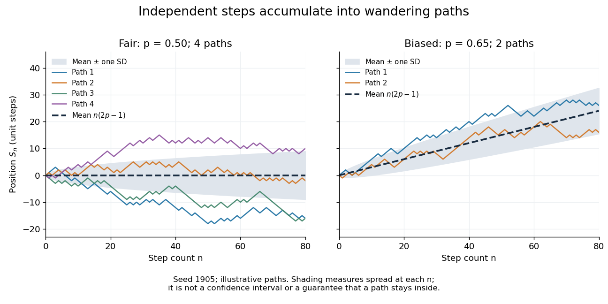

# Random walk

↑ **Parent:** [Markov chain](markov-chain.md)  
ⓦ [Wiki](https://en.wikipedia.org/wiki/Random_walk)

A random walk is a [stochastic process](stochastic-process.md) formed by accumulating random steps. In its additive form, the [increments](stochastic-process.md#increment) $\xi_j$ are [independent and identically distributed random variables](random-variable.md#independent-and-identically-distributed-random-variables) and the position after $n$ steps is

$$
S_n=S_0+\sum_{j=1}^n\xi_j.
$$

The steps can have more choices than $-1$ and $+1$: they may be [integers](integer.md), [real numbers](arithmetic.md#real-number), or [vectors](vector-space.md#vector). A [random walk on a graph](#random-walk-on-a-graph) instead describes steps between [vertices](graph.md#vertex-graph-theory) along [edges](graph-theory.md#edge-of-a-graph); its available moves can depend on the current [vertex](graph.md#vertex-graph-theory).

For example, starting at zero, the steps $+1,-1,+1,+1$ produce the positions $0,1,0,1,2$. This is one [sample path](stochastic-process.md#sample-path); other step sequences can have the same endpoint. A [simple random walk on the integer line](#simple-random-walk-on-the-integer-line) makes this distinction particularly tangible: repeated [Bernoulli trials](discrete-probability-distribution.md#bernoulli-trial) determine both a whole [sample path](stochastic-process.md#sample-path) and an endpoint with a [binomial distribution](discrete-probability-distribution.md#binomial-distribution). All positions below are [dimensionless quantities](physics.md#dimensionless-quantity) measured in steps of length one, and $n$ counts discrete updates.

The model is useful because it separates an average tendency from accumulated fluctuations. A fair [simple symmetric random walk](#simple-symmetric-random-walk) has zero [expected value](expected-value.md) at every time, yet its [standard deviation](variance.md#standard-deviation) grows: cancellation across many possible [sample paths](stochastic-process.md#sample-path) does not keep each walker near zero. The two figures below compare [sample paths](stochastic-process.md#sample-path) with exact endpoint [probabilities](probability-theory.md#probability). For the basic additive construction and its [independent increments](stochastic-process.md#independent-increments), see [MIT, Stochastic Processes I, section 2](https://ocw.mit.edu/courses/18-s096-topics-in-mathematics-with-applications-in-finance-fall-2013/f5784e4facf3de690210d17c97358eba_MIT18_S096F13_lecnote5.pdf).

**Table of contents**

- [Lazy random walk](#lazy-random-walk)
- [Upward skip-free random walk](#upward-skip-free-random-walk)
  - [Geometric maximum of an upward skip-free random walk](#geometric-maximum-of-an-upward-skip-free-random-walk)
- [Gaussian random walk spends zero density of time in bounded sets](#gaussian-random-walk-spends-zero-density-of-time-in-bounded-sets)
- [Mean-square displacement of an isotropic planar random walk](#mean-square-displacement-of-an-isotropic-planar-random-walk)
- [Exponential martingale of a random walk](#exponential-martingale-of-a-random-walk)
  - [Stopped likelihood ratio under exponential tilting](#stopped-likelihood-ratio-under-exponential-tilting)
  - [Exponential first-passage transform for an upward skip-free random walk](#exponential-first-passage-transform-for-an-upward-skip-free-random-walk)
  - [Exponential moment bound for a Gaussian random-walk maximum](#exponential-moment-bound-for-a-gaussian-random-walk-maximum)
- [Random walk on a graph](#random-walk-on-a-graph)
  - [Radial random walk on a regular tree](#radial-random-walk-on-a-regular-tree)
  - [Non-backtracking random walk](#non-backtracking-random-walk)
  - [Random walk on a multigraph](#random-walk-on-a-multigraph)
  - [Recurrent graph](#recurrent-graph)
    - [Edge deletion preserves recurrence](#edge-deletion-preserves-recurrence)
  - [Weighted graph](#weighted-graph)
    - [Killing measure of a weighted graph](#killing-measure-of-a-weighted-graph)
    - [Electrical network](#electrical-network)
      - [Electrical current from stopped random-walk traversals](#electrical-current-from-stopped-random-walk-traversals)
      - [Voltage](#voltage)
      - [Current flow](#current-flow)
        - [Kirchhoff cycle law](#kirchhoff-cycle-law)
        - [Kirchhoff node law](#kirchhoff-node-law)
      - [Effective resistance](#effective-resistance)
        - [Return probability from effective resistance](#return-probability-from-effective-resistance)
        - [Foster's theorem](#foster-s-theorem)
        - [Effective resistance to infinity](#effective-resistance-to-infinity)
        - [Rayleigh monotonicity principle](#rayleigh-monotonicity-principle)
        - [Effective conductance](#effective-conductance)
        - [Thomson principle](#thomson-principle)
        - [Nash-Williams inequality](#nash-williams-inequality)
        - [Commute time identity](#commute-time-identity)
          - [Directed edge occupation in a random-walk commute](#directed-edge-occupation-in-a-random-walk-commute)
  - [Bishop random walk](#bishop-random-walk)
  - [Transient graph](#transient-graph)
    - [Green function of a transient weighted graph](#green-function-of-a-transient-weighted-graph)
      - [Green-function decay for simple random walk on the integer lattice](#green-function-decay-for-simple-random-walk-on-the-integer-lattice)
    - [Equilibrium potential of a finite set](#equilibrium-potential-of-a-finite-set)
      - [Equilibrium measure of a finite set](#equilibrium-measure-of-a-finite-set)
        - [Capacity of a finite set for a transient random walk](#capacity-of-a-finite-set-for-a-transient-random-walk)
      - [Singleton equilibrium potential from the Green function](#singleton-equilibrium-potential-from-the-green-function)
    - [Last-exit decomposition for a transient random walk](#last-exit-decomposition-for-a-transient-random-walk)
  - [Loop-erased random walk](#loop-erased-random-walk)
    - [Loop-erasure of planar Brownian motion](#loop-erasure-of-planar-brownian-motion)
    - [Uniform-spanning-tree path representation of loop-erased random walk](#uniform-spanning-tree-path-representation-of-loop-erased-random-walk)
    - [Loop erasure](#loop-erasure)
    - [Reversibility of loop-erased random walk](#reversibility-of-loop-erased-random-walk)
  - [Simple random walk](#simple-random-walk)
    - [Simple symmetric random walk](#simple-symmetric-random-walk)
      - [Multinomial collision proof of three-dimensional walk transience](#multinomial-collision-proof-of-three-dimensional-walk-transience)
      - [Infinite mean first passage of a simple symmetric random walk](#infinite-mean-first-passage-of-a-simple-symmetric-random-walk)
      - [Origin capture by a sufficiently sleepy planar random walk](#origin-capture-by-a-sufficiently-sleepy-planar-random-walk)
      - [Exponential maximal bound for a symmetric random walk](#exponential-maximal-bound-for-a-symmetric-random-walk)
      - [First-return generating function of the simple symmetric random walk](#first-return-generating-function-of-the-simple-symmetric-random-walk)
      - [Expected time to expand a random-walk range](#expected-time-to-expand-a-random-walk-range)
      - [Square-minus-time martingale of a simple symmetric random walk](#square-minus-time-martingale-of-a-simple-symmetric-random-walk)
        - [Stopped second-moment identity for a simple symmetric random walk](#stopped-second-moment-identity-for-a-simple-symmetric-random-walk)
    - [Simple random walk on the hypercube](#simple-random-walk-on-the-hypercube)
      - [Spectrum of lazy random walk on the hypercube](#spectrum-of-lazy-random-walk-on-the-hypercube)
    - [Simple random walk in two dimensions is recurrent](#simple-random-walk-in-two-dimensions-is-recurrent)
  - [Simple random walk on the integer line](#simple-random-walk-on-the-integer-line)
    - [Expected visits to the origin by a simple random walk](#expected-visits-to-the-origin-by-a-simple-random-walk)
    - [Simultaneous returns of independent simple random walks](#simultaneous-returns-of-independent-simple-random-walks)
    - [Biased random walk](#biased-random-walk)
      - [Exponential martingale of a biased simple random walk](#exponential-martingale-of-a-biased-simple-random-walk)
      - [Hitting time of a downward-biased walk reflected at an upper barrier](#hitting-time-of-a-downward-biased-walk-reflected-at-an-upper-barrier)
      - [Diffusion limit of a weakly biased random walk](#diffusion-limit-of-a-weakly-biased-random-walk)
      - [Maximum of a downward-biased random walk](#maximum-of-a-downward-biased-random-walk)
      - [Reflected biased random walk on the nonnegative integers](#reflected-biased-random-walk-on-the-nonnegative-integers)
  - [Stationary distribution of a graph random walk](#stationary-distribution-of-a-graph-random-walk)

## Lazy random walk

↑ **Parent:** [Random walk](random-walk.md)

## Upward skip-free random walk

↑ **Parent:** [Random walk](random-walk.md)

An upward skip-free [random walk](random-walk.md) has integer-valued increments bounded above by one. Arbitrarily large downward jumps are permitted, but a first crossing of a nonnegative integer level $k$ from below must land exactly at $k$. This removes the overshoot from the [stopped likelihood ratio under exponential tilting](#stopped-likelihood-ratio-under-exponential-tilting) and permits the exact [geometric maximum of an upward skip-free random walk](#geometric-maximum-of-an-upward-skip-free-random-walk). For a real threshold $k$, the first crossing is the crossing of $\lceil k\rceil$, so the overshoot-free formula must use that integer level.

### Geometric maximum of an upward skip-free random walk

↑ **Parent:** [Upward skip-free random walk](#upward-skip-free-random-walk)

Let the increments define an [upward skip-free random walk](#upward-skip-free-random-walk), and suppose $\phi(\lambda)=\mathbb E e^{\lambda X_1}$ is finite for all $\lambda\geq0$. If $\lambda_0>0$ satisfies $\phi(\lambda_0)=1$ and $\phi'(\lambda_0)>0$, the [exponential tilting](probability-distribution.md#exponential-tilting) at $\lambda_0$ gives integrable increments of positive mean. The [strong law of large numbers](convergence-of-random-variables.md#strong-law-of-large-numbers) makes every nonnegative integer level attainable under this tilted law. Upward jumps are at most one, so the value at a first level hit is exactly that level. The [stopped likelihood ratio under exponential tilting](#stopped-likelihood-ratio-under-exponential-tilting) therefore gives hitting probability $e^{-\lambda_0 k}$ for integer $k\geq0$. Subtracting consecutive tail probabilities yields the displayed [geometric distribution](discrete-probability-distribution.md#geometric-distribution) on $j=0,1,\ldots$. For real thresholds use $\lceil k\rceil$ in place of $k$.

## Gaussian random walk spends zero density of time in bounded sets

↑ **Parent:** [Random walk](random-walk.md)

For independent $N(0,1)$ increments, a [random walk](random-walk.md) has $S_j\sim N(0,j)$. If $B$ is a bounded measurable set, its [occupation time](continuous-time-markov-chain.md#occupation-time-of-a-continuous-time-markov-chain) [probability](probability-theory.md#probability) obeys $\mathbb P(S_j\in B)\leq |B|/\sqrt{2\pi j}$. Consequently $\mathbb E\sum_j\mathbf1_B(S_j)/j<\infty$, and [Tonelli's theorem](measure-theory.md#tonelli-theorem) makes this series finite [almost surely](convergence-of-random-variables.md#almost-sure-convergence). [Kronecker lemma](sequence-and-series.md#kronecker-lemma) then gives the displayed zero occupation density. This also shows why its empirical occupation [probabilities](probability-theory.md#probability) cannot converge to a [probability](probability-theory.md#probability) measure simultaneously on all bounded intervals and the whole real line: [continuity](calculus.md#continuous-function) from below would contradict the preserved total mass one.

## Mean-square displacement of an isotropic planar random walk

↑ **Parent:** [Random walk](random-walk.md)

Independent planar unit steps with uniformly distributed direction have zero vector [expected value](expected-value.md). The [squared Euclidean norm](normed-vector-space.md#squared-euclidean-norm) of their sum has expectation $n$, because each diagonal term is one and all cross terms vanish by [independence](random-variable.md#independent-random-variables). More generally, zero-mean independent steps with common second moment $s^2$ give mean-square displacement $ns^2$; nonzero drift adds a quadratic contribution.

## Exponential martingale of a random walk

↑ **Parent:** [Random walk](random-walk.md)

For a [random walk](random-walk.md) with [independent and identically distributed random variables](random-variable.md#independent-and-identically-distributed-random-variables) as increments and finite [moment-generating function](probability-distribution.md#moment-generating-function) at $\theta$, put $\kappa(\theta)=\log\mathbb E e^{\theta X_1}$. Then $e^{\theta S_n-n\kappa(\theta)}$ is a [martingale](martingale.md) by conditioning on the next independent increment. In particular, if $r>0$ and $\mathbb E r^{X_1}=1$, then $r^{S_n}$ is a [martingale](martingale.md). Stopping at a finite interval exit can make this process bounded, allowing the [dominated convergence theorem](measure-theory.md#dominated-convergence-theorem) to justify passage from [bounded stopping times](martingale.md#bounded-stopping-time) to the exit time.

### Stopped likelihood ratio under exponential tilting

↑ **Parent:** [Exponential martingale of a random walk](#exponential-martingale-of-a-random-walk)

For a [random walk](random-walk.md) with [independent and identically distributed random variables](random-variable.md#independent-and-identically-distributed-random-variables) as increments, let $M_n=e^{\lambda S_n}/\phi(\lambda)^n$ define its finite-time [exponential tilting](probability-distribution.md#exponential-tilting). Under the tilted law, $L_n=M_n^{-1}$ is a [martingale](martingale.md): the conditional mean of $\phi(\lambda)e^{-\lambda X_{n+1}}$ is one. For a [stopping time](martingale.md#stopping-time) $T$, partition $\{T\leq n\}$ into $\{T=j\}$ and apply the [tower property of conditional expectation](measure-theory.md#law-of-total-expectation) to obtain the displayed identity. Only finite-time [absolute continuity of measures](measure-theory.md#absolute-continuity-of-measures) is needed; there need not be an infinite-horizon likelihood-ratio density.

### Exponential first-passage transform for an upward skip-free random walk

↑ **Parent:** [Exponential martingale of a random walk](#exponential-martingale-of-a-random-walk)

Let $S_n$ have integrable, mean-zero [independent and identically distributed random variables](random-variable.md#independent-and-identically-distributed-random-variables) as increments, taking integer values at most one, with $\mathbb P(X_1=1)>0$. For a positive integer $b$, put $T_b=\inf\{n:S_n=b\}$ and $M(\tau)=\mathbb E e^{\tau X_1}$, $\tau>0$. Then $T_b$ is finite [almost surely](convergence-of-random-variables.md#almost-sure-convergence). Indeed, $b-S_{n\wedge T_b}$ is a nonnegative [martingale](martingale.md); finite convergence on $\{T_b=\infty\}$ would force its integer increments eventually to vanish, contrary to the [Borel-Cantelli lemmas](probability-theory.md#borel-cantelli-lemmas) applied to $\{X_n=1\}$.

The [exponential martingale of a random walk](#exponential-martingale-of-a-random-walk) $e^{\tau S_n}/M(\tau)^n$ stopped at $T_b$ is bounded by $e^{\tau b}$ because $S_{n\wedge T_b}\leq b$ and $M(\tau)\geq1$. The [dominated convergence theorem](measure-theory.md#dominated-convergence-theorem) therefore preserves its mean one at the limit and proves the displayed [first-passage time](markov-chain.md#first-passage-time) transform. This argument accommodates arbitrarily large negative jumps; the restriction concerns upward jumps. For a [simple symmetric random walk](#simple-symmetric-random-walk), $M(\tau)=\cosh\tau$, giving $\mathbb E e^{-\alpha T_b}=(e^\alpha-\sqrt{e^{2\alpha}-1})^b$.

### Exponential moment bound for a Gaussian random-walk maximum

↑ **Parent:** [Exponential martingale of a random walk](#exponential-martingale-of-a-random-walk)

For [independent and identically distributed random variables](random-variable.md#independent-and-identically-distributed-random-variables) with law $N(-1,1)$, $e^{2S_n}$ is a nonnegative [martingale](martingale.md), since the increment's [moment-generating function](probability-distribution.md#moment-generating-function) equals one at parameter two. The [Doob maximal inequality](martingale.md#doob-maximal-inequality-for-a-nonnegative-submartingale) gives $\mathbb P(Z>t)\leq e^{-2t}$ for the all-time maximum $Z\geq0$. Integrating the tail gives the displayed bound. For $b\leq0$, $e^{bZ}\leq1$. The [strong law of large numbers](convergence-of-random-variables.md#strong-law-of-large-numbers) guarantees finiteness and attainment of the maximum because $S_n\to-\infty$.

## Random walk on a graph

↑ **Parent:** [Random walk](random-walk.md)

A random walk on a graph moves along an incident edge at each step.

### Radial random walk on a regular tree

↑ **Parent:** [Random walk on a graph](#random-walk-on-a-graph)

For a [simple random walk](#simple-random-walk) on an infinite [regular tree](tree-graph-theory.md#regular-tree) of degree $z\geq2$, every [vertex](graph.md#vertex-graph-theory) other than the chosen root has one neighbour closer to the root and $z-1$ farther away. The [graph distance](graph-theory.md#distance-graph-theory) from the root is therefore a nearest-neighbour [Markov chain](markov-chain.md) on the nonnegative integers, with the displayed bulk transition [probabilities](probability-theory.md#probability) and a certain outward step from zero. For shell [probabilities](probability-theory.md#probability) $P_r(N)$,

$$
P_0(N+1)=\frac{P_1(N)}z,\qquad
P_1(N+1)=P_0(N)+\frac{P_2(N)}z,
$$

$$
P_r(N+1)=\frac{z-1}{z}P_{r-1}(N)+\frac1zP_{r+1}(N),\qquad r>1.
$$

Shell [probabilities](probability-theory.md#probability) include all [vertices](graph.md#vertex-graph-theory) at the given distance. They differ from single-vertex [probabilities](probability-theory.md#probability) by the shell size, $1$ at the root and $z(z-1)^{r-1}$ for $r\geq1$.

### Non-backtracking random walk

↑ **Parent:** [Random walk on a graph](#random-walk-on-a-graph)

A non-backtracking random walk remembers its preceding vertex and excludes that neighbor from the next choice. At vertices of degree at least two, it is a [Markov chain](markov-chain.md) on directed edges: $(a,b)$ moves to $(b,c)$ with probability $1/(\deg b-1)$ for each neighbor $c\ne a$. Dead ends require an additional convention. An initial vertex without a preceding edge uses the ordinary first-step neighbor distribution.

### Random walk on a multigraph

↑ **Parent:** [Random walk on a graph](#random-walk-on-a-graph)

An undirected graph may have repeated edges. Choosing an incident edge uniformly gives transition probability equal to the edge multiplicity divided by the vertex degree. Its stationary probability is proportional to degree and its stationary fluxes are symmetric, making it a [reversible Markov chain](markov-chain.md#reversible-markov-chain).

### Recurrent graph

↑ **Parent:** [Random walk on a graph](#random-walk-on-a-graph)

A connected [locally finite graph](graph-theory.md#locally-finite-graph) is recurrent if its [simple random walk](#simple-random-walk) returns to its starting vertex [almost surely](convergence-of-random-variables.md#almost-sure-convergence). In that case the walk hits every fixed vertex [almost surely](convergence-of-random-variables.md#almost-sure-convergence) from every starting vertex.

#### Edge deletion preserves recurrence

↑ **Parent:** [Recurrent graph](#recurrent-graph)

Deleting an [edge](graph-theory.md#edge-of-a-graph) of a locally finite [recurrent graph](#recurrent-graph) leaves [recurrent Markov chain](markov-chain.md#recurrent-markov-chain) connected components. On an infinite component choose a root away from the deleted [edge](graph-theory.md#edge-of-a-graph)'s endpoints, so its [vertex degree](graph-theory.md#degree-graph-theory) does not change. The [Rayleigh monotonicity principle](#rayleigh-monotonicity-principle) increases resistance to wired outer boundaries, and [effective resistance to infinity](#effective-resistance-to-infinity) therefore remains infinite. Finite components are [recurrent Markov chain](markov-chain.md#recurrent-markov-chain) too. This is a recurrence-type comparison; at an endpoint, changes in the [vertex degree](graph-theory.md#degree-graph-theory) factor prevent a blanket monotonicity claim about first-return [probabilities](probability-theory.md#probability).

### Weighted graph

↑ **Parent:** [Random walk on a graph](#random-walk-on-a-graph)  
ⓦ [Wiki](https://en.wikipedia.org/wiki/Weighted_graph)

A weighted graph assigns a symmetric nonnegative conductance $\mu_{xy}$ to each edge. With killing weights $\kappa_x$, the associated discrete-time walk moves from $x$ to $y$ with probability $\mu_{xy}/\mu_x$ and is killed with probability $\kappa_x/\mu_x$, where $\mu_x=\kappa_x+\sum_y\mu_{xy}$.

#### Killing measure of a weighted graph

↑ **Parent:** [Weighted graph](#weighted-graph)

The killing measure assigns the weight $\kappa_x$ of the transition from $x$ to a cemetery state.

#### Electrical network

↑ **Parent:** [Weighted graph](#weighted-graph)  
ⓦ [Wiki](https://en.wikipedia.org/wiki/Electrical_network)

An electrical network is a [weighted graph](#weighted-graph) whose edge weights are interpreted as electrical conductances. Random-walk hitting quantities can then be expressed through voltages, currents, and [effective resistance](#effective-resistance).

##### Electrical current from stopped random-walk traversals

↑ **Parent:** [Electrical network](#electrical-network)

In a finite connected [electrical network](#electrical-network), run the conductance [random walk](random-walk.md) from $s$ until its first visit to a distinct vertex $t$. Let $G(s,x)$ be the expected visits to $x$ before stopping, and $w_x=\sum_yw_{xy}$. The expected signed number of traversals of $\{x,y\}$ is the displayed expression. Its divergence is $\mathbf1_{x=s}-\mathbf1_{x=t}$ by telescoping each path, and its resistance-weighted sum around a cycle is zero because $G(s,x)/w_x$ is a voltage. Uniqueness follows by summing $\sum_{\{x,y\}}w_{xy}(v_x-v_y)^2$: a zero-divergence voltage flow has zero energy. Thus the expected net traversals are exactly the unit source-to-sink current.

##### Voltage

↑ **Parent:** [Electrical network](#electrical-network)

A voltage is a scalar potential on the vertices of an [electrical network](#electrical-network). Away from prescribed boundary vertices it is harmonic, and its difference across an edge drives current through that edge.

##### Current flow

↑ **Parent:** [Electrical network](#electrical-network)

A current flow is an antisymmetric function on oriented edges satisfying Kirchhoff's node law away from its sources and sinks. For conductance $c(x,y)$ and voltage $u$, [Ohm's law](electric-charge.md#ohm-s-law) gives $i(x,y)=c(x,y)(u(x)-u(y))$.

###### Kirchhoff cycle law

↑ **Parent:** [Current flow](#current-flow)

The [Kirchhoff cycle law](#kirchhoff-cycle-law) says the directed sum of [voltage](#voltage) drops around every [graph cycle](graph-theory.md#cycle-in-a-graph) is zero. For unit [edge](graph-theory.md#edge-of-a-graph) resistance this is the sum of signed currents around the [graph cycle](graph-theory.md#cycle-in-a-graph). With unit [edge](graph-theory.md#edge-of-a-graph) resistance, the current is a [voltage](#voltage) gradient: define the [voltage](#voltage) difference by summing drops along a [graph path](graph-theory.md#path-in-a-graph). The difference of the sums along two [graph paths](graph-theory.md#path-in-a-graph) is a sum around closed walks; decomposing these into [graph cycles](graph-theory.md#cycle-in-a-graph) makes it zero. Together with the [Kirchhoff node law](#kirchhoff-node-law), the resulting [graph Laplacian](graph-theory.md#laplacian-matrix) equation determines current uniquely on a finite connected network.

###### Kirchhoff node law

↑ **Parent:** [Current flow](#current-flow)

The [Kirchhoff node law](#kirchhoff-node-law) says the sum of outward currents at a [graph vertex](graph.md#vertex-graph-theory) is zero unless that [graph vertex](graph.md#vertex-graph-theory) is a source or sink. In an [electrical network](#electrical-network), it is [flow conservation](flow-network.md#flow-conservation); a [unit flow](flow-network.md#unit-flow) has divergences $+1$ and $-1$ at its terminals.

##### Effective resistance

↑ **Parent:** [Electrical network](#electrical-network)  
ⓦ [Wiki](https://en.wikipedia.org/wiki/Effective_resistance)

The effective resistance between vertices $a$ and $z$ is the voltage difference required to send one unit of current from $a$ to $z$.

###### Return probability from effective resistance

↑ **Parent:** [Effective resistance](#effective-resistance)

For the conductance-weighted [random walk on a graph](#random-walk-on-a-graph), set $d(x)=\sum_vc_{xv}$. The voltage $h(u)=P_u(T_x<T_y)$ has boundary values one and zero. The total [electric current](electric-charge.md#electric-current) is $\sum_vc_{xv}(1-h(v))=1/R(x,y)$. The [first-step analysis](analysis.md#first-step-analysis) therefore gives the displayed positive-return-time formula. Wiring the exterior of finite sets and taking limits gives $P_x(T_x^+=\infty)=1/(d(x)R(x,\infty))$.

<h6 id="foster-s-theorem">Foster's theorem</h6>

↑ **Parent:** [Effective resistance](#effective-resistance)

For a finite connected unweighted loopless [graph](graph.md) with $n$ [graph vertices](graph.md#vertex-graph-theory),

$$
\sum_{e\in E}R_{\mathrm{eff}}(e)=n-1.
$$

The [edge-inclusion formula for a uniform spanning tree](tree-graph-theory.md#edge-inclusion-formula-for-a-uniform-spanning-tree) gives the left-hand side as $\mathbb E|T|$, and every [spanning tree](tree-graph-theory.md#spanning-tree) has $n-1$ [edges](graph-theory.md#edge-of-a-graph). On the same finite [connected graph](graph.md#connected-graph) with positive [edge](graph-theory.md#edge-of-a-graph) conductances $c_e>0$, the corresponding identity is $\sum_e c_eR_{\mathrm{eff}}(e)=n-1$.

###### Effective resistance to infinity

↑ **Parent:** [Effective resistance](#effective-resistance)

The effective resistance to infinity is the limit of the [effective resistance](#effective-resistance) from a fixed vertex to the wired complement of increasing finite sets. It is finite exactly when the [finite-energy flow criterion for transience](flow-network.md#finite-energy-flow-criterion-for-transience) holds.

###### Rayleigh monotonicity principle

↑ **Parent:** [Effective resistance](#effective-resistance)

Increasing edge resistances, including deleting edges, cannot decrease [effective resistance](#effective-resistance). Decreasing resistances or identifying vertices cannot increase [effective resistance](#effective-resistance). These statements also follow from the [Thomson principle](#thomson-principle).

###### Effective conductance

↑ **Parent:** [Effective resistance](#effective-resistance)

The effective conductance between two terminals is the reciprocal of their [effective resistance](#effective-resistance). Under a unit voltage difference it equals the total current flowing from one terminal to the other.

###### Thomson principle

↑ **Parent:** [Effective resistance](#effective-resistance)  
ⓦ [Wiki](https://en.wikipedia.org/wiki/Thomson_principle)

[Thomson principle](#thomson-principle) says that effective resistance is the minimum energy among unit flows from $a$ to $z$:

$$
R_{\mathrm{eff}}(a,z)=\inf_\theta\sum_e\frac{\theta(e)^2}{c(e)}.
$$

###### Nash-Williams inequality

↑ **Parent:** [Effective resistance](#effective-resistance)  
ⓦ [Wiki](https://en.wikipedia.org/wiki/Nash-Williams_inequality)

If $\Pi_1,\ldots,\Pi_m$ are pairwise edge-disjoint cutsets separating $a$ from $z$ in an [electrical network](#electrical-network), then

$$
R_{\mathrm{eff}}(a,z)\geq\sum_{k=1}^m\left(\sum_{e\in\Pi_k}c(e)\right)^{-1}.
$$

###### Commute time identity

↑ **Parent:** [Effective resistance](#effective-resistance)

For a random walk on a finite [electrical network](#electrical-network),

$$
\mathbb E_aT_z+\mathbb E_zT_a
=2\left(\sum_{e\in E}c(e)\right)R_{\mathrm{eff}}(a,z).
$$

###### Directed edge occupation in a random-walk commute

↑ **Parent:** [Commute time identity](#commute-time-identity)

Let [simple random walk](#simple-random-walk) travel from $a\ne z$ to its first visit to $z$, then stop on its subsequent first hit of $a$ in a finite connected unweighted loopless [graph](graph.md). Every directed [edge](graph-theory.md#edge-of-a-graph) $u\to v$ has expected traversal count

$$
\mathbb E S(u,v)=R_{\mathrm{eff}}(a,z).
$$

The [Strong Markov property](markov-chain.md#strong-markov-property) splits the count into the two killed legs. By [killed-walk occupation voltage](markov-chain.md#killed-walk-occupation-voltage), their contributions are $v_{az}(u)$ and $v_{za}(u)$. Their Laplacians cancel, so the [harmonic maximum principle on a finite graph](partial-differential-equation.md#harmonic-maximum-principle-on-a-finite-graph) makes the sum constant, with value $v_{az}(a)+v_{za}(a)=R_{\mathrm{eff}}(a,z)$. Summing over all directed [edges](graph-theory.md#edge-of-a-graph) recovers the [commute time identity](#commute-time-identity).

### Bishop random walk

↑ **Parent:** [Random walk on a graph](#random-walk-on-a-graph)

A bishop random walk moves uniformly among the current square and all chessboard squares sharing a diagonal with it.

### Transient graph

↑ **Parent:** [Random walk on a graph](#random-walk-on-a-graph)

A locally finite connected graph is transient when its [simple random walk](#simple-random-walk) visits every vertex only finitely often almost surely.

#### Green function of a transient weighted graph

↑ **Parent:** [Transient graph](#transient-graph)

For the walk on a [weighted graph](#weighted-graph), the Green function normalized by vertex weight is

$$
g(x,y)=\frac1{\mu_y}\mathbb E_x\sum_{n\geq0}\mathbf1_{\{X_n=y\}}.
$$

Symmetry of the conductances makes $g(x,y)=g(y,x)$, and $\mathcal E(g(\mathord\cdot,y),f)=f(y)$ for finitely supported $f$.

##### Green-function decay for simple random walk on the integer lattice

↑ **Parent:** [Green function of a transient weighted graph](#green-function-of-a-transient-weighted-graph)

For [simple random walk](#simple-random-walk) on $\mathbb Z^d$ with $d\geq3$,

$$
g(0,x)\asymp |x|^{2-d}.
$$

Consequently the probability of ever hitting $x$ from the origin has the same order.

#### Equilibrium potential of a finite set

↑ **Parent:** [Transient graph](#transient-graph)

For a finite vertex set $A$, its equilibrium potential is $h_A(x)=P_x(H_A<\infty)$. It equals one on $A$, is harmonic off $A$, and belongs to the [Dirichlet energy space with zero boundary at infinity](markov-chain.md#dirichlet-energy-space-with-zero-boundary-at-infinity).

##### Equilibrium measure of a finite set

↑ **Parent:** [Equilibrium potential of a finite set](#equilibrium-potential-of-a-finite-set)

The equilibrium measure is supported on $A$ and is given by

$$
e_A(x)=\mathbf1_{\{x\in A\}}\mu_xP_x(\widetilde H_A=\infty).
$$

###### Capacity of a finite set for a transient random walk

↑ **Parent:** [Equilibrium measure of a finite set](#equilibrium-measure-of-a-finite-set)

The capacity of a finite set is the total mass of its [equilibrium measure of a finite set](#equilibrium-measure-of-a-finite-set):

$$
\operatorname{cap}(A)=\sum_xe_A(x)=\mathcal E(h_A,h_A).
$$

Capacity is monotone under inclusion, though strict inclusion need not give strict inequality.

##### Singleton equilibrium potential from the Green function

↑ **Parent:** [Equilibrium potential of a finite set](#equilibrium-potential-of-a-finite-set)

For a vertex $o$,

$$
P_x(H_o<\infty)=\frac{g(x,o)}{g(o,o)},
\qquad
\mathcal E(h_{\{o\}},h_{\{o\}})=\frac1{g(o,o)}.
$$

#### Last-exit decomposition for a transient random walk

↑ **Parent:** [Transient graph](#transient-graph)

A last-exit decomposition partitions a transient path event according to the final visit to a finite set. Reversing the finite path before that visit and using [detailed balance](markov-chain.md#detailed-balance) converts last-exit probabilities into hitting probabilities weighted by an [equilibrium measure of a finite set](#equilibrium-measure-of-a-finite-set).

### Loop-erased random walk

↑ **Parent:** [Random walk on a graph](#random-walk-on-a-graph)  
ⓦ [Wiki](https://en.wikipedia.org/wiki/Loop-erased_random_walk)

A loop-erased random walk is the self-avoiding path obtained by chronologically erasing loops from a random-walk path.

#### Loop-erasure of planar Brownian motion

↑ **Parent:** [Loop-erased random walk](#loop-erased-random-walk)

The time reversal of a [Brownian motion conditioned to exit at a boundary point](markov-process.md#brownian-motion-conditioned-to-exit-at-a-boundary-point) can be coupled to radial $\operatorname{SLE}_2$ so that its loop-erasure is the radial curve. The coupling requires the Brownian path's first hit of each initial radial segment to occur at its tip. It is an existence theorem for a coupling and does not assert that the Brownian trace equals the simple radial curve, or that an elementary deterministic finite-loop algorithm is defined for all continuum paths.

#### Uniform-spanning-tree path representation of loop-erased random walk

↑ **Parent:** [Loop-erased random walk](#loop-erased-random-walk)

On a finite connected unweighted [graph](graph.md), the [graph path](graph-theory.md#path-in-a-graph) between $x$ and $y$ in a [uniform spanning tree](tree-graph-theory.md#uniform-spanning-tree) has the law of [loop-erased random walk](#loop-erased-random-walk) from $x$ to $y$. Root [Wilson's algorithm](tree-graph-theory.md#wilson-s-algorithm) at $y$ and process $x$ first: the first attached [graph path](graph-theory.md#path-in-a-graph) is exactly that [loop erasure](#loop-erasure), and later attachments cannot change it. Changing the root to $x$ proves [reversibility of loop-erased random walk](#reversibility-of-loop-erased-random-walk), even though chronological [loop erasure](#loop-erasure) does not commute with reversing each individual random-walk trajectory.

#### Loop erasure

↑ **Parent:** [Loop-erased random walk](#loop-erased-random-walk)

Chronological loop erasure removes each loop from a finite or transient infinite path as soon as the loop is formed, producing a self-avoiding path.

#### Reversibility of loop-erased random walk

↑ **Parent:** [Loop-erased random walk](#loop-erased-random-walk)

On a finite undirected graph, the reversal of a loop-erased random walk from $x$ to $y$ has the law of a loop-erased random walk from $y$ to $x$. The uniform-spanning-tree path representation proves the identity.

### Simple random walk

↑ **Parent:** [Random walk on a graph](#random-walk-on-a-graph)

A simple random walk on a [locally finite graph](graph-theory.md#locally-finite-graph) chooses each [vertex](graph.md#vertex-graph-theory) in the current [vertex](graph.md#vertex-graph-theory)'s [graph neighbourhood](graph-theory.md#graph-neighbourhood) with equal [probability](probability-theory.md#probability), assuming there is at least one available [neighbour](graph-theory.md#neighbour-of-a-vertex). On the [integer](integer.md) line there are two choices, one unit left or right, so each has [probability](probability-theory.md#probability) $1/2$. This is the one-dimensional [simple symmetric random walk](#simple-symmetric-random-walk). Terminology varies: a [simple random walk on the integer line](#simple-random-walk-on-the-integer-line) is also often allowed unequal step [probabilities](probability-theory.md#probability), with “symmetric” specifying the fair case.

For a [simple symmetric random walk](#simple-symmetric-random-walk) starting at $S_0=0$, each [increment](stochastic-process.md#increment) has the [Rademacher distribution](probability-distribution.md#rademacher-distribution), with [expected value](expected-value.md) zero and [variance](variance.md) one. Thus [linearity of expectation](expected-value.md#linearity-of-expectation) and the [variance of a sum](variance.md#variance-of-a-sum) of [independent random variables](random-variable.md#independent-random-variables) give

$$
\mathbb E S_n=0,\qquad \operatorname{Var}(S_n)=n,\qquad \sigma_n=\sqrt n.
$$

For example, after $80$ steps the [expected value](expected-value.md) is zero, the [variance](variance.md) is $80$, and the [standard deviation](variance.md#standard-deviation) is $\sqrt{80}\approx8.944$. Doubling the typical distance scale takes four times as many steps. This square-root growth explains why a [random walk](random-walk.md) can wander far even when there is no preferred direction.

**[Figure 1](#image-four-fair-and-two-biased-unit-step-random-walk-paths-with-their-expected-values-and-bands-one-standard-deviation-wide-on-either-side). Four fair and two biased unit-step random-walk paths, with their expected values and bands one standard deviation wide on either side.**

The colored curves are illustrative [sample paths](stochastic-process.md#sample-path), not averages over all possible walks. The dashed curves show the [expected values](expected-value.md); the shaded bands show the [expected value](expected-value.md) plus or minus one [standard deviation](variance.md#standard-deviation) at each time. These bands are a scale of spread, not [confidence intervals](statistical-inference.md#confidence-interval), and give no guarantee that an entire [sample path](stochastic-process.md#sample-path) stays inside them.

Zero [expected value](expected-value.md) does not make this a [stationary process](time-series.md#stationary-process): its one-time [probability distribution](probability-distribution.md) changes with $n$, as the increasing [variance](variance.md) already proves. It does have [stationary increments](stochastic-process.md#stationary-increments) and [independent increments](stochastic-process.md#independent-increments), because blocks of fresh steps have the same [probability distribution](probability-distribution.md) at any starting time and disjoint blocks use [independent random variables](random-variable.md#independent-random-variables). This separation of position from [increment](stochastic-process.md#increment) is one reason the [random walk](random-walk.md) is such a useful first example of a [stochastic process](stochastic-process.md).

#### Simple symmetric random walk

↑ **Parent:** [Simple random walk](#simple-random-walk)

A simple symmetric random walk starting from $S_0$ has

$$
S_n=S_0+\sum_{k=1}^n\xi_k,
$$

where the increments $\xi_k$ are independent and satisfy

$$
\mathbb P(\xi_k=1)=\mathbb P(\xi_k=-1)=\frac12.
$$

##### Multinomial collision proof of three-dimensional walk transience

↑ **Parent:** [Simple symmetric random walk](#simple-symmetric-random-walk)

For the nearest-neighbor symmetric walk on $\mathbb Z^3$, a return at time $2n$ uses $i,j,k$ positive and the same numbers of negative steps along each axis, with $i+j+k=n$. Counting arrangements gives the displayed identity. The sum of squares of the three-category [multinomial distribution](discrete-probability-distribution.md#multinomial-distribution) probabilities is at most their maximum. This maximum occurs at balanced counts and is $O(n^{-1})$ by [Stirling's formula](real-analysis.md#stirling-formula); the central binomial factor is $O(n^{-1/2})$. The total return probability is therefore summable. The expected number of visits is finite, so the probability of returning after time zero is strictly below one, proving that the origin is a [transient state](markov-chain.md#transient-state).

##### Infinite mean first passage of a simple symmetric random walk

↑ **Parent:** [Simple symmetric random walk](#simple-symmetric-random-walk)

For a [simple symmetric random walk](#simple-symmetric-random-walk) starting from zero, its first [hitting time](markov-chain.md#first-passage-time) of $1$ is almost surely finite but has infinite [expectation](expected-value.md). Stopping at exit from $[-m,1]$, the [optional stopping theorem](martingale.md#optional-sampling-theorem-for-a-supermartingale) for $S_n$ gives upper-exit [probability](probability-theory.md#probability) $m/(m+1)$, while stopping $S_n^2-n$ gives mean exit time $m$. The first [probabilities](probability-theory.md#probability) tend to one, and the exit times are bounded above by the first passage to $1$, proving both conclusions. Finite-time stopping and bounded stopped positions justify passage to the exit time.

##### Origin capture by a sufficiently sleepy planar random walk

↑ **Parent:** [Simple symmetric random walk](#simple-symmetric-random-walk)

Suppose two independent planar [simple symmetric random walks](#simple-symmetric-random-walk) are compared while one stays at its $j$th position throughout a deterministic time block. If each block has an unconditional probability bounded below by a positive constant that the other walk visits the origin, simultaneous origin visits occur infinitely often almost surely. [Markov-chain recurrence](markov-chain.md#recurrent-markov-chain) gives infinitely many origin blocks for the sleepy walk. The block bound yields positive probability of infinitely many coincidences; [eventual coupling of planar symmetric random walks](probability-and-statistics.md#eventual-coupling-of-planar-symmetric-random-walks) then makes this future event have probability zero or one. Conditional block bounds or independence of capture attempts are not required.

##### Exponential maximal bound for a symmetric random walk

↑ **Parent:** [Simple symmetric random walk](#simple-symmetric-random-walk)

For a [simple symmetric random walk](#simple-symmetric-random-walk), the estimate $\mathbb E e^{\theta S_n}\le e^{n\theta^2/2}$ and the exponential maximal inequality give $\mathbb P(\max_{k\le n}S_k\ge t\sqrt n)\le e^{-t^2/2}$ for $t\ge0$.

##### First-return generating function of the simple symmetric random walk

↑ **Parent:** [Simple symmetric random walk](#simple-symmetric-random-walk)

For the [simple symmetric random walk](#simple-symmetric-random-walk) on $\mathbb Z$, the [renewal equation](probability-theory.md#renewal-equation) relates first-return and return [probability generating functions](probability-distribution.md#probability-generating-function). The central-binomial return series is $U(s)=(1-s^2)^{-1/2}$, giving $F(s)=1-U(s)^{-1}$. Its value tends to one at $s=1$, but its derivative diverges there: the walk has [null recurrent states](markov-chain.md#null-recurrent-state).

##### Expected time to expand a random-walk range

↑ **Parent:** [Simple symmetric random walk](#simple-symmetric-random-walk)

For a [simple symmetric random walk](#simple-symmetric-random-walk) on the integers, let $T_k$ be the first time that $k$ distinct vertices have been visited. The visited set is an interval, and at $T_k$ the walk is at an endpoint. The [Strong Markov property](markov-chain.md#strong-markov-property) turns the time to add one vertex into [gambler's ruin](markov-chain.md#gambler-s-ruin) between the two immediately exterior vertices, starting one step from a boundary. The [expected duration of symmetric gambler's ruin](markov-chain.md#expected-duration-of-symmetric-gambler-s-ruin) is therefore $k$. This also holds at $k=1$.

##### Square-minus-time martingale of a simple symmetric random walk

↑ **Parent:** [Simple symmetric random walk](#simple-symmetric-random-walk)

For a simple symmetric random walk, $S_n^2-n$ is a martingale because the next increment has conditional mean zero and conditional square one.

###### Stopped second-moment identity for a simple symmetric random walk

↑ **Parent:** [Square-minus-time martingale of a simple symmetric random walk](#square-minus-time-martingale-of-a-simple-symmetric-random-walk)

If $T$ is a stopping time with finite mean, then

$$
\mathbb E[S_T^2]=\mathbb E[T].
$$

Stopping first at $T\wedge n$ and using the $L^2$ martingale convergence theorem justifies passage to an unbounded $T$.

#### Simple random walk on the hypercube

↑ **Parent:** [Simple random walk](#simple-random-walk)

On the $n$-dimensional [hypercube graph](graph.md#hypercube-graph), simple random walk flips one uniformly chosen coordinate at each step. Its stationary distribution is uniform on the $2^n$ vertices, so its mean return time is $2^n$.

##### Spectrum of lazy random walk on the hypercube

↑ **Parent:** [Simple random walk on the hypercube](#simple-random-walk-on-the-hypercube)

For [random walk](random-walk.md) on $\{-1,1\}^n$ that chooses a coordinate uniformly and flips it with probability $1/2$, the [Walsh characters](analysis-of-boolean-functions.md#walsh-character) $f_J(x)=\prod_{j\in J}x_j$ form an [orthonormal eigenbasis](linear-operator-theory.md#orthonormal-eigenbasis) under the [uniform distribution on a finite set](discrete-probability-distribution.md#discrete-uniform-distribution). Flipping a coordinate in $J$ negates $f_J$, so $Pf_J=(1-|J|/n)f_J$. Hence $1-k/n$ has [multiplicity](polynomial.md#multiplicity-mathematics) $\binom nk$, and the ordinary and absolute [spectral gaps](linear-operator-theory.md#spectral-gap) both equal $1/n$.

#### Simple random walk in two dimensions is recurrent

↑ **Parent:** [Simple random walk](#simple-random-walk)

A simple random walk on $\mathbb Z^2$ visits its starting point infinitely often almost surely and hits every fixed vertex almost surely.

### Simple random walk on the integer line

↑ **Parent:** [Random walk on a graph](#random-walk-on-a-graph)

A simple random walk on the [integer](integer.md) line starts at $S_0=0$ and takes [independent and identically distributed random variables](random-variable.md#independent-and-identically-distributed-random-variables) $\xi_j$ as unit [increments](stochastic-process.md#increment), with

$$
\mathbb P(\xi_j=+1)=p,\qquad \mathbb P(\xi_j=-1)=1-p,\qquad
S_n=\sum_{j=1}^n\xi_j,\qquad 0<p<1.
$$

The [simple symmetric random walk](#simple-symmetric-random-walk) has $p=1/2$; a [biased random walk](#biased-random-walk) has $p\ne1/2$. At $p=0$ or $p=1$ every step is deterministic, giving $S_n=-n$ or $S_n=n$ respectively.

Count the rightward steps using [indicator functions](measure-theory.md#indicator-function):

$$
B_n=\sum_{j=1}^n\mathbf1_{\{\xi_j=+1\}},\qquad
B_n\sim\operatorname{Binomial}(n,p),\qquad S_n=B_n-(n-B_n)=2B_n-n.
$$

Thus the endpoint is a shifted and rescaled [random variable](random-variable.md) with a [binomial distribution](discrete-probability-distribution.md#binomial-distribution). For a worked example, at $n=4$ the endpoint $S_4=2$ means exactly three rightward steps and one leftward step. There are $\binom43=4$ possible orders, so its [probability](probability-theory.md#probability) is $4p^3(1-p)$, equal to $1/4$ in the fair case. More generally the [binomial coefficient](binomial-coefficient.md) counts the orders, giving the exact [probability mass function](probability-distribution.md#probability-mass-function)

$$
\mathbb P(S_n=s)=
\begin{cases}
\displaystyle\binom{n}{(n+s)/2}p^{(n+s)/2}(1-p)^{(n-s)/2},
&s\in\{-n,-n+2,\ldots,n\},\\
0,&\text{otherwise}.
\end{cases}
$$

In particular, the endpoint must have the same [integer parity](integer.md#parity-mathematics) as $n$: $S_n\equiv n\pmod2$. For $0<p<1$ the [support of a probability distribution](probability-distribution.md#support-of-a-probability-distribution) is exactly $\{-n,-n+2,\ldots,n\}$. At $n=80$ only [even integers](integer.md#even-number) in $[-80,80]$ are reachable; at $n=81$ only [odd integers](integer.md#odd-integer) are reachable. This restriction is easy to lose if one draws a smooth curve instead of discrete [probability masses](probability-distribution.md#probability-mass). The fair-walk counting argument is also presented in [Grinstead and Snell, Introduction to Probability, section 12.1](https://math.dartmouth.edu/~prob/prob/prob.pdf).

**[Figure 2](#image-exact-binomial-endpoint-probabilities-for-fair-walks-of-20-and-80-steps-and-a-biased-walk-of-80-steps-only-even-endpoints-are-possible). Exact binomial endpoint probabilities for fair walks of 20 and 80 steps and a biased walk of 80 steps; only even endpoints are possible.**

The endpoint identity and the [binomial distribution](discrete-probability-distribution.md#binomial-distribution) give the [expected value](expected-value.md), [variance](variance.md), and [standard deviation](variance.md#standard-deviation)

$$
\mathbb E S_n=n(2p-1),\qquad
\operatorname{Var}(S_n)=4np(1-p),\qquad
\sigma_n=2\sqrt{np(1-p)}.
$$

A short direct check gives $\mathbb E\xi_j=2p-1$ and $\mathbb E\xi_j^2=1$, hence $\operatorname{Var}(\xi_j)=1-(2p-1)^2=4p(1-p)$. Then apply [linearity of expectation](expected-value.md#linearity-of-expectation) and the [variance of a sum](variance.md#variance-of-a-sum) of [independent random variables](random-variable.md#independent-random-variables).

The absolute width and the width relative to the number of steps answer different questions. In the fair case the [standard deviation](variance.md#standard-deviation) grows from $\sqrt{20}\approx4.472$ to $\sqrt{80}\approx8.944$, while $\sigma_n/n$ shrinks from $0.2236$ to $0.1118$. At $n=80,p=0.65$, the [standard deviation](variance.md#standard-deviation) is $\sqrt{72.8}\approx8.532$, or $0.9539$ times the fair width, and $\sigma_n/n\approx0.1067$. Centering and dividing by each walk's own [standard deviation](variance.md#standard-deviation) gives, for $n>0$,

$$
Z_n=\frac{S_n-n(2p-1)}{2\sqrt{np(1-p)}},\qquad
\mathbb E Z_n=0,\qquad \operatorname{Var}(Z_n)=1.
$$

This rescaling equalizes the [variances](variance.md), not the entire [probability distributions](probability-distribution.md). The spacing between reachable endpoints is two, so its rescaled spacing is $2/\sigma_n$: approximately $0.4472$ for the fair $20$-step walk, $0.2236$ for the fair $80$-step walk, and $0.2344$ for the biased $80$-step walk.

The positions themselves are dependent. For $1\leq m\leq n$, $S_n=S_m+(S_n-S_m)$, where the second term is [independent](random-variable.md#independent-random-variables) of $S_m$. Their [covariance](variance.md#covariance) is therefore

$$
\operatorname{Cov}(S_m,S_n)=\operatorname{Var}(S_m)=4mp(1-p)>0.
$$

For example, in the fair case $S_1=1$ allows $S_2=0$ or $2$, whereas $S_1=-1$ allows $S_2=-2$ or $0$. Nevertheless the position process is a [Markov chain](markov-chain.md): given its current position, the next fresh [increment](stochastic-process.md#increment) has no dependence on its past. Its [transition probabilities](markov-chain.md#transition-probability) are

$$
P(x,y)=\begin{cases}p,&y=x+1,\\1-p,&y=x-1,\\0,&\text{otherwise}.\end{cases}
$$

These [transition probabilities](markov-chain.md#transition-probability) are the same at every time and every [integer](integer.md) position: shifting both $x$ and $y$ by the same [integer](integer.md) leaves $P(x,y)$ unchanged. Thus the [Markov property](markov-chain.md#markov-property) and [independent increments](stochastic-process.md#independent-increments) coexist with dependent positions.

#### Expected visits to the origin by a simple random walk

↑ **Parent:** [Simple random walk on the integer line](#simple-random-walk-on-the-integer-line)

For the symmetric walk and $V_{2n}=|\{0\leq j\leq2n:S_j=0\}|$,

$$
\mathbb EV_{2n}=\sum_{k=0}^n\frac{\binom{2k}{k}}{4^k}.
$$

Since the central binomial coefficient satisfies $\binom{2k}{k}/4^k\asymp k^{-1/2}$, this expectation is of order $\sqrt n$.

#### Simultaneous returns of independent simple random walks

↑ **Parent:** [Simple random walk on the integer line](#simple-random-walk-on-the-integer-line)

For $d$ [independent](random-variable.md#independent-random-variables) symmetric walks on $\mathbb Z$, the probability that all are at the origin at time $2n$ is

$$
\left(\frac{\binom{2n}{n}}{4^n}\right)^d\asymp n^{-d/2}.
$$

The [Borel-Cantelli lemmas](probability-theory.md#borel-cantelli-lemmas) therefore show that simultaneous returns occur only finitely often almost surely when $d\geq3$.

#### Biased random walk

↑ **Parent:** [Simple random walk on the integer line](#simple-random-walk-on-the-integer-line)

A biased random walk on the [integer](integer.md) line takes unit steps right and left with unequal [probabilities](probability-theory.md#probability) $p$ and $1-p$, using [independent and identically distributed random variables](random-variable.md#independent-and-identically-distributed-random-variables) as [increments](stochastic-process.md#increment). For $S_0=0$, the [expected value](expected-value.md) is $n(2p-1)$: positive for $p>1/2$ and negative for $p<1/2$. Changing $p$ to $1-p$ reverses the preferred direction. The exact endpoint [probability mass function](probability-distribution.md#probability-mass-function) is given under [simple random walk on the integer line](#simple-random-walk-on-the-integer-line).

For example, with $p=0.65$ each step has [expected value](expected-value.md) $0.30$ and [variance](variance.md) $0.91$. After $80$ steps,

$$
\mathbb E S_{80}=24,\qquad \operatorname{Var}(S_{80})=72.8,\qquad
\sigma_{80}=\sqrt{72.8}\approx8.532.
$$

The displacement of the [expected value](expected-value.md) from zero is about $24/8.532\approx2.813$ [standard deviations](variance.md#standard-deviation), yet individual [sample paths](stochastic-process.md#sample-path) still move left as well as right, as the figure under [simple random walk](#simple-random-walk) illustrates. Bias lets this elementary [stochastic process](stochastic-process.md) model an average directional tendency while retaining fluctuations. Boundary and return questions have their own treatments under [gambler's ruin](markov-chain.md#gambler-s-ruin) and the specialized children below.

##### Exponential martingale of a biased simple random walk

↑ **Parent:** [Biased random walk](#biased-random-walk)

For a walk with increments $+1$ with probability $p$ and $-1$ with probability $1-p$, put

$$
\psi(\theta)=\log(pe^\theta+(1-p)e^{-\theta}).
$$

Then $\exp(\theta S_n-n\psi(\theta))$ is a martingale. Optional stopping at the first linear-boundary crossing and optimization over $\theta$ gives exponential maximal-deviation bounds governed by the [Legendre transform of a cumulant-generating function](probability-distribution.md#legendre-transform-of-a-cumulant-generating-function).

##### Hitting time of a downward-biased walk reflected at an upper barrier

↑ **Parent:** [Biased random walk](#biased-random-walk)

On $\{0,\ldots,N\}$, stop at zero, move left with probability $q>1/2$ and right with probability $p=1-q$ at interior states, and move deterministically from $N$ to $N-1$. For $m_i=\mathbb E_iT_0$, the [first-step analysis](analysis.md#first-step-analysis) gives $m_0=0$, $m_i=1+qm_{i-1}+pm_{i+1}$ and $m_N=1+m_{N-1}$. Setting $D_i=m_i-m_{i-1}$ gives $qD_i-pD_{i+1}=1$, $D_N=1$, hence $D_i=[1-2p(p/q)^{N-i}]/(q-p)$. Summing these differences proves the displayed formula, and more generally $m_i=i/(q-p)-2pq(p/q)^{N-i}[1-(p/q)^i]/(q-p)^2$. A downward block has a uniformly positive probability of reaching zero, which supplies a geometric tail bound and justifies finiteness of these expectations.

##### Diffusion limit of a weakly biased random walk

↑ **Parent:** [Biased random walk](#biased-random-walk)

For independent lattice steps of length $a$ at intervals $\tau$, with probabilities $\alpha+\beta=1$, the diffusive scaling $a^2/\tau\to2D$ and $(\alpha-\beta)a/\tau\to V$ requires a bias of order $a$. Expanding the [master equation](continuous-time-markov-chain.md#master-equation) gives the [advection-diffusion equation](diffusion-equation.md#advection-diffusion-equation) $p_t+Vp_x=Dp_{xx}$. The finite-step variance coefficient is $2a^2\alpha\beta/\tau$; it has the same limit because the squared bias vanishes. Fixed nonzero bias does not give finite drift under this diffusive scaling.

##### Maximum of a downward-biased random walk

↑ **Parent:** [Biased random walk](#biased-random-walk)

For a nearest-neighbour [random walk](random-walk.md) with upward probability $0<p<q=1-p$, start at $S_0=0$ and put $M=\sup_{n\geq0}S_n$. Its [probability distribution](probability-distribution.md) is geometric on the nonnegative integers, with the displayed mass and [expected value](expected-value.md) $p/(q-p)$. To prove this, the [exponential martingale of a biased simple random walk](#exponential-martingale-of-a-biased-simple-random-walk) $Z_n=(q/p)^{S_n}$ has expectation one. Stop at the first hit $H_k$ of $k$. Before that hit, $Z_{n\wedge H_k}\leq(q/p)^k$; the [strong law of large numbers](convergence-of-random-variables.md#strong-law-of-large-numbers) gives $S_n\to-\infty$ on paths without a hit. [Dominated convergence theorem](measure-theory.md#dominated-convergence-theorem) therefore gives $1=(q/p)^k\mathbb P(H_k<\infty)$. Taking differences of $\mathbb P(M\geq k)=(p/q)^k$ yields the mass. If time zero is excluded, the maximum can equal $-1$ with probability $q-p$ and does not have this nonnegative [geometric distribution](discrete-probability-distribution.md#geometric-distribution).

##### Reflected biased random walk on the nonnegative integers

↑ **Parent:** [Biased random walk](#biased-random-walk)

Let a discrete-time chain move up with probability $q$ and down with probability $p=1-q$ away from zero, while at zero it moves up with probability $q$ and stays with probability $p$. It is transient for $q>p$, null recurrent for $q=p$, and positive recurrent for $q<p$. In the positive-recurrent case its invariant distribution is

$$
\pi_k=(1-r)r^k,
\qquad r=\frac qp,
$$

and aperiodicity from the self-loop at zero implies convergence to this distribution.

### Stationary distribution of a graph random walk

↑ **Parent:** [Random walk on a graph](#random-walk-on-a-graph)  
ⓦ [Wiki](https://en.wikipedia.org/wiki/Stationary_distribution_of_a_graph_random_walk)

On a finite undirected graph, stationary mass is proportional to vertex degree.

## ↑ Ancestors (7)

1. [Markov chain](markov-chain.md)
2. [Markov process](markov-process.md)
3. [Probability theory](probability-theory.md)
4. [Probability and statistics](probability-and-statistics.md)
5. [Area of mathematics](mathematics.md#area-of-mathematics)
6. [Mathematics](mathematics.md)
7. [Codex Wiki](README.md)

## ← Incoming links (61)

- [Aldous spectral gap theorem](continuous-time-markov-chain.md#aldous-spectral-gap-theorem)
- [Comet energy diffusion](planetary-science.md#comet-energy-diffusion)
- [Convexity of a random-walk Snell value function](martingale.md#convexity-of-a-random-walk-snell-value-function)
- [Diffusion-limited aggregation](mixture.md#diffusion-limited-aggregation)
- [Discounted gambler's ruin hitting probability](markov-chain.md#discounted-gambler-s-ruin-hitting-probability)
- [Electrical current from stopped random-walk traversals](#electrical-current-from-stopped-random-walk-traversals)
- [Exponential martingale of a random walk](#exponential-martingale-of-a-random-walk)
- [Gaussian random walk spends zero density of time in bounded sets](#gaussian-random-walk-spends-zero-density-of-time-in-bounded-sets)
- [Hitting time of the bridge vertex between two cliques](markov-chain.md#hitting-time-of-the-bridge-vertex-between-two-cliques)
- [Increment](stochastic-process.md#increment)
- [Independent increments](stochastic-process.md#independent-increments)
- [Integrated random-walk limit](convergence-of-random-variables.md#integrated-random-walk-limit)
- [Interchange process](continuous-time-markov-chain.md#interchange-process)
- [Kalman filtering of a moving scalar state](control-theory.md#kalman-filtering-of-a-moving-scalar-state)
- [Local-level state-space model](time-series.md#local-level-state-space-model)
- [Maximum of a downward-biased random walk](#maximum-of-a-downward-biased-random-walk)
- [Molecular diffusion](thermodynamics.md#molecular-diffusion)
- [Oscillation of a bounded centered iid random walk](stochastic-process.md#oscillation-of-a-bounded-centered-iid-random-walk)
- [Solution](past-exam-of-the-biochemistry-course-of-the-university-of-cambridge/2025/paper-2.md#section-ii/5/solution)
- [Solution](past-exam-of-the-chemistry-course-of-the-year-4-of-the-natural-sciences-course-of-the-university-of-cambridge/2022/paper-1.md#13/b/solution)
- [Solution](past-exam-of-the-mathematical-and-computational-biology-course-of-the-university-of-cambridge/2024/paper-1.md#d7/a/solution)
- [Solution](past-exam-of-the-mathematical-and-computational-biology-course-of-the-university-of-cambridge/2025/paper-2.md#7/e/solution)
- [Solution](past-exam-of-the-mathematics-course-of-the-university-of-cambridge/2002/iii/paper-11.md#2/solution)
- [Solution](past-exam-of-the-mathematics-course-of-the-university-of-cambridge/2004/iii/paper-31.md#3/b/solution)
- [Solution](past-exam-of-the-mathematics-course-of-the-university-of-cambridge/2005/ia/paper-2.md#9f/solution)
- [Solution](past-exam-of-the-mathematics-course-of-the-university-of-cambridge/2005/iii/paper-75.md#4/solution)
- [Solution](past-exam-of-the-mathematics-course-of-the-university-of-cambridge/2006/iii/paper-32.md#2/a/solution)
- [Solution](past-exam-of-the-mathematics-course-of-the-university-of-cambridge/2006/iii/paper-69.md#2/b/solution)
- [Solution](past-exam-of-the-mathematics-course-of-the-university-of-cambridge/2006/iii/paper-73.md#1/i/solution)
- [Solution](past-exam-of-the-mathematics-course-of-the-university-of-cambridge/2010/iii/paper-28.md#1/a/solution)
- [Solution](past-exam-of-the-mathematics-course-of-the-university-of-cambridge/2010/iii/paper-39.md#3/b/solution)
- [Solution](past-exam-of-the-mathematics-course-of-the-university-of-cambridge/2012/iii/paper-33.md#1/b/solution)
- [Solution](past-exam-of-the-mathematics-course-of-the-university-of-cambridge/2012/iii/paper-64.md#1/solution)
- [Solution](past-exam-of-the-mathematics-course-of-the-university-of-cambridge/2012/iii/paper-73.md#3/iii/solution)
- [Solution](past-exam-of-the-mathematics-course-of-the-university-of-cambridge/2013/iii/paper-24.md#5/a/solution)
- [Solution](past-exam-of-the-mathematics-course-of-the-university-of-cambridge/2014/iii/paper-26.md#1/3/solution)
- [Solution](past-exam-of-the-mathematics-course-of-the-university-of-cambridge/2015/iii/paper-37.md#1/a/ii/solution)
- [Solution](past-exam-of-the-mathematics-course-of-the-university-of-cambridge/2015/iii/paper-37.md#1/b/solution)
- [Solution](past-exam-of-the-mathematics-course-of-the-university-of-cambridge/2016/iii/paper-208.md#3/1/solution)
- [Solution](past-exam-of-the-mathematics-course-of-the-university-of-cambridge/2016/iii/paper-211.md#5/b/solution)
- [Solution](past-exam-of-the-mathematics-course-of-the-university-of-cambridge/2016/iii/paper-211.md#5/c/solution)
- [Solution](past-exam-of-the-mathematics-course-of-the-university-of-cambridge/2017/iii/paper-214.md#3/b/solution)
- [Solution](past-exam-of-the-mathematics-course-of-the-university-of-cambridge/2017/iii/paper-215.md#4/b/solution)
- [Solution](past-exam-of-the-mathematics-course-of-the-university-of-cambridge/2017/iii/paper-316.md#4/viii/solution)
- [Solution](past-exam-of-the-quantum-condensed-matter-course-of-the-university-of-cambridge/2005.md#section-a/a3/solution)
- [Solution](past-exam-of-the-quantum-condensed-matter-course-of-the-university-of-cambridge/2008.md#section-a/a4/a/i/solution)
- [Solution](past-exam-of-the-soft-condensed-matter-course-of-the-university-of-cambridge/2022.md#section-b/4/a/solution)
- [Solution](past-exam-of-the-theoretical-physics-ii-course-of-the-university-of-cambridge/2016/paper-1.md#1/e/solution)
- [Positive random-environment path-weight martingale](martingale.md#positive-random-environment-path-weight-martingale)
- [Random-walk exit bound from a positive-increment block](martingale.md#random-walk-exit-bound-from-a-positive-increment-block)
- [Random-walk maximum limit from Donsker invariance](convergence-of-random-variables.md#random-walk-maximum-limit-from-donsker-invariance)
- [Sample path](stochastic-process.md#sample-path)
- [Simple random walk](#simple-random-walk)
- [Spectral gap of the adjacent transposition shuffle](markov-chain.md#spectral-gap-of-the-adjacent-transposition-shuffle)
- [Spectrum of lazy random walk on the hypercube](#spectrum-of-lazy-random-walk-on-the-hypercube)
- [Stochastic process](stochastic-process.md)
- [Stopped likelihood ratio under exponential tilting](#stopped-likelihood-ratio-under-exponential-tilting)
- [Transition operator](markov-chain.md#transition-operator)
- [Unit-root autoregressive process](time-series.md#unit-root-autoregressive-process)
- [Upward skip-free random walk](#upward-skip-free-random-walk)
- [Weak wave cascade](turbulence.md#weak-wave-cascade)
