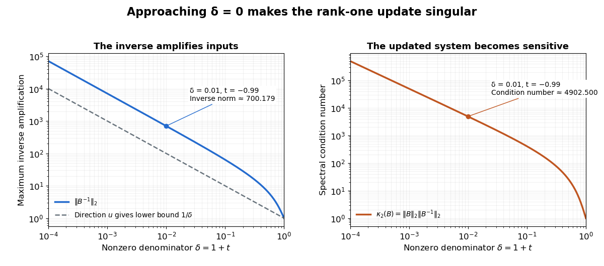

# Rank-one update singularity criterion

↑ **Parent:** [Sherman–Morrison formula](sherman-morrison-formula.md)

For an [invertible matrix](invertible-matrix.md) $A$, the [rank-one matrix update](rank-one-matrix-update.md) $B=A+uv^T$ is a [singular matrix](singular-matrix.md) exactly when $1+v^TA^{-1}u=0$. This follows directly from the [matrix determinant lemma](matrix-determinant-lemma.md). At that value, $u\ne0$ and the nonzero [vector](vector.md) $w=A^{-1}u$ satisfies

$$
Bw=u+u(v^TA^{-1}u)=0.
$$

Every [vector](vector.md) in the [kernel](kernel-of-a-linear-map-split.md) is a multiple of $w$, since $Bx=0$ implies $x=-A^{-1}u(v^Tx)$. The [matrix rank](matrix-rank.md) therefore drops by exactly one.

For $B(t)=I+tuv^T$ with $u=(1,2)^T$ and $v=(3,-1)^T$, the update becomes a [singular matrix](singular-matrix.md) at $t=-1$, and $B(t)u=(1+t)u$. At $t=-0.99$, this direction is compressed by a factor $0.01$ and the inverse amplifies it by a factor 100. The actual [spectral norm](matrix-2-norm.md) of the [matrix inverse](matrix-inverse-split.md), which maximizes amplification over every direction, is about $700.17853409$.

**[Figure 3](#image-an-inverse-grows-large-as-the-rank-one-update-approaches-its-singular-denominator). An inverse grows large as the rank-one update approaches its singular denominator**. Here $\delta=1+t>0$ and $B(t)=I+tuv^T$ uses the same example [vectors](vector.md). The left panel shows $\|B(t)^{-1}\|_2$ and its lower bound $1/\delta$, obtained from the direction $u$. The right panel shows the [condition number](condition-number.md) $\kappa_2(B)=\|B\|_2\|B^{-1}\|_2$. Both are computed from [singular values](singular-value.md); the missing point $\delta=0$ has no [matrix inverse](matrix-inverse-split.md).

The exact formula can expose a large [condition number](condition-number.md) in the updated [linear system](system-of-linear-equations.md) even when the original one had a small [condition number](condition-number.md). It does not guarantee [numerical stability](stability-of-a-numerical-method.md) merely because its evaluation uses fewer arithmetic operations. The denominator condition certifies existence; the [condition number](condition-number.md) and floating-point behavior address different questions about using the resulting answer.

**Table of contents**

- [Solvability of an affine rank-one vector equation](solvability-of-an-affine-rank-one-vector-equation.md)

## ↑ Ancestors (7)

1. [Sherman–Morrison formula](sherman-morrison-formula.md)
2. [Matrix inverse](matrix-inverse-split.md)
3. [Linear algebra](linear-algebra-split.md)
4. [Algebra](algebra-split.md)
5. [Area of mathematics](area-of-mathematics.md)
6. [Mathematics](mathematics-split.md)
7. [Codex Wiki](split.md)

## ← Incoming links (1)

- [Matrix determinant lemma](matrix-determinant-lemma.md)
