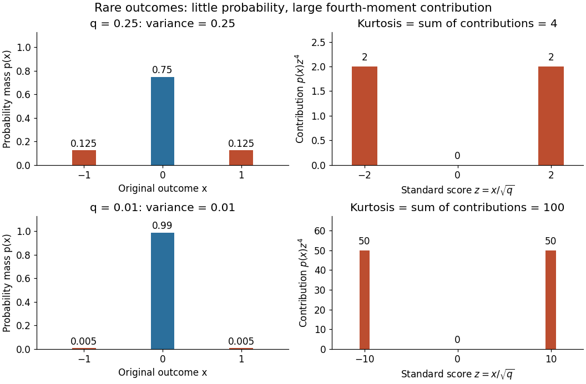

# Rare-outlier three-point distribution

↑ **Parent:** [Kurtosis](kurtosis.md)

For $0<q\leq1$, put [probability mass](probability-mass.md) $1-q$ at zero and $q/2$ at each of $-1$ and $1$. This [symmetric probability distribution](symmetric-probability-distribution.md) has [mean](expected-value.md) zero. Its second and [fourth moments](fourth-moment.md) are both $q$, because the nonzero outcomes have square and fourth power equal to one:

$$
\operatorname{Var}(X)=q,\qquad \mathbb E[X^4]=q,\qquad \kappa(X)=\frac{q}{q^2}=\frac1q.
$$

For $q=1/4$ the [kurtosis](kurtosis.md) is $4$; for $q=1/100$ it is $100$. In the latter case $99\%$ of the [probability mass](probability-mass.md) is at zero, yet all of the fourth [central moment](central-moment.md) comes from the remaining $1\%$. The [standard score](standard-score.md) $Z=X/\sqrt q$ takes values $0$ and $\pm q^{-1/2}$, with [variance](variance-split.md) one. Each nonzero outcome contributes

$$
\frac q2\left(q^{-1/2}\right)^4=\frac1{2q}
$$

to [kurtosis](kurtosis.md). At $q=1/100$, the two rare outcomes are ten [standard deviations](standard-deviation.md) from the [mean](expected-value.md), and their contributions are $50+50=100$.

**[Figure 25](#image-probability-mass-and-fourth-moment-contributions-for-a-rare-outlier-three-point-distribution). Probability mass and fourth-moment contributions for a rare-outlier three-point distribution**. The left panels keep the original [support of a probability distribution](support-of-a-probability-distribution.md) $\{-1,0,1\}$; the right panels use [standard scores](standard-score.md). A rare outcome can have small [probability mass](probability-mass.md) but a large contribution to [kurtosis](kurtosis.md). Each row is a different specified [probability distribution](probability-distribution.md), not a [statistical sample](statistical-sample.md).

Every member has finite [support of a probability distribution](support-of-a-probability-distribution.md), so all its [moments](moment.md) are finite. Nevertheless, [kurtosis](kurtosis.md) becomes arbitrarily large as $q$ approaches zero: high [kurtosis](kurtosis.md) does not require an unbounded [support of a probability distribution](support-of-a-probability-distribution.md) or a [heavy-tailed distribution](heavy-tailed-distribution.md). At $q=0$ the [variance](variance-split.md) vanishes and [kurtosis](kurtosis.md) is undefined. At $q=1/3$ this discrete [probability distribution](probability-distribution.md) even has the [normal distribution](normal-distribution.md) value $\kappa=3$ and [excess kurtosis](excess-kurtosis.md) zero, so those values do not establish a [normal distribution](normal-distribution.md).

## ↑ Ancestors (7)

1. [Kurtosis](kurtosis.md)
2. [Probability distribution](probability-distribution.md)
3. [Probability theory](probability-theory-split.md)
4. [Probability and statistics](probability-and-statistics-split.md)
5. [Area of mathematics](area-of-mathematics.md)
6. [Mathematics](mathematics-split.md)
7. [Codex Wiki](split.md)

## ← Incoming links (3)

- [Central contribution to kurtosis](central-contribution-to-kurtosis.md)
- [Excess kurtosis](excess-kurtosis.md)
- [Rare-outlier three-point distribution](rare-outlier-three-point-distribution.md)
