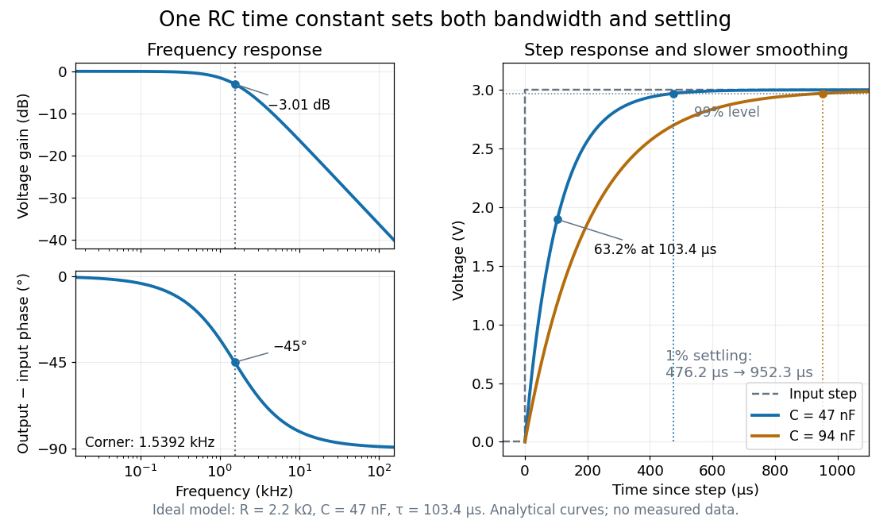

# RC low-pass step response

↑ **Parent:** [RC low-pass filter](rc-low-pass-filter.md)

The [step response](step-response.md) describes a sudden persistent input change. Suppose the input becomes a constant $V_s$ at $t=0$, and the initial [capacitor](capacitor.md) voltage is $v_0$. Finite [electric current](electric-current.md) leaves that voltage continuous. Subtract $V_s$ from the [RC low-pass filter](rc-low-pass-filter.md) equation: the remaining error satisfies $\tau\,de/dt+e=0$. Separating variables gives

$$
v_{\rm out}(t)=V_s+(v_0-V_s)e^{-t/\tau}\qquad(t\geq0).
$$

For an initially uncharged [capacitor](capacitor.md) and a $0$ to $3\,\mathrm V$ step in the constructed example,

$$
v_{\rm out}(t)=3\left(1-e^{-t/(103.4\,\mu\mathrm{s})}\right)\,\mathrm V.
$$

At one [time constant](time-constant.md), $t=103.4\,\mu\mathrm{s}$, the voltage is $1.8964\,\mathrm V$, about $63.2\%$ of its final value. The voltage error then continues its [exponential decay](exponential-decay.md). This is different from a pure delay: the output starts changing immediately, yet takes time to approach the target.

**[Figure 21](#image-rc-low-pass-frequency-response-and-rc-low-pass-step-response-from-one-time-constant). RC low-pass frequency response and RC low-pass step response from one time constant**. Original analytical curves for $R=2.2\,\mathrm{k}\Omega$ and $C=47\,\mathrm{nF}$; no experimental points. Left: a [Bode plot](bode-plot.md) of voltage gain and output-minus-input [phase difference](phase-difference.md), with [cutoff frequency](cutoff-frequency.md) $1.5392\,\mathrm{kHz}$. Right: the response to a $0$ to $3\,\mathrm V$ step, compared with doubling $C$ at fixed $R$. Doubling the [time constant](time-constant.md) halves the [cutoff frequency](cutoff-frequency.md) and doubles the time to reach the same fraction of the final voltage.

Define [settling time](settling-time.md) relative to the total voltage change: require $|v_{\rm out}-V_s|\leq\epsilon|v_0-V_s|$ thereafter, with $0<\epsilon<1$. The [exponential decay](exponential-decay.md) is monotone, so

$$
t_\epsilon=\tau\ln\frac1\epsilon,\qquad
f_ct_\epsilon=\frac{\ln(1/\epsilon)}{2\pi}.
$$

For $1\%$ settling, $t_{0.01}=4.6052\tau\approx476.17\,\mu\mathrm{s}$; the $10\%$ to $90\%$ rise takes $\tau\ln9\approx227.19\,\mu\mathrm{s}$. Reducing the [cutoff frequency](cutoff-frequency.md) by doubling $C$ doubles both times. This reciprocal relation is the useful connection between [signal bandwidth](signal-bandwidth.md) and response speed: stronger suppression of rapid [noise](noise-signal-processing.md) comes with slower tracking of wanted changes.

## ↑ Ancestors (6)

1. [RC low-pass filter](rc-low-pass-filter.md)
2. [Low-pass filter](low-pass-filter.md)
3. [Linear filter](linear-filter.md)
4. [Signal processing](signal-processing.md)
5. [Electrical engineering](electrical-engineering-split.md)
6. [Codex Wiki](split.md)

## ← Incoming links (2)

- [Low-pass filter](low-pass-filter.md)
- [RC low-pass step response](rc-low-pass-step-response.md)
