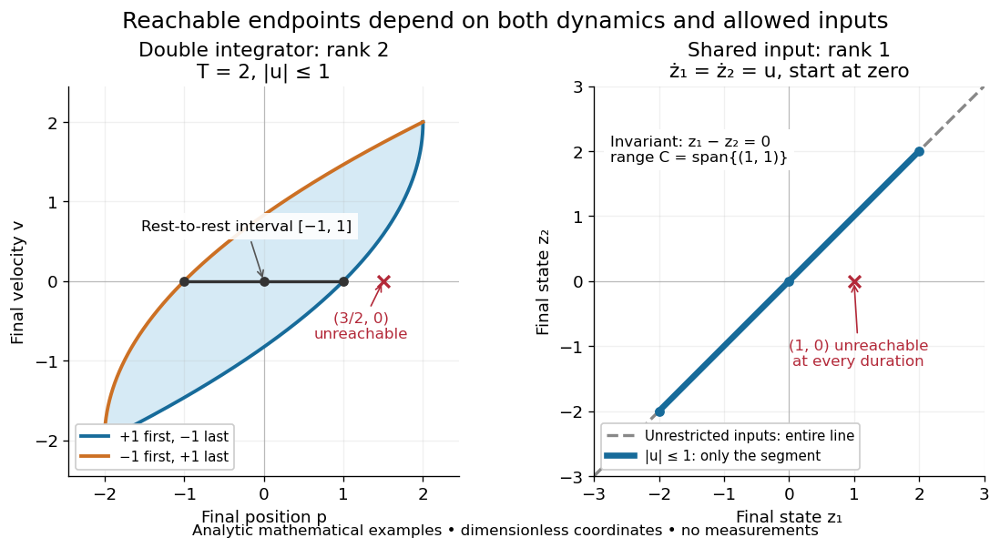

# Reachable set

↑ **Parent:** [Reachability in control theory](reachability-in-control-theory.md)

The [reachable set](reachable-set.md) $\mathcal R_T(x_0)$ collects all endpoints attainable from $x_0$ at exactly $T$ by admissible [control inputs](control-input.md). If arrival any time up to $T$ is allowed, use $\mathcal R_{\le T}(x_0)=\bigcup_{0\le t\le T}\mathcal R_t(x_0)$, with $\mathcal R_0(x_0)=\{x_0\}$. These definitions differ: a general [dynamical system](dynamical-system.md) may drift away after early arrival, so waiting need not preserve the target. The [reachable set](reachable-set.md) is always relative to a declared input class and any constraints on the entire path.

For the [double integrator](double-integrator.md) starting from $(0,0)$, now require [measurable functions](measurable-function.md) as [control inputs](control-input.md) with $|u(t)|\le1$ [almost everywhere](almost-everywhere.md). Write $(p,v)$ for its endpoint at $T>0$. Two [integrals](integral.md) determine the endpoint:

$$
v=\int_0^T u(t)\,dt,\qquad p=\int_0^T(T-t)u(t)\,dt.
$$

Our mathematical example has the exact [reachable set](reachable-set.md)

$$
\mathcal R_T(0)=\left\{(p,v): |v|\le T,\quad
-\frac{T^2}{4}+\frac{Tv}{2}+\frac{v^2}{4}\le p\le
\frac{T^2}{4}+\frac{Tv}{2}-\frac{v^2}{4}\right\}.
$$

To see the upper boundary, fix $v$: put $u=1$ first and $u=-1$ last, switching at $s=(T+v)/2$. This maximizes the weighted [integral](integral.md) for [position](position.md) because early commands have the largest weight $T-t$; the required net [velocity](velocity.md) fixes $s$. Formally, $(T-t)-(T-s)=s-t$ has the same sign as this maximizing command, so changing to any other admissible command with the same [integral](integral.md) cannot increase $p$. Reversing the order gives the lower boundary. Pointwise [convex combinations](convex-combination.md) of these two commands preserve $v$ and attain every intermediate $p$, so the formula describes the whole region, not merely a bound. The extreme commands are [bang-bang control](bang-bang-control.md).

**[Figure 3](#image-an-amplitude-bound-limits-endpoints-a-shared-input-can-remove-a-state-direction-entirely). An amplitude bound limits endpoints; a shared input can remove a state direction entirely**. Analytic mathematical examples, not measured data. Left: the exact [double integrator](double-integrator.md) [reachable set](reachable-set.md) from rest at $T=2$ with $|u|\le1$. Each curved boundary comes from one switch between $+1$ and $-1$. At final [velocity](velocity.md) $v=0$, the available [position](position.md) interval is $[-1,1]$, excluding $(3/2,0)$. Right: $\dot z_1=\dot z_2=u$ only reaches the diagonal from zero. Unrestricted inputs fill the entire line; the same bound $|u|\le1$ at $T=2$ leaves only its segment from $(-2,-2)$ to $(2,2)$.

In particular, the bounded [double integrator](double-integrator.md) can move from rest to [position](position.md) $d$ and rest again exactly when $|d|\le T^2/4$. Its minimum duration is therefore $2\sqrt{|d|}$ in these normalized units. With freely chosen time every rest-to-rest distance is attainable; with a fixed deadline many are excluded. Changing the amplitude bound to $|u|\le a$ with $a>0$ scales this condition to $|d|\le aT^2/4$. This shows why specifying the controls matters even when the [Kalman rank criterion](kalman-rank-criterion.md) gives full [rank of a matrix](matrix-rank.md).

In closed [quantum control](quantum-control.md), a [density operator](density-matrix.md) [reachable set](reachable-set.md) lies inside its [unitary orbit of a density operator](unitary-orbit-of-a-density-operator.md), since coherent evolution preserves the [spectrum](spectrum-functional-analysis.md). That orbit need not be fully reachable under the available [control inputs](control-input.md).

## ↑ Ancestors (5)

1. [Reachability in control theory](reachability-in-control-theory.md)
2. [Control theory](control-theory-split.md)
3. [Area of mathematics](area-of-mathematics.md)
4. [Mathematics](mathematics-split.md)
5. [Codex Wiki](split.md)

## ← Incoming links (8)

- [Controllability](controllability.md)
- [Controllability matrix](controllability-matrix.md)
- [Solution](past-exam-of-the-mathematics-course-of-the-university-of-cambridge/2006/ii/paper-2/17f/solution.md)
- [Solution](past-exam-of-the-mathematics-course-of-the-university-of-cambridge/2007/iii/paper-60/2/a/solution.md)
- [Solution](past-exam-of-the-mathematics-course-of-the-university-of-cambridge/2008/iii/paper-61/1/a/solution.md)
- [Solution](past-exam-of-the-mathematics-course-of-the-university-of-cambridge/2009/iii/paper-52/1/c/solution.md)
- [Reachability in control theory](reachability-in-control-theory.md)
- [Reachable set](reachable-set.md)
