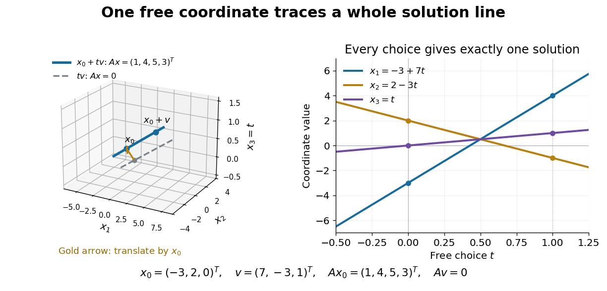

# Reading solutions from reduced row echelon form

↑ **Parent:** [Reduced row echelon form](reduced-row-echelon-form.md)

For [row reduction with a parameterized right-hand side](row-reduction-with-a-parameterized-right-hand-side.md) at $\tau=5$, the nonzero reduced equations are

$$
x_1-7x_3=-3,\qquad x_2+3x_3=2.
$$

Column 3 has no [pivot element](pivot-element.md), so $x_3$ is a [free variable in a linear system](free-variable-in-a-linear-system.md). Taking $x_3=t$ gives every solution:

$$
x=x_0+tv,\qquad x_0=\begin{pmatrix}-3\\2\\0\end{pmatrix},\quad v=\begin{pmatrix}7\\-3\\1\end{pmatrix},\quad t\in\mathbb R.
$$

There is no further restriction on $t$. Independent substitution into the original [linear system](system-of-linear-equations.md) gives

$$
Ax_0=\begin{pmatrix}1\\4\\5\\3\end{pmatrix},\qquad Av=\begin{pmatrix}7-6-1\\14-15+1\\21-21\\7-9+2\end{pmatrix}=0.
$$

Conversely, the two reduced equations force exactly these coordinate formulas, so no solutions have been omitted. The same computation with zero right-hand side gives the [kernel](kernel-of-a-linear-map-split.md) $\ker A=\operatorname{span}\{v\}$. Its [dimension](dimension-vector-space.md) is one. The [rank-nullity theorem](rank-nullity-theorem.md) appears here as $2+1=3$: two [pivot columns](pivot-column.md) and one freely chosen coordinate account for the three unknowns.[Interactive Linear Algebra by Dan Margalit and others; §2.9, Rank Theorem and preceding pivot-column/free-variable count](interactive-linear-algebra-by-dan-margalit-and-others/the-rank-theorem.md)

**[Figure 10](#image-one-free-variable-in-a-linear-system-traces-an-affine-solution-space-of-a-linear-equation-parallel-to-its-kernel). One free variable in a linear system traces an affine solution space of a linear equation parallel to its kernel**.

In general a consistent [linear system](system-of-linear-equations.md) has solution set $x_0+\ker A$. Subtracting $Ax_0=b$ from $Ax=b$ proves this description in both directions. The particular solution places the [affine subspace](affine-subspace.md), and the [kernel](kernel-of-a-linear-map-split.md) supplies its directions.[Interactive Linear Algebra by Dan Margalit and others; §2.4.2, Key Observation and its proof: translate homogeneous solutions by any particular solution](interactive-linear-algebra-by-dan-margalit-and-others/solution-sets.md) Over the [real numbers](real-number.md) this example is an entire line; over the [rational numbers](rational-number.md) the same formula uses rational $t$. A [free variable in a linear system](free-variable-in-a-linear-system.md) over a [finite field](finite-field.md) instead has only finitely many choices.

The [pivot columns](pivot-column.md) identify a different object: the original [column space](column-space.md). Here they select

$$
a_1=(1,2,3,1)^T,\qquad a_2=(2,5,7,3)^T,
$$

which form its [basis](basis.md), while $a_3=-7a_1+3a_2$. The corresponding reduced columns are $(1,0,0,0)^T$ and $(0,1,0,0)^T$; their [linear span](linear-span.md) is a different [plane](plane.md). For example, every original output satisfies $y_3=y_1+y_2$, but $(1,0,0,0)^T$ does not. Since $E$ is an [invertible matrix](invertible-matrix.md), column [linear relations](linear-relation.md) survive $EA=R$ even though the output [vectors](vector.md) move. This is why choosing original columns at the reduced pivot positions works.

## ↑ Ancestors (9)

1. [Reduced row echelon form](reduced-row-echelon-form.md)
2. [Row echelon form](row-echelon-form.md)
3. [Gaussian elimination](gaussian-elimination.md)
4. [Numerical linear algebra](numerical-linear-algebra-split.md)
5. [Numerical analysis](numerical-analysis-split.md)
6. [Analysis](analysis-split.md)
7. [Area of mathematics](area-of-mathematics.md)
8. [Mathematics](mathematics-split.md)
9. [Codex Wiki](split.md)
