# Real analysis

↑ **Parent:** [Analysis](analysis.md)  
ⓦ [Wiki](https://en.wikipedia.org/wiki/Real_analysis)

Real analysis studies [limits](calculus.md#limit-of-a-function), [continuity](calculus.md#continuous-function), [differentiation](calculus.md#differentiation), [integration](integral.md), and convergence of [sequences](sequence-and-series.md#sequence) and [functions](function.md) taking values in the [real numbers](arithmetic.md#real-number). Its central question is how finite approximations determine an exact answer: what does an arbitrarily small error mean, and which operations respect that error? A [derivative](calculus.md#derivative) is a [limit](calculus.md#limit-of-a-function) of quotients, while a [Riemann integral](#riemann-integral) is obtained from increasingly fine [Riemann sums](#riemann-sum). Both need conditions that make the answer independent of the approximations chosen.

Two organizing ideas are [completeness of the real numbers](sequence-and-series.md#completeness-of-the-real-numbers), which ensures that suitable approximations have a destination, and [uniform convergence](sequence-and-series.md#uniform-convergence), which controls approximation error over an entire domain. [Pointwise convergence](sequence-and-series.md#pointwise-convergence) supplies separate guarantees at separate inputs; [uniform convergence](sequence-and-series.md#uniform-convergence) supplies one guarantee for all inputs. This distinction explains why replacing an approximating [function](function.md) by its [limit](calculus.md#limit-of-a-function) can preserve [continuity](calculus.md#continuous-function) or [integrals](integral.md) under appropriate hypotheses, yet fail without them.

For historical context, Cauchy's 1821 _Cours d'analyse_ explicitly discusses convergence of [series](sequence-and-series.md#series-mathematics). Its Note VII treats double [series](sequence-and-series.md#series-mathematics) and compares summing by rows and by columns under stated convergence assumptions: controlling an infinite process was already a concrete problem. This is historical context for questions about [limits](calculus.md#limit-of-a-function), rather than an attribution of the modern definitions below. [Cauchy, Cours d'analyse (1821), Note VII, pp. 537–539, original scan](https://www.e-rara.ch/download/pdf/8543076.pdf).

**Table of contents**

- [Hardy's inequality](#hardy-s-inequality)
  - [Hardy's integral inequality](#hardy-s-integral-inequality)
    - [Hardy's integral inequality for an interval indicator](#hardy-s-integral-inequality-for-an-interval-indicator)
    - [Sharp constant in Hardy's integral inequality](#sharp-constant-in-hardy-s-integral-inequality)
    - [Proof outline of Hardy's integral inequality](#proof-outline-of-hardy-s-integral-inequality)
- [Infimum and supremum](#infimum-and-supremum)
  - [Essential infimum and essential supremum](#essential-infimum-and-essential-supremum)
    - [Essential infimum](#essential-infimum)
  - [Supremum](#supremum)
    - [Supremum of a sum](#supremum-of-a-sum)
    - [Stability of a supremum under uniform perturbations](#stability-of-a-supremum-under-uniform-perturbations)
    - [Approximation property of a supremum](#approximation-property-of-a-supremum)
    - [Accumulation below an unattained supremum](#accumulation-below-an-unattained-supremum)
  - [Infimum](#infimum)
    - [Approximation property of an infimum](#approximation-property-of-an-infimum)
- [Asymptotic analysis](#asymptotic-analysis)
  - [Asymptotic equivalence](#asymptotic-equivalence)
    - [Asymptotic comparison of exponential functions](#asymptotic-comparison-of-exponential-functions)
    - [Stirling formula](#stirling-formula)
      - [Integral bounds for a logarithmic factorial](#integral-bounds-for-a-logarithmic-factorial)
      - [Convergence of the Stirling sequence](#convergence-of-the-stirling-sequence)
      - [Robbins bounds for Stirling's formula](#robbins-bounds-for-stirling-s-formula)
      - [Gaussian peak behind Stirling's formula](#gaussian-peak-behind-stirling-s-formula)
      - [Stirling correction by Gaussian moments](#stirling-correction-by-gaussian-moments)
- [Monotone integral Tauberian lemma](#monotone-integral-tauberian-lemma)
- [Homogeneous function](#homogeneous-function)
  - [Homogeneity](#homogeneity)
  - [Positively homogeneous function (degree one)](#positively-homogeneous-function-degree-one)
  - [Euler theorem for homogeneous functions](#euler-theorem-for-homogeneous-functions)
    - [Second derivative identity for a degree-one homogeneous function](#second-derivative-identity-for-a-degree-one-homogeneous-function)
    - [Second-order Euler identity for homogeneous functions](#second-order-euler-identity-for-homogeneous-functions)
    - [Euler differential identity characterizes homogeneity](#euler-differential-identity-characterizes-homogeneity)
    - [Volume integral of a homogeneous function](#volume-integral-of-a-homogeneous-function)
- [Regular variation](#regular-variation)
  - [Slowly varying function](#slowly-varying-function)
- [Lipschitz continuity](#lipschitz-continuity)
  - [Bi-Lipschitz map](#bi-lipschitz-map)
  - [Bounded Lipschitz norm](#bounded-lipschitz-norm)
    - [Diagonal compactness for bounded Lipschitz functions](#diagonal-compactness-for-bounded-lipschitz-functions)
    - [Pointwise closure of the bounded Lipschitz unit ball](#pointwise-closure-of-the-bounded-lipschitz-unit-ball)
  - [One-sided Lipschitz condition](#one-sided-lipschitz-condition)
  - [Lipschitz domain](#lipschitz-domain)
  - [McShane extension theorem](#mcshane-extension-theorem)
  - [Lipschitz constant](#lipschitz-constant)
  - [Globally Lipschitz function](#globally-lipschitz-function)
  - [Lipschitz bound](#lipschitz-bound)
  - [Locally Lipschitz function](#locally-lipschitz-function)
- [Big O notation](#big-o-notation)
  - [Little o notation](#little-o-notation)
  - [Big theta notation](#big-theta-notation)
  - [Uniform big O bound](#uniform-big-o-bound)
- [Real line](#real-line)
  - [Interval (mathematics)](#interval-mathematics)
    - [Subinterval](#subinterval)
    - [Nested intervals](#nested-intervals)
      - [Nested interval theorem](#nested-interval-theorem)
    - [Closed real interval](#closed-real-interval)
      - [Compact interval](#compact-interval)
- [Extreme value theorem](#extreme-value-theorem)
  - [Interior-value criterion for an attained maximum](#interior-value-criterion-for-an-attained-maximum)
  - [Supremum can fail to be attained at an oscillatory endpoint](#supremum-can-fail-to-be-attained-at-an-oscillatory-endpoint)
- [Coercive function](#coercive-function)
  - [Range of a continuous coercive real function](#range-of-a-continuous-coercive-real-function)
- [Lp norm](#lp-norm)
  - [L-infinity norm](#l-infinity-norm)
    - [Essentially bounded function](#essentially-bounded-function)
  - [Lq quasi-norm](#lq-quasi-norm)
  - [Minkowski inequality](#minkowski-inequality)
    - [Minkowski inequality for finite vectors](#minkowski-inequality-for-finite-vectors)
    - [Equality in Minkowski inequality](#equality-in-minkowski-inequality)
    - [Minkowski inequality for error aggregation](#minkowski-inequality-for-error-aggregation)
    - [Failure of Minkowski inequality below exponent one](#failure-of-minkowski-inequality-below-exponent-one)
  - [L2 norm](#l2-norm)
  - [Marcinkiewicz–Zygmund inequality](#marcinkiewicz-zygmund-inequality)
  - [Hölder's inequality](#holder-s-inequality)
    - [Conjugate exponent](#conjugate-exponent)
    - [Finite-vector example of Hölder's inequality](#finite-vector-example-of-holder-s-inequality)
    - [Equality in Hölder's inequality](#equality-in-holder-s-inequality)
    - [Probabilistic use of Hölder's inequality](#probabilistic-use-of-holder-s-inequality)
    - [History of Hölder's inequality](#history-of-holder-s-inequality)
- [Calculus](calculus.md)
  - [Differential calculus](calculus.md#differential-calculus)
  - [Floor and ceiling functions](calculus.md#floor-and-ceiling-functions)
    - [Integer count in a closed interval](calculus.md#integer-count-in-a-closed-interval)
    - [Floor function](calculus.md#floor-function)
      - [Floor-division grouping](calculus.md#floor-division-grouping)
      - [Floor division](calculus.md#floor-division)
      - [Floor quotient grouping](calculus.md#floor-quotient-grouping)
      - [Floor sum](calculus.md#floor-sum)
        - [Floor-sum rearrangement](calculus.md#floor-sum-rearrangement)
        - [Euclidean floor-sum transformation](calculus.md#euclidean-floor-sum-transformation)
      - [Fractional part](calculus.md#fractional-part)
    - [Ceiling function](calculus.md#ceiling-function)
      - [Ceiling count for fixed-size batches](calculus.md#ceiling-count-for-fixed-size-batches)
    - [Truncation toward zero](calculus.md#truncation-toward-zero)
  - [Integral](integral.md)
    - [Domain of integration](integral.md#domain-of-integration)
    - [Integration by substitution](integral.md#integration-by-substitution)
      - [Trigonometric substitution](integral.md#trigonometric-substitution)
    - [Average value of a function](integral.md#average-value-of-a-function)
    - [Linearity of integration](integral.md#linearity-of-integration)
    - [Signed area under a graph](integral.md#signed-area-under-a-graph)
      - [Total geometric area under a graph](integral.md#total-geometric-area-under-a-graph)
    - [Definite integral](integral.md#definite-integral)
      - [Integration limit](integral.md#integration-limit)
      - [Distance traveled from velocity](integral.md#distance-traveled-from-velocity)
    - [Wallis integrals](integral.md#wallis-integrals)
    - [Dipole line-integral identity](integral.md#dipole-line-integral-identity)
    - [Integrand](integral.md#integrand)
    - [Multiple integral](integral.md#multiple-integral)
      - [Triple integral](integral.md#triple-integral)
      - [Volume element](integral.md#volume-element)
      - [Iterated integral](integral.md#iterated-integral)
      - [Odd-integrand cancellation by reflection](integral.md#odd-integrand-cancellation-by-reflection)
    - [Integral representation](integral.md#integral-representation)
      - [Trigonometric integral](integral.md#trigonometric-integral)
        - [Cosine integral](integral.md#cosine-integral)
        - [Sine integral](integral.md#sine-integral)
    - [Lebesgue integration](integral.md#lebesgue-integration)
      - [Prékopa–Leindler inequality](integral.md#prekopa-leindler-inequality)
      - [Absolute continuity of the Lebesgue integral](integral.md#absolute-continuity-of-the-lebesgue-integral)
    - [Time integral](integral.md#time-integral)
    - [Double integral](integral.md#double-integral)
    - [Monotonicity of the Lebesgue integral](integral.md#monotonicity-of-the-lebesgue-integral)
    - [Antiderivative](integral.md#antiderivative)
      - [Constant of integration](integral.md#constant-of-integration)
        - [Antiderivatives on disconnected domains](integral.md#antiderivatives-on-disconnected-domains)
      - [Additive constant](integral.md#additive-constant)
    - [Gaussian integral](integral.md#gaussian-integral)
      - [Gaussian integral with an inverse-square term](integral.md#gaussian-integral-with-an-inverse-square-term)
      - [Gaussian moment recurrence](integral.md#gaussian-moment-recurrence)
        - [Odd Gaussian moments on a half-line](integral.md#odd-gaussian-moments-on-a-half-line)
        - [Full-line Gaussian moment recurrence](integral.md#full-line-gaussian-moment-recurrence)
      - [Polar-coordinate proof of the Gaussian integral](integral.md#polar-coordinate-proof-of-the-gaussian-integral)
      - [Linear-source multivariate Gaussian integral](integral.md#linear-source-multivariate-gaussian-integral)
      - [Dawson function](integral.md#dawson-function)
        - [Gaussian drift primitives](integral.md#gaussian-drift-primitives)
      - [Error function](integral.md#error-function)
        - [Error function and the normal distribution](integral.md#error-function-and-the-normal-distribution)
        - [Inverse error function](integral.md#inverse-error-function)
        - [Error-function diffusion front](integral.md#error-function-diffusion-front)
        - [Quadrant asymptotics of the error function](integral.md#quadrant-asymptotics-of-the-error-function)
        - [Complementary error function](integral.md#complementary-error-function)
          - [Complementary error function tail bound](integral.md#complementary-error-function-tail-bound)
          - [Faddeeva function](integral.md#faddeeva-function)
            - [Gaussian pole integral](integral.md#gaussian-pole-integral)
  - [Taylor polynomial](calculus.md#taylor-polynomial)
    - [Multivariate Taylor polynomial](calculus.md#multivariate-taylor-polynomial)
      - [Second-order relative change of a monomial](calculus.md#second-order-relative-change-of-a-monomial)
  - [Exponential function](calculus.md#exponential-function)
    - [Exponential growth](calculus.md#exponential-growth)
      - [Doubling time](calculus.md#doubling-time)
    - [e (mathematical constant)](calculus.md#e-mathematical-constant)
      - [Compounding limit for e](calculus.md#compounding-limit-for-e)
      - [Irrationality of e](calculus.md#irrationality-of-e)
    - [Exponential series](calculus.md#exponential-series)
      - [Exponential series divided by a shifted index](calculus.md#exponential-series-divided-by-a-shifted-index)
    - [Complex exponential function](calculus.md#complex-exponential-function)
      - [Modulus of the complex exponential](calculus.md#modulus-of-the-complex-exponential)
      - [Complex sine function](calculus.md#complex-sine-function)
        - [Periodicity of the complex sine](calculus.md#periodicity-of-the-complex-sine)
    - [Logarithm](calculus.md#logarithm)
      - [Geometric-series bound for the logarithmic remainder](calculus.md#geometric-series-bound-for-the-logarithmic-remainder)
      - [Irrational logarithm criterion](calculus.md#irrational-logarithm-criterion)
      - [Concavity of the logarithm](calculus.md#concavity-of-the-logarithm)
      - [Logarithmic integral function](calculus.md#logarithmic-integral-function)
      - [Natural logarithm](calculus.md#natural-logarithm)
        - [Mercator series](calculus.md#mercator-series)
        - [Logarithmic integral representation of the natural logarithm](calculus.md#logarithmic-integral-representation-of-the-natural-logarithm)
      - [Logarithmic scale](calculus.md#logarithmic-scale)
        - [Order of magnitude](calculus.md#order-of-magnitude)
        - [Logarithmic midpoint](calculus.md#logarithmic-midpoint)
        - [Semi-log plot](calculus.md#semi-log-plot)
        - [Log-log plot](calculus.md#log-log-plot)
      - [Logarithm inequality](calculus.md#logarithm-inequality)
        - [Rational lower bound for the natural logarithm](calculus.md#rational-lower-bound-for-the-natural-logarithm)
      - [Operator monotonicity of logarithm](calculus.md#operator-monotonicity-of-logarithm)
    - [Gaussian function](calculus.md#gaussian-function)
      - [Taylor expansion of a translated Gaussian](calculus.md#taylor-expansion-of-a-translated-gaussian)
      - [Gaussian decay dominates every power](calculus.md#gaussian-decay-dominates-every-power)
      - [Gaussian dyadic summation bound](calculus.md#gaussian-dyadic-summation-bound)
    - [Hyperbolic function](calculus.md#hyperbolic-function)
      - [Hyperbolic angle](calculus.md#hyperbolic-angle)
      - [Inverse hyperbolic functions](calculus.md#inverse-hyperbolic-functions)
      - [Hyperbolic cosine](calculus.md#hyperbolic-cosine)
        - [Catenary from hyperbolic cosine](calculus.md#catenary-from-hyperbolic-cosine)
        - [Factorial-tail irrationality proof for a hyperbolic cosine](calculus.md#factorial-tail-irrationality-proof-for-a-hyperbolic-cosine)
        - [Inverse hyperbolic cosine](calculus.md#inverse-hyperbolic-cosine)
          - [Real inverse-hyperbolic antiderivative branches](calculus.md#real-inverse-hyperbolic-antiderivative-branches)
      - [Hyperbolic sine](calculus.md#hyperbolic-sine)
      - [Hyperbolic cotangent](calculus.md#hyperbolic-cotangent)
        - [Partial-fraction expansion of the hyperbolic cotangent](calculus.md#partial-fraction-expansion-of-the-hyperbolic-cotangent)
      - [Hyperbolic secant](calculus.md#hyperbolic-secant)
        - [Exponential moment of the hyperbolic secant](calculus.md#exponential-moment-of-the-hyperbolic-secant)
  - [Fundamental theorem of calculus](calculus.md#fundamental-theorem-of-calculus)
    - [Fundamental theorem of calculus for Lebesgue integration](calculus.md#fundamental-theorem-of-calculus-for-lebesgue-integration)
  - [Mean value theorem](calculus.md#mean-value-theorem)
    - [Cauchy mean value theorem](calculus.md#cauchy-mean-value-theorem)
    - [Endpoint secant-tangent approximation](calculus.md#endpoint-secant-tangent-approximation)
  - [Rolle theorem](calculus.md#rolle-theorem)
    - [Rolle root count with multiplicities](calculus.md#rolle-root-count-with-multiplicities)
  - [Taylor's theorem](calculus.md#taylor-s-theorem)
    - [Taylor expansion from a periodic derivative equation](calculus.md#taylor-expansion-from-a-periodic-derivative-equation)
    - [Integral first-order Taylor formula for a vector map](calculus.md#integral-first-order-taylor-formula-for-a-vector-map)
    - [Integral remainder in Taylor theorem](calculus.md#integral-remainder-in-taylor-theorem)
      - [Logarithmic series from an integral Taylor remainder](calculus.md#logarithmic-series-from-an-integral-taylor-remainder)
    - [Taylor expansion](calculus.md#taylor-expansion)
      - [Peano zero](calculus.md#peano-zero)
      - [Parabolic approximation](calculus.md#parabolic-approximation)
    - [Taylor formula for a polynomial](calculus.md#taylor-formula-for-a-polynomial)
    - [Taylor theorem with Lagrange remainder](calculus.md#taylor-theorem-with-lagrange-remainder)
      - [Lagrange remainder](calculus.md#lagrange-remainder)
    - [Taylor remainder](calculus.md#taylor-remainder)
    - [Taylor formula with integral remainder](calculus.md#taylor-formula-with-integral-remainder)
    - [Taylor series](calculus.md#taylor-series)
      - [Maclaurin series](calculus.md#maclaurin-series)
  - [Limit of a function](calculus.md#limit-of-a-function)
    - [Exponential concentration of a weighted mean](calculus.md#exponential-concentration-of-a-weighted-mean)
    - [Root limit of a finite sum of powers](calculus.md#root-limit-of-a-finite-sum-of-powers)
    - [One-sided limit](calculus.md#one-sided-limit)
    - [Continuous function](calculus.md#continuous-function)
      - [Epsilon-delta definition of continuity](calculus.md#epsilon-delta-definition-of-continuity)
        - [Continuity bounds for the square function](calculus.md#continuity-bounds-for-the-square-function)
      - [Continuous functions preserve convergent sequences](calculus.md#continuous-functions-preserve-convergent-sequences)
      - [Blancmange curve](calculus.md#blancmange-curve)
      - [Bounded continuous functions](calculus.md#bounded-continuous-functions)
      - [Upper semicontinuity](calculus.md#upper-semicontinuity)
      - [Oscillation multiplied by a vanishing amplitude](calculus.md#oscillation-multiplied-by-a-vanishing-amplitude)
      - [Lower semicontinuity](calculus.md#lower-semicontinuity)
      - [Discontinuity of a function](calculus.md#discontinuity-of-a-function)
        - [Removable discontinuity](calculus.md#removable-discontinuity)
        - [Jump discontinuity](calculus.md#jump-discontinuity)
      - [Sequential lower semicontinuity](calculus.md#sequential-lower-semicontinuity)
        - [Sublevel set](calculus.md#sublevel-set)
          - [Compact sublevel set](calculus.md#compact-sublevel-set)
        - [Closed-sublevel-set characterization of lower semicontinuity](calculus.md#closed-sublevel-set-characterization-of-lower-semicontinuity)
      - [Locally constant function](calculus.md#locally-constant-function)
        - [Compactly supported locally constant function](calculus.md#compactly-supported-locally-constant-function)
      - [Intermediate value theorem](calculus.md#intermediate-value-theorem)
        - [Intermediate value theorem hypotheses and counterexamples](calculus.md#intermediate-value-theorem-hypotheses-and-counterexamples)
        - [A cubic root from existence to a quantitative bracket](calculus.md#a-cubic-root-from-existence-to-a-quantitative-bracket)
        - [Nested-bracket proof of the intermediate value theorem](calculus.md#nested-bracket-proof-of-the-intermediate-value-theorem)
        - [Continuous image of a real interval](calculus.md#continuous-image-of-a-real-interval)
        - [Interval order theorem for continuous injections](calculus.md#interval-order-theorem-for-continuous-injections)
        - [Horizontal chord of reciprocal-integer length](calculus.md#horizontal-chord-of-reciprocal-integer-length)
        - [Zero on a line segment](calculus.md#zero-on-a-line-segment)
        - [Telescoping increment lemma](calculus.md#telescoping-increment-lemma)
        - [Continuous bijection of the real line is monotone](calculus.md#continuous-bijection-of-the-real-line-is-monotone)
      - [Composition of continuous functions](calculus.md#composition-of-continuous-functions)
      - [Continuity set of a function](calculus.md#continuity-set-of-a-function)
      - [Right-continuous function](calculus.md#right-continuous-function)
        - [Càdlàg](calculus.md#cadlag)
      - [Uniformly continuous function](calculus.md#uniformly-continuous-function)
        - [Decay of a nonnegative uniformly continuous integrable function](calculus.md#decay-of-a-nonnegative-uniformly-continuous-integrable-function)
    - [Squeeze theorem](calculus.md#squeeze-theorem)
  - [Derivative](calculus.md#derivative)
    - [Related rates](calculus.md#related-rates)
    - [Power rule](calculus.md#power-rule)
    - [Logarithmic differentiation](calculus.md#logarithmic-differentiation)
    - [Regularity of a power times a function with a simple zero](calculus.md#regularity-of-a-power-times-a-function-with-a-simple-zero)
    - [Local linear approximation](calculus.md#local-linear-approximation)
    - [Symmetric second derivative](calculus.md#symmetric-second-derivative)
    - [Symmetric second differences detect an affine corner](calculus.md#symmetric-second-differences-detect-an-affine-corner)
    - [Symmetric first-order differences remove an affine corner](calculus.md#symmetric-first-order-differences-remove-an-affine-corner)
    - [Vanishing symmetric second derivative forces an affine function](calculus.md#vanishing-symmetric-second-derivative-forces-an-affine-function)
    - [One-sided derivative](calculus.md#one-sided-derivative)
    - [Tangent line](calculus.md#tangent-line)
      - [Common tangent](calculus.md#common-tangent)
      - [Tangent through the origin to an exponential curve](calculus.md#tangent-through-the-origin-to-an-exponential-curve)
      - [Normal line to a plane curve](calculus.md#normal-line-to-a-plane-curve)
    - [Automatic differentiation](calculus.md#automatic-differentiation)
    - [Differentiation](calculus.md#differentiation)
    - [Second derivative](calculus.md#second-derivative)
    - [Difference quotient](calculus.md#difference-quotient)
      - [Discrete integration by parts](calculus.md#discrete-integration-by-parts)
    - [Total derivative](calculus.md#total-derivative)
    - [L'Hôpital's rule](calculus.md#l-hopital-s-rule)
      - [Derivative quotient limits on partial domains](calculus.md#derivative-quotient-limits-on-partial-domains)
    - [Darboux's theorem (analysis)](calculus.md#darboux-s-theorem-analysis)
      - [Intermediate secant slope from endpoint derivatives](calculus.md#intermediate-secant-slope-from-endpoint-derivatives)
    - [Product rule](calculus.md#product-rule)
      - [Differentiability restored by a quadratic zero](calculus.md#differentiability-restored-by-a-quadratic-zero)
      - [Leibniz rule](calculus.md#leibniz-rule)
        - [Generalized Leibniz rule](calculus.md#generalized-leibniz-rule)
      - [Nondifferentiable factor with a differentiable nondegenerate product](calculus.md#nondifferentiable-factor-with-a-differentiable-nondegenerate-product)
    - [Quotient rule](calculus.md#quotient-rule)
    - [Chain rule](calculus.md#chain-rule)
      - [Linear approximation](calculus.md#linear-approximation)
      - [Multivariable chain rule](calculus.md#multivariable-chain-rule)
        - [Second derivatives under a two-variable coordinate change](calculus.md#second-derivatives-under-a-two-variable-coordinate-change)
        - [Derivative along a curve](calculus.md#derivative-along-a-curve)
          - [Derivative of a vector field dotted with curve velocity](calculus.md#derivative-of-a-vector-field-dotted-with-curve-velocity)
      - [Nondifferentiable inner function with a differentiable nondegenerate composite](calculus.md#nondifferentiable-inner-function-with-a-differentiable-nondegenerate-composite)
      - [Second derivative chain rule](calculus.md#second-derivative-chain-rule)
  - [Monotonic function](calculus.md#monotonic-function)
    - [Derivative criterion for monotonicity](calculus.md#derivative-criterion-for-monotonicity)
    - [Monotone mean-value point of an integral average](calculus.md#monotone-mean-value-point-of-an-integral-average)
    - [Nonincreasing function](calculus.md#nonincreasing-function)
    - [Non-strict inverse of a continuous nondecreasing function](calculus.md#non-strict-inverse-of-a-continuous-nondecreasing-function)
    - [Left-continuous cumulative function of an atomic measure](calculus.md#left-continuous-cumulative-function-of-an-atomic-measure)
    - [Nondecreasing function](calculus.md#nondecreasing-function)
    - [Strict generalized inverse of a nondecreasing function](calculus.md#strict-generalized-inverse-of-a-nondecreasing-function)
    - [Strictly increasing function](calculus.md#strictly-increasing-function)
      - [Continuity of an increasing interval surjection](calculus.md#continuity-of-an-increasing-interval-surjection)
    - [Strictly decreasing function](calculus.md#strictly-decreasing-function)
    - [Lebesgue theorem on differentiability of monotone functions](calculus.md#lebesgue-theorem-on-differentiability-of-monotone-functions)
  - [Multivariable calculus](multivariable-calculus.md)
    - [Volume integral](multivariable-calculus.md#volume-integral)
      - [Volume of a solid with affine thickness](multivariable-calculus.md#volume-of-a-solid-with-affine-thickness)
    - [Fundamental theorem of calculus along a line segment](multivariable-calculus.md#fundamental-theorem-of-calculus-along-a-line-segment)
    - [Partial derivative](multivariable-calculus.md#partial-derivative)
      - [Partial derivatives do not imply continuity](multivariable-calculus.md#partial-derivatives-do-not-imply-continuity)
      - [Mixed partial derivative](multivariable-calculus.md#mixed-partial-derivative)
        - [Unequal mixed partial derivatives](multivariable-calculus.md#unequal-mixed-partial-derivatives)
        - [Symmetry of second derivatives](multivariable-calculus.md#symmetry-of-second-derivatives)
      - [Time derivative](multivariable-calculus.md#time-derivative)
      - [Spatial derivative](multivariable-calculus.md#spatial-derivative)
      - [Directional derivative](multivariable-calculus.md#directional-derivative)
        - [Directional derivatives do not imply differentiability](multivariable-calculus.md#directional-derivatives-do-not-imply-differentiability)
        - [Directional derivative of a convex function is sublinear](multivariable-calculus.md#directional-derivative-of-a-convex-function-is-sublinear)
      - [Gradient](multivariable-calculus.md#gradient)
        - [Gradient of a radial function](multivariable-calculus.md#gradient-of-a-radial-function)
        - [Gradient of a dot product](multivariable-calculus.md#gradient-of-a-dot-product)
        - [Gradient field](multivariable-calculus.md#gradient-field)
      - [Total differential](multivariable-calculus.md#total-differential)
    - [Hessian matrix](multivariable-calculus.md#hessian-matrix)
      - [Quadratic growth from a bounded Hessian](multivariable-calculus.md#quadratic-growth-from-a-bounded-hessian)
      - [Higher-order test for separated extrema](multivariable-calculus.md#higher-order-test-for-separated-extrema)
      - [Negative semidefinite matrix](multivariable-calculus.md#negative-semidefinite-matrix)
      - [Second-derivative test](multivariable-calculus.md#second-derivative-test)
        - [Existence of second partial derivatives does not justify the Hessian test](multivariable-calculus.md#existence-of-second-partial-derivatives-does-not-justify-the-hessian-test)
        - [Critical points escaping to infinity in a Gaussian-weighted bilinear function](multivariable-calculus.md#critical-points-escaping-to-infinity-in-a-gaussian-weighted-bilinear-function)
      - [Nondegenerate critical point](multivariable-calculus.md#nondegenerate-critical-point)
    - [Vector calculus](multivariable-calculus.md#vector-calculus)
      - [Euclidean scalar-gradient stress identity](multivariable-calculus.md#euclidean-scalar-gradient-stress-identity)
      - [Vector Analysis (book)](multivariable-calculus.md#vector-analysis-book)
      - [Dot-product gradient identity](multivariable-calculus.md#dot-product-gradient-identity)
      - [Helmholtz decomposition](multivariable-calculus.md#helmholtz-decomposition)
      - [Divergence of a cross product](multivariable-calculus.md#divergence-of-a-cross-product)
      - [Vector field](multivariable-calculus.md#vector-field)
        - [Flow of a vector field](multivariable-calculus.md#flow-of-a-vector-field)
        - [Time-dependent vector field](multivariable-calculus.md#time-dependent-vector-field)
          - [Finite-time flow completeness on a compact manifold](multivariable-calculus.md#finite-time-flow-completeness-on-a-compact-manifold)
        - [Radial dilation tangency to homogeneous zero sets](multivariable-calculus.md#radial-dilation-tangency-to-homogeneous-zero-sets)
        - [Divergence and curl of a radial vector field](multivariable-calculus.md#divergence-and-curl-of-a-radial-vector-field)
          - [Radial power-law flux through a spherical shell](multivariable-calculus.md#radial-power-law-flux-through-a-spherical-shell)
        - [Azimuthal inverse-radius vector field](multivariable-calculus.md#azimuthal-inverse-radius-vector-field)
        - [Integral curve of a vector field](multivariable-calculus.md#integral-curve-of-a-vector-field)
          - [Curvature of an integral curve of a vector field](multivariable-calculus.md#curvature-of-an-integral-curve-of-a-vector-field)
        - [Axisymmetric vector field](multivariable-calculus.md#axisymmetric-vector-field)
        - [Solenoidal vector field](multivariable-calculus.md#solenoidal-vector-field)
          - [Solenoidal flux depends on the oriented boundary](multivariable-calculus.md#solenoidal-flux-depends-on-the-oriented-boundary)
          - [Poloidal-toroidal decomposition](multivariable-calculus.md#poloidal-toroidal-decomposition)
            - [Poloidal magnetic energy bound by the radial scalar gradient](multivariable-calculus.md#poloidal-magnetic-energy-bound-by-the-radial-scalar-gradient)
      - [Spherically symmetric function](multivariable-calculus.md#spherically-symmetric-function)
      - [Helicity conservation by tangent boundary conditions](multivariable-calculus.md#helicity-conservation-by-tangent-boundary-conditions)
      - [Divergence](multivariable-calculus.md#divergence)
        - [Divergence of a Riemannian vector field](multivariable-calculus.md#divergence-of-a-riemannian-vector-field)
        - [Cylindrically radial divergence](multivariable-calculus.md#cylindrically-radial-divergence)
        - [Distributional divergence](multivariable-calculus.md#distributional-divergence)
        - [Divergence in polar coordinates](multivariable-calculus.md#divergence-in-polar-coordinates)
        - [Product rule for divergence](multivariable-calculus.md#product-rule-for-divergence)
        - [Total divergence](multivariable-calculus.md#total-divergence)
          - [Total divergences in a variational principle](multivariable-calculus.md#total-divergences-in-a-variational-principle)
        - [Divergence of a curl is zero](multivariable-calculus.md#divergence-of-a-curl-is-zero)
      - [Curl](multivariable-calculus.md#curl)
        - [Curl of a gradient](multivariable-calculus.md#curl-of-a-gradient)
        - [Irrotational vector field](multivariable-calculus.md#irrotational-vector-field)
        - [Vector potential](multivariable-calculus.md#vector-potential)
          - [Radial vector potential of a solenoidal vector field](multivariable-calculus.md#radial-vector-potential-of-a-solenoidal-vector-field)
        - [Curl of the curl identity](multivariable-calculus.md#curl-of-the-curl-identity)
      - [Laplacian](multivariable-calculus.md#laplacian)
        - [Rotational invariance of the Laplacian](multivariable-calculus.md#rotational-invariance-of-the-laplacian)
        - [Laplacian as departure from a local average](multivariable-calculus.md#laplacian-as-departure-from-a-local-average)
        - [Gaussian diffusion of a smooth initial profile](multivariable-calculus.md#gaussian-diffusion-of-a-smooth-initial-profile)
        - [Laplacian in polar coordinates](multivariable-calculus.md#laplacian-in-polar-coordinates)
          - [Cartesian second derivatives in polar coordinates](multivariable-calculus.md#cartesian-second-derivatives-in-polar-coordinates)
        - [Product rule for the Laplacian](multivariable-calculus.md#product-rule-for-the-laplacian)
        - [Biharmonic operator](multivariable-calculus.md#biharmonic-operator)
          - [Clamped biharmonic problem](multivariable-calculus.md#clamped-biharmonic-problem)
          - [Biharmonic equation](multivariable-calculus.md#biharmonic-equation)
            - [Separated polar solutions of the biharmonic equation](multivariable-calculus.md#separated-polar-solutions-of-the-biharmonic-equation)
            - [Complex analytic representation of biharmonic functions](multivariable-calculus.md#complex-analytic-representation-of-biharmonic-functions)
            - [Spherical mean of a biharmonic function](multivariable-calculus.md#spherical-mean-of-a-biharmonic-function)
      - [Divergence and curl of a cross product](multivariable-calculus.md#divergence-and-curl-of-a-cross-product)
        - [Curl of a cross product](multivariable-calculus.md#curl-of-a-cross-product)
      - [Levi-Civita symbol](multivariable-calculus.md#levi-civita-symbol)
        - [Rotation invariance of the Levi-Civita symbol](multivariable-calculus.md#rotation-invariance-of-the-levi-civita-symbol)
        - [Contraction of two Levi-Civita symbols](multivariable-calculus.md#contraction-of-two-levi-civita-symbols)
          - [Levi-Civita formulas for a three-dimensional determinant and inverse](multivariable-calculus.md#levi-civita-formulas-for-a-three-dimensional-determinant-and-inverse)
        - [Lagrange identity for the cross product](multivariable-calculus.md#lagrange-identity-for-the-cross-product)
        - [Triple product](multivariable-calculus.md#triple-product)
          - [Vector triple product](multivariable-calculus.md#vector-triple-product)
      - [Feasible inner products with two unit vectors](multivariable-calculus.md#feasible-inner-products-with-two-unit-vectors)
      - [Conservative vector field](multivariable-calculus.md#conservative-vector-field)
        - [Integrating-factor equation for a planar vector field](multivariable-calculus.md#integrating-factor-equation-for-a-planar-vector-field)
        - [Periods obstruct a periodic potential](multivariable-calculus.md#periods-obstruct-a-periodic-potential)
        - [Potential of a conservative vector field](multivariable-calculus.md#potential-of-a-conservative-vector-field)
          - [Radial integral potential for a curl-free field](multivariable-calculus.md#radial-integral-potential-for-a-curl-free-field)
      - [Divergence theorem](multivariable-calculus.md#divergence-theorem)
        - [Vector curl form of the divergence theorem](multivariable-calculus.md#vector-curl-form-of-the-divergence-theorem)
        - [Conical flux by closing with a cap](multivariable-calculus.md#conical-flux-by-closing-with-a-cap)
        - [Flux of a vector field with an integrable tangential singularity](multivariable-calculus.md#flux-of-a-vector-field-with-an-integrable-tangential-singularity)
        - [Polynomial flux through a half-ellipsoid](multivariable-calculus.md#polynomial-flux-through-a-half-ellipsoid)
        - [Removing a singular axis in a flux integral](multivariable-calculus.md#removing-a-singular-axis-in-a-flux-integral)
        - [Gradient volume-to-boundary identity](multivariable-calculus.md#gradient-volume-to-boundary-identity)
        - [Vector gradient form of the divergence theorem](multivariable-calculus.md#vector-gradient-form-of-the-divergence-theorem)
        - [Boundary integral of position and normal components](multivariable-calculus.md#boundary-integral-of-position-and-normal-components)
        - [An entire bounded vector field cannot have nonzero constant divergence](multivariable-calculus.md#an-entire-bounded-vector-field-cannot-have-nonzero-constant-divergence)
        - [Riemannian divergence theorem](multivariable-calculus.md#riemannian-divergence-theorem)
      - [Fundamental theorem for line integrals](multivariable-calculus.md#fundamental-theorem-for-line-integrals)
        - [Path independence](multivariable-calculus.md#path-independence)
          - [Coinciding path integrals need not imply a conservative field](multivariable-calculus.md#coinciding-path-integrals-need-not-imply-a-conservative-field)
          - [Agreement of two path integrals does not imply conservativeness](multivariable-calculus.md#agreement-of-two-path-integrals-does-not-imply-conservativeness)
      - [Stokes theorem](multivariable-calculus.md#stokes-theorem)
        - [Cross-product form of Stokes theorem](multivariable-calculus.md#cross-product-form-of-stokes-theorem)
        - [Circulation around a hole in an oriented surface](multivariable-calculus.md#circulation-around-a-hole-in-an-oriented-surface)
        - [Vector-valued Stokes identity](multivariable-calculus.md#vector-valued-stokes-identity)
        - [Stokes flux through an annular paraboloid](multivariable-calculus.md#stokes-flux-through-an-annular-paraboloid)
      - [Surface integral](multivariable-calculus.md#surface-integral)
        - [Rotational flux through an ellipsoidal graph patch](multivariable-calculus.md#rotational-flux-through-an-ellipsoidal-graph-patch)
        - [Flux of a linear field through a sphere](multivariable-calculus.md#flux-of-a-linear-field-through-a-sphere)
        - [Oriented surface element of an ellipsoid of revolution](multivariable-calculus.md#oriented-surface-element-of-an-ellipsoid-of-revolution)
        - [Flux of the position vector through a cone](multivariable-calculus.md#flux-of-the-position-vector-through-a-cone)
        - [Vector surface element of a graph](multivariable-calculus.md#vector-surface-element-of-a-graph)
        - [Oriented surface element](multivariable-calculus.md#oriented-surface-element)
        - [Parametrized surface](multivariable-calculus.md#parametrized-surface)
        - [Surface area of a graph](multivariable-calculus.md#surface-area-of-a-graph)
        - [Flux integral](multivariable-calculus.md#flux-integral)
          - [Radial flux through a truncated unit sphere](multivariable-calculus.md#radial-flux-through-a-truncated-unit-sphere)
      - [Green theorem](multivariable-calculus.md#green-theorem)
        - [Boundary formula for planar area](multivariable-calculus.md#boundary-formula-for-planar-area)
        - [Green theorem circulation examples](multivariable-calculus.md#green-theorem-circulation-examples)
        - [Green theorem with holes](multivariable-calculus.md#green-theorem-with-holes)
      - [Line integral](multivariable-calculus.md#line-integral)
        - [Improper line integral](multivariable-calculus.md#improper-line-integral)
        - [Vector line integral weighted by a scalar field](multivariable-calculus.md#vector-line-integral-weighted-by-a-scalar-field)
      - [Tensor divergence theorem](multivariable-calculus.md#tensor-divergence-theorem)
        - [Integration by parts for tensor fields](multivariable-calculus.md#integration-by-parts-for-tensor-fields)
    - [Jacobian matrix and determinant](multivariable-calculus.md#jacobian-matrix-and-determinant)
      - [Jacobian matrix](multivariable-calculus.md#jacobian-matrix)
        - [Finite-difference Jacobian](multivariable-calculus.md#finite-difference-jacobian)
        - [Spatial derivative control in perturbations of the identity map](multivariable-calculus.md#spatial-derivative-control-in-perturbations-of-the-identity-map)
        - [Jacobian determinant](multivariable-calculus.md#jacobian-determinant)
          - [Jacobian determinant as a divergence](multivariable-calculus.md#jacobian-determinant-as-a-divergence)
    - [Change of variables formula](multivariable-calculus.md#change-of-variables-formula)
      - [Ordered-cone substitution by products and ratios](multivariable-calculus.md#ordered-cone-substitution-by-products-and-ratios)
      - [Ratio-product coordinates](multivariable-calculus.md#ratio-product-coordinates)
      - [Squared-radius difference substitution](multivariable-calculus.md#squared-radius-difference-substitution)
      - [Weighted inverse multiplicity](multivariable-calculus.md#weighted-inverse-multiplicity)
      - [Rational square diffeomorphism](multivariable-calculus.md#rational-square-diffeomorphism)
      - [Hyperbolic substitution](multivariable-calculus.md#hyperbolic-substitution)
      - [Monotone substitution inequality](multivariable-calculus.md#monotone-substitution-inequality)
      - [Area formula (geometric measure theory)](multivariable-calculus.md#area-formula-geometric-measure-theory)
      - [Polar coordinates](multivariable-calculus.md#polar-coordinates)
        - [Logarithmic polar coordinate change](multivariable-calculus.md#logarithmic-polar-coordinate-change)
        - [Polar area element](multivariable-calculus.md#polar-area-element)
        - [Cylindrical coordinate system](multivariable-calculus.md#cylindrical-coordinate-system)
          - [Azimuthal derivative of a cylindrical vector Fourier mode](multivariable-calculus.md#azimuthal-derivative-of-a-cylindrical-vector-fourier-mode)
          - [Cylindrical radius](multivariable-calculus.md#cylindrical-radius)
        - [Cardioid](multivariable-calculus.md#cardioid)
          - [Area and perimeter of a cardioid](multivariable-calculus.md#area-and-perimeter-of-a-cardioid)
          - [Polar cap between a cardioid and a circle](multivariable-calculus.md#polar-cap-between-a-cardioid-and-a-circle)
      - [Orthogonal coordinates](multivariable-calculus.md#orthogonal-coordinates)
        - [Parabolic cylindrical coordinates](multivariable-calculus.md#parabolic-cylindrical-coordinates)
        - [Divergence and curl from orthogonal coordinate gradients](multivariable-calculus.md#divergence-and-curl-from-orthogonal-coordinate-gradients)
        - [Gradient in orthogonal coordinates](multivariable-calculus.md#gradient-in-orthogonal-coordinates)
        - [Circular torus coordinates](multivariable-calculus.md#circular-torus-coordinates)
        - [Bipolar coordinates](multivariable-calculus.md#bipolar-coordinates)
          - [Dirichlet problem between bipolar coordinate circles](multivariable-calculus.md#dirichlet-problem-between-bipolar-coordinate-circles)
        - [Elliptic cylindrical coordinates](multivariable-calculus.md#elliptic-cylindrical-coordinates)
          - [Vector calculus in elliptic cylindrical coordinates](multivariable-calculus.md#vector-calculus-in-elliptic-cylindrical-coordinates)
        - [Parabolic coordinates](multivariable-calculus.md#parabolic-coordinates)
        - [Del in cylindrical and spherical coordinates](multivariable-calculus.md#del-in-cylindrical-and-spherical-coordinates)
        - [Hyperspherical coordinates](multivariable-calculus.md#hyperspherical-coordinates)
          - [Spherical coordinate system](multivariable-calculus.md#spherical-coordinate-system)
            - [Longitude](multivariable-calculus.md#longitude)
            - [Colatitude](multivariable-calculus.md#colatitude)
            - [Polar angle](multivariable-calculus.md#polar-angle)
            - [Exponential spherical mass factor](multivariable-calculus.md#exponential-spherical-mass-factor)
            - [Radial unit vector in spherical coordinates](multivariable-calculus.md#radial-unit-vector-in-spherical-coordinates)
            - [Scale factors of orthogonal coordinates](multivariable-calculus.md#scale-factors-of-orthogonal-coordinates)
            - [Curl in spherical coordinates](multivariable-calculus.md#curl-in-spherical-coordinates)
          - [Volume of an n-ball](multivariable-calculus.md#volume-of-an-n-ball)
          - [Surface area of an n-sphere](multivariable-calculus.md#surface-area-of-an-n-sphere)
    - [Differentiable map](multivariable-calculus.md#differentiable-map)
      - [Functionally independent functions](multivariable-calculus.md#functionally-independent-functions)
      - [Derivative of a map into a level set](multivariable-calculus.md#derivative-of-a-map-into-a-level-set)
      - [Fréchet derivative](multivariable-calculus.md#frechet-derivative)
        - [Differentiability under equivalent norms](multivariable-calculus.md#differentiability-under-equivalent-norms)
        - [Hadamard differentiability](multivariable-calculus.md#hadamard-differentiability)
          - [Hadamard remainder near a compact set](multivariable-calculus.md#hadamard-remainder-near-a-compact-set)
          - [Stieltjes bilinear functional under a variation constraint](multivariable-calculus.md#stieltjes-bilinear-functional-under-a-variation-constraint)
        - [Fréchet differentiability](multivariable-calculus.md#frechet-differentiability)
        - [Derivative of matrix inversion](multivariable-calculus.md#derivative-of-matrix-inversion)
      - [Continuously differentiable function](multivariable-calculus.md#continuously-differentiable-function)
      - [Invertible linear map](multivariable-calculus.md#invertible-linear-map)
      - [Mean value inequality](multivariable-calculus.md#mean-value-inequality)
        - [Zero derivative on a connected open set](multivariable-calculus.md#zero-derivative-on-a-connected-open-set)
      - [Inverse function theorem](multivariable-calculus.md#inverse-function-theorem)
        - [Derivative of a local inverse map](multivariable-calculus.md#derivative-of-a-local-inverse-map)
          - [First three derivatives of an inverse function](multivariable-calculus.md#first-three-derivatives-of-an-inverse-function)
        - [Constant rank theorem](multivariable-calculus.md#constant-rank-theorem)
          - [Rank-one level curves from a characteristic differential equation](multivariable-calculus.md#rank-one-level-curves-from-a-characteristic-differential-equation)
        - [Local diffeomorphism](multivariable-calculus.md#local-diffeomorphism)
          - [Noninjective map with constant Jacobian determinant](multivariable-calculus.md#noninjective-map-with-constant-jacobian-determinant)
          - [Open map](multivariable-calculus.md#open-map)
        - [Implicit function theorem](multivariable-calculus.md#implicit-function-theorem)
          - [Holomorphic implicit function theorem](multivariable-calculus.md#holomorphic-implicit-function-theorem)
          - [Implicit differentiation](multivariable-calculus.md#implicit-differentiation)
            - [Reciprocity rule for constrained partial derivatives](multivariable-calculus.md#reciprocity-rule-for-constrained-partial-derivatives)
            - [Cyclic partial derivative identity](multivariable-calculus.md#cyclic-partial-derivative-identity)
  - [Symmetry in integration](calculus.md#symmetry-in-integration)
  - [Integration by parts](calculus.md#integration-by-parts)
    - [Sine-weighted power integral recurrence](calculus.md#sine-weighted-power-integral-recurrence)
    - [Boundary term](calculus.md#boundary-term)
  - [Hyperbolic tangent](calculus.md#hyperbolic-tangent)
    - [Inverse hyperbolic tangent](calculus.md#inverse-hyperbolic-tangent)
    - [Small-argument expansion of the hyperbolic tangent](calculus.md#small-argument-expansion-of-the-hyperbolic-tangent)
    - [Hyperbolic-function identity](calculus.md#hyperbolic-function-identity)
    - [Hyperbolic Pythagorean identity](calculus.md#hyperbolic-pythagorean-identity)
  - [Even function](calculus.md#even-function)
  - [Odd function](calculus.md#odd-function)
    - [Odd extension](calculus.md#odd-extension)
- [Sequence and series](sequence-and-series.md)
  - [Direct comparison test](sequence-and-series.md#direct-comparison-test)
  - [Dyadic-block alternation of reciprocal terms](sequence-and-series.md#dyadic-block-alternation-of-reciprocal-terms)
  - [Lucas number](sequence-and-series.md#lucas-number)
  - [Sequence](sequence-and-series.md#sequence)
    - [Kolakoski sequence](sequence-and-series.md#kolakoski-sequence)
    - [Longest nondecreasing subsequence](sequence-and-series.md#longest-nondecreasing-subsequence)
    - [Eventually periodic sequence](sequence-and-series.md#eventually-periodic-sequence)
      - [Sum of an eventually periodic sequence](sequence-and-series.md#sum-of-an-eventually-periodic-sequence)
    - [Kronecker sequence](sequence-and-series.md#kronecker-sequence)
    - [Shortest common supersequence](sequence-and-series.md#shortest-common-supersequence)
    - [Longest common subsequence](sequence-and-series.md#longest-common-subsequence)
    - [Look-and-say sequence](sequence-and-series.md#look-and-say-sequence)
    - [Rudin-Shapiro sequence](sequence-and-series.md#rudin-shapiro-sequence)
    - [Beatty sequence](sequence-and-series.md#beatty-sequence)
      - [Beatty sequence reciprocity](sequence-and-series.md#beatty-sequence-reciprocity)
      - [Beatty's theorem](sequence-and-series.md#beatty-s-theorem)
    - [Fibonacci word](sequence-and-series.md#fibonacci-word)
    - [Integer sequence](sequence-and-series.md#integer-sequence)
      - [Divisibility sequence](sequence-and-series.md#divisibility-sequence)
        - [Elliptic divisibility sequence](sequence-and-series.md#elliptic-divisibility-sequence)
      - [Ulam sequence](sequence-and-series.md#ulam-sequence)
      - [Golomb sequence](sequence-and-series.md#golomb-sequence)
      - [Tribonacci number](sequence-and-series.md#tribonacci-number)
    - [Collatz sequence](sequence-and-series.md#collatz-sequence)
      - [Collatz prefix family](sequence-and-series.md#collatz-prefix-family)
    - [Constant sequence](sequence-and-series.md#constant-sequence)
    - [Periodic sequence](sequence-and-series.md#periodic-sequence)
    - [Tail of a sequence](sequence-and-series.md#tail-of-a-sequence)
    - [Limit inferior and limit superior](sequence-and-series.md#limit-inferior-and-limit-superior)
      - [Limit inferior](sequence-and-series.md#limit-inferior)
    - [Recurrence relation](sequence-and-series.md#recurrence-relation)
      - [Polynomial-coefficient recurrence relation](sequence-and-series.md#polynomial-coefficient-recurrence-relation)
      - [P-recursive sequence](sequence-and-series.md#p-recursive-sequence)
      - [Difference equation](sequence-and-series.md#difference-equation)
    - [Thue–Morse sequence](sequence-and-series.md#thue-morse-sequence)
      - [Thue–Morse Fourier product](sequence-and-series.md#thue-morse-fourier-product)
        - [Uniform interval cancellation for binary digit parity](sequence-and-series.md#uniform-interval-cancellation-for-binary-digit-parity)
          - [Small Type I sums for binary digit parity](sequence-and-series.md#small-type-i-sums-for-binary-digit-parity)
    - [Cluster-set matching of bounded sequences](sequence-and-series.md#cluster-set-matching-of-bounded-sequences)
    - [Fejér monotonicity](sequence-and-series.md#fejer-monotonicity)
    - [Finite repetition-free sequence](sequence-and-series.md#finite-repetition-free-sequence)
    - [Subadditive sequence](sequence-and-series.md#subadditive-sequence)
      - [Asymmetrically almost-subadditive sequence](sequence-and-series.md#asymmetrically-almost-subadditive-sequence)
    - [Geometric progression](sequence-and-series.md#geometric-progression)
      - [Common ratio](sequence-and-series.md#common-ratio)
    - [Subsequence](sequence-and-series.md#subsequence)
      - [Subsequential limit](sequence-and-series.md#subsequential-limit)
      - [Monotone subsequence theorem](sequence-and-series.md#monotone-subsequence-theorem)
    - [Null sequence](sequence-and-series.md#null-sequence)
    - [Bounded sequence](sequence-and-series.md#bounded-sequence)
      - [Bounded subsequence](sequence-and-series.md#bounded-subsequence)
    - [Bitstream](sequence-and-series.md#bitstream)
      - [Uncountability by interleaving prescribed binary coordinates](sequence-and-series.md#uncountability-by-interleaving-prescribed-binary-coordinates)
    - [Monotone sequence](sequence-and-series.md#monotone-sequence)
      - [Minimum-decrement convergence criterion](sequence-and-series.md#minimum-decrement-convergence-criterion)
      - [Bounded nondecreasing rational sequences are uncountable](sequence-and-series.md#bounded-nondecreasing-rational-sequences-are-uncountable)
      - [Bounded nondecreasing integer sequences are eventually constant](sequence-and-series.md#bounded-nondecreasing-integer-sequences-are-eventually-constant)
      - [Bounded monotone sequence theorem](sequence-and-series.md#bounded-monotone-sequence-theorem)
        - [Increasing and decreasing approximations to a common limit](sequence-and-series.md#increasing-and-decreasing-approximations-to-a-common-limit)
        - [Attainment of the limit of a monotone sequence](sequence-and-series.md#attainment-of-the-limit-of-a-monotone-sequence)
        - [Assumptions of the bounded monotone sequence theorem](sequence-and-series.md#assumptions-of-the-bounded-monotone-sequence-theorem)
        - [Error bounds for bounded monotone sequences](sequence-and-series.md#error-bounds-for-bounded-monotone-sequences)
          - [Bounded monotone sequences have no universal convergence rate](sequence-and-series.md#bounded-monotone-sequences-have-no-universal-convergence-rate)
    - [Limit superior](sequence-and-series.md#limit-superior)
      - [Sparse peaks can determine a limit superior](sequence-and-series.md#sparse-peaks-can-determine-a-limit-superior)
    - [Sequence term](sequence-and-series.md#sequence-term)
    - [Sequence index](sequence-and-series.md#sequence-index)
    - [Sequence of functions](sequence-and-series.md#sequence-of-functions)
  - [Series (mathematics)](sequence-and-series.md#series-mathematics)
    - [Lambert series](sequence-and-series.md#lambert-series)
    - [Double series](sequence-and-series.md#double-series)
    - [Divergent series](sequence-and-series.md#divergent-series)
    - [Summation method](sequence-and-series.md#summation-method)
      - [Regular summation method](sequence-and-series.md#regular-summation-method)
      - [Cesàro summation](sequence-and-series.md#cesaro-summation)
        - [Weighted partial sums for Cesàro summation](sequence-and-series.md#weighted-partial-sums-for-cesaro-summation)
        - [Grandi's series](sequence-and-series.md#grandi-s-series)
        - [First-order Cesàro summation of a geometric series](sequence-and-series.md#first-order-cesaro-summation-of-a-geometric-series)
        - [Cesàro sum](sequence-and-series.md#cesaro-sum)
        - [Bounded partial sums need not be Cesàro summable](sequence-and-series.md#bounded-partial-sums-need-not-be-cesaro-summable)
        - [Alternating integers have no first-order Cesàro sum](sequence-and-series.md#alternating-integers-have-no-first-order-cesaro-sum)
    - [Factorial series](sequence-and-series.md#factorial-series)
      - [Irrationality criterion for factorial series](sequence-and-series.md#irrationality-criterion-for-factorial-series)
    - [Polynomial-logarithmic series convergence](sequence-and-series.md#polynomial-logarithmic-series-convergence)
    - [Root test](sequence-and-series.md#root-test)
    - [Telescoping series](sequence-and-series.md#telescoping-series)
      - [Tail of a telescoping reciprocal series](sequence-and-series.md#tail-of-a-telescoping-reciprocal-series)
    - [Term test for divergence](sequence-and-series.md#term-test-for-divergence)
    - [Infinite product](sequence-and-series.md#infinite-product)
      - [Reciprocal geometric infinite product](sequence-and-series.md#reciprocal-geometric-infinite-product)
      - [Weierstrass elementary factor](sequence-and-series.md#weierstrass-elementary-factor)
      - [Infinite product convergence from logarithmic tails](sequence-and-series.md#infinite-product-convergence-from-logarithmic-tails)
      - [Positive sum-product convergence criterion](sequence-and-series.md#positive-sum-product-convergence-criterion)
      - [Hyperbolic-sine infinite product](sequence-and-series.md#hyperbolic-sine-infinite-product)
    - [Lattice sum](sequence-and-series.md#lattice-sum)
    - [Partial sum](sequence-and-series.md#partial-sum)
      - [Series remainder](sequence-and-series.md#series-remainder)
    - [Kronecker lemma](sequence-and-series.md#kronecker-lemma)
    - [Harmonic series](sequence-and-series.md#harmonic-series)
      - [Alternating harmonic series](sequence-and-series.md#alternating-harmonic-series)
    - [Cauchy condensation test](sequence-and-series.md#cauchy-condensation-test)
  - [Fekete's lemma](sequence-and-series.md#fekete-s-lemma)
  - [Bolzano-Weierstrass theorem](sequence-and-series.md#bolzano-weierstrass-theorem)
    - [Nested intervals extract a convergent subsequence](sequence-and-series.md#nested-intervals-extract-a-convergent-subsequence)
    - [Bounded rational sequences can converge outside the rationals](sequence-and-series.md#bounded-rational-sequences-can-converge-outside-the-rationals)
    - [Infinite-dimensional bounded sequences can lack convergent subsequences](sequence-and-series.md#infinite-dimensional-bounded-sequences-can-lack-convergent-subsequences)
    - [Extended real subsequence theorem](sequence-and-series.md#extended-real-subsequence-theorem)
    - [Diagonal subsequence argument](sequence-and-series.md#diagonal-subsequence-argument)
    - [Unique subsequential limit of a bounded sequence](sequence-and-series.md#unique-subsequential-limit-of-a-bounded-sequence)
  - [Convergent sequence](sequence-and-series.md#convergent-sequence)
    - [Bounded sequence with vanishing increments need not converge](sequence-and-series.md#bounded-sequence-with-vanishing-increments-need-not-converge)
    - [Limit of a sequence](sequence-and-series.md#limit-of-a-sequence)
      - [Reciprocal limits and escape in absolute value](sequence-and-series.md#reciprocal-limits-and-escape-in-absolute-value)
    - [Cesàro mean](sequence-and-series.md#cesaro-mean)
      - [Cesàro theorem for convergent sequences](sequence-and-series.md#cesaro-theorem-for-convergent-sequences)
    - [Geometric mean of a sequence](sequence-and-series.md#geometric-mean-of-a-sequence)
    - [Monotone bounded sequence](sequence-and-series.md#monotone-bounded-sequence)
  - [Fibonacci number](sequence-and-series.md#fibonacci-number)
    - [Fibonacci matrix](sequence-and-series.md#fibonacci-matrix)
    - [Pisano period](sequence-and-series.md#pisano-period)
    - [Fibonacci entry point](sequence-and-series.md#fibonacci-entry-point)
    - [Zeckendorf representation](sequence-and-series.md#zeckendorf-representation)
    - [Zeckendorf's theorem](sequence-and-series.md#zeckendorf-s-theorem)
    - [Cassini's identity](sequence-and-series.md#cassini-s-identity)
    - [Fibonacci fast doubling](sequence-and-series.md#fibonacci-fast-doubling)
    - [Fibonacci recurrence matrix modulo an integer](sequence-and-series.md#fibonacci-recurrence-matrix-modulo-an-integer)
    - [Fibonacci addition formula](sequence-and-series.md#fibonacci-addition-formula)
      - [Fibonacci gcd reduction](sequence-and-series.md#fibonacci-gcd-reduction)
    - [Binet formula](sequence-and-series.md#binet-formula)
    - [Fibonacci determinant identity](sequence-and-series.md#fibonacci-determinant-identity)
    - [Fibonacci recurrence](sequence-and-series.md#fibonacci-recurrence)
  - [Pointwise convergence](sequence-and-series.md#pointwise-convergence)
    - [Factorial cosine iterated limit detects rationality](sequence-and-series.md#factorial-cosine-iterated-limit-detects-rationality)
    - [Shrinking continuous spikes with vanishing integral](sequence-and-series.md#shrinking-continuous-spikes-with-vanishing-integral)
    - [Pointwise limit](sequence-and-series.md#pointwise-limit)
  - [Power series](sequence-and-series.md#power-series)
    - [Reciprocal of a power series](sequence-and-series.md#reciprocal-of-a-power-series)
    - [Composition coefficients of power series](sequence-and-series.md#composition-coefficients-of-power-series)
    - [Analyticity](sequence-and-series.md#analyticity)
    - [Geometric power-series remainder](sequence-and-series.md#geometric-power-series-remainder)
    - [Generating function](sequence-and-series.md#generating-function)
      - [Algebraic generating function](sequence-and-series.md#algebraic-generating-function)
      - [Euler transform of a sequence](sequence-and-series.md#euler-transform-of-a-sequence)
      - [Rational generating function](sequence-and-series.md#rational-generating-function)
      - [Binomial transform](sequence-and-series.md#binomial-transform)
      - [Exponential generating function](sequence-and-series.md#exponential-generating-function)
        - [EGF coefficient](sequence-and-series.md#egf-coefficient)
    - [Lacunary power series](sequence-and-series.md#lacunary-power-series)
      - [Factorial-gap power series](sequence-and-series.md#factorial-gap-power-series)
    - [Binomial series](sequence-and-series.md#binomial-series)
      - [Square-root binomial series at its endpoints](sequence-and-series.md#square-root-binomial-series-at-its-endpoints)
      - [Negative binomial series](sequence-and-series.md#negative-binomial-series)
    - [Majorant series](sequence-and-series.md#majorant-series)
    - [Radius of convergence](sequence-and-series.md#radius-of-convergence)
      - [Radius of a Maclaurin series from successive derivatives](sequence-and-series.md#radius-of-a-maclaurin-series-from-successive-derivatives)
      - [Isolating a logarithmic singularity to test a power-series endpoint](sequence-and-series.md#isolating-a-logarithmic-singularity-to-test-a-power-series-endpoint)
      - [Boundary convergence of a power series](sequence-and-series.md#boundary-convergence-of-a-power-series)
      - [Bounded power-series terms force interior absolute convergence](sequence-and-series.md#bounded-power-series-terms-force-interior-absolute-convergence)
      - [Sum of power series with unequal radii of convergence](sequence-and-series.md#sum-of-power-series-with-unequal-radii-of-convergence)
      - [Terms of a power series are unbounded outside its convergence disc](sequence-and-series.md#terms-of-a-power-series-are-unbounded-outside-its-convergence-disc)
      - [Radius of convergence of a sparse power series](sequence-and-series.md#radius-of-convergence-of-a-sparse-power-series)
      - [Polynomial-coefficient power series](sequence-and-series.md#polynomial-coefficient-power-series)
      - [Polynomial coefficient growth with unit power-series radius](sequence-and-series.md#polynomial-coefficient-growth-with-unit-power-series-radius)
      - [Cauchy-Hadamard theorem](sequence-and-series.md#cauchy-hadamard-theorem)
      - [Radius of convergence after powering coefficients](sequence-and-series.md#radius-of-convergence-after-powering-coefficients)
      - [Half-plane of convergence of an exponential power series](sequence-and-series.md#half-plane-of-convergence-of-an-exponential-power-series)
    - [Cauchy product](sequence-and-series.md#cauchy-product)
    - [Termwise differentiation of a power series](sequence-and-series.md#termwise-differentiation-of-a-power-series)
    - [Leading Taylor term](sequence-and-series.md#leading-taylor-term)
  - [Uniform convergence](sequence-and-series.md#uniform-convergence)
    - [Supremum error](sequence-and-series.md#supremum-error)
    - [Uniformly vanishing functions can retain a nonzero integral](sequence-and-series.md#uniformly-vanishing-functions-can-retain-a-nonzero-integral)
    - [Uniform convergence preserves integrals on a compact interval](sequence-and-series.md#uniform-convergence-preserves-integrals-on-a-compact-interval)
    - [Uniform convergence at moving evaluation points](sequence-and-series.md#uniform-convergence-at-moving-evaluation-points)
    - [Uniform derivative convergence with an anchored value](sequence-and-series.md#uniform-derivative-convergence-with-an-anchored-value)
    - [Egorov's theorem](sequence-and-series.md#egorov-s-theorem)
    - [Uniform limit theorem](sequence-and-series.md#uniform-limit-theorem)
    - [Dini's theorem](sequence-and-series.md#dini-s-theorem)
    - [Uniformly Cauchy sequence](sequence-and-series.md#uniformly-cauchy-sequence)
    - [Locally uniform convergence](sequence-and-series.md#locally-uniform-convergence)
      - [Compact-open topology](sequence-and-series.md#compact-open-topology)
        - [Weighted metric for local uniform convergence](sequence-and-series.md#weighted-metric-for-local-uniform-convergence)
      - [Local uniform convergence on compact subsets](sequence-and-series.md#local-uniform-convergence-on-compact-subsets)
  - [Geometric series](sequence-and-series.md#geometric-series)
    - [Geometric decay of bounce distances](sequence-and-series.md#geometric-decay-of-bounce-distances)
    - [Weighted geometric series](sequence-and-series.md#weighted-geometric-series)
    - [Remainder of a geometric series](sequence-and-series.md#remainder-of-a-geometric-series)
    - [Iterated contraction gives a summable orbit](sequence-and-series.md#iterated-contraction-gives-a-summable-orbit)
    - [Finite geometric series](sequence-and-series.md#finite-geometric-series)
      - [Finite weighted geometric sum](sequence-and-series.md#finite-weighted-geometric-sum)
      - [Finite trigonometric sum](sequence-and-series.md#finite-trigonometric-sum)
      - [Exponential geometric sum bound](sequence-and-series.md#exponential-geometric-sum-bound)
  - [Cauchy sequence](sequence-and-series.md#cauchy-sequence)
    - [Tail diameter of a sequence](sequence-and-series.md#tail-diameter-of-a-sequence)
    - [Summable increments imply a Cauchy sequence](sequence-and-series.md#summable-increments-imply-a-cauchy-sequence)
    - [Convergence from arbitrary variable-lag increments](sequence-and-series.md#convergence-from-arbitrary-variable-lag-increments)
    - [Cauchy subsequence](sequence-and-series.md#cauchy-subsequence)
    - [Completeness of the real numbers](sequence-and-series.md#completeness-of-the-real-numbers)
      - [Dedekind cut](sequence-and-series.md#dedekind-cut)
      - [Least-upper-bound property](sequence-and-series.md#least-upper-bound-property)
  - [Conditional convergence](sequence-and-series.md#conditional-convergence)
    - [Paired logarithmic series with zero sum](sequence-and-series.md#paired-logarithmic-series-with-zero-sum)
    - [Riemann series theorem](sequence-and-series.md#riemann-series-theorem)
      - [Rearrangement of a series](sequence-and-series.md#rearrangement-of-a-series)
    - [Alternating series test](sequence-and-series.md#alternating-series-test)
  - [P-series](sequence-and-series.md#p-series)
    - [Shifted integral representation of a p-series tail](sequence-and-series.md#shifted-integral-representation-of-a-p-series-tail)
    - [Telescoping bound for a p-series](sequence-and-series.md#telescoping-bound-for-a-p-series)
  - [Absolute convergence](sequence-and-series.md#absolute-convergence)
    - [Squares of a summable positive sequence](sequence-and-series.md#squares-of-a-summable-positive-sequence)
    - [Geometric means of two summable positive sequences](sequence-and-series.md#geometric-means-of-two-summable-positive-sequences)
    - [Weighted square roots of a summable sequence](sequence-and-series.md#weighted-square-roots-of-a-summable-sequence)
  - [Total variation](sequence-and-series.md#total-variation)
    - [Total generalized variation](sequence-and-series.md#total-generalized-variation)
      - [TGV divergence splitting](sequence-and-series.md#tgv-divergence-splitting)
  - [Harmonic sum](sequence-and-series.md#harmonic-sum)
  - [Convergent series](sequence-and-series.md#convergent-series)
    - [Terms of a convergent series tend to zero](sequence-and-series.md#terms-of-a-convergent-series-tend-to-zero)
    - [Convergence from fixed-length series blocks](sequence-and-series.md#convergence-from-fixed-length-series-blocks)
    - [Dirichlet test](sequence-and-series.md#dirichlet-test)
    - [Comparison test for series](sequence-and-series.md#comparison-test-for-series)
      - [Ratio comparison test](sequence-and-series.md#ratio-comparison-test)
      - [Clipping preserves divergence of a positive series](sequence-and-series.md#clipping-preserves-divergence-of-a-positive-series)
      - [Integral test for convergence](sequence-and-series.md#integral-test-for-convergence)
        - [Integral comparison for a nonincreasing nonnegative function](sequence-and-series.md#integral-comparison-for-a-nonincreasing-nonnegative-function)
    - [Summable sequence](sequence-and-series.md#summable-sequence)
    - [Limit comparison test](sequence-and-series.md#limit-comparison-test)
    - [Ratio test](sequence-and-series.md#ratio-test)
      - [Power-law comparison from a refined ratio bound](sequence-and-series.md#power-law-comparison-from-a-refined-ratio-bound)
      - [Ratio limit implies root limit](sequence-and-series.md#ratio-limit-implies-root-limit)
      - [Factorial-over-power series](sequence-and-series.md#factorial-over-power-series)
  - [Uniform limit](sequence-and-series.md#uniform-limit)
- [Riemann integration](#riemann-integration)
  - [Single-point changes preserve Riemann integrals](#single-point-changes-preserve-riemann-integrals)
  - [Riemann-Stieltjes integral](#riemann-stieltjes-integral)
  - [Quadrature error](#quadrature-error)
  - [Partition of an interval](#partition-of-an-interval)
    - [Partition refinement](#partition-refinement)
    - [Dyadic partition](#dyadic-partition)
      - [Dyadic interval](#dyadic-interval)
        - [Alternating dyadic colouring excludes symmetric weighted pair sums](#alternating-dyadic-colouring-excludes-symmetric-weighted-pair-sums)
  - [Riemann sum](#riemann-sum)
    - [Geometric partition bounds for a power-law improper integral](#geometric-partition-bounds-for-a-power-law-improper-integral)
  - [Continuous approximation of a Riemann-integrable function](#continuous-approximation-of-a-riemann-integrable-function)
  - [Total variation of a function](#total-variation-of-a-function)
    - [Partition example of total variation](#partition-example-of-total-variation)
    - [Uniformly small functions with nonvanishing total variation](#uniformly-small-functions-with-nonvanishing-total-variation)
    - [Integration error controlled by total variation](#integration-error-controlled-by-total-variation)
    - [History of total variation of a function](#history-of-total-variation-of-a-function)
    - [p-variation of a path](#p-variation-of-a-path)
    - [Dyadic approximation of total variation](#dyadic-approximation-of-total-variation)
    - [Weak convergence of bounded-variation integrators](#weak-convergence-of-bounded-variation-integrators)
    - [Jordan decomposition of a function of bounded variation](#jordan-decomposition-of-a-function-of-bounded-variation)
  - [Riemann integral](#riemann-integral)
    - [Unbounded derivative obstruction to Riemann integrability](#unbounded-derivative-obstruction-to-riemann-integrability)
    - [Weighted mean value theorem for integrals](#weighted-mean-value-theorem-for-integrals)
    - [Direct Riemann integrability](#direct-riemann-integrability)
    - [Improper integral](#improper-integral)
      - [Logarithmic divergence](#logarithmic-divergence)
      - [Improper power integral](#improper-power-integral)
      - [Integrable singularity](#integrable-singularity)
    - [Monotonicity of the Riemann integral](#monotonicity-of-the-riemann-integral)
  - [Riemann integrability criterion](#riemann-integrability-criterion)
    - [Pointwise supremum need not preserve Riemann integrability](#pointwise-supremum-need-not-preserve-riemann-integrability)
    - [Dirichlet function](#dirichlet-function)
    - [Riemann integrability is closed under addition and maximum](#riemann-integrability-is-closed-under-addition-and-maximum)
    - [Bounded functions continuous away from one endpoint are Riemann integrable](#bounded-functions-continuous-away-from-one-endpoint-are-riemann-integrable)
    - [Indicator of a restricted-digit decimal set](#indicator-of-a-restricted-digit-decimal-set)
    - [Riemann integrability from almost full interval coverage](#riemann-integrability-from-almost-full-interval-coverage)
    - [Lipschitz composition preserves Riemann integrability](#lipschitz-composition-preserves-riemann-integrability)
    - [Uniform-mesh Darboux criterion](#uniform-mesh-darboux-criterion)
      - [Finite bad-cell estimate for Darboux sums](#finite-bad-cell-estimate-for-darboux-sums)
    - [Riemann-integrable function](#riemann-integrable-function)
      - [Dense jumps do not prevent Riemann integrability](#dense-jumps-do-not-prevent-riemann-integrability)
    - [Continuous functions are Riemann integrable](#continuous-functions-are-riemann-integrable)
  - [Darboux sum](#darboux-sum)
    - [Oscillation of a function on an interval](#oscillation-of-a-function-on-an-interval)
    - [Darboux sum refinement monotonicity](#darboux-sum-refinement-monotonicity)
    - [Upper Darboux sum](#upper-darboux-sum)
    - [Lower Darboux sum](#lower-darboux-sum)
      - [Exponential bound for a lower-sum product](#exponential-bound-for-a-lower-sum-product)
    - [Upper and lower Darboux integrals](#upper-and-lower-darboux-integrals)
      - [Lower Darboux integral](#lower-darboux-integral)
      - [Upper Darboux integral](#upper-darboux-integral)
  - [Improper integration by truncation](#improper-integration-by-truncation)
    - [First occurrence of a decimal digit](#first-occurrence-of-a-decimal-digit)
- [Convergent subsequence](#convergent-subsequence)
- [Proper extended-real function](#proper-extended-real-function)
  - [Effective domain](#effective-domain)
- [Convex function](#convex-function)
  - [Convex envelope](#convex-envelope)
  - [Finite convex function as supremum of affine minorants](#finite-convex-function-as-supremum-of-affine-minorants)
  - [Essential smoothness of a convex function](#essential-smoothness-of-a-convex-function)
  - [Convex quadratic function](#convex-quadratic-function)
  - [Bounded convex functions are locally Lipschitz on an open ball](#bounded-convex-functions-are-locally-lipschitz-on-an-open-ball)
  - [Negative part of a finite convex function is Lipschitz](#negative-part-of-a-finite-convex-function-is-lipschitz)
  - [Affine minorant](#affine-minorant)
  - [Proper convex function](#proper-convex-function)
  - [Operator convex function](#operator-convex-function)
    - [Operator concave function](#operator-concave-function)
  - [Continuity of a convex function](#continuity-of-a-convex-function)
  - [Pointwise maximum of convex functions](#pointwise-maximum-of-convex-functions)
  - [Softplus](#softplus)
  - [Absolute value](#absolute-value)
    - [Absolute value at a simple zero](#absolute-value-at-a-simple-zero)
    - [Summable absolute-value cusp series](#summable-absolute-value-cusp-series)
  - [Strongly convex function](#strongly-convex-function)
    - [Uniformly convex variational integrand](#uniformly-convex-variational-integrand)
      - [Interior gradient regularity for uniformly convex autonomous energies](#interior-gradient-regularity-for-uniformly-convex-autonomous-energies)
      - [Uniqueness for uniformly convex gradient Dirichlet problems](#uniqueness-for-uniformly-convex-gradient-dirichlet-problems)
  - [Strictly convex function](#strictly-convex-function)
    - [Uniqueness of a minimizer of a strictly convex function](#uniqueness-of-a-minimizer-of-a-strictly-convex-function)
  - [Convexity domain of x cubed plus y cubed plus Axy](#convexity-domain-of-x-cubed-plus-y-cubed-plus-axy)
  - [Perspective function](#perspective-function)
  - [Subgradient](#subgradient)
    - [Continuous supporting functional for a locally bounded convex function](#continuous-supporting-functional-for-a-locally-bounded-convex-function)
    - [Subgradient optimality condition](#subgradient-optimality-condition)
    - [Subgradient of the absolute value](#subgradient-of-the-absolute-value)
    - [Subgradient inequality](#subgradient-inequality)
  - [Jensen's inequality](#jensen-s-inequality)
    - [Jensen gap](#jensen-gap)
    - [Sharp two-term convex power bound](#sharp-two-term-convex-power-bound)
- [Concave function](#concave-function)
  - [Extrema of a concave power sum on a simplex](#extrema-of-a-concave-power-sum-on-a-simplex)
  - [Strictly increasing concave function](#strictly-increasing-concave-function)
  - [Concave supporting-tangent inequality](#concave-supporting-tangent-inequality)
  - [Concave majorant](#concave-majorant)
  - [Strictly concave function](#strictly-concave-function)
    - [Strict concavity](#strict-concavity)
      - [Positive-product maximization on a convex set](#positive-product-maximization-on-a-convex-set)
    - [Uniform negative curvature and global maximization](#uniform-negative-curvature-and-global-maximization)
    - [Product maximizer on a compact convex subset of the positive orthant](#product-maximizer-on-a-compact-convex-subset-of-the-positive-orthant)
- [Measure theory](measure-theory.md)
  - [Wiener covering lemma](measure-theory.md#wiener-covering-lemma)
    - [Disjoint ball decomposition modulo null sets](measure-theory.md#disjoint-ball-decomposition-modulo-null-sets)
  - [Geometric measure theory](measure-theory.md#geometric-measure-theory)
    - [Hausdorff measure](measure-theory.md#hausdorff-measure)
      - [Scale-restricted Hausdorff content](measure-theory.md#scale-restricted-hausdorff-content)
      - [Hausdorff dimension](measure-theory.md#hausdorff-dimension)
        - [Mass distribution principle](measure-theory.md#mass-distribution-principle)
        - [Hausdorff dimension of the Cantor set](measure-theory.md#hausdorff-dimension-of-the-cantor-set)
        - [Pressure upper bound for Hausdorff dimension](measure-theory.md#pressure-upper-bound-for-hausdorff-dimension)
        - [Hausdorff dimension of a connected set](measure-theory.md#hausdorff-dimension-of-a-connected-set)
  - [Vector measure](measure-theory.md#vector-measure)
    - [Vector Radon measure](measure-theory.md#vector-radon-measure)
      - [Polar decomposition of a vector measure](measure-theory.md#polar-decomposition-of-a-vector-measure)
  - [Standard Borel probability space](measure-theory.md#standard-borel-probability-space)
  - [Measurable space](measure-theory.md#measurable-space)
    - [Standard Borel space](measure-theory.md#standard-borel-space)
  - [Null set](measure-theory.md#null-set)
    - [Lebesgue null set](measure-theory.md#lebesgue-null-set)
    - [Borel null set](measure-theory.md#borel-null-set)
  - [Random measure](measure-theory.md#random-measure)
  - [Measurable partition](measure-theory.md#measurable-partition)
    - [Partition atom](measure-theory.md#partition-atom)
    - [Entropy of a countable measurable partition](measure-theory.md#entropy-of-a-countable-measurable-partition)
      - [Conditional information function](measure-theory.md#conditional-information-function)
        - [Maximal inequality for conditional information functions](measure-theory.md#maximal-inequality-for-conditional-information-functions)
        - [Conditional entropy of a countable measurable partition](measure-theory.md#conditional-entropy-of-a-countable-measurable-partition)
    - [Join of measurable partitions](measure-theory.md#join-of-measurable-partitions)
  - [Field of sets](measure-theory.md#field-of-sets)
  - [Semiring of sets](measure-theory.md#semiring-of-sets)
  - [Monotone class](measure-theory.md#monotone-class)
    - [Monotone class theorem](measure-theory.md#monotone-class-theorem)
      - [Functional monotone-class theorem](measure-theory.md#functional-monotone-class-theorem)
  - [Measurable function](measure-theory.md#measurable-function)
    - [Essential range](measure-theory.md#essential-range)
    - [Measurability](measure-theory.md#measurability)
    - [Borel measurable function](measure-theory.md#borel-measurable-function)
    - [Composition of measurable functions](measure-theory.md#composition-of-measurable-functions)
  - [Measure density](measure-theory.md#measure-density)
    - [Spherical derivative of a measure](measure-theory.md#spherical-derivative-of-a-measure)
      - [Spherical derivative of a singular measure vanishes](measure-theory.md#spherical-derivative-of-a-singular-measure-vanishes)
    - [Lebesgue differentiation theorem](measure-theory.md#lebesgue-differentiation-theorem)
      - [Oscillating annuli obstruct differentiation at a point](measure-theory.md#oscillating-annuli-obstruct-differentiation-at-a-point)
      - [Lebesgue point](measure-theory.md#lebesgue-point)
      - [Differentiation of an indefinite Lebesgue integral](measure-theory.md#differentiation-of-an-indefinite-lebesgue-integral)
    - [Lebesgue's density theorem](measure-theory.md#lebesgue-s-density-theorem)
      - [Density point](measure-theory.md#density-point)
      - [High-density interval in a positive-measure subset of the real line](measure-theory.md#high-density-interval-in-a-positive-measure-subset-of-the-real-line)
  - [Lebesgue measurable set](measure-theory.md#lebesgue-measurable-set)
    - [Regularity of Lebesgue measure](measure-theory.md#regularity-of-lebesgue-measure)
  - [Almost everywhere](measure-theory.md#almost-everywhere)
  - [Lebesgue integrable function](measure-theory.md#lebesgue-integrable-function)
    - [Integrability](measure-theory.md#integrability)
  - [Conditional expectation](measure-theory.md#conditional-expectation)
    - [Conditional mean of a bounded success time](measure-theory.md#conditional-mean-of-a-bounded-success-time)
    - [Conditional expectation preserving a distribution](measure-theory.md#conditional-expectation-preserving-a-distribution)
    - [Dyadic conditional averages recover integrable functions](measure-theory.md#dyadic-conditional-averages-recover-integrable-functions)
    - [Symmetrization as conditional expectation](measure-theory.md#symmetrization-as-conditional-expectation)
      - [Sampling with and without replacement comparison for bounded products](measure-theory.md#sampling-with-and-without-replacement-comparison-for-bounded-products)
    - [Conditional expectation from finite-measure densities](measure-theory.md#conditional-expectation-from-finite-measure-densities)
    - [Equality case for conditional second moments](measure-theory.md#equality-case-for-conditional-second-moments)
    - [Conditional L2 norm](measure-theory.md#conditional-l2-norm)
      - [Conditional norm covariance under a factor map](measure-theory.md#conditional-norm-covariance-under-a-factor-map)
      - [Uniform conditional L2 norm](measure-theory.md#uniform-conditional-l2-norm)
    - [Conditional Jensen inequality](measure-theory.md#conditional-jensen-inequality)
    - [L1 contraction of conditional expectation](measure-theory.md#l1-contraction-of-conditional-expectation)
    - [Conditional expectation of a summand given future partial sums](measure-theory.md#conditional-expectation-of-a-summand-given-future-partial-sums)
    - [Law of total expectation](measure-theory.md#law-of-total-expectation)
      - [Nested conditioning keeps the coarser information](measure-theory.md#nested-conditioning-keeps-the-coarser-information)
    - [Independent sigma-algebras have trivial intersection](measure-theory.md#independent-sigma-algebras-have-trivial-intersection)
    - [Iterated conditional expectation over nonnested sigma-algebras](measure-theory.md#iterated-conditional-expectation-over-nonnested-sigma-algebras)
    - [Conditional Fatou lemma](measure-theory.md#conditional-fatou-lemma)
  - [Fatou's lemma](measure-theory.md#fatou-s-lemma)
    - [Fatou lemma for series](measure-theory.md#fatou-lemma-for-series)
    - [Proof of Fatou lemma](measure-theory.md#proof-of-fatou-lemma)
    - [Strict inequality in Fatou lemma](measure-theory.md#strict-inequality-in-fatou-lemma)
  - [Ergodic theory](ergodic-theory.md)
    - [Generic point for an invariant measure](ergodic-theory.md#generic-point-for-an-invariant-measure)
    - [Invariant measure](ergodic-theory.md#invariant-measure)
      - [Invariant probability measure for a semigroup](ergodic-theory.md#invariant-probability-measure-for-a-semigroup)
        - [Krylov–Bogolyubov theorem](ergodic-theory.md#krylov-bogolyubov-theorem)
    - [Cutting and stacking](ergodic-theory.md#cutting-and-stacking)
      - [Chacon transformation](ergodic-theory.md#chacon-transformation)
    - [Unique ergodicity](ergodic-theory.md#unique-ergodicity)
      - [Uniform ergodic convergence for uniquely ergodic systems](ergodic-theory.md#uniform-ergodic-convergence-for-uniquely-ergodic-systems)
    - [Van der Corput lemma (Hilbert space sequences)](ergodic-theory.md#van-der-corput-lemma-hilbert-space-sequences)
      - [Van der Corput inequality for finite scalar sequences](ergodic-theory.md#van-der-corput-inequality-for-finite-scalar-sequences)
    - [Equidistributed sequence](ergodic-theory.md#equidistributed-sequence)
      - [Equidistribution criterion for a torus translation](ergodic-theory.md#equidistribution-criterion-for-a-torus-translation)
      - [Interval discrepancy](ergodic-theory.md#interval-discrepancy)
      - [Weyl criterion](ergodic-theory.md#weyl-criterion)
        - [Differencing obstruction to equidistribution](ergodic-theory.md#differencing-obstruction-to-equidistribution)
        - [Equidistribution of a quadratic polynomial with irrational leading coefficient](ergodic-theory.md#equidistribution-of-a-quadratic-polynomial-with-irrational-leading-coefficient)
          - [Uniform square recurrence on the circle](ergodic-theory.md#uniform-square-recurrence-on-the-circle)
    - [Nonsingular transformation](ergodic-theory.md#nonsingular-transformation)
    - [Koopman operator](ergodic-theory.md#koopman-operator)
      - [Spectral measure of a Koopman observable](ergodic-theory.md#spectral-measure-of-a-koopman-observable)
      - [Almost periodic observable](ergodic-theory.md#almost-periodic-observable)
        - [Syndetic near returns of an almost periodic observable](ergodic-theory.md#syndetic-near-returns-of-an-almost-periodic-observable)
        - [Compact measure-preserving system](ergodic-theory.md#compact-measure-preserving-system)
      - [Decay of autocorrelation implies weak convergence of an observable](ergodic-theory.md#decay-of-autocorrelation-implies-weak-convergence-of-an-observable)
      - [Bounded Koopman operator criterion](ergodic-theory.md#bounded-koopman-operator-criterion)
    - [Measure-preserving transformation](ergodic-theory.md#measure-preserving-transformation)
      - [Lebesgue-measure-preserving map](ergodic-theory.md#lebesgue-measure-preserving-map)
      - [Integer multiplication map on the circle](ergodic-theory.md#integer-multiplication-map-on-the-circle)
        - [Ergodicity of integer multiplication on the circle](ergodic-theory.md#ergodicity-of-integer-multiplication-on-the-circle)
      - [Measure-preserving system](ergodic-theory.md#measure-preserving-system)
        - [Factor of a measure-preserving system](ergodic-theory.md#factor-of-a-measure-preserving-system)
          - [Factor map between measure-preserving systems](ergodic-theory.md#factor-map-between-measure-preserving-systems)
            - [Compact extension of a measure-preserving system](ergodic-theory.md#compact-extension-of-a-measure-preserving-system)
              - [Finite-fiber compact extension](ergodic-theory.md#finite-fiber-compact-extension)
              - [Positive-measure almost periodic indicator in a compact extension](ergodic-theory.md#positive-measure-almost-periodic-indicator-in-a-compact-extension)
            - [Relatively almost periodic observable](ergodic-theory.md#relatively-almost-periodic-observable)
              - [Localization of relative almost periodicity to base sets](ergodic-theory.md#localization-of-relative-almost-periodicity-to-base-sets)
      - [Finite full-support measure-preserving map is bijective](ergodic-theory.md#finite-full-support-measure-preserving-map-is-bijective)
      - [Invertible measure-preserving system](ergodic-theory.md#invertible-measure-preserving-system)
      - [Invariant sigma-algebra](ergodic-theory.md#invariant-sigma-algebra)
        - [Invariant set of a measure-preserving transformation](ergodic-theory.md#invariant-set-of-a-measure-preserving-transformation)
      - [Ergodicity](ergodic-theory.md#ergodicity)
        - [Strong mixing](ergodic-theory.md#strong-mixing)
          - [Diagonal set-correlation criterion for mixing](ergodic-theory.md#diagonal-set-correlation-criterion-for-mixing)
        - [Ergodic decomposition](ergodic-theory.md#ergodic-decomposition)
          - [Ergodic components of a rational circle rotation](ergodic-theory.md#ergodic-components-of-a-rational-circle-rotation)
          - [Ergodic component](ergodic-theory.md#ergodic-component)
            - [Countable-test proof of ergodicity of conditional components](ergodic-theory.md#countable-test-proof-of-ergodicity-of-conditional-components)
          - [Affinity of entropy under ergodic decomposition](ergodic-theory.md#affinity-of-entropy-under-ergodic-decomposition)
        - [Ergodic invariant probability on a countable state space has finite cyclic support](ergodic-theory.md#ergodic-invariant-probability-on-a-countable-state-space-has-finite-cyclic-support)
        - [Invariant-function characterization of ergodicity](ergodic-theory.md#invariant-function-characterization-of-ergodicity)
        - [Bernoulli shift](ergodic-theory.md#bernoulli-shift)
          - [Bernoulli coordinate observable is not almost periodic](ergodic-theory.md#bernoulli-coordinate-observable-is-not-almost-periodic)
          - [Cantor Bernoulli measure](ergodic-theory.md#cantor-bernoulli-measure)
        - [Irrational rotation](ergodic-theory.md#irrational-rotation)
          - [Ergodicity criterion for a circle rotation](ergodic-theory.md#ergodicity-criterion-for-a-circle-rotation)
          - [Everywhere interval frequency under an irrational rotation](ergodic-theory.md#everywhere-interval-frequency-under-an-irrational-rotation)
        - [Weakly mixing measure-preserving transformation](ergodic-theory.md#weakly-mixing-measure-preserving-transformation)
          - [Arithmetic-progression multiple averages under weak mixing](ergodic-theory.md#arithmetic-progression-multiple-averages-under-weak-mixing)
            - [Density convergence of multiple weak-mixing correlations](ergodic-theory.md#density-convergence-of-multiple-weak-mixing-correlations)
          - [Stability of weak mixing under powers and products](ergodic-theory.md#stability-of-weak-mixing-under-powers-and-products)
          - [Product characterization of weak mixing](ergodic-theory.md#product-characterization-of-weak-mixing)
            - [Square-correlation proof of weak mixing from product ergodicity](ergodic-theory.md#square-correlation-proof-of-weak-mixing-from-product-ergodicity)
          - [Koopman eigenfunction obstruction to weak mixing](ergodic-theory.md#koopman-eigenfunction-obstruction-to-weak-mixing)
          - [Simultaneous hitting characterization of weak mixing](ergodic-theory.md#simultaneous-hitting-characterization-of-weak-mixing)
      - [Poincaré recurrence theorem](ergodic-theory.md#poincare-recurrence-theorem)
        - [Furstenberg multiple recurrence theorem](ergodic-theory.md#furstenberg-multiple-recurrence-theorem)
          - [SZ property](ergodic-theory.md#sz-property)
          - [Multiple recurrence for circle rotations](ergodic-theory.md#multiple-recurrence-for-circle-rotations)
    - [Birkhoff ergodic theorem](ergodic-theory.md#birkhoff-ergodic-theorem)
      - [Nonnegative ergodic averages with infinite integral](ergodic-theory.md#nonnegative-ergodic-averages-with-infinite-integral)
      - [Maximal ergodic lemma](ergodic-theory.md#maximal-ergodic-lemma)
      - [Triangular ergodic averaging lemma](ergodic-theory.md#triangular-ergodic-averaging-lemma)
      - [Linear growth bound for integrable observables](ergodic-theory.md#linear-growth-bound-for-integrable-observables)
        - [Sharpness of the linear growth bound for integrable observables](ergodic-theory.md#sharpness-of-the-linear-growth-bound-for-integrable-observables)
      - [L1 convergence in the Birkhoff ergodic theorem on a finite measure space](ergodic-theory.md#l1-convergence-in-the-birkhoff-ergodic-theorem-on-a-finite-measure-space)
    - [Upper Banach density](ergodic-theory.md#upper-banach-density)
      - [Furstenberg correspondence principle](ergodic-theory.md#furstenberg-correspondence-principle)
    - [Convergence in density of a sequence](ergodic-theory.md#convergence-in-density-of-a-sequence)
      - [Mean-square criterion for convergence in density](ergodic-theory.md#mean-square-criterion-for-convergence-in-density)
      - [Cesaro convergence of a sequence](ergodic-theory.md#cesaro-convergence-of-a-sequence)
    - [Entropy of a finite measurable partition](ergodic-theory.md#entropy-of-a-finite-measurable-partition)
      - [Conditional entropy of finite measurable partitions](ergodic-theory.md#conditional-entropy-of-finite-measurable-partitions)
      - [Entropy rate of a measurable partition](ergodic-theory.md#entropy-rate-of-a-measurable-partition)
        - [Infinite-future formula for partition entropy rate](ergodic-theory.md#infinite-future-formula-for-partition-entropy-rate)
          - [Block conditional entropy given the infinite future](ergodic-theory.md#block-conditional-entropy-given-the-infinite-future)
        - [Shannon-McMillan-Breiman theorem](ergodic-theory.md#shannon-mcmillan-breiman-theorem)
        - [Monotonicity of normalized block entropy](ergodic-theory.md#monotonicity-of-normalized-block-entropy)
        - [Kolmogorov-Sinai entropy](ergodic-theory.md#kolmogorov-sinai-entropy)
          - [Completely positive entropy](ergodic-theory.md#completely-positive-entropy)
          - [Generating measurable partition](ergodic-theory.md#generating-measurable-partition)
            - [One-sided generator](ergodic-theory.md#one-sided-generator)
              - [Finite one-sided generator of an invertible system forces zero entropy](ergodic-theory.md#finite-one-sided-generator-of-an-invertible-system-forces-zero-entropy)
            - [Kolmogorov-Sinai generator theorem](ergodic-theory.md#kolmogorov-sinai-generator-theorem)
          - [Host equidistribution theorem](ergodic-theory.md#host-equidistribution-theorem)
            - [Rudolph measure rigidity theorem](ergodic-theory.md#rudolph-measure-rigidity-theorem)
          - [Entropy preservation under a finite-to-one factor](ergodic-theory.md#entropy-preservation-under-a-finite-to-one-factor)
          - [Pinsker sigma-algebra](ergodic-theory.md#pinsker-sigma-algebra)
            - [Tail characterization of the Pinsker sigma-algebra](ergodic-theory.md#tail-characterization-of-the-pinsker-sigma-algebra)
        - [Infimum rule for partition entropy rate](ergodic-theory.md#infimum-rule-for-partition-entropy-rate)
    - [K-mixing](ergodic-theory.md#k-mixing)
      - [Tail sigma-algebra of a measurable partition](ergodic-theory.md#tail-sigma-algebra-of-a-measurable-partition)
        - [Finite partitions measurable in a partition tail have zero entropy rate](ergodic-theory.md#finite-partitions-measurable-in-a-partition-tail-have-zero-entropy-rate)
  - [Outer measure](measure-theory.md#outer-measure)
    - [Carathéodory's criterion](measure-theory.md#caratheodory-s-criterion)
    - [Lebesgue outer measure](measure-theory.md#lebesgue-outer-measure)
  - [Measure](measure.md)
    - [Inner regular measure](measure.md#inner-regular-measure)
    - [p-adic measure](measure.md#p-adic-measure)
      - [Mahler expansion of continuous p-adic functions](measure.md#mahler-expansion-of-continuous-p-adic-functions)
      - [Amice transform](measure.md#amice-transform)
      - [Convolution of p-adic measures](measure.md#convolution-of-p-adic-measures)
    - [Stieltjes transform of a measure](measure.md#stieltjes-transform-of-a-measure)
    - [Outer regular measure](measure.md#outer-regular-measure)
    - [Complex measure](measure.md#complex-measure)
    - [Countable subadditivity of a measure](measure.md#countable-subadditivity-of-a-measure)
    - [Complete measure](measure.md#complete-measure)
      - [Completion of a measure](measure.md#completion-of-a-measure)
    - [Variation measure](measure.md#variation-measure)
      - [Total variation norm of a measure](measure.md#total-variation-norm-of-a-measure)
    - [Signed measure](measure.md#signed-measure)
    - [Dirac measure](measure.md#dirac-measure)
    - [Atom (measure theory)](measure.md#atom-measure-theory)
      - [Non-atomic measure](measure.md#non-atomic-measure)
        - [Lyapunov convexity theorem](measure.md#lyapunov-convexity-theorem)
    - [Counting measure](measure.md#counting-measure)
      - [Series as a Lebesgue integral against counting measure](measure.md#series-as-a-lebesgue-integral-against-counting-measure)
    - [Premeasure](measure.md#premeasure)
      - [Cylinder premeasure from a positive functional](measure.md#cylinder-premeasure-from-a-positive-functional)
      - [Carathéodory's extension theorem](measure.md#caratheodory-s-extension-theorem)
    - [Positive measure](measure.md#positive-measure)
    - [Borel measure](measure.md#borel-measure)
      - [Support of a measure](measure.md#support-of-a-measure)
        - [Support under a continuous map](measure.md#support-under-a-continuous-map)
      - [Borel probability measure](measure.md#borel-probability-measure)
        - [Continuous approximation of Borel indicators on a compact metric space](measure.md#continuous-approximation-of-borel-indicators-on-a-compact-metric-space)
      - [Regular Borel measure](measure.md#regular-borel-measure)
      - [Radon measure](measure.md#radon-measure)
        - [Regularity of finite Borel measures on Euclidean space](measure.md#regularity-of-finite-borel-measures-on-euclidean-space)
    - [Measure space](measure.md#measure-space)
    - [Pushforward measure](measure.md#pushforward-measure)
      - [Probability pushforward embedding theorem](measure.md#probability-pushforward-embedding-theorem)
    - [Change of measure](measure.md#change-of-measure)
      - [Density process](measure.md#density-process)
    - [Haar measure](measure.md#haar-measure)
      - [Haar measure from a left-invariant coframe](measure.md#haar-measure-from-a-left-invariant-coframe)
      - [Haar measure from normalized covering functionals](measure.md#haar-measure-from-normalized-covering-functionals)
      - [Compact-group invariant probability by finite averaging](measure.md#compact-group-invariant-probability-by-finite-averaging)
      - [Haar integral](measure.md#haar-integral)
      - [Weyl integration formula for SU(2)](measure.md#weyl-integration-formula-for-su-2)
      - [Pauli-coordinate Haar measure on SU(2)](measure.md#pauli-coordinate-haar-measure-on-su-2)
      - [Minimal left covering net of a compact group](measure.md#minimal-left-covering-net-of-a-compact-group)
        - [Matching minimal covering nets of a compact group](measure.md#matching-minimal-covering-nets-of-a-compact-group)
    - [Countable additivity](measure.md#countable-additivity)
      - [Continuity from below of a measure](measure.md#continuity-from-below-of-a-measure)
      - [Continuity from above of a measure](measure.md#continuity-from-above-of-a-measure)
    - [Finite measure](measure.md#finite-measure)
      - [Finite-measure set](measure.md#finite-measure-set)
    - [Sigma-finite measure](measure.md#sigma-finite-measure)
  - [Step function](measure-theory.md#step-function)
  - [Lebesgue integral](measure-theory.md#lebesgue-integral)
    - [Integral average](measure-theory.md#integral-average)
      - [Volume average](measure-theory.md#volume-average)
    - [Simple function](measure-theory.md#simple-function)
  - [Indicator function](measure-theory.md#indicator-function)
    - [Indicator vector](measure-theory.md#indicator-vector)
  - [Sigma-algebra](measure-theory.md#sigma-algebra)
    - [Algebra of sets](measure-theory.md#algebra-of-sets)
      - [Countable generating algebra](measure-theory.md#countable-generating-algebra)
    - [Measurable set](measure-theory.md#measurable-set)
    - [Atom of a sigma-algebra](measure-theory.md#atom-of-a-sigma-algebra)
    - [Borel set](measure-theory.md#borel-set)
      - [Borel hierarchy](measure-theory.md#borel-hierarchy)
      - [Borel sigma-algebra](measure-theory.md#borel-sigma-algebra)
        - [Borel sigma-algebra of a discrete space](measure-theory.md#borel-sigma-algebra-of-a-discrete-space)
    - [Pi-system](measure-theory.md#pi-system)
    - [Dynkin system](measure-theory.md#dynkin-system)
      - [Dynkin lemma](measure-theory.md#dynkin-lemma)
  - [Fubini's theorem](measure-theory.md#fubini-s-theorem)
    - [Frullani integral](measure-theory.md#frullani-integral)
      - [Hyperbolic-secant Frullani integral](measure-theory.md#hyperbolic-secant-frullani-integral)
  - [Sigma-finite uniqueness theorem for measures](measure-theory.md#sigma-finite-uniqueness-theorem-for-measures)
    - [Lebesgue measure](measure-theory.md#lebesgue-measure)
      - [Null-set limsup cover by finite arc families](measure-theory.md#null-set-limsup-cover-by-finite-arc-families)
      - [Compact batching of a small open set](measure-theory.md#compact-batching-of-a-small-open-set)
      - [Inner regularity of Lebesgue measure](measure-theory.md#inner-regularity-of-lebesgue-measure)
      - [Sierpiński set](measure-theory.md#sierpinski-set)
      - [Divisibility of Lebesgue measure](measure-theory.md#divisibility-of-lebesgue-measure)
      - [Completeness of Lebesgue measure](measure-theory.md#completeness-of-lebesgue-measure)
  - [Bochner integral](measure-theory.md#bochner-integral)
    - [Mean-square integral](measure-theory.md#mean-square-integral)
    - [Barycenter of a measure on a Banach space](measure-theory.md#barycenter-of-a-measure-on-a-banach-space)
    - [Strongly measurable function](measure-theory.md#strongly-measurable-function)
  - [Essential supremum](measure-theory.md#essential-supremum)
  - [Lp space](measure-theory.md#lp-space)
    - [L1 space](measure-theory.md#l1-space)
    - [Sum of Lp spaces](measure-theory.md#sum-of-lp-spaces)
      - [Threshold decomposition between Lp spaces](measure-theory.md#threshold-decomposition-between-lp-spaces)
    - [Sine sequence is not Cauchy in the integral norm](measure-theory.md#sine-sequence-is-not-cauchy-in-the-integral-norm)
    - [Translation continuity in Lp on a locally compact group](measure-theory.md#translation-continuity-in-lp-on-a-locally-compact-group)
    - [Derivative of a power of the Lp norm](measure-theory.md#derivative-of-a-power-of-the-lp-norm)
    - [Closest point theorem for a closed convex subset of Lp](measure-theory.md#closest-point-theorem-for-a-closed-convex-subset-of-lp)
    - [Completeness of Lp spaces](measure-theory.md#completeness-of-lp-spaces)
    - [Weak Lq space](measure-theory.md#weak-lq-space)
      - [Integral norm for weak Lq](measure-theory.md#integral-norm-for-weak-lq)
    - [Mixed Lebesgue norm](measure-theory.md#mixed-lebesgue-norm)
    - [Locally square-integrable function](measure-theory.md#locally-square-integrable-function)
    - [Translation continuity in Lp](measure-theory.md#translation-continuity-in-lp)
    - [Translation continuity in L1 on the circle](measure-theory.md#translation-continuity-in-l1-on-the-circle)
    - [Lp norms converge to the supremum norm](measure-theory.md#lp-norms-converge-to-the-supremum-norm)
      - [Moment ratios converge to the essential supremum](measure-theory.md#moment-ratios-converge-to-the-essential-supremum)
    - [Lp interpolation inequality](measure-theory.md#lp-interpolation-inequality)
      - [Nonvanishing level-set bound between three Lp norms](measure-theory.md#nonvanishing-level-set-bound-between-three-lp-norms)
    - [Square-integrable function](measure-theory.md#square-integrable-function)
    - [L2 space is a Hilbert space](measure-theory.md#l2-space-is-a-hilbert-space)
      - [Exponentially weighted L2 space](measure-theory.md#exponentially-weighted-l2-space)
        - [Weighted essential spectrum of a Fisher travelling front](measure-theory.md#weighted-essential-spectrum-of-a-fisher-travelling-front)
      - [Mean-zero L2 space](measure-theory.md#mean-zero-l2-space)
      - [L2 inner product](measure-theory.md#l2-inner-product)
    - [Riesz-Fischer theorem](measure-theory.md#riesz-fischer-theorem)
    - [Banach intersection of L1 and L2](measure-theory.md#banach-intersection-of-l1-and-l2)
  - [Approximation by nonnegative simple functions](measure-theory.md#approximation-by-nonnegative-simple-functions)
  - [Monotone convergence theorem](measure-theory.md#monotone-convergence-theorem)
    - [Moving-spike obstruction to interchanging a limit and an infinite sum](measure-theory.md#moving-spike-obstruction-to-interchanging-a-limit-and-an-infinite-sum)
  - [Dominated convergence theorem](measure-theory.md#dominated-convergence-theorem)
  - [Bounded convergence theorem](measure-theory.md#bounded-convergence-theorem)
  - [Tonelli theorem](measure-theory.md#tonelli-theorem)
  - [Mutually singular measures](measure-theory.md#mutually-singular-measures)
    - [Density level sets separate a singular measure](measure-theory.md#density-level-sets-separate-a-singular-measure)
  - [Absolute continuity of measures](measure-theory.md#absolute-continuity-of-measures)
    - [Dominating measure](measure-theory.md#dominating-measure)
    - [Lusin condition N](measure-theory.md#lusin-condition-n)
    - [Image-length measure of a strictly increasing continuous function](measure-theory.md#image-length-measure-of-a-strictly-increasing-continuous-function)
    - [Uniform absolute continuity for a finite measure](measure-theory.md#uniform-absolute-continuity-for-a-finite-measure)
    - [Mutually absolutely continuous measures](measure-theory.md#mutually-absolutely-continuous-measures)
      - [Equivalent probability measure](measure-theory.md#equivalent-probability-measure)
    - [Radon-Nikodym theorem](measure-theory.md#radon-nikodym-theorem)
      - [Hilbert-space construction of dominated measure densities](measure-theory.md#hilbert-space-construction-of-dominated-measure-densities)
      - [Radon-Nikodym derivative](measure-theory.md#radon-nikodym-derivative)
        - [Radon-Nikodym density martingale](measure-theory.md#radon-nikodym-density-martingale)
      - [Positive Radon-Nikodym derivative](measure-theory.md#positive-radon-nikodym-derivative)
    - [Lebesgue decomposition theorem](measure-theory.md#lebesgue-decomposition-theorem)
      - [Dyadic density martingale](measure-theory.md#dyadic-density-martingale)
        - [Martingale construction of Lebesgue decomposition](measure-theory.md#martingale-construction-of-lebesgue-decomposition)
      - [Lebesgue decomposition from a sum-measure density](measure-theory.md#lebesgue-decomposition-from-a-sum-measure-density)
    - [Dominating mixture measure](measure-theory.md#dominating-mixture-measure)
  - [Lebesgue-Stieltjes measure](measure-theory.md#lebesgue-stieltjes-measure)
    - [Lebesgue–Stieltjes integration](measure-theory.md#lebesgue-stieltjes-integration)
  - [Lp inclusion on a finite measure space](measure-theory.md#lp-inclusion-on-a-finite-measure-space)
    - [Almost-everywhere convergent subsequence from Lp convergence](measure-theory.md#almost-everywhere-convergent-subsequence-from-lp-convergence)
    - [Lq inclusion implies finite measure on a Euclidean Borel subset](measure-theory.md#lq-inclusion-implies-finite-measure-on-a-euclidean-borel-subset)
    - [Power singularity integrability](measure-theory.md#power-singularity-integrability)

<h2 id="hardy-s-inequality">Hardy's inequality</h2>

↑ **Parent:** [Real analysis](real-analysis.md)  
ⓦ [Wiki](https://en.wikipedia.org/wiki/Hardy's_inequality)

[Hardy's inequality](#hardy-s-inequality) bounds averages or weighted functions by their original size or [derivatives](calculus.md#derivative). For $p>1$ and $f\geq0$, its integral form is $\int_0^\infty(x^{-1}\int_0^xf(t)\,dt)^p\,dx\leq(p/(p-1))^p\int_0^\infty f(x)^p\,dx$. Spatial weighted forms include the [Hardy inequality in Euclidean space](sobolev-space.md#hardy-inequality-in-euclidean-space).

<h3 id="hardy-s-integral-inequality">Hardy's integral inequality</h3>

↑ **Parent:** [Hardy's inequality](#hardy-s-inequality)

Let $1<p<\infty$ and let $f$ be a real or complex [measurable function](measure-theory.md#measurable-function) in [Lp space](measure-theory.md#lp-space) $L^p((0,\infty),dx)$, with [Lebesgue measure](measure-theory.md#lebesgue-measure) $dx$. The [Hardy operator](sobolev-space.md#hardy-operator), denoted here by $H$, takes the running average

$$
Hf(x)=\frac1x\int_0^x f(t)\,dt,\qquad x>0.
$$

[Hölder's inequality](#holder-s-inequality) ensures $\int_0^x|f(t)|\,dt\leq x^{1-1/p}\|f\|_p<\infty$, so every such average exists. [Hardy's integral inequality](#hardy-s-integral-inequality) states

$$
\int_0^\infty |Hf(x)|^p\,dx\leq\left(\frac{p}{p-1}\right)^p\int_0^\infty |f(x)|^p\,dx.
$$

The real signed and complex extensions of the nonnegative statement follow from the [triangle inequality](topological-analysis.md#triangle-inequality) $|Hf|\leq H|f|$. Changing $f$ on a [null set](measure-theory.md#null-set) changes neither average nor [Lp norm](#lp-norm).[Inequalities, second edition, §9.8, Theorem 327, equation (9.8.2), printed p. 240](mathematics-bibliography.md#inequalities-by-godfrey-harold-hardy-and-others)

Averaging over an expanding [interval](#interval-mathematics) spreads a localized input across the whole positive half-line. [Hardy's integral inequality](#hardy-s-integral-inequality) bounds the total [Lp norm](#lp-norm) of that spread. The [Hardy operator](sobolev-space.md#hardy-operator) is consequently a [bounded linear operator](topological-vector-space.md#continuous-linear-operator) on this [Lp space](measure-theory.md#lp-space). The factor $p/(p-1)$ bounds its [operator norm](continuous-dual-space.md#operator-norm); its $p$th power is the constant in the displayed [integral](integral.md) bound. These are different constants: at $p=2$, the [L2 norm](#l2-norm) bound is two and the squared [L2 norm](#l2-norm) bound is four.

<h4 id="hardy-s-integral-inequality-for-an-interval-indicator">Hardy's integral inequality for an interval indicator</h4>

↑ **Parent:** [Hardy's integral inequality](#hardy-s-integral-inequality)

Take the [indicator function](measure-theory.md#indicator-function) $f=\mathbf1_{(0,1)}$. Direct [integration](integral.md) gives

$$
Hf(x)=\begin{cases}1,&0<x\leq1,\\1/x,&x>1.\end{cases}
$$

Although the [function](function.md) vanishes beyond one, its average remembers the unit area accumulated before one. Squaring and integrating both portions gives

$$
\|f\|_2^2=1,\qquad \|Hf\|_2^2=\int_0^1 1\,dx+\int_1^\infty x^{-2}\,dx=1+1=2\leq4\|f\|_2^2=4.
$$

Thus the tail accounts for half of the squared [L2 norm](#l2-norm). Averaging does not always decrease the [L2 norm](#l2-norm) with this [Lebesgue measure](measure-theory.md#lebesgue-measure) on the half-line. The same [indicator function](measure-theory.md#indicator-function) also explains the restriction $p>1$: $\int_1^\infty x^{-1}\,dx=\infty$, so its average is not in [L1 space](measure-theory.md#l1-space).

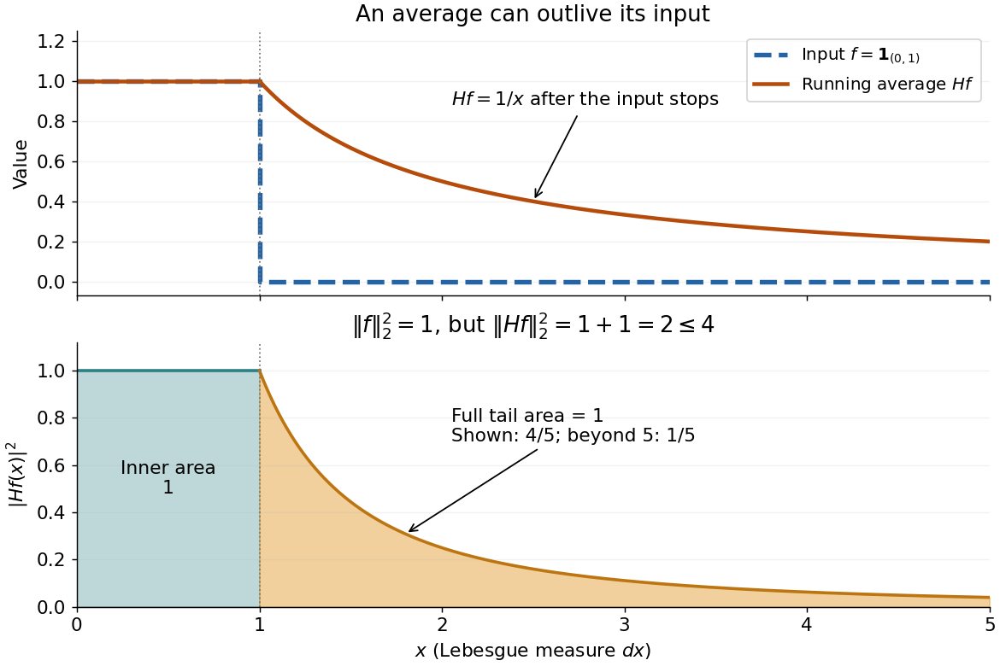

**[Figure 1](#image-an-indicator-function-its-hardy-operator-average-and-the-tail-s-squared-l2-norm). An indicator function, its Hardy operator average, and the tail's squared L2 norm**. The upper panel shows the input and its running average. The lower panel splits the squared average at one: each portion has [integral](integral.md) one, including the tail beyond the plotted range.

<h4 id="sharp-constant-in-hardy-s-integral-inequality">Sharp constant in Hardy's integral inequality</h4>

↑ **Parent:** [Hardy's integral inequality](#hardy-s-integral-inequality)

The [indicator function](measure-theory.md#indicator-function) example reaches a squared [L2 norm](#l2-norm) ratio of two. To approach four, concentrate more strongly near zero. For $0\leq a<1/2$, use the [measurable function](measure-theory.md#measurable-function)

$$
f_a(x)=x^{-a}\mathbf1_{(0,1)}(x),\qquad Hf_a(x)=\begin{cases}x^{-a}/(1-a),&0<x\leq1,\\1/((1-a)x),&x>1.\end{cases}
$$

All [integrals](integral.md) use [Lebesgue measure](measure-theory.md#lebesgue-measure) $dx$. Keeping both portions of the squared [L2 norm](#l2-norm) gives

$$
\|f_a\|_2^2=\frac1{1-2a},\qquad \int_0^1|Hf_a|^2\,dx=\frac1{(1-a)^2(1-2a)},\qquad \int_1^\infty|Hf_a|^2\,dx=\frac1{(1-a)^2}.
$$

Consequently,

$$
\frac{\|Hf_a\|_2^2}{\|f_a\|_2^2}=\frac1{(1-a)^2}+\frac{1-2a}{(1-a)^2}=\frac2{1-a}\longrightarrow4\quad\text{as }a\uparrow\frac12.
$$

Every allowed member has ratio strictly below four. For any proposed constant $C<4$, a sufficiently large $a<1/2$ has ratio greater than $C$. Combined with [Hardy's integral inequality](#hardy-s-integral-inequality), this proves that four is the smallest possible squared [L2 norm](#l2-norm) constant.[Inequalities, second edition, §9.8, Theorem 327, printed p. 240, and sharpness argument on printed p. 243](mathematics-bibliography.md#inequalities-by-godfrey-harold-hardy-and-others)

The endpoint is excluded: at $a=1/2$, $\int_0^1|f_a|^2\,dx=\int_0^1x^{-1}\,dx=\infty$, and the inner portion of $\|Hf_a\|_2^2$ also diverges. Its tail still has finite [integral](integral.md) four. There is no finite [L2 norm](#l2-norm) ratio at this endpoint, hence no equality example obtained by substituting it. The [limit](calculus.md#limit-of-a-function) four is unattained by this family. Multiplying each $f_a$ by $\sqrt{1-2a}$ makes its [L2 norm](#l2-norm) one without changing the ratio.

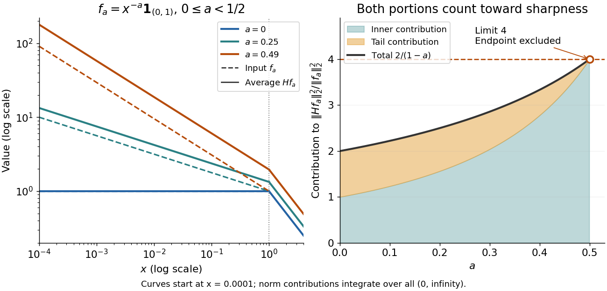

**[Figure 2](#image-a-power-family-approaches-the-sharp-constant-in-hardy-s-integral-inequality). A power family approaches the Sharp constant in Hardy's integral inequality**. Dashed input curves and solid [Hardy operator](sobolev-space.md#hardy-operator) averages show three allowed [exponents](arithmetic.md#exponent). The right panel splits the exact squared [L2 norm](#l2-norm) ratio into inner and tail contributions. The hollow endpoint marks a [limit](calculus.md#limit-of-a-function), not an admissible [function](function.md) in [L2 space](measure-theory.md#l2-space-is-a-hilbert-space).

<h4 id="proof-outline-of-hardy-s-integral-inequality">Proof outline of Hardy's integral inequality</h4>

↑ **Parent:** [Hardy's integral inequality](#hardy-s-integral-inequality)

For a nonnegative $f$, first set $g_n(x)=\min(f(x),n)\mathbf1_{(1/n,n)}(x)$ and $F_n(x)=\int_0^xg_n(t)\,dt$. These bounded [functions](function.md) vanish near zero and have [compact support](function.md#compact-support). Their averages have finite [Lp norms](#lp-norm): they vanish near zero and decay as $1/x$ beyond $n$. [Integration by parts](calculus.md#integration-by-parts) gives

$$
I_n:=\int_0^\infty(F_n(x)/x)^p\,dx=\frac{p}{p-1}\int_0^\infty(F_n(x)/x)^{p-1}g_n(x)\,dx\leq\frac{p}{p-1}I_n^{(p-1)/p}\|g_n\|_p.
$$

The boundary term $x^{1-p}F_n(x)^p$ vanishes at zero because $F_n$ is zero there, and at infinity because $F_n$ is eventually constant and $p>1$. The inequality is [Hölder's inequality](#holder-s-inequality) with [conjugate exponents](functional-analysis.md#conjugate-exponents) $p$ and $p/(p-1)$. Divide when $I_n>0$; the zero case is immediate. Since $g_n\uparrow f$ and $Hg_n\uparrow Hf$, the [monotone convergence theorem](measure-theory.md#monotone-convergence-theorem) proves the full bound without presupposing that $Hf$ has finite [Lp norm](#lp-norm). Apply it to $|f|$ for the signed or complex case.[Inequalities, second edition, §9.8(ii), truncation and integration by parts, printed pp. 242–243](mathematics-bibliography.md#inequalities-by-godfrey-harold-hardy-and-others)

## Infimum and supremum

↑ **Parent:** [Real analysis](real-analysis.md)  
ⓦ [Wiki](https://en.wikipedia.org/wiki/Infimum_and_supremum)

For a [subset](set.md#subset) $A$ of a [partially ordered set](set.md#partially-ordered-set), its [infimum](#infimum) is its [greatest lower bound](set.md#greatest-lower-bound-in-a-partially-ordered-set) and its [supremum](#supremum) is its [least upper bound](set.md#least-upper-bound-in-a-partially-ordered-set). An [upper bound](set.md#upper-bound-in-a-partially-ordered-set) only has to lie above every member; the [supremum](#supremum) is the smallest such bound. A [lower bound](set.md#lower-bound-in-a-partially-ordered-set) lies below every member; the [infimum](#infimum) is the largest such bound. These definitions identify the exact edges of a [set](set.md) even when neither edge belongs to it.

For example, $(0,1)$ and $[0,1]$ both have [infimum](#infimum) zero and [supremum](#supremum) one. Only $[0,1]$ has a [minimum](set.md#minimum-of-a-subset-of-a-total-order) and a [maximum](set.md#maximum-of-a-subset-of-a-total-order): those must be actual members of the [set](set.md). The [set](set.md) $C=\{1/n:n\in\mathbb N_{>0}\}$ has [infimum](#infimum) zero without a [minimum](set.md#minimum-of-a-subset-of-a-total-order), but its [supremum](#supremum) one is also its [maximum](set.md#maximum-of-a-subset-of-a-total-order). Such examples distinguish a bound from an attained extremal value. [Basic Analysis: Introduction to Real Analysis, Volume I by Jiří Lebl; Lebl, Basic Analysis I, §1.2: supremum, infimum and attainment](mathematics-bibliography.md#basic-analysis-introduction-to-real-analysis-volume-i-by-jiri-lebl/1-2-the-set-of-real-numbers).

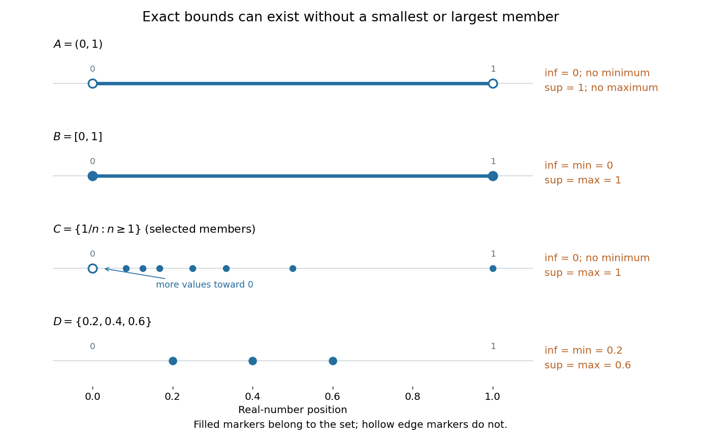

**[Figure 3](#image-infimum-and-supremum-need-not-be-attained-as-a-minimum-or-maximum). Infimum and supremum need not be attained as a minimum or maximum**. Filled endpoint markers belong to the displayed [set](set.md); hollow markers do not. The reciprocal row shows selected values $1/n$, with further values accumulating toward the excluded lower edge zero. The finite row attains both bounds.

For a nonempty [subset](set.md#subset) of the [real numbers](arithmetic.md#real-number), [completeness of the real numbers](sequence-and-series.md#completeness-of-the-real-numbers) guarantees a real [supremum](#supremum) when it is bounded above, and a real [infimum](#infimum) when it is bounded below. The bound and the ambient [partially ordered set](set.md#partially-ordered-set) both matter: $\{q\in\mathbb Q:q\geq0,\ q^2<2\}$ has [supremum](#supremum) $\sqrt2$ in the [real numbers](arithmetic.md#real-number), but no [supremum](#supremum) in the [rational numbers](number-theory.md#rational-number). The detailed explanation belongs to [completeness of the real numbers](sequence-and-series.md#completeness-of-the-real-numbers).

Why are unattained bounds useful? They specify a precise limiting target. In [mathematical optimization](mathematical-optimization.md), $f(x)=x$ on $(0,1)$ has [infimum](#infimum) zero but no [global minimizer](analysis.md#global-minimizer). The inputs $x_n=1/n$ for $n\geq2$ give a [minimizing sequence](calculus-of-variations.md#minimizing-sequence): their objective values approach zero without ever reaching it. Bounds therefore describe what approximation can achieve even when no feasible input is best. The [approximation property of an infimum](#approximation-property-of-an-infimum) and [approximation property of a supremum](#approximation-property-of-a-supremum) express this idea quantitatively.

### Essential infimum and essential supremum

↑ **Parent:** [Infimum and supremum](#infimum-and-supremum)  
ⓦ [Wiki](https://en.wikipedia.org/wiki/Essential_infimum_and_essential_supremum)

The [essential infimum](#essential-infimum) and [essential supremum](measure-theory.md#essential-supremum) describe the lower and upper bounds of a [measurable function](measure-theory.md#measurable-function) after disregarding [null sets](measure-theory.md#null-set) for a specified [measure](measure.md). A pointwise [infimum](#infimum) or [supremum](#supremum) sees every input; an essential bound sees whether values below or above a proposed threshold occur on a set of positive [measure](measure.md). Thus "essential" means insensitive to changes on a [null set](measure-theory.md#null-set), rather than insensitive to unusual values. This distinction makes essential bounds compatible with [Lebesgue integrals](measure-theory.md#lebesgue-integral) and the [equivalence classes](set-theory.md#equivalence-class) used in [Lp spaces](measure-theory.md#lp-space). [Hunter, Measure Theory, Definitions 7.1, 7.3–7.4: almost-everywhere equivalence and essential bounds](mathematics-bibliography.md#measure-theory-by-john-k-hunter/lp-spaces-chapter-7-of-measure-theory).

For a real [measurable function](measure-theory.md#measurable-function) $f$ on a [measure space](measure.md#measure-space) $(X,\Sigma,\mu)$, the definitions are

$$
\operatorname{ess\,inf}_\mu f=\sup\{a\in\mathbb R:\mu(\{x:f(x)<a\})=0\},\qquad
\operatorname{ess\,sup}_\mu f=\inf\{b\in\mathbb R:\mu(\{x:f(x)>b\})=0\}.
$$

These can take values in the [extended real number line](arithmetic.md#extended-real-number-line). On a space of positive total [measure](measure.md), finite essential bounds obey $\operatorname{ess\,inf}_\mu f\leq f\leq\operatorname{ess\,sup}_\mu f$ [almost everywhere](measure-theory.md#almost-everywhere). If $s=\operatorname{ess\,sup}_\mu f$ is finite, every threshold $b<s$ has $\mu(\{f>b\})>0$; the corresponding lower-edge statement is $\mu(\{f<a\})>0$ for every $a>\operatorname{ess\,inf}_\mu f$. These are the measure-based counterparts of the [approximation property of a supremum](#approximation-property-of-a-supremum) and [approximation property of an infimum](#approximation-property-of-an-infimum).

Here is a two-sided example on $[0,1]$ with [Lebesgue measure](measure-theory.md#lebesgue-measure):

$$
g(x)=\begin{cases}-3,&x=1/4,\\4,&x=3/4,\\x,&\text{otherwise}.\end{cases}
$$

**The pointwise bounds are $\inf g=-3$ and $\sup g=4$, while the essential bounds are $\operatorname{ess\,inf}g=0$ and $\operatorname{ess\,sup}g=1$.** Both exceptional [singletons](set.md#singleton-mathematics) are [null sets](measure-theory.md#null-set). But for $0<a<1$, the inputs where $g<a$ still have [measure](measure.md) $a$, and those where $g>a$ have [measure](measure.md) $1-a$: deleting or adding two individual inputs cannot change those lengths. Hence neither essential bound can be moved inward.

**[Figure 4](#image-essential-infimum-and-essential-supremum-ignore-two-exceptional-singletons-while-pointwise-infimum-and-supremum-retain-them). Essential infimum and essential supremum ignore two exceptional singletons, while pointwise infimum and supremum retain them**. The [function](function.md) follows $g(x)=x$ except for the filled values $g(1/4)=-3$ and $g(3/4)=4$. Hollow markers exclude the ordinary values at those inputs. The shaded horizontal band spans the essential bounds zero and one for [Lebesgue measure](measure-theory.md#lebesgue-measure).

The choice of [measure](measure.md) is part of the answer. The same $g$ has essential bounds $-3$ and $4$ under [counting measure](measure.md#counting-measure), because every nonempty [set](set.md) has positive [measure](measure.md). Under the [Dirac measure](measure.md#dirac-measure) at $1/4$, both essential bounds equal $-3$. A [null set](measure-theory.md#null-set) for one [measure](measure.md) need not be a [null set](measure-theory.md#null-set) for another.

Nor must the exceptional inputs be isolated. The [Dirichlet function](#dirichlet-function), equal to one at [rational numbers](number-theory.md#rational-number) and zero at [irrational numbers](algebra.md#irrational-number), has pointwise [supremum](#supremum) one on $[0,1]$, but [essential supremum](measure-theory.md#essential-supremum) zero for [Lebesgue measure](measure-theory.md#lebesgue-measure): the [rational numbers](number-theory.md#rational-number) form a [countable set](cardinal-number.md#countable-set) that is a [null set](measure-theory.md#null-set), even though they are [dense](topology.md#dense-set). Conversely, a value ten on an [interval](#interval-mathematics) of length $0.001$ affects the [essential supremum](measure-theory.md#essential-supremum) just as decisively as it would on half the domain. Small positive [measure](measure.md) is not zero [measure](measure.md).

#### Essential infimum

↑ **Parent:** [Essential infimum and essential supremum](#essential-infimum-and-essential-supremum)

The [essential infimum](#essential-infimum) of a real [measurable function](measure-theory.md#measurable-function) is $\operatorname{ess\,inf}_\mu f=-\operatorname{ess\,sup}_\mu(-f)$. It is the largest lower bound that holds [almost everywhere](measure-theory.md#almost-everywhere), with values allowed in the [extended real number line](arithmetic.md#extended-real-number-line). Unlike a pointwise [infimum](#infimum), it is unchanged by altering a representative on a [null set](measure-theory.md#null-set).

For the [function](function.md) $g$ in [essential infimum and essential supremum](#essential-infimum-and-essential-supremum), the value $-3$ at one input changes the pointwise [infimum](#infimum), but the [essential infimum](#essential-infimum) remains zero under [Lebesgue measure](measure-theory.md#lebesgue-measure). If instead a [function](function.md) is $-3$ throughout an [interval](#interval-mathematics) of any positive length and zero elsewhere, its [essential infimum](#essential-infimum) is $-3$. The distinction concerns the [measure](measure.md) of the low-value [set](set.md), rather than the magnitude of the low value.

### Supremum

↑ **Parent:** [Infimum and supremum](#infimum-and-supremum)

For a nonempty [set](set.md) $A\subseteq\mathbb R$, a real number $s$ is its [supremum](#supremum) precisely when it is an [upper bound](set.md#upper-bound-in-a-partially-ordered-set) and no smaller real number is an [upper bound](set.md#upper-bound-in-a-partially-ordered-set). It is unique: two least [upper bounds](set.md#upper-bound-in-a-partially-ordered-set) must each be no greater than the other.

For $A=(0,1)$, every number at least one is an [upper bound](set.md#upper-bound-in-a-partially-ordered-set), and none smaller than one bounds the whole [set](set.md). Thus $\sup A=1$, although $1\notin A$. For $A=[0,1]$, that same [supremum](#supremum) is also the [maximum](set.md#maximum-of-a-subset-of-a-total-order). The [approximation property of a supremum](#approximation-property-of-a-supremum) supplies witnesses arbitrarily close to an unattained upper edge.

#### Supremum of a sum

↑ **Parent:** [Supremum](#supremum)

Let $A,B$ be nonempty [sets](set.md) of [real numbers](arithmetic.md#real-number) bounded above. Their [Minkowski sum](geometry-and-topology.md#minkowski-addition) is $A+B=\{a+b:a\in A,\ b\in B\}$, allowing every pair from the [Cartesian product](set-theory.md#cartesian-product) $A\times B$. Then

$$
\boxed{\sup(A+B)=\sup A+\sup B.}
$$

The sum of the two [suprema](#supremum) is an [upper bound](set.md#upper-bound-in-a-partially-ordered-set) for every permitted sum. For the reverse bound, use the [approximation property of a supremum](#approximation-property-of-a-supremum) to choose $a>\sup A-\varepsilon/2$ and $b>\sup B-\varepsilon/2$. Their sum is within $\varepsilon$ of the claimed value. This reasoning does not require either [supremum](#supremum) to be a [maximum](set.md#maximum-of-a-subset-of-a-total-order).

Separate choices matter. On $X=[0,1]$, choose the [functions](function.md) $f(x)=x$ and $g(x)=1-x$. Each has [supremum](#supremum) one, but their sum at a shared input is always one:

$$
\sup_{x\in X}(f(x)+g(x))=1<2=\sup_{x\in X}f(x)+\sup_{x\in X}g(x).
$$

The [maximum](set.md#maximum-of-a-subset-of-a-total-order) of $f$ occurs at $x=1$, while that of $g$ occurs at $x=0$. A common input cannot realize both choices. With separate inputs, choosing $x=1$ and $y=0$ gives $f(x)+g(y)=2$. The allowed pairs of output values are the entire [unit square](euclidean-geometry.md#unit-square) for separate inputs, but only the [line segment](convex-set.md#line-segment) $a+b=1$ for the shared input.

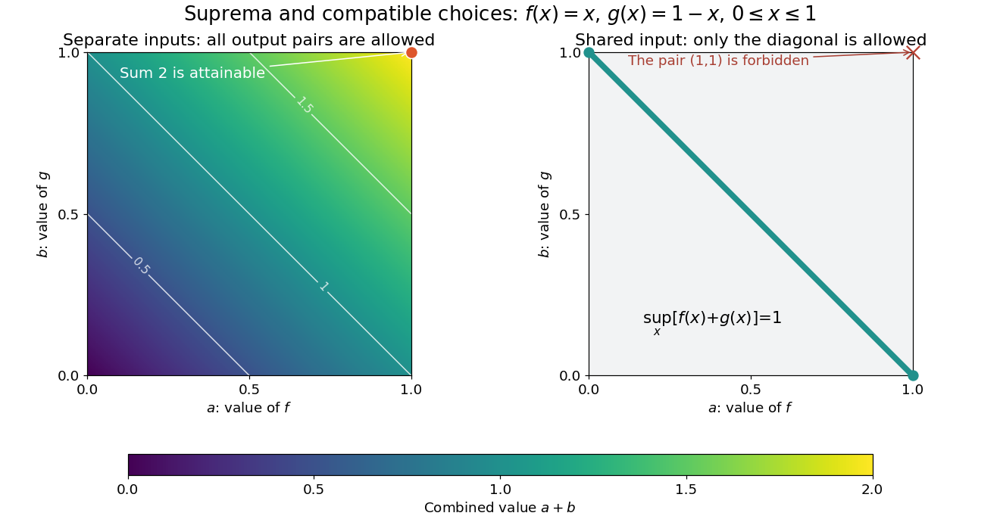

**[Figure 5](#image-separate-input-choices-fill-a-square-one-shared-input-restricts-the-attainable-sums). Separate input choices fill a square; one shared input restricts the attainable sums**. Original example $f(x)=x$, $g(x)=1-x$ on $[0,1]$. Left: every pair $(f(x),g(y))$ is permitted for separate inputs, including $(1,1)$ with sum two. Right: the shared-input pairs $(f(x),g(x))$ lie on $a+b=1$, with sum one. The colours encode $a+b$; this is a deterministic constraint on choices, not probabilistic [independence](random-variable.md#independent-random-variables).

For any two [bounded functions](function.md#bounded-function) on the same nonempty [domain of a function](function.md#domain-of-a-function), the useful general estimate is

$$
\sup_x(f(x)+g(x))\leq\sup_x f(x)+\sup_x g(x).
$$

The [inequality](arithmetic.md#inequality-mathematics) can be strict, as the example shows. Equality does not require attained [maxima](set.md#maximum-of-a-subset-of-a-total-order), but it does require that the two large values can be approached at compatible inputs. For example, $f(x)=g(x)=x$ on $(0,1)$ gives equality with value two, although neither [function](function.md) reaches its [supremum](#supremum). This distinction is useful when an [objective function](mathematical-optimization.md#objective-function) combines terms sharing a decision variable: adding the best possible termwise scores gives an [upper bound](set.md#upper-bound-in-a-partially-ordered-set), not necessarily a feasible combined score.

#### Stability of a supremum under uniform perturbations

↑ **Parent:** [Supremum](#supremum)

Suppose $f,g:X\to\mathbb R$ are [bounded functions](function.md#bounded-function) on the same nonempty [set](set.md), and the [supremum norm](normed-vector-space.md#supremum-norm) of their difference is at most $\delta$. Then their optimal values differ by at most the same amount:

$$
\boxed{\left|\sup_{x\in X}f(x)-\sup_{x\in X}g(x)\right|\leq\|f-g\|_\infty\leq\delta.}
$$

Indeed, $f(x)\leq g(x)+\delta\leq\sup_X g+\delta$ for every $x$, so $\sup_X f\leq\sup_X g+\delta$; exchange $f$ and $g$ for the other direction. Adding a constant shifts a [supremum](#supremum) by that constant, a basic compatibility between [upper bounds](set.md#upper-bound-in-a-partially-ordered-set) and [addition](arithmetic.md#addition).[Basic Analysis: Introduction to Real Analysis, Volume I by Jiří Lebl; §1.2.3, Proposition 1.2.6(i): translating a nonempty bounded-above set translates its supremum](mathematics-bibliography.md#basic-analysis-introduction-to-real-analysis-volume-i-by-jiri-lebl/1-2-the-set-of-real-numbers)

For a chosen example on $[-1,1]$, take $f(x)=-x^2$ and $g(x)=-x^2+0.2x$. Their [supremum error](sequence-and-series.md#supremum-error) is $0.2$, since $|g(x)-f(x)|=0.2|x|$. [Completing the square](polynomial.md#completing-the-square) gives

$$
g(x)=-(x-0.1)^2+0.01.
$$

Thus $f$ has [maximum](set.md#maximum-of-a-subset-of-a-total-order) zero at $x=0$, while $g$ has [maximum](set.md#maximum-of-a-subset-of-a-total-order) $0.01$ at $x=0.1$. The change in optimal value, $0.01$, is smaller than the certified bound $0.2$. For the vertical translation $h(x)=f(x)+0.2$, the bound is exact: its [supremum error](sequence-and-series.md#supremum-error) and optimal-value change are both $0.2$.

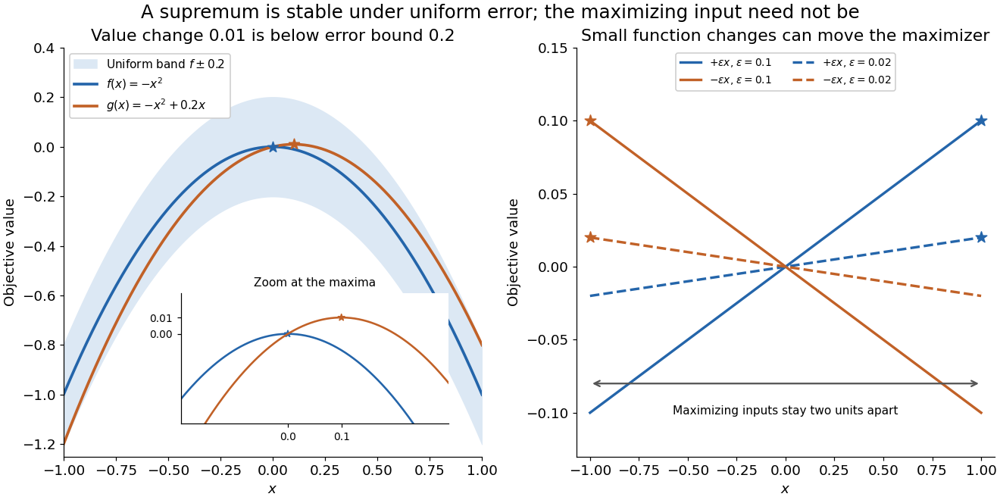

**[Figure 6](#image-uniform-error-controls-the-optimal-value-maximizing-inputs-require-additional-control). Uniform error controls the optimal value; maximizing inputs require additional control**. Original [polynomial](polynomial.md) examples on $[-1,1]$. Left: $-x^2$ and $-x^2+0.2x$ lie within a vertical error band of $0.2$, while their [maxima](set.md#maximum-of-a-subset-of-a-total-order) differ by $0.01$. Right: the small tilts $\varepsilon x$ and $-\varepsilon x$ have maximizing inputs $1$ and $-1$ for every $\varepsilon>0$; solid lines use $\varepsilon=0.1$ and dashed lines use $0.02$. These chosen examples are not measured errors or claims about an arbitrary optimizer.

A stable optimal value does not guarantee a stable maximizing input. On $[-1,1]$, the two [linear functions](vector-space.md#linear-function) $f_\varepsilon(x)=\varepsilon x$ and $g_\varepsilon(x)=-\varepsilon x$ satisfy

$$
\|f_\varepsilon-g_\varepsilon\|_\infty=2\varepsilon\longrightarrow0,
\qquad\sup f_\varepsilon=\sup g_\varepsilon=\varepsilon.
$$

For every positive $\varepsilon$, their unique maximizing inputs remain two units apart, at $1$ and $-1$. Both [functions](function.md) approach the flat zero [function](function.md), which has many maximizing inputs. Consequently an accurate [objective function](mathematical-optimization.md#objective-function) value is not by itself a certificate that the optimizing decision is accurate.

The estimate also gives a convenient consequence of [uniform convergence](sequence-and-series.md#uniform-convergence). If $f_n$ converges uniformly to a [bounded function](function.md#bounded-function) $f$ on a nonempty $X$, then $\sup_X f_n\to\sup_X f$ for the bounded tail of the [sequence](sequence-and-series.md#sequence). Uniform control handles the changing input that defines the best value. [Pointwise convergence](sequence-and-series.md#pointwise-convergence) alone supplies no such control; the existing examples under [uniform convergence](sequence-and-series.md#uniform-convergence) illustrate that distinction.

#### Approximation property of a supremum

↑ **Parent:** [Supremum](#supremum)

Let $A\subseteq\mathbb R$ be nonempty and bounded above. An [upper bound](set.md#upper-bound-in-a-partially-ordered-set) $s$ equals $\sup A$ exactly when, for every $\varepsilon>0$, some $a\in A$ satisfies $s-\varepsilon<a\leq s$. If no such member existed, $s-\varepsilon$ would be a smaller [upper bound](set.md#upper-bound-in-a-partially-ordered-set). Conversely, the condition defeats every proposed [upper bound](set.md#upper-bound-in-a-partially-ordered-set) $u<s$ by taking $\varepsilon=s-u$. [Basic Analysis: Introduction to Real Analysis, Volume I by Jiří Lebl; Lebl, Basic Analysis I, §1.2: approximation of a supremum](mathematics-bibliography.md#basic-analysis-introduction-to-real-analysis-volume-i-by-jiri-lebl/1-2-the-set-of-real-numbers).

For $(0,1)$ and $\varepsilon=0.2$, $a=0.9$ is one witness: $0.8<0.9<1$. Choosing $a_n\in A$ with $s-1/n<a_n\leq s$ produces a [sequence](sequence-and-series.md#sequence) converging to $s$ by the [squeeze theorem](calculus.md#squeeze-theorem). The choices need not form a [monotone sequence](sequence-and-series.md#monotone-sequence).

#### Accumulation below an unattained supremum

↑ **Parent:** [Supremum](#supremum)

If a nonempty real set $A$ has finite [supremum](#supremum) $s$ and $s\notin A$, then every interval $(s-\varepsilon,s)$ contains infinitely many elements of $A$. Otherwise its finitely many elements have a largest value $m<s$; all remaining elements are at most $s-\varepsilon$, making $\max(m,s-\varepsilon)<s$ an [upper bound](set.md#upper-bound-in-a-partially-ordered-set). The interval cannot be empty either, by the defining approximation property of a [supremum](#supremum). Thus failure to attain a finite [supremum](#supremum) forces accumulation from below.

### Infimum

↑ **Parent:** [Infimum and supremum](#infimum-and-supremum)

For a nonempty [set](set.md) $A\subseteq\mathbb R$, a real number $\ell$ is its [infimum](#infimum) precisely when it is a [lower bound](set.md#lower-bound-in-a-partially-ordered-set) and every other [lower bound](set.md#lower-bound-in-a-partially-ordered-set) is at most $\ell$. It is the [greatest lower bound](set.md#greatest-lower-bound-in-a-partially-ordered-set), not necessarily the [minimum](set.md#minimum-of-a-subset-of-a-total-order).

For $C=\{1/n:n\in\mathbb N_{>0}\}$, zero is a [lower bound](set.md#lower-bound-in-a-partially-ordered-set). Every positive candidate $\varepsilon$ fails: the [Archimedean property](arithmetic.md#archimedean-property) gives an [integer](integer.md) $n>1/\varepsilon$, hence $1/n<\varepsilon$. Thus $\inf C=0$, although zero is never a member of $C$. This is the lower-edge counterpart of approximating an unattained [supremum](#supremum).

#### Approximation property of an infimum

↑ **Parent:** [Infimum](#infimum)

Let $A\subseteq\mathbb R$ be nonempty and bounded below. A [lower bound](set.md#lower-bound-in-a-partially-ordered-set) $\ell$ equals $\inf A$ exactly when every $\varepsilon>0$ admits $a\in A$ with $\ell\leq a<\ell+\varepsilon$. Otherwise $\ell+\varepsilon$ would be a larger [lower bound](set.md#lower-bound-in-a-partially-ordered-set). Taking tolerances $1/n$ gives a [sequence](sequence-and-series.md#sequence) of members converging to $\ell$. For a real-valued objective with finite [infimum](#infimum), this supplies a [minimizing sequence](calculus-of-variations.md#minimizing-sequence) without assuming that a [global minimizer](analysis.md#global-minimizer) exists.

## Asymptotic analysis

↑ **Parent:** [Real analysis](real-analysis.md)  
ⓦ [Wiki](https://en.wikipedia.org/wiki/Asymptotic_analysis)

Asymptotic analysis describes what remains dominant as an argument approaches a specified [limit](calculus.md#limit-of-a-function). It compares [functions](function.md) or [sequences](sequence-and-series.md#sequence) by scale: how much of a complicated expression can be replaced by a simpler one, and how large is the omitted part? The [limit](calculus.md#limit-of-a-function) may be $n\to\infty$ for a growing input or $h\to0$ for a shrinking approximation parameter.

For example, $n^2+10^5n$ is eventually dominated by its quadratic term, since division by $n^2$ gives $1+10^5/n\to1$. But at $n=100$, the linear term contributes $10^7$, compared with only $10^4$ from the quadratic term. A statement about the limiting scale and a good approximation at a particular input are different claims.

Three useful comparisons keep their strengths distinct. [Big O notation](#big-o-notation) supplies an eventual [upper bound](set.md#upper-bound-in-a-partially-ordered-set) up to a constant multiplier; [big theta notation](#big-theta-notation) supplies both an [upper bound](set.md#upper-bound-in-a-partially-ordered-set) and a [lower bound](set.md#lower-bound-in-a-partially-ordered-set) up to constants; [asymptotic equivalence](#asymptotic-equivalence) makes the ratio tend to one. [Little o notation](#little-o-notation) says that a term becomes negligible relative to a specified scale. These distinctions make approximations checkable instead of merely calling one expression small.

The same language connects [time complexity](theoretical-computer-science.md#time-complexity) with [Taylor remainders](calculus.md#taylor-remainder). In an operation-count model, one asks how a cost scales with input size. In a [Taylor expansion](calculus.md#taylor-expansion), one asks how the approximation error scales with the increment. Neither use requires interpreting the unspecified constant as one. The [asymptotic comparison of exponential functions](#asymptotic-comparison-of-exponential-functions) gives another example: dividing by the largest contributing exponential reveals the terms that disappear.

### Asymptotic equivalence

↑ **Parent:** [Asymptotic analysis](#asymptotic-analysis)

For [functions](function.md) with $g$ nonzero sufficiently near a specified [limit](calculus.md#limit-of-a-function),

$$
\boxed{f\sim g\quad\Longleftrightarrow\quad \frac{f}{g}\longrightarrow1.}
$$

The same definition applies to [sequences](sequence-and-series.md#sequence) $a_n\sim b_n$ as $n\to\infty$. Equivalently, $(f-g)/g\to0$: replacing $f$ by $g$ has a [relative error](numerical-analysis.md#relative-error) tending to zero, and the difference is $o(g)$ in [little o notation](#little-o-notation). The [limit](calculus.md#limit-of-a-function) and reference scale are essential parts of the statement.

For example, $n^2+n\sim n^2$ because $(n^2+n)/n^2=1+1/n\to1$. Replacing the former by the latter gives [absolute error](numerical-analysis.md#absolute-error) $n$, which grows without bound. Thus [asymptotic equivalence](#asymptotic-equivalence) controls a ratio, rather than requiring the [absolute error](numerical-analysis.md#absolute-error) to vanish. This distinction is crucial when approximating a rapidly growing [factorial](combinatorics.md#factorial) with [Stirling's formula](#stirling-formula).

By contrast, $2n$ and $n$ have the same order in [big theta notation](#big-theta-notation), but are not [asymptotically equivalent](#asymptotic-equivalence): their ratio remains two. For positive [functions](function.md), [asymptotic equivalence](#asymptotic-equivalence) gives both-sided constant bounds eventually, whereas constant bounds alone do not recover the leading coefficient.

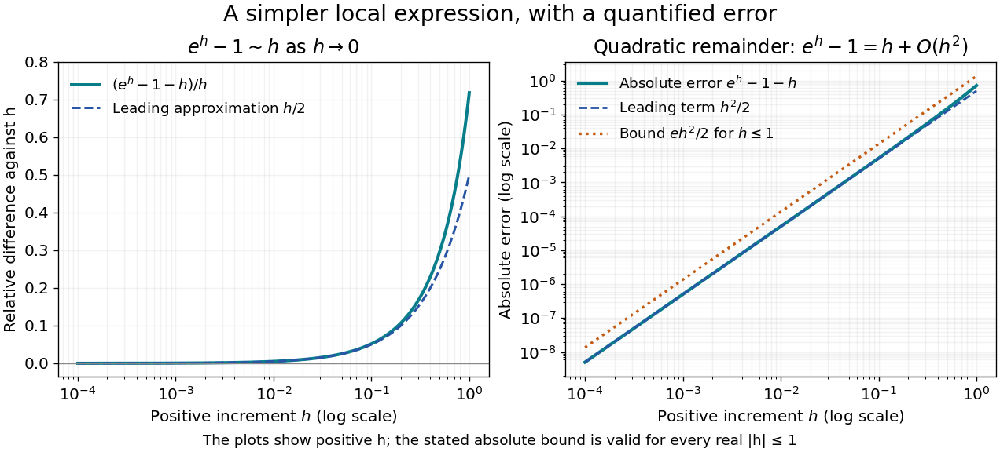

**[Figure 7](#image-local-exponential-approximation-relative-difference-tends-to-zero-and-absolute-error-is-quadratic). Local exponential approximation: relative difference tends to zero and absolute error is quadratic**.

For a local example with real $h$, the [exponential function](calculus.md#exponential-function) obeys $e^h-1\sim h$ as $h\to0$. The [Taylor theorem with Lagrange remainder](calculus.md#taylor-theorem-with-lagrange-remainder) gives

$$
e^h-1=h+\frac{e^\xi}{2}h^2,\qquad
|\xi|\le |h|.
$$

Thus for $|h|\le1$,

$$
|e^h-1-h|\le\frac e2 h^2.
$$

This states $e^h-1=h+O(h^2)$ in [big O notation](#big-o-notation), and division by $h$ shows that the relative difference measured against $h$ vanishes. The diagram uses positive $h$; the bound is valid on both sides of zero. At $h=0.1$, the [absolute error](numerical-analysis.md#absolute-error) is approximately $0.00517092$ and the relative difference against $h$ is approximately $0.0517092$.

#### Asymptotic comparison of exponential functions

↑ **Parent:** [Asymptotic equivalence](#asymptotic-equivalence)

For positive bases $a,b$, comparison of the [exponential functions](calculus.md#exponential-function) $a^n$ and $b^n$ reduces to a [geometric progression](sequence-and-series.md#geometric-progression):

$$
\frac{a^n}{b^n}=\left(\frac ab\right)^n.
$$

If $a<b$, this ratio tends to zero, so $a^n=o(b^n)$ in [little o notation](#little-o-notation). If $a=b$, the ratio is one; if $a>b$, it grows without bound.

Consequently, provided at least one coefficient is nonzero, a finite sum with distinct positive bases is [asymptotically equivalent](#asymptotic-equivalence) to its largest-base term whose coefficient is nonzero. For example,

$$
3\cdot2^n+5\cdot3^n\sim5\cdot3^n,\qquad
\frac{3\cdot2^n+5\cdot3^n}{5\cdot3^n}
=1+\frac35\left(\frac23\right)^n.
$$

The relative difference against $5\cdot3^n$ first drops below one percent at the integer $n=11$. Dividing by the proposed dominant term provides an explicit error estimate, not just a comparison of two rapidly growing numbers. If several terms have the same largest base, their coefficients must first be combined; cancellation can remove that base entirely.

#### Stirling formula

↑ **Parent:** [Asymptotic equivalence](#asymptotic-equivalence)  
ⓦ [Wiki](https://en.wikipedia.org/wiki/Stirling_formula)

[Stirling's formula](#stirling-formula) turns the long product defining a [factorial](combinatorics.md#factorial) into a short expression. For positive [integers](integer.md) $n$, put

$$
S_n=\sqrt{2\pi n}\left(\frac ne\right)^n.
$$

Then $n!\sim S_n$ as $n\to\infty$. This is [asymptotic equivalence](#asymptotic-equivalence): $S_n/n!\to1$, so the [relative error](numerical-analysis.md#relative-error) tends to zero. It does not say that the [absolute error](numerical-analysis.md#absolute-error) tends to zero, and the formula is not an equality for finite $n$. The [Gamma function](complex-analysis.md#gamma-function) extends this approximation beyond integer inputs. [NIST Digital Library of Mathematical Functions, §5.11: Gamma-function asymptotic expansions](https://dlmf.nist.gov/5.11)

For $n=10$,

$$
10!=3\,628\,800,\qquad S_{10}\simeq3\,598\,695.619,\qquad
\frac{S_{10}-10!}{10!}\simeq-0.00829596.
$$

The leading estimate is about $0.830\%$ low. Multiplying by the first correction factor gives

$$
S_{10}\left(1+\frac1{120}\right)\simeq3\,628\,684.749,
$$

which is about $0.003176\%$ low. The [Stirling correction by Gaussian moments](#stirling-correction-by-gaussian-moments) explains why this factor is $1+1/(12n)$ rather than an arbitrary numerical adjustment.

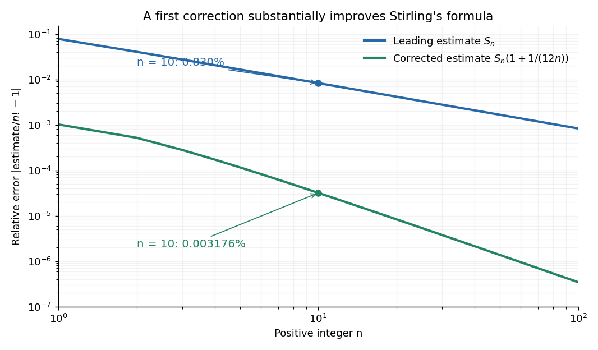

**[Figure 8](#image-relative-factorial-errors-shrink-faster-after-the-first-stirling-correction). Relative factorial errors shrink faster after the first Stirling correction**. For each integer $1\leq n\leq100$, the curves compare $S_n$ and $S_n(1+1/(12n))$ with the exact [factorial](combinatorics.md#factorial). The vertical axis is the nonnegative [relative error](numerical-analysis.md#relative-error), on a logarithmic scale.

The usefulness is in ratios as well as in enormous numbers. Applying [Stirling's formula](#stirling-formula) to the three [factorials](combinatorics.md#factorial) in a [central binomial coefficient](binomial-coefficient.md#central-binomial-coefficient) gives

$$
\binom{2n}{n}\sim\frac{4^n}{\sqrt{\pi n}}.
$$

This counts the ways to choose exactly half of $2n$ objects. Equivalently, for $2n$ independent fair coin tosses, the [binomial distribution](discrete-probability-distribution.md#binomial-distribution) assigns probability $\binom{2n}{n}/4^n\sim1/\sqrt{\pi n}$ to exactly $n$ heads. An exponentially large count becomes a simple probability scale after cancellation.

For numerical calculations, taking the [natural logarithm](calculus.md#natural-logarithm) yields

$$
\log(n!)=n\log n-n+\frac12\log(2\pi n)+r_n,
$$

where $r_n\to0$. Computing a [logarithm](calculus.md#logarithm) of a large [factorial](combinatorics.md#factorial) avoids representing the factorial itself. The [Robbins bounds for Stirling's formula](#robbins-bounds-for-stirling-s-formula) give a finite-$n$ interval for this logarithmic remainder, rather than only a limiting statement.

The factor $\sqrt{2\pi n}$ is beautiful because a [Gaussian integral](integral.md#gaussian-integral) lies behind a discrete product. The [Gaussian peak behind Stirling's formula](#gaussian-peak-behind-stirling-s-formula) displays this connection through the [Gamma integral](complex-analysis.md#gamma-integral) and [Laplace's method](asymptotic-expansion.md#laplace-s-method). A rigorous proof must also control the tails of the integral; the local expansion explains the geometry but is not by itself a complete proof.

James Stirling published _Methodus differentialis_ in 1730, a treatise on [summation](arithmetic.md#summation) and [interpolation](interpolation.md) of infinite [series](sequence-and-series.md#series-mathematics). This setting connects the formula with a practical calculation problem: taking [logarithms](calculus.md#logarithm) turns a long product into a [sum](arithmetic.md#sum), whose growth can be approximated. [James Stirling, Methodus differentialis (1730), digitized original and bibliographic record](https://commons.wikimedia.org/wiki/File:Methodus_differentialis,_sive_tractatus_de_summatione_et_interpolatione_serierum_infinitarum_(IA_10053880bsb).pdf)

##### Integral bounds for a logarithmic factorial

↑ **Parent:** [Stirling formula](#stirling-formula)

For integer $N\geq2$, write $\ln(N!)=\sum_{k=2}^N\ln k$. Monotonicity gives $\int_{k-1}^k\ln x\,dx\leq\ln k\leq\int_k^{k+1}\ln x\,dx$. Summing and evaluating the endpoint integrals proves the displayed bounds. They also hold with equality when $N=1$. The lower integral starts at one and the upper at two; confusing those endpoints loses the constant in the upper bound. The bounds imply $\ln(N!)=N\ln N-N+O(\ln N)$, while [Stirling's formula](#stirling-formula) determines the logarithmic and constant corrections.

##### Convergence of the Stirling sequence

↑ **Parent:** [Stirling formula](#stirling-formula)

The positive [sequence](sequence-and-series.md#sequence) $a_n=\sqrt n(n/e)^n/n!$ has logarithmic increments

$$
u_n=\ln\frac{a_{n+1}}{a_n}=\left(n+\frac12\right)\ln\left(1+\frac1n\right)-1.
$$

The [rational lower bound for the natural logarithm](calculus.md#rational-lower-bound-for-the-natural-logarithm) proves $u_n>0$. For $n>1$, the [Taylor series](calculus.md#taylor-series) gives

$$
u_n=\sum_{k=2}^{\infty}\frac{(-1)^k}{n^k}\frac{k-1}{2k(k+1)}.
$$

Since $0<(k-1)/[2k(k+1)]<1/2$, a [geometric series](sequence-and-series.md#geometric-series) bounds $u_n<1/[2n(n-1)]\leq n^{-2}$ for $n\geq2$. The [comparison test for series](sequence-and-series.md#comparison-test-for-series) therefore proves $\sum u_n<\infty$. The finite [telescoping sum](arithmetic.md#telescoping-sum) $\ln a_{n+1}=-1+\sum_{k=1}^n u_k$ shows that $a_n$ increases to a finite positive [limit](calculus.md#limit-of-a-function). This argument establishes the existence of the constant in [Stirling's formula](#stirling-formula); its value $1/\sqrt{2\pi}$ requires an independent identification.

<h5 id="robbins-bounds-for-stirling-s-formula">Robbins bounds for Stirling's formula</h5>

↑ **Parent:** [Stirling formula](#stirling-formula)

For every positive [integer](integer.md) $n$, Herbert Robbins's bounds give

$$
\boxed{S_n e^{1/(12n+1)}<n!<S_n e^{1/(12n)}.}
$$

Equivalently, the remainder in $\log(n!)=\log S_n+r_n$ satisfies $1/(12n+1)<r_n<1/(12n)$. This both proves that $S_n$ underestimates $n!$ and squeezes $n!/S_n$ to one, establishing [Stirling's formula](#stirling-formula). Robbins published the bounds in “A Remark on Stirling's Formula” in 1955. [Herbert Robbins, American Mathematical Monthly 62 (1955), pp. 26–29, equations (1)–(2)](https://dornsife.usc.edu/sergey-lototsky/wp-content/uploads/sites/211/2024/02/Stirling-Robbins.pdf)

For $n=10$, the [relative error](numerical-analysis.md#relative-error) of $S_{10}$ lies strictly between $1-e^{-1/121}$ and $1-e^{-1/120}$, approximately $0.823\%$ and $0.830\%$. A bound specifies the accuracy of an approximation before using it in another calculation.

<h5 id="gaussian-peak-behind-stirling-s-formula">Gaussian peak behind Stirling's formula</h5>

↑ **Parent:** [Stirling formula](#stirling-formula)

Repeated [integration by parts](calculus.md#integration-by-parts) gives the [Gamma integral](complex-analysis.md#gamma-integral)

$$
n!=\int_0^\infty t^n e^{-t}\,dt.
$$

The logarithm of its integrand is $n\log t-t$, whose unique maximum is at $t=n$. Write $t=n+\sqrt n\,s$. For fixed $s$ and large $n$, a [Taylor expansion](calculus.md#taylor-expansion) gives

$$
n\log\left(1+\frac{s}{\sqrt n}\right)-s\sqrt n
=-\frac{s^2}{2}+\frac{s^3}{3\sqrt n}+O(n^{-1}).
$$

The [Big O notation](#big-o-notation) here is for a fixed $s$, or uniformly for $s$ in a fixed bounded interval. It does not claim a uniform approximation over the entire growing integration domain. Consequently the peak, divided by its height, approaches $e^{-s^2/2}$.

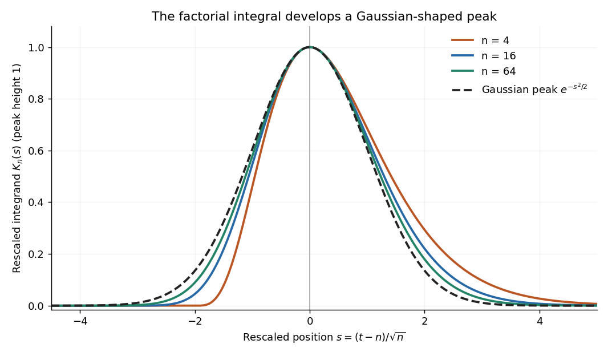

**[Figure 9](#image-the-peak-of-a-factorial-integral-approaches-a-gaussian-after-recentering-and-rescaling). The peak of a factorial integral approaches a Gaussian after recentering and rescaling**. The plotted functions are $K_n(s)=\exp(n\log(1+s/\sqrt n)-s\sqrt n)$ for $s>-\sqrt n$, with zero outside their domains. Each has peak height one. They are rescaled integrands, not normalized [probability density functions](continuous-probability-distribution.md#probability-density-function).

The exact substitution gives

$$
n!=n^n e^{-n}\sqrt n\int_{-\sqrt n}^{\infty}
\exp\left(n\log\left(1+\frac{s}{\sqrt n}\right)-s\sqrt n\right)\,ds.
$$

Replacing the integral by the [Gaussian integral](integral.md#gaussian-integral) $\int_{\mathbb R}e^{-s^2/2}\,ds=\sqrt{2\pi}$ produces $S_n$. Thus the estimate is peak height $n^ne^{-n}$ times width $\sqrt n$ times the area of a standard Gaussian peak. This is [Laplace's method](asymptotic-expansion.md#laplace-s-method) in a concrete form; controlling the integral's tails justifies the replacement. The next terms, including their products after exponentiation, produce the [Stirling correction by Gaussian moments](#stirling-correction-by-gaussian-moments).

##### Stirling correction by Gaussian moments

↑ **Parent:** [Stirling formula](#stirling-formula)

In [Laplace method](asymptotic-expansion.md#laplace-s-method) for the [Gamma function](complex-analysis.md#gamma-function), scaling $t=x(1+s/\sqrt x)$ gives a standard [Gaussian integral](integral.md#gaussian-integral). The first even correction polynomial is $s^2-7s^4/12+s^6/18$. Its expectation under a unit-variance centered Gaussian is $1-7\cdot3/12+15/18=1/12$. The amplitude expansion contributes to this coefficient as well as the phase expansion; expanding only the latter gives the wrong [Stirling formula](#stirling-formula) correction.

## Monotone integral Tauberian lemma

↑ **Parent:** [Real analysis](real-analysis.md)

For nondecreasing real $\beta$, convergence of the displayed improper integral forces $\beta(x)/x\to1$. For $\lambda>1$, the integral over $[X,\lambda X]$ tends to zero and is at least $(1-\lambda^{-1})\beta(X)/X-\log\lambda$. The integral over $[X/\lambda,X]$ tends to zero and is at most $(\lambda-1)\beta(X)/X-\log\lambda$. These bound the upper and lower limits by $\log\lambda/(1-\lambda^{-1})$ and $\log\lambda/(\lambda-1)$. Letting $\lambda\downarrow1$ squeezes both to one. The limit of the improper integral must be finite.

## Homogeneous function

↑ **Parent:** [Real analysis](real-analysis.md)  
ⓦ [Wiki](https://en.wikipedia.org/wiki/Homogeneous_function)

A [function](function.md) is homogeneous of degree $k$ when rescaling its arguments by a common [scalar](vector-space.md#scalar) $\lambda$ rescales its value by $\lambda^k$, whenever the arguments and that power are defined. For integer $k$ over a [vector space](vector-space.md), one can require every nonzero scalar; a [homogeneous polynomial](algebra.md#homogeneous-polynomial) gives an example. On a domain stable under positive real rescaling, the positive-scaling version allows real $k$. Degree-one [positive homogeneity](#positively-homogeneous-function-degree-one) is the convention used for [norms](normed-vector-space.md#norm) and many [convex functions](#convex-function). The [Euler theorem for homogeneous functions](#euler-theorem-for-homogeneous-functions) turns this scaling law into a differential identity for a [differentiable function](analysis.md#differentiable-function).

### Homogeneity

↑ **Parent:** [Homogeneous function](#homogeneous-function)

Homogeneity of degree $k$ means that multiplying all arguments by a common positive factor $a$ multiplies the output by $a^k$. A [homogeneous function](#homogeneous-function) is the function possessing this property. This is different from degree-one [positive homogeneity](#positively-homogeneous-function-degree-one); investment values with [constant relative risk aversion utility](utility-function.md#constant-relative-risk-aversion-utility) usually have degree $1-R$.

### Positively homogeneous function (degree one)

↑ **Parent:** [Homogeneous function](#homogeneous-function)

A [function](function.md) on a cone is positively homogeneous of degree one when $f(tX)=t f(X)$ for every $t>0$. If such a function is [concave](#concave-function), then

$$
f(X+tY)\geq f(X)+t f(Y),
$$

because homogeneity rewrites the left-hand side as $(1+t)f((X+tY)/(1+t))$ before [concavity](#concave-function) is applied.

### Euler theorem for homogeneous functions

↑ **Parent:** [Homogeneous function](#homogeneous-function)

Let $f$ be a [differentiable function](analysis.md#differentiable-function) on an open domain stable under positive rescaling, with $f(\lambda x)=\lambda^kf(x)$ for $\lambda>0$. The [chain rule](calculus.md#chain-rule) differentiates this [homogeneous function](#homogeneous-function) identity at $\lambda=1$ to give

$$
\sum_ix_i\partial_i f(x)=k f(x).
$$

If $f$ is twice differentiable, differentiating once more gives $\sum_i x_i\partial_i\partial_jf=(k-1)\partial_j f$. In degree one its [Hessian matrix](multivariable-calculus.md#hessian-matrix) therefore annihilates the radial vector $x$. This is the identity used in the [no-scale identity from degree-one homogeneity](supersymmetry.md#no-scale-identity-from-degree-one-homogeneity). For an [extensive quantity](thermodynamics.md#extensive-quantity), the degree-one formula also supplies the thermodynamic identity behind the [Gibbs-Duhem equation](thermodynamics.md#gibbs-duhem-equation).

#### Second derivative identity for a degree-one homogeneous function

↑ **Parent:** [Euler theorem for homogeneous functions](#euler-theorem-for-homogeneous-functions)

For a twice [continuously differentiable](multivariable-calculus.md#continuously-differentiable-function) [homogeneous function](#homogeneous-function) $h(x,y)$ of degree one, [Euler theorem for homogeneous functions](#euler-theorem-for-homogeneous-functions) gives $xh_x+yh_y=h$. Differentiation first with respect to $x$ and then, separately, with respect to $y$ gives

$$
xh_{xx}+yh_{xy}=0,\qquad xh_{xy}+yh_{yy}=0.
$$

Multiplying by $x$ and $y$, respectively, shows that $x^2h_{xx}=y^2h_{yy}=-xyh_{xy}$. This identity can verify a second-order [partial differential equation](partial-differential-equation.md) without expanding a complicated homogeneous expression twice.

#### Second-order Euler identity for homogeneous functions

↑ **Parent:** [Euler theorem for homogeneous functions](#euler-theorem-for-homogeneous-functions)

Let $f$ be a twice continuously [differentiable function](analysis.md#differentiable-function) on an open domain stable under positive scaling, with $f(\lambda x)=\lambda^nf(x)$. Apply the [chain rule](calculus.md#chain-rule) twice to the scalar [function](function.md) $\lambda\mapsto f(\lambda x)$ and set $\lambda=1$. The result is

$$
\boxed{\sum_{i,j}x_ix_j\partial_i\partial_jf(x)=n(n-1)f(x).}
$$

In two variables, this reads $x^2f_{xx}+2xyf_{xy}+y^2f_{yy}=n(n-1)f$. In [matrix](vector-space.md#matrix) notation it is $x^T(\nabla^2f)x=n(n-1)f$, where $\nabla^2f$ is the [Hessian matrix](multivariable-calculus.md#hessian-matrix). Equivalently, the radial [differential operator](analysis.md#differential-operator) $D=\sum_ix_i\partial_i$ obeys $D^2f=Df+\sum_{i,j}x_ix_j\partial_i\partial_jf$; substituting $Df=nf$ explains the factor $n(n-1)$.

#### Euler differential identity characterizes homogeneity

↑ **Parent:** [Euler theorem for homogeneous functions](#euler-theorem-for-homogeneous-functions)

On an open domain invariant under positive scaling, $Df_x(x)=cf(x)$ implies $f(\lambda x)=\lambda^cf(x)$. Indeed, $\frac d{d\lambda}[\lambda^{-c}f(\lambda x)]=\lambda^{-c-1}[Df_{\lambda x}(\lambda x)-cf(\lambda x)]=0$. The converse follows by differentiating the scaling identity at $\lambda=1$. Connectedness of the whole domain is unnecessary: the argument works along each positive ray.

#### Volume integral of a homogeneous function

↑ **Parent:** [Euler theorem for homogeneous functions](#euler-theorem-for-homogeneous-functions)

For a sufficiently regular [homogeneous function](#homogeneous-function) $f$ of degree $n$ on a three-dimensional region, [Euler theorem for homogeneous functions](#euler-theorem-for-homogeneous-functions) gives $x\cdot\nabla f=nf$. Hence $\nabla\cdot(fx)=(n+3)f$, and the [divergence theorem](multivariable-calculus.md#divergence-theorem) gives the displayed reduction when $n\ne-3$. At degree $-3$ only the zero-flux identity follows, so division by $n+3$ is unavailable. Singular functions additionally require an excision or limiting argument; the surface contribution at a removed singularity must not be silently dropped. On the sloping side of a cone with its apex at zero, $x$ is tangent to the side and $x\cdot n=0$, so only the cap contributes to this formula.

## Regular variation

↑ **Parent:** [Real analysis](real-analysis.md)

A [power law](analysis.md#power-law) $q(t)=t^\rho$ responds to every fixed rescaling $t\mapsto ut$ by the same factor $u^\rho$. [Regular variation](#regular-variation) keeps this scaling behaviour in the [limit](calculus.md#limit-of-a-function) $t\to\infty$, while allowing departures from an exact [power law](analysis.md#power-law). It is useful when the scaling exponent is stable but a smaller correction continues changing. The correction can even grow without bound.

An eventually positive [measurable function](measure-theory.md#measurable-function) $q$ has [regular variation](#regular-variation) at infinity with index $\rho\in\mathbb R$ if

$$
\lim_{t\to\infty}\frac{q(ut)}{q(t)}=u^\rho
\qquad\text{for every fixed }u>0.
$$

The argument $ut$ is in the [domain of a function](function.md#domain-of-a-function) for sufficiently large $t$. Each $u$ is held fixed as the [limit](calculus.md#limit-of-a-function) is taken; allowing $u$ to change with $t$ is a different assertion. This is the scalar definition recalled by [Filip Lindskog, Sidney I. Resnick and Joyjit Roy, Regularly varying measures on metric spaces: hidden regular variation and hidden jumps, §3.2, p. 12](https://people.orie.cornell.edu/sid/NewForLinking/papers/RegVarMeasFinal2.pdf). The index is unique: taking $u=2$ determines $2^\rho$.

For example, on $t>1$ the [function](function.md) $q(t)=t^2\log t$ has

$$
\frac{q(ut)}{q(t)}
=u^2\left(1+\frac{\log u}{\log t}\right)
\longrightarrow u^2.
$$

Thus $q$ has [regular variation](#regular-variation) of index two. Yet $q(t)/t^2=\log t\to\infty$: [regular variation](#regular-variation) does not require [asymptotic equivalence](#asymptotic-equivalence) to a constant times a [power law](analysis.md#power-law). Doubling $t$ gives $q(2t)/q(t)=4(1+\log2/\log t)$. At $t=100,10^4,10^6$ this is approximately $4.60206,4.30103,4.20069$, respectively. The ratio approaches four slowly, even though the exponent is exactly two in the limiting scaling law.

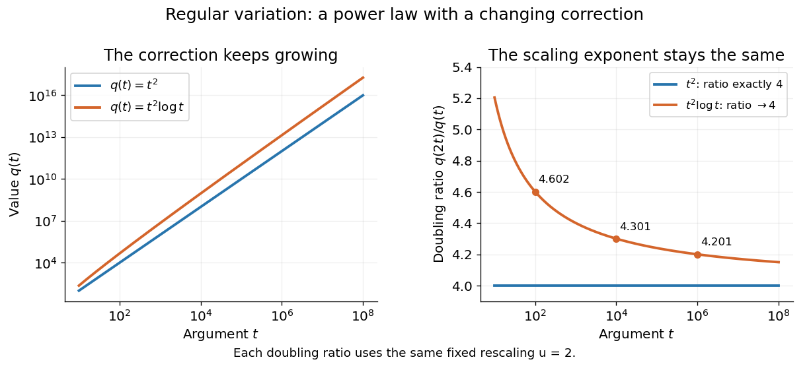

**[Figure 10](#image-an-exact-power-law-has-a-fixed-doubling-ratio-a-logarithmic-correction-approaches-the-same-ratio-without-approaching-a-constant-multiple-of-that-power). An exact power law has a fixed doubling ratio; a logarithmic correction approaches the same ratio without approaching a constant multiple of that power**.

The [slowly varying function](#slowly-varying-function) isolates this correction. Set $\ell(t)=q(t)/t^\rho$. Then

$$
\frac{\ell(ut)}{\ell(t)}
=u^{-\rho}\frac{q(ut)}{q(t)}\longrightarrow1.
$$

Conversely, multiplying a [slowly varying function](#slowly-varying-function) by $t^\rho$ gives [regular variation](#regular-variation) of index $\rho$. Hence the decomposition $q(t)=t^\rho\ell(t)$ is exact on its eventual [domain of a function](function.md#domain-of-a-function); it is the scaling relation, rather than the decomposition itself, that is asymptotic.

A [Pareto distribution](continuous-probability-distribution.md#pareto-distribution) gives a decreasing example with a direct interpretation. For $x\geq1$, take the [tail probability](probability-theory.md#tail-probability) $\mathbb P(X>x)=x^{-2}$. Its [regular variation](#regular-variation) index is $-2$. Doubling a threshold divides its [tail probability](probability-theory.md#tail-probability) by four, and

$$
\mathbb P(X>2t\mid X>t)
=\frac{\mathbb P(X>2t)}{\mathbb P(X>t)}
=\frac14
\qquad(t\geq1).
$$

For a [tail probability](probability-theory.md#tail-probability) with [regular variation](#regular-variation) of index $-\alpha$, the same [conditional probability](probability-theory.md#conditional-probability) tends to $2^{-\alpha}$. An [exponential distribution](continuous-probability-distribution.md#exponential-distribution) behaves differently: its corresponding conditional probability is $e^{-\lambda t}\to0$. This comparison explains why scaling limits are useful in [extreme value theory](extreme-value-theory.md); it does not establish that an observed dataset follows a particular tail model. The role of [regular variation](#regular-variation) in [heavy-tailed distributions](probability-distribution.md#heavy-tailed-distribution) is discussed in [Lindskog, Resnick and Roy, introduction, p. 1](https://people.orie.cornell.edu/sid/NewForLinking/papers/RegVarMeasFinal2.pdf).

An [exponential function](calculus.md#exponential-function) $q(t)=e^t$ is not [regularly varying](#regular-variation) with any finite index: at $u=2$, $q(2t)/q(t)=e^t\to\infty$, rather than $2^\rho$. Boundedness alone is also insufficient, as the oscillating counterexample in [slowly varying function](#slowly-varying-function) shows. Checking a few rescaling ratios at finite arguments can illustrate a proposed law, but cannot prove its limiting definition.

Jovan Karamata developed this theory in his 1930 paper and returned to its fundamental results in 1933. The opening of his 1933 paper identifies the earlier work; pp. 57–58 connect the rescaling limit with a [power law](analysis.md#power-law) and a slowly varying factor. See [J. Karamata, Sur un mode de croissance régulière. Théorèmes fondamentaux, Bulletin de la Société Mathématique de France 61 (1933), 55–62](https://www.numdam.org/article/BSMF_1933__61__55_0.pdf). This gives a precise language for “almost a power” without discarding corrections that remain large.

### Slowly varying function

↑ **Parent:** [Regular variation](#regular-variation)  
ⓦ [Wiki](https://en.wikipedia.org/wiki/Slowly_varying_function)

A positive [measurable function](measure-theory.md#measurable-function) $\ell$ is slowly varying at infinity if

$$
\frac{\ell(ut)}{\ell(t)}\longrightarrow1
\qquad(t\to\infty)
$$

for every fixed $u>0$. It has [regular variation](#regular-variation) of index zero. “Slowly” concerns relative change under multiplication of the argument; it does not mean that the [function](function.md) must be bounded, have a small [derivative](calculus.md#derivative), or converge to a finite value.

Every positive constant is a [slowly varying function](#slowly-varying-function). So are $\log t$, $1/\log t$ and $(\log t)^a$ for any fixed [real number](arithmetic.md#real-number) $a$, on $t>1$. Indeed,

$$
\frac{(\log(ut))^a}{(\log t)^a}
=\left(1+\frac{\log u}{\log t}\right)^a\longrightarrow1.
$$

The first grows without bound, the second tends to zero, and the constant does neither. Another unbounded example is $\ell(t)=e^{\sqrt{\log t}}$:

$$
\log\frac{\ell(ut)}{\ell(t)}
=\frac{\log u}{\sqrt{\log t+\log u}+\sqrt{\log t}}
\longrightarrow0.
$$

This [function](function.md) can grow much faster than $\log t$ while retaining [regular variation](#regular-variation) of index zero.

Even convergence is unnecessary. The bounded [function](function.md)

$$
\ell(t)=\exp\!\bigl(\sin(\log\log t)\bigr),\qquad t>1,
$$

oscillates between $e^{-1}$ and $e$. It is nevertheless a [slowly varying function](#slowly-varying-function): the change in the argument of the [sine](geometry-and-topology.md#sine) under $t\mapsto ut$ is

$$
\log\log(ut)-\log\log t
=\log\left(1+\frac{\log u}{\log t}\right)\longrightarrow0,
$$

and the [Lipschitz continuity](#lipschitz-continuity) of the [sine](geometry-and-topology.md#sine) makes the logarithm of the ratio tend to zero. The [sequences](sequence-and-series.md#sequence) $t_k=\exp(\exp(\pi/2+2\pi k))$ and $s_k=\exp(\exp(3\pi/2+2\pi k))$ give the two values $e$ and $e^{-1}$ for every nonnegative [integer](integer.md) $k$, so there is no [limit](calculus.md#limit-of-a-function) at infinity.

Contrast this with $h(t)=2+\sin(\log t)$, which is positive and bounded but is not a [slowly varying function](#slowly-varying-function). Fix $u=e^{\pi/2}$. Along $t_k=e^{2\pi k}$ its rescaling ratio is $h(ut_k)/h(t_k)=3/2$; along $s_k=e^{\pi+2\pi k}$ the ratio is $1/2$. The persistent oscillations prevent even a [limit](calculus.md#limit-of-a-function) for this one fixed rescaling. It is not [regularly varying](#regular-variation) with any finite index either.

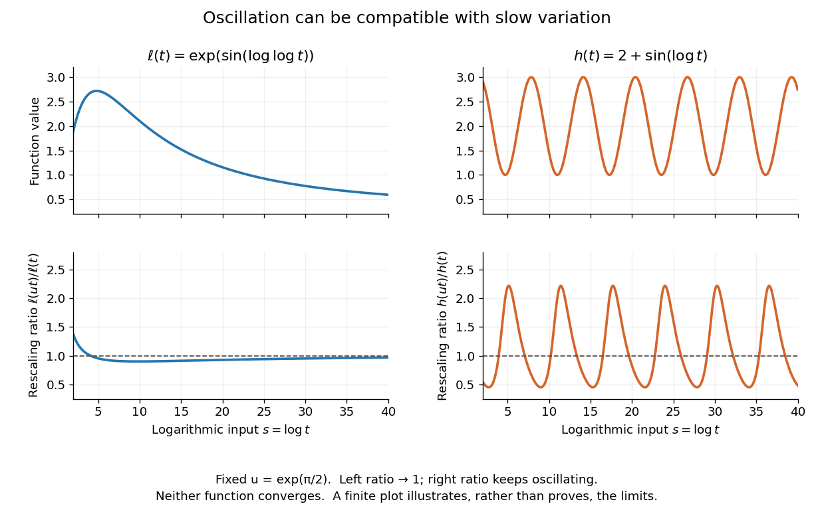

**[Figure 11](#image-two-bounded-oscillating-functions-logarithmic-rescaling-makes-one-ratio-approach-one-while-the-other-keeps-oscillating). Two bounded oscillating functions: logarithmic rescaling makes one ratio approach one, while the other keeps oscillating**. The horizontal coordinate is $s=\log t$, and the fixed rescaling is $u=e^{\pi/2}$. The displayed range illustrates the formulas; the limiting claims follow from the arguments in the text.

The useful distinction is whether a fixed proportional change of input eventually produces a negligible proportional change of output. A [slowly varying function](#slowly-varying-function) can therefore preserve the scaling exponent of a [power law](analysis.md#power-law) while changing its magnitude substantially. The decomposition in [regular variation](#regular-variation) explains why a logarithmic factor can matter in numerical estimates without changing the limiting exponent.

## Lipschitz continuity

↑ **Parent:** [Real analysis](real-analysis.md)  
ⓦ [Wiki](https://en.wikipedia.org/wiki/Lipschitz_continuity)

A [function](function.md) $f:X\to Y$ between [metric spaces](topological-analysis.md#metric-space) is Lipschitz continuous if one finite number $L\geq0$ controls every change of output by the corresponding change of input:

$$
d_Y(f(x),f(y))\leq Ld_X(x,y)\qquad(x,y\in X).
$$

For real inputs and outputs this is $|f(x)-f(y)|\leq L|x-y|$. The same bound must work for every pair in the specified [domain of a function](function.md#domain-of-a-function). It gives a quantitative version of [continuity](calculus.md#continuous-function): an input error of at most $\varepsilon$ produces an output error of at most $L\varepsilon$. The least possible bound is the [Lipschitz constant](#lipschitz-constant). Lebl presents the real and metric-space definitions and their connection with [uniform continuity](topological-analysis.md#uniform-continuity). [Jiří Lebl, Basic Analysis I, Sections 3.4 and 7.5; accessed 2026-10-12](https://www.jirka.org/ra/realanal.pdf)

Three [functions](function.md) show why this condition differs from [differentiability](analysis.md#differentiability). The [absolute value](#absolute-value) $f(x)=|x|$ has a corner at zero, but the [reverse triangle inequality](topological-analysis.md#reverse-triangle-inequality) gives $||x|-|y||\leq|x-y|$, so it has [Lipschitz constant](#lipschitz-constant) one on the [real line](#real-line). The [sine](geometry-and-topology.md#sine) is smooth and also has [Lipschitz constant](#lipschitz-constant) one: the [mean value theorem](calculus.md#mean-value-theorem) and $|\cos t|\leq1$ bound every secant slope. The [square root](algebra.md#square-root) is [continuous](calculus.md#continuous-function) on $[0,1]$, but

$$
\frac{|\sqrt h-\sqrt0|}{|h-0|}=\frac1{\sqrt h}\longrightarrow\infty
\qquad(h\downarrow0).
$$

No finite [Lipschitz bound](#lipschitz-bound) works on that [interval](#interval-mathematics). At $h=1,1/4,1/16,1/64$, the ratios are $1,2,4,8$. Smaller input changes near zero therefore require larger amplification factors.

**[Figure 12](#image-bounded-secant-slopes-permit-a-corner-while-the-square-root-needs-unbounded-amplification-near-zero). Bounded secant slopes permit a corner, while the square root needs unbounded amplification near zero**.

For a real [function](function.md), [Lipschitz continuity](#lipschitz-continuity) means that the absolute slopes of all [secant lines](euclidean-geometry.md#secant-line) are bounded. If the [derivative](calculus.md#derivative) exists at a point, taking a [limit](calculus.md#limit-of-a-function) of those slopes gives $|f'(x)|\leq L$. In the other direction, a [function](function.md) that is [continuous](calculus.md#continuous-function) on a real [interval](#interval-mathematics), [differentiable](analysis.md#differentiable-function) in its interior, and satisfies $|f'|\leq L$ there is [Lipschitz continuous](#lipschitz-continuity) by the [mean value theorem](calculus.md#mean-value-theorem). The [interval](#interval-mathematics) hypothesis matters: the theorem uses the segment connecting the two inputs.

A [Lipschitz function](#lipschitz-continuity) is [uniformly continuous](topological-analysis.md#uniform-continuity): for $L>0$, choosing input tolerance $\delta=\varepsilon/L$ works at every point. If $L=0$, the function is constant. The converse fails; the [square root](algebra.md#square-root) on $[0,1]$ is [uniformly continuous](topological-analysis.md#uniform-continuity), and satisfies the weaker [Hölder continuity](sobolev-space.md#holder-condition) bound $|\sqrt x-\sqrt y|\leq\sqrt{|x-y|}$, without a finite [Lipschitz constant](#lipschitz-constant). These distinctions are developed in Lebl's worked examples. [Lebl, Section 3.4, Proposition 3.4.8 and Examples 3.4.9–3.4.10](https://www.jirka.org/ra/realanal.pdf)

The usefulness is controlled sensitivity. Successive [Lipschitz maps](#lipschitz-continuity) with bounds $L$ and $M$ have a [function composition](function.md#function-composition) with bound $ML$, because each stage amplifies the previous distance by at most its own bound. For an [ordinary differential equation](differential-equation.md#ordinary-differential-equation), [Lipschitz continuity](#lipschitz-continuity) in the unknown state is the condition that makes nearby trial solutions controllably close in the [Picard-Lindelöf theorem](differential-equation.md#picard-lindelof-theorem). For incomplete data, the [McShane extension theorem](#mcshane-extension-theorem) fills in unobserved values while preserving the same bound. This one inequality connects error estimates, uniqueness, and [interpolation](interpolation.md).

### Bi-Lipschitz map

↑ **Parent:** [Lipschitz continuity](#lipschitz-continuity)

A bi-Lipschitz map between [metric spaces](topological-analysis.md#metric-space) satisfies the displayed bounds for all input pairs, with constants $0<m\leq M<\infty$. The lower bound makes it [injective](algebra.md#injective-function); its inverse on its image is [Lipschitz continuous](#lipschitz-continuity) with bound $1/m$, while the map itself has [Lipschitz bound](#lipschitz-bound) $M$. Thus it controls both stretching and compression. It is a [homeomorphism](topology.md#homeomorphism) onto its image, preserves [Hausdorff dimension](measure-theory.md#hausdorff-dimension), and has [bi-Lipschitz distortion](metric-embedding.md#bi-lipschitz-distortion) at most $M/m$. Uniformly multiplying every distance by the same positive factor has distortion one, as explained in [metric embedding](metric-embedding.md).

### Bounded Lipschitz norm

↑ **Parent:** [Lipschitz continuity](#lipschitz-continuity)

The bounded Lipschitz norm combines the [Lipschitz constant](#lipschitz-constant) and [supremum norm](normed-vector-space.md#supremum-norm) of a bounded real-valued [Lipschitz function](#lipschitz-continuity) on a [metric space](topological-analysis.md#metric-space). Both summands satisfy the [triangle inequality](topological-analysis.md#triangle-inequality); the supremum term makes the sum definite even on constant functions. Its unit ball requires the sum of the two bounds to be at most one, a stronger requirement than bounding each separately by one.

#### Diagonal compactness for bounded Lipschitz functions

↑ **Parent:** [Bounded Lipschitz norm](#bounded-lipschitz-norm)

On a separable [metric space](topological-analysis.md#metric-space), a sequence uniformly bounded in [bounded Lipschitz norm](#bounded-lipschitz-norm) has a pointwise convergent subsequence. Enumerate a countable dense subset and use the [Bolzano-Weierstrass theorem](sequence-and-series.md#bolzano-weierstrass-theorem) and [diagonal subsequence argument](sequence-and-series.md#diagonal-subsequence-argument) to obtain convergence there. Uniform control of the [Lipschitz constant](#lipschitz-constant) then makes the subsequence Cauchy at every point. The [pointwise closure of the bounded Lipschitz unit ball](#pointwise-closure-of-the-bounded-lipschitz-unit-ball) preserves the original norm bound after rescaling.

#### Pointwise closure of the bounded Lipschitz unit ball

↑ **Parent:** [Bounded Lipschitz norm](#bounded-lipschitz-norm)

For every fixed $x\ne y$ and $z$, the sum $|f_i(x)-f_i(y)|/d(x,y)+|f_i(z)|$ is at most one. [Pointwise convergence](sequence-and-series.md#pointwise-convergence) preserves this inequality. Taking the independent suprema over the pair $(x,y)$ and the point $z$ proves the assertion. Taking each bound separately would only give the weaker estimate two.

### One-sided Lipschitz condition

↑ **Parent:** [Lipschitz continuity](#lipschitz-continuity)

A one-sided Lipschitz condition controls the growth of distances between solutions of an [ordinary differential equation](differential-equation.md#ordinary-differential-equation). Differentiating the squared difference and applying the [Gronwall inequality](probability-and-statistics.md#gronwall-inequality) gives $\|y(t)-z(t)\|\leq e^{\nu t}\|y(0)-z(0)\|$. The case $\nu\leq0$ is a [dissipative vector field](differential-equation.md#dissipative-vector-field). Ordinary [Lipschitz continuity](#lipschitz-continuity) implies such a bound, but the converse fails: $f(y)=-y^3$ has one-sided constant zero on the real line without being globally [Lipschitz continuous](#lipschitz-continuity).

### Lipschitz domain

↑ **Parent:** [Lipschitz continuity](#lipschitz-continuity)  
ⓦ [Wiki](https://en.wikipedia.org/wiki/Lipschitz_domain)

A Lipschitz domain is an open connected subset of [Euclidean space](normed-vector-space.md#euclidean-norm) whose boundary is locally the graph of a [Lipschitz continuous](#lipschitz-continuity) function after rotating and translating coordinates. Locally the domain lies on one side of that graph. This permits corners but excludes boundary cusps that cannot be represented with a finite Lipschitz constant. Bounded Lipschitz domains are a standard setting for [Sobolev spaces](sobolev-space.md) and the [Poincaré inequality for total variation](inverse-problem.md#poincare-inequality-for-total-variation).

### McShane extension theorem

↑ **Parent:** [Lipschitz continuity](#lipschitz-continuity)

Let $A$ be a nonempty [subset](set.md#subset) of a [metric space](topological-analysis.md#metric-space) $X$, and let $f:A\to\mathbb R$ satisfy a [Lipschitz bound](#lipschitz-bound) $L$. Then

$$
F(x)=\inf_{a\in A}\{f(a)+Ld(x,a)\},\qquad
G(x)=\sup_{a\in A}\{f(a)-Ld(x,a)\}
$$

are real-valued [Lipschitz functions](#lipschitz-continuity) on all of $X$, agree with $f$ on $A$, and obey the same bound $L$. Every other extension $H$ satisfying that bound lies between them, $G\leq H\leq F$. Despite the [infimum](#infimum) in its formula, $F$ is the largest such extension: every given sample supplies an upper constraint $H(x)\leq f(a)+Ld(x,a)$.

Take three real samples $f(0)=0$, $f(1)=1/2$, $f(2)=0$, and allow the bound $L=1$. Their least [Lipschitz constant](#lipschitz-constant) is only $1/2$, so this is deliberately a looser permitted bound. The two extensions are

$$
F(x)=\min\{|x|,\tfrac12+|x-1|,|x-2|\},\qquad
G(x)=\max\{-|x|,\tfrac12-|x-1|,-|x-2|\}.
$$

At $x=1/2$, the allowable [interval](#interval-mathematics) is $0=G(1/2)\leq H(1/2)\leq F(1/2)=1/2$. The [interpolant](interpolation.md#interpolant) obtained by [linear interpolation](function.md#linear-interpolation) is a [piecewise linear function](function.md#piecewise-linear-function) and has value $1/4$ there. Extending it constantly outside $[0,2]$ obeys the same bound on the entire [real line](#real-line). At $x=5/2$, the allowable [interval](#interval-mathematics) is $[-1/2,1/2]$. Thus the data and the bound control possible values without selecting a unique curve.

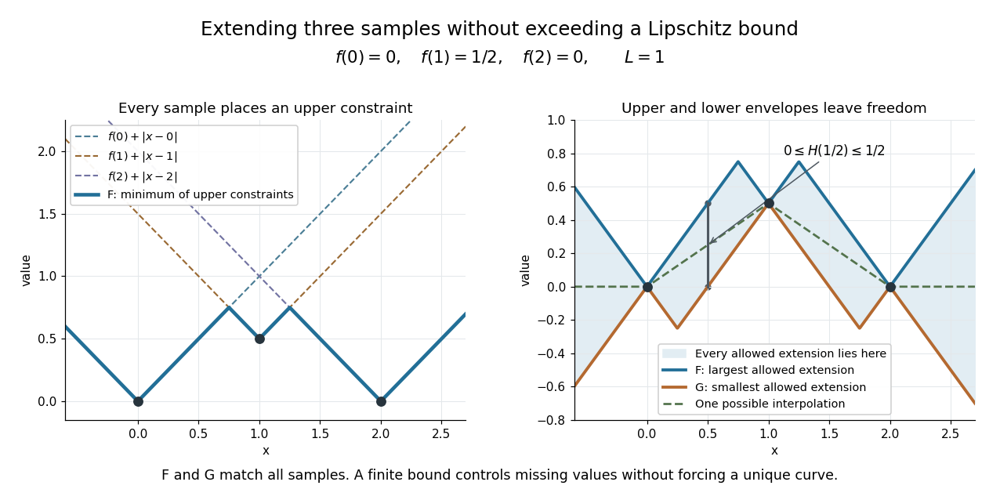

**[Figure 13](#image-each-sample-constrains-a-lipschitz-function-the-upper-and-lower-envelopes-bound-every-allowed-extension). Each sample constrains a Lipschitz function; the upper and lower envelopes bound every allowed extension**.

The construction is useful when data are known only on a [subset](set.md#subset): it extends them without increasing an allowed [Lipschitz bound](#lipschitz-bound). A short justification explains why the envelopes work. Fix $a_0\in A$. The [triangle inequality](topological-analysis.md#triangle-inequality) and the bound on $f$ imply

$$
f(a_0)-Ld(x,a_0)\leq f(a)+Ld(x,a)
\qquad(a\in A),
$$

so the [infimum](#infimum) is finite below; the term $a=a_0$ makes it finite above. At a sample $x=a_0$, all upper terms are at least $f(a_0)$, while that term gives equality. Finally, $d(x,a)\leq d(y,a)+d(x,y)$ gives $F(x)\leq F(y)+Ld(x,y)$ after taking an [infimum](#infimum); exchanging $x,y$ proves the bound. The lower envelope follows by applying the same argument to $-f$.

E. J. McShane's paper _Extension of range of functions_ appeared in the _Bulletin of the American Mathematical Society_, volume 40, in 1934, pp. 837–842. [AMS bibliography: E. J. McShane, Extension of range of functions](https://www.ams.org/books/surv/012/surv012-endmatter.pdf) [McShane's original publication](https://doi.org/10.1090/S0002-9904-1934-05978-0)

### Lipschitz constant

↑ **Parent:** [Lipschitz continuity](#lipschitz-continuity)

The [Lipschitz constant](#lipschitz-constant) is the least nonnegative number that works in the defining [Lipschitz bound](#lipschitz-bound), equivalently the displayed [supremum](#supremum) of distance ratios. A constant function has constant zero; for a domain with at most one point we also set it to zero. An infinite supremum means there is no finite [Lipschitz bound](#lipschitz-bound). The least constant need not be attained by one pair of inputs.

For $f(x)=3x-2$ on the [real line](#real-line), every distinct pair has ratio $3$, so the [Lipschitz constant](#lipschitz-constant) is $3$. For $f(x)=x^2$ on $[-R,R]$, with $R>0$,

$$
\frac{|x^2-y^2|}{|x-y|}=|x+y|\leq2R.
$$

Pairs $x=R$, $y=R-\varepsilon$ have ratio $2R-\varepsilon$, approaching $2R$. Thus the [Lipschitz constant](#lipschitz-constant) is $2R$, although no distinct pair realizes that exact value. Reporting the domain is essential: the same [function](function.md) has no finite global [Lipschitz constant](#lipschitz-constant) on $\mathbb R$.

### Globally Lipschitz function

↑ **Parent:** [Lipschitz continuity](#lipschitz-continuity)

A [function](function.md) is globally Lipschitz when one finite [Lipschitz bound](#lipschitz-bound) holds for every pair in its entire specified [domain of a function](function.md#domain-of-a-function). The [sine](geometry-and-topology.md#sine) and the [absolute value](#absolute-value) have this property on the [real line](#real-line). For any reference point $x_0$, a globally [Lipschitz continuous](#lipschitz-continuity) real function obeys $|f(x)|\leq|f(x_0)|+L|x-x_0|$, so its size grows at most linearly in the distance from $x_0$.

The [function](function.md) $f(x)=x^2$ is a [locally Lipschitz function](#locally-lipschitz-function) on the [real line](#real-line), but is not globally Lipschitz there: pairs $x=n+1$, $y=n$ have ratio $2n+1$, which is unbounded. Restricting the domain to $[-R,R]$ does give a global bound $2R$. Global and local describe where one bound must work, rather than two intrinsic labels independent of the domain.

### Lipschitz bound

↑ **Parent:** [Lipschitz continuity](#lipschitz-continuity)

A Lipschitz bound is any valid inequality of the displayed form with a finite constant $L$. It need not use the least [Lipschitz constant](#lipschitz-constant). For $f(x)=3x-2$, both $L=3$ and $L=5$ are valid, but $L=2$ fails. The tighter bound gives a sharper error estimate: input error at most $0.01$ guarantees output error at most $0.03$ using $L=3$, compared with the valid but weaker $0.05$ using $L=5$. The bound constrains errors; it does not state that every pair achieves that amplification.

### Locally Lipschitz function

↑ **Parent:** [Lipschitz continuity](#lipschitz-continuity)

A [function](function.md) between [metric spaces](topological-analysis.md#metric-space) is locally Lipschitz if every point has a [neighbourhood](topology.md#neighbourhood-mathematics) on which one finite [Lipschitz bound](#lipschitz-bound) works for every pair. The neighbourhood and bound may depend on the point. A [continuously differentiable](multivariable-calculus.md#continuously-differentiable-function) real function on an open [interval](#interval-mathematics) has this property: continuity of its [derivative](calculus.md#derivative) bounds that derivative on a sufficiently small closed interval, and the [mean value theorem](calculus.md#mean-value-theorem) bounds every secant slope there.

The [function](function.md) $x^2$ is locally Lipschitz at every real point but has no single bound on the [real line](#real-line). The [square root](algebra.md#square-root) is locally Lipschitz on $(0,\infty)$, and has the bound $1/(2\sqrt a)$ on $[a,b]$ for $0<a<b$. Adding zero to its domain changes the conclusion at that point: the ratios in the [Lipschitz continuity](#lipschitz-continuity) example become unbounded, so it is not locally Lipschitz at zero. This distinction is what permits the delayed, nonunique ODE solutions illustrated under [Picard-Lindelöf theorem](differential-equation.md#picard-lindelof-theorem).

## Big O notation

↑ **Parent:** [Real analysis](real-analysis.md)  
ⓦ [Wiki](https://en.wikipedia.org/wiki/Big_O_notation)

The statement $f(n)=O(g(n))$ as $n\to\infty$ means there are constants $C>0$ and $N$ such that

$$
\boxed{|f(n)|\le C|g(n)|\qquad\text{for every }n\ge N.}
$$

The same constant must work for all sufficiently large inputs. Near a finite [limit](calculus.md#limit-of-a-function) point $a$, replace $n\ge N$ by $0<|x-a|<\delta$ within the domain. [Absolute values](#absolute-value) allow signed or complex-valued [functions](function.md); when discussing nonnegative operation counts they can be omitted.

The notation records an [upper bound](set.md#upper-bound-in-a-partially-ordered-set), not an exact leading coefficient or necessarily a tight growth order. For example, $3n^2+7n+4=O(n^2)$ because for $n\ge1$ it is at most $14n^2$. It is also $O(n^3)$, a weaker statement. A tight comparison uses [big theta notation](#big-theta-notation); a ratio tending to one uses [asymptotic equivalence](#asymptotic-equivalence). Formally $O(g)$ denotes a class of [functions](function.md), and writing $f=O(g)$ is conventional shorthand for membership in that class. [MIT 6.006, Demaine, Ku and Solomon, Recitation 1, page 3: asymptotic upper and tight bounds](https://live.ocw.mit.edu/courses/6-006-introduction-to-algorithms-spring-2020/c6d8f06c6f11e3342633dec85498f551_MIT6_006S20_r01.pdf)

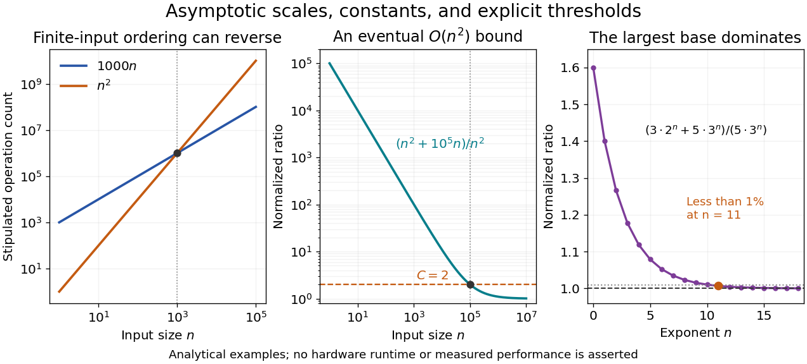

**[Figure 14](#image-constants-affect-finite-comparisons-while-normalized-ratios-expose-eventual-growth). Constants affect finite comparisons while normalized ratios expose eventual growth**.

The first panel compares stipulated operation counts $A(n)=1000n$ and $B(n)=n^2$. Although $A$ is linear and $B$ quadratic, $B(n)<A(n)$ for $1\le n<1000$; the ordering reverses beyond their crossing. These are mathematical cost models, not measured runtimes. The [time complexity](theoretical-computer-science.md#time-complexity) notation describes the growth of whichever cost function has been specified, whether that function represents a worst-case bound, an average, or another explicit quantity.

The middle panel gives a concrete eventual bound: $n^2+10^5n\le2n^2$ for every $n\ge10^5$. Its normalized ratio approaches one, but the threshold matters. The final panel shows the [asymptotic comparison of exponential functions](#asymptotic-comparison-of-exponential-functions), with its geometrically shrinking relative difference.

Constants may depend on fixed parameters. For each fixed $\alpha>0$, $f_\alpha(n)=\alpha n$ is $O(n)$ with $C=\alpha$; one constant cannot cover every positive $\alpha$. A [uniform big O bound](#uniform-big-o-bound) makes this extra quantifier explicit.

The notation was already used in nineteenth-century [number theory](number-theory.md). In his 1976 paper, Donald E. Knuth reports Landau identifying Bachmann's 1894 book as the first appearance of $O$ known to him. Knuth's account gives the earlier mathematical setting of a notation now also common in [time complexity](theoretical-computer-science.md#time-complexity) analysis. [Knuth, Big Omicron and big Omega and big Theta, 1976, page 19](https://danluu.com/knuth-big-o.pdf)

### Little o notation

↑ **Parent:** [Big O notation](#big-o-notation)

When $g$ is nonzero sufficiently near the specified [limit](calculus.md#limit-of-a-function), little o notation means

$$
\boxed{f=o(g)\quad\Longleftrightarrow\quad f/g\longrightarrow0.}
$$

Thus the numerator becomes negligible relative to the denominator's scale. As $n\to\infty$, $n=o(n^2)$ because $n/n^2=1/n\to0$; as $h\to0$, $h^2=o(h)$ because $h^2/h=h\to0$. The direction of the [limit](calculus.md#limit-of-a-function) changes the comparison. [MIT Mathematics for Computer Science, §9.7.1: little-oh comparison](https://ocw.mit.edu/courses/6-042j-mathematics-for-computer-science-fall-2010/93cad640cf3ed0b23ef70688f452d4d5_MIT6_042JF10_notes.pdf#page=281)

Equivalently, for every $\varepsilon>0$, the bound $|f|\le\varepsilon|g|$ holds sufficiently near that [limit](calculus.md#limit-of-a-function), with a threshold allowed to depend on $\varepsilon$. [Big O notation](#big-o-notation) needs only one fixed multiplier, making it weaker. For example, $2n=O(n)$ but $2n$ is not $o(n)$. The useful relation $f\sim g\Longleftrightarrow f-g=o(g)$ turns [asymptotic equivalence](#asymptotic-equivalence) into a statement about a negligible remainder.

### Big theta notation

↑ **Parent:** [Big O notation](#big-o-notation)

At the specified [limit](calculus.md#limit-of-a-function), big theta notation means that two positive constants give both-sided bounds:

$$
\boxed{c|g|\le |f|\le C|g|\qquad(0<c\le C)}
$$

sufficiently near the [limit](calculus.md#limit-of-a-function). Equivalently, $f=O(g)$ and $g=O(f)$ in [big O notation](#big-o-notation). In operation-count analysis, $3n^2+7n+4=\Theta(n^2)$ for $n\ge1$, using $c=3$ and $C=14$. This supplies a tight scale without asserting that the normalized ratio tends to one.

For an example with no limiting ratio, let $f(n)=n(2+(-1)^n)$ for positive [integers](integer.md) $n$. Then $n\le f(n)\le3n$, so $f(n)=\Theta(n)$, but $f(n)/n$ alternates between one and three. A tight growth order is therefore weaker than [asymptotic equivalence](#asymptotic-equivalence). The constant bounds also do not fix an exact factor by which a function changes when its argument doubles.

Donald E. Knuth's 1976 paper proposes using $\Theta$ for two-sided constant bounds in algorithm analysis. He credits Bob Tarjan and Mike Paterson with independently suggesting the notation. His discussion gives a concrete motivation for distinguishing an eventual upper estimate from a tight comparison. [Knuth, Big Omicron and big Omega and big Theta, 1976, pages 19–20](https://danluu.com/knuth-big-o.pdf)

### Uniform big O bound

↑ **Parent:** [Big O notation](#big-o-notation)

A uniform big O bound for a family of [functions](function.md) uses one multiplier and one threshold for every allowed parameter:

$$
\exists C>0,\ N\quad\forall\alpha\in A\quad\forall n\ge N:
\quad |f_\alpha(n)|\le C|g(n)|.
$$

The order of the quantifiers matters. For $f_\alpha(n)=\alpha n$, $0\le\alpha\le10$ admits $C=10$ and $N=1$, while the unbounded family $\alpha>0$ admits no such constant. Each individual member nevertheless satisfies $f_\alpha=O(n)$. A uniform bound is useful when an approximation must work across a whole parameter range, rather than separately for each fixed parameter.

## Real line

↑ **Parent:** [Real analysis](real-analysis.md)  
ⓦ [Wiki](https://en.wikipedia.org/wiki/Real_line)

The real line is the set $\mathbb R$ of real numbers equipped with its usual order, metric, and topology.

### Interval (mathematics)

↑ **Parent:** [Real line](#real-line)  
ⓦ [Wiki](https://en.wikipedia.org/wiki/Interval_(mathematics))

A real interval contains every real number lying between any two of its elements.

#### Subinterval

↑ **Parent:** [Interval (mathematics)](#interval-mathematics)

An [interval](#interval-mathematics) contained in another [interval](#interval-mathematics).

#### Nested intervals

↑ **Parent:** [Interval (mathematics)](#interval-mathematics)  
ⓦ [Wiki](https://en.wikipedia.org/wiki/Nested_intervals)

A sequence of [nested intervals](#nested-intervals) keeps every new enclosure inside the previous one:

$$
I_1\supseteq I_2\supseteq I_3\supseteq\cdots.
$$

Each step adds a restriction without discarding an earlier restriction. This is useful when an exact [real number](arithmetic.md#real-number) is described by increasingly precise bounds rather than by a finite decimal expansion. The [bisection method](numerical-analysis.md#bisection-method), for instance, produces [nested intervals](#nested-intervals) that keep enclosing a [zero of a function](polynomial.md#zero-of-a-function).

For a simple example, the [closed intervals](#closed-real-interval) $I_n=[1-1/n,1+1/n]$ are nested and all contain $1$. Their lengths $2/n$ tend to zero, so the [nested interval theorem](#nested-interval-theorem) leaves exactly that point. The family $J_n=[1-1/n,2+1/n]$ is also nested, but its intersection is the whole [closed interval](#closed-real-interval) $[1,2]$. Nesting alone does not force uniqueness.

The [open intervals](topology.md#open-interval) $K_n=(0,1/n)$ illustrate a different possibility. Every finite collection has a nonempty intersection, but the intersection of all of them is empty: any positive candidate eventually exceeds $1/n$, and zero is excluded from every member. Each finite row in the diagram contains points; the full infinite family need not.

##### Nested interval theorem

↑ **Parent:** [Nested intervals](#nested-intervals)

If $I_1\supseteq I_2\supseteq\cdots$ are nonempty [closed intervals](#closed-real-interval) with finite endpoints, then at least one [real number](arithmetic.md#real-number) belongs to every member. If their lengths tend to zero, exactly one [real number](arithmetic.md#real-number) belongs to every member. The result turns an unlimited sequence of consistent enclosures into an existence guarantee.

Write $I_n=[a_n,b_n]$. Nesting makes the left endpoints [nondecreasing](calculus.md#nondecreasing-function) and the right endpoints [nonincreasing](calculus.md#nonincreasing-function). Their bounds give finite [supremum](#supremum) and [infimum](#infimum), with

$$
\bigcap_{n=1}^{\infty}I_n=
\left[\sup_{n\geq1}a_n,\ \inf_{n\geq1}b_n\right].
$$

Indeed, every $b_n$ is an [upper bound](set.md#upper-bound-in-a-partially-ordered-set) for all the $a_j$, so the [least-upper-bound property](sequence-and-series.md#least-upper-bound-property) gives $\sup_j a_j\leq b_n$ for every $n$. This proves the displayed interval is nonempty. If $b_n-a_n\to0$, its two endpoints must coincide. This is the connection to the [completeness of the real numbers](sequence-and-series.md#completeness-of-the-real-numbers) discussed in [Günther Hörmann and David Langer, Einführung in die Analysis, §§3.15–3.16: nested intervals and order completeness](https://homepage.univie.ac.at/christian.schmeiser/einfanalysis.pdf).

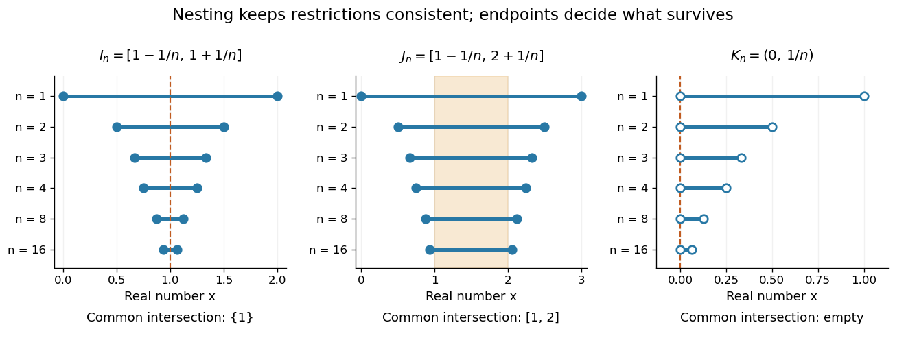

**[Figure 15](#image-nested-enclosures-can-converge-to-one-point-retain-a-whole-interval-or-have-no-common-point-when-endpoints-are-excluded). Nested enclosures can converge to one point, retain a whole interval, or have no common point when endpoints are excluded**.

The distinction between existence and uniqueness is useful in computation. If an unknown point $x_*$ lies in every $[a_n,b_n]$, the [midpoint](convex-set.md#midpoint) $m_n=(a_n+b_n)/2$ satisfies

$$
|m_n-x_*|\leq\frac{b_n-a_n}{2}.
$$

Thus the enclosure itself certifies an [absolute error](numerical-analysis.md#absolute-error) without knowing the answer. The [bisection error bound](numerical-analysis.md#bisection-error-bound) is the special case where each update halves the width.

Closedness and a finite initial enclosure matter. The [open intervals](topology.md#open-interval) $(0,1/n)$ have no common point, while the closed but unbounded intervals $[n,\infty)$ also have empty intersection. A picture of a few intervals cannot certify the intersection of an infinite family; the hypotheses of the [nested interval theorem](#nested-interval-theorem) do that work.

#### Closed real interval

↑ **Parent:** [Interval (mathematics)](#interval-mathematics)

A bounded [closed interval](#closed-real-interval) includes both of its endpoints:

$$
[a,b]=\{x\in\mathbb R:a\leq x\leq b\},\qquad a\leq b.
$$

If $a=b$, it consists of one point. Its length is $b-a$. In contrast, the [open interval](topology.md#open-interval) $(a,b)$ excludes both endpoints; half-open [real intervals](#interval-mathematics) include just one.

Including the endpoints has a useful consequence for [limits](calculus.md#limit-of-a-function): a convergent [sequence](sequence-and-series.md#sequence) whose terms lie in $[a,b]$ has its [limit of a sequence](sequence-and-series.md#limit-of-a-sequence) in $[a,b]$ too. Finite endpoints also make this a [bounded set](topological-analysis.md#bounded-set), so it is a [compact set](topology.md#compact-space) by the [Heine-Borel theorem](topology.md#heine-borel-theorem). These two properties support both the [nested interval theorem](#nested-interval-theorem) and the [extreme value theorem](#extreme-value-theorem).

##### Compact interval

↑ **Parent:** [Closed real interval](#closed-real-interval)

A [compact interval](#compact-interval) in the [real numbers](arithmetic.md#real-number) is either the empty [set](set.md) or a closed bounded [interval](#interval-mathematics) $[a,b]$ with $a\leq b$. Its [compactness](topology.md#compact-space) follows from the [Heine-Borel theorem](topology.md#heine-borel-theorem).

## Extreme value theorem

↑ **Parent:** [Real analysis](real-analysis.md)  
ⓦ [Wiki](https://en.wikipedia.org/wiki/Extreme_value_theorem)

A [real-valued function](function.md#real-valued-function) that is [continuous](calculus.md#continuous-function) on a nonempty [compact space](topology.md#compact-space) attains both a [global minimum](analysis.md#global-minimum) and a [global maximum](function.md#global-maximum). In particular, for a [continuous function](calculus.md#continuous-function) $f:[a,b]\to\mathbb R$ on a nonempty [closed interval](#closed-real-interval), there are points $x_{\min},x_{\max}\in[a,b]$ such that

$$
f(x_{\min})\leq f(x)\leq f(x_{\max})
\qquad\text{for every }x\in[a,b].
$$

The important word is “attains”: the best values occur at actual allowed inputs, rather than merely being approached. The interval version is [Jiří Lebl, Basic Analysis I, theorem 3.3.2](https://jirilebl.github.io/ra/html/sec_minmaxint.html).

For a worked example, take $f(x)=(x-1)^2$ on $[-1,2]$. Its [global minimum](analysis.md#global-minimum) is $f(1)=0$, and its [global maximum](function.md#global-maximum) is $f(-1)=4$. Nonnegativity gives the first answer; $|x-1|\leq2$ on the specified [closed interval](#closed-real-interval) gives the second. The endpoint $x=-1$ is essential: looking only for a zero [derivative](calculus.md#derivative) would find the minimum and miss the maximum.

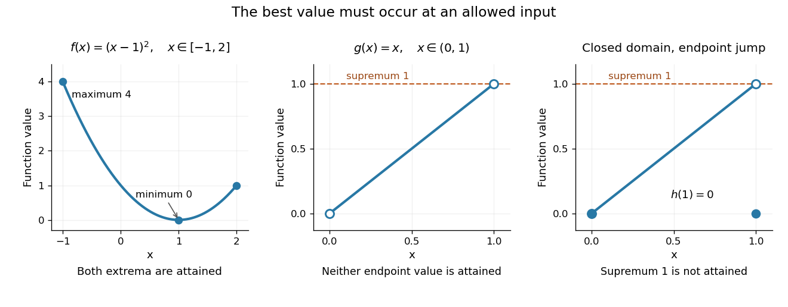

**[Figure 16](#image-an-attained-minimum-and-maximum-on-a-closed-interval-compared-with-excluded-endpoints-and-a-discontinuous-endpoint-value). An attained minimum and maximum on a closed interval, compared with excluded endpoints and a discontinuous endpoint value**.

For comparison, the [continuous function](calculus.md#continuous-function) $g(x)=x$ on the [open interval](topology.md#open-interval) $(0,1)$ has [infimum](#infimum) $0$ and [supremum](#supremum) $1$, but neither is a value of $g$. Even a closed domain is insufficient without [continuity](calculus.md#continuous-function): define $h(x)=x$ for $0\leq x<1$, and $h(1)=0$. On $[0,1]$, its [supremum](#supremum) is $1$, approached by $x_n=1-1/n$ for $n\geq2$, but every function value is strictly less than $1$. This endpoint change makes $h$ [discontinuous](calculus.md#discontinuity-of-a-function), preventing attainment. On the unbounded [real line](#real-line), the [continuous function](calculus.md#continuous-function) $x\mapsto x$ has neither a [global minimum](analysis.md#global-minimum) nor a [global maximum](function.md#global-maximum). These examples show what can fail when a hypothesis is dropped; functions outside the hypotheses may still have extrema.

The [extreme value theorem](#extreme-value-theorem) is an existence tool for [optimization](mathematical-optimization.md): first establish that a [continuous](calculus.md#continuous-function) [objective function](mathematical-optimization.md#objective-function) on a nonempty [compact](topology.md#compact-space) [feasible set](mathematical-optimization.md#feasible-region) has a best value, then investigate where it occurs. It neither locates the optimizing point nor promises uniqueness or [differentiability](analysis.md#differentiability). For example, the [absolute value](#absolute-value) function $|x|$ on $[-1,2]$ has its [global minimum](analysis.md#global-minimum) at zero although no [derivative](calculus.md#derivative) exists there; a [constant function](function.md#constant-function) has every input as a [minimizer](analysis.md#global-minimizer). This role in [optimization](mathematical-optimization.md) is explained in [University of Toronto MAT237 notes, section 1.4: compactness and the extreme value theorem](https://www.math.utoronto.ca/courses/mat237y1/20189/notes/Chapter1/S1.4.html).

A short proof outline identifies the mechanism. The [continuous image of a compact space](topology.md#continuous-image-of-a-compact-space) is [compact](topology.md#compact-space); a nonempty [compact subset](topology.md#compact-space) of the [real line](#real-line) contains its [infimum](#infimum) and [supremum](#supremum). For a [closed interval](#closed-real-interval), one can instead choose inputs whose outputs approach the [supremum](#supremum), extract a convergent [subsequence](sequence-and-series.md#subsequence) by the [Bolzano-Weierstrass theorem](sequence-and-series.md#bolzano-weierstrass-theorem), and use [continuity](calculus.md#continuous-function) to make its limiting output equal that [supremum](#supremum). The [closed interval](#closed-real-interval) retains the limiting input. Repeating the argument for the [infimum](#infimum) supplies the minimum.

### Interior-value criterion for an attained maximum

↑ **Parent:** [Extreme value theorem](#extreme-value-theorem)

Let $f$ be continuous on $(a,b]$, bounded above, and suppose its [limit superior](sequence-and-series.md#limit-superior) at $a$ from the right is at most $L$. If some $c\in(a,b]$ has $f(c)>\max\{L,f(a)\}$, then $f$ attains its maximum on $[a,b]$. A sufficiently short initial interval has all values below $f(c)$. On the remaining closed interval, the [extreme value theorem](#extreme-value-theorem) supplies a maximum, which is consequently global. This can prove attainment despite an oscillatory discontinuity at one endpoint.

### Supremum can fail to be attained at an oscillatory endpoint

↑ **Parent:** [Extreme value theorem](#extreme-value-theorem)

The [extreme value theorem](#extreme-value-theorem) requires continuity on the entire closed interval. A bounded function can have values tending to an endpoint envelope without ever reaching that envelope, while its defined endpoint value is smaller. To prove nonattainment, establish a strict pointwise upper bound and construct a sequence approaching that bound. An oscillatory factor can supply the approaching sequence by selecting phases where it equals $1$.

## Coercive function

↑ **Parent:** [Real analysis](real-analysis.md)  
ⓦ [Wiki](https://en.wikipedia.org/wiki/Coercive_function)

A real-valued function on a normed vector space is coercive when its value tends to positive infinity as the norm of its argument tends to infinity. A continuous coercive function on a finite-dimensional real vector space attains a global minimum.

### Range of a continuous coercive real function

↑ **Parent:** [Coercive function](#coercive-function)

A real [continuous function](calculus.md#continuous-function) on $\mathbb R$ that tends to $+\infty$ as $|x|\to\infty$ has range $[m,\infty)$ for an attained minimum $m$. Choose a compact interval outside which its values exceed $f(0)$, and minimize there by the [extreme value theorem](#extreme-value-theorem). For any $y>m$, choose a far point with value larger than $y$ and apply the [intermediate value theorem](calculus.md#intermediate-value-theorem) between it and a minimizer. Distance from a fixed point to a continuous graph is an example because it is at least the horizontal distance.

## Lp norm

↑ **Parent:** [Real analysis](real-analysis.md)

An [Lp norm](#lp-norm) measures the size of a [measurable function](measure-theory.md#measurable-function) by averaging a power of its [absolute value](#absolute-value) with respect to a specified [measure](measure.md). For $1\leq p<\infty$,

$$
\lVert f\rVert_p=\left(\int |f|^p\,d\mu\right)^{1/p},
$$

when the [integral](integral.md) is finite. The [exponent](arithmetic.md#exponent) $p$ controls how strongly large values influence the result. The [Lp space](measure-theory.md#lp-space) identifies [functions](function.md) equal [almost everywhere](measure-theory.md#almost-everywhere), so this becomes a [norm](normed-vector-space.md#norm) on the corresponding [equivalence classes](set-theory.md#equivalence-class). For $p=\infty$, use the [essential supremum](measure-theory.md#essential-supremum) of $|f|$, as defined by the [L-infinity norm](#l-infinity-norm). [Hunter, Measure Theory, Definitions 7.1 and 7.4: Lp spaces and norms](mathematics-bibliography.md#measure-theory-by-john-k-hunter/lp-spaces-chapter-7-of-measure-theory).

For a two-coordinate [vector](vector-space.md#vector) $(3,4)$, treat the coordinates as a [function](function.md) on two inputs with [counting measure](measure.md#counting-measure). Then $\lVert(3,4)\rVert_1=3+4=7$, $\lVert(3,4)\rVert_2=\sqrt{9+16}=5$, and $\lVert(3,4)\rVert_\infty=4$. The middle case is the [Euclidean norm](normed-vector-space.md#euclidean-norm); the first adds the coordinate magnitudes, and the last takes their largest value. These are different answers to different questions about size, all satisfying the [triangle inequality](topological-analysis.md#triangle-inequality).

If instead each input has [probability](probability-theory.md#probability) $1/2$, the same values give $\lVert f\rVert_1=3.5$ and $\lVert f\rVert_2=\sqrt{12.5}$, while $\lVert f\rVert_\infty=4$ remains unchanged. Thus the [measure](measure.md) is not an optional label. On a [probability space](probability-space.md), the finite [Lp norms](#lp-norm) are nondecreasing in $p$ whenever they are finite, by [Hölder's inequality](#holder-s-inequality); the unnormalized two-coordinate example above decreases instead. Statements comparing different [exponents](arithmetic.md#exponent) must specify their [measure](measure.md) convention.

Why are these sizes useful? If $e$ is an error [function](function.md), its [L1 norm](normed-vector-space.md#l1-norm) measures aggregate [absolute error](numerical-analysis.md#absolute-error), its [L2 norm](#l2-norm) measures the square root of aggregate [quadratic loss](statistical-inference.md#squared-error-loss), and its [L-infinity norm](#l-infinity-norm) bounds error [almost everywhere](measure-theory.md#almost-everywhere). Concentrating a large error on a [set](set.md) of small positive [measure](measure.md) can give a modest finite [Lp norm](#lp-norm) but a large [L-infinity norm](#l-infinity-norm). The three-point example and diagram in [L-infinity norm](#l-infinity-norm) show this explicitly, including why a [null set](measure-theory.md#null-set) behaves differently from a rare event.

### L-infinity norm

↑ **Parent:** [Lp norm](#lp-norm)

On a [measure space](measure.md#measure-space) of positive total [measure](measure.md), the [L-infinity norm](#l-infinity-norm) of an [essentially bounded](#essentially-bounded-function) [measurable function](measure-theory.md#measurable-function) is $\lVert f\rVert_\infty=\operatorname{ess\,sup}_\mu|f|$. The [absolute value](#absolute-value) matters: a constant [function](function.md) $f=-3$ has [L-infinity norm](#l-infinity-norm) three, even though its [essential supremum](measure-theory.md#essential-supremum) is $-3$. The [norm](normed-vector-space.md#norm) belongs to the [equivalence class](set-theory.md#equivalence-class) in [Lp space](measure-theory.md#lp-space); different representatives equal [almost everywhere](measure-theory.md#almost-everywhere) give the same answer. [Hunter, Measure Theory, Definition 7.4: the L-infinity norm](mathematics-bibliography.md#measure-theory-by-john-k-hunter/lp-spaces-chapter-7-of-measure-theory).

For the [function](function.md) $g$ in [essential infimum and essential supremum](#essential-infimum-and-essential-supremum), **$\lVert g\rVert_\infty=1$ under [Lebesgue measure](measure-theory.md#lebesgue-measure), whereas its [supremum norm](normed-vector-space.md#supremum-norm) is four**. Replacing the exceptional values by the ordinary values $x$ leaves every finite [Lp norm](#lp-norm) unchanged as well: $\lVert g\rVert_p=(\int_0^1x^p\,dx)^{1/p}=(p+1)^{-1/p}$. This tends to one as $p\to\infty$. That agreement explains why the endpoint with [exponent](arithmetic.md#exponent) $p=\infty$ uses an essential bound rather than a pointwise bound.

A finite [probability space](probability-space.md) makes the distinction between zero and small [measure](measure.md) explicit. Let $f(a)=1$, $f(b)=3$, and $f(c)=10$. Assign weights $\mu(a)=1/2-\varepsilon$, $\mu(b)=1/2$, $\mu(c)=\varepsilon$, where $0\leq\varepsilon<1/2$. For $1\leq p<\infty$,

$$
\lVert f\rVert_p=\left((1/2-\varepsilon)+\tfrac12 3^p+\varepsilon 10^p\right)^{1/p}.
$$

When $\varepsilon=0$, the [singleton](set.md#singleton-mathematics) $\{c\}$ is a [null set](measure-theory.md#null-set) and $\lVert f\rVert_\infty=3$. For every $\varepsilon>0$, however small, $\lVert f\rVert_\infty=10$. For example, $\varepsilon=0.001$ gives $\lVert f\rVert_1=2.009$ and $\lVert f\rVert_2=\sqrt{5.099}$, yet the large-$p$ [Lp norms](#lp-norm) approach ten. The ordinary pointwise [supremum norm](normed-vector-space.md#supremum-norm) is ten in both cases.

**[Figure 17](#image-a-zero-weight-value-disappears-from-every-lp-norm-while-a-rare-positive-weight-value-determines-the-limiting-l-infinity-norm). A zero-weight value disappears from every Lp norm, while a rare positive-weight value determines the limiting L-infinity norm**. The original three-point example has values $1,3,10$. The curves use weights $(0.5,0.5,0)$ and $(0.499,0.5,0.001)$, respectively. Dashed levels show the limiting norms three and ten; the plotted finite [exponents](arithmetic.md#exponent) do not themselves reach those limits.

Why can a rare value dominate? For a bounded [function](function.md) on a [probability space](probability-space.md), an [almost everywhere](measure-theory.md#almost-everywhere) bound $|f|\leq M$ gives $\lVert f\rVert_p\leq M$. If $0<t<\lVert f\rVert_\infty$, the [set](set.md) $A_t=\{|f|>t\}$ has positive [probability](probability-theory.md#probability), so $\lVert f\rVert_p\geq t\,\mu(A_t)^{1/p}$. As $p\to\infty$, the factor $\mu(A_t)^{1/p}$ tends to one. These two bounds squeeze the [limit](calculus.md#limit-of-a-function) to $\lVert f\rVert_\infty$. The [probability measure](probability-space.md#probability-measure) assumption keeps total [measure](measure.md) finite; this explanation does not assert the same finite-$p$ integrability on arbitrary infinite-measure spaces.

#### Essentially bounded function

↑ **Parent:** [L-infinity norm](#l-infinity-norm)

A [measurable function](measure-theory.md#measurable-function) is [essentially bounded](#essentially-bounded-function) if some finite nonnegative [real number](arithmetic.md#real-number) $M$ bounds its [absolute value](#absolute-value) [almost everywhere](measure-theory.md#almost-everywhere). The exceptional [null set](measure-theory.md#null-set) may contain arbitrarily large values. With [Lebesgue measure](measure-theory.md#lebesgue-measure) on $[0,1]$, a [function](function.md) equal to zero outside $\{1/n:n\in\mathbb N_{>0}\}$ and equal to $n$ at $1/n$ is [essentially bounded](#essentially-bounded-function) despite being unbounded pointwise: its exceptional [countable set](cardinal-number.md#countable-set) is a [null set](measure-theory.md#null-set), so $M=0$ works. Its [L-infinity norm](#l-infinity-norm) is zero because it represents the zero [equivalence class](set-theory.md#equivalence-class) in [Lp space](measure-theory.md#lp-space).

Contrast this with $f(x)=1/x$ on $(0,1]$. For every $M\geq1$, the values exceeding $M$ occupy $(0,1/M)$, a [set](set.md) of positive [Lebesgue measure](measure-theory.md#lebesgue-measure). Hence no finite [almost everywhere](measure-theory.md#almost-everywhere) bound works, and this [function](function.md) is not [essentially bounded](#essentially-bounded-function). Being finite at every input does not imply essential boundedness.

### Lq quasi-norm

↑ **Parent:** [Lp norm](#lp-norm)

The displayed quantity is homogeneous and separates zero, but generally violates the [triangle inequality](topological-analysis.md#triangle-inequality). Its $q$th power is subadditive because $(a+b)^q\le a^q+b^q$ for nonnegative $a,b$. Minimizing it is equivalent to minimizing its $q$th power. On finite [vectors](vector-space.md#vector) it is a standard nonconvex sparsity penalty.

### Minkowski inequality

↑ **Parent:** [Lp norm](#lp-norm)  
ⓦ [Wiki](https://en.wikipedia.org/wiki/Minkowski_inequality)

For [measurable functions](measure-theory.md#measurable-function) $f,g$ with values in the [real numbers](arithmetic.md#real-number) or [complex numbers](complex-analysis.md#complex-number) on the same [measure space](measure.md#measure-space) $(X,\mathcal A,\mu)$, and $1\leq p\leq\infty$, membership in the same [Lp space](measure-theory.md#lp-space) gives

$$
f,g\in L^p(\mu)\quad\Longrightarrow\quad f+g\in L^p(\mu),\qquad
\lVert f+g\rVert_p\leq\lVert f\rVert_p+\lVert g\rVert_p.
$$

Thus adding two [functions](function.md) cannot make their combined [Lp norm](#lp-norm) exceed the sum of their separate [Lp norms](#lp-norm). The [measure](measure.md) need not be finite or a [probability measure](probability-space.md#probability-measure). The hypotheses require finite [Lp norms](#lp-norm); $p=\infty$ uses the [essential supremum](measure-theory.md#essential-supremum) of the [absolute value](#absolute-value), not an ordinary pointwise [supremum](#supremum). For [complex numbers](complex-analysis.md#complex-number), the [absolute value](#absolute-value) is the [complex modulus](complex-analysis.md#complex-modulus). As usual, [Lp spaces](measure-theory.md#lp-space) identify [functions](function.md) equal [almost everywhere](measure-theory.md#almost-everywhere). [Axler, Measure, Integration & Real Analysis, §7A, Definition 7.1, pp. 194–195, and Theorem 7.14, p. 199](mathematics-bibliography.md#measure-integration-and-real-analysis-by-sheldon-axler)

The [Minkowski inequality](#minkowski-inequality) makes the [Lp norm](#lp-norm) a workable notion of size: it supplies the [triangle inequality](topological-analysis.md#triangle-inequality) needed to turn $d_p(f,g)=\lVert f-g\rVert_p$ into a [metric](topological-analysis.md#metric) on [Lp space](measure-theory.md#lp-space). Applied to $(f-h)+(h-g)$, it says that travelling through an intermediate [function](function.md) $h$ cannot shorten the direct distance measured by this [metric](topological-analysis.md#metric). Applied to two error [functions](function.md), it gives a bound on the total error even when the errors reinforce one another; [Minkowski inequality for error aggregation](#minkowski-inequality-for-error-aggregation) gives explicit examples.

The geometry is already visible in the [Euclidean plane](geometry-and-topology.md#euclidean-plane). Under [counting measure](measure.md#counting-measure) on two coordinates, the closed [unit balls](normed-vector-space.md#unit-ball) for the [L1 norm](normed-vector-space.md#l1-norm), [Euclidean norm](normed-vector-space.md#euclidean-norm), and [L-infinity norm](#l-infinity-norm) are respectively $|x|+|y|\leq1$, $x^2+y^2\leq1$, and $\max(|x|,|y|)\leq1$. Every one is a [convex set](convex-set.md): if $u,v$ have [Lp norm](#lp-norm) at most one, the [Minkowski inequality](#minkowski-inequality) and [absolute homogeneity of a norm](normed-vector-space.md#absolute-homogeneity-of-a-norm) give $\lVert tu+(1-t)v\rVert_p\leq t+(1-t)=1$ for $0\leq t\leq1$. The [Euclidean norm](normed-vector-space.md#euclidean-norm) has no flat boundary segments, whereas the other two [norms](normed-vector-space.md#norm) do. This is the distinction captured by a [strictly convex normed space](normed-vector-space.md#strictly-convex-normed-space) and developed in [equality in Minkowski inequality](#equality-in-minkowski-inequality).

**[Figure 18](#image-closed-unit-balls-for-the-l1-norm-euclidean-norm-and-l-infinity-norm). Closed unit balls for the L1 norm, Euclidean norm, and L-infinity norm**. The red point is the midpoint of the two marked unit [vectors](vector-space.md#vector). It lies inside the disk, but on the flat edge of the diamond or square. All three [unit balls](normed-vector-space.md#unit-ball) are [convex sets](convex-set.md); only the disk gives a [strictly convex normed space](normed-vector-space.md#strictly-convex-normed-space) among these planar examples.

A short [Hölder's inequality](#holder-s-inequality) proof outline handles $1<p<\infty$. First $|f+g|^p\leq2^{p-1}(|f|^p+|g|^p)$, so $f+g$ has finite [Lp norm](#lp-norm) before any division. With [conjugate exponents](functional-analysis.md#conjugate-exponents) $p$ and $q=p/(p-1)$, set $h=|f+g|^{p-1}$; then $\lVert h\rVert_q=\lVert f+g\rVert_p^{p-1}$. The scalar [triangle inequality](topological-analysis.md#triangle-inequality) followed by [Hölder's inequality](#holder-s-inequality) gives

$$
\lVert f+g\rVert_p^p
\leq\int (|f|+|g|)|f+g|^{p-1}\,d\mu
\leq(\lVert f\rVert_p+\lVert g\rVert_p)\lVert f+g\rVert_p^{p-1}.
$$

Divide if $\lVert f+g\rVert_p>0$; otherwise the desired bound is immediate. For $p=1$, integrate $|f+g|\leq|f|+|g|$. For $p=\infty$, the [almost everywhere](measure-theory.md#almost-everywhere) bounds $|f|\leq\lVert f\rVert_\infty$ and $|g|\leq\lVert g\rVert_\infty$ give the result by the [essential supremum](measure-theory.md#essential-supremum). The same scalar [triangle inequality](topological-analysis.md#triangle-inequality) works for [real numbers](arithmetic.md#real-number) and [complex numbers](complex-analysis.md#complex-number).

#### Minkowski inequality for finite vectors

↑ **Parent:** [Minkowski inequality](#minkowski-inequality)

For [vectors](vector-space.md#vector) $u,v\in\mathbb R^n$ or $\mathbb C^n$, [counting measure](measure.md#counting-measure) turns the [Minkowski inequality](#minkowski-inequality) into

$$
\left(\sum_{i=1}^n|u_i+v_i|^p\right)^{1/p}
\leq\left(\sum_{i=1}^n|u_i|^p\right)^{1/p}
+\left(\sum_{i=1}^n|v_i|^p\right)^{1/p},\qquad 1\leq p<\infty.
$$

For $p=\infty$, replace each displayed [norm](normed-vector-space.md#norm) by the maximum of its coordinate [absolute values](#absolute-value). Take $u=(1,0)$ and $v=(0,1)$. Both [vectors](vector-space.md#vector) have [Lp norm](#lp-norm) one for every $p\geq1$, but their sum has [L1 norm](normed-vector-space.md#l1-norm) $2$, [Euclidean norm](normed-vector-space.md#euclidean-norm) $\sqrt2$, and [L-infinity norm](#l-infinity-norm) $1$. Thus the same [vector addition](vector-space.md#vector-addition) gives equality $2=1+1$ at $p=1$, strict inequality $\sqrt2<1+1$ at $p=2$, and strict inequality $1<1+1$ at $p=\infty$.

By contrast, $u=(1,1)$ and $v=2u=(2,2)$ give equality for every $p\geq1$: [absolute homogeneity of a norm](normed-vector-space.md#absolute-homogeneity-of-a-norm) yields $\lVert u+v\rVert_p=3\lVert u\rVert_p=\lVert u\rVert_p+\lVert v\rVert_p$. At $p=2$, the three sizes are $\sqrt2$, $2\sqrt2$, and $3\sqrt2$. Opposite [vectors](vector-space.md#vector) behave very differently: $u+(-u)=0$, so the inequality is strict whenever $u$ is nonzero. Cancellation is allowed; the bound describes the largest possible total size.

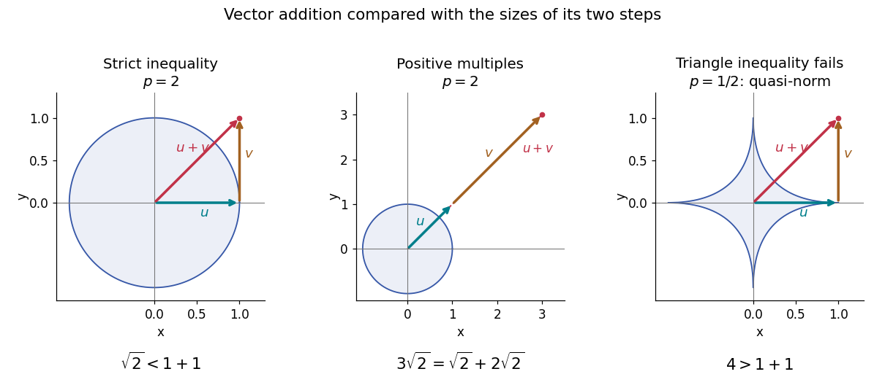

**[Figure 19](#image-strict-minkowski-inequality-equality-for-positive-multiples-and-quasi-norm-failure). Strict Minkowski inequality, equality for positive multiples, and quasi-norm failure**. Arrows show $u$, the translated step $v$, and their sum. Left: perpendicular unit [vectors](vector-space.md#vector) give $\sqrt2<2$ for the [Euclidean norm](normed-vector-space.md#euclidean-norm). Middle: $u=(1,1)$ and $v=(2,2)$ give $3\sqrt2=\sqrt2+2\sqrt2$. Right: $u=(1,0)$ and $v=(0,1)$ give $4>2$ for the [Lq quasi-norm](#lq-quasi-norm) at $q=1/2$. Pale curves show the corresponding unit level sets.

#### Equality in Minkowski inequality

↑ **Parent:** [Minkowski inequality](#minkowski-inequality)

For $1<p<\infty$ and nonzero elements $f,g$ of the same real or complex [Lp space](measure-theory.md#lp-space), equality in the [Minkowski inequality](#minkowski-inequality) holds if and only if

$$
\frac{f}{\lVert f\rVert_p}=\frac{g}{\lVert g\rVert_p}\quad\text{almost everywhere}.
$$

Equivalently, $g=cf$ [almost everywhere](measure-theory.md#almost-everywhere) for a single positive [real number](arithmetic.md#real-number) $c$. The multiplier must be constant across $X$; matching signs at each input alone is insufficient. For [complex numbers](complex-analysis.md#complex-number), an arbitrary complex [scalar multiple](vector-space.md#scalar-multiple) is also insufficient: $g=if$ gives $\lVert f+g\rVert_p=\sqrt2\lVert f\rVert_p<2\lVert f\rVert_p$ for nonzero $f$. If either element is zero in [Lp space](measure-theory.md#lp-space), equality holds automatically, even if a representative has nonzero values on a [null set](measure-theory.md#null-set).

The reason is [strictly convex normed space](normed-vector-space.md#strictly-convex-normed-space) geometry. Normalize $f,g$ to unit [Lp norm](#lp-norm) and use weights $\lVert f\rVert_p/(\lVert f\rVert_p+\lVert g\rVert_p)$ and $\lVert g\rVert_p/(\lVert f\rVert_p+\lVert g\rVert_p)$. Distinct normalized [functions](function.md) give a [convex combination](convex-set.md#convex-combination) of [Lp norm](#lp-norm) strictly below one. This follows by integrating the strict [convexity](#convex-function) of $z\mapsto|z|^p$ on the [real numbers](arithmetic.md#real-number) or [complex numbers](complex-analysis.md#complex-number); equality therefore forces the normalized [functions](function.md) to agree [almost everywhere](measure-theory.md#almost-everywhere).

At $p=1$, equality instead means $|f+g|=|f|+|g|$ [almost everywhere](measure-theory.md#almost-everywhere): the nonnegative difference has zero [integral](integral.md). For real [functions](function.md), this is $fg\geq0$ [almost everywhere](measure-theory.md#almost-everywhere). For complex [functions](function.md), their nonzero values must have the same [argument](complex-analysis.md#argument-complex-analysis) wherever both are nonzero, but their magnitude ratio may vary. The disjoint-coordinate [vectors](vector-space.md#vector) $(1,0)$ and $(0,1)$ illustrate equality without constant proportionality.

At $p=\infty$, no such constant proportionality condition is necessary: $(1,0)$ and $(1,1)$ have [L-infinity norms](#l-infinity-norm) one and a sum of [L-infinity norm](#l-infinity-norm) two. Nor must an [essential supremum](measure-theory.md#essential-supremum) be attained: under [Lebesgue measure](measure-theory.md#lebesgue-measure) on $(0,1)$, $f(x)=g(x)=x$ give equality $2=1+1$, although neither [function](function.md) takes the value one. The endpoint [Lp spaces](measure-theory.md#lp-space) need not be [strictly convex normed spaces](normed-vector-space.md#strictly-convex-normed-space).

#### Minkowski inequality for error aggregation

↑ **Parent:** [Minkowski inequality](#minkowski-inequality)

Suppose an approximation $a$ is compared with a target $f$ through an intermediate approximation $b$, with both error [functions](function.md) in the same [Lp space](measure-theory.md#lp-space). The identity $f-a=(f-b)+(b-a)$ and the [Minkowski inequality](#minkowski-inequality) combine two error budgets without any [independence](random-variable.md#independent-random-variables) assumption. The [L1 norm](normed-vector-space.md#l1-norm) controls aggregate [absolute error](numerical-analysis.md#absolute-error), the [L2 norm](#l2-norm) controls the square root of aggregate [quadratic loss](statistical-inference.md#squared-error-loss), and the [L-infinity norm](#l-infinity-norm) controls the largest error [almost everywhere](measure-theory.md#almost-everywhere). For equally weighted samples with the [probability measure](probability-space.md#probability-measure) $1/n$ on each coordinate, the [L2 norm](#l2-norm) is the [root mean square](analysis.md#root-mean-square) error; the inequality still applies when this normalization is used consistently.

For example, two signed error [vectors](vector-space.md#vector) $e=(3,0)$ and $r=(0,4)$ have [Euclidean norms](normed-vector-space.md#euclidean-norm) $3$ and $4$, while $\lVert e+r\rVert_2=5\leq7$. Reinforcing errors $e=(3,0)$ and $r=(4,0)$ attain the bound $7$; opposing errors $e=(3,0)$ and $r=(-3,0)$ cancel completely. The [Minkowski inequality](#minkowski-inequality) always allows reinforcement. A smaller combined budget requires additional information about the errors, not just their separate [norms](normed-vector-space.md#norm).

Iteration gives $\lVert\sum_{k=1}^N e_k\rVert_p\leq\sum_{k=1}^N\lVert e_k\rVert_p$ for every finite sum. For an infinite [series](sequence-and-series.md#series-mathematics), if all $e_k$ belong to one fixed [Lp space](measure-theory.md#lp-space) with $1\leq p\leq\infty$ and $\sum_{k=1}^\infty\lVert e_k\rVert_p<\infty$, its [partial sums](sequence-and-series.md#partial-sum) form a [Cauchy sequence](sequence-and-series.md#cauchy-sequence) in the full [Lp norm](#lp-norm). [Completeness](topological-analysis.md#completeness) of this [Banach space](banach-space.md) then gives [norm convergence](normed-vector-space.md#norm-convergence) to an element of the same [Lp space](measure-theory.md#lp-space). A finite sum bound alone does not establish convergence, and [completeness](topological-analysis.md#completeness) is an additional ingredient beyond the [Minkowski inequality](#minkowski-inequality). [Hunter, Measure Theory, §7.4, Lemma 7.9, pp. 81–82, and Theorem 7.10, pp. 82–83: norm summability and completeness](mathematics-bibliography.md#measure-theory-by-john-k-hunter/lp-spaces-chapter-7-of-measure-theory)

#### Failure of Minkowski inequality below exponent one

↑ **Parent:** [Minkowski inequality](#minkowski-inequality)

For $0<p<1$, write $Q_p(f)=(\int|f|^p\,d\mu)^{1/p}$ to emphasize that this is a [quasi-norm](normed-vector-space.md#quasi-norm), as in the [Lq quasi-norm](#lq-quasi-norm) branch. On two coordinates with [counting measure](measure.md#counting-measure), $u=(1,0)$ and $v=(0,1)$ give $Q_p(u)=Q_p(v)=1$, but $Q_p(u+v)=2^{1/p}>2$. At $p=1/2$, this is the explicit failure $4>1+1$ in the right panel of the diagram. The midpoint $(1/2,1/2)$ has $Q_p=2^{1/p-1}>1$, so the corresponding unit sublevel [set](set.md) is not a [convex set](convex-set.md).

A useful replacement survives: for nonnegative [real numbers](arithmetic.md#real-number) $a,b$, $(a+b)^p\leq a^p+b^p$. Together with the scalar [triangle inequality](topological-analysis.md#triangle-inequality), this yields

$$
Q_p(f+g)^p\leq Q_p(f)^p+Q_p(g)^p.
$$

Consequently $d_p(f,g)=Q_p(f-g)^p$ is a [metric](topological-analysis.md#metric) on the [equivalence classes](set-theory.md#equivalence-class) of [measurable functions](measure-theory.md#measurable-function) with finite $Q_p$, even though $Q_p(f-g)$ itself need not be a [metric](topological-analysis.md#metric). Do not replace the failed [Minkowski inequality](#minkowski-inequality) by a universal reversed bound for signed or complex [functions](function.md): $g=-f\ne0$ would give a zero sum but two positive separate sizes.

### L2 norm

↑ **Parent:** [Lp norm](#lp-norm)

The $L^2$ norm is

$$
\lVert f\rVert_2=\left(\int|f|^2\right)^{1/2}.
$$

It is induced by the $L^2$ inner product and is the continuous analogue of the [Euclidean norm](normed-vector-space.md#euclidean-norm).

<h3 id="marcinkiewicz-zygmund-inequality">Marcinkiewicz–Zygmund inequality</h3>

↑ **Parent:** [Lp norm](#lp-norm)  
ⓦ [Wiki](https://en.wikipedia.org/wiki/Marcinkiewicz–Zygmund_inequality)

For independent mean-zero random variables $X_1,\ldots,X_n$ and $p\geq1$, the Marcinkiewicz–Zygmund inequality compares the $L^p$ norm of their sum with the square function:

$$
\mathbb E\left|\sum_iX_i\right|^p
\leq C_p\,\mathbb E\left(\sum_i|X_i|^2\right)^{p/2}.
$$

For $p=2m$, one may take $C_p^{1/p}=O(\sqrt m)$.

<h3 id="holder-s-inequality">Hölder's inequality</h3>

↑ **Parent:** [Lp norm](#lp-norm)  
ⓦ [Wiki](https://en.wikipedia.org/wiki/Hölder's_inequality)

[Hölder's inequality](#holder-s-inequality) controls a product using separate information about its two factors. If one factor is large on part of a domain, the other factor's complementary [Lp norm](#lp-norm) limits how much their product can accumulate there. The same statement bounds finite [sums](arithmetic.md#sum), [integrals](integral.md) and [expected values](expected-value.md); no [independence](random-variable.md#independent-random-variables) is required in the probabilistic version.

Let $p,q\in[1,\infty]$ be [conjugate exponents](functional-analysis.md#conjugate-exponents), meaning

$$
\frac1p+\frac1q=1,\qquad\frac1\infty=0.
$$

On a [measure space](measure.md#measure-space), if $f\in L^p$ and $g\in L^q$, then $fg\in L^1$ and

$$
\boxed{\int |fg|\,d\mu\leq\lVert f\rVert_p\lVert g\rVert_q.}
$$

Here the [Lp norms](#lp-norm) are finite; at exponent $\infty$ the norm uses the [essential supremum](measure-theory.md#essential-supremum). For a finite [vector](vector-space.md#vector), integration with [counting measure](measure.md#counting-measure) gives

$$
\left|\sum_i x_i y_i\right|\leq\sum_i|x_i y_i|
\leq\left(\sum_i|x_i|^p\right)^{1/p}
\left(\sum_i|y_i|^q\right)^{1/q},\qquad 1<p,q<\infty.
$$

The first step is the [triangle inequality](topological-analysis.md#triangle-inequality); the second is [Hölder's inequality](#holder-s-inequality).[NIST Digital Library of Mathematical Functions, §1.7(i)–(ii), equations 1.7.2 and 1.7.5 and the accompanying equality statements](mathematics-bibliography.md#nist-digital-library-of-mathematical-functions/1-algebraic-and-analytic-methods)

For finite [vectors](vector-space.md#vector), the endpoint case $p=1$, $q=\infty$ is $|x^Ty|\leq\lVert x\rVert_1\lVert y\rVert_\infty$: bound every $|y_i|$ by its [maximum](set.md#maximum-of-a-subset-of-a-total-order), then sum the $|x_i|$. Swapping the factors gives the other endpoint. The choice $p=q=2$ gives the [Cauchy-Schwarz inequality](probability-and-statistics.md#cauchy-schwarz-inequality).

#### Conjugate exponent

↑ **Parent:** [Hölder's inequality](#holder-s-inequality)

The [conjugate exponent](#conjugate-exponent) of $1<p<\infty$ is $q=p/(p-1)$, so $1/p+1/q=1$. The endpoint conventions pair $1$ with $\infty$ and $\infty$ with $1$. Examples are $(p,q)=(2,2)$, $(3,3/2)$ and $(4,4/3)$. The exponents themselves need not add to one; their reciprocals do.

<h4 id="finite-vector-example-of-holder-s-inequality">Finite-vector example of Hölder's inequality</h4>

↑ **Parent:** [Hölder's inequality](#holder-s-inequality)

Take $p=3$, $q=3/2$, and [vectors](vector-space.md#vector) $x=(1,2,-1)$ and $y=(2,-1,3)$. Their coordinate products are $(2,-2,-3)$, so

$$
\left|\sum_i x_i y_i\right|=3,\qquad
\sum_i|x_i y_i|=7.
$$

Their [Lp norms](#lp-norm) give the larger bound

$$
\lVert x\rVert_3\lVert y\rVert_{3/2}
=10^{1/3}(2\sqrt2+1+3\sqrt3)^{2/3}
\approx9.338662.
$$

Thus cancellation explains $3<7$, and [Hölder's inequality](#holder-s-inequality) explains the remaining gap between $7$ and the norm product. Small signed [sums](arithmetic.md#sum) need not imply small individual coordinate products.

Now keep $x$ and choose $y=(1,4,-1)$. The coordinate products are $(1,8,1)$, with no cancellation, and

$$
\sum_i x_i y_i=10
=10^{1/3}10^{2/3}
=\lVert x\rVert_3\lVert y\rVert_{3/2}.
$$

The matching powers are $|x_i|^3=|y_i|^{3/2}$, namely $(1,8,1)$.

**[Figure 20](#image-cancellation-and-holder-s-inequality-account-for-two-different-gaps). Cancellation and Hölder's inequality account for two different gaps**. Two original finite-vector calculations with $p=3$, $q=3/2$. The first pair has signed [sum](arithmetic.md#sum) $-3$, absolute-product [sum](arithmetic.md#sum) $7$ and norm-product bound approximately $9.339$. The second pair attains equality at $10$. The diagrams show calculated values, with no simulated data.

<h4 id="equality-in-holder-s-inequality">Equality in Hölder's inequality</h4>

↑ **Parent:** [Hölder's inequality](#holder-s-inequality)

For $1<p,q<\infty$ and nonzero factors in their respective [Lp spaces](measure-theory.md#lp-space), equality in the product-integral bound holds precisely when

$$
\frac{|f|^p}{\lVert f\rVert_p^p}
=\frac{|g|^q}{\lVert g\rVert_q^q}
\quad\text{almost everywhere}.
$$

In other words, the normalized powers match. Zero factors give the trivial equality separately. For real [vectors](vector-space.md#vector), equality for the signed finite [sum](arithmetic.md#sum) also needs the nonzero coordinate products to have a common sign; otherwise the preceding [triangle inequality](topological-analysis.md#triangle-inequality) loses information.

For $f(t)=t$ and $g(t)=1-t$ on $[0,1]$, with $p=3$, $q=3/2$,

$$
\int_0^1 f(t)g(t)\,dt=\frac16,
\qquad
\lVert f\rVert_3\lVert g\rVert_{3/2}
=\left(\frac14\right)^{1/3}\left(\frac25\right)^{2/3}
=25^{-1/3}\approx0.341995.
$$

Changing only $g$ to $t^2$ gives $f^3=g^{3/2}=t^3$, and both sides become $1/4$. The factors need not be equal: their conjugate powers are what must agree after normalization.

**[Figure 21](#image-matching-conjugate-powers-makes-the-integral-bound-exact). Matching conjugate powers makes the integral bound exact**. Original [function graphs](function.md#graph-of-a-function) on $[0,1]$. The green [area](differential-geometry.md#surface-area) is the [integral](integral.md) of the product. For $g=1-t$, the normalized powers differ and the bound is strict. For $g=t^2$, $f^3=g^{3/2}$ pointwise, so the product [integral](integral.md) attains the [Hölder's inequality](#holder-s-inequality) bound.

The proof outline makes the equality condition natural. Normalize $u=|f|/\lVert f\rVert_p$ and $v=|g|/\lVert g\rVert_q$. The [Young inequality](nonlinear-analysis.md#young-s-inequality-for-products) gives $uv\leq u^p/p+v^q/q$; integration yields $\int uv\leq1/p+1/q=1$. Equality requires $u^p=v^q$ [almost everywhere](measure-theory.md#almost-everywhere). The endpoint proof uses the [essential supremum](measure-theory.md#essential-supremum) directly, so it does not need division by $p-1$ at $p=1$.

<h4 id="probabilistic-use-of-holder-s-inequality">Probabilistic use of Hölder's inequality</h4>

↑ **Parent:** [Hölder's inequality](#holder-s-inequality)

On a [probability space](probability-space.md), the same [inequality](arithmetic.md#inequality-mathematics) reads

$$
\mathbb E|XY|\leq
(\mathbb E|X|^p)^{1/p}(\mathbb E|Y|^q)^{1/q}.
$$

If the displayed [moments](expected-value.md#moment) are finite, the product is an [integrable random variable](expected-value.md#integrable-random-variable). The [random variables](random-variable.md) can be dependent: the estimate controls their possible overlap without assuming a factorization of the [expected value](expected-value.md). This is useful when a calculation needs the product to be integrable but the joint [probability distribution](probability-distribution.md) is complicated.

<h4 id="history-of-holder-s-inequality">History of Hölder's inequality</h4>

↑ **Parent:** [Hölder's inequality](#holder-s-inequality)

[Otto Hölder](mathematics.md#otto-holder)'s 1889 paper begins with a weighted-mean inequality for a [function](function.md) with increasing [derivative](calculus.md#derivative). In current terminology, its opening statement is a weighted form of [Jensen's inequality](#jensen-s-inequality): applying a [convex function](#convex-function) after taking a [weighted mean](arithmetic.md#weighted-arithmetic-mean) gives a lower bound for the weighted mean of its values. This connects product estimates to the geometry of [convex functions](#convex-function), rather than treating them as isolated formulas.[Otto Hölder, Ueber einen Mittelwerthssatz (1889), §§1–2, printed pp. 38–39: weighted means and increasing derivative](mathematics-bibliography.md#ueber-einen-mittelwerthssatz-by-otto-holder)

## Calculus

↑ **Parent:** [Real analysis](real-analysis.md)

[This section is present in another page, follow this link to view it.](calculus.md)

## Sequence and series

↑ **Parent:** [Real analysis](real-analysis.md)

[This section is present in another page, follow this link to view it.](sequence-and-series.md)

## Riemann integration

↑ **Parent:** [Real analysis](real-analysis.md)

Riemann integration approximates area by upper and lower sums over finite partitions.

### Single-point changes preserve Riemann integrals

↑ **Parent:** [Riemann integration](#riemann-integration)

Changing the value of a bounded [Riemann-integrable function](#riemann-integrable-function) at one point preserves its [Riemann integral](#riemann-integral). The difference is supported at that point: partitions isolating it in intervals of arbitrarily small total length make both [Darboux sums](#darboux-sum) tend to zero. Thus a nonnegative single-point spike can have zero integral without vanishing everywhere. Its indefinite integral is identically zero, so the [fundamental theorem of calculus](calculus.md#fundamental-theorem-of-calculus) derivative identity can fail at the changed point despite differentiability of the primitive.

### Riemann-Stieltjes integral

↑ **Parent:** [Riemann integration](#riemann-integration)

For continuous $f$ and an integrator $g$ of [bounded variation](#total-variation-of-a-function), the Riemann-Stieltjes integral is the limit of tagged sums $\sum f(\xi_j)(g(t_{j+1})-g(t_j))$ as the mesh tends to zero. It exists and equals integration against the signed measure induced by $g$. Continuous vector-valued integrators are handled componentwise, which defines [path signatures](analysis.md#signature-of-a-bounded-variation-path) of continuous [bounded variation](#total-variation-of-a-function) paths.

### Quadrature error

↑ **Parent:** [Riemann integration](#riemann-integration)

The difference between a weighted integral and a discrete approximation is a quadrature error. For a [Hölder continuous function](sobolev-space.md#holder-condition) on a [partition of an interval](#partition-of-an-interval) with mesh $\Delta$, a left endpoint approximation has error of order $\Delta^\alpha$. For a normalized window [indicator function](measure-theory.md#indicator-function), only the two endpoint cells contribute and the error is bounded by a constant times $\Delta/h$.

### Partition of an interval

↑ **Parent:** [Riemann integration](#riemann-integration)

A partition of $[a,b]$ is a finite increasing sequence $a=t_0<t_1<\cdots<t_n=b$. Its mesh is $\max_i(t_i-t_{i-1})$, and a sequence of partitions is refining when each partition contains the preceding one.

#### Partition refinement

↑ **Parent:** [Partition of an interval](#partition-of-an-interval)

A refinement of a finite interval partition inserts additional points without removing original points. The union of two partitions is a common refinement. Refinement makes each subinterval smaller, increasing its infimum and decreasing its supremum; this proves [Darboux sum refinement monotonicity](#darboux-sum-refinement-monotonicity).

#### Dyadic partition

↑ **Parent:** [Partition of an interval](#partition-of-an-interval)

A [dyadic partition](#dyadic-partition) of $[0,1]$ at level $J$ consists of $2^J$ equal cells of length $2^{-J}$. Each cell splits into two cells at the next level. Use left-closed, right-open cells, adding the endpoint $1$ to the final cell when a pointwise representative is needed. These nested partitions underlie the [Haar scaling functions](fourier-analysis.md#haar-scaling-function) and [Haar wavelets](fourier-analysis.md#haar-wavelet).

##### Dyadic interval

↑ **Parent:** [Dyadic partition](#dyadic-partition)

A [dyadic interval](#dyadic-interval) is one cell in a [dyadic partition](#dyadic-partition). Its children are the left and right half intervals. Disjoint [dyadic intervals](#dyadic-interval) at a fixed level produce orthogonal [indicator functions](measure-theory.md#indicator-function) and [independent](random-variable.md#independent-random-variables) [Brownian motion](brownian-motion.md) increments.

###### Alternating dyadic colouring excludes symmetric weighted pair sums

↑ **Parent:** [Dyadic interval](#dyadic-interval)

Define a [finite colouring](ramsey-theory.md#finite-coloring) of the positive [integers](integer.md) by $c(n)=\lfloor\log_2 n\rfloor\pmod 2$. No increasing infinite [sequence](sequence-and-series.md#sequence) has all the numbers $x_i+2x_j$, $i\ne j$, in one [colour class](ramsey-theory.md#colour-class).

Write $\delta(y)=2^{\lfloor\log_2 y\rfloor+1}-y$. If $\delta$ is unbounded on the [sequence](sequence-and-series.md#sequence), fix a term $x$ and choose a later term $y>2x$ with $\delta(y)>2x$. With $L=2^{\lfloor\log_2 y\rfloor}$, the numbers $y+2x$ and $2y+x$ lie respectively in the adjacent [dyadic intervals](#dyadic-interval) $[L,2L)$ and $[2L,4L)$, so their colours differ. If $\delta$ is bounded by $D$ on the [sequence](sequence-and-series.md#sequence), choose $x>2D$ and then $y>2x$. Now $y+2x=2L-\delta(y)+2x$ lies in $[2L,4L)$, whereas $2y+x=4L-2\delta(y)+x$ lies in $[4L,8L)$. Their colours again differ. The [finite colouring](ramsey-theory.md#finite-coloring) therefore excludes the symmetric weighted-pair configuration.

### Riemann sum

↑ **Parent:** [Riemann integration](#riemann-integration)  
ⓦ [Wiki](https://en.wikipedia.org/wiki/Riemann_sum)

For a tagged partition $a=x_0<\cdots<x_n=b$ with $t_i\in[x_{i-1},x_i]$, the corresponding Riemann sum is

$$
\sum_{i=1}^n f(t_i)(x_i-x_{i-1}).
$$

Its limits over increasingly fine partitions define the [Riemann integral](#riemann-integral).

#### Geometric partition bounds for a power-law improper integral

↑ **Parent:** [Riemann sum](#riemann-sum)

On the [geometric progression](sequence-and-series.md#geometric-progression) $x_i=(1+\epsilon)^i$, with $\epsilon>0$, the interval widths are $\epsilon(1+\epsilon)^i$. The left-endpoint [Riemann sum](#riemann-sum) for the decreasing integrand $x^{-1-\alpha}$ is the [geometric series](sequence-and-series.md#geometric-series)

$$
U_\epsilon=\sum_{i=0}^\infty\epsilon(1+\epsilon)^{-\alpha i}
=\frac{\epsilon}{1-(1+\epsilon)^{-\alpha}}.
$$

The right-endpoint sum is $L_\epsilon=(1+\epsilon)^{-1-\alpha}U_\epsilon$. Integral comparison on each interval gives $L_\epsilon\leq I\leq U_\epsilon$. Both bounds tend to $1/\alpha$ as $\epsilon\to0^+$, proving the [improper integral](#improper-integral) by the [squeeze theorem](calculus.md#squeeze-theorem). Although the largest interval width is unbounded on the infinite domain, these explicit upper and lower bounds justify the limit without incorrectly applying a finite-interval mesh argument to the entire half-line.

### Continuous approximation of a Riemann-integrable function

↑ **Parent:** [Riemann integration](#riemann-integration)

Every Riemann-integrable function on a compact interval can be approximated in $L^1$ by continuous functions. Consequently their integrals converge uniformly over all subintervals.

### Total variation of a function

↑ **Parent:** [Riemann integration](#riemann-integration)

The total variation of a [function](function.md) $f:[a,b]\to\mathbb R$ measures its accumulated rises and falls, rather than just its change between the endpoints. For each [partition of an interval](#partition-of-an-interval) $\Pi=(a=t_0<\cdots<t_n=b)$, add the [absolute values](#absolute-value) of its sampled increments. Then take the [supremum](#supremum) over all such [partitions of an interval](#partition-of-an-interval):

$$
S_\Pi(f)=\sum_{k=1}^n|f(t_k)-f(t_{k-1})|,\qquad
V_a^b(f)=\sup_\Pi S_\Pi(f).
$$

The [function](function.md) has bounded variation when $V_a^b(f)<\infty$. This definition uses its value at every point of the [interval](#interval-mathematics), including both endpoints.[§3.5.1, Definition 1, printed pp. 1–2: partition definition and pointwise convention](mathematics-bibliography.md#real-analysis-lecture-notes-3-5-functions-of-bounded-variation-by-christopher-e-heil)

For a [nondecreasing function](calculus.md#nondecreasing-function), all increments are nonnegative and the sum telescopes to $f(b)-f(a)$. More generally, the [triangle inequality](topological-analysis.md#triangle-inequality) gives $|f(b)-f(a)|\leq V_a^b(f)$. Equality can fail dramatically when the [function](function.md) changes direction: an object can travel a long distance and finish near its starting position. Here we measure movement of the function's value; [arc length](riemannian-geometry.md#arc-length) of its [function graph](function.md#graph-of-a-function) also includes horizontal movement.

#### Partition example of total variation

↑ **Parent:** [Total variation of a function](#total-variation-of-a-function)

Define a [piecewise linear function](function.md#piecewise-linear-function) by joining the five points $(0,0),(1,2),(2,-1),(3,3),(4,1)$. Its net change is $1$, but the increments at these knots are $2,-3,4,-2$. Their [absolute values](#absolute-value) give

$$
\boxed{V_0^4(f)=2+3+4+2=11.}
$$

This is its exact total variation, not merely one lower bound. Given any [partition of an interval](#partition-of-an-interval), insert all five knots. The [triangle inequality](topological-analysis.md#triangle-inequality) ensures that this [partition refinement](#partition-refinement) cannot decrease the sum. On each resulting [monotone function](calculus.md#monotonic-function) segment, the absolute increments telescope, so every refined sum is $11$. The knot [partition of an interval](#partition-of-an-interval) itself attains $11$.

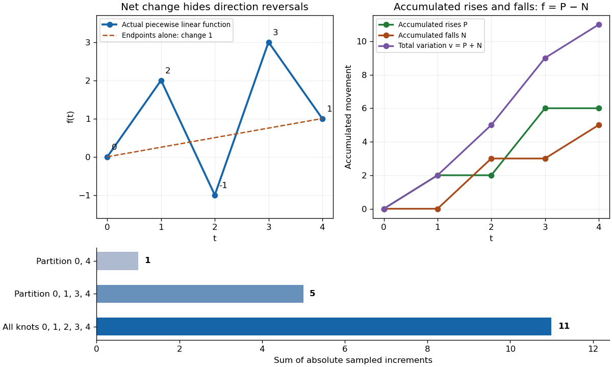

**[Figure 22](#image-a-piecewise-linear-function-has-net-change-1-and-total-variation-11-refinements-reveal-hidden-movement-while-accumulated-rises-and-falls-give-its-jordan-decomposition). A piecewise linear function has net change 1 and total variation 11; refinements reveal hidden movement, while accumulated rises and falls give its Jordan decomposition**.

Sampling only at $0,4$ gives $1$. Sampling at $0,1,3,4$ gives $2+1+2=5$. Inserting the remaining knot at $2$ reveals the descent and rise that were hidden inside $[1,3]$, giving $11$. These are nested [partitions of an interval](#partition-of-an-interval): their sums increase because each is a [partition refinement](#partition-refinement) of the preceding one. Arbitrarily chosen unrelated [partitions of an interval](#partition-of-an-interval) need not produce an increasing sequence of sums.

#### Uniformly small functions with nonvanishing total variation

↑ **Parent:** [Total variation of a function](#total-variation-of-a-function)

For each positive [integer](integer.md) $n$, put $f_n(t)=\sin(2\pi nt)/n$ on $[0,1]$. Its [supremum norm](normed-vector-space.md#supremum-norm) is exactly $1/n$, so this [sequence of functions](sequence-and-series.md#sequence-of-functions) converges to zero by [uniform convergence](sequence-and-series.md#uniform-convergence). Nevertheless,

$$
\boxed{V_0^1(f_n)=4\quad\text{for every }n\geq1.}
$$

Each of its $n$ complete [sine](geometry-and-topology.md#sine) oscillations contributes $4/n$: rise from zero to $1/n$, fall through zero to $-1/n$, then return to zero. Taking a [partition of an interval](#partition-of-an-interval) through all extrema attains $4$. Every further [partition refinement](#partition-refinement) merely subdivides [monotone function](calculus.md#monotonic-function) segments, so the same reasoning as in [partition example of total variation](#partition-example-of-total-variation) proves the upper bound too.

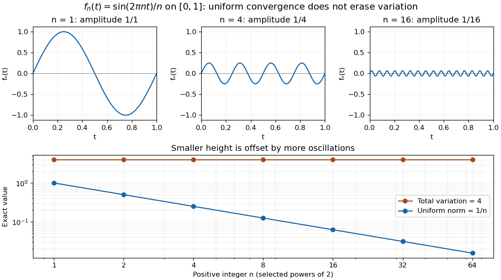

**[Figure 23](#image-the-functions-sin-2-pi-nt-n-converge-uniformly-to-zero-while-their-total-variation-remains-4-all-three-function-plots-use-the-same-vertical-scale). The functions sin(2πnt)/n converge uniformly to zero while their total variation remains 4; all three function plots use the same vertical scale**.

For a [continuously differentiable function](multivariable-calculus.md#continuously-differentiable-function) on a closed bounded [interval](#interval-mathematics), total variation also satisfies

$$
V_a^b(f)=\int_a^b|f'(t)|\,dt.
$$

Applied here, the [derivative](calculus.md#derivative) is $2\pi\cos(2\pi nt)$, and integrating its [absolute value](#absolute-value) over $n$ periods gives $4$. The differentiability hypothesis matters: the partition definition applies much more widely than this derivative formula.[NIST Digital Library of Mathematical Functions; §1.4(v), equations 1.4.33–1.4.34, Functions of Bounded Variation](mathematics-bibliography.md#nist-digital-library-of-mathematical-functions/1-algebraic-and-analytic-methods) Small pointwise size and small accumulated movement are different approximation goals.

#### Integration error controlled by total variation

↑ **Parent:** [Total variation of a function](#total-variation-of-a-function)

Let $f$ have [bounded variation](#total-variation-of-a-function), and let $g,h$ be [continuous functions](calculus.md#continuous-function) on $[a,b]$. In any tagged sum for the [Riemann-Stieltjes integral](#riemann-stieltjes-integral),

$$
\left|\sum_j(g(\xi_j)-h(\xi_j))(f(t_j)-f(t_{j-1}))\right|
\leq\|g-h\|_\infty\sum_j|f(t_j)-f(t_{j-1})|
\leq\|g-h\|_\infty V_a^b(f).
$$

Taking the [limit](calculus.md#limit-of-a-function) proves the displayed error bound. Thus approximating $g$ uniformly to accuracy $\varepsilon$ controls this integration error by $\varepsilon V_a^b(f)$, even when the integrator is not [differentiable](analysis.md#differentiable-function). For the [piecewise linear function](function.md#piecewise-linear-function) in [partition example of total variation](#partition-example-of-total-variation), accuracy $0.001$ gives an error at most $0.011$. Total variation supplies exactly the movement budget that an endpoint difference would miss.

#### History of total variation of a function

↑ **Parent:** [Total variation of a function](#total-variation-of-a-function)

[Camille Jordan](mathematics.md#camille-jordan) developed [bounded variation](#total-variation-of-a-function) as part of his work in [real analysis](real-analysis.md); his treatment of [functions](function.md) and [arc length](riemannian-geometry.md#arc-length) was part of the influence of his analysis textbooks.[Discussion of Jordan's analysis textbooks, bounded variation and definition of curve length; biography by J. J. O'Connor and E. F. Robertson, last updated March 2001](mathematics-bibliography.md#marie-ennemond-camille-jordan-by-john-joseph-o-connor-and-edmund-frederick-robertson) The [Jordan decomposition of a function of bounded variation](#jordan-decomposition-of-a-function-of-bounded-variation) expresses the underlying idea especially well: complicated changes of direction can be separated into two functions that only increase.

#### p-variation of a path

↑ **Parent:** [Total variation of a function](#total-variation-of-a-function)

For $p\ge1$, the displayed quantity measures the accumulated oscillation of a path in a [metric space](topological-analysis.md#metric-space). For $p=1$ it is total variation. A [Hölder continuous](sobolev-space.md#holder-condition) path of exponent $\alpha$ has finite $p$-variation on a compact interval if $p\alpha\ge1$. Applying this construction to the [Carnot-Carathéodory distance](differential-geometry.md#carnot-caratheodory-distance) gives the defining regularity of a [weak geometric p-rough path](analysis.md#weak-geometric-p-rough-path).

#### Dyadic approximation of total variation

↑ **Parent:** [Total variation of a function](#total-variation-of-a-function)

For a [càdlàg function](calculus.md#cadlag), replace the last sampled value at $2^{-n}\lceil2^nt\rceil$ by $X_t$. Right continuity makes this change tend to zero. The corrected sum is bounded by the [total variation of a function](#total-variation-of-a-function). Conversely every finite [partition of an interval](#partition-of-an-interval) can be approximated by dyadic points from the right, retaining the endpoint $t$. The [triangle inequality](topological-analysis.md#triangle-inequality) bounds that partition's limiting sum by the dyadic sums. Taking the [supremum](#supremum) proves convergence, including the value $+\infty$.

#### Weak convergence of bounded-variation integrators

↑ **Parent:** [Total variation of a function](#total-variation-of-a-function)

If continuously differentiable $F_j,F$ converge uniformly on a [compact](topology.md#compact-space) interval and have uniformly bounded [total variation of a function](#total-variation-of-a-function), then $\int bF_j^{\prime}\to\int bF^{\prime}$ for every continuous $b$. For continuously differentiable test functions this is [integration by parts](calculus.md#integration-by-parts). Uniform approximation by [polynomials](polynomial.md) extends the conclusion to continuous tests using the variation bound.

#### Jordan decomposition of a function of bounded variation

↑ **Parent:** [Total variation of a function](#total-variation-of-a-function)

Every real [function](function.md) on $[a,b]$ has [bounded variation](#total-variation-of-a-function) if and only if it is a difference of two [nondecreasing functions](calculus.md#nondecreasing-function). For a normalized version, let $v(t)=V_a^t(f)$ and $v(a)=0$. Its accumulated positive and negative variations are

$$
P(t)=\frac{v(t)+f(t)-f(a)}2,\qquad
N(t)=\frac{v(t)-f(t)+f(a)}2.
$$

Both are [nondecreasing functions](calculus.md#nondecreasing-function), $P(a)=N(a)=0$, and

$$
f(t)=f(a)+P(t)-N(t),\qquad v(t)=P(t)+N(t).
$$

This is the [Jordan decomposition of a function of bounded variation](#jordan-decomposition-of-a-function-of-bounded-variation).[§3.5.2, Definition 9, Lemma 12, Exercise 13 and Theorem 14, printed pp. 3–5: positive and negative variation and Jordan decomposition](mathematics-bibliography.md#real-analysis-lecture-notes-3-5-functions-of-bounded-variation-by-christopher-e-heil) Equivalently one may write $f=f_+-f_-$ with $f_+=(v+f)/2$ and $f_-=(v-f)/2$; those functions need not vanish at $a$.

For the [piecewise linear function](function.md#piecewise-linear-function) in [partition example of total variation](#partition-example-of-total-variation), the successive values of $P$ are $0,2,2,6,6$, while those of $N$ are $0,0,3,3,5$. At $t=4$, the total rise is $6$ and the total fall is $5$: their difference gives the net change $1$, and their sum gives the total variation $11$. A declining segment increases $N$ while $P$ stays constant; an ascending segment does the opposite.

For a short proof outline, total variation is additive over adjacent [intervals](#interval-mathematics), because any two [partitions of an interval](#partition-of-an-interval) have a common [partition refinement](#partition-refinement). Thus $v(t)-v(s)=V_s^t(f)\geq|f(t)-f(s)|$ for $s<t$. Substituting this inequality into the formulas for $P$ and $N$ shows their increments are nonnegative. Conversely, if $f=g-h$ for two [nondecreasing functions](calculus.md#nondecreasing-function), the [triangle inequality](topological-analysis.md#triangle-inequality) bounds each partition sum by $g(b)-g(a)+h(b)-h(a)$. This proves finite total variation without restricting the number of changes of direction.

### Riemann integral

↑ **Parent:** [Riemann integration](#riemann-integration)  
ⓦ [Wiki](https://en.wikipedia.org/wiki/Riemann_integral)

#### Unbounded derivative obstruction to Riemann integrability

↑ **Parent:** [Riemann integral](#riemann-integral)

A proper [Riemann integral](#riemann-integral) on a compact interval requires a bounded integrand, but a [derivative](calculus.md#derivative) can be unbounded. For $f(x)=x^2\sin(1/x^2)$ away from zero and $f(0)=0$, the [difference quotient](calculus.md#difference-quotient) gives $f'(0)=0$, whereas $f'(x)=2x\sin(1/x^2)-2\cos(1/x^2)/x$ for $x\ne0$. At $x_n=(2\pi n)^{-1/2}$, this derivative is $-2/x_n$ and is unbounded. The [fundamental theorem of calculus](calculus.md#fundamental-theorem-of-calculus) version that integrates a derivative therefore needs an explicit integrability hypothesis.

#### Weighted mean value theorem for integrals

↑ **Parent:** [Riemann integral](#riemann-integral)

For real [continuous functions](calculus.md#continuous-function) $f,g$ on a compact interval with $g\geq0$, some $\alpha$ in the interval satisfies $\int fg=f(\alpha)\int g$. If $\int g>0$, the weighted average lies between the minimum and maximum of $f$, and the [intermediate value theorem](calculus.md#intermediate-value-theorem) supplies $\alpha$. If $\int g=0$, the bound $|\int fg|\leq\sup|f|\int g$ makes both sides zero. Nonnegativity of the weight is essential to this argument.

#### Direct Riemann integrability

↑ **Parent:** [Riemann integral](#riemann-integral)

A function $g$ on $[0,\infty)$ is directly Riemann integrable when its upper and lower sums on an equal-width mesh are absolutely finite and converge to the same finite integral as the mesh width tends to zero. A locally absolutely continuous integrable function with integrable derivative has this property: the upper-minus-lower sum is bounded by mesh width times its total variation. The derivative bound therefore gives [bounded variation](#total-variation-of-a-function) as well as tail control. This stronger form of integrability is a hypothesis of the [key renewal theorem](probability-theory.md#key-renewal-theorem).

#### Improper integral

↑ **Parent:** [Riemann integral](#riemann-integral)  
ⓦ [Wiki](https://en.wikipedia.org/wiki/Improper_integral)

An improper integral is defined by taking a [limit](calculus.md#limit-of-a-function) when an integration endpoint is infinite or the integrand is unbounded. Its convergence must be established before ordinary integral manipulations are applied.

##### Logarithmic divergence

↑ **Parent:** [Improper integral](#improper-integral)

A [logarithmic divergence](#logarithmic-divergence) grows like a [logarithm](calculus.md#logarithm) as a cutoff is removed. For example $\int_\epsilon^1dx/x=\log(1/\epsilon)\to\infty$ as $\epsilon\to0^+$. An integrand $f(x)=C/x+O(1)$ near zero gives $C\log(1/\epsilon)+O(1)$. This behavior distinguishes logarithmic sensitivity to an infrared or ultraviolet cutoff from power-law divergence.

##### Improper power integral

↑ **Parent:** [Improper integral](#improper-integral)

The [improper integral](#improper-integral) $\int_1^\infty u^{-p}\,du$ converges exactly when $p>1$, in which case its value is $1/(p-1)$.

##### Integrable singularity

↑ **Parent:** [Improper integral](#improper-integral)

A [function](function.md) has an [integrable singularity](#integrable-singularity) at a point if it becomes unbounded there but its [absolute value](#absolute-value) has a finite [improper integral](#improper-integral) over a sufficiently small surrounding interval, one-sided at an endpoint. The endpoint behavior of the [arcsine distribution](continuous-probability-distribution.md#arcsine-distribution)'s [probability density function](continuous-probability-distribution.md#probability-density-function) is an example.

#### Monotonicity of the Riemann integral

↑ **Parent:** [Riemann integral](#riemann-integral)

If Riemann-integrable functions satisfy $f(x)\leq g(x)$ throughout $[a,b]$, then

$$
\int_a^bf(x)\,dx\leq\int_a^bg(x)\,dx.
$$

This follows directly by comparing their lower and upper Darboux sums, or their Riemann sums on a common sequence of refining partitions.

### Riemann integrability criterion

↑ **Parent:** [Riemann integration](#riemann-integration)

A bounded function is Riemann integrable exactly when for every $\varepsilon>0$ some partition $P$ satisfies $U(f,P)-L(f,P)<\varepsilon$.

#### Pointwise supremum need not preserve Riemann integrability

↑ **Parent:** [Riemann integrability criterion](#riemann-integrability-criterion)

Enumerate the rational points of a compact nondegenerate interval as $q_1,q_2,\ldots$. Each singleton [indicator function](measure-theory.md#indicator-function) $f_n=1_{\{q_n\}}$ is [Riemann integrable](#riemann-integrable-function) with integral zero. Their pointwise supremum is the [Dirichlet function](#dirichlet-function), which is not [Riemann integrable](#riemann-integrable-function). Thus even a uniformly bounded countable supremum need not preserve integrability.

#### Dirichlet function

↑ **Parent:** [Riemann integrability criterion](#riemann-integrability-criterion)  
ⓦ [Wiki](https://en.wikipedia.org/wiki/Dirichlet_function)

The indicator of the [rational numbers](number-theory.md#rational-number) is not [Riemann integrable](#riemann-integrable-function) on a nondegenerate interval: every subinterval contains both rational and irrational points, so its lower sum is zero and its upper sum is the interval length.

#### Riemann integrability is closed under addition and maximum

↑ **Parent:** [Riemann integrability criterion](#riemann-integrability-criterion)

For a common interval partition, the [oscillation of a function on an interval](#oscillation-of-a-function-on-an-interval) satisfies $\operatorname{osc}_I(f+g)\le\operatorname{osc}_I f+\operatorname{osc}_I g$. Refining two good [Darboux sums](#darboux-sum) therefore proves integrability of the sum. [Lipschitz composition preserves Riemann integrability](#lipschitz-composition-preserves-riemann-integrability), so absolute values preserve it too. The identity $\max(f,g)=(f+g+|f-g|)/2$ then proves the assertion for the maximum.

#### Bounded functions continuous away from one endpoint are Riemann integrable

↑ **Parent:** [Riemann integrability criterion](#riemann-integrability-criterion)

Let $f$ be bounded on $[a,b]$ and continuous on $(a,b]$. For any positive error tolerance, isolate $[a,a+\delta]$. Its contribution to the difference of [upper Darboux sums](#upper-darboux-sum) and [lower Darboux sums](#lower-darboux-sum) is at most $2\|f\|_\infty\delta$. On $[a+\delta,b]$, [uniform continuity](topological-analysis.md#uniform-continuity) supplies a [partition of an interval](#partition-of-an-interval) with arbitrarily small remaining oscillation sum. The [Riemann integrability criterion](#riemann-integrability-criterion) then proves integrability, even when the values oscillate without a limit at the endpoint.

#### Indicator of a restricted-digit decimal set

↑ **Parent:** [Riemann integrability criterion](#riemann-integrability-criterion)

Let $K$ consist of numbers whose decimal digits all lie in a fixed set $D\subseteq\{1,\ldots,8\}$ with $m<10$ digits. The $m^N$ allowed prefixes give closed decimal intervals of length $10^{-N}$ covering $K$, with no endpoints in $K$. A [partition of an interval](#partition-of-an-interval) at those endpoints gives an [upper Darboux sum](#upper-darboux-sum) at most $(m/10)^N$. Every cell contains a terminating decimal outside $K$, so the [lower Darboux sum](#lower-darboux-sum) is zero. Thus the [indicator function](measure-theory.md#indicator-function) is [Riemann integrable](#riemann-integrable-function) with [Riemann integral](#riemann-integral) zero. Such sets illustrate how an uncountable set may have an integrable [indicator function](measure-theory.md#indicator-function) of zero integral.

#### Riemann integrability from almost full interval coverage

↑ **Parent:** [Riemann integrability criterion](#riemann-integrability-criterion)

Let $|f|\le M$ on $[0,1]$. Suppose finitely many nonoverlapping closed intervals, of total length at least $1-\delta$, can be chosen for each $\delta>0$, with $f$ [Riemann integrable](#riemann-integrable-function) on each. Refine the intervals to make their total [Darboux sum](#darboux-sum) gap less than $\varepsilon/2$. The remaining length contributes at most $2M\delta$. Taking $\delta<\varepsilon/(4M)$ proves global [Riemann integrability](#riemann-integrable-function) by the [Riemann integrability criterion](#riemann-integrability-criterion).

#### Lipschitz composition preserves Riemann integrability

↑ **Parent:** [Riemann integrability criterion](#riemann-integrability-criterion)

If $f$ is [Riemann integrable](#riemann-integrable-function) and $g$ is Lipschitz on an interval containing the range of $f$, then $g\circ f$ is [Riemann integrable](#riemann-integrable-function). With Lipschitz constant $K$, the oscillation on each partition cell satisfies $\operatorname{osc}(g\circ f)\leq K\operatorname{osc}(f)$, and hence the gap between [Darboux sums](#darboux-sum) is multiplied by at most $K$. A continuously differentiable $g$ is Lipschitz on each closed bounded interval by the [mean value theorem](calculus.md#mean-value-theorem) and the [extreme value theorem](#extreme-value-theorem) applied to $g'$.

#### Uniform-mesh Darboux criterion

↑ **Parent:** [Riemann integrability criterion](#riemann-integrability-criterion)

A bounded function on $[0,1]$ is [Riemann integrable](#riemann-integrable-function) if and only if its [upper Darboux sum](#upper-darboux-sum) minus its [lower Darboux sum](#lower-darboux-sum) on the equal-length partition $D_n$ tends to zero. Sufficiency follows directly from the [Riemann integrability criterion](#riemann-integrability-criterion). Necessity follows by comparing with a fixed partition whose gap is small and using the [finite bad-cell estimate for Darboux sums](#finite-bad-cell-estimate-for-darboux-sums). The equal-length partitions need not be nested.

##### Finite bad-cell estimate for Darboux sums

↑ **Parent:** [Uniform-mesh Darboux criterion](#uniform-mesh-darboux-criterion)

Let $|f|\leq M$ on $[0,1]$ and let $P$ have $r$ interior division points. At most $r$ cells of the equal-length partition $D_n$ have one of those points in their interior. Their total length is at most $r/n$, and their oscillation is at most $2M$. Every other cell lies in a single cell of $P$. Therefore

$$
U(f,D_n)-L(f,D_n)\leq U(f,P)-L(f,P)+\frac{2Mr}{n}.
$$

This comparison of [Darboux sums](#darboux-sum) avoids the incorrect assumption that $D_n$ refines $P$ for all large $n$.

#### Riemann-integrable function

↑ **Parent:** [Riemann integrability criterion](#riemann-integrability-criterion)

A bounded function on a closed interval is Riemann-integrable when its [upper and lower Darboux integrals](#upper-and-lower-darboux-integrals) agree.

##### Dense jumps do not prevent Riemann integrability

↑ **Parent:** [Riemann-integrable function](#riemann-integrable-function)

A [left-continuous cumulative function of an atomic measure](calculus.md#left-continuous-cumulative-function-of-an-atomic-measure) with positive masses at a dense countable set has dense discontinuities. Nevertheless it is bounded and monotone on a compact interval, hence a [Riemann-integrable function](#riemann-integrable-function). Finite step-function sums approximate it uniformly because the positive masses are summable. Thus dense discontinuities do not imply failure of the [Riemann integral](#riemann-integral).

#### Continuous functions are Riemann integrable

↑ **Parent:** [Riemann integrability criterion](#riemann-integrability-criterion)

A continuous function on a compact interval is uniformly continuous. A partition with sufficiently small mesh then makes the oscillation on every subinterval small, so its upper and lower Darboux sums can be made arbitrarily close.

### Darboux sum

↑ **Parent:** [Riemann integration](#riemann-integration)  
ⓦ [Wiki](https://en.wikipedia.org/wiki/Darboux_sum)

A lower Darboux sum uses the infimum of a function on each partition interval, while an upper sum uses the supremum.

#### Oscillation of a function on an interval

↑ **Parent:** [Darboux sum](#darboux-sum)

For a bounded real function, its oscillation on an interval is its full range width there. An [upper Darboux sum](#upper-darboux-sum) minus a [lower Darboux sum](#lower-darboux-sum) is the sum of these widths multiplied by their interval lengths. This gives the [Riemann integrability criterion](#riemann-integrability-criterion) in terms of oscillation.

#### Darboux sum refinement monotonicity

↑ **Parent:** [Darboux sum](#darboux-sum)

For a bounded real function, inserting partition points increases its [lower Darboux sum](#lower-darboux-sum) and decreases its [upper Darboux sum](#upper-darboux-sum). This follows interval by interval because infima increase on smaller sets while suprema decrease, and the new widths sum to the original width. A common [partition refinement](#partition-refinement) consequently proves $s(f,D_1)\leq S(f,D_2)$ for arbitrary two partitions.

#### Upper Darboux sum

↑ **Parent:** [Darboux sum](#darboux-sum)

For a bounded function $f$ and a [partition of an interval](#partition-of-an-interval) $P$, the upper Darboux sum multiplies the [supremum](#supremum) of $f$ on each subinterval by its length and adds the results.

#### Lower Darboux sum

↑ **Parent:** [Darboux sum](#darboux-sum)

For a bounded function $f$ and a [partition of an interval](#partition-of-an-interval) $P$, the lower Darboux sum multiplies the [infimum](#infimum) of $f$ on each subinterval by its length and adds the results.

##### Exponential bound for a lower-sum product

↑ **Parent:** [Lower Darboux sum](#lower-darboux-sum)

For a nonnegative [Riemann-integrable function](#riemann-integrable-function) and an interval partition,

$$
\prod_k(1+m_k\Delta x_k)\leq e^{\sum_km_k\Delta x_k}\leq e^{\int_a^bf(x)\,dx},\qquad m_k=\inf_{[x_{k-1},x_k]}f.
$$

Every factor is nonnegative, so multiplication of $1+t\leq e^t$ is legitimate. The final step uses the lower-sum bound on the [Riemann integral](#riemann-integral).

#### Upper and lower Darboux integrals

↑ **Parent:** [Darboux sum](#darboux-sum)

For a bounded function,

$$
\overline{\int_a^b}f=\inf_PU(f,P),
\qquad
\underline{\int_a^b}f=\sup_PL(f,P).
$$

The function is Riemann integrable exactly when these values agree.

##### Lower Darboux integral

↑ **Parent:** [Upper and lower Darboux integrals](#upper-and-lower-darboux-integrals)

The lower Darboux integral of a bounded real function on a closed interval is the [supremum](#supremum) of its [lower Darboux sums](#lower-darboux-sum) over all [partitions of an interval](#partition-of-an-interval). Refinement increases a [lower Darboux sum](#lower-darboux-sum). A common refinement of two arbitrary [partitions of an interval](#partition-of-an-interval) proves that every [lower Darboux sum](#lower-darboux-sum) is at most every [upper Darboux sum](#upper-darboux-sum), hence the lower Darboux integral never exceeds the [upper Darboux integral](#upper-darboux-integral).

##### Upper Darboux integral

↑ **Parent:** [Upper and lower Darboux integrals](#upper-and-lower-darboux-integrals)

The upper Darboux integral of a bounded real function on a closed interval is the [infimum](#infimum) of its [upper Darboux sums](#upper-darboux-sum) over all [partitions of an interval](#partition-of-an-interval). Refinement decreases an [upper Darboux sum](#upper-darboux-sum), and the function is [Riemann integrable](#riemann-integrable-function) precisely when this infimum agrees with its [lower Darboux integral](#lower-darboux-integral).

### Improper integration by truncation

↑ **Parent:** [Riemann integration](#riemann-integration)

For a nonnegative unbounded function, one truncation convention sets $f_r=\min(f,r)$ and asks that every $f_r$ be Riemann integrable and that $\int f_r$ have a finite limit as $r\to\infty$.

#### First occurrence of a decimal digit

↑ **Parent:** [Improper integration by truncation](#improper-integration-by-truncation)

Under uniform length on $[0,1]$, the position $K$ of the first occurrence of a fixed decimal digit has

$$
\Pr(K=k)=\frac1{10}\left(\frac9{10}\right)^{k-1}.
$$

The set of expansions in which the digit never occurs has length zero, and

$$
\mathbb E K=\sum_{k\geq1}\frac{k}{10}\left(\frac9{10}\right)^{k-1}=10.
$$

## Convergent subsequence

↑ **Parent:** [Real analysis](real-analysis.md)

A convergent subsequence of $(x_n)$ is a sequence $(x_{n_k})$ with strictly increasing indices $n_k$ that converges to a limit.

## Proper extended-real function

↑ **Parent:** [Real analysis](real-analysis.md)

An extended-real function is proper if it never takes $-\infty$ and is finite at at least one point. It can take $+\infty$ to impose a constraint. A [convex function](#convex-function) with this property is a [proper convex function](#proper-convex-function).

### Effective domain

↑ **Parent:** [Proper extended-real function](#proper-extended-real-function)

The [effective domain](#effective-domain) of an extended-real [function](function.md) is $\operatorname{dom}E=\{u:E(u)<+\infty\}$. An infinite value can impose a hard constraint through an [indicator functional of a constraint set](inverse-problem.md#indicator-functional-of-a-constraint-set).

## Convex function

↑ **Parent:** [Real analysis](real-analysis.md)  
ⓦ [Wiki](https://en.wikipedia.org/wiki/Convex_function)

A [function](function.md) $f:C\to\mathbb R$ on a [convex set](convex-set.md) $C$ is a [convex function](#convex-function) if, for every $x,y\in C$ and $t\in[0,1]$,

$$
f(tx+(1-t)y)\leq tf(x)+(1-t)f(y).
$$

Geometrically, a [line segment](convex-set.md#line-segment) joining two points of its [graph of a function](function.md#graph-of-a-function) lies on or above that [graph of a function](function.md#graph-of-a-function). The [convex set](convex-set.md) condition ensures that the intermediate input stays in the [domain of a function](function.md#domain-of-a-function). An [affine function](vector-space.md#affine-function) satisfies the defining [inequality](arithmetic.md#inequality-mathematics) with equality.

For the [quadratic function](polynomial.md#quadratic-function) $f(x)=x^2$, the inputs $1$ and $3$ have equally weighted [arithmetic mean](arithmetic.md#arithmetic-mean) $2$. Evaluating at the [arithmetic mean](arithmetic.md#arithmetic-mean) gives $f(2)=4$, whereas averaging the outputs gives $(f(1)+f(3))/2=5$. **Averaging first saves one unit in this example.** More generally, direct expansion gives

$$
tx^2+(1-t)y^2-[tx+(1-t)y]^2=t(1-t)(x-y)^2\geq0.
$$

This identity proves [convexity](#convex-function) and also shows exactly when its defining [inequality](arithmetic.md#inequality-mathematics) is strict.

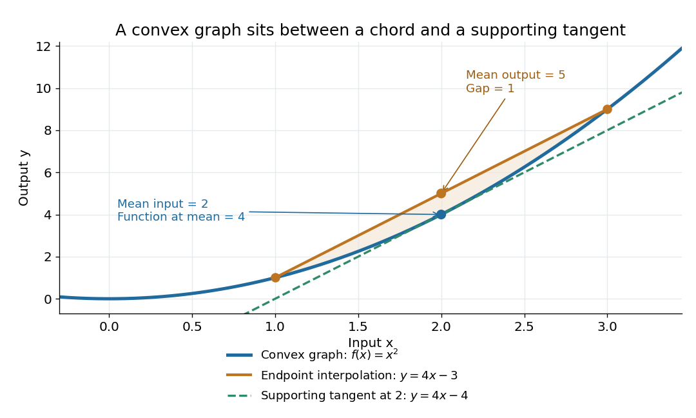

**[Figure 24](#image-the-graph-of-a-convex-quadratic-lies-below-its-endpoint-interpolation-and-above-its-supporting-tangent). The graph of a convex quadratic lies below its endpoint interpolation and above its supporting tangent**. For $f(x)=x^2$, the [line segment](convex-set.md#line-segment) through $(1,1)$ and $(3,9)$ has height $5$ at $x=2$, while the [graph of a function](function.md#graph-of-a-function) has height $4$. The [tangent line](calculus.md#tangent-line) $y=4x-4$ is an [affine minorant](#affine-minorant): $x^2-(4x-4)=(x-2)^2\geq0$ everywhere.

For a [differentiable](analysis.md#differentiable-function) [convex function](#convex-function), the [tangent line](calculus.md#tangent-line) in one dimension, or the corresponding supporting [affine function](vector-space.md#affine-function) in several dimensions, lies below the entire [graph of a function](function.md#graph-of-a-function). This is the [subgradient inequality](#subgradient-inequality). The equivalent geometric statement is that the [epigraph](calculus-of-variations.md#epigraph), consisting of points on or above the [graph of a function](function.md#graph-of-a-function), is a [convex set](convex-set.md). These characterizations are developed in [Boyd and Vandenberghe's convex-function slides, sections 3.1–3.4](https://stanford.edu/~boyd/cvxbook/bv_cvxslides.pdf).

[Convexity](#convex-function) does not require [differentiability](analysis.md#differentiability): the [absolute value function](#absolute-value) $|x|$ is a [convex function](#convex-function) with a corner at $0$. When a [function](function.md) is twice continuously [differentiable](analysis.md#differentiable-function) on an open [interval](#interval-mathematics), it is a [convex function](#convex-function) exactly when its [second derivative](calculus.md#second-derivative) is nonnegative throughout that [interval](#interval-mathematics). In several dimensions, the corresponding criterion on an open [convex set](convex-set.md) is that its [Hessian matrix](multivariable-calculus.md#hessian-matrix) is [positive semidefinite](quadratic-form.md#positive-semidefinite-matrix) everywhere. The [domain of a function](function.md#domain-of-a-function) matters: $x^3$ is a [convex function](#convex-function) on $[0,\infty)$, but not on all of $\mathbb R$. A strictly positive [second derivative](calculus.md#second-derivative) is sufficient for [strict convexity](#strictly-convex-function), but is not necessary: $x^4$ is a [strictly convex function](#strictly-convex-function) although its [second derivative](calculus.md#second-derivative) vanishes at $0$.

The usefulness of [convexity](#convex-function) is that local information can certify a global conclusion. Every [local minimum](analysis.md#local-minimum) of a [convex function](#convex-function) on a [convex set](convex-set.md) is a [global minimum](analysis.md#global-minimum): if a lower value existed elsewhere, the defining [inequality](arithmetic.md#inequality-mathematics) would produce lower values arbitrarily close to the proposed [local minimum](analysis.md#local-minimum). For a [differentiable](analysis.md#differentiable-function) [convex function](#convex-function) on an open [convex set](convex-set.md), a zero [gradient](multivariable-calculus.md#gradient) therefore certifies a [global minimum](analysis.md#global-minimum). [Strict convexity](#strictly-convex-function) gives uniqueness when a [global minimum](analysis.md#global-minimum) exists; it does not supply existence by itself. These facts explain the role of [convex functions](#convex-function) in [convex optimization](convex-optimization.md).

### Convex envelope

↑ **Parent:** [Convex function](#convex-function)

The greatest [convex function](#convex-function) lying below a given function, when such an envelope is considered in the specified domain. A [convex combination](convex-set.md#convex-combination) of phase compositions and their [Gibbs free energies](thermodynamic-potential.md#gibbs-free-energy) constructs candidate mixtures; the equilibrium free energy is their lower [convex envelope](#convex-envelope). For two differentiable coexisting branches, the supporting line is a [common tangent](calculus.md#common-tangent).

### Finite convex function as supremum of affine minorants

↑ **Parent:** [Convex function](#convex-function)

For a finite real [convex function](#convex-function) on an entire real [vector space](vector-space.md), apply the [convex domination form of the Hahn-Banach theorem](functional-analysis.md#convex-domination-form-of-the-hahn-banach-theorem) to $\phi(y+z)-\phi(y)$ and the zero functional on $\{0\}$. It supplies a [linear functional](dual-space.md#linear-functional) $\ell_y$ dominated by this translated function. The [affine function](vector-space.md#affine-function) $a_y(x)=\phi(y)+\ell_y(x-y)$ lies below $\phi$ everywhere and equals it at $y$. Taking the supremum proves the formula. These are algebraic affine minorants; continuity requires additional topological hypotheses.

### Essential smoothness of a convex function

↑ **Parent:** [Convex function](#convex-function)

An extended-real [convex function](#convex-function) $\Lambda:\mathbb R^d\to\mathbb R\cup\{+\infty\}$ is [essentially smooth](#essential-smoothness-of-a-convex-function) if its effective domain has nonempty interior, it is differentiable throughout that interior, and $\|\nabla\Lambda(\theta_n)\|\to\infty$ whenever interior points converge to a finite boundary point of the domain. A differentiable [convex function](#convex-function) finite on all of $\mathbb R^d$ satisfies the boundary condition vacuously. The [cumulant-generating function](probability-distribution.md#cumulant-generating-function) $\log(r/(r-\theta))$ on $\theta<r$ has derivative $(r-\theta)^{-1}$ and is [essentially smooth](#essential-smoothness-of-a-convex-function). Restricting its domain to $\theta<\lambda<r$ destroys this property. This distinction matters in the lower bounds of the [Gärtner–Ellis theorem](convergence-of-random-variables.md#gartner-ellis-theorem).

### Convex quadratic function

↑ **Parent:** [Convex function](#convex-function)

A [convex quadratic function](#convex-quadratic-function) on $\mathbb R^n$ has the form $q(x)=\tfrac12x^THx+b^Tx+c$ with a symmetric [positive semidefinite matrix](quadratic-form.md#positive-semidefinite-matrix) $H$. Its Hessian is $H$, and $q(y)-q(x)-\nabla q(x)\cdot(y-x)=\tfrac12(y-x)^TH(y-x)\geq0$, proving convexity directly. A stationary point is a global minimum. On a compact polytope, a minimum either is stationary in the interior or minimizes a restriction to a boundary face.

### Bounded convex functions are locally Lipschitz on an open ball

↑ **Parent:** [Convex function](#convex-function)

Let a real [convex function](#convex-function) satisfy $|f|\leq M$ on the open unit ball of a [normed space](normed-vector-space.md). For $4r=1-\|x\|$, points $u,v\in B(x,r)$ satisfy $|f(u)-f(v)|\leq(M/r)\|u-v\|$. Extend the segment from $u$ through $v$ to length $2r$; its endpoint still lies in the domain, and [convexity](#convex-function) bounds the difference by $2M\|u-v\|/(2r)$. Reverse $u,v$ for the opposite inequality. Unlike finite-dimensional local continuity theorems, this argument applies in arbitrary dimension because boundedness on a full neighborhood is assumed.

### Negative part of a finite convex function is Lipschitz

↑ **Parent:** [Convex function](#convex-function)

For a finite [convex function](#convex-function) $f:\mathbb R\to\mathbb R$, its negative part $f^-=\max(-f,0)$ is globally [Lipschitz continuous](#lipschitz-continuity). The negative sublevel set is an interval. If bounded, local Lipschitz continuity of finite convex functions bounds the slopes on its closure. If it is a left ray, any negative slope there would force $f$ positive far to the left by the supporting-line inequality; all slopes on that ray are therefore nonnegative and bounded above near its finite endpoint. For a right ray the analogous slopes are nonpositive and bounded below. If $f$ is negative everywhere, convexity and boundedness above force it to be constant. These cases bound the slopes of $f^-$ globally, including its zero extension outside the interval. In particular, integrability of $f(Z)$ implies integrability of the negative part of every fixed translate $f(Z+x)$.

### Affine minorant

↑ **Parent:** [Convex function](#convex-function)

An affine minorant of $f$ is a function $x\mapsto\langle a,x\rangle+b$ that is everywhere at most $f(x)$. Every proper lower-semicontinuous [convex function](#convex-function) has such a minorant, by separating a point below its closed [epigraph](calculus-of-variations.md#epigraph). Adding a positive quadratic then yields a [coercive function](#coercive-function), which establishes existence in proximal minimization.

### Proper convex function

↑ **Parent:** [Convex function](#convex-function)  
ⓦ [Wiki](https://en.wikipedia.org/wiki/Proper_convex_function)

A proper convex function is both a [convex function](#convex-function) and a [proper extended-real function](#proper-extended-real-function). For example, the [total variation seminorm on a domain](inverse-problem.md#total-variation-seminorm-on-a-domain) is nonnegative, finite at zero, and a supremum of linear functionals, making it proper and convex.

### Operator convex function

↑ **Parent:** [Convex function](#convex-function)  
ⓦ [Wiki](https://en.wikipedia.org/wiki/Operator_convex_function)

A real function $f$ on an interval $I$ is operator convex when

$$
f(\lambda A+(1-\lambda)B)
\leq\lambda f(A)+(1-\lambda)f(B)
$$

in the [Loewner order](quadratic-form.md#loewner-order) for all [Hermitian operators](hilbert-space.md#hermitian-operator) $A,B$ with spectra in $I$ and every $0\leq\lambda\leq1$.

#### Operator concave function

↑ **Parent:** [Operator convex function](#operator-convex-function)

A function is operator concave when its negative is [operator convex](#operator-convex-function). Equivalently, the defining operator-convexity inequality is reversed.

### Continuity of a convex function

↑ **Parent:** [Convex function](#convex-function)

A finite convex function on an open convex subset of a finite-dimensional real vector space is locally Lipschitz, and therefore [continuous](calculus.md#continuous-function). In one dimension this follows by bounding its secant slopes between two slightly wider endpoints.

### Pointwise maximum of convex functions

↑ **Parent:** [Convex function](#convex-function)

The pointwise maximum of finitely many convex functions is convex because

$$
\max_i f_i(tx+(1-t)y)
\leq t\max_i f_i(x)+(1-t)\max_i f_i(y).
$$

### Softplus

↑ **Parent:** [Convex function](#convex-function)  
ⓦ [Wiki](https://en.wikipedia.org/wiki/Softplus)

The softplus function $s(x)=\log(1+e^x)$ is convex because

$$
s''(x)=\frac{e^x}{(1+e^x)^2}>0.
$$

### Absolute value

↑ **Parent:** [Convex function](#convex-function)  
ⓦ [Wiki](https://en.wikipedia.org/wiki/Absolute_value)

The absolute value function is convex by the triangle inequality:

$$
|tx+(1-t)y|\leq t|x|+(1-t)|y|.
$$

For a real number $x$, its [absolute value](#absolute-value) is $x$ when $x\geq0$ and $-x$ otherwise; for a complex number $z$, it is the nonnegative magnitude $\sqrt{z\overline z}$.

#### Absolute value at a simple zero

↑ **Parent:** [Absolute value](#absolute-value)

Suppose a real function $g$ is differentiable at $a$, with $g(a)=0$ and $g'(a)\ne0$. The [derivative](calculus.md#derivative) definition gives $g(a+h)=g'(a)h+o(|h|)$. The [reverse triangle inequality](topological-analysis.md#reverse-triangle-inequality) then implies

$$
|g(a+h)|=|g'(a)|\,|h|+o(|h|).
$$

Thus $|g|$ has unequal [one-sided derivatives](calculus.md#one-sided-derivative), $|g'(a)|$ on the right and $-|g'(a)|$ on the left. More generally, multiplication by a function $w$ continuous at $a$ with $w(a)\ne0$ gives right and left slopes $w(a)|g'(a)|$ and $-w(a)|g'(a)|$. This elementary expansion explains how a smooth oscillation can acquire infinitely many corners under the [absolute value function](#absolute-value), even after multiplication by a factor that makes it differentiable at an accumulation point.

#### Summable absolute-value cusp series

↑ **Parent:** [Absolute value](#absolute-value)

Let the locations $a_n$ be distinct and bounded, and let $c_n>0$ with $\sum_nc_n<\infty$. The [Weierstrass M-test](probability-and-statistics.md#weierstrass-m-test) gives locally [uniform convergence](sequence-and-series.md#uniform-convergence) of $G$, so the [uniform limit theorem](sequence-and-series.md#uniform-limit-theorem) makes it [continuous](calculus.md#continuous-function). The [reverse triangle inequality](topological-analysis.md#reverse-triangle-inequality) bounds each term's [difference quotient](calculus.md#difference-quotient) by $c_n$. Consequently a uniformly small tail permits passing each one-sided difference-quotient limit through the series. At every point outside the locations, $G'(x)=\sum_nc_n\operatorname{sgn}(x-a_n)$; at $a_m$, the right derivative minus the left derivative is $2c_m>0$. Thus the function has precisely the prescribed cusp locations, even when they accumulate at another point where the function remains [differentiable](analysis.md#differentiable-function).

### Strongly convex function

↑ **Parent:** [Convex function](#convex-function)

A differentiable function is $\alpha$-strongly convex when

$$
f(y)\geq f(x)+\nabla f(x)\cdot(y-x)
+\frac\alpha2\|y-x\|^2.
$$

#### Uniformly convex variational integrand

↑ **Parent:** [Strongly convex function](#strongly-convex-function)

A gradient integrand is uniformly convex in this elliptic variational sense when its [Hessian matrix](multivariable-calculus.md#hessian-matrix) in the gradient variables has a common positive lower bound. Then $(F_p(x,p)-F_p(x,q))\cdot(p-q)\geq\lambda|p-q|^2$. Averaging $F_{pp}$ along a line segment in gradient space preserves the same lower bound.

##### Interior gradient regularity for uniformly convex autonomous energies

↑ **Parent:** [Uniformly convex variational integrand](#uniformly-convex-variational-integrand)

For scalar minimizers of $\int F(Du)$ with $F\in C^2(\mathbb R^n)$ and globally bounded uniformly positive [Hessian matrix](multivariable-calculus.md#hessian-matrix), no higher differentiability of $F$ is needed for interior gradient Hölder continuity. The weak Euler-Lagrange equation is $\operatorname{div}DF(Du)=0$. Difference quotients solve uniformly elliptic equations with coefficient matrices obtained by averaging $D^2F$ along gradient segments. The [Caccioppoli inequality](partial-differential-equation.md#caccioppoli-inequality) and difference quotient characterization give $u\in H^2_{\mathrm{loc}}$. The [Sobolev chain rule](distribution-theory.md#sobolev-chain-rule) then gives $\operatorname{div}(D^2F(Du)D(D_ku))=0$. The [De Giorgi-Nash-Moser theorem](elliptic-boundary-value-problem.md#de-giorgi-nash-moser-theorem) makes each derivative Hölder continuous, with exponent depending only on dimension and the ellipticity ratio. This scalar conclusion should not be assumed for vector-valued elliptic systems.

##### Uniqueness for uniformly convex gradient Dirichlet problems

↑ **Parent:** [Uniformly convex variational integrand](#uniformly-convex-variational-integrand)

On a bounded domain, classical solutions continuous on the closure have difference $w=u-v$ satisfying $D_i(A_{ij}D_jw)=0$, where $A=\int_0^1F_{pp}(x,Dv+tDw)\,dt$. The coefficients are uniformly elliptic and locally smooth. Apply the [weak maximum principle](elliptic-boundary-value-problem.md#weak-maximum-principle-for-elliptic-operators) on inner domains whose closures lie in the original domain, then let their boundary distances tend to zero. The common continuous boundary values make their boundary differences tend uniformly to zero, proving uniqueness without assuming global bounds on derivatives of the linearized coefficients.

### Strictly convex function

↑ **Parent:** [Convex function](#convex-function)

A function $f$ on a [convex set](convex-set.md) is strictly convex when

$$
f(tx+(1-t)y)<tf(x)+(1-t)f(y)
$$

whenever $x\ne y$ and $0<t<1$.

#### Uniqueness of a minimizer of a strictly convex function

↑ **Parent:** [Strictly convex function](#strictly-convex-function)

A strictly convex function has at most one minimizer: if distinct points attained the same minimum, every strict convex combination of them would have a smaller value.

### Convexity domain of x cubed plus y cubed plus Axy

↑ **Parent:** [Convex function](#convex-function)

The [Hessian matrix](multivariable-calculus.md#hessian-matrix) of

$$
f(x,y)=x^3+y^3+Axy
$$

is positive semidefinite exactly when

$$
x\geq0,\qquad y\geq0,\qquad 36xy\geq A^2.
$$

This region is convex: for $A\ne0$ it is the epigraph of $A^2/(36x)$ in the positive quadrant, and for $A=0$ it is the closed first quadrant.

### Perspective function

↑ **Parent:** [Convex function](#convex-function)  
ⓦ [Wiki](https://en.wikipedia.org/wiki/Perspective_function)

The perspective of f is g(t,x)=t f(x/t) for positive t and preserves convexity.

### Subgradient

↑ **Parent:** [Convex function](#convex-function)

A subgradient of a [convex function](#convex-function) $f$ at $x$ is a vector $g$ such that $f(y)\geq f(x)+g^T(y-x)$ for every $y$ in the domain.

#### Continuous supporting functional for a locally bounded convex function

↑ **Parent:** [Subgradient](#subgradient)

A real [convex function](#convex-function) locally bounded on an open [convex set](convex-set.md) has a continuous supporting [linear functional](dual-space.md#linear-functional) at every interior point. Apply the dominated [Hahn-Banach theorem](functional-analysis.md#hahn-banach-theorem) to its sublinear [directional derivative](multivariable-calculus.md#directional-derivative) $p_x$ to obtain $l\leq p_x$. Increasing secant slopes imply $p_x(z)\leq f(x+z)-f(x)$ whenever the endpoint is in the domain. A local [Lipschitz continuity](#lipschitz-continuity) bound gives both $l(y)\leq L\|y\|$ and $-l(y)=l(-y)\leq L\|y\|$, proving continuity.

#### Subgradient optimality condition

↑ **Parent:** [Subgradient](#subgradient)

A proper convex function $f$ is minimized at $x$ exactly when $0\in\partial f(x)$. For a differentiable convex term $g$ and another convex term $h$, the [subdifferential sum rule](convex-optimization.md#subdifferential-sum-rule) gives the condition $0\in\nabla g(x)+\partial h(x)$.

#### Subgradient of the absolute value

↑ **Parent:** [Subgradient](#subgradient)

The [absolute value function](#absolute-value) has

$$
\partial|x|=
\begin{cases}
\{\operatorname{sgn}x\},&x\ne0,\\
[-1,1],&x=0.
\end{cases}
$$

#### Subgradient inequality

↑ **Parent:** [Subgradient](#subgradient)  
ⓦ [Wiki](https://en.wikipedia.org/wiki/Subgradient_inequality)

A vector is a subgradient when its supporting affine function lies below the convex function.

<h3 id="jensen-s-inequality">Jensen's inequality</h3>

↑ **Parent:** [Convex function](#convex-function)  
ⓦ [Wiki](https://en.wikipedia.org/wiki/Jensen's_inequality)

[Jensen's inequality](#jensen-s-inequality) says that applying a [convex function](#convex-function) to a [weighted mean](arithmetic.md#weighted-arithmetic-mean) cannot exceed the same [weighted mean](arithmetic.md#weighted-arithmetic-mean) of its outputs. For nonnegative weights $w_i$ with $\sum_{i=1}^n w_i=1$ and inputs $x_i$ in a [convex set](convex-set.md),

$$
f\left(\sum_{i=1}^n w_i x_i\right)\leq\sum_{i=1}^n w_i f(x_i).
$$

Nonnegative weights are essential: this is a [convex combination](convex-set.md#convex-combination), rather than an arbitrary [affine combination](geometry-and-topology.md#affine-combination). For two inputs it is precisely the defining [inequality](arithmetic.md#inequality-mathematics) for a [convex function](#convex-function); repeatedly grouping inputs gives the finite weighted version.

Take $f(x)=x^2$, weights $1/4$ and $3/4$, and inputs $1$ and $3$. Their [weighted mean](arithmetic.md#weighted-arithmetic-mean) is $2.5$, so the two sides are

$$
f(2.5)=6.25\leq\tfrac14 f(1)+\tfrac34 f(3)=7.
$$

**The Jensen gap is $0.75$.** The [inequality](arithmetic.md#inequality-mathematics) measures the effect of replacing distinct inputs by one representative input before applying a nonlinear [function](function.md).

The probabilistic form uses an [integrable random variable](expected-value.md#integrable-random-variable) $X$ taking values in an [interval](#interval-mathematics) where $f$ is a [convex function](#convex-function). If $f(X)$ is also an [integrable random variable](expected-value.md#integrable-random-variable) and $\mathbb E X$ belongs to that [interval](#interval-mathematics), then

$$
f(\mathbb E X)\leq\mathbb E[f(X)].
$$

The direction reverses for a [concave function](#concave-function). For a [strictly convex function](#strictly-convex-function), equality in the finite weighted form requires all inputs having positive weight to be equal; in the probabilistic form it requires $X$ to be constant [almost surely](convergence-of-random-variables.md#almost-sure-convergence). An [affine function](vector-space.md#affine-function) gives equality for any admissible distribution. [Boyd and Vandenberghe's slides, section 3.14, state the expectation form](https://stanford.edu/~boyd/cvxbook/bv_cvxslides.pdf).

For the [quadratic function](polynomial.md#quadratic-function) $f(x)=x^2$ and a [random variable](random-variable.md) with a finite [second moment](expected-value.md#second-moment), the difference between the two sides is exactly its [variance](variance.md):

$$
\mathbb E[X^2]-(\mathbb E X)^2=\operatorname{Var}(X)\geq0.
$$

Consider two equally likely values $2-d$ and $2+d$. Their [expected value](expected-value.md) stays at $2$ as $d$ increases, but their [variance](variance.md) is $d^2$. Thus the [expected value](expected-value.md) of the square grows from $4$ to $4+d^2$. For the [exponential function](calculus.md#exponential-function), the same two-point distribution gives $\mathbb E[e^X]=e^2\cosh d$, while $e^{\mathbb E X}=e^2$. Both are examples of [Jensen's inequality](#jensen-s-inequality), but their [Jensen gaps](#jensen-gap) depend differently on the spread of the inputs.

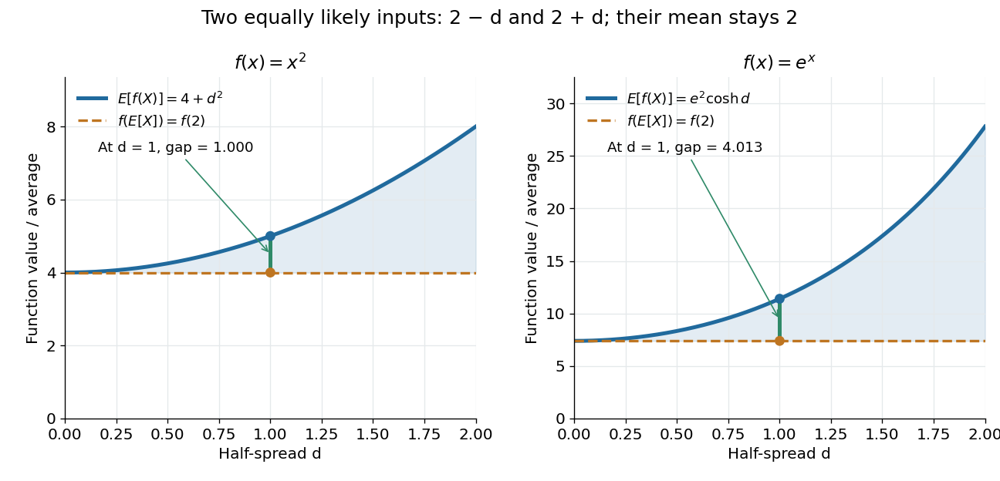

**[Figure 25](#image-keeping-the-mean-fixed-while-spreading-the-inputs-increases-the-average-of-these-convex-functions). Keeping the mean fixed while spreading the inputs increases the average of these convex functions**. The [random variable](random-variable.md) takes $2-d$ and $2+d$ with equal [probability](probability-theory.md#probability). The [quadratic function](polynomial.md#quadratic-function) produces a [Jensen gap](#jensen-gap) of $d^2$, exactly the [variance](variance.md). The [exponential function](calculus.md#exponential-function) produces a [Jensen gap](#jensen-gap) of $e^2(\cosh d-1)$, involving the [hyperbolic cosine](calculus.md#hyperbolic-cosine). The horizontal reference in each panel applies the [function](function.md) directly to the unchanged [expected value](expected-value.md) $2$.

Another useful choice is the [concave function](#concave-function) $\log x$ on positive inputs. Its version of [Jensen's inequality](#jensen-s-inequality) gives $\sum_iw_i\log x_i\leq\log(\sum_iw_ix_i)$. Applying the increasing [exponential function](calculus.md#exponential-function) shows that the weighted [geometric mean](arithmetic.md#geometric-mean) cannot exceed the weighted [arithmetic mean](arithmetic.md#arithmetic-mean). For the equally weighted inputs $1$ and $9$, these are $3$ and $5$. This recovers the [arithmetic-geometric mean inequality](mathematical-optimization.md#arithmetic-geometric-mean-inequality) and illustrates how choosing one [function](function.md) can generate an entire family of bounds.

A short proof idea explains the probabilistic form. If $f$ has a [subgradient](#subgradient) $g$ at $\mu=\mathbb E X$, the supporting [affine function](vector-space.md#affine-function) gives $f(X)\geq f(\mu)+g(X-\mu)$. Taking the [expected value](expected-value.md) cancels the linear term because $\mathbb E[X-\mu]=0$. This argument applies, for example, to finite [convex functions](#convex-function) on $\mathbb R$; more general [domains of a function](function.md#domain-of-a-function) need attention to endpoints and the existence of a [subgradient](#subgradient).

[Johan Jensen](mathematics.md#johan-jensen)'s 1906 paper “Sur les fonctions convexes et les inégalités entre les valeurs moyennes” is an early source for the connection between [convex functions](#convex-function) and inequalities for [means](expected-value.md). [Jensen's original article and publication record, DOI 10.1007/BF02418571](https://zenodo.org/records/2371297).

#### Jensen gap

↑ **Parent:** [Jensen's inequality](#jensen-s-inequality)

The [Jensen gap](#jensen-gap) is the nonnegative difference $\mathbb E[f(X)]-f(\mathbb E X)$ in [Jensen's inequality](#jensen-s-inequality), under its [integrability](measure-theory.md#integrability) assumptions. It quantifies how much applying a [convex function](#convex-function) before averaging differs from applying it afterward. For $f(x)=x^2$ it is the [variance](variance.md) of $X$; for an [affine function](vector-space.md#affine-function) it is zero. For general [convex functions](#convex-function), it depends on both the [function](function.md) and the distribution of $X$, and is not determined by the [variance](variance.md) alone.

#### Sharp two-term convex power bound

↑ **Parent:** [Jensen's inequality](#jensen-s-inequality)

Apply [Jensen's inequality](#jensen-s-inequality) to the two equally weighted values $a,b$ and the [convex function](#convex-function) $t\mapsto t^p$. Equality for $a=b>0$ proves that $2^{p-1}$ is the smallest possible constant. For $p>1$, strict convexity makes equality equivalent to $a=b$; for $p=1$, equality holds for every pair.

## Concave function

↑ **Parent:** [Real analysis](real-analysis.md)  
ⓦ [Wiki](https://en.wikipedia.org/wiki/Concave_function)

A function $f$ is concave exactly when $-f$ is [convex](#convex-function). Equivalently,

$$
f(tx+(1-t)y)\geq tf(x)+(1-t)f(y)
$$

for $0\leq t\leq1$.

### Extrema of a concave power sum on a simplex

↑ **Parent:** [Concave function](#concave-function)

For $0<c<1$ on the [probability simplex](algebraic-topology.md#probability-simplex), $x_i^c\geq x_i$ gives the lower bound, with equality exactly at its vertices. Strict concavity and the [Jensen inequality](#jensen-s-inequality) give the upper bound, with equality exactly at the uniform point $x_i=1/n$. Thus the boundary can minimize a strictly concave objective, while its unique maximum lies at the symmetric interior point; a Lagrange-multiplier calculation alone would miss the boundary minimum.

### Strictly increasing concave function

↑ **Parent:** [Concave function](#concave-function)

Let a differentiable [concave function](#concave-function) on all of $\mathbb R^d$ be strictly increasing in each coordinate separately. Every coordinate derivative is strictly positive. Indeed it is nonnegative by monotonicity and nonincreasing along its coordinate by [concavity](#concave-function); a zero value would force zero derivative on the remaining positive ray and hence a constant segment. The global-domain assumption matters at endpoints of restricted domains.

### Concave supporting-tangent inequality

↑ **Parent:** [Concave function](#concave-function)

For a differentiable [concave](#concave-function) function, secant slopes lie below the tangent slope at their left endpoint and above the tangent slope at their right endpoint. This gives the displayed inequality for either order of $x,y$. It converts a first-order optimality relation into a global utility bound. Strict [concavity](#concave-function) makes equality possible only at $x=y$, on the differentiability domain.

### Concave majorant

↑ **Parent:** [Concave function](#concave-function)

A concave majorant of $F$ is a [concave function](#concave-function) lying everywhere above $F$ on the specified domain. The least concave majorant, when it exists, is the pointwise smallest such function. A common tangent can replace an upward derivative kink by a linear segment joining two contact points.

### Strictly concave function

↑ **Parent:** [Concave function](#concave-function)

A function is strictly concave when its concavity inequality is strict for distinct points and coefficients strictly between zero and one. A strictly concave function has at most one maximizer on a convex set.

#### Strict concavity

↑ **Parent:** [Strictly concave function](#strictly-concave-function)

Strict concavity is the displayed property for distinct $x,y$ in a [convex set](convex-set.md) and $0<t<1$. It makes a stationary point of a [differentiable function](analysis.md#differentiable-function) its unique global maximum, whenever such a stationary point exists.

##### Positive-product maximization on a convex set

↑ **Parent:** [Strict concavity](#strict-concavity)

A compact convex subset of $\mathbb R^2$ meeting the positive quadrant has a unique positive point maximizing $xy$. Existence follows by maximizing the continuous product on the intersection with the closed nonnegative quadrant; a positive attainable value excludes its axes. Uniqueness follows from strict concavity of $\log x+\log y$ on the positive quadrant. This is a useful way to optimize a product even though the product itself is not concave.

#### Uniform negative curvature and global maximization

↑ **Parent:** [Strictly concave function](#strictly-concave-function)

If a twice differentiable real [function](function.md) on $\mathbb R$ satisfies $f''(x)\le-c$ for some fixed $c>0$, then it has a unique [global maximum](function.md#global-maximum). The [mean value theorem](calculus.md#mean-value-theorem) shows that $f'$ is strictly decreasing, and that $f'(x)+cx$ is nonincreasing. Hence $f'(x)\le f'(0)-cx$ for $x>0$ and $f'(x)\ge f'(0)-cx$ for $x<0$. These inequalities force opposite derivative signs at the two ends. The [intermediate value theorem](calculus.md#intermediate-value-theorem) supplies a unique zero of $f'$, at which $f$ changes from increasing to decreasing. Merely having $f''<0$ does not guarantee existence: $f(x)=-e^{-x}$ is increasing and approaches its unattained supremum zero.

#### Product maximizer on a compact convex subset of the positive orthant

↑ **Parent:** [Strictly concave function](#strictly-concave-function)

On the positive orthant,

$$
F(x)=\sum_{j=1}^n\log x_j
$$

is strictly concave. Its unique maximizer $x^*$ on a compact convex feasible set satisfies the first-order inequality

$$
\nabla F(x^*)\cdot(x-x^*)\leq0,
$$

equivalently

$$
\sum_{j=1}^n\frac{x_j}{x_j^*}\leq n.
$$

## Measure theory

↑ **Parent:** [Real analysis](real-analysis.md)

[This section is present in another page, follow this link to view it.](measure-theory.md)

## ↑ Ancestors (4)

1. [Analysis](analysis.md)
2. [Area of mathematics](mathematics.md#area-of-mathematics)
3. [Mathematics](mathematics.md)
4. [Codex Wiki](README.md)

## ← Incoming links (3)

- [Analytic number theory](analytic-number-theory.md)
- [Camille Jordan](mathematics.md#camille-jordan)
- [History of total variation of a function](#history-of-total-variation-of-a-function)
