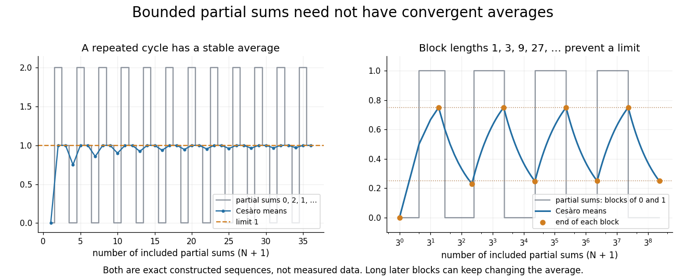
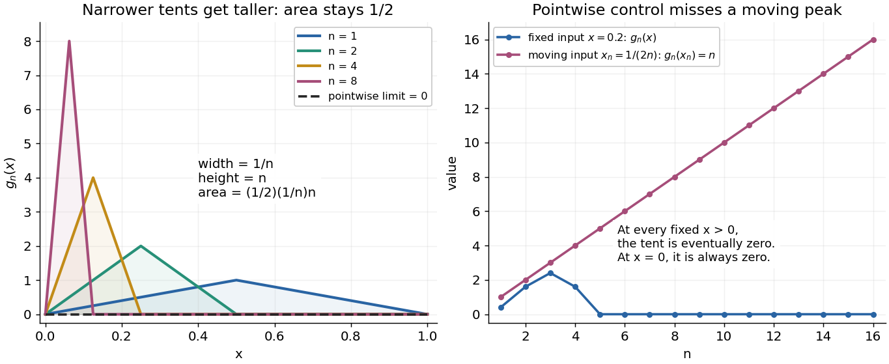
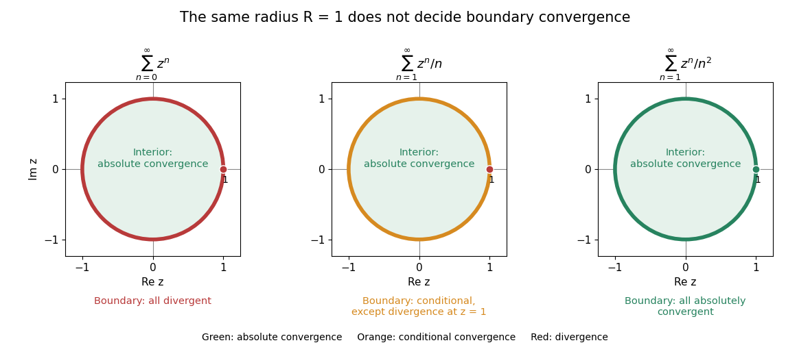
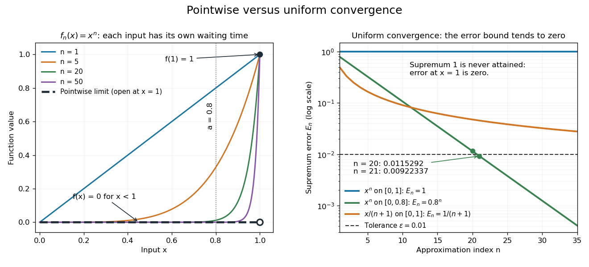
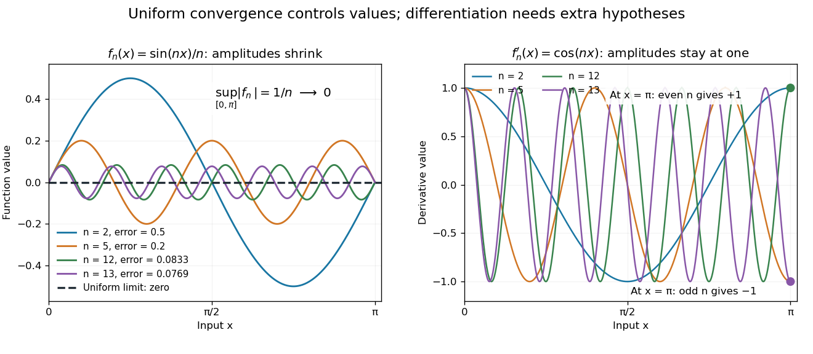
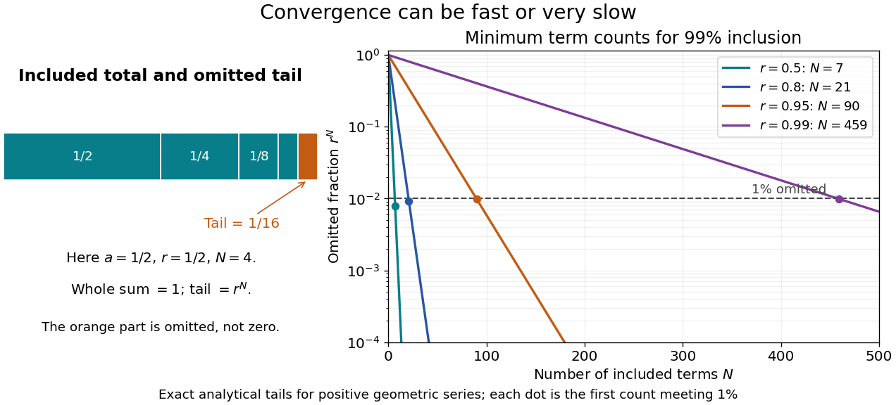

# Real analysis

↑ **Parent:** [Analysis](analysis.md)  
ⓦ [Wiki](https://en.wikipedia.org/wiki/Real_analysis)

Real analysis studies [limits](calculus.md#limit-of-a-function), [continuity](calculus.md#continuous-function), [differentiation](calculus.md#differentiation), [integration](calculus.md#integral), and convergence of [sequences](#sequence) and [functions](function.md) taking values in the [real numbers](arithmetic.md#real-number). Its central question is how finite approximations determine an exact answer: what does an arbitrarily small error mean, and which operations respect that error? A [derivative](calculus.md#derivative) is a [limit](calculus.md#limit-of-a-function) of quotients, while a [Riemann integral](#riemann-integral) is obtained from increasingly fine [Riemann sums](#riemann-sum). Both need conditions that make the answer independent of the approximations chosen.

Two organizing ideas are [completeness of the real numbers](#completeness-of-the-real-numbers), which ensures that suitable approximations have a destination, and [uniform convergence](#uniform-convergence), which controls approximation error over an entire domain. [Pointwise convergence](#pointwise-convergence) supplies separate guarantees at separate inputs; [uniform convergence](#uniform-convergence) supplies one guarantee for all inputs. This distinction explains why replacing an approximating [function](function.md) by its [limit](calculus.md#limit-of-a-function) can preserve [continuity](calculus.md#continuous-function) or [integrals](calculus.md#integral) under appropriate hypotheses, yet fail without them.

For historical context, Cauchy's 1821 _Cours d'analyse_ explicitly discusses convergence of [series](#series-mathematics). Its Note VII treats double [series](#series-mathematics) and compares summing by rows and by columns under stated convergence assumptions: controlling an infinite process was already a concrete problem. This is historical context for questions about [limits](calculus.md#limit-of-a-function), rather than an attribution of the modern definitions below. [Cauchy, Cours d'analyse (1821), Note VII, pp. 537–539, original scan](https://www.e-rara.ch/download/pdf/8543076.pdf).

**Table of contents**

- [Hardy's inequality](#hardy-s-inequality)
- [Infimum and supremum](#infimum-and-supremum)
  - [Essential infimum and essential supremum](#essential-infimum-and-essential-supremum)
    - [Essential infimum](#essential-infimum)
  - [Supremum](#supremum)
    - [Approximation property of a supremum](#approximation-property-of-a-supremum)
    - [Accumulation below an unattained supremum](#accumulation-below-an-unattained-supremum)
  - [Infimum](#infimum)
    - [Approximation property of an infimum](#approximation-property-of-an-infimum)
- [Asymptotic analysis](#asymptotic-analysis)
  - [Asymptotic equivalence](#asymptotic-equivalence)
    - [Asymptotic comparison of exponential functions](#asymptotic-comparison-of-exponential-functions)
    - [Stirling formula](#stirling-formula)
      - [Robbins bounds for Stirling's formula](#robbins-bounds-for-stirling-s-formula)
      - [Gaussian peak behind Stirling's formula](#gaussian-peak-behind-stirling-s-formula)
      - [Stirling correction by Gaussian moments](#stirling-correction-by-gaussian-moments)
- [Monotone integral Tauberian lemma](#monotone-integral-tauberian-lemma)
- [Homogeneous function](#homogeneous-function)
  - [Homogeneity](#homogeneity)
  - [Positively homogeneous function (degree one)](#positively-homogeneous-function-degree-one)
  - [Euler theorem for homogeneous functions](#euler-theorem-for-homogeneous-functions)
    - [Euler differential identity characterizes homogeneity](#euler-differential-identity-characterizes-homogeneity)
    - [Volume integral of a homogeneous function](#volume-integral-of-a-homogeneous-function)
- [Regular variation](#regular-variation)
  - [Slowly varying function](#slowly-varying-function)
- [Lipschitz continuity](#lipschitz-continuity)
  - [Bi-Lipschitz map](#bi-lipschitz-map)
  - [Bounded Lipschitz norm](#bounded-lipschitz-norm)
    - [Diagonal compactness for bounded Lipschitz functions](#diagonal-compactness-for-bounded-lipschitz-functions)
    - [Pointwise closure of the bounded Lipschitz unit ball](#pointwise-closure-of-the-bounded-lipschitz-unit-ball)
  - [One-sided Lipschitz condition](#one-sided-lipschitz-condition)
  - [Lipschitz domain](#lipschitz-domain)
  - [McShane extension theorem](#mcshane-extension-theorem)
  - [Lipschitz constant](#lipschitz-constant)
  - [Globally Lipschitz function](#globally-lipschitz-function)
  - [Lipschitz bound](#lipschitz-bound)
  - [Locally Lipschitz function](#locally-lipschitz-function)
- [Big O notation](#big-o-notation)
  - [Little o notation](#little-o-notation)
  - [Big theta notation](#big-theta-notation)
  - [Uniform big O bound](#uniform-big-o-bound)
- [Real line](#real-line)
  - [Interval (mathematics)](#interval-mathematics)
    - [Nested intervals](#nested-intervals)
      - [Nested interval theorem](#nested-interval-theorem)
    - [Closed real interval](#closed-real-interval)
      - [Compact interval](#compact-interval)
- [Extreme value theorem](#extreme-value-theorem)
  - [Interior-value criterion for an attained maximum](#interior-value-criterion-for-an-attained-maximum)
  - [Supremum can fail to be attained at an oscillatory endpoint](#supremum-can-fail-to-be-attained-at-an-oscillatory-endpoint)
- [Coercive function](#coercive-function)
  - [Range of a continuous coercive real function](#range-of-a-continuous-coercive-real-function)
- [Lp norm](#lp-norm)
  - [L-infinity norm](#l-infinity-norm)
    - [Essentially bounded function](#essentially-bounded-function)
  - [Lq quasi-norm](#lq-quasi-norm)
  - [Minkowski inequality](#minkowski-inequality)
    - [Minkowski inequality for finite vectors](#minkowski-inequality-for-finite-vectors)
    - [Equality in Minkowski inequality](#equality-in-minkowski-inequality)
    - [Minkowski inequality for error aggregation](#minkowski-inequality-for-error-aggregation)
    - [Failure of Minkowski inequality below exponent one](#failure-of-minkowski-inequality-below-exponent-one)
  - [L2 norm](#l2-norm)
  - [Marcinkiewicz–Zygmund inequality](#marcinkiewicz-zygmund-inequality)
  - [Hölder's inequality](#holder-s-inequality)
- [Sequence and series](#sequence-and-series)
  - [Dyadic-block alternation of reciprocal terms](#dyadic-block-alternation-of-reciprocal-terms)
  - [Lucas number](#lucas-number)
  - [Sequence](#sequence)
    - [Periodic sequence](#periodic-sequence)
    - [Tail of a sequence](#tail-of-a-sequence)
    - [Limit inferior and limit superior](#limit-inferior-and-limit-superior)
      - [Limit inferior](#limit-inferior)
    - [Recurrence relation](#recurrence-relation)
      - [Difference equation](#difference-equation)
    - [Thue–Morse sequence](#thue-morse-sequence)
      - [Thue–Morse Fourier product](#thue-morse-fourier-product)
        - [Uniform interval cancellation for binary digit parity](#uniform-interval-cancellation-for-binary-digit-parity)
          - [Small Type I sums for binary digit parity](#small-type-i-sums-for-binary-digit-parity)
    - [Cluster-set matching of bounded sequences](#cluster-set-matching-of-bounded-sequences)
    - [Fejér monotonicity](#fejer-monotonicity)
    - [Finite repetition-free sequence](#finite-repetition-free-sequence)
    - [Subadditive sequence](#subadditive-sequence)
      - [Asymmetrically almost-subadditive sequence](#asymmetrically-almost-subadditive-sequence)
    - [Geometric progression](#geometric-progression)
      - [Common ratio](#common-ratio)
    - [Subsequence](#subsequence)
      - [Subsequential limit](#subsequential-limit)
      - [Monotone subsequence theorem](#monotone-subsequence-theorem)
    - [Null sequence](#null-sequence)
    - [Bounded sequence](#bounded-sequence)
      - [Bounded subsequence](#bounded-subsequence)
    - [Bitstream](#bitstream)
      - [Uncountability by interleaving prescribed binary coordinates](#uncountability-by-interleaving-prescribed-binary-coordinates)
    - [Monotone sequence](#monotone-sequence)
      - [Minimum-decrement convergence criterion](#minimum-decrement-convergence-criterion)
      - [Bounded nondecreasing rational sequences are uncountable](#bounded-nondecreasing-rational-sequences-are-uncountable)
      - [Bounded nondecreasing integer sequences are eventually constant](#bounded-nondecreasing-integer-sequences-are-eventually-constant)
      - [Bounded monotone sequence theorem](#bounded-monotone-sequence-theorem)
        - [Increasing and decreasing approximations to a common limit](#increasing-and-decreasing-approximations-to-a-common-limit)
        - [Attainment of the limit of a monotone sequence](#attainment-of-the-limit-of-a-monotone-sequence)
        - [Assumptions of the bounded monotone sequence theorem](#assumptions-of-the-bounded-monotone-sequence-theorem)
        - [Error bounds for bounded monotone sequences](#error-bounds-for-bounded-monotone-sequences)
          - [Bounded monotone sequences have no universal convergence rate](#bounded-monotone-sequences-have-no-universal-convergence-rate)
    - [Limit superior](#limit-superior)
      - [Sparse peaks can determine a limit superior](#sparse-peaks-can-determine-a-limit-superior)
  - [Series (mathematics)](#series-mathematics)
    - [Divergent series](#divergent-series)
    - [Summation method](#summation-method)
      - [Regular summation method](#regular-summation-method)
      - [Cesàro summation](#cesaro-summation)
        - [Weighted partial sums for Cesàro summation](#weighted-partial-sums-for-cesaro-summation)
        - [Grandi's series](#grandi-s-series)
        - [First-order Cesàro summation of a geometric series](#first-order-cesaro-summation-of-a-geometric-series)
        - [Cesàro sum](#cesaro-sum)
        - [Bounded partial sums need not be Cesàro summable](#bounded-partial-sums-need-not-be-cesaro-summable)
        - [Alternating integers have no first-order Cesàro sum](#alternating-integers-have-no-first-order-cesaro-sum)
    - [Factorial series](#factorial-series)
      - [Irrationality criterion for factorial series](#irrationality-criterion-for-factorial-series)
    - [Polynomial-logarithmic series convergence](#polynomial-logarithmic-series-convergence)
    - [Root test](#root-test)
    - [Telescoping series](#telescoping-series)
      - [Tail of a telescoping reciprocal series](#tail-of-a-telescoping-reciprocal-series)
    - [Term test for divergence](#term-test-for-divergence)
    - [Infinite product](#infinite-product)
      - [Reciprocal geometric infinite product](#reciprocal-geometric-infinite-product)
      - [Weierstrass elementary factor](#weierstrass-elementary-factor)
      - [Infinite product convergence from logarithmic tails](#infinite-product-convergence-from-logarithmic-tails)
      - [Positive sum-product convergence criterion](#positive-sum-product-convergence-criterion)
      - [Hyperbolic-sine infinite product](#hyperbolic-sine-infinite-product)
    - [Lattice sum](#lattice-sum)
    - [Partial sum](#partial-sum)
    - [Kronecker lemma](#kronecker-lemma)
    - [Harmonic series](#harmonic-series)
      - [Alternating harmonic series](#alternating-harmonic-series)
    - [Cauchy condensation test](#cauchy-condensation-test)
  - [Fekete's lemma](#fekete-s-lemma)
  - [Bolzano-Weierstrass theorem](#bolzano-weierstrass-theorem)
    - [Extended real subsequence theorem](#extended-real-subsequence-theorem)
    - [Diagonal subsequence argument](#diagonal-subsequence-argument)
    - [Unique subsequential limit of a bounded sequence](#unique-subsequential-limit-of-a-bounded-sequence)
  - [Convergent sequence](#convergent-sequence)
    - [Bounded sequence with vanishing increments need not converge](#bounded-sequence-with-vanishing-increments-need-not-converge)
    - [Limit of a sequence](#limit-of-a-sequence)
      - [Reciprocal limits and escape in absolute value](#reciprocal-limits-and-escape-in-absolute-value)
    - [Cesàro mean](#cesaro-mean)
      - [Cesàro theorem for convergent sequences](#cesaro-theorem-for-convergent-sequences)
    - [Geometric mean of a sequence](#geometric-mean-of-a-sequence)
    - [Monotone bounded sequence](#monotone-bounded-sequence)
  - [Fibonacci number](#fibonacci-number)
    - [Fibonacci recurrence matrix modulo an integer](#fibonacci-recurrence-matrix-modulo-an-integer)
    - [Fibonacci addition formula](#fibonacci-addition-formula)
      - [Fibonacci gcd reduction](#fibonacci-gcd-reduction)
    - [Binet formula](#binet-formula)
    - [Fibonacci determinant identity](#fibonacci-determinant-identity)
  - [Pointwise convergence](#pointwise-convergence)
    - [Factorial cosine iterated limit detects rationality](#factorial-cosine-iterated-limit-detects-rationality)
    - [Shrinking continuous spikes with vanishing integral](#shrinking-continuous-spikes-with-vanishing-integral)
    - [Pointwise limit](#pointwise-limit)
  - [Power series](#power-series)
    - [Geometric power-series remainder](#geometric-power-series-remainder)
    - [Generating function](#generating-function)
      - [Exponential generating function](#exponential-generating-function)
    - [Lacunary power series](#lacunary-power-series)
      - [Factorial-gap power series](#factorial-gap-power-series)
    - [Binomial series](#binomial-series)
      - [Negative binomial series](#negative-binomial-series)
    - [Majorant series](#majorant-series)
    - [Radius of convergence](#radius-of-convergence)
      - [Boundary convergence of a power series](#boundary-convergence-of-a-power-series)
      - [Bounded power-series terms force interior absolute convergence](#bounded-power-series-terms-force-interior-absolute-convergence)
      - [Sum of power series with unequal radii of convergence](#sum-of-power-series-with-unequal-radii-of-convergence)
      - [Terms of a power series are unbounded outside its convergence disc](#terms-of-a-power-series-are-unbounded-outside-its-convergence-disc)
      - [Radius of convergence of a sparse power series](#radius-of-convergence-of-a-sparse-power-series)
      - [Polynomial-coefficient power series](#polynomial-coefficient-power-series)
      - [Polynomial coefficient growth with unit power-series radius](#polynomial-coefficient-growth-with-unit-power-series-radius)
      - [Cauchy-Hadamard theorem](#cauchy-hadamard-theorem)
      - [Radius of convergence after powering coefficients](#radius-of-convergence-after-powering-coefficients)
      - [Half-plane of convergence of an exponential power series](#half-plane-of-convergence-of-an-exponential-power-series)
    - [Cauchy product](#cauchy-product)
    - [Termwise differentiation of a power series](#termwise-differentiation-of-a-power-series)
    - [Leading Taylor term](#leading-taylor-term)
  - [Uniform convergence](#uniform-convergence)
    - [Supremum error](#supremum-error)
    - [Uniformly vanishing functions can retain a nonzero integral](#uniformly-vanishing-functions-can-retain-a-nonzero-integral)
    - [Uniform convergence preserves integrals on a compact interval](#uniform-convergence-preserves-integrals-on-a-compact-interval)
    - [Uniform convergence at moving evaluation points](#uniform-convergence-at-moving-evaluation-points)
    - [Uniform derivative convergence with an anchored value](#uniform-derivative-convergence-with-an-anchored-value)
    - [Egorov's theorem](#egorov-s-theorem)
    - [Uniform limit theorem](#uniform-limit-theorem)
    - [Dini's theorem](#dini-s-theorem)
    - [Uniformly Cauchy sequence](#uniformly-cauchy-sequence)
    - [Locally uniform convergence](#locally-uniform-convergence)
      - [Compact-open topology](#compact-open-topology)
        - [Weighted metric for local uniform convergence](#weighted-metric-for-local-uniform-convergence)
      - [Local uniform convergence on compact subsets](#local-uniform-convergence-on-compact-subsets)
  - [Geometric series](#geometric-series)
    - [Remainder of a geometric series](#remainder-of-a-geometric-series)
    - [Iterated contraction gives a summable orbit](#iterated-contraction-gives-a-summable-orbit)
    - [Finite geometric series](#finite-geometric-series)
      - [Finite trigonometric sum](#finite-trigonometric-sum)
      - [Exponential geometric sum bound](#exponential-geometric-sum-bound)
  - [Cauchy sequence](#cauchy-sequence)
    - [Tail diameter of a sequence](#tail-diameter-of-a-sequence)
    - [Summable increments imply a Cauchy sequence](#summable-increments-imply-a-cauchy-sequence)
    - [Convergence from arbitrary variable-lag increments](#convergence-from-arbitrary-variable-lag-increments)
    - [Cauchy subsequence](#cauchy-subsequence)
    - [Completeness of the real numbers](#completeness-of-the-real-numbers)
      - [Dedekind cut](#dedekind-cut)
      - [Least-upper-bound property](#least-upper-bound-property)
  - [Conditional convergence](#conditional-convergence)
    - [Riemann series theorem](#riemann-series-theorem)
      - [Rearrangement of a series](#rearrangement-of-a-series)
    - [Alternating series test](#alternating-series-test)
  - [P-series](#p-series)
  - [Absolute convergence](#absolute-convergence)
    - [Squares of a summable positive sequence](#squares-of-a-summable-positive-sequence)
    - [Geometric means of two summable positive sequences](#geometric-means-of-two-summable-positive-sequences)
    - [Weighted square roots of a summable sequence](#weighted-square-roots-of-a-summable-sequence)
  - [Total variation](#total-variation)
    - [Total generalized variation](#total-generalized-variation)
      - [TGV divergence splitting](#tgv-divergence-splitting)
  - [Harmonic sum](#harmonic-sum)
  - [Convergent series](#convergent-series)
    - [Convergence from fixed-length series blocks](#convergence-from-fixed-length-series-blocks)
    - [Dirichlet test](#dirichlet-test)
    - [Comparison test for series](#comparison-test-for-series)
      - [Ratio comparison test](#ratio-comparison-test)
      - [Clipping preserves divergence of a positive series](#clipping-preserves-divergence-of-a-positive-series)
      - [Integral test for convergence](#integral-test-for-convergence)
        - [Integral comparison for a nonincreasing nonnegative function](#integral-comparison-for-a-nonincreasing-nonnegative-function)
    - [Summable sequence](#summable-sequence)
    - [Limit comparison test](#limit-comparison-test)
    - [Ratio test](#ratio-test)
      - [Power-law comparison from a refined ratio bound](#power-law-comparison-from-a-refined-ratio-bound)
      - [Ratio limit implies root limit](#ratio-limit-implies-root-limit)
      - [Factorial-over-power series](#factorial-over-power-series)
  - [Uniform limit](#uniform-limit)
- [Calculus](calculus.md)
  - [Differential calculus](calculus.md#differential-calculus)
  - [Floor and ceiling functions](calculus.md#floor-and-ceiling-functions)
    - [Integer count in a closed interval](calculus.md#integer-count-in-a-closed-interval)
    - [Floor function](calculus.md#floor-function)
      - [Fractional part](calculus.md#fractional-part)
    - [Ceiling function](calculus.md#ceiling-function)
      - [Ceiling count for fixed-size batches](calculus.md#ceiling-count-for-fixed-size-batches)
    - [Truncation toward zero](calculus.md#truncation-toward-zero)
  - [Integral](calculus.md#integral)
    - [Average value of a function](calculus.md#average-value-of-a-function)
    - [Linearity of integration](calculus.md#linearity-of-integration)
    - [Signed area under a graph](calculus.md#signed-area-under-a-graph)
      - [Total geometric area under a graph](calculus.md#total-geometric-area-under-a-graph)
    - [Definite integral](calculus.md#definite-integral)
      - [Distance traveled from velocity](calculus.md#distance-traveled-from-velocity)
    - [Wallis integrals](calculus.md#wallis-integrals)
    - [Dipole line-integral identity](calculus.md#dipole-line-integral-identity)
    - [Integrand](calculus.md#integrand)
    - [Multiple integral](calculus.md#multiple-integral)
      - [Odd-integrand cancellation by reflection](calculus.md#odd-integrand-cancellation-by-reflection)
    - [Integral representation](calculus.md#integral-representation)
      - [Trigonometric integral](calculus.md#trigonometric-integral)
        - [Cosine integral](calculus.md#cosine-integral)
        - [Sine integral](calculus.md#sine-integral)
    - [Lebesgue integration](calculus.md#lebesgue-integration)
      - [Prékopa–Leindler inequality](calculus.md#prekopa-leindler-inequality)
      - [Absolute continuity of the Lebesgue integral](calculus.md#absolute-continuity-of-the-lebesgue-integral)
    - [Time integral](calculus.md#time-integral)
    - [Double integral](calculus.md#double-integral)
    - [Monotonicity of the Lebesgue integral](calculus.md#monotonicity-of-the-lebesgue-integral)
    - [Antiderivative](calculus.md#antiderivative)
      - [Constant of integration](calculus.md#constant-of-integration)
        - [Antiderivatives on disconnected domains](calculus.md#antiderivatives-on-disconnected-domains)
      - [Additive constant](calculus.md#additive-constant)
    - [Gaussian integral](calculus.md#gaussian-integral)
      - [Polar-coordinate proof of the Gaussian integral](calculus.md#polar-coordinate-proof-of-the-gaussian-integral)
      - [Linear-source multivariate Gaussian integral](calculus.md#linear-source-multivariate-gaussian-integral)
      - [Dawson function](calculus.md#dawson-function)
        - [Gaussian drift primitives](calculus.md#gaussian-drift-primitives)
      - [Error function](calculus.md#error-function)
        - [Quadrant asymptotics of the error function](calculus.md#quadrant-asymptotics-of-the-error-function)
        - [Complementary error function](calculus.md#complementary-error-function)
          - [Faddeeva function](calculus.md#faddeeva-function)
            - [Gaussian pole integral](calculus.md#gaussian-pole-integral)
  - [Taylor polynomial](calculus.md#taylor-polynomial)
    - [Multivariate Taylor polynomial](calculus.md#multivariate-taylor-polynomial)
  - [Exponential function](calculus.md#exponential-function)
    - [Exponential growth](calculus.md#exponential-growth)
      - [Doubling time](calculus.md#doubling-time)
    - [e (mathematical constant)](calculus.md#e-mathematical-constant)
      - [Compounding limit for e](calculus.md#compounding-limit-for-e)
      - [Irrationality of e](calculus.md#irrationality-of-e)
    - [Exponential series](calculus.md#exponential-series)
    - [Complex exponential function](calculus.md#complex-exponential-function)
      - [Modulus of the complex exponential](calculus.md#modulus-of-the-complex-exponential)
      - [Complex sine function](calculus.md#complex-sine-function)
        - [Periodicity of the complex sine](calculus.md#periodicity-of-the-complex-sine)
    - [Logarithm](calculus.md#logarithm)
      - [Geometric-series bound for the logarithmic remainder](calculus.md#geometric-series-bound-for-the-logarithmic-remainder)
      - [Irrational logarithm criterion](calculus.md#irrational-logarithm-criterion)
      - [Concavity of the logarithm](calculus.md#concavity-of-the-logarithm)
      - [Logarithmic integral function](calculus.md#logarithmic-integral-function)
      - [Natural logarithm](calculus.md#natural-logarithm)
      - [Logarithmic scale](calculus.md#logarithmic-scale)
      - [Logarithm inequality](calculus.md#logarithm-inequality)
      - [Operator monotonicity of logarithm](calculus.md#operator-monotonicity-of-logarithm)
    - [Gaussian function](calculus.md#gaussian-function)
      - [Gaussian decay dominates every power](calculus.md#gaussian-decay-dominates-every-power)
      - [Gaussian dyadic summation bound](calculus.md#gaussian-dyadic-summation-bound)
    - [Hyperbolic function](calculus.md#hyperbolic-function)
      - [Hyperbolic angle](calculus.md#hyperbolic-angle)
      - [Inverse hyperbolic functions](calculus.md#inverse-hyperbolic-functions)
      - [Hyperbolic cosine](calculus.md#hyperbolic-cosine)
        - [Catenary from hyperbolic cosine](calculus.md#catenary-from-hyperbolic-cosine)
        - [Factorial-tail irrationality proof for a hyperbolic cosine](calculus.md#factorial-tail-irrationality-proof-for-a-hyperbolic-cosine)
        - [Inverse hyperbolic cosine](calculus.md#inverse-hyperbolic-cosine)
      - [Hyperbolic sine](calculus.md#hyperbolic-sine)
      - [Hyperbolic cotangent](calculus.md#hyperbolic-cotangent)
        - [Partial-fraction expansion of the hyperbolic cotangent](calculus.md#partial-fraction-expansion-of-the-hyperbolic-cotangent)
      - [Hyperbolic secant](calculus.md#hyperbolic-secant)
  - [Fundamental theorem of calculus](calculus.md#fundamental-theorem-of-calculus)
    - [Fundamental theorem of calculus for Lebesgue integration](calculus.md#fundamental-theorem-of-calculus-for-lebesgue-integration)
  - [Mean value theorem](calculus.md#mean-value-theorem)
    - [Cauchy mean value theorem](calculus.md#cauchy-mean-value-theorem)
    - [Endpoint secant-tangent approximation](calculus.md#endpoint-secant-tangent-approximation)
  - [Rolle theorem](calculus.md#rolle-theorem)
    - [Rolle root count with multiplicities](calculus.md#rolle-root-count-with-multiplicities)
  - [Taylor's theorem](calculus.md#taylor-s-theorem)
    - [Taylor expansion from a periodic derivative equation](calculus.md#taylor-expansion-from-a-periodic-derivative-equation)
    - [Integral first-order Taylor formula for a vector map](calculus.md#integral-first-order-taylor-formula-for-a-vector-map)
    - [Integral remainder in Taylor theorem](calculus.md#integral-remainder-in-taylor-theorem)
      - [Logarithmic series from an integral Taylor remainder](calculus.md#logarithmic-series-from-an-integral-taylor-remainder)
    - [Taylor expansion](calculus.md#taylor-expansion)
      - [Peano zero](calculus.md#peano-zero)
      - [Parabolic approximation](calculus.md#parabolic-approximation)
    - [Taylor formula for a polynomial](calculus.md#taylor-formula-for-a-polynomial)
    - [Taylor theorem with Lagrange remainder](calculus.md#taylor-theorem-with-lagrange-remainder)
    - [Taylor remainder](calculus.md#taylor-remainder)
    - [Taylor formula with integral remainder](calculus.md#taylor-formula-with-integral-remainder)
    - [Taylor series](calculus.md#taylor-series)
      - [Maclaurin series](calculus.md#maclaurin-series)
  - [Limit of a function](calculus.md#limit-of-a-function)
    - [One-sided limit](calculus.md#one-sided-limit)
    - [Continuous function](calculus.md#continuous-function)
      - [Blancmange curve](calculus.md#blancmange-curve)
      - [Bounded continuous functions](calculus.md#bounded-continuous-functions)
      - [Upper semicontinuity](calculus.md#upper-semicontinuity)
      - [Oscillation multiplied by a vanishing amplitude](calculus.md#oscillation-multiplied-by-a-vanishing-amplitude)
      - [Lower semicontinuity](calculus.md#lower-semicontinuity)
      - [Discontinuity of a function](calculus.md#discontinuity-of-a-function)
        - [Removable discontinuity](calculus.md#removable-discontinuity)
        - [Jump discontinuity](calculus.md#jump-discontinuity)
      - [Sequential lower semicontinuity](calculus.md#sequential-lower-semicontinuity)
        - [Sublevel set](calculus.md#sublevel-set)
          - [Compact sublevel set](calculus.md#compact-sublevel-set)
        - [Closed-sublevel-set characterization of lower semicontinuity](calculus.md#closed-sublevel-set-characterization-of-lower-semicontinuity)
      - [Locally constant function](calculus.md#locally-constant-function)
        - [Compactly supported locally constant function](calculus.md#compactly-supported-locally-constant-function)
      - [Intermediate value theorem](calculus.md#intermediate-value-theorem)
        - [Intermediate value theorem hypotheses and counterexamples](calculus.md#intermediate-value-theorem-hypotheses-and-counterexamples)
        - [A cubic root from existence to a quantitative bracket](calculus.md#a-cubic-root-from-existence-to-a-quantitative-bracket)
        - [Nested-bracket proof of the intermediate value theorem](calculus.md#nested-bracket-proof-of-the-intermediate-value-theorem)
        - [Continuous image of a real interval](calculus.md#continuous-image-of-a-real-interval)
        - [Interval order theorem for continuous injections](calculus.md#interval-order-theorem-for-continuous-injections)
        - [Horizontal chord of reciprocal-integer length](calculus.md#horizontal-chord-of-reciprocal-integer-length)
        - [Zero on a line segment](calculus.md#zero-on-a-line-segment)
        - [Telescoping increment lemma](calculus.md#telescoping-increment-lemma)
        - [Continuous bijection of the real line is monotone](calculus.md#continuous-bijection-of-the-real-line-is-monotone)
      - [Composition of continuous functions](calculus.md#composition-of-continuous-functions)
      - [Continuity set of a function](calculus.md#continuity-set-of-a-function)
      - [Right-continuous function](calculus.md#right-continuous-function)
        - [Càdlàg](calculus.md#cadlag)
      - [Uniformly continuous function](calculus.md#uniformly-continuous-function)
        - [Decay of a nonnegative uniformly continuous integrable function](calculus.md#decay-of-a-nonnegative-uniformly-continuous-integrable-function)
    - [Squeeze theorem](calculus.md#squeeze-theorem)
  - [Derivative](calculus.md#derivative)
    - [Local linear approximation](calculus.md#local-linear-approximation)
    - [Symmetric second derivative](calculus.md#symmetric-second-derivative)
    - [Symmetric second differences detect an affine corner](calculus.md#symmetric-second-differences-detect-an-affine-corner)
    - [Symmetric first-order differences remove an affine corner](calculus.md#symmetric-first-order-differences-remove-an-affine-corner)
    - [Vanishing symmetric second derivative forces an affine function](calculus.md#vanishing-symmetric-second-derivative-forces-an-affine-function)
    - [One-sided derivative](calculus.md#one-sided-derivative)
    - [Tangent line](calculus.md#tangent-line)
    - [Automatic differentiation](calculus.md#automatic-differentiation)
    - [Differentiation](calculus.md#differentiation)
    - [Second derivative](calculus.md#second-derivative)
    - [Difference quotient](calculus.md#difference-quotient)
      - [Discrete integration by parts](calculus.md#discrete-integration-by-parts)
    - [Total derivative](calculus.md#total-derivative)
    - [L'Hôpital's rule](calculus.md#l-hopital-s-rule)
      - [Derivative quotient limits on partial domains](calculus.md#derivative-quotient-limits-on-partial-domains)
    - [Darboux's theorem (analysis)](calculus.md#darboux-s-theorem-analysis)
      - [Intermediate secant slope from endpoint derivatives](calculus.md#intermediate-secant-slope-from-endpoint-derivatives)
    - [Product rule](calculus.md#product-rule)
      - [Differentiability restored by a quadratic zero](calculus.md#differentiability-restored-by-a-quadratic-zero)
      - [Leibniz rule](calculus.md#leibniz-rule)
      - [Nondifferentiable factor with a differentiable nondegenerate product](calculus.md#nondifferentiable-factor-with-a-differentiable-nondegenerate-product)
    - [Quotient rule](calculus.md#quotient-rule)
    - [Chain rule](calculus.md#chain-rule)
      - [Linear approximation](calculus.md#linear-approximation)
      - [Multivariable chain rule](calculus.md#multivariable-chain-rule)
        - [Derivative along a curve](calculus.md#derivative-along-a-curve)
      - [Nondifferentiable inner function with a differentiable nondegenerate composite](calculus.md#nondifferentiable-inner-function-with-a-differentiable-nondegenerate-composite)
      - [Second derivative chain rule](calculus.md#second-derivative-chain-rule)
  - [Monotonic function](calculus.md#monotonic-function)
    - [Derivative criterion for monotonicity](calculus.md#derivative-criterion-for-monotonicity)
    - [Monotone mean-value point of an integral average](calculus.md#monotone-mean-value-point-of-an-integral-average)
    - [Nonincreasing function](calculus.md#nonincreasing-function)
    - [Non-strict inverse of a continuous nondecreasing function](calculus.md#non-strict-inverse-of-a-continuous-nondecreasing-function)
    - [Left-continuous cumulative function of an atomic measure](calculus.md#left-continuous-cumulative-function-of-an-atomic-measure)
    - [Nondecreasing function](calculus.md#nondecreasing-function)
    - [Strict generalized inverse of a nondecreasing function](calculus.md#strict-generalized-inverse-of-a-nondecreasing-function)
    - [Strictly increasing function](calculus.md#strictly-increasing-function)
      - [Continuity of an increasing interval surjection](calculus.md#continuity-of-an-increasing-interval-surjection)
    - [Strictly decreasing function](calculus.md#strictly-decreasing-function)
    - [Lebesgue theorem on differentiability of monotone functions](calculus.md#lebesgue-theorem-on-differentiability-of-monotone-functions)
  - [Multivariable calculus](calculus.md#multivariable-calculus)
    - [Volume integral](calculus.md#volume-integral)
    - [Fundamental theorem of calculus along a line segment](calculus.md#fundamental-theorem-of-calculus-along-a-line-segment)
    - [Partial derivative](calculus.md#partial-derivative)
      - [Partial derivatives do not imply continuity](calculus.md#partial-derivatives-do-not-imply-continuity)
      - [Mixed partial derivative](calculus.md#mixed-partial-derivative)
        - [Unequal mixed partial derivatives](calculus.md#unequal-mixed-partial-derivatives)
        - [Symmetry of second derivatives](calculus.md#symmetry-of-second-derivatives)
      - [Time derivative](calculus.md#time-derivative)
      - [Spatial derivative](calculus.md#spatial-derivative)
      - [Directional derivative](calculus.md#directional-derivative)
        - [Directional derivatives do not imply differentiability](calculus.md#directional-derivatives-do-not-imply-differentiability)
        - [Directional derivative of a convex function is sublinear](calculus.md#directional-derivative-of-a-convex-function-is-sublinear)
      - [Gradient](calculus.md#gradient)
        - [Gradient of a dot product](calculus.md#gradient-of-a-dot-product)
        - [Gradient field](calculus.md#gradient-field)
      - [Total differential](calculus.md#total-differential)
    - [Hessian matrix](calculus.md#hessian-matrix)
      - [Quadratic growth from a bounded Hessian](calculus.md#quadratic-growth-from-a-bounded-hessian)
      - [Higher-order test for separated extrema](calculus.md#higher-order-test-for-separated-extrema)
      - [Negative semidefinite matrix](calculus.md#negative-semidefinite-matrix)
      - [Second-derivative test](calculus.md#second-derivative-test)
        - [Critical points escaping to infinity in a Gaussian-weighted bilinear function](calculus.md#critical-points-escaping-to-infinity-in-a-gaussian-weighted-bilinear-function)
      - [Nondegenerate critical point](calculus.md#nondegenerate-critical-point)
    - [Vector calculus](calculus.md#vector-calculus)
      - [Vector Analysis (book)](calculus.md#vector-analysis-book)
      - [Dot-product gradient identity](calculus.md#dot-product-gradient-identity)
      - [Helmholtz decomposition](calculus.md#helmholtz-decomposition)
      - [Divergence of a cross product](calculus.md#divergence-of-a-cross-product)
      - [Vector field](calculus.md#vector-field)
        - [Flow of a vector field](calculus.md#flow-of-a-vector-field)
        - [Time-dependent vector field](calculus.md#time-dependent-vector-field)
          - [Finite-time flow completeness on a compact manifold](calculus.md#finite-time-flow-completeness-on-a-compact-manifold)
        - [Radial dilation tangency to homogeneous zero sets](calculus.md#radial-dilation-tangency-to-homogeneous-zero-sets)
        - [Divergence and curl of a radial vector field](calculus.md#divergence-and-curl-of-a-radial-vector-field)
        - [Azimuthal inverse-radius vector field](calculus.md#azimuthal-inverse-radius-vector-field)
        - [Integral curve of a vector field](calculus.md#integral-curve-of-a-vector-field)
          - [Curvature of an integral curve of a vector field](calculus.md#curvature-of-an-integral-curve-of-a-vector-field)
        - [Axisymmetric vector field](calculus.md#axisymmetric-vector-field)
        - [Solenoidal vector field](calculus.md#solenoidal-vector-field)
          - [Poloidal-toroidal decomposition](calculus.md#poloidal-toroidal-decomposition)
            - [Poloidal magnetic energy bound by the radial scalar gradient](calculus.md#poloidal-magnetic-energy-bound-by-the-radial-scalar-gradient)
      - [Spherically symmetric function](calculus.md#spherically-symmetric-function)
      - [Helicity conservation by tangent boundary conditions](calculus.md#helicity-conservation-by-tangent-boundary-conditions)
      - [Divergence](calculus.md#divergence)
        - [Divergence of a Riemannian vector field](calculus.md#divergence-of-a-riemannian-vector-field)
        - [Cylindrically radial divergence](calculus.md#cylindrically-radial-divergence)
        - [Distributional divergence](calculus.md#distributional-divergence)
        - [Divergence in polar coordinates](calculus.md#divergence-in-polar-coordinates)
        - [Product rule for divergence](calculus.md#product-rule-for-divergence)
        - [Total divergence](calculus.md#total-divergence)
        - [Divergence of a curl is zero](calculus.md#divergence-of-a-curl-is-zero)
      - [Curl](calculus.md#curl)
        - [Curl of a gradient](calculus.md#curl-of-a-gradient)
        - [Irrotational vector field](calculus.md#irrotational-vector-field)
        - [Vector potential](calculus.md#vector-potential)
          - [Radial vector potential of a solenoidal vector field](calculus.md#radial-vector-potential-of-a-solenoidal-vector-field)
        - [Curl of the curl identity](calculus.md#curl-of-the-curl-identity)
      - [Laplacian](calculus.md#laplacian)
        - [Laplacian in polar coordinates](calculus.md#laplacian-in-polar-coordinates)
        - [Product rule for the Laplacian](calculus.md#product-rule-for-the-laplacian)
        - [Biharmonic operator](calculus.md#biharmonic-operator)
          - [Clamped biharmonic problem](calculus.md#clamped-biharmonic-problem)
          - [Biharmonic equation](calculus.md#biharmonic-equation)
            - [Spherical mean of a biharmonic function](calculus.md#spherical-mean-of-a-biharmonic-function)
      - [Divergence and curl of a cross product](calculus.md#divergence-and-curl-of-a-cross-product)
        - [Curl of a cross product](calculus.md#curl-of-a-cross-product)
      - [Levi-Civita symbol](calculus.md#levi-civita-symbol)
        - [Rotation invariance of the Levi-Civita symbol](calculus.md#rotation-invariance-of-the-levi-civita-symbol)
        - [Contraction of two Levi-Civita symbols](calculus.md#contraction-of-two-levi-civita-symbols)
        - [Lagrange identity for the cross product](calculus.md#lagrange-identity-for-the-cross-product)
        - [Triple product](calculus.md#triple-product)
          - [Vector triple product](calculus.md#vector-triple-product)
      - [Feasible inner products with two unit vectors](calculus.md#feasible-inner-products-with-two-unit-vectors)
      - [Conservative vector field](calculus.md#conservative-vector-field)
        - [Integrating-factor equation for a planar vector field](calculus.md#integrating-factor-equation-for-a-planar-vector-field)
        - [Periods obstruct a periodic potential](calculus.md#periods-obstruct-a-periodic-potential)
        - [Potential of a conservative vector field](calculus.md#potential-of-a-conservative-vector-field)
          - [Radial integral potential for a curl-free field](calculus.md#radial-integral-potential-for-a-curl-free-field)
      - [Divergence theorem](calculus.md#divergence-theorem)
        - [Gradient volume-to-boundary identity](calculus.md#gradient-volume-to-boundary-identity)
        - [Vector gradient form of the divergence theorem](calculus.md#vector-gradient-form-of-the-divergence-theorem)
        - [Boundary integral of position and normal components](calculus.md#boundary-integral-of-position-and-normal-components)
        - [An entire bounded vector field cannot have nonzero constant divergence](calculus.md#an-entire-bounded-vector-field-cannot-have-nonzero-constant-divergence)
        - [Riemannian divergence theorem](calculus.md#riemannian-divergence-theorem)
      - [Fundamental theorem for line integrals](calculus.md#fundamental-theorem-for-line-integrals)
        - [Path independence](calculus.md#path-independence)
      - [Stokes theorem](calculus.md#stokes-theorem)
        - [Vector-valued Stokes identity](calculus.md#vector-valued-stokes-identity)
        - [Stokes flux through an annular paraboloid](calculus.md#stokes-flux-through-an-annular-paraboloid)
      - [Surface integral](calculus.md#surface-integral)
        - [Vector surface element of a graph](calculus.md#vector-surface-element-of-a-graph)
        - [Oriented surface element](calculus.md#oriented-surface-element)
        - [Parametrized surface](calculus.md#parametrized-surface)
        - [Surface area of a graph](calculus.md#surface-area-of-a-graph)
        - [Flux integral](calculus.md#flux-integral)
      - [Green theorem](calculus.md#green-theorem)
        - [Boundary formula for planar area](calculus.md#boundary-formula-for-planar-area)
      - [Line integral](calculus.md#line-integral)
      - [Tensor divergence theorem](calculus.md#tensor-divergence-theorem)
        - [Integration by parts for tensor fields](calculus.md#integration-by-parts-for-tensor-fields)
    - [Jacobian matrix and determinant](calculus.md#jacobian-matrix-and-determinant)
      - [Jacobian matrix](calculus.md#jacobian-matrix)
        - [Spatial derivative control in perturbations of the identity map](calculus.md#spatial-derivative-control-in-perturbations-of-the-identity-map)
        - [Jacobian determinant](calculus.md#jacobian-determinant)
          - [Jacobian determinant as a divergence](calculus.md#jacobian-determinant-as-a-divergence)
    - [Change of variables formula](calculus.md#change-of-variables-formula)
      - [Ordered-cone substitution by products and ratios](calculus.md#ordered-cone-substitution-by-products-and-ratios)
      - [Ratio-product coordinates](calculus.md#ratio-product-coordinates)
      - [Squared-radius difference substitution](calculus.md#squared-radius-difference-substitution)
      - [Weighted inverse multiplicity](calculus.md#weighted-inverse-multiplicity)
      - [Rational square diffeomorphism](calculus.md#rational-square-diffeomorphism)
      - [Hyperbolic substitution](calculus.md#hyperbolic-substitution)
      - [Monotone substitution inequality](calculus.md#monotone-substitution-inequality)
      - [Area formula (geometric measure theory)](calculus.md#area-formula-geometric-measure-theory)
      - [Polar coordinates](calculus.md#polar-coordinates)
        - [Cylindrical coordinate system](calculus.md#cylindrical-coordinate-system)
          - [Azimuthal derivative of a cylindrical vector Fourier mode](calculus.md#azimuthal-derivative-of-a-cylindrical-vector-fourier-mode)
          - [Cylindrical radius](calculus.md#cylindrical-radius)
        - [Cardioid](calculus.md#cardioid)
      - [Orthogonal coordinates](calculus.md#orthogonal-coordinates)
        - [Del in cylindrical and spherical coordinates](calculus.md#del-in-cylindrical-and-spherical-coordinates)
        - [Hyperspherical coordinates](calculus.md#hyperspherical-coordinates)
          - [Spherical coordinate system](calculus.md#spherical-coordinate-system)
            - [Radial unit vector in spherical coordinates](calculus.md#radial-unit-vector-in-spherical-coordinates)
            - [Scale factors of orthogonal coordinates](calculus.md#scale-factors-of-orthogonal-coordinates)
            - [Curl in spherical coordinates](calculus.md#curl-in-spherical-coordinates)
          - [Volume of an n-ball](calculus.md#volume-of-an-n-ball)
          - [Surface area of an n-sphere](calculus.md#surface-area-of-an-n-sphere)
    - [Differentiable map](calculus.md#differentiable-map)
      - [Functionally independent functions](calculus.md#functionally-independent-functions)
      - [Derivative of a map into a level set](calculus.md#derivative-of-a-map-into-a-level-set)
      - [Fréchet derivative](calculus.md#frechet-derivative)
        - [Differentiability under equivalent norms](calculus.md#differentiability-under-equivalent-norms)
        - [Hadamard differentiability](calculus.md#hadamard-differentiability)
          - [Hadamard remainder near a compact set](calculus.md#hadamard-remainder-near-a-compact-set)
          - [Stieltjes bilinear functional under a variation constraint](calculus.md#stieltjes-bilinear-functional-under-a-variation-constraint)
        - [Fréchet differentiability](calculus.md#frechet-differentiability)
        - [Derivative of matrix inversion](calculus.md#derivative-of-matrix-inversion)
      - [Continuously differentiable function](calculus.md#continuously-differentiable-function)
      - [Invertible linear map](calculus.md#invertible-linear-map)
      - [Mean value inequality](calculus.md#mean-value-inequality)
        - [Zero derivative on a connected open set](calculus.md#zero-derivative-on-a-connected-open-set)
      - [Inverse function theorem](calculus.md#inverse-function-theorem)
        - [Derivative of a local inverse map](calculus.md#derivative-of-a-local-inverse-map)
        - [Constant rank theorem](calculus.md#constant-rank-theorem)
          - [Rank-one level curves from a characteristic differential equation](calculus.md#rank-one-level-curves-from-a-characteristic-differential-equation)
        - [Local diffeomorphism](calculus.md#local-diffeomorphism)
          - [Noninjective map with constant Jacobian determinant](calculus.md#noninjective-map-with-constant-jacobian-determinant)
          - [Open map](calculus.md#open-map)
        - [Implicit function theorem](calculus.md#implicit-function-theorem)
          - [Holomorphic implicit function theorem](calculus.md#holomorphic-implicit-function-theorem)
          - [Implicit differentiation](calculus.md#implicit-differentiation)
            - [Cyclic partial derivative identity](calculus.md#cyclic-partial-derivative-identity)
  - [Symmetry in integration](calculus.md#symmetry-in-integration)
  - [Integration by parts](calculus.md#integration-by-parts)
    - [Boundary term](calculus.md#boundary-term)
  - [Hyperbolic tangent](calculus.md#hyperbolic-tangent)
    - [Inverse hyperbolic tangent](calculus.md#inverse-hyperbolic-tangent)
    - [Small-argument expansion of the hyperbolic tangent](calculus.md#small-argument-expansion-of-the-hyperbolic-tangent)
    - [Hyperbolic-function identity](calculus.md#hyperbolic-function-identity)
    - [Hyperbolic Pythagorean identity](calculus.md#hyperbolic-pythagorean-identity)
  - [Even function](calculus.md#even-function)
  - [Odd function](calculus.md#odd-function)
    - [Odd extension](calculus.md#odd-extension)
- [Riemann integration](#riemann-integration)
  - [Single-point changes preserve Riemann integrals](#single-point-changes-preserve-riemann-integrals)
  - [Riemann-Stieltjes integral](#riemann-stieltjes-integral)
  - [Quadrature error](#quadrature-error)
  - [Partition of an interval](#partition-of-an-interval)
    - [Partition refinement](#partition-refinement)
    - [Dyadic partition](#dyadic-partition)
      - [Dyadic interval](#dyadic-interval)
        - [Alternating dyadic colouring excludes symmetric weighted pair sums](#alternating-dyadic-colouring-excludes-symmetric-weighted-pair-sums)
  - [Riemann sum](#riemann-sum)
  - [Continuous approximation of a Riemann-integrable function](#continuous-approximation-of-a-riemann-integrable-function)
  - [Total variation of a function](#total-variation-of-a-function)
    - [p-variation of a path](#p-variation-of-a-path)
    - [Dyadic approximation of total variation](#dyadic-approximation-of-total-variation)
    - [Weak convergence of bounded-variation integrators](#weak-convergence-of-bounded-variation-integrators)
    - [Jordan decomposition of a function of bounded variation](#jordan-decomposition-of-a-function-of-bounded-variation)
  - [Riemann integral](#riemann-integral)
    - [Unbounded derivative obstruction to Riemann integrability](#unbounded-derivative-obstruction-to-riemann-integrability)
    - [Weighted mean value theorem for integrals](#weighted-mean-value-theorem-for-integrals)
    - [Direct Riemann integrability](#direct-riemann-integrability)
    - [Improper integral](#improper-integral)
      - [Logarithmic divergence](#logarithmic-divergence)
      - [Improper power integral](#improper-power-integral)
    - [Monotonicity of the Riemann integral](#monotonicity-of-the-riemann-integral)
  - [Riemann integrability criterion](#riemann-integrability-criterion)
    - [Pointwise supremum need not preserve Riemann integrability](#pointwise-supremum-need-not-preserve-riemann-integrability)
    - [Dirichlet function](#dirichlet-function)
    - [Riemann integrability is closed under addition and maximum](#riemann-integrability-is-closed-under-addition-and-maximum)
    - [Bounded functions continuous away from one endpoint are Riemann integrable](#bounded-functions-continuous-away-from-one-endpoint-are-riemann-integrable)
    - [Indicator of a restricted-digit decimal set](#indicator-of-a-restricted-digit-decimal-set)
    - [Riemann integrability from almost full interval coverage](#riemann-integrability-from-almost-full-interval-coverage)
    - [Lipschitz composition preserves Riemann integrability](#lipschitz-composition-preserves-riemann-integrability)
    - [Uniform-mesh Darboux criterion](#uniform-mesh-darboux-criterion)
      - [Finite bad-cell estimate for Darboux sums](#finite-bad-cell-estimate-for-darboux-sums)
    - [Riemann-integrable function](#riemann-integrable-function)
      - [Dense jumps do not prevent Riemann integrability](#dense-jumps-do-not-prevent-riemann-integrability)
    - [Continuous functions are Riemann integrable](#continuous-functions-are-riemann-integrable)
  - [Darboux sum](#darboux-sum)
    - [Oscillation of a function on an interval](#oscillation-of-a-function-on-an-interval)
    - [Darboux sum refinement monotonicity](#darboux-sum-refinement-monotonicity)
    - [Upper Darboux sum](#upper-darboux-sum)
    - [Lower Darboux sum](#lower-darboux-sum)
      - [Exponential bound for a lower-sum product](#exponential-bound-for-a-lower-sum-product)
    - [Upper and lower Darboux integrals](#upper-and-lower-darboux-integrals)
      - [Lower Darboux integral](#lower-darboux-integral)
      - [Upper Darboux integral](#upper-darboux-integral)
  - [Improper integration by truncation](#improper-integration-by-truncation)
    - [First occurrence of a decimal digit](#first-occurrence-of-a-decimal-digit)
- [Convergent subsequence](#convergent-subsequence)
- [Proper extended-real function](#proper-extended-real-function)
  - [Effective domain](#effective-domain)
- [Convex function](#convex-function)
  - [Finite convex function as supremum of affine minorants](#finite-convex-function-as-supremum-of-affine-minorants)
  - [Essential smoothness of a convex function](#essential-smoothness-of-a-convex-function)
  - [Convex quadratic function](#convex-quadratic-function)
  - [Bounded convex functions are locally Lipschitz on an open ball](#bounded-convex-functions-are-locally-lipschitz-on-an-open-ball)
  - [Negative part of a finite convex function is Lipschitz](#negative-part-of-a-finite-convex-function-is-lipschitz)
  - [Affine minorant](#affine-minorant)
  - [Proper convex function](#proper-convex-function)
  - [Operator convex function](#operator-convex-function)
    - [Operator concave function](#operator-concave-function)
  - [Continuity of a convex function](#continuity-of-a-convex-function)
  - [Pointwise maximum of convex functions](#pointwise-maximum-of-convex-functions)
  - [Softplus](#softplus)
  - [Absolute value](#absolute-value)
    - [Absolute value at a simple zero](#absolute-value-at-a-simple-zero)
    - [Summable absolute-value cusp series](#summable-absolute-value-cusp-series)
  - [Strongly convex function](#strongly-convex-function)
    - [Uniformly convex variational integrand](#uniformly-convex-variational-integrand)
      - [Interior gradient regularity for uniformly convex autonomous energies](#interior-gradient-regularity-for-uniformly-convex-autonomous-energies)
      - [Uniqueness for uniformly convex gradient Dirichlet problems](#uniqueness-for-uniformly-convex-gradient-dirichlet-problems)
  - [Strictly convex function](#strictly-convex-function)
    - [Uniqueness of a minimizer of a strictly convex function](#uniqueness-of-a-minimizer-of-a-strictly-convex-function)
  - [Convexity domain of x cubed plus y cubed plus Axy](#convexity-domain-of-x-cubed-plus-y-cubed-plus-axy)
  - [Perspective function](#perspective-function)
  - [Subgradient](#subgradient)
    - [Continuous supporting functional for a locally bounded convex function](#continuous-supporting-functional-for-a-locally-bounded-convex-function)
    - [Subgradient optimality condition](#subgradient-optimality-condition)
    - [Subgradient of the absolute value](#subgradient-of-the-absolute-value)
    - [Subgradient inequality](#subgradient-inequality)
  - [Jensen's inequality](#jensen-s-inequality)
    - [Jensen gap](#jensen-gap)
    - [Sharp two-term convex power bound](#sharp-two-term-convex-power-bound)
- [Concave function](#concave-function)
  - [Extrema of a concave power sum on a simplex](#extrema-of-a-concave-power-sum-on-a-simplex)
  - [Strictly increasing concave function](#strictly-increasing-concave-function)
  - [Concave supporting-tangent inequality](#concave-supporting-tangent-inequality)
  - [Concave majorant](#concave-majorant)
  - [Strictly concave function](#strictly-concave-function)
    - [Strict concavity](#strict-concavity)
      - [Positive-product maximization on a convex set](#positive-product-maximization-on-a-convex-set)
    - [Uniform negative curvature and global maximization](#uniform-negative-curvature-and-global-maximization)
    - [Product maximizer on a compact convex subset of the positive orthant](#product-maximizer-on-a-compact-convex-subset-of-the-positive-orthant)
- [Measure theory](measure-theory.md)
  - [Wiener covering lemma](measure-theory.md#wiener-covering-lemma)
    - [Disjoint ball decomposition modulo null sets](measure-theory.md#disjoint-ball-decomposition-modulo-null-sets)
  - [Geometric measure theory](measure-theory.md#geometric-measure-theory)
    - [Hausdorff measure](measure-theory.md#hausdorff-measure)
      - [Scale-restricted Hausdorff content](measure-theory.md#scale-restricted-hausdorff-content)
      - [Hausdorff dimension](measure-theory.md#hausdorff-dimension)
        - [Mass distribution principle](measure-theory.md#mass-distribution-principle)
        - [Hausdorff dimension of the Cantor set](measure-theory.md#hausdorff-dimension-of-the-cantor-set)
        - [Pressure upper bound for Hausdorff dimension](measure-theory.md#pressure-upper-bound-for-hausdorff-dimension)
        - [Hausdorff dimension of a connected set](measure-theory.md#hausdorff-dimension-of-a-connected-set)
  - [Vector measure](measure-theory.md#vector-measure)
    - [Vector Radon measure](measure-theory.md#vector-radon-measure)
      - [Polar decomposition of a vector measure](measure-theory.md#polar-decomposition-of-a-vector-measure)
  - [Standard Borel probability space](measure-theory.md#standard-borel-probability-space)
  - [Measurable space](measure-theory.md#measurable-space)
    - [Standard Borel space](measure-theory.md#standard-borel-space)
  - [Null set](measure-theory.md#null-set)
    - [Lebesgue null set](measure-theory.md#lebesgue-null-set)
    - [Borel null set](measure-theory.md#borel-null-set)
  - [Random measure](measure-theory.md#random-measure)
  - [Measurable partition](measure-theory.md#measurable-partition)
    - [Partition atom](measure-theory.md#partition-atom)
    - [Entropy of a countable measurable partition](measure-theory.md#entropy-of-a-countable-measurable-partition)
      - [Conditional information function](measure-theory.md#conditional-information-function)
        - [Maximal inequality for conditional information functions](measure-theory.md#maximal-inequality-for-conditional-information-functions)
        - [Conditional entropy of a countable measurable partition](measure-theory.md#conditional-entropy-of-a-countable-measurable-partition)
    - [Join of measurable partitions](measure-theory.md#join-of-measurable-partitions)
  - [Field of sets](measure-theory.md#field-of-sets)
  - [Semiring of sets](measure-theory.md#semiring-of-sets)
  - [Monotone class](measure-theory.md#monotone-class)
    - [Monotone class theorem](measure-theory.md#monotone-class-theorem)
      - [Functional monotone-class theorem](measure-theory.md#functional-monotone-class-theorem)
  - [Measurable function](measure-theory.md#measurable-function)
    - [Essential range](measure-theory.md#essential-range)
    - [Measurability](measure-theory.md#measurability)
    - [Borel measurable function](measure-theory.md#borel-measurable-function)
    - [Composition of measurable functions](measure-theory.md#composition-of-measurable-functions)
  - [Measure density](measure-theory.md#measure-density)
    - [Spherical derivative of a measure](measure-theory.md#spherical-derivative-of-a-measure)
      - [Spherical derivative of a singular measure vanishes](measure-theory.md#spherical-derivative-of-a-singular-measure-vanishes)
    - [Lebesgue differentiation theorem](measure-theory.md#lebesgue-differentiation-theorem)
      - [Oscillating annuli obstruct differentiation at a point](measure-theory.md#oscillating-annuli-obstruct-differentiation-at-a-point)
      - [Lebesgue point](measure-theory.md#lebesgue-point)
      - [Differentiation of an indefinite Lebesgue integral](measure-theory.md#differentiation-of-an-indefinite-lebesgue-integral)
    - [Lebesgue's density theorem](measure-theory.md#lebesgue-s-density-theorem)
      - [Density point](measure-theory.md#density-point)
      - [High-density interval in a positive-measure subset of the real line](measure-theory.md#high-density-interval-in-a-positive-measure-subset-of-the-real-line)
  - [Lebesgue measurable set](measure-theory.md#lebesgue-measurable-set)
    - [Regularity of Lebesgue measure](measure-theory.md#regularity-of-lebesgue-measure)
  - [Almost everywhere](measure-theory.md#almost-everywhere)
  - [Lebesgue integrable function](measure-theory.md#lebesgue-integrable-function)
    - [Integrability](measure-theory.md#integrability)
  - [Conditional expectation](measure-theory.md#conditional-expectation)
    - [Conditional expectation preserving a distribution](measure-theory.md#conditional-expectation-preserving-a-distribution)
    - [Dyadic conditional averages recover integrable functions](measure-theory.md#dyadic-conditional-averages-recover-integrable-functions)
    - [Symmetrization as conditional expectation](measure-theory.md#symmetrization-as-conditional-expectation)
      - [Sampling with and without replacement comparison for bounded products](measure-theory.md#sampling-with-and-without-replacement-comparison-for-bounded-products)
    - [Conditional expectation from finite-measure densities](measure-theory.md#conditional-expectation-from-finite-measure-densities)
    - [Equality case for conditional second moments](measure-theory.md#equality-case-for-conditional-second-moments)
    - [Conditional L2 norm](measure-theory.md#conditional-l2-norm)
      - [Conditional norm covariance under a factor map](measure-theory.md#conditional-norm-covariance-under-a-factor-map)
      - [Uniform conditional L2 norm](measure-theory.md#uniform-conditional-l2-norm)
    - [Conditional Jensen inequality](measure-theory.md#conditional-jensen-inequality)
    - [L1 contraction of conditional expectation](measure-theory.md#l1-contraction-of-conditional-expectation)
    - [Conditional expectation of a summand given future partial sums](measure-theory.md#conditional-expectation-of-a-summand-given-future-partial-sums)
    - [Law of total expectation](measure-theory.md#law-of-total-expectation)
      - [Nested conditioning keeps the coarser information](measure-theory.md#nested-conditioning-keeps-the-coarser-information)
    - [Independent sigma-algebras have trivial intersection](measure-theory.md#independent-sigma-algebras-have-trivial-intersection)
    - [Iterated conditional expectation over nonnested sigma-algebras](measure-theory.md#iterated-conditional-expectation-over-nonnested-sigma-algebras)
    - [Conditional Fatou lemma](measure-theory.md#conditional-fatou-lemma)
  - [Fatou's lemma](measure-theory.md#fatou-s-lemma)
    - [Fatou lemma for series](measure-theory.md#fatou-lemma-for-series)
    - [Proof of Fatou lemma](measure-theory.md#proof-of-fatou-lemma)
    - [Strict inequality in Fatou lemma](measure-theory.md#strict-inequality-in-fatou-lemma)
  - [Ergodic theory](measure-theory.md#ergodic-theory)
    - [Generic point for an invariant measure](measure-theory.md#generic-point-for-an-invariant-measure)
    - [Invariant measure](measure-theory.md#invariant-measure)
      - [Invariant probability measure for a semigroup](measure-theory.md#invariant-probability-measure-for-a-semigroup)
        - [Krylov–Bogolyubov theorem](measure-theory.md#krylov-bogolyubov-theorem)
    - [Cutting and stacking](measure-theory.md#cutting-and-stacking)
      - [Chacon transformation](measure-theory.md#chacon-transformation)
    - [Unique ergodicity](measure-theory.md#unique-ergodicity)
      - [Uniform ergodic convergence for uniquely ergodic systems](measure-theory.md#uniform-ergodic-convergence-for-uniquely-ergodic-systems)
    - [Van der Corput lemma (Hilbert space sequences)](measure-theory.md#van-der-corput-lemma-hilbert-space-sequences)
      - [Van der Corput inequality for finite scalar sequences](measure-theory.md#van-der-corput-inequality-for-finite-scalar-sequences)
    - [Equidistributed sequence](measure-theory.md#equidistributed-sequence)
      - [Equidistribution criterion for a torus translation](measure-theory.md#equidistribution-criterion-for-a-torus-translation)
      - [Interval discrepancy](measure-theory.md#interval-discrepancy)
      - [Weyl criterion](measure-theory.md#weyl-criterion)
        - [Differencing obstruction to equidistribution](measure-theory.md#differencing-obstruction-to-equidistribution)
        - [Equidistribution of a quadratic polynomial with irrational leading coefficient](measure-theory.md#equidistribution-of-a-quadratic-polynomial-with-irrational-leading-coefficient)
          - [Uniform square recurrence on the circle](measure-theory.md#uniform-square-recurrence-on-the-circle)
    - [Nonsingular transformation](measure-theory.md#nonsingular-transformation)
    - [Koopman operator](measure-theory.md#koopman-operator)
      - [Spectral measure of a Koopman observable](measure-theory.md#spectral-measure-of-a-koopman-observable)
      - [Almost periodic observable](measure-theory.md#almost-periodic-observable)
        - [Syndetic near returns of an almost periodic observable](measure-theory.md#syndetic-near-returns-of-an-almost-periodic-observable)
        - [Compact measure-preserving system](measure-theory.md#compact-measure-preserving-system)
      - [Decay of autocorrelation implies weak convergence of an observable](measure-theory.md#decay-of-autocorrelation-implies-weak-convergence-of-an-observable)
      - [Bounded Koopman operator criterion](measure-theory.md#bounded-koopman-operator-criterion)
    - [Measure-preserving transformation](measure-theory.md#measure-preserving-transformation)
      - [Lebesgue-measure-preserving map](measure-theory.md#lebesgue-measure-preserving-map)
      - [Integer multiplication map on the circle](measure-theory.md#integer-multiplication-map-on-the-circle)
        - [Ergodicity of integer multiplication on the circle](measure-theory.md#ergodicity-of-integer-multiplication-on-the-circle)
      - [Measure-preserving system](measure-theory.md#measure-preserving-system)
        - [Factor of a measure-preserving system](measure-theory.md#factor-of-a-measure-preserving-system)
          - [Factor map between measure-preserving systems](measure-theory.md#factor-map-between-measure-preserving-systems)
            - [Compact extension of a measure-preserving system](measure-theory.md#compact-extension-of-a-measure-preserving-system)
              - [Finite-fiber compact extension](measure-theory.md#finite-fiber-compact-extension)
              - [Positive-measure almost periodic indicator in a compact extension](measure-theory.md#positive-measure-almost-periodic-indicator-in-a-compact-extension)
            - [Relatively almost periodic observable](measure-theory.md#relatively-almost-periodic-observable)
              - [Localization of relative almost periodicity to base sets](measure-theory.md#localization-of-relative-almost-periodicity-to-base-sets)
      - [Finite full-support measure-preserving map is bijective](measure-theory.md#finite-full-support-measure-preserving-map-is-bijective)
      - [Invertible measure-preserving system](measure-theory.md#invertible-measure-preserving-system)
      - [Invariant sigma-algebra](measure-theory.md#invariant-sigma-algebra)
        - [Invariant set of a measure-preserving transformation](measure-theory.md#invariant-set-of-a-measure-preserving-transformation)
      - [Ergodicity](measure-theory.md#ergodicity)
        - [Strong mixing](measure-theory.md#strong-mixing)
          - [Diagonal set-correlation criterion for mixing](measure-theory.md#diagonal-set-correlation-criterion-for-mixing)
        - [Ergodic decomposition](measure-theory.md#ergodic-decomposition)
          - [Ergodic components of a rational circle rotation](measure-theory.md#ergodic-components-of-a-rational-circle-rotation)
          - [Ergodic component](measure-theory.md#ergodic-component)
            - [Countable-test proof of ergodicity of conditional components](measure-theory.md#countable-test-proof-of-ergodicity-of-conditional-components)
          - [Affinity of entropy under ergodic decomposition](measure-theory.md#affinity-of-entropy-under-ergodic-decomposition)
        - [Ergodic invariant probability on a countable state space has finite cyclic support](measure-theory.md#ergodic-invariant-probability-on-a-countable-state-space-has-finite-cyclic-support)
        - [Invariant-function characterization of ergodicity](measure-theory.md#invariant-function-characterization-of-ergodicity)
        - [Bernoulli shift](measure-theory.md#bernoulli-shift)
          - [Bernoulli coordinate observable is not almost periodic](measure-theory.md#bernoulli-coordinate-observable-is-not-almost-periodic)
          - [Cantor Bernoulli measure](measure-theory.md#cantor-bernoulli-measure)
        - [Irrational rotation](measure-theory.md#irrational-rotation)
          - [Ergodicity criterion for a circle rotation](measure-theory.md#ergodicity-criterion-for-a-circle-rotation)
          - [Everywhere interval frequency under an irrational rotation](measure-theory.md#everywhere-interval-frequency-under-an-irrational-rotation)
        - [Weakly mixing measure-preserving transformation](measure-theory.md#weakly-mixing-measure-preserving-transformation)
          - [Arithmetic-progression multiple averages under weak mixing](measure-theory.md#arithmetic-progression-multiple-averages-under-weak-mixing)
            - [Density convergence of multiple weak-mixing correlations](measure-theory.md#density-convergence-of-multiple-weak-mixing-correlations)
          - [Stability of weak mixing under powers and products](measure-theory.md#stability-of-weak-mixing-under-powers-and-products)
          - [Product characterization of weak mixing](measure-theory.md#product-characterization-of-weak-mixing)
            - [Square-correlation proof of weak mixing from product ergodicity](measure-theory.md#square-correlation-proof-of-weak-mixing-from-product-ergodicity)
          - [Koopman eigenfunction obstruction to weak mixing](measure-theory.md#koopman-eigenfunction-obstruction-to-weak-mixing)
          - [Simultaneous hitting characterization of weak mixing](measure-theory.md#simultaneous-hitting-characterization-of-weak-mixing)
      - [Poincaré recurrence theorem](measure-theory.md#poincare-recurrence-theorem)
        - [Furstenberg multiple recurrence theorem](measure-theory.md#furstenberg-multiple-recurrence-theorem)
          - [SZ property](measure-theory.md#sz-property)
          - [Multiple recurrence for circle rotations](measure-theory.md#multiple-recurrence-for-circle-rotations)
    - [Birkhoff ergodic theorem](measure-theory.md#birkhoff-ergodic-theorem)
      - [Nonnegative ergodic averages with infinite integral](measure-theory.md#nonnegative-ergodic-averages-with-infinite-integral)
      - [Maximal ergodic lemma](measure-theory.md#maximal-ergodic-lemma)
      - [Triangular ergodic averaging lemma](measure-theory.md#triangular-ergodic-averaging-lemma)
      - [Linear growth bound for integrable observables](measure-theory.md#linear-growth-bound-for-integrable-observables)
        - [Sharpness of the linear growth bound for integrable observables](measure-theory.md#sharpness-of-the-linear-growth-bound-for-integrable-observables)
      - [L1 convergence in the Birkhoff ergodic theorem on a finite measure space](measure-theory.md#l1-convergence-in-the-birkhoff-ergodic-theorem-on-a-finite-measure-space)
    - [Upper Banach density](measure-theory.md#upper-banach-density)
      - [Furstenberg correspondence principle](measure-theory.md#furstenberg-correspondence-principle)
    - [Convergence in density of a sequence](measure-theory.md#convergence-in-density-of-a-sequence)
      - [Mean-square criterion for convergence in density](measure-theory.md#mean-square-criterion-for-convergence-in-density)
      - [Cesaro convergence of a sequence](measure-theory.md#cesaro-convergence-of-a-sequence)
    - [Entropy of a finite measurable partition](measure-theory.md#entropy-of-a-finite-measurable-partition)
      - [Conditional entropy of finite measurable partitions](measure-theory.md#conditional-entropy-of-finite-measurable-partitions)
      - [Entropy rate of a measurable partition](measure-theory.md#entropy-rate-of-a-measurable-partition)
        - [Infinite-future formula for partition entropy rate](measure-theory.md#infinite-future-formula-for-partition-entropy-rate)
          - [Block conditional entropy given the infinite future](measure-theory.md#block-conditional-entropy-given-the-infinite-future)
        - [Shannon-McMillan-Breiman theorem](measure-theory.md#shannon-mcmillan-breiman-theorem)
        - [Monotonicity of normalized block entropy](measure-theory.md#monotonicity-of-normalized-block-entropy)
        - [Kolmogorov-Sinai entropy](measure-theory.md#kolmogorov-sinai-entropy)
          - [Completely positive entropy](measure-theory.md#completely-positive-entropy)
          - [Generating measurable partition](measure-theory.md#generating-measurable-partition)
            - [One-sided generator](measure-theory.md#one-sided-generator)
              - [Finite one-sided generator of an invertible system forces zero entropy](measure-theory.md#finite-one-sided-generator-of-an-invertible-system-forces-zero-entropy)
            - [Kolmogorov-Sinai generator theorem](measure-theory.md#kolmogorov-sinai-generator-theorem)
          - [Host equidistribution theorem](measure-theory.md#host-equidistribution-theorem)
            - [Rudolph measure rigidity theorem](measure-theory.md#rudolph-measure-rigidity-theorem)
          - [Entropy preservation under a finite-to-one factor](measure-theory.md#entropy-preservation-under-a-finite-to-one-factor)
          - [Pinsker sigma-algebra](measure-theory.md#pinsker-sigma-algebra)
            - [Tail characterization of the Pinsker sigma-algebra](measure-theory.md#tail-characterization-of-the-pinsker-sigma-algebra)
        - [Infimum rule for partition entropy rate](measure-theory.md#infimum-rule-for-partition-entropy-rate)
    - [K-mixing](measure-theory.md#k-mixing)
      - [Tail sigma-algebra of a measurable partition](measure-theory.md#tail-sigma-algebra-of-a-measurable-partition)
        - [Finite partitions measurable in a partition tail have zero entropy rate](measure-theory.md#finite-partitions-measurable-in-a-partition-tail-have-zero-entropy-rate)
  - [Outer measure](measure-theory.md#outer-measure)
    - [Carathéodory's criterion](measure-theory.md#caratheodory-s-criterion)
    - [Lebesgue outer measure](measure-theory.md#lebesgue-outer-measure)
  - [Measure](measure-theory.md#measure)
    - [Inner regular measure](measure-theory.md#inner-regular-measure)
    - [p-adic measure](measure-theory.md#p-adic-measure)
      - [Mahler expansion of continuous p-adic functions](measure-theory.md#mahler-expansion-of-continuous-p-adic-functions)
      - [Amice transform](measure-theory.md#amice-transform)
      - [Convolution of p-adic measures](measure-theory.md#convolution-of-p-adic-measures)
    - [Stieltjes transform of a measure](measure-theory.md#stieltjes-transform-of-a-measure)
    - [Outer regular measure](measure-theory.md#outer-regular-measure)
    - [Complex measure](measure-theory.md#complex-measure)
    - [Countable subadditivity of a measure](measure-theory.md#countable-subadditivity-of-a-measure)
    - [Complete measure](measure-theory.md#complete-measure)
      - [Completion of a measure](measure-theory.md#completion-of-a-measure)
    - [Variation measure](measure-theory.md#variation-measure)
      - [Total variation norm of a measure](measure-theory.md#total-variation-norm-of-a-measure)
    - [Signed measure](measure-theory.md#signed-measure)
    - [Dirac measure](measure-theory.md#dirac-measure)
    - [Atom (measure theory)](measure-theory.md#atom-measure-theory)
      - [Non-atomic measure](measure-theory.md#non-atomic-measure)
        - [Lyapunov convexity theorem](measure-theory.md#lyapunov-convexity-theorem)
    - [Counting measure](measure-theory.md#counting-measure)
      - [Series as a Lebesgue integral against counting measure](measure-theory.md#series-as-a-lebesgue-integral-against-counting-measure)
    - [Premeasure](measure-theory.md#premeasure)
      - [Cylinder premeasure from a positive functional](measure-theory.md#cylinder-premeasure-from-a-positive-functional)
      - [Carathéodory's extension theorem](measure-theory.md#caratheodory-s-extension-theorem)
    - [Positive measure](measure-theory.md#positive-measure)
    - [Borel measure](measure-theory.md#borel-measure)
      - [Support of a measure](measure-theory.md#support-of-a-measure)
        - [Support under a continuous map](measure-theory.md#support-under-a-continuous-map)
      - [Borel probability measure](measure-theory.md#borel-probability-measure)
        - [Continuous approximation of Borel indicators on a compact metric space](measure-theory.md#continuous-approximation-of-borel-indicators-on-a-compact-metric-space)
      - [Regular Borel measure](measure-theory.md#regular-borel-measure)
      - [Radon measure](measure-theory.md#radon-measure)
        - [Regularity of finite Borel measures on Euclidean space](measure-theory.md#regularity-of-finite-borel-measures-on-euclidean-space)
    - [Measure space](measure-theory.md#measure-space)
    - [Pushforward measure](measure-theory.md#pushforward-measure)
      - [Probability pushforward embedding theorem](measure-theory.md#probability-pushforward-embedding-theorem)
    - [Change of measure](measure-theory.md#change-of-measure)
      - [Density process](measure-theory.md#density-process)
    - [Haar measure](measure-theory.md#haar-measure)
      - [Haar measure from a left-invariant coframe](measure-theory.md#haar-measure-from-a-left-invariant-coframe)
      - [Haar measure from normalized covering functionals](measure-theory.md#haar-measure-from-normalized-covering-functionals)
      - [Compact-group invariant probability by finite averaging](measure-theory.md#compact-group-invariant-probability-by-finite-averaging)
      - [Haar integral](measure-theory.md#haar-integral)
      - [Weyl integration formula for SU(2)](measure-theory.md#weyl-integration-formula-for-su-2)
      - [Pauli-coordinate Haar measure on SU(2)](measure-theory.md#pauli-coordinate-haar-measure-on-su-2)
      - [Minimal left covering net of a compact group](measure-theory.md#minimal-left-covering-net-of-a-compact-group)
        - [Matching minimal covering nets of a compact group](measure-theory.md#matching-minimal-covering-nets-of-a-compact-group)
    - [Countable additivity](measure-theory.md#countable-additivity)
      - [Continuity from below of a measure](measure-theory.md#continuity-from-below-of-a-measure)
      - [Continuity from above of a measure](measure-theory.md#continuity-from-above-of-a-measure)
    - [Finite measure](measure-theory.md#finite-measure)
      - [Finite-measure set](measure-theory.md#finite-measure-set)
    - [Sigma-finite measure](measure-theory.md#sigma-finite-measure)
  - [Step function](measure-theory.md#step-function)
  - [Lebesgue integral](measure-theory.md#lebesgue-integral)
    - [Integral average](measure-theory.md#integral-average)
      - [Volume average](measure-theory.md#volume-average)
    - [Simple function](measure-theory.md#simple-function)
  - [Indicator function](measure-theory.md#indicator-function)
    - [Indicator vector](measure-theory.md#indicator-vector)
  - [Sigma-algebra](measure-theory.md#sigma-algebra)
    - [Algebra of sets](measure-theory.md#algebra-of-sets)
      - [Countable generating algebra](measure-theory.md#countable-generating-algebra)
    - [Measurable set](measure-theory.md#measurable-set)
    - [Atom of a sigma-algebra](measure-theory.md#atom-of-a-sigma-algebra)
    - [Borel set](measure-theory.md#borel-set)
      - [Borel hierarchy](measure-theory.md#borel-hierarchy)
      - [Borel sigma-algebra](measure-theory.md#borel-sigma-algebra)
        - [Borel sigma-algebra of a discrete space](measure-theory.md#borel-sigma-algebra-of-a-discrete-space)
    - [Pi-system](measure-theory.md#pi-system)
    - [Dynkin system](measure-theory.md#dynkin-system)
      - [Dynkin lemma](measure-theory.md#dynkin-lemma)
  - [Fubini's theorem](measure-theory.md#fubini-s-theorem)
    - [Frullani integral](measure-theory.md#frullani-integral)
  - [Sigma-finite uniqueness theorem for measures](measure-theory.md#sigma-finite-uniqueness-theorem-for-measures)
    - [Lebesgue measure](measure-theory.md#lebesgue-measure)
      - [Null-set limsup cover by finite arc families](measure-theory.md#null-set-limsup-cover-by-finite-arc-families)
      - [Compact batching of a small open set](measure-theory.md#compact-batching-of-a-small-open-set)
      - [Inner regularity of Lebesgue measure](measure-theory.md#inner-regularity-of-lebesgue-measure)
      - [Sierpiński set](measure-theory.md#sierpinski-set)
      - [Divisibility of Lebesgue measure](measure-theory.md#divisibility-of-lebesgue-measure)
      - [Completeness of Lebesgue measure](measure-theory.md#completeness-of-lebesgue-measure)
  - [Bochner integral](measure-theory.md#bochner-integral)
    - [Mean-square integral](measure-theory.md#mean-square-integral)
    - [Barycenter of a measure on a Banach space](measure-theory.md#barycenter-of-a-measure-on-a-banach-space)
    - [Strongly measurable function](measure-theory.md#strongly-measurable-function)
  - [Essential supremum](measure-theory.md#essential-supremum)
  - [Lp space](measure-theory.md#lp-space)
    - [L1 space](measure-theory.md#l1-space)
    - [Sum of Lp spaces](measure-theory.md#sum-of-lp-spaces)
      - [Threshold decomposition between Lp spaces](measure-theory.md#threshold-decomposition-between-lp-spaces)
    - [Sine sequence is not Cauchy in the integral norm](measure-theory.md#sine-sequence-is-not-cauchy-in-the-integral-norm)
    - [Translation continuity in Lp on a locally compact group](measure-theory.md#translation-continuity-in-lp-on-a-locally-compact-group)
    - [Derivative of a power of the Lp norm](measure-theory.md#derivative-of-a-power-of-the-lp-norm)
    - [Closest point theorem for a closed convex subset of Lp](measure-theory.md#closest-point-theorem-for-a-closed-convex-subset-of-lp)
    - [Completeness of Lp spaces](measure-theory.md#completeness-of-lp-spaces)
    - [Weak Lq space](measure-theory.md#weak-lq-space)
      - [Integral norm for weak Lq](measure-theory.md#integral-norm-for-weak-lq)
    - [Mixed Lebesgue norm](measure-theory.md#mixed-lebesgue-norm)
    - [Locally square-integrable function](measure-theory.md#locally-square-integrable-function)
    - [Translation continuity in Lp](measure-theory.md#translation-continuity-in-lp)
    - [Translation continuity in L1 on the circle](measure-theory.md#translation-continuity-in-l1-on-the-circle)
    - [Lp norms converge to the supremum norm](measure-theory.md#lp-norms-converge-to-the-supremum-norm)
      - [Moment ratios converge to the essential supremum](measure-theory.md#moment-ratios-converge-to-the-essential-supremum)
    - [Lp interpolation inequality](measure-theory.md#lp-interpolation-inequality)
      - [Nonvanishing level-set bound between three Lp norms](measure-theory.md#nonvanishing-level-set-bound-between-three-lp-norms)
    - [Square-integrable function](measure-theory.md#square-integrable-function)
    - [L2 space is a Hilbert space](measure-theory.md#l2-space-is-a-hilbert-space)
      - [Exponentially weighted L2 space](measure-theory.md#exponentially-weighted-l2-space)
        - [Weighted essential spectrum of a Fisher travelling front](measure-theory.md#weighted-essential-spectrum-of-a-fisher-travelling-front)
      - [Mean-zero L2 space](measure-theory.md#mean-zero-l2-space)
      - [L2 inner product](measure-theory.md#l2-inner-product)
    - [Riesz-Fischer theorem](measure-theory.md#riesz-fischer-theorem)
    - [Banach intersection of L1 and L2](measure-theory.md#banach-intersection-of-l1-and-l2)
  - [Approximation by nonnegative simple functions](measure-theory.md#approximation-by-nonnegative-simple-functions)
  - [Monotone convergence theorem](measure-theory.md#monotone-convergence-theorem)
    - [Moving-spike obstruction to interchanging a limit and an infinite sum](measure-theory.md#moving-spike-obstruction-to-interchanging-a-limit-and-an-infinite-sum)
  - [Dominated convergence theorem](measure-theory.md#dominated-convergence-theorem)
  - [Bounded convergence theorem](measure-theory.md#bounded-convergence-theorem)
  - [Tonelli theorem](measure-theory.md#tonelli-theorem)
  - [Mutually singular measures](measure-theory.md#mutually-singular-measures)
    - [Density level sets separate a singular measure](measure-theory.md#density-level-sets-separate-a-singular-measure)
  - [Absolute continuity of measures](measure-theory.md#absolute-continuity-of-measures)
    - [Dominating measure](measure-theory.md#dominating-measure)
    - [Lusin condition N](measure-theory.md#lusin-condition-n)
    - [Image-length measure of a strictly increasing continuous function](measure-theory.md#image-length-measure-of-a-strictly-increasing-continuous-function)
    - [Uniform absolute continuity for a finite measure](measure-theory.md#uniform-absolute-continuity-for-a-finite-measure)
    - [Mutually absolutely continuous measures](measure-theory.md#mutually-absolutely-continuous-measures)
      - [Equivalent probability measure](measure-theory.md#equivalent-probability-measure)
    - [Radon-Nikodym theorem](measure-theory.md#radon-nikodym-theorem)
      - [Hilbert-space construction of dominated measure densities](measure-theory.md#hilbert-space-construction-of-dominated-measure-densities)
      - [Radon-Nikodym derivative](measure-theory.md#radon-nikodym-derivative)
        - [Radon-Nikodym density martingale](measure-theory.md#radon-nikodym-density-martingale)
      - [Positive Radon-Nikodym derivative](measure-theory.md#positive-radon-nikodym-derivative)
    - [Lebesgue decomposition theorem](measure-theory.md#lebesgue-decomposition-theorem)
      - [Dyadic density martingale](measure-theory.md#dyadic-density-martingale)
        - [Martingale construction of Lebesgue decomposition](measure-theory.md#martingale-construction-of-lebesgue-decomposition)
      - [Lebesgue decomposition from a sum-measure density](measure-theory.md#lebesgue-decomposition-from-a-sum-measure-density)
    - [Dominating mixture measure](measure-theory.md#dominating-mixture-measure)
  - [Lebesgue-Stieltjes measure](measure-theory.md#lebesgue-stieltjes-measure)
    - [Lebesgue–Stieltjes integration](measure-theory.md#lebesgue-stieltjes-integration)
  - [Lp inclusion on a finite measure space](measure-theory.md#lp-inclusion-on-a-finite-measure-space)
    - [Almost-everywhere convergent subsequence from Lp convergence](measure-theory.md#almost-everywhere-convergent-subsequence-from-lp-convergence)
    - [Lq inclusion implies finite measure on a Euclidean Borel subset](measure-theory.md#lq-inclusion-implies-finite-measure-on-a-euclidean-borel-subset)
    - [Power singularity integrability](measure-theory.md#power-singularity-integrability)

<h2 id="hardy-s-inequality">Hardy's inequality</h2>

↑ **Parent:** [Real analysis](real-analysis.md)  
ⓦ [Wiki](https://en.wikipedia.org/wiki/Hardy's_inequality)

[Hardy's inequality](#hardy-s-inequality) bounds averages or weighted functions by their original size or [derivatives](calculus.md#derivative). For $p>1$ and $f\geq0$, its integral form is $\int_0^\infty(x^{-1}\int_0^xf(t)\,dt)^p\,dx\leq(p/(p-1))^p\int_0^\infty f(x)^p\,dx$. Spatial weighted forms include the [Hardy inequality in Euclidean space](sobolev-space.md#hardy-inequality-in-euclidean-space).

## Infimum and supremum

↑ **Parent:** [Real analysis](real-analysis.md)  
ⓦ [Wiki](https://en.wikipedia.org/wiki/Infimum_and_supremum)

For a [subset](set.md#subset) $A$ of a [partially ordered set](set.md#partially-ordered-set), its [infimum](#infimum) is its [greatest lower bound](set.md#greatest-lower-bound-in-a-partially-ordered-set) and its [supremum](#supremum) is its [least upper bound](set.md#least-upper-bound-in-a-partially-ordered-set). An [upper bound](set.md#upper-bound-in-a-partially-ordered-set) only has to lie above every member; the [supremum](#supremum) is the smallest such bound. A [lower bound](set.md#lower-bound-in-a-partially-ordered-set) lies below every member; the [infimum](#infimum) is the largest such bound. These definitions identify the exact edges of a [set](set.md) even when neither edge belongs to it.

For example, $(0,1)$ and $[0,1]$ both have [infimum](#infimum) zero and [supremum](#supremum) one. Only $[0,1]$ has a [minimum](set.md#minimum-of-a-subset-of-a-total-order) and a [maximum](set.md#maximum-of-a-subset-of-a-total-order): those must be actual members of the [set](set.md). The [set](set.md) $C=\{1/n:n\in\mathbb N_{>0}\}$ has [infimum](#infimum) zero without a [minimum](set.md#minimum-of-a-subset-of-a-total-order), but its [supremum](#supremum) one is also its [maximum](set.md#maximum-of-a-subset-of-a-total-order). Such examples distinguish a bound from an attained extremal value. [Lebl, Basic Analysis I, §1.2: supremum, infimum and attainment](mathematics-bibliography.md#basic-analysis-introduction-to-real-analysis-volume-i-by-jiri-lebl/1-2-the-set-of-real-numbers).

**[Figure 1](#image-infimum-and-supremum-need-not-be-attained-as-a-minimum-or-maximum). Infimum and supremum need not be attained as a minimum or maximum**. Filled endpoint markers belong to the displayed [set](set.md); hollow markers do not. The reciprocal row shows selected values $1/n$, with further values accumulating toward the excluded lower edge zero. The finite row attains both bounds.

For a nonempty [subset](set.md#subset) of the [real numbers](arithmetic.md#real-number), [completeness of the real numbers](#completeness-of-the-real-numbers) guarantees a real [supremum](#supremum) when it is bounded above, and a real [infimum](#infimum) when it is bounded below. The bound and the ambient [partially ordered set](set.md#partially-ordered-set) both matter: $\{q\in\mathbb Q:q\geq0,\ q^2<2\}$ has [supremum](#supremum) $\sqrt2$ in the [real numbers](arithmetic.md#real-number), but no [supremum](#supremum) in the [rational numbers](number-theory.md#rational-number). The detailed explanation belongs to [completeness of the real numbers](#completeness-of-the-real-numbers).

Why are unattained bounds useful? They specify a precise limiting target. In [mathematical optimization](mathematical-optimization.md), $f(x)=x$ on $(0,1)$ has [infimum](#infimum) zero but no [global minimizer](analysis.md#global-minimizer). The inputs $x_n=1/n$ for $n\geq2$ give a [minimizing sequence](calculus-of-variations.md#minimizing-sequence): their objective values approach zero without ever reaching it. Bounds therefore describe what approximation can achieve even when no feasible input is best. The [approximation property of an infimum](#approximation-property-of-an-infimum) and [approximation property of a supremum](#approximation-property-of-a-supremum) express this idea quantitatively.

### Essential infimum and essential supremum

↑ **Parent:** [Infimum and supremum](#infimum-and-supremum)  
ⓦ [Wiki](https://en.wikipedia.org/wiki/Essential_infimum_and_essential_supremum)

The [essential infimum](#essential-infimum) and [essential supremum](measure-theory.md#essential-supremum) describe the lower and upper bounds of a [measurable function](measure-theory.md#measurable-function) after disregarding [null sets](measure-theory.md#null-set) for a specified [measure](measure-theory.md#measure). A pointwise [infimum](#infimum) or [supremum](#supremum) sees every input; an essential bound sees whether values below or above a proposed threshold occur on a set of positive [measure](measure-theory.md#measure). Thus "essential" means insensitive to changes on a [null set](measure-theory.md#null-set), rather than insensitive to unusual values. This distinction makes essential bounds compatible with [Lebesgue integrals](measure-theory.md#lebesgue-integral) and the [equivalence classes](set-theory.md#equivalence-class) used in [Lp spaces](measure-theory.md#lp-space). [Hunter, Measure Theory, Definitions 7.1, 7.3–7.4: almost-everywhere equivalence and essential bounds](mathematics-bibliography.md#measure-theory-by-john-k-hunter/lp-spaces-chapter-7-of-measure-theory).

For a real [measurable function](measure-theory.md#measurable-function) $f$ on a [measure space](measure-theory.md#measure-space) $(X,\Sigma,\mu)$, the definitions are

$$
\operatorname{ess\,inf}_\mu f=\sup\{a\in\mathbb R:\mu(\{x:f(x)<a\})=0\},\qquad
\operatorname{ess\,sup}_\mu f=\inf\{b\in\mathbb R:\mu(\{x:f(x)>b\})=0\}.
$$

These can take values in the [extended real number line](arithmetic.md#extended-real-number-line). On a space of positive total [measure](measure-theory.md#measure), finite essential bounds obey $\operatorname{ess\,inf}_\mu f\leq f\leq\operatorname{ess\,sup}_\mu f$ [almost everywhere](measure-theory.md#almost-everywhere). If $s=\operatorname{ess\,sup}_\mu f$ is finite, every threshold $b<s$ has $\mu(\{f>b\})>0$; the corresponding lower-edge statement is $\mu(\{f<a\})>0$ for every $a>\operatorname{ess\,inf}_\mu f$. These are the measure-based counterparts of the [approximation property of a supremum](#approximation-property-of-a-supremum) and [approximation property of an infimum](#approximation-property-of-an-infimum).

Here is a two-sided example on $[0,1]$ with [Lebesgue measure](measure-theory.md#lebesgue-measure):

$$
g(x)=\begin{cases}-3,&x=1/4,\\4,&x=3/4,\\x,&\text{otherwise}.\end{cases}
$$

**The pointwise bounds are $\inf g=-3$ and $\sup g=4$, while the essential bounds are $\operatorname{ess\,inf}g=0$ and $\operatorname{ess\,sup}g=1$.** Both exceptional [singletons](set.md#singleton-mathematics) are [null sets](measure-theory.md#null-set). But for $0<a<1$, the inputs where $g<a$ still have [measure](measure-theory.md#measure) $a$, and those where $g>a$ have [measure](measure-theory.md#measure) $1-a$: deleting or adding two individual inputs cannot change those lengths. Hence neither essential bound can be moved inward.

**[Figure 2](#image-essential-infimum-and-essential-supremum-ignore-two-exceptional-singletons-while-pointwise-infimum-and-supremum-retain-them). Essential infimum and essential supremum ignore two exceptional singletons, while pointwise infimum and supremum retain them**. The [function](function.md) follows $g(x)=x$ except for the filled values $g(1/4)=-3$ and $g(3/4)=4$. Hollow markers exclude the ordinary values at those inputs. The shaded horizontal band spans the essential bounds zero and one for [Lebesgue measure](measure-theory.md#lebesgue-measure).

The choice of [measure](measure-theory.md#measure) is part of the answer. The same $g$ has essential bounds $-3$ and $4$ under [counting measure](measure-theory.md#counting-measure), because every nonempty [set](set.md) has positive [measure](measure-theory.md#measure). Under the [Dirac measure](measure-theory.md#dirac-measure) at $1/4$, both essential bounds equal $-3$. A [null set](measure-theory.md#null-set) for one [measure](measure-theory.md#measure) need not be a [null set](measure-theory.md#null-set) for another.

Nor must the exceptional inputs be isolated. The [Dirichlet function](#dirichlet-function), equal to one at [rational numbers](number-theory.md#rational-number) and zero at [irrational numbers](algebra.md#irrational-number), has pointwise [supremum](#supremum) one on $[0,1]$, but [essential supremum](measure-theory.md#essential-supremum) zero for [Lebesgue measure](measure-theory.md#lebesgue-measure): the [rational numbers](number-theory.md#rational-number) form a [countable set](set-theory.md#countable-set) that is a [null set](measure-theory.md#null-set), even though they are [dense](topology.md#dense-set). Conversely, a value ten on an [interval](#interval-mathematics) of length $0.001$ affects the [essential supremum](measure-theory.md#essential-supremum) just as decisively as it would on half the domain. Small positive [measure](measure-theory.md#measure) is not zero [measure](measure-theory.md#measure).

#### Essential infimum

↑ **Parent:** [Essential infimum and essential supremum](#essential-infimum-and-essential-supremum)

The [essential infimum](#essential-infimum) of a real [measurable function](measure-theory.md#measurable-function) is $\operatorname{ess\,inf}_\mu f=-\operatorname{ess\,sup}_\mu(-f)$. It is the largest lower bound that holds [almost everywhere](measure-theory.md#almost-everywhere), with values allowed in the [extended real number line](arithmetic.md#extended-real-number-line). Unlike a pointwise [infimum](#infimum), it is unchanged by altering a representative on a [null set](measure-theory.md#null-set).

For the [function](function.md) $g$ in [essential infimum and essential supremum](#essential-infimum-and-essential-supremum), the value $-3$ at one input changes the pointwise [infimum](#infimum), but the [essential infimum](#essential-infimum) remains zero under [Lebesgue measure](measure-theory.md#lebesgue-measure). If instead a [function](function.md) is $-3$ throughout an [interval](#interval-mathematics) of any positive length and zero elsewhere, its [essential infimum](#essential-infimum) is $-3$. The distinction concerns the [measure](measure-theory.md#measure) of the low-value [set](set.md), rather than the magnitude of the low value.

### Supremum

↑ **Parent:** [Infimum and supremum](#infimum-and-supremum)

For a nonempty [set](set.md) $A\subseteq\mathbb R$, a real number $s$ is its [supremum](#supremum) precisely when it is an [upper bound](set.md#upper-bound-in-a-partially-ordered-set) and no smaller real number is an [upper bound](set.md#upper-bound-in-a-partially-ordered-set). It is unique: two least [upper bounds](set.md#upper-bound-in-a-partially-ordered-set) must each be no greater than the other.

For $A=(0,1)$, every number at least one is an [upper bound](set.md#upper-bound-in-a-partially-ordered-set), and none smaller than one bounds the whole [set](set.md). Thus $\sup A=1$, although $1\notin A$. For $A=[0,1]$, that same [supremum](#supremum) is also the [maximum](set.md#maximum-of-a-subset-of-a-total-order). The [approximation property of a supremum](#approximation-property-of-a-supremum) supplies witnesses arbitrarily close to an unattained upper edge.

#### Approximation property of a supremum

↑ **Parent:** [Supremum](#supremum)

Let $A\subseteq\mathbb R$ be nonempty and bounded above. An [upper bound](set.md#upper-bound-in-a-partially-ordered-set) $s$ equals $\sup A$ exactly when, for every $\varepsilon>0$, some $a\in A$ satisfies $s-\varepsilon<a\leq s$. If no such member existed, $s-\varepsilon$ would be a smaller [upper bound](set.md#upper-bound-in-a-partially-ordered-set). Conversely, the condition defeats every proposed [upper bound](set.md#upper-bound-in-a-partially-ordered-set) $u<s$ by taking $\varepsilon=s-u$. [Lebl, Basic Analysis I, §1.2: approximation of a supremum](mathematics-bibliography.md#basic-analysis-introduction-to-real-analysis-volume-i-by-jiri-lebl/1-2-the-set-of-real-numbers).

For $(0,1)$ and $\varepsilon=0.2$, $a=0.9$ is one witness: $0.8<0.9<1$. Choosing $a_n\in A$ with $s-1/n<a_n\leq s$ produces a [sequence](#sequence) converging to $s$ by the [squeeze theorem](calculus.md#squeeze-theorem). The choices need not form a [monotone sequence](#monotone-sequence).

#### Accumulation below an unattained supremum

↑ **Parent:** [Supremum](#supremum)

If a nonempty real set $A$ has finite [supremum](#supremum) $s$ and $s\notin A$, then every interval $(s-\varepsilon,s)$ contains infinitely many elements of $A$. Otherwise its finitely many elements have a largest value $m<s$; all remaining elements are at most $s-\varepsilon$, making $\max(m,s-\varepsilon)<s$ an [upper bound](set.md#upper-bound-in-a-partially-ordered-set). The interval cannot be empty either, by the defining approximation property of a [supremum](#supremum). Thus failure to attain a finite [supremum](#supremum) forces accumulation from below.

### Infimum

↑ **Parent:** [Infimum and supremum](#infimum-and-supremum)

For a nonempty [set](set.md) $A\subseteq\mathbb R$, a real number $\ell$ is its [infimum](#infimum) precisely when it is a [lower bound](set.md#lower-bound-in-a-partially-ordered-set) and every other [lower bound](set.md#lower-bound-in-a-partially-ordered-set) is at most $\ell$. It is the [greatest lower bound](set.md#greatest-lower-bound-in-a-partially-ordered-set), not necessarily the [minimum](set.md#minimum-of-a-subset-of-a-total-order).

For $C=\{1/n:n\in\mathbb N_{>0}\}$, zero is a [lower bound](set.md#lower-bound-in-a-partially-ordered-set). Every positive candidate $\varepsilon$ fails: the [Archimedean property](arithmetic.md#archimedean-property) gives an [integer](number-theory.md#integer) $n>1/\varepsilon$, hence $1/n<\varepsilon$. Thus $\inf C=0$, although zero is never a member of $C$. This is the lower-edge counterpart of approximating an unattained [supremum](#supremum).

#### Approximation property of an infimum

↑ **Parent:** [Infimum](#infimum)

Let $A\subseteq\mathbb R$ be nonempty and bounded below. A [lower bound](set.md#lower-bound-in-a-partially-ordered-set) $\ell$ equals $\inf A$ exactly when every $\varepsilon>0$ admits $a\in A$ with $\ell\leq a<\ell+\varepsilon$. Otherwise $\ell+\varepsilon$ would be a larger [lower bound](set.md#lower-bound-in-a-partially-ordered-set). Taking tolerances $1/n$ gives a [sequence](#sequence) of members converging to $\ell$. For a real-valued objective with finite [infimum](#infimum), this supplies a [minimizing sequence](calculus-of-variations.md#minimizing-sequence) without assuming that a [global minimizer](analysis.md#global-minimizer) exists.

## Asymptotic analysis

↑ **Parent:** [Real analysis](real-analysis.md)  
ⓦ [Wiki](https://en.wikipedia.org/wiki/Asymptotic_analysis)

Asymptotic analysis describes what remains dominant as an argument approaches a specified [limit](calculus.md#limit-of-a-function). It compares [functions](function.md) or [sequences](#sequence) by scale: how much of a complicated expression can be replaced by a simpler one, and how large is the omitted part? The [limit](calculus.md#limit-of-a-function) may be $n\to\infty$ for a growing input or $h\to0$ for a shrinking approximation parameter.

For example, $n^2+10^5n$ is eventually dominated by its quadratic term, since division by $n^2$ gives $1+10^5/n\to1$. But at $n=100$, the linear term contributes $10^7$, compared with only $10^4$ from the quadratic term. A statement about the limiting scale and a good approximation at a particular input are different claims.

Three useful comparisons keep their strengths distinct. [Big O notation](#big-o-notation) supplies an eventual [upper bound](set.md#upper-bound-in-a-partially-ordered-set) up to a constant multiplier; [big theta notation](#big-theta-notation) supplies both an [upper bound](set.md#upper-bound-in-a-partially-ordered-set) and a [lower bound](set.md#lower-bound-in-a-partially-ordered-set) up to constants; [asymptotic equivalence](#asymptotic-equivalence) makes the ratio tend to one. [Little o notation](#little-o-notation) says that a term becomes negligible relative to a specified scale. These distinctions make approximations checkable instead of merely calling one expression small.

The same language connects [time complexity](computer-science.md#time-complexity) with [Taylor remainders](calculus.md#taylor-remainder). In an operation-count model, one asks how a cost scales with input size. In a [Taylor expansion](calculus.md#taylor-expansion), one asks how the approximation error scales with the increment. Neither use requires interpreting the unspecified constant as one. The [asymptotic comparison of exponential functions](#asymptotic-comparison-of-exponential-functions) gives another example: dividing by the largest contributing exponential reveals the terms that disappear.

### Asymptotic equivalence

↑ **Parent:** [Asymptotic analysis](#asymptotic-analysis)

For [functions](function.md) with $g$ nonzero sufficiently near a specified [limit](calculus.md#limit-of-a-function),

$$
\boxed{f\sim g\quad\Longleftrightarrow\quad \frac{f}{g}\longrightarrow1.}
$$

The same definition applies to [sequences](#sequence) $a_n\sim b_n$ as $n\to\infty$. Equivalently, $(f-g)/g\to0$: replacing $f$ by $g$ has a [relative error](numerical-analysis.md#relative-error) tending to zero, and the difference is $o(g)$ in [little o notation](#little-o-notation). The [limit](calculus.md#limit-of-a-function) and reference scale are essential parts of the statement.

For example, $n^2+n\sim n^2$ because $(n^2+n)/n^2=1+1/n\to1$. Replacing the former by the latter gives [absolute error](numerical-analysis.md#absolute-error) $n$, which grows without bound. Thus [asymptotic equivalence](#asymptotic-equivalence) controls a ratio, rather than requiring the [absolute error](numerical-analysis.md#absolute-error) to vanish. This distinction is crucial when approximating a rapidly growing [factorial](combinatorics.md#factorial) with [Stirling's formula](#stirling-formula).

By contrast, $2n$ and $n$ have the same order in [big theta notation](#big-theta-notation), but are not [asymptotically equivalent](#asymptotic-equivalence): their ratio remains two. For positive [functions](function.md), [asymptotic equivalence](#asymptotic-equivalence) gives both-sided constant bounds eventually, whereas constant bounds alone do not recover the leading coefficient.

**[Figure 3](#image-local-exponential-approximation-relative-difference-tends-to-zero-and-absolute-error-is-quadratic). Local exponential approximation: relative difference tends to zero and absolute error is quadratic**.

For a local example with real $h$, the [exponential function](calculus.md#exponential-function) obeys $e^h-1\sim h$ as $h\to0$. The [Taylor theorem with Lagrange remainder](calculus.md#taylor-theorem-with-lagrange-remainder) gives

$$
e^h-1=h+\frac{e^\xi}{2}h^2,\qquad
|\xi|\le |h|.
$$

Thus for $|h|\le1$,

$$
|e^h-1-h|\le\frac e2 h^2.
$$

This states $e^h-1=h+O(h^2)$ in [big O notation](#big-o-notation), and division by $h$ shows that the relative difference measured against $h$ vanishes. The diagram uses positive $h$; the bound is valid on both sides of zero. At $h=0.1$, the [absolute error](numerical-analysis.md#absolute-error) is approximately $0.00517092$ and the relative difference against $h$ is approximately $0.0517092$.

#### Asymptotic comparison of exponential functions

↑ **Parent:** [Asymptotic equivalence](#asymptotic-equivalence)

For positive bases $a,b$, comparison of the [exponential functions](calculus.md#exponential-function) $a^n$ and $b^n$ reduces to a [geometric progression](#geometric-progression):

$$
\frac{a^n}{b^n}=\left(\frac ab\right)^n.
$$

If $a<b$, this ratio tends to zero, so $a^n=o(b^n)$ in [little o notation](#little-o-notation). If $a=b$, the ratio is one; if $a>b$, it grows without bound.

Consequently, provided at least one coefficient is nonzero, a finite sum with distinct positive bases is [asymptotically equivalent](#asymptotic-equivalence) to its largest-base term whose coefficient is nonzero. For example,

$$
3\cdot2^n+5\cdot3^n\sim5\cdot3^n,\qquad
\frac{3\cdot2^n+5\cdot3^n}{5\cdot3^n}
=1+\frac35\left(\frac23\right)^n.
$$

The relative difference against $5\cdot3^n$ first drops below one percent at the integer $n=11$. Dividing by the proposed dominant term provides an explicit error estimate, not just a comparison of two rapidly growing numbers. If several terms have the same largest base, their coefficients must first be combined; cancellation can remove that base entirely.

#### Stirling formula

↑ **Parent:** [Asymptotic equivalence](#asymptotic-equivalence)  
ⓦ [Wiki](https://en.wikipedia.org/wiki/Stirling_formula)

[Stirling's formula](#stirling-formula) turns the long product defining a [factorial](combinatorics.md#factorial) into a short expression. For positive [integers](number-theory.md#integer) $n$, put

$$
S_n=\sqrt{2\pi n}\left(\frac ne\right)^n.
$$

Then $n!\sim S_n$ as $n\to\infty$. This is [asymptotic equivalence](#asymptotic-equivalence): $S_n/n!\to1$, so the [relative error](numerical-analysis.md#relative-error) tends to zero. It does not say that the [absolute error](numerical-analysis.md#absolute-error) tends to zero, and the formula is not an equality for finite $n$. The [Gamma function](complex-analysis.md#gamma-function) extends this approximation beyond integer inputs. [NIST Digital Library of Mathematical Functions, §5.11: Gamma-function asymptotic expansions](https://dlmf.nist.gov/5.11)

For $n=10$,

$$
10!=3\,628\,800,\qquad S_{10}\simeq3\,598\,695.619,\qquad
\frac{S_{10}-10!}{10!}\simeq-0.00829596.
$$

The leading estimate is about $0.830\%$ low. Multiplying by the first correction factor gives

$$
S_{10}\left(1+\frac1{120}\right)\simeq3\,628\,684.749,
$$

which is about $0.003176\%$ low. The [Stirling correction by Gaussian moments](#stirling-correction-by-gaussian-moments) explains why this factor is $1+1/(12n)$ rather than an arbitrary numerical adjustment.

**[Figure 4](#image-relative-factorial-errors-shrink-faster-after-the-first-stirling-correction). Relative factorial errors shrink faster after the first Stirling correction**. For each integer $1\leq n\leq100$, the curves compare $S_n$ and $S_n(1+1/(12n))$ with the exact [factorial](combinatorics.md#factorial). The vertical axis is the nonnegative [relative error](numerical-analysis.md#relative-error), on a logarithmic scale.

The usefulness is in ratios as well as in enormous numbers. Applying [Stirling's formula](#stirling-formula) to the three [factorials](combinatorics.md#factorial) in a [central binomial coefficient](combinatorics.md#central-binomial-coefficient) gives

$$
\binom{2n}{n}\sim\frac{4^n}{\sqrt{\pi n}}.
$$

This counts the ways to choose exactly half of $2n$ objects. Equivalently, for $2n$ independent fair coin tosses, the [binomial distribution](discrete-probability-distribution.md#binomial-distribution) assigns probability $\binom{2n}{n}/4^n\sim1/\sqrt{\pi n}$ to exactly $n$ heads. An exponentially large count becomes a simple probability scale after cancellation.

For numerical calculations, taking the [natural logarithm](calculus.md#natural-logarithm) yields

$$
\log(n!)=n\log n-n+\frac12\log(2\pi n)+r_n,
$$

where $r_n\to0$. Computing a [logarithm](calculus.md#logarithm) of a large [factorial](combinatorics.md#factorial) avoids representing the factorial itself. The [Robbins bounds for Stirling's formula](#robbins-bounds-for-stirling-s-formula) give a finite-$n$ interval for this logarithmic remainder, rather than only a limiting statement.

The factor $\sqrt{2\pi n}$ is beautiful because a [Gaussian integral](calculus.md#gaussian-integral) lies behind a discrete product. The [Gaussian peak behind Stirling's formula](#gaussian-peak-behind-stirling-s-formula) displays this connection through the [Gamma integral](complex-analysis.md#gamma-integral) and [Laplace's method](analysis.md#laplace-s-method). A rigorous proof must also control the tails of the integral; the local expansion explains the geometry but is not by itself a complete proof.

James Stirling published _Methodus differentialis_ in 1730, a treatise on [summation](arithmetic.md#summation) and [interpolation](numerical-analysis.md#interpolation) of infinite [series](#series-mathematics). This setting connects the formula with a practical calculation problem: taking [logarithms](calculus.md#logarithm) turns a long product into a [sum](arithmetic.md#sum), whose growth can be approximated. [James Stirling, Methodus differentialis (1730), digitized original and bibliographic record](https://commons.wikimedia.org/wiki/File:Methodus_differentialis,_sive_tractatus_de_summatione_et_interpolatione_serierum_infinitarum_(IA_10053880bsb).pdf)

<h5 id="robbins-bounds-for-stirling-s-formula">Robbins bounds for Stirling's formula</h5>

↑ **Parent:** [Stirling formula](#stirling-formula)

For every positive [integer](number-theory.md#integer) $n$, Herbert Robbins's bounds give

$$
\boxed{S_n e^{1/(12n+1)}<n!<S_n e^{1/(12n)}.}
$$

Equivalently, the remainder in $\log(n!)=\log S_n+r_n$ satisfies $1/(12n+1)<r_n<1/(12n)$. This both proves that $S_n$ underestimates $n!$ and squeezes $n!/S_n$ to one, establishing [Stirling's formula](#stirling-formula). Robbins published the bounds in “A Remark on Stirling's Formula” in 1955. [Herbert Robbins, American Mathematical Monthly 62 (1955), pp. 26–29, equations (1)–(2)](https://dornsife.usc.edu/sergey-lototsky/wp-content/uploads/sites/211/2024/02/Stirling-Robbins.pdf)

For $n=10$, the [relative error](numerical-analysis.md#relative-error) of $S_{10}$ lies strictly between $1-e^{-1/121}$ and $1-e^{-1/120}$, approximately $0.823\%$ and $0.830\%$. A bound specifies the accuracy of an approximation before using it in another calculation.

<h5 id="gaussian-peak-behind-stirling-s-formula">Gaussian peak behind Stirling's formula</h5>

↑ **Parent:** [Stirling formula](#stirling-formula)

Repeated [integration by parts](calculus.md#integration-by-parts) gives the [Gamma integral](complex-analysis.md#gamma-integral)

$$
n!=\int_0^\infty t^n e^{-t}\,dt.
$$

The logarithm of its integrand is $n\log t-t$, whose unique maximum is at $t=n$. Write $t=n+\sqrt n\,s$. For fixed $s$ and large $n$, a [Taylor expansion](calculus.md#taylor-expansion) gives

$$
n\log\left(1+\frac{s}{\sqrt n}\right)-s\sqrt n
=-\frac{s^2}{2}+\frac{s^3}{3\sqrt n}+O(n^{-1}).
$$

The [Big O notation](#big-o-notation) here is for a fixed $s$, or uniformly for $s$ in a fixed bounded interval. It does not claim a uniform approximation over the entire growing integration domain. Consequently the peak, divided by its height, approaches $e^{-s^2/2}$.

**[Figure 5](#image-the-peak-of-a-factorial-integral-approaches-a-gaussian-after-recentering-and-rescaling). The peak of a factorial integral approaches a Gaussian after recentering and rescaling**. The plotted functions are $K_n(s)=\exp(n\log(1+s/\sqrt n)-s\sqrt n)$ for $s>-\sqrt n$, with zero outside their domains. Each has peak height one. They are rescaled integrands, not normalized [probability density functions](continuous-probability-distribution.md#probability-density-function).

The exact substitution gives

$$
n!=n^n e^{-n}\sqrt n\int_{-\sqrt n}^{\infty}
\exp\left(n\log\left(1+\frac{s}{\sqrt n}\right)-s\sqrt n\right)\,ds.
$$

Replacing the integral by the [Gaussian integral](calculus.md#gaussian-integral) $\int_{\mathbb R}e^{-s^2/2}\,ds=\sqrt{2\pi}$ produces $S_n$. Thus the estimate is peak height $n^ne^{-n}$ times width $\sqrt n$ times the area of a standard Gaussian peak. This is [Laplace's method](analysis.md#laplace-s-method) in a concrete form; controlling the integral's tails justifies the replacement. The next terms, including their products after exponentiation, produce the [Stirling correction by Gaussian moments](#stirling-correction-by-gaussian-moments).

##### Stirling correction by Gaussian moments

↑ **Parent:** [Stirling formula](#stirling-formula)

In [Laplace method](analysis.md#laplace-s-method) for the [Gamma function](complex-analysis.md#gamma-function), scaling $t=x(1+s/\sqrt x)$ gives a standard [Gaussian integral](calculus.md#gaussian-integral). The first even correction polynomial is $s^2-7s^4/12+s^6/18$. Its expectation under a unit-variance centered Gaussian is $1-7\cdot3/12+15/18=1/12$. The amplitude expansion contributes to this coefficient as well as the phase expansion; expanding only the latter gives the wrong [Stirling formula](#stirling-formula) correction.

## Monotone integral Tauberian lemma

↑ **Parent:** [Real analysis](real-analysis.md)

For nondecreasing real $\beta$, convergence of the displayed improper integral forces $\beta(x)/x\to1$. For $\lambda>1$, the integral over $[X,\lambda X]$ tends to zero and is at least $(1-\lambda^{-1})\beta(X)/X-\log\lambda$. The integral over $[X/\lambda,X]$ tends to zero and is at most $(\lambda-1)\beta(X)/X-\log\lambda$. These bound the upper and lower limits by $\log\lambda/(1-\lambda^{-1})$ and $\log\lambda/(\lambda-1)$. Letting $\lambda\downarrow1$ squeezes both to one. The limit of the improper integral must be finite.

## Homogeneous function

↑ **Parent:** [Real analysis](real-analysis.md)  
ⓦ [Wiki](https://en.wikipedia.org/wiki/Homogeneous_function)

A [function](function.md) is homogeneous of degree $k$ when rescaling its arguments by a common [scalar](vector-space.md#scalar) $\lambda$ rescales its value by $\lambda^k$, whenever the arguments and that power are defined. For integer $k$ over a [vector space](vector-space.md), one can require every nonzero scalar; a [homogeneous polynomial](algebra.md#homogeneous-polynomial) gives an example. On a domain stable under positive real rescaling, the positive-scaling version allows real $k$. Degree-one [positive homogeneity](#positively-homogeneous-function-degree-one) is the convention used for [norms](functional-analysis.md#norm) and many [convex functions](#convex-function). The [Euler theorem for homogeneous functions](#euler-theorem-for-homogeneous-functions) turns this scaling law into a differential identity for a [differentiable function](analysis.md#differentiable-function).

### Homogeneity

↑ **Parent:** [Homogeneous function](#homogeneous-function)

Homogeneity of degree $k$ means that multiplying all arguments by a common positive factor $a$ multiplies the output by $a^k$. A [homogeneous function](#homogeneous-function) is the function possessing this property. This is different from degree-one [positive homogeneity](#positively-homogeneous-function-degree-one); investment values with [constant relative risk aversion utility](utility-function.md#constant-relative-risk-aversion-utility) usually have degree $1-R$.

### Positively homogeneous function (degree one)

↑ **Parent:** [Homogeneous function](#homogeneous-function)

A [function](function.md) on a cone is positively homogeneous of degree one when $f(tX)=t f(X)$ for every $t>0$. If such a function is [concave](#concave-function), then

$$
f(X+tY)\geq f(X)+t f(Y),
$$

because homogeneity rewrites the left-hand side as $(1+t)f((X+tY)/(1+t))$ before [concavity](#concave-function) is applied.

### Euler theorem for homogeneous functions

↑ **Parent:** [Homogeneous function](#homogeneous-function)

Let $f$ be a [differentiable function](analysis.md#differentiable-function) on an open domain stable under positive rescaling, with $f(\lambda x)=\lambda^kf(x)$ for $\lambda>0$. The [chain rule](calculus.md#chain-rule) differentiates this [homogeneous function](#homogeneous-function) identity at $\lambda=1$ to give

$$
\sum_ix_i\partial_i f(x)=k f(x).
$$

If $f$ is twice differentiable, differentiating once more gives $\sum_i x_i\partial_i\partial_jf=(k-1)\partial_j f$. In degree one its [Hessian matrix](calculus.md#hessian-matrix) therefore annihilates the radial vector $x$. This is the identity used in the [no-scale identity from degree-one homogeneity](supersymmetry.md#no-scale-identity-from-degree-one-homogeneity). For an [extensive quantity](thermodynamics.md#extensive-quantity), the degree-one formula also supplies the thermodynamic identity behind the [Gibbs-Duhem equation](thermodynamics.md#gibbs-duhem-equation).

#### Euler differential identity characterizes homogeneity

↑ **Parent:** [Euler theorem for homogeneous functions](#euler-theorem-for-homogeneous-functions)

On an open domain invariant under positive scaling, $Df_x(x)=cf(x)$ implies $f(\lambda x)=\lambda^cf(x)$. Indeed, $\frac d{d\lambda}[\lambda^{-c}f(\lambda x)]=\lambda^{-c-1}[Df_{\lambda x}(\lambda x)-cf(\lambda x)]=0$. The converse follows by differentiating the scaling identity at $\lambda=1$. Connectedness of the whole domain is unnecessary: the argument works along each positive ray.

#### Volume integral of a homogeneous function

↑ **Parent:** [Euler theorem for homogeneous functions](#euler-theorem-for-homogeneous-functions)

For a sufficiently regular [homogeneous function](#homogeneous-function) $f$ of degree $n$ on a three-dimensional region, [Euler theorem for homogeneous functions](#euler-theorem-for-homogeneous-functions) gives $x\cdot\nabla f=nf$. Hence $\nabla\cdot(fx)=(n+3)f$, and the [divergence theorem](calculus.md#divergence-theorem) gives the displayed reduction when $n\ne-3$. At degree $-3$ only the zero-flux identity follows, so division by $n+3$ is unavailable. Singular functions additionally require an excision or limiting argument; the surface contribution at a removed singularity must not be silently dropped. On the sloping side of a cone with its apex at zero, $x$ is tangent to the side and $x\cdot n=0$, so only the cap contributes to this formula.

## Regular variation

↑ **Parent:** [Real analysis](real-analysis.md)

A [power law](analysis.md#power-law) $q(t)=t^\rho$ responds to every fixed rescaling $t\mapsto ut$ by the same factor $u^\rho$. [Regular variation](#regular-variation) keeps this scaling behaviour in the [limit](calculus.md#limit-of-a-function) $t\to\infty$, while allowing departures from an exact [power law](analysis.md#power-law). It is useful when the scaling exponent is stable but a smaller correction continues changing. The correction can even grow without bound.

An eventually positive [measurable function](measure-theory.md#measurable-function) $q$ has [regular variation](#regular-variation) at infinity with index $\rho\in\mathbb R$ if

$$
\lim_{t\to\infty}\frac{q(ut)}{q(t)}=u^\rho
\qquad\text{for every fixed }u>0.
$$

The argument $ut$ is in the [domain of a function](function.md#domain-of-a-function) for sufficiently large $t$. Each $u$ is held fixed as the [limit](calculus.md#limit-of-a-function) is taken; allowing $u$ to change with $t$ is a different assertion. This is the scalar definition recalled by [Filip Lindskog, Sidney I. Resnick and Joyjit Roy, Regularly varying measures on metric spaces: hidden regular variation and hidden jumps, §3.2, p. 12](https://people.orie.cornell.edu/sid/NewForLinking/papers/RegVarMeasFinal2.pdf). The index is unique: taking $u=2$ determines $2^\rho$.

For example, on $t>1$ the [function](function.md) $q(t)=t^2\log t$ has

$$
\frac{q(ut)}{q(t)}
=u^2\left(1+\frac{\log u}{\log t}\right)
\longrightarrow u^2.
$$

Thus $q$ has [regular variation](#regular-variation) of index two. Yet $q(t)/t^2=\log t\to\infty$: [regular variation](#regular-variation) does not require [asymptotic equivalence](#asymptotic-equivalence) to a constant times a [power law](analysis.md#power-law). Doubling $t$ gives $q(2t)/q(t)=4(1+\log2/\log t)$. At $t=100,10^4,10^6$ this is approximately $4.60206,4.30103,4.20069$, respectively. The ratio approaches four slowly, even though the exponent is exactly two in the limiting scaling law.

**[Figure 6](#image-an-exact-power-law-has-a-fixed-doubling-ratio-a-logarithmic-correction-approaches-the-same-ratio-without-approaching-a-constant-multiple-of-that-power). An exact power law has a fixed doubling ratio; a logarithmic correction approaches the same ratio without approaching a constant multiple of that power**.

The [slowly varying function](#slowly-varying-function) isolates this correction. Set $\ell(t)=q(t)/t^\rho$. Then

$$
\frac{\ell(ut)}{\ell(t)}
=u^{-\rho}\frac{q(ut)}{q(t)}\longrightarrow1.
$$

Conversely, multiplying a [slowly varying function](#slowly-varying-function) by $t^\rho$ gives [regular variation](#regular-variation) of index $\rho$. Hence the decomposition $q(t)=t^\rho\ell(t)$ is exact on its eventual [domain of a function](function.md#domain-of-a-function); it is the scaling relation, rather than the decomposition itself, that is asymptotic.

A [Pareto distribution](continuous-probability-distribution.md#pareto-distribution) gives a decreasing example with a direct interpretation. For $x\geq1$, take the [tail probability](probability-theory.md#tail-probability) $\mathbb P(X>x)=x^{-2}$. Its [regular variation](#regular-variation) index is $-2$. Doubling a threshold divides its [tail probability](probability-theory.md#tail-probability) by four, and

$$
\mathbb P(X>2t\mid X>t)
=\frac{\mathbb P(X>2t)}{\mathbb P(X>t)}
=\frac14
\qquad(t\geq1).
$$

For a [tail probability](probability-theory.md#tail-probability) with [regular variation](#regular-variation) of index $-\alpha$, the same [conditional probability](probability-theory.md#conditional-probability) tends to $2^{-\alpha}$. An [exponential distribution](continuous-probability-distribution.md#exponential-distribution) behaves differently: its corresponding conditional probability is $e^{-\lambda t}\to0$. This comparison explains why scaling limits are useful in [extreme value theory](probability-theory.md#extreme-value-theory); it does not establish that an observed dataset follows a particular tail model. The role of [regular variation](#regular-variation) in [heavy-tailed distributions](probability-theory.md#heavy-tailed-distribution) is discussed in [Lindskog, Resnick and Roy, introduction, p. 1](https://people.orie.cornell.edu/sid/NewForLinking/papers/RegVarMeasFinal2.pdf).

An [exponential function](calculus.md#exponential-function) $q(t)=e^t$ is not [regularly varying](#regular-variation) with any finite index: at $u=2$, $q(2t)/q(t)=e^t\to\infty$, rather than $2^\rho$. Boundedness alone is also insufficient, as the oscillating counterexample in [slowly varying function](#slowly-varying-function) shows. Checking a few rescaling ratios at finite arguments can illustrate a proposed law, but cannot prove its limiting definition.

Jovan Karamata developed this theory in his 1930 paper and returned to its fundamental results in 1933. The opening of his 1933 paper identifies the earlier work; pp. 57–58 connect the rescaling limit with a [power law](analysis.md#power-law) and a slowly varying factor. See [J. Karamata, Sur un mode de croissance régulière. Théorèmes fondamentaux, Bulletin de la Société Mathématique de France 61 (1933), 55–62](https://www.numdam.org/article/BSMF_1933__61__55_0.pdf). This gives a precise language for “almost a power” without discarding corrections that remain large.

### Slowly varying function

↑ **Parent:** [Regular variation](#regular-variation)  
ⓦ [Wiki](https://en.wikipedia.org/wiki/Slowly_varying_function)

A positive [measurable function](measure-theory.md#measurable-function) $\ell$ is slowly varying at infinity if

$$
\frac{\ell(ut)}{\ell(t)}\longrightarrow1
\qquad(t\to\infty)
$$

for every fixed $u>0$. It has [regular variation](#regular-variation) of index zero. “Slowly” concerns relative change under multiplication of the argument; it does not mean that the [function](function.md) must be bounded, have a small [derivative](calculus.md#derivative), or converge to a finite value.

Every positive constant is a [slowly varying function](#slowly-varying-function). So are $\log t$, $1/\log t$ and $(\log t)^a$ for any fixed [real number](arithmetic.md#real-number) $a$, on $t>1$. Indeed,

$$
\frac{(\log(ut))^a}{(\log t)^a}
=\left(1+\frac{\log u}{\log t}\right)^a\longrightarrow1.
$$

The first grows without bound, the second tends to zero, and the constant does neither. Another unbounded example is $\ell(t)=e^{\sqrt{\log t}}$:

$$
\log\frac{\ell(ut)}{\ell(t)}
=\frac{\log u}{\sqrt{\log t+\log u}+\sqrt{\log t}}
\longrightarrow0.
$$

This [function](function.md) can grow much faster than $\log t$ while retaining [regular variation](#regular-variation) of index zero.

Even convergence is unnecessary. The bounded [function](function.md)

$$
\ell(t)=\exp\!\bigl(\sin(\log\log t)\bigr),\qquad t>1,
$$

oscillates between $e^{-1}$ and $e$. It is nevertheless a [slowly varying function](#slowly-varying-function): the change in the argument of the [sine](geometry-and-topology.md#sine) under $t\mapsto ut$ is

$$
\log\log(ut)-\log\log t
=\log\left(1+\frac{\log u}{\log t}\right)\longrightarrow0,
$$

and the [Lipschitz continuity](#lipschitz-continuity) of the [sine](geometry-and-topology.md#sine) makes the logarithm of the ratio tend to zero. The [sequences](#sequence) $t_k=\exp(\exp(\pi/2+2\pi k))$ and $s_k=\exp(\exp(3\pi/2+2\pi k))$ give the two values $e$ and $e^{-1}$ for every nonnegative [integer](number-theory.md#integer) $k$, so there is no [limit](calculus.md#limit-of-a-function) at infinity.

Contrast this with $h(t)=2+\sin(\log t)$, which is positive and bounded but is not a [slowly varying function](#slowly-varying-function). Fix $u=e^{\pi/2}$. Along $t_k=e^{2\pi k}$ its rescaling ratio is $h(ut_k)/h(t_k)=3/2$; along $s_k=e^{\pi+2\pi k}$ the ratio is $1/2$. The persistent oscillations prevent even a [limit](calculus.md#limit-of-a-function) for this one fixed rescaling. It is not [regularly varying](#regular-variation) with any finite index either.

**[Figure 7](#image-two-bounded-oscillating-functions-logarithmic-rescaling-makes-one-ratio-approach-one-while-the-other-keeps-oscillating). Two bounded oscillating functions: logarithmic rescaling makes one ratio approach one, while the other keeps oscillating**. The horizontal coordinate is $s=\log t$, and the fixed rescaling is $u=e^{\pi/2}$. The displayed range illustrates the formulas; the limiting claims follow from the arguments in the text.

The useful distinction is whether a fixed proportional change of input eventually produces a negligible proportional change of output. A [slowly varying function](#slowly-varying-function) can therefore preserve the scaling exponent of a [power law](analysis.md#power-law) while changing its magnitude substantially. The decomposition in [regular variation](#regular-variation) explains why a logarithmic factor can matter in numerical estimates without changing the limiting exponent.

## Lipschitz continuity

↑ **Parent:** [Real analysis](real-analysis.md)  
ⓦ [Wiki](https://en.wikipedia.org/wiki/Lipschitz_continuity)

A [function](function.md) $f:X\to Y$ between [metric spaces](topological-analysis.md#metric-space) is Lipschitz continuous if one finite number $L\geq0$ controls every change of output by the corresponding change of input:

$$
d_Y(f(x),f(y))\leq Ld_X(x,y)\qquad(x,y\in X).
$$

For real inputs and outputs this is $|f(x)-f(y)|\leq L|x-y|$. The same bound must work for every pair in the specified [domain of a function](function.md#domain-of-a-function). It gives a quantitative version of [continuity](calculus.md#continuous-function): an input error of at most $\varepsilon$ produces an output error of at most $L\varepsilon$. The least possible bound is the [Lipschitz constant](#lipschitz-constant). Lebl presents the real and metric-space definitions and their connection with [uniform continuity](topological-analysis.md#uniform-continuity). [Jiří Lebl, Basic Analysis I, Sections 3.4 and 7.5; accessed 2026-10-12](https://www.jirka.org/ra/realanal.pdf)

Three [functions](function.md) show why this condition differs from [differentiability](analysis.md#differentiability). The [absolute value](#absolute-value) $f(x)=|x|$ has a corner at zero, but the [reverse triangle inequality](topological-analysis.md#reverse-triangle-inequality) gives $||x|-|y||\leq|x-y|$, so it has [Lipschitz constant](#lipschitz-constant) one on the [real line](#real-line). The [sine](geometry-and-topology.md#sine) is smooth and also has [Lipschitz constant](#lipschitz-constant) one: the [mean value theorem](calculus.md#mean-value-theorem) and $|\cos t|\leq1$ bound every secant slope. The [square root](algebra.md#square-root) is [continuous](calculus.md#continuous-function) on $[0,1]$, but

$$
\frac{|\sqrt h-\sqrt0|}{|h-0|}=\frac1{\sqrt h}\longrightarrow\infty
\qquad(h\downarrow0).
$$

No finite [Lipschitz bound](#lipschitz-bound) works on that [interval](#interval-mathematics). At $h=1,1/4,1/16,1/64$, the ratios are $1,2,4,8$. Smaller input changes near zero therefore require larger amplification factors.

**[Figure 8](#image-bounded-secant-slopes-permit-a-corner-while-the-square-root-needs-unbounded-amplification-near-zero). Bounded secant slopes permit a corner, while the square root needs unbounded amplification near zero**.

For a real [function](function.md), [Lipschitz continuity](#lipschitz-continuity) means that the absolute slopes of all [secant lines](geometry-and-topology.md#secant-line) are bounded. If the [derivative](calculus.md#derivative) exists at a point, taking a [limit](calculus.md#limit-of-a-function) of those slopes gives $|f'(x)|\leq L$. In the other direction, a [function](function.md) that is [continuous](calculus.md#continuous-function) on a real [interval](#interval-mathematics), [differentiable](analysis.md#differentiable-function) in its interior, and satisfies $|f'|\leq L$ there is [Lipschitz continuous](#lipschitz-continuity) by the [mean value theorem](calculus.md#mean-value-theorem). The [interval](#interval-mathematics) hypothesis matters: the theorem uses the segment connecting the two inputs.

A [Lipschitz function](#lipschitz-continuity) is [uniformly continuous](topological-analysis.md#uniform-continuity): for $L>0$, choosing input tolerance $\delta=\varepsilon/L$ works at every point. If $L=0$, the function is constant. The converse fails; the [square root](algebra.md#square-root) on $[0,1]$ is [uniformly continuous](topological-analysis.md#uniform-continuity), and satisfies the weaker [Hölder continuity](sobolev-space.md#holder-condition) bound $|\sqrt x-\sqrt y|\leq\sqrt{|x-y|}$, without a finite [Lipschitz constant](#lipschitz-constant). These distinctions are developed in Lebl's worked examples. [Lebl, Section 3.4, Proposition 3.4.8 and Examples 3.4.9–3.4.10](https://www.jirka.org/ra/realanal.pdf)

The usefulness is controlled sensitivity. Successive [Lipschitz maps](#lipschitz-continuity) with bounds $L$ and $M$ have a [function composition](function.md#function-composition) with bound $ML$, because each stage amplifies the previous distance by at most its own bound. For an [ordinary differential equation](differential-equation.md#ordinary-differential-equation), [Lipschitz continuity](#lipschitz-continuity) in the unknown state is the condition that makes nearby trial solutions controllably close in the [Picard-Lindelöf theorem](differential-equation.md#picard-lindelof-theorem). For incomplete data, the [McShane extension theorem](#mcshane-extension-theorem) fills in unobserved values while preserving the same bound. This one inequality connects error estimates, uniqueness, and [interpolation](numerical-analysis.md#interpolation).

### Bi-Lipschitz map

↑ **Parent:** [Lipschitz continuity](#lipschitz-continuity)

A bi-Lipschitz map between [metric spaces](topological-analysis.md#metric-space) satisfies the displayed bounds for all input pairs, with constants $0<m\leq M<\infty$. The lower bound makes it [injective](algebra.md#injective-function); its inverse on its image is [Lipschitz continuous](#lipschitz-continuity) with bound $1/m$, while the map itself has [Lipschitz bound](#lipschitz-bound) $M$. Thus it controls both stretching and compression. It is a [homeomorphism](topology.md#homeomorphism) onto its image, preserves [Hausdorff dimension](measure-theory.md#hausdorff-dimension), and has [bi-Lipschitz distortion](functional-analysis.md#bi-lipschitz-distortion) at most $M/m$. Uniformly multiplying every distance by the same positive factor has distortion one, as explained in [metric embedding](functional-analysis.md#metric-embedding).

### Bounded Lipschitz norm

↑ **Parent:** [Lipschitz continuity](#lipschitz-continuity)

The bounded Lipschitz norm combines the [Lipschitz constant](#lipschitz-constant) and [supremum norm](functional-analysis.md#supremum-norm) of a bounded real-valued [Lipschitz function](#lipschitz-continuity) on a [metric space](topological-analysis.md#metric-space). Both summands satisfy the [triangle inequality](topological-analysis.md#triangle-inequality); the supremum term makes the sum definite even on constant functions. Its unit ball requires the sum of the two bounds to be at most one, a stronger requirement than bounding each separately by one.

#### Diagonal compactness for bounded Lipschitz functions

↑ **Parent:** [Bounded Lipschitz norm](#bounded-lipschitz-norm)

On a separable [metric space](topological-analysis.md#metric-space), a sequence uniformly bounded in [bounded Lipschitz norm](#bounded-lipschitz-norm) has a pointwise convergent subsequence. Enumerate a countable dense subset and use the [Bolzano-Weierstrass theorem](#bolzano-weierstrass-theorem) and [diagonal subsequence argument](#diagonal-subsequence-argument) to obtain convergence there. Uniform control of the [Lipschitz constant](#lipschitz-constant) then makes the subsequence Cauchy at every point. The [pointwise closure of the bounded Lipschitz unit ball](#pointwise-closure-of-the-bounded-lipschitz-unit-ball) preserves the original norm bound after rescaling.

#### Pointwise closure of the bounded Lipschitz unit ball

↑ **Parent:** [Bounded Lipschitz norm](#bounded-lipschitz-norm)

For every fixed $x\ne y$ and $z$, the sum $|f_i(x)-f_i(y)|/d(x,y)+|f_i(z)|$ is at most one. [Pointwise convergence](#pointwise-convergence) preserves this inequality. Taking the independent suprema over the pair $(x,y)$ and the point $z$ proves the assertion. Taking each bound separately would only give the weaker estimate two.

### One-sided Lipschitz condition

↑ **Parent:** [Lipschitz continuity](#lipschitz-continuity)

A one-sided Lipschitz condition controls the growth of distances between solutions of an [ordinary differential equation](differential-equation.md#ordinary-differential-equation). Differentiating the squared difference and applying the [Gronwall inequality](probability-and-statistics.md#gronwall-inequality) gives $\|y(t)-z(t)\|\leq e^{\nu t}\|y(0)-z(0)\|$. The case $\nu\leq0$ is a [dissipative vector field](differential-equation.md#dissipative-vector-field). Ordinary [Lipschitz continuity](#lipschitz-continuity) implies such a bound, but the converse fails: $f(y)=-y^3$ has one-sided constant zero on the real line without being globally [Lipschitz continuous](#lipschitz-continuity).

### Lipschitz domain

↑ **Parent:** [Lipschitz continuity](#lipschitz-continuity)  
ⓦ [Wiki](https://en.wikipedia.org/wiki/Lipschitz_domain)

A Lipschitz domain is an open connected subset of [Euclidean space](functional-analysis.md#euclidean-norm) whose boundary is locally the graph of a [Lipschitz continuous](#lipschitz-continuity) function after rotating and translating coordinates. Locally the domain lies on one side of that graph. This permits corners but excludes boundary cusps that cannot be represented with a finite Lipschitz constant. Bounded Lipschitz domains are a standard setting for [Sobolev spaces](sobolev-space.md) and the [Poincaré inequality for total variation](inverse-problem.md#poincare-inequality-for-total-variation).

### McShane extension theorem

↑ **Parent:** [Lipschitz continuity](#lipschitz-continuity)

Let $A$ be a nonempty [subset](set.md#subset) of a [metric space](topological-analysis.md#metric-space) $X$, and let $f:A\to\mathbb R$ satisfy a [Lipschitz bound](#lipschitz-bound) $L$. Then

$$
F(x)=\inf_{a\in A}\{f(a)+Ld(x,a)\},\qquad
G(x)=\sup_{a\in A}\{f(a)-Ld(x,a)\}
$$

are real-valued [Lipschitz functions](#lipschitz-continuity) on all of $X$, agree with $f$ on $A$, and obey the same bound $L$. Every other extension $H$ satisfying that bound lies between them, $G\leq H\leq F$. Despite the [infimum](#infimum) in its formula, $F$ is the largest such extension: every given sample supplies an upper constraint $H(x)\leq f(a)+Ld(x,a)$.

Take three real samples $f(0)=0$, $f(1)=1/2$, $f(2)=0$, and allow the bound $L=1$. Their least [Lipschitz constant](#lipschitz-constant) is only $1/2$, so this is deliberately a looser permitted bound. The two extensions are

$$
F(x)=\min\{|x|,\tfrac12+|x-1|,|x-2|\},\qquad
G(x)=\max\{-|x|,\tfrac12-|x-1|,-|x-2|\}.
$$

At $x=1/2$, the allowable [interval](#interval-mathematics) is $0=G(1/2)\leq H(1/2)\leq F(1/2)=1/2$. The [interpolant](numerical-analysis.md#interpolant) obtained by [linear interpolation](function.md#linear-interpolation) is a [piecewise linear function](function.md#piecewise-linear-function) and has value $1/4$ there. Extending it constantly outside $[0,2]$ obeys the same bound on the entire [real line](#real-line). At $x=5/2$, the allowable [interval](#interval-mathematics) is $[-1/2,1/2]$. Thus the data and the bound control possible values without selecting a unique curve.

**[Figure 9](#image-each-sample-constrains-a-lipschitz-function-the-upper-and-lower-envelopes-bound-every-allowed-extension). Each sample constrains a Lipschitz function; the upper and lower envelopes bound every allowed extension**.

The construction is useful when data are known only on a [subset](set.md#subset): it extends them without increasing an allowed [Lipschitz bound](#lipschitz-bound). A short justification explains why the envelopes work. Fix $a_0\in A$. The [triangle inequality](topological-analysis.md#triangle-inequality) and the bound on $f$ imply

$$
f(a_0)-Ld(x,a_0)\leq f(a)+Ld(x,a)
\qquad(a\in A),
$$

so the [infimum](#infimum) is finite below; the term $a=a_0$ makes it finite above. At a sample $x=a_0$, all upper terms are at least $f(a_0)$, while that term gives equality. Finally, $d(x,a)\leq d(y,a)+d(x,y)$ gives $F(x)\leq F(y)+Ld(x,y)$ after taking an [infimum](#infimum); exchanging $x,y$ proves the bound. The lower envelope follows by applying the same argument to $-f$.

E. J. McShane's paper _Extension of range of functions_ appeared in the _Bulletin of the American Mathematical Society_, volume 40, in 1934, pp. 837–842. [AMS bibliography: E. J. McShane, Extension of range of functions](https://www.ams.org/books/surv/012/surv012-endmatter.pdf) [McShane's original publication](https://doi.org/10.1090/S0002-9904-1934-05978-0)

### Lipschitz constant

↑ **Parent:** [Lipschitz continuity](#lipschitz-continuity)

The [Lipschitz constant](#lipschitz-constant) is the least nonnegative number that works in the defining [Lipschitz bound](#lipschitz-bound), equivalently the displayed [supremum](#supremum) of distance ratios. A constant function has constant zero; for a domain with at most one point we also set it to zero. An infinite supremum means there is no finite [Lipschitz bound](#lipschitz-bound). The least constant need not be attained by one pair of inputs.

For $f(x)=3x-2$ on the [real line](#real-line), every distinct pair has ratio $3$, so the [Lipschitz constant](#lipschitz-constant) is $3$. For $f(x)=x^2$ on $[-R,R]$, with $R>0$,

$$
\frac{|x^2-y^2|}{|x-y|}=|x+y|\leq2R.
$$

Pairs $x=R$, $y=R-\varepsilon$ have ratio $2R-\varepsilon$, approaching $2R$. Thus the [Lipschitz constant](#lipschitz-constant) is $2R$, although no distinct pair realizes that exact value. Reporting the domain is essential: the same [function](function.md) has no finite global [Lipschitz constant](#lipschitz-constant) on $\mathbb R$.

### Globally Lipschitz function

↑ **Parent:** [Lipschitz continuity](#lipschitz-continuity)

A [function](function.md) is globally Lipschitz when one finite [Lipschitz bound](#lipschitz-bound) holds for every pair in its entire specified [domain of a function](function.md#domain-of-a-function). The [sine](geometry-and-topology.md#sine) and the [absolute value](#absolute-value) have this property on the [real line](#real-line). For any reference point $x_0$, a globally [Lipschitz continuous](#lipschitz-continuity) real function obeys $|f(x)|\leq|f(x_0)|+L|x-x_0|$, so its size grows at most linearly in the distance from $x_0$.

The [function](function.md) $f(x)=x^2$ is a [locally Lipschitz function](#locally-lipschitz-function) on the [real line](#real-line), but is not globally Lipschitz there: pairs $x=n+1$, $y=n$ have ratio $2n+1$, which is unbounded. Restricting the domain to $[-R,R]$ does give a global bound $2R$. Global and local describe where one bound must work, rather than two intrinsic labels independent of the domain.

### Lipschitz bound

↑ **Parent:** [Lipschitz continuity](#lipschitz-continuity)

A Lipschitz bound is any valid inequality of the displayed form with a finite constant $L$. It need not use the least [Lipschitz constant](#lipschitz-constant). For $f(x)=3x-2$, both $L=3$ and $L=5$ are valid, but $L=2$ fails. The tighter bound gives a sharper error estimate: input error at most $0.01$ guarantees output error at most $0.03$ using $L=3$, compared with the valid but weaker $0.05$ using $L=5$. The bound constrains errors; it does not state that every pair achieves that amplification.

### Locally Lipschitz function

↑ **Parent:** [Lipschitz continuity](#lipschitz-continuity)

A [function](function.md) between [metric spaces](topological-analysis.md#metric-space) is locally Lipschitz if every point has a [neighbourhood](topology.md#neighbourhood-mathematics) on which one finite [Lipschitz bound](#lipschitz-bound) works for every pair. The neighbourhood and bound may depend on the point. A [continuously differentiable](calculus.md#continuously-differentiable-function) real function on an open [interval](#interval-mathematics) has this property: continuity of its [derivative](calculus.md#derivative) bounds that derivative on a sufficiently small closed interval, and the [mean value theorem](calculus.md#mean-value-theorem) bounds every secant slope there.

The [function](function.md) $x^2$ is locally Lipschitz at every real point but has no single bound on the [real line](#real-line). The [square root](algebra.md#square-root) is locally Lipschitz on $(0,\infty)$, and has the bound $1/(2\sqrt a)$ on $[a,b]$ for $0<a<b$. Adding zero to its domain changes the conclusion at that point: the ratios in the [Lipschitz continuity](#lipschitz-continuity) example become unbounded, so it is not locally Lipschitz at zero. This distinction is what permits the delayed, nonunique ODE solutions illustrated under [Picard-Lindelöf theorem](differential-equation.md#picard-lindelof-theorem).

## Big O notation

↑ **Parent:** [Real analysis](real-analysis.md)  
ⓦ [Wiki](https://en.wikipedia.org/wiki/Big_O_notation)

The statement $f(n)=O(g(n))$ as $n\to\infty$ means there are constants $C>0$ and $N$ such that

$$
\boxed{|f(n)|\le C|g(n)|\qquad\text{for every }n\ge N.}
$$

The same constant must work for all sufficiently large inputs. Near a finite [limit](calculus.md#limit-of-a-function) point $a$, replace $n\ge N$ by $0<|x-a|<\delta$ within the domain. [Absolute values](#absolute-value) allow signed or complex-valued [functions](function.md); when discussing nonnegative operation counts they can be omitted.

The notation records an [upper bound](set.md#upper-bound-in-a-partially-ordered-set), not an exact leading coefficient or necessarily a tight growth order. For example, $3n^2+7n+4=O(n^2)$ because for $n\ge1$ it is at most $14n^2$. It is also $O(n^3)$, a weaker statement. A tight comparison uses [big theta notation](#big-theta-notation); a ratio tending to one uses [asymptotic equivalence](#asymptotic-equivalence). Formally $O(g)$ denotes a class of [functions](function.md), and writing $f=O(g)$ is conventional shorthand for membership in that class. [MIT 6.006, Demaine, Ku and Solomon, Recitation 1, page 3: asymptotic upper and tight bounds](https://live.ocw.mit.edu/courses/6-006-introduction-to-algorithms-spring-2020/c6d8f06c6f11e3342633dec85498f551_MIT6_006S20_r01.pdf)

**[Figure 10](#image-constants-affect-finite-comparisons-while-normalized-ratios-expose-eventual-growth). Constants affect finite comparisons while normalized ratios expose eventual growth**.

The first panel compares stipulated operation counts $A(n)=1000n$ and $B(n)=n^2$. Although $A$ is linear and $B$ quadratic, $B(n)<A(n)$ for $1\le n<1000$; the ordering reverses beyond their crossing. These are mathematical cost models, not measured runtimes. The [time complexity](computer-science.md#time-complexity) notation describes the growth of whichever cost function has been specified, whether that function represents a worst-case bound, an average, or another explicit quantity.

The middle panel gives a concrete eventual bound: $n^2+10^5n\le2n^2$ for every $n\ge10^5$. Its normalized ratio approaches one, but the threshold matters. The final panel shows the [asymptotic comparison of exponential functions](#asymptotic-comparison-of-exponential-functions), with its geometrically shrinking relative difference.

Constants may depend on fixed parameters. For each fixed $\alpha>0$, $f_\alpha(n)=\alpha n$ is $O(n)$ with $C=\alpha$; one constant cannot cover every positive $\alpha$. A [uniform big O bound](#uniform-big-o-bound) makes this extra quantifier explicit.

The notation was already used in nineteenth-century [number theory](number-theory.md). In his 1976 paper, Donald E. Knuth reports Landau identifying Bachmann's 1894 book as the first appearance of $O$ known to him. Knuth's account gives the earlier mathematical setting of a notation now also common in [time complexity](computer-science.md#time-complexity) analysis. [Knuth, Big Omicron and big Omega and big Theta, 1976, page 19](https://danluu.com/knuth-big-o.pdf)

### Little o notation

↑ **Parent:** [Big O notation](#big-o-notation)

When $g$ is nonzero sufficiently near the specified [limit](calculus.md#limit-of-a-function), little o notation means

$$
\boxed{f=o(g)\quad\Longleftrightarrow\quad f/g\longrightarrow0.}
$$

Thus the numerator becomes negligible relative to the denominator's scale. As $n\to\infty$, $n=o(n^2)$ because $n/n^2=1/n\to0$; as $h\to0$, $h^2=o(h)$ because $h^2/h=h\to0$. The direction of the [limit](calculus.md#limit-of-a-function) changes the comparison. [MIT Mathematics for Computer Science, §9.7.1: little-oh comparison](https://ocw.mit.edu/courses/6-042j-mathematics-for-computer-science-fall-2010/93cad640cf3ed0b23ef70688f452d4d5_MIT6_042JF10_notes.pdf#page=281)

Equivalently, for every $\varepsilon>0$, the bound $|f|\le\varepsilon|g|$ holds sufficiently near that [limit](calculus.md#limit-of-a-function), with a threshold allowed to depend on $\varepsilon$. [Big O notation](#big-o-notation) needs only one fixed multiplier, making it weaker. For example, $2n=O(n)$ but $2n$ is not $o(n)$. The useful relation $f\sim g\Longleftrightarrow f-g=o(g)$ turns [asymptotic equivalence](#asymptotic-equivalence) into a statement about a negligible remainder.

### Big theta notation

↑ **Parent:** [Big O notation](#big-o-notation)

At the specified [limit](calculus.md#limit-of-a-function), big theta notation means that two positive constants give both-sided bounds:

$$
\boxed{c|g|\le |f|\le C|g|\qquad(0<c\le C)}
$$

sufficiently near the [limit](calculus.md#limit-of-a-function). Equivalently, $f=O(g)$ and $g=O(f)$ in [big O notation](#big-o-notation). In operation-count analysis, $3n^2+7n+4=\Theta(n^2)$ for $n\ge1$, using $c=3$ and $C=14$. This supplies a tight scale without asserting that the normalized ratio tends to one.

For an example with no limiting ratio, let $f(n)=n(2+(-1)^n)$ for positive [integers](number-theory.md#integer) $n$. Then $n\le f(n)\le3n$, so $f(n)=\Theta(n)$, but $f(n)/n$ alternates between one and three. A tight growth order is therefore weaker than [asymptotic equivalence](#asymptotic-equivalence). The constant bounds also do not fix an exact factor by which a function changes when its argument doubles.

Donald E. Knuth's 1976 paper proposes using $\Theta$ for two-sided constant bounds in algorithm analysis. He credits Bob Tarjan and Mike Paterson with independently suggesting the notation. His discussion gives a concrete motivation for distinguishing an eventual upper estimate from a tight comparison. [Knuth, Big Omicron and big Omega and big Theta, 1976, pages 19–20](https://danluu.com/knuth-big-o.pdf)

### Uniform big O bound

↑ **Parent:** [Big O notation](#big-o-notation)

A uniform big O bound for a family of [functions](function.md) uses one multiplier and one threshold for every allowed parameter:

$$
\exists C>0,\ N\quad\forall\alpha\in A\quad\forall n\ge N:
\quad |f_\alpha(n)|\le C|g(n)|.
$$

The order of the quantifiers matters. For $f_\alpha(n)=\alpha n$, $0\le\alpha\le10$ admits $C=10$ and $N=1$, while the unbounded family $\alpha>0$ admits no such constant. Each individual member nevertheless satisfies $f_\alpha=O(n)$. A uniform bound is useful when an approximation must work across a whole parameter range, rather than separately for each fixed parameter.

## Real line

↑ **Parent:** [Real analysis](real-analysis.md)  
ⓦ [Wiki](https://en.wikipedia.org/wiki/Real_line)

The real line is the set $\mathbb R$ of real numbers equipped with its usual order, metric, and topology.

### Interval (mathematics)

↑ **Parent:** [Real line](#real-line)  
ⓦ [Wiki](https://en.wikipedia.org/wiki/Interval_(mathematics))

A real interval contains every real number lying between any two of its elements.

#### Nested intervals

↑ **Parent:** [Interval (mathematics)](#interval-mathematics)  
ⓦ [Wiki](https://en.wikipedia.org/wiki/Nested_intervals)

A sequence of [nested intervals](#nested-intervals) keeps every new enclosure inside the previous one:

$$
I_1\supseteq I_2\supseteq I_3\supseteq\cdots.
$$

Each step adds a restriction without discarding an earlier restriction. This is useful when an exact [real number](arithmetic.md#real-number) is described by increasingly precise bounds rather than by a finite decimal expansion. The [bisection method](numerical-analysis.md#bisection-method), for instance, produces [nested intervals](#nested-intervals) that keep enclosing a [zero of a function](polynomial.md#zero-of-a-function).

For a simple example, the [closed intervals](#closed-real-interval) $I_n=[1-1/n,1+1/n]$ are nested and all contain $1$. Their lengths $2/n$ tend to zero, so the [nested interval theorem](#nested-interval-theorem) leaves exactly that point. The family $J_n=[1-1/n,2+1/n]$ is also nested, but its intersection is the whole [closed interval](#closed-real-interval) $[1,2]$. Nesting alone does not force uniqueness.

The [open intervals](topology.md#open-interval) $K_n=(0,1/n)$ illustrate a different possibility. Every finite collection has a nonempty intersection, but the intersection of all of them is empty: any positive candidate eventually exceeds $1/n$, and zero is excluded from every member. Each finite row in the diagram contains points; the full infinite family need not.

##### Nested interval theorem

↑ **Parent:** [Nested intervals](#nested-intervals)

If $I_1\supseteq I_2\supseteq\cdots$ are nonempty [closed intervals](#closed-real-interval) with finite endpoints, then at least one [real number](arithmetic.md#real-number) belongs to every member. If their lengths tend to zero, exactly one [real number](arithmetic.md#real-number) belongs to every member. The result turns an unlimited sequence of consistent enclosures into an existence guarantee.

Write $I_n=[a_n,b_n]$. Nesting makes the left endpoints [nondecreasing](calculus.md#nondecreasing-function) and the right endpoints [nonincreasing](calculus.md#nonincreasing-function). Their bounds give finite [supremum](#supremum) and [infimum](#infimum), with

$$
\bigcap_{n=1}^{\infty}I_n=
\left[\sup_{n\geq1}a_n,\ \inf_{n\geq1}b_n\right].
$$

Indeed, every $b_n$ is an [upper bound](set.md#upper-bound-in-a-partially-ordered-set) for all the $a_j$, so the [least-upper-bound property](#least-upper-bound-property) gives $\sup_j a_j\leq b_n$ for every $n$. This proves the displayed interval is nonempty. If $b_n-a_n\to0$, its two endpoints must coincide. This is the connection to the [completeness of the real numbers](#completeness-of-the-real-numbers) discussed in [Günther Hörmann and David Langer, Einführung in die Analysis, §§3.15–3.16: nested intervals and order completeness](https://homepage.univie.ac.at/christian.schmeiser/einfanalysis.pdf).

**[Figure 11](#image-nested-enclosures-can-converge-to-one-point-retain-a-whole-interval-or-have-no-common-point-when-endpoints-are-excluded). Nested enclosures can converge to one point, retain a whole interval, or have no common point when endpoints are excluded**.

The distinction between existence and uniqueness is useful in computation. If an unknown point $x_*$ lies in every $[a_n,b_n]$, the [midpoint](mathematical-optimization.md#midpoint) $m_n=(a_n+b_n)/2$ satisfies

$$
|m_n-x_*|\leq\frac{b_n-a_n}{2}.
$$

Thus the enclosure itself certifies an [absolute error](numerical-analysis.md#absolute-error) without knowing the answer. The [bisection error bound](numerical-analysis.md#bisection-error-bound) is the special case where each update halves the width.

Closedness and a finite initial enclosure matter. The [open intervals](topology.md#open-interval) $(0,1/n)$ have no common point, while the closed but unbounded intervals $[n,\infty)$ also have empty intersection. A picture of a few intervals cannot certify the intersection of an infinite family; the hypotheses of the [nested interval theorem](#nested-interval-theorem) do that work.

#### Closed real interval

↑ **Parent:** [Interval (mathematics)](#interval-mathematics)

A bounded [closed interval](#closed-real-interval) includes both of its endpoints:

$$
[a,b]=\{x\in\mathbb R:a\leq x\leq b\},\qquad a\leq b.
$$

If $a=b$, it consists of one point. Its length is $b-a$. In contrast, the [open interval](topology.md#open-interval) $(a,b)$ excludes both endpoints; half-open [real intervals](#interval-mathematics) include just one.

Including the endpoints has a useful consequence for [limits](calculus.md#limit-of-a-function): a convergent [sequence](#sequence) whose terms lie in $[a,b]$ has its [limit of a sequence](#limit-of-a-sequence) in $[a,b]$ too. Finite endpoints also make this a [bounded set](topological-analysis.md#bounded-set), so it is a [compact set](topology.md#compact-space) by the [Heine-Borel theorem](topology.md#heine-borel-theorem). These two properties support both the [nested interval theorem](#nested-interval-theorem) and the [extreme value theorem](#extreme-value-theorem).

##### Compact interval

↑ **Parent:** [Closed real interval](#closed-real-interval)

A [compact interval](#compact-interval) in the [real numbers](arithmetic.md#real-number) is either the empty [set](set.md) or a closed bounded [interval](#interval-mathematics) $[a,b]$ with $a\leq b$. Its [compactness](topology.md#compact-space) follows from the [Heine-Borel theorem](topology.md#heine-borel-theorem).

## Extreme value theorem

↑ **Parent:** [Real analysis](real-analysis.md)  
ⓦ [Wiki](https://en.wikipedia.org/wiki/Extreme_value_theorem)

A [real-valued function](function.md#real-valued-function) that is [continuous](calculus.md#continuous-function) on a nonempty [compact space](topology.md#compact-space) attains both a [global minimum](analysis.md#global-minimum) and a [global maximum](function.md#global-maximum). In particular, for a [continuous function](calculus.md#continuous-function) $f:[a,b]\to\mathbb R$ on a nonempty [closed interval](#closed-real-interval), there are points $x_{\min},x_{\max}\in[a,b]$ such that

$$
f(x_{\min})\leq f(x)\leq f(x_{\max})
\qquad\text{for every }x\in[a,b].
$$

The important word is “attains”: the best values occur at actual allowed inputs, rather than merely being approached. The interval version is [Jiří Lebl, Basic Analysis I, theorem 3.3.2](https://jirilebl.github.io/ra/html/sec_minmaxint.html).

For a worked example, take $f(x)=(x-1)^2$ on $[-1,2]$. Its [global minimum](analysis.md#global-minimum) is $f(1)=0$, and its [global maximum](function.md#global-maximum) is $f(-1)=4$. Nonnegativity gives the first answer; $|x-1|\leq2$ on the specified [closed interval](#closed-real-interval) gives the second. The endpoint $x=-1$ is essential: looking only for a zero [derivative](calculus.md#derivative) would find the minimum and miss the maximum.

**[Figure 12](#image-an-attained-minimum-and-maximum-on-a-closed-interval-compared-with-excluded-endpoints-and-a-discontinuous-endpoint-value). An attained minimum and maximum on a closed interval, compared with excluded endpoints and a discontinuous endpoint value**.

For comparison, the [continuous function](calculus.md#continuous-function) $g(x)=x$ on the [open interval](topology.md#open-interval) $(0,1)$ has [infimum](#infimum) $0$ and [supremum](#supremum) $1$, but neither is a value of $g$. Even a closed domain is insufficient without [continuity](calculus.md#continuous-function): define $h(x)=x$ for $0\leq x<1$, and $h(1)=0$. On $[0,1]$, its [supremum](#supremum) is $1$, approached by $x_n=1-1/n$ for $n\geq2$, but every function value is strictly less than $1$. This endpoint change makes $h$ [discontinuous](calculus.md#discontinuity-of-a-function), preventing attainment. On the unbounded [real line](#real-line), the [continuous function](calculus.md#continuous-function) $x\mapsto x$ has neither a [global minimum](analysis.md#global-minimum) nor a [global maximum](function.md#global-maximum). These examples show what can fail when a hypothesis is dropped; functions outside the hypotheses may still have extrema.

The [extreme value theorem](#extreme-value-theorem) is an existence tool for [optimization](mathematical-optimization.md): first establish that a [continuous](calculus.md#continuous-function) [objective function](mathematical-optimization.md#objective-function) on a nonempty [compact](topology.md#compact-space) [feasible set](mathematical-optimization.md#feasible-region) has a best value, then investigate where it occurs. It neither locates the optimizing point nor promises uniqueness or [differentiability](analysis.md#differentiability). For example, the [absolute value](#absolute-value) function $|x|$ on $[-1,2]$ has its [global minimum](analysis.md#global-minimum) at zero although no [derivative](calculus.md#derivative) exists there; a [constant function](function.md#constant-function) has every input as a [minimizer](analysis.md#global-minimizer). This role in [optimization](mathematical-optimization.md) is explained in [University of Toronto MAT237 notes, section 1.4: compactness and the extreme value theorem](https://www.math.utoronto.ca/courses/mat237y1/20189/notes/Chapter1/S1.4.html).

A short proof outline identifies the mechanism. The [continuous image of a compact space](topology.md#continuous-image-of-a-compact-space) is [compact](topology.md#compact-space); a nonempty [compact subset](topology.md#compact-space) of the [real line](#real-line) contains its [infimum](#infimum) and [supremum](#supremum). For a [closed interval](#closed-real-interval), one can instead choose inputs whose outputs approach the [supremum](#supremum), extract a convergent [subsequence](#subsequence) by the [Bolzano-Weierstrass theorem](#bolzano-weierstrass-theorem), and use [continuity](calculus.md#continuous-function) to make its limiting output equal that [supremum](#supremum). The [closed interval](#closed-real-interval) retains the limiting input. Repeating the argument for the [infimum](#infimum) supplies the minimum.

### Interior-value criterion for an attained maximum

↑ **Parent:** [Extreme value theorem](#extreme-value-theorem)

Let $f$ be continuous on $(a,b]$, bounded above, and suppose its [limit superior](#limit-superior) at $a$ from the right is at most $L$. If some $c\in(a,b]$ has $f(c)>\max\{L,f(a)\}$, then $f$ attains its maximum on $[a,b]$. A sufficiently short initial interval has all values below $f(c)$. On the remaining closed interval, the [extreme value theorem](#extreme-value-theorem) supplies a maximum, which is consequently global. This can prove attainment despite an oscillatory discontinuity at one endpoint.

### Supremum can fail to be attained at an oscillatory endpoint

↑ **Parent:** [Extreme value theorem](#extreme-value-theorem)

The [extreme value theorem](#extreme-value-theorem) requires continuity on the entire closed interval. A bounded function can have values tending to an endpoint envelope without ever reaching that envelope, while its defined endpoint value is smaller. To prove nonattainment, establish a strict pointwise upper bound and construct a sequence approaching that bound. An oscillatory factor can supply the approaching sequence by selecting phases where it equals $1$.

## Coercive function

↑ **Parent:** [Real analysis](real-analysis.md)  
ⓦ [Wiki](https://en.wikipedia.org/wiki/Coercive_function)

A real-valued function on a normed vector space is coercive when its value tends to positive infinity as the norm of its argument tends to infinity. A continuous coercive function on a finite-dimensional real vector space attains a global minimum.

### Range of a continuous coercive real function

↑ **Parent:** [Coercive function](#coercive-function)

A real [continuous function](calculus.md#continuous-function) on $\mathbb R$ that tends to $+\infty$ as $|x|\to\infty$ has range $[m,\infty)$ for an attained minimum $m$. Choose a compact interval outside which its values exceed $f(0)$, and minimize there by the [extreme value theorem](#extreme-value-theorem). For any $y>m$, choose a far point with value larger than $y$ and apply the [intermediate value theorem](calculus.md#intermediate-value-theorem) between it and a minimizer. Distance from a fixed point to a continuous graph is an example because it is at least the horizontal distance.

## Lp norm

↑ **Parent:** [Real analysis](real-analysis.md)

An [Lp norm](#lp-norm) measures the size of a [measurable function](measure-theory.md#measurable-function) by averaging a power of its [absolute value](#absolute-value) with respect to a specified [measure](measure-theory.md#measure). For $1\leq p<\infty$,

$$
\lVert f\rVert_p=\left(\int |f|^p\,d\mu\right)^{1/p},
$$

when the [integral](calculus.md#integral) is finite. The [exponent](arithmetic.md#exponent) $p$ controls how strongly large values influence the result. The [Lp space](measure-theory.md#lp-space) identifies [functions](function.md) equal [almost everywhere](measure-theory.md#almost-everywhere), so this becomes a [norm](functional-analysis.md#norm) on the corresponding [equivalence classes](set-theory.md#equivalence-class). For $p=\infty$, use the [essential supremum](measure-theory.md#essential-supremum) of $|f|$, as defined by the [L-infinity norm](#l-infinity-norm). [Hunter, Measure Theory, Definitions 7.1 and 7.4: Lp spaces and norms](mathematics-bibliography.md#measure-theory-by-john-k-hunter/lp-spaces-chapter-7-of-measure-theory).

For a two-coordinate [vector](vector-space.md#vector) $(3,4)$, treat the coordinates as a [function](function.md) on two inputs with [counting measure](measure-theory.md#counting-measure). Then $\lVert(3,4)\rVert_1=3+4=7$, $\lVert(3,4)\rVert_2=\sqrt{9+16}=5$, and $\lVert(3,4)\rVert_\infty=4$. The middle case is the [Euclidean norm](functional-analysis.md#euclidean-norm); the first adds the coordinate magnitudes, and the last takes their largest value. These are different answers to different questions about size, all satisfying the [triangle inequality](topological-analysis.md#triangle-inequality).

If instead each input has [probability](probability-theory.md#probability) $1/2$, the same values give $\lVert f\rVert_1=3.5$ and $\lVert f\rVert_2=\sqrt{12.5}$, while $\lVert f\rVert_\infty=4$ remains unchanged. Thus the [measure](measure-theory.md#measure) is not an optional label. On a [probability space](probability-theory.md#probability-space), the finite [Lp norms](#lp-norm) are nondecreasing in $p$ whenever they are finite, by [Hölder's inequality](#holder-s-inequality); the unnormalized two-coordinate example above decreases instead. Statements comparing different [exponents](arithmetic.md#exponent) must specify their [measure](measure-theory.md#measure) convention.

Why are these sizes useful? If $e$ is an error [function](function.md), its [L1 norm](functional-analysis.md#l1-norm) measures aggregate [absolute error](numerical-analysis.md#absolute-error), its [L2 norm](#l2-norm) measures the square root of aggregate [quadratic loss](statistical-inference.md#squared-error-loss), and its [L-infinity norm](#l-infinity-norm) bounds error [almost everywhere](measure-theory.md#almost-everywhere). Concentrating a large error on a [set](set.md) of small positive [measure](measure-theory.md#measure) can give a modest finite [Lp norm](#lp-norm) but a large [L-infinity norm](#l-infinity-norm). The three-point example and diagram in [L-infinity norm](#l-infinity-norm) show this explicitly, including why a [null set](measure-theory.md#null-set) behaves differently from a rare event.

### L-infinity norm

↑ **Parent:** [Lp norm](#lp-norm)

On a [measure space](measure-theory.md#measure-space) of positive total [measure](measure-theory.md#measure), the [L-infinity norm](#l-infinity-norm) of an [essentially bounded](#essentially-bounded-function) [measurable function](measure-theory.md#measurable-function) is $\lVert f\rVert_\infty=\operatorname{ess\,sup}_\mu|f|$. The [absolute value](#absolute-value) matters: a constant [function](function.md) $f=-3$ has [L-infinity norm](#l-infinity-norm) three, even though its [essential supremum](measure-theory.md#essential-supremum) is $-3$. The [norm](functional-analysis.md#norm) belongs to the [equivalence class](set-theory.md#equivalence-class) in [Lp space](measure-theory.md#lp-space); different representatives equal [almost everywhere](measure-theory.md#almost-everywhere) give the same answer. [Hunter, Measure Theory, Definition 7.4: the L-infinity norm](mathematics-bibliography.md#measure-theory-by-john-k-hunter/lp-spaces-chapter-7-of-measure-theory).

For the [function](function.md) $g$ in [essential infimum and essential supremum](#essential-infimum-and-essential-supremum), **$\lVert g\rVert_\infty=1$ under [Lebesgue measure](measure-theory.md#lebesgue-measure), whereas its [supremum norm](functional-analysis.md#supremum-norm) is four**. Replacing the exceptional values by the ordinary values $x$ leaves every finite [Lp norm](#lp-norm) unchanged as well: $\lVert g\rVert_p=(\int_0^1x^p\,dx)^{1/p}=(p+1)^{-1/p}$. This tends to one as $p\to\infty$. That agreement explains why the endpoint with [exponent](arithmetic.md#exponent) $p=\infty$ uses an essential bound rather than a pointwise bound.

A finite [probability space](probability-theory.md#probability-space) makes the distinction between zero and small [measure](measure-theory.md#measure) explicit. Let $f(a)=1$, $f(b)=3$, and $f(c)=10$. Assign weights $\mu(a)=1/2-\varepsilon$, $\mu(b)=1/2$, $\mu(c)=\varepsilon$, where $0\leq\varepsilon<1/2$. For $1\leq p<\infty$,

$$
\lVert f\rVert_p=\left((1/2-\varepsilon)+\tfrac12 3^p+\varepsilon 10^p\right)^{1/p}.
$$

When $\varepsilon=0$, the [singleton](set.md#singleton-mathematics) $\{c\}$ is a [null set](measure-theory.md#null-set) and $\lVert f\rVert_\infty=3$. For every $\varepsilon>0$, however small, $\lVert f\rVert_\infty=10$. For example, $\varepsilon=0.001$ gives $\lVert f\rVert_1=2.009$ and $\lVert f\rVert_2=\sqrt{5.099}$, yet the large-$p$ [Lp norms](#lp-norm) approach ten. The ordinary pointwise [supremum norm](functional-analysis.md#supremum-norm) is ten in both cases.

**[Figure 13](#image-a-zero-weight-value-disappears-from-every-lp-norm-while-a-rare-positive-weight-value-determines-the-limiting-l-infinity-norm). A zero-weight value disappears from every Lp norm, while a rare positive-weight value determines the limiting L-infinity norm**. The original three-point example has values $1,3,10$. The curves use weights $(0.5,0.5,0)$ and $(0.499,0.5,0.001)$, respectively. Dashed levels show the limiting norms three and ten; the plotted finite [exponents](arithmetic.md#exponent) do not themselves reach those limits.

Why can a rare value dominate? For a bounded [function](function.md) on a [probability space](probability-theory.md#probability-space), an [almost everywhere](measure-theory.md#almost-everywhere) bound $|f|\leq M$ gives $\lVert f\rVert_p\leq M$. If $0<t<\lVert f\rVert_\infty$, the [set](set.md) $A_t=\{|f|>t\}$ has positive [probability](probability-theory.md#probability), so $\lVert f\rVert_p\geq t\,\mu(A_t)^{1/p}$. As $p\to\infty$, the factor $\mu(A_t)^{1/p}$ tends to one. These two bounds squeeze the [limit](calculus.md#limit-of-a-function) to $\lVert f\rVert_\infty$. The [probability measure](probability-theory.md#probability-measure) assumption keeps total [measure](measure-theory.md#measure) finite; this explanation does not assert the same finite-$p$ integrability on arbitrary infinite-measure spaces.

#### Essentially bounded function

↑ **Parent:** [L-infinity norm](#l-infinity-norm)

A [measurable function](measure-theory.md#measurable-function) is [essentially bounded](#essentially-bounded-function) if some finite nonnegative [real number](arithmetic.md#real-number) $M$ bounds its [absolute value](#absolute-value) [almost everywhere](measure-theory.md#almost-everywhere). The exceptional [null set](measure-theory.md#null-set) may contain arbitrarily large values. With [Lebesgue measure](measure-theory.md#lebesgue-measure) on $[0,1]$, a [function](function.md) equal to zero outside $\{1/n:n\in\mathbb N_{>0}\}$ and equal to $n$ at $1/n$ is [essentially bounded](#essentially-bounded-function) despite being unbounded pointwise: its exceptional [countable set](set-theory.md#countable-set) is a [null set](measure-theory.md#null-set), so $M=0$ works. Its [L-infinity norm](#l-infinity-norm) is zero because it represents the zero [equivalence class](set-theory.md#equivalence-class) in [Lp space](measure-theory.md#lp-space).

Contrast this with $f(x)=1/x$ on $(0,1]$. For every $M\geq1$, the values exceeding $M$ occupy $(0,1/M)$, a [set](set.md) of positive [Lebesgue measure](measure-theory.md#lebesgue-measure). Hence no finite [almost everywhere](measure-theory.md#almost-everywhere) bound works, and this [function](function.md) is not [essentially bounded](#essentially-bounded-function). Being finite at every input does not imply essential boundedness.

### Lq quasi-norm

↑ **Parent:** [Lp norm](#lp-norm)

The displayed quantity is homogeneous and separates zero, but generally violates the [triangle inequality](topological-analysis.md#triangle-inequality). Its $q$th power is subadditive because $(a+b)^q\le a^q+b^q$ for nonnegative $a,b$. Minimizing it is equivalent to minimizing its $q$th power. On finite [vectors](vector-space.md#vector) it is a standard nonconvex sparsity penalty.

### Minkowski inequality

↑ **Parent:** [Lp norm](#lp-norm)  
ⓦ [Wiki](https://en.wikipedia.org/wiki/Minkowski_inequality)

For [measurable functions](measure-theory.md#measurable-function) $f,g$ with values in the [real numbers](arithmetic.md#real-number) or [complex numbers](complex-analysis.md#complex-number) on the same [measure space](measure-theory.md#measure-space) $(X,\mathcal A,\mu)$, and $1\leq p\leq\infty$, membership in the same [Lp space](measure-theory.md#lp-space) gives

$$
f,g\in L^p(\mu)\quad\Longrightarrow\quad f+g\in L^p(\mu),\qquad
\lVert f+g\rVert_p\leq\lVert f\rVert_p+\lVert g\rVert_p.
$$

Thus adding two [functions](function.md) cannot make their combined [Lp norm](#lp-norm) exceed the sum of their separate [Lp norms](#lp-norm). The [measure](measure-theory.md#measure) need not be finite or a [probability measure](probability-theory.md#probability-measure). The hypotheses require finite [Lp norms](#lp-norm); $p=\infty$ uses the [essential supremum](measure-theory.md#essential-supremum) of the [absolute value](#absolute-value), not an ordinary pointwise [supremum](#supremum). For [complex numbers](complex-analysis.md#complex-number), the [absolute value](#absolute-value) is the [complex modulus](complex-analysis.md#complex-modulus). As usual, [Lp spaces](measure-theory.md#lp-space) identify [functions](function.md) equal [almost everywhere](measure-theory.md#almost-everywhere). [Axler, Measure, Integration & Real Analysis, §7A, Definition 7.1, pp. 194–195, and Theorem 7.14, p. 199](mathematics-bibliography.md#measure-integration-and-real-analysis-by-sheldon-axler)

The [Minkowski inequality](#minkowski-inequality) makes the [Lp norm](#lp-norm) a workable notion of size: it supplies the [triangle inequality](topological-analysis.md#triangle-inequality) needed to turn $d_p(f,g)=\lVert f-g\rVert_p$ into a [metric](topological-analysis.md#metric) on [Lp space](measure-theory.md#lp-space). Applied to $(f-h)+(h-g)$, it says that travelling through an intermediate [function](function.md) $h$ cannot shorten the direct distance measured by this [metric](topological-analysis.md#metric). Applied to two error [functions](function.md), it gives a bound on the total error even when the errors reinforce one another; [Minkowski inequality for error aggregation](#minkowski-inequality-for-error-aggregation) gives explicit examples.

The geometry is already visible in the [Euclidean plane](geometry-and-topology.md#euclidean-plane). Under [counting measure](measure-theory.md#counting-measure) on two coordinates, the closed [unit balls](functional-analysis.md#unit-ball) for the [L1 norm](functional-analysis.md#l1-norm), [Euclidean norm](functional-analysis.md#euclidean-norm), and [L-infinity norm](#l-infinity-norm) are respectively $|x|+|y|\leq1$, $x^2+y^2\leq1$, and $\max(|x|,|y|)\leq1$. Every one is a [convex set](mathematical-optimization.md#convex-set): if $u,v$ have [Lp norm](#lp-norm) at most one, the [Minkowski inequality](#minkowski-inequality) and [absolute homogeneity of a norm](functional-analysis.md#absolute-homogeneity-of-a-norm) give $\lVert tu+(1-t)v\rVert_p\leq t+(1-t)=1$ for $0\leq t\leq1$. The [Euclidean norm](functional-analysis.md#euclidean-norm) has no flat boundary segments, whereas the other two [norms](functional-analysis.md#norm) do. This is the distinction captured by a [strictly convex normed space](functional-analysis.md#strictly-convex-normed-space) and developed in [equality in Minkowski inequality](#equality-in-minkowski-inequality).

**[Figure 14](#image-closed-unit-balls-for-the-l1-norm-euclidean-norm-and-l-infinity-norm). Closed unit balls for the L1 norm, Euclidean norm, and L-infinity norm**. The red point is the midpoint of the two marked unit [vectors](vector-space.md#vector). It lies inside the disk, but on the flat edge of the diamond or square. All three [unit balls](functional-analysis.md#unit-ball) are [convex sets](mathematical-optimization.md#convex-set); only the disk gives a [strictly convex normed space](functional-analysis.md#strictly-convex-normed-space) among these planar examples.

A short [Hölder's inequality](#holder-s-inequality) proof outline handles $1<p<\infty$. First $|f+g|^p\leq2^{p-1}(|f|^p+|g|^p)$, so $f+g$ has finite [Lp norm](#lp-norm) before any division. With [conjugate exponents](functional-analysis.md#conjugate-exponents) $p$ and $q=p/(p-1)$, set $h=|f+g|^{p-1}$; then $\lVert h\rVert_q=\lVert f+g\rVert_p^{p-1}$. The scalar [triangle inequality](topological-analysis.md#triangle-inequality) followed by [Hölder's inequality](#holder-s-inequality) gives

$$
\lVert f+g\rVert_p^p
\leq\int (|f|+|g|)|f+g|^{p-1}\,d\mu
\leq(\lVert f\rVert_p+\lVert g\rVert_p)\lVert f+g\rVert_p^{p-1}.
$$

Divide if $\lVert f+g\rVert_p>0$; otherwise the desired bound is immediate. For $p=1$, integrate $|f+g|\leq|f|+|g|$. For $p=\infty$, the [almost everywhere](measure-theory.md#almost-everywhere) bounds $|f|\leq\lVert f\rVert_\infty$ and $|g|\leq\lVert g\rVert_\infty$ give the result by the [essential supremum](measure-theory.md#essential-supremum). The same scalar [triangle inequality](topological-analysis.md#triangle-inequality) works for [real numbers](arithmetic.md#real-number) and [complex numbers](complex-analysis.md#complex-number).

#### Minkowski inequality for finite vectors

↑ **Parent:** [Minkowski inequality](#minkowski-inequality)

For [vectors](vector-space.md#vector) $u,v\in\mathbb R^n$ or $\mathbb C^n$, [counting measure](measure-theory.md#counting-measure) turns the [Minkowski inequality](#minkowski-inequality) into

$$
\left(\sum_{i=1}^n|u_i+v_i|^p\right)^{1/p}
\leq\left(\sum_{i=1}^n|u_i|^p\right)^{1/p}
+\left(\sum_{i=1}^n|v_i|^p\right)^{1/p},\qquad 1\leq p<\infty.
$$

For $p=\infty$, replace each displayed [norm](functional-analysis.md#norm) by the maximum of its coordinate [absolute values](#absolute-value). Take $u=(1,0)$ and $v=(0,1)$. Both [vectors](vector-space.md#vector) have [Lp norm](#lp-norm) one for every $p\geq1$, but their sum has [L1 norm](functional-analysis.md#l1-norm) $2$, [Euclidean norm](functional-analysis.md#euclidean-norm) $\sqrt2$, and [L-infinity norm](#l-infinity-norm) $1$. Thus the same [vector addition](vector-space.md#vector-addition) gives equality $2=1+1$ at $p=1$, strict inequality $\sqrt2<1+1$ at $p=2$, and strict inequality $1<1+1$ at $p=\infty$.

By contrast, $u=(1,1)$ and $v=2u=(2,2)$ give equality for every $p\geq1$: [absolute homogeneity of a norm](functional-analysis.md#absolute-homogeneity-of-a-norm) yields $\lVert u+v\rVert_p=3\lVert u\rVert_p=\lVert u\rVert_p+\lVert v\rVert_p$. At $p=2$, the three sizes are $\sqrt2$, $2\sqrt2$, and $3\sqrt2$. Opposite [vectors](vector-space.md#vector) behave very differently: $u+(-u)=0$, so the inequality is strict whenever $u$ is nonzero. Cancellation is allowed; the bound describes the largest possible total size.

**[Figure 15](#image-strict-minkowski-inequality-equality-for-positive-multiples-and-quasi-norm-failure). Strict Minkowski inequality, equality for positive multiples, and quasi-norm failure**. Arrows show $u$, the translated step $v$, and their sum. Left: perpendicular unit [vectors](vector-space.md#vector) give $\sqrt2<2$ for the [Euclidean norm](functional-analysis.md#euclidean-norm). Middle: $u=(1,1)$ and $v=(2,2)$ give $3\sqrt2=\sqrt2+2\sqrt2$. Right: $u=(1,0)$ and $v=(0,1)$ give $4>2$ for the [Lq quasi-norm](#lq-quasi-norm) at $q=1/2$. Pale curves show the corresponding unit level sets.

#### Equality in Minkowski inequality

↑ **Parent:** [Minkowski inequality](#minkowski-inequality)

For $1<p<\infty$ and nonzero elements $f,g$ of the same real or complex [Lp space](measure-theory.md#lp-space), equality in the [Minkowski inequality](#minkowski-inequality) holds if and only if

$$
\frac{f}{\lVert f\rVert_p}=\frac{g}{\lVert g\rVert_p}\quad\text{almost everywhere}.
$$

Equivalently, $g=cf$ [almost everywhere](measure-theory.md#almost-everywhere) for a single positive [real number](arithmetic.md#real-number) $c$. The multiplier must be constant across $X$; matching signs at each input alone is insufficient. For [complex numbers](complex-analysis.md#complex-number), an arbitrary complex [scalar multiple](vector-space.md#scalar-multiple) is also insufficient: $g=if$ gives $\lVert f+g\rVert_p=\sqrt2\lVert f\rVert_p<2\lVert f\rVert_p$ for nonzero $f$. If either element is zero in [Lp space](measure-theory.md#lp-space), equality holds automatically, even if a representative has nonzero values on a [null set](measure-theory.md#null-set).

The reason is [strictly convex normed space](functional-analysis.md#strictly-convex-normed-space) geometry. Normalize $f,g$ to unit [Lp norm](#lp-norm) and use weights $\lVert f\rVert_p/(\lVert f\rVert_p+\lVert g\rVert_p)$ and $\lVert g\rVert_p/(\lVert f\rVert_p+\lVert g\rVert_p)$. Distinct normalized [functions](function.md) give a [convex combination](mathematical-optimization.md#convex-combination) of [Lp norm](#lp-norm) strictly below one. This follows by integrating the strict [convexity](#convex-function) of $z\mapsto|z|^p$ on the [real numbers](arithmetic.md#real-number) or [complex numbers](complex-analysis.md#complex-number); equality therefore forces the normalized [functions](function.md) to agree [almost everywhere](measure-theory.md#almost-everywhere).

At $p=1$, equality instead means $|f+g|=|f|+|g|$ [almost everywhere](measure-theory.md#almost-everywhere): the nonnegative difference has zero [integral](calculus.md#integral). For real [functions](function.md), this is $fg\geq0$ [almost everywhere](measure-theory.md#almost-everywhere). For complex [functions](function.md), their nonzero values must have the same [argument](complex-analysis.md#argument-complex-analysis) wherever both are nonzero, but their magnitude ratio may vary. The disjoint-coordinate [vectors](vector-space.md#vector) $(1,0)$ and $(0,1)$ illustrate equality without constant proportionality.

At $p=\infty$, no such constant proportionality condition is necessary: $(1,0)$ and $(1,1)$ have [L-infinity norms](#l-infinity-norm) one and a sum of [L-infinity norm](#l-infinity-norm) two. Nor must an [essential supremum](measure-theory.md#essential-supremum) be attained: under [Lebesgue measure](measure-theory.md#lebesgue-measure) on $(0,1)$, $f(x)=g(x)=x$ give equality $2=1+1$, although neither [function](function.md) takes the value one. The endpoint [Lp spaces](measure-theory.md#lp-space) need not be [strictly convex normed spaces](functional-analysis.md#strictly-convex-normed-space).

#### Minkowski inequality for error aggregation

↑ **Parent:** [Minkowski inequality](#minkowski-inequality)

Suppose an approximation $a$ is compared with a target $f$ through an intermediate approximation $b$, with both error [functions](function.md) in the same [Lp space](measure-theory.md#lp-space). The identity $f-a=(f-b)+(b-a)$ and the [Minkowski inequality](#minkowski-inequality) combine two error budgets without any [independence](random-variable.md#independent-random-variables) assumption. The [L1 norm](functional-analysis.md#l1-norm) controls aggregate [absolute error](numerical-analysis.md#absolute-error), the [L2 norm](#l2-norm) controls the square root of aggregate [quadratic loss](statistical-inference.md#squared-error-loss), and the [L-infinity norm](#l-infinity-norm) controls the largest error [almost everywhere](measure-theory.md#almost-everywhere). For equally weighted samples with the [probability measure](probability-theory.md#probability-measure) $1/n$ on each coordinate, the [L2 norm](#l2-norm) is the [root mean square](analysis.md#root-mean-square) error; the inequality still applies when this normalization is used consistently.

For example, two signed error [vectors](vector-space.md#vector) $e=(3,0)$ and $r=(0,4)$ have [Euclidean norms](functional-analysis.md#euclidean-norm) $3$ and $4$, while $\lVert e+r\rVert_2=5\leq7$. Reinforcing errors $e=(3,0)$ and $r=(4,0)$ attain the bound $7$; opposing errors $e=(3,0)$ and $r=(-3,0)$ cancel completely. The [Minkowski inequality](#minkowski-inequality) always allows reinforcement. A smaller combined budget requires additional information about the errors, not just their separate [norms](functional-analysis.md#norm).

Iteration gives $\lVert\sum_{k=1}^N e_k\rVert_p\leq\sum_{k=1}^N\lVert e_k\rVert_p$ for every finite sum. For an infinite [series](#series-mathematics), if all $e_k$ belong to one fixed [Lp space](measure-theory.md#lp-space) with $1\leq p\leq\infty$ and $\sum_{k=1}^\infty\lVert e_k\rVert_p<\infty$, its [partial sums](#partial-sum) form a [Cauchy sequence](#cauchy-sequence) in the full [Lp norm](#lp-norm). [Completeness](topological-analysis.md#completeness) of this [Banach space](banach-space.md) then gives [norm convergence](functional-analysis.md#norm-convergence) to an element of the same [Lp space](measure-theory.md#lp-space). A finite sum bound alone does not establish convergence, and [completeness](topological-analysis.md#completeness) is an additional ingredient beyond the [Minkowski inequality](#minkowski-inequality). [Hunter, Measure Theory, §7.4, Lemma 7.9, pp. 81–82, and Theorem 7.10, pp. 82–83: norm summability and completeness](mathematics-bibliography.md#measure-theory-by-john-k-hunter/lp-spaces-chapter-7-of-measure-theory)

#### Failure of Minkowski inequality below exponent one

↑ **Parent:** [Minkowski inequality](#minkowski-inequality)

For $0<p<1$, write $Q_p(f)=(\int|f|^p\,d\mu)^{1/p}$ to emphasize that this is a [quasi-norm](functional-analysis.md#quasi-norm), as in the [Lq quasi-norm](#lq-quasi-norm) branch. On two coordinates with [counting measure](measure-theory.md#counting-measure), $u=(1,0)$ and $v=(0,1)$ give $Q_p(u)=Q_p(v)=1$, but $Q_p(u+v)=2^{1/p}>2$. At $p=1/2$, this is the explicit failure $4>1+1$ in the right panel of the diagram. The midpoint $(1/2,1/2)$ has $Q_p=2^{1/p-1}>1$, so the corresponding unit sublevel [set](set.md) is not a [convex set](mathematical-optimization.md#convex-set).

A useful replacement survives: for nonnegative [real numbers](arithmetic.md#real-number) $a,b$, $(a+b)^p\leq a^p+b^p$. Together with the scalar [triangle inequality](topological-analysis.md#triangle-inequality), this yields

$$
Q_p(f+g)^p\leq Q_p(f)^p+Q_p(g)^p.
$$

Consequently $d_p(f,g)=Q_p(f-g)^p$ is a [metric](topological-analysis.md#metric) on the [equivalence classes](set-theory.md#equivalence-class) of [measurable functions](measure-theory.md#measurable-function) with finite $Q_p$, even though $Q_p(f-g)$ itself need not be a [metric](topological-analysis.md#metric). Do not replace the failed [Minkowski inequality](#minkowski-inequality) by a universal reversed bound for signed or complex [functions](function.md): $g=-f\ne0$ would give a zero sum but two positive separate sizes.

### L2 norm

↑ **Parent:** [Lp norm](#lp-norm)

The $L^2$ norm is

$$
\lVert f\rVert_2=\left(\int|f|^2\right)^{1/2}.
$$

It is induced by the $L^2$ inner product and is the continuous analogue of the [Euclidean norm](functional-analysis.md#euclidean-norm).

<h3 id="marcinkiewicz-zygmund-inequality">Marcinkiewicz–Zygmund inequality</h3>

↑ **Parent:** [Lp norm](#lp-norm)  
ⓦ [Wiki](https://en.wikipedia.org/wiki/Marcinkiewicz–Zygmund_inequality)

For independent mean-zero random variables $X_1,\ldots,X_n$ and $p\geq1$, the Marcinkiewicz–Zygmund inequality compares the $L^p$ norm of their sum with the square function:

$$
\mathbb E\left|\sum_iX_i\right|^p
\leq C_p\,\mathbb E\left(\sum_i|X_i|^2\right)^{p/2}.
$$

For $p=2m$, one may take $C_p^{1/p}=O(\sqrt m)$.

<h3 id="holder-s-inequality">Hölder's inequality</h3>

↑ **Parent:** [Lp norm](#lp-norm)  
ⓦ [Wiki](https://en.wikipedia.org/wiki/Hölder's_inequality)

For conjugate exponents $p,q\in[1,\infty]$, [Hölder's inequality](#holder-s-inequality) states $\lVert fg\rVert_1\leq\lVert f\rVert_p\lVert g\rVert_q$. For finite vectors, the case $p=1$, $q=\infty$ is $|x^Ty|\leq\lVert x\rVert_1\lVert y\rVert_\infty$.

## Sequence and series

↑ **Parent:** [Real analysis](real-analysis.md)  
ⓦ [Wiki](https://en.wikipedia.org/wiki/Sequence_and_series)

A sequence is an ordered family indexed by the natural numbers; a series studies the partial sums of a sequence of terms.

### Dyadic-block alternation of reciprocal terms

↑ **Parent:** [Sequence and series](#sequence-and-series)

For $0\le r<2^n$ and $n\ge0$, the displayed [sequence](#sequence) tends to zero, but its [series](#series-mathematics) diverges. The signed sum across the $n$th dyadic block has magnitude $\sum_{r=0}^{2^n-1}(2^n+r)^{-1}\ge1/2$. Differences of arbitrarily late [partial sums](#partial-sum) therefore fail the [Cauchy sequence](#cauchy-sequence) condition on [partial sums](#partial-sum). Alternating signs between blocks do not rescue convergence when the total contribution of an entire block stays away from zero.

### Lucas number

↑ **Parent:** [Sequence and series](#sequence-and-series)  
ⓦ [Wiki](https://en.wikipedia.org/wiki/Lucas_number)

The [Lucas numbers](#lucas-number) obey the same second-order recurrence as the [Fibonacci numbers](#fibonacci-number) but start with $2,1$, so their sequence is $2,1,3,4,7,11,\ldots$. For $n\ge1$, $L_n=F_{n-1}+F_{n+1}$. Substitution in the [Fibonacci addition formula](#fibonacci-addition-formula) gives $F_{2n}=F_nL_n$. Consecutive [Fibonacci numbers](#fibonacci-number) are coprime by the [Euclidean algorithm](number-theory.md#euclidean-algorithm); since $L_n=F_n+2F_{n-1}$, [Bézout's identity](algebra.md#bezout-s-identity) gives $\gcd(F_n,L_n)=\gcd(F_n,2)\le2$.

### Sequence

↑ **Parent:** [Sequence and series](#sequence-and-series)  
ⓦ [Wiki](https://en.wikipedia.org/wiki/Sequence)

A sequence assigns a value to each position in an ordered index list. For an infinite [sequence](#sequence) in a [set](set.md) $X$, one standard convention is a [function](function.md) $x:\mathbb N_{>0}\to X$, written $(x_n)_{n=1}^\infty$ with $x_n=x(n)$. Some applications start the index at zero, and a finite [sequence](#sequence) has only finitely many positions. Values may repeat; both order and repetition matter. [Lebl, Basic Analysis I, §2.1: sequences as functions and their limits](mathematics-bibliography.md#basic-analysis-introduction-to-real-analysis-volume-i-by-jiri-lebl/2-1-sequences-and-limits).

For example, $a_n=(-1)^n$ begins $-1,1,-1,1,\ldots$, whereas $b_n=(-1)^{n+1}$ begins $1,-1,1,-1,\ldots$. Their [sets](set.md) of values are both $\{-1,1\}$, but these are different [sequences](#sequence). A [subsequence](#subsequence) keeps selected positions in increasing order; the [subsequence](#subsequence) of $a_n$ at its [even integers](number-theory.md#even-number) is the constant [sequence](#sequence) $1,1,1,\ldots$. A [tail of a sequence](#tail-of-a-sequence) retains all positions from one index onward.

[Sequences](#sequence) express successive approximations, repeated observations, and the iterates of a [recurrence relation](#recurrence-relation). A [limit of a sequence](#limit-of-a-sequence) describes where its terms eventually concentrate. Finite observations alone cannot establish that behaviour: for any positive [integer](number-theory.md#integer) $K$, the all-zero [sequence](#sequence) and the [sequence](#sequence) with $u_n=0$ for $n\leq K$ and $u_n=1$ for $n>K$ agree through index $K$, yet have different [limits of sequences](#limit-of-a-sequence). A formula or bound controlling the entire future, such as the [tail diameter of a sequence](#tail-diameter-of-a-sequence) in the [Cauchy sequence](#cauchy-sequence) condition, supplies information that a finite list cannot.

#### Periodic sequence

↑ **Parent:** [Sequence](#sequence)

A [sequence](#sequence) indexed from zero with an [integer](number-theory.md#integer) period $p\geq1$ satisfying the displayed identity for all $n\geq0$. Repeating a finite cycle is an example. The [Cesàro mean](#cesaro-mean) article explains why its cumulative averages approach the one-cycle [arithmetic mean](arithmetic.md#arithmetic-mean).

#### Tail of a sequence

↑ **Parent:** [Sequence](#sequence)

A tail of a [sequence](#sequence) consists of its terms from some index $N$ onward, retaining their order and repetitions. Discarding finitely many initial terms does not change its [limit of a sequence](#limit-of-a-sequence) or whether it is a [Cauchy sequence](#cauchy-sequence). A tail can also be considered as the [set](set.md) of values $\{x_n:n\geq N\}$ when forming an [infimum](#infimum), [supremum](#supremum), or [tail diameter of a sequence](#tail-diameter-of-a-sequence); that [set](set.md) alone forgets the original order and repetitions.

#### Limit inferior and limit superior

↑ **Parent:** [Sequence](#sequence)  
ⓦ [Wiki](https://en.wikipedia.org/wiki/Limit_inferior_and_limit_superior)

The [limit inferior](#limit-inferior) and [limit superior](#limit-superior) retain the lower and upper long-run behaviour of a real [sequence](#sequence), even when it has no ordinary [limit of a sequence](#limit-of-a-sequence). For each [tail of a sequence](#tail-of-a-sequence) beginning at $N$, define

$$
l_N=\inf\{a_n:n\geq N\},\qquad u_N=\sup\{a_n:n\geq N\}.
$$

Discarding more initial terms raises or preserves the [infimum](#infimum) and lowers or preserves the [supremum](#supremum). Hence $(l_N)$ is nondecreasing and $(u_N)$ is nonincreasing. Their [limits](calculus.md#limit-of-a-function) exist in the [extended real number line](arithmetic.md#extended-real-number-line):

$$
\liminf_{n\to\infty}a_n=\lim_{N\to\infty}l_N=\sup_N l_N,\qquad
\limsup_{n\to\infty}a_n=\lim_{N\to\infty}u_N=\inf_N u_N.
$$

For a [bounded sequence](#bounded-sequence), both values are finite and $\liminf a_n\leq\limsup a_n$. These bounds use the entire infinite [tail of a sequence](#tail-of-a-sequence), rather than the last few observed terms. [MIT 18.100A, Lecture 9, Definition 3 and Theorem 4: tail bounds and monotonicity](https://ocw.mit.edu/courses/18-100a-real-analysis-fall-2020/mit18_100af20_lec92.pdf).

Take the original example $a_n=(-1)^n(1+1/n)$, beginning $-2,3/2,-4/3,5/4,\ldots$. The [subsequence](#subsequence) at [even integers](number-theory.md#even-number) decreases toward one, while the [subsequence](#subsequence) at [odd integers](number-theory.md#odd-integer) increases toward minus one. If $e_N$ is the first [even integer](number-theory.md#even-number) at least $N$ and $o_N$ is the first [odd integer](number-theory.md#odd-integer) at least $N$, then

$$
u_N=1+1/e_N,\qquad l_N=-1-1/o_N.
$$

Thus **$\liminf a_n=-1$ and $\limsup a_n=1$**. The finite initial extreme $a_1=-2$ disappears from later lower bounds; neither long-run value is attained by any term of this example.

**[Figure 16](#image-infima-and-suprema-of-successively-shorter-sequence-tails-approach-the-limit-inferior-and-limit-superior). Infima and suprema of successively shorter sequence tails approach the limit inferior and limit superior**. The original [sequence](#sequence) $a_n=(-1)^n(1+1/n)$ alternates beyond both limiting levels. The exact bounds are determined by the first remaining odd and even indices, producing monotone stair-step envelopes. Although only a finite portion is drawn, these formulas describe every infinite tail.

For a [bounded sequence](#bounded-sequence), the [limit inferior](#limit-inferior) is the smallest [subsequential limit](#subsequential-limit) and the [limit superior](#limit-superior) is the largest [subsequential limit](#subsequential-limit); both are reached by suitable [convergent subsequences](#convergent-subsequence). Every other [subsequential limit](#subsequential-limit) lies between them. In the example there are only two [subsequential limits](#subsequential-limit), $-1$ and $1$: a convergent [subsequence](#subsequence) cannot retain infinitely many terms of both parities, because those two branches stay separated. The whole [interval](#interval-mathematics) between the two bounds need not consist of [subsequential limits](#subsequential-limit). [Lebl, Basic Analysis I, §2.3: extreme subsequential limits](https://www.jirka.org/ra/html/sec_bw.html).

A finite ordinary [limit of a sequence](#limit-of-a-sequence) exists exactly when the [limit inferior](#limit-inferior) and [limit superior](#limit-superior) agree at the same finite value $L$. The bounds $l_N\leq a_N\leq u_N$ and the [squeeze theorem](calculus.md#squeeze-theorem) prove the sufficient direction. For a [bounded sequence](#bounded-sequence), its [tail diameter of a sequence](#tail-diameter-of-a-sequence) is $D_N=u_N-l_N$, so the limiting gap is zero exactly when the [Cauchy sequence](#cauchy-sequence) condition holds. In the example the gap approaches two, not zero. The same framework allows infinite bounds: $a_n=n$ has both values $+\infty$, whereas $a_n=(-1)^n n$ has [limit inferior](#limit-inferior) $-\infty$ and [limit superior](#limit-superior) $+\infty$. Equality at infinity describes escape rather than convergence to a real value. [Lebl, Basic Analysis I, §2.3: equality of finite bounds and extended limits](https://www.jirka.org/ra/html/sec_bw.html).

##### Limit inferior

↑ **Parent:** [Limit inferior and limit superior](#limit-inferior-and-limit-superior)

The limit inferior of a real [sequence](#sequence) is

$$
\liminf_{n\to\infty}a_n=\sup_N\inf_{n\geq N}a_n,
$$

allowing a value in the [extended real number line](arithmetic.md#extended-real-number-line). For a finite value $L$, it has two complementary meanings: for every $\varepsilon>0$, all sufficiently late terms satisfy $a_n>L-\varepsilon$, while arbitrarily late terms satisfy $a_n<L+\varepsilon$. The first prevents persistent dips below $L$; the second prevents any larger number from being the true lower edge.

For $a_n=(-1)^n(1+1/n)$, the lower bounds in [limit inferior and limit superior](#limit-inferior-and-limit-superior) approach $-1$. Every late term eventually exceeds $-1-\varepsilon$, and the [subsequence](#subsequence) at [odd integers](number-theory.md#odd-integer) comes arbitrarily close to $-1$. For $a_n=1/n$, the lower bound of every infinite [tail of a sequence](#tail-of-a-sequence) is already zero, although no term equals zero. Thus a [limit inferior](#limit-inferior) need not be the [minimum](set.md#minimum-of-a-subset-of-a-total-order) of any tail.

#### Recurrence relation

↑ **Parent:** [Sequence](#sequence)  
ⓦ [Wiki](https://en.wikipedia.org/wiki/Recurrence_relation)

A recurrence relation specifies members of a [sequence](#sequence) in terms of previous members, together with enough initial values to determine the sequence. A three-term recurrence for [orthogonal polynomials](numerical-analysis.md#orthogonal-polynomial) relates consecutive orders. For example, the physicists' [Hermite polynomials](numerical-analysis.md#hermite-polynomial) satisfy $H_{n+1}(x)=2xH_n(x)-2nH_{n-1}(x)$, starting from $H_0=1$ and $H_1=2x$.

##### Difference equation

↑ **Parent:** [Recurrence relation](#recurrence-relation)

A [difference equation](#difference-equation) relates values of a [sequence](#sequence) at different indices, or its finite differences. A first-order autonomous system has the displayed form, with a scalar or vector state. Writing $z_{n+1}-z_n=F(z_n)-z_n$ gives its equivalent finite-difference form. Its [fixed point](function.md#fixed-point) stability is determined by the [Jacobian matrix](calculus.md#jacobian-matrix) of the update and the [unit circle](complex-analysis.md#complex-unit-circle), whereas a continuous-time [differential equation](differential-equation.md) uses the real parts of its linearized [eigenvalues](linear-operator-theory.md#eigenvalue).

<h4 id="thue-morse-sequence">Thue–Morse sequence</h4>

↑ **Parent:** [Sequence](#sequence)  
ⓦ [Wiki](https://en.wikipedia.org/wiki/Thue–Morse_sequence)

Here $s_2(n)$ is the sum of the [binary digits](number-theory.md#binary-digit) of the nonnegative [integer](number-theory.md#integer) $n$. The sign version is $f(n)=(-1)^{s_2(n)}$. Concatenating binary digits gives $f(a2^j+r)=f(a)f(r)$ for $0\le r<2^j$. It supplies cancellation controlled by binary blocks rather than multiplicative factorization.

<h5 id="thue-morse-fourier-product">Thue–Morse Fourier product</h5>

↑ **Parent:** [Thue–Morse sequence](#thue-morse-sequence)

Each [binary digit](number-theory.md#binary-digit) independently contributes either $1$ or $-e(2^l\theta)$, proving the product. Two adjacent factors have modulus $8|\cos(\pi t)|(1-\cos^2(\pi t))\le16/(3\sqrt3)<4$. Consequently the product is $O(2^{\sigma j})$, with $\sigma=2-\frac34\log_2 3<1$. This two-factor estimate suffices for a power saving, though its exponent is not optimal.

###### Uniform interval cancellation for binary digit parity

↑ **Parent:** [Thue–Morse Fourier product](#thue-morse-fourier-product)

An integer interval is a disjoint union of aligned binary blocks with at most two of each length. On $[a2^j,(a+1)2^j)$ the [Thue–Morse sequence](#thue-morse-sequence) sign factors as $f(a)f(r)$, so the [Thue–Morse Fourier product](#thue-morse-fourier-product) bounds its [exponential sum](analytic-number-theory.md#exponential-sum) by $O(2^{\sigma j})$. Sum the geometric series over block lengths to obtain the uniform bound, for $\sigma=2-\frac34\log_2 3$.

###### Small Type I sums for binary digit parity

↑ **Parent:** [Uniform interval cancellation for binary digit parity](#uniform-interval-cancellation-for-binary-digit-parity)

The additive [character orthogonality](representation-theory.md#character-orthogonality) filter $1_{m\mid r}=m^{-1}\sum_{a=0}^{m-1}e(ar/m)$ restricts the [uniform interval cancellation for binary digit parity](#uniform-interval-cancellation-for-binary-digit-parity) to multiples of $m$, without increasing its bound. Each inner [Type I sum](analytic-number-theory.md#type-i-sum) is therefore $O(N^\sigma)$. Summing the at most $N^{1/100}$ outer terms proves the displayed estimate, which is smaller than every fixed negative power of $\log N$ for large $N$.

#### Cluster-set matching of bounded sequences

↑ **Parent:** [Sequence](#sequence)

Two bounded real sequences with the same set of subsequential limits admit permutations that match their terms with differences tending to zero. Alternate between taking the least unused index of the first sequence and of the second. Match its value to an unused term of the other sequence near a nearest common cluster point, with additional error at most $1/j$ at stage $j$. Every cluster-point neighbourhood contains infinitely many available terms. The actively chosen indices tend to infinity, whose distance to the common cluster set tends to zero by boundedness. By step $2j$, both lists have included every index up to $j$.

<h4 id="fejer-monotonicity">Fejér monotonicity</h4>

↑ **Parent:** [Sequence](#sequence)

A sequence is Fejér monotone with respect to a nonempty set $C$ if $\|z^{k+1}-p\|\leq\|z^k-p\|$ for every $p\in C$. It is bounded. If it has a cluster point $\bar z\in C$, its nonincreasing distance to $\bar z$ and that convergent subsequence force the entire sequence to converge to $\bar z$.

#### Finite repetition-free sequence

↑ **Parent:** [Sequence](#sequence)

A [finite repetition-free sequence](#finite-repetition-free-sequence) in a [set](set.md) $X$ is an [injective function](algebra.md#injective-function) from an initial segment $\{0,\ldots,k-1\}$ of the [natural numbers](arithmetic.md#natural-number) into $X$, including the empty [sequence](#sequence) for $k=0$. For a [finite set](set.md#finite-set) of size $m$, the number of these [sequences](#sequence) is

$$
\sum_{k=0}^m\frac{m!}{(m-k)!}.
$$

The order of each list is part of the data, so it can be enumerated without choosing an order on its underlying support.

#### Subadditive sequence

↑ **Parent:** [Sequence](#sequence)

A real sequence $(a_n)$ is subadditive when $a_{m+n}\leq a_m+a_n$ for all positive $m,n$. [Fekete lemma](#fekete-s-lemma) gives

$$
\lim_{n\to\infty}\frac{a_n}{n}=\inf_{n\geq1}\frac{a_n}{n},
$$

allowing the value negative infinity.

##### Asymmetrically almost-subadditive sequence

↑ **Parent:** [Subadditive sequence](#subadditive-sequence)

If the real error depends only on the second index and $\alpha_n/n\to0$, the normalized sequence has a limit in $[-\infty,\infty)$. For fixed $k$, write $n=qk+r$ with $1\leq r\leq k$ and iterate to obtain $x_n\leq x_r+q(x_k+\alpha_k)$. It follows that $\limsup x_n/n\leq(x_k+\alpha_k)/k$ for every $k$; a subsequence attaining the lower limit proves convergence. The limit is $\inf_k(x_k+\alpha_k)/k$, even when the errors can be negative.

#### Geometric progression

↑ **Parent:** [Sequence](#sequence)  
ⓦ [Wiki](https://en.wikipedia.org/wiki/Geometric_progression)

A geometric progression is a [sequence](#sequence) obtained by repeatedly multiplying by one fixed [common ratio](#common-ratio) $r$:

$$
a_0=a,\qquad a_{n+1}=ra_n,\qquad a_n=ar^n\quad(n\ge0).
$$

Here $a$ and $r$ may be [real numbers](arithmetic.md#real-number) or [complex numbers](complex-analysis.md#complex-number). The recurrence is meaningful even when $a=0$ or $r=0$; expressing $r$ as a [ratio](arithmetic.md#ratio) of successive terms requires a nonzero denominator. As a polynomial convention, $r^0=1$, including at $r=0$.

For example, quantities $100,80,64,51.2,\ldots$ retain four fifths of their preceding value at every step. The decrement changes, but the retained fraction does not. With the same initial value and [common ratio](#common-ratio) $2$, the terms are $100,200,400,800,\ldots$. This multiplicative structure is useful whenever the same proportional rule repeats: it turns many updates into the single [exponentiation](arithmetic.md#exponentiation) $r^n$. An [arithmetic progression](arithmetic.md#arithmetic-progression) instead repeats an additive increment.

For nonzero $a$, the [modulus](complex-analysis.md#modulus) of $a_n$ tends to zero when $|r|<1$, stays fixed when $|r|=1$, and grows without bound when $|r|>1$. For a negative real [common ratio](#common-ratio), successive nonzero terms also alternate in sign. Thus the terms $1,-1/2,1/4,-1/8,\ldots$ decay in size while crossing zero at every step. Adding the terms gives a [geometric series](#geometric-series); the individual terms and their accumulated [partial sums](#partial-sum) are different [sequences](#sequence).

##### Common ratio

↑ **Parent:** [Geometric progression](#geometric-progression)

The common ratio of a [geometric progression](#geometric-progression) is the multiplier $r$ in $a_{n+1}=ra_n$. Whenever $a_n\ne0$, it can be recovered as $a_{n+1}/a_n$. For $a\ne0$ and $r=0$, the first step gives zero and all subsequent terms remain zero, so those later quotients are undefined even though the recurrence remains valid. For the all-zero [sequence](#sequence), every multiplier gives the same progression, so it does not determine a unique common ratio.

#### Subsequence

↑ **Parent:** [Sequence](#sequence)  
ⓦ [Wiki](https://en.wikipedia.org/wiki/Subsequence)

A subsequence of $(a_n)$ has the form $(a_{n_k})$, where $n_1<n_2<\cdots$ is a strictly increasing sequence of indices.

##### Subsequential limit

↑ **Parent:** [Subsequence](#subsequence)

A subsequential limit of a [sequence](#sequence) $(a_n)$ is a value $L$ approached by some [subsequence](#subsequence) $(a_{n_k})$ with strictly increasing indices $n_k$. For $a_n=(-1)^n(1+1/n)$, the [subsequences](#subsequence) at [even integers](number-theory.md#even-number) and [odd integers](number-theory.md#odd-integer) give [subsequential limits](#subsequential-limit) one and minus one. A finite value appearing among only finitely many initial terms does not become a [subsequential limit](#subsequential-limit) merely by being a member of the [image of a function](set-theory.md#image-of-a-function) represented by the [sequence](#sequence).

For a [bounded sequence](#bounded-sequence) of [real numbers](arithmetic.md#real-number), its [subsequential limits](#subsequential-limit) form a nonempty [bounded set](topological-analysis.md#bounded-set) that is also a [closed set](topology.md#closed-set). The [Bolzano-Weierstrass theorem](#bolzano-weierstrass-theorem) guarantees nonemptiness, and its extreme values are the [limit inferior](#limit-inferior) and [limit superior](#limit-superior). The [sequence](#sequence) in [sparse peaks can determine a limit superior](#sparse-peaks-can-determine-a-limit-superior) has the two [subsequential limits](#subsequential-limit) zero and one, despite almost all indices in the [natural density](number-theory.md#natural-density) sense carrying zero.

##### Monotone subsequence theorem

↑ **Parent:** [Subsequence](#subsequence)

Every real sequence has a monotone [subsequence](#subsequence), without a boundedness assumption. Call an index a peak when its term is at least every later term. Infinitely many peaks give a nonincreasing subsequence; beyond finitely many peaks each term has a larger later term, which recursively gives an increasing subsequence.

#### Null sequence

↑ **Parent:** [Sequence](#sequence)

A null sequence is a sequence that converges to the additive identity zero in its ambient topological vector space.

#### Bounded sequence

↑ **Parent:** [Sequence](#sequence)  
ⓦ [Wiki](https://en.wikipedia.org/wiki/Bounded_sequence)

A sequence $(x_n)$ in a metric space is bounded when all its terms lie in some ball of finite radius.

##### Bounded subsequence

↑ **Parent:** [Bounded sequence](#bounded-sequence)

A bounded subsequence is a [subsequence](#subsequence) whose terms all lie in one fixed bounded set.

#### Bitstream

↑ **Parent:** [Sequence](#sequence)  
ⓦ [Wiki](https://en.wikipedia.org/wiki/Bitstream)

A binary sequence is a finite or infinite sequence whose terms belong to $\{0,1\}$.

##### Uncountability by interleaving prescribed binary coordinates

↑ **Parent:** [Bitstream](#bitstream)

Partition the positive [natural numbers](arithmetic.md#natural-number) into three infinite coordinate [sets](set.md). Fix the coordinates on the first two [sets](set.md) to any prescribed binary values, and leave those on the third [set](set.md) free. Reading the third coordinate [set](set.md) embeds all infinite [binary sequences](#bitstream) in the resulting family, so the family is an [uncountable set](set-theory.md#uncountable-set) by [Cantor's diagonal argument](set-theory.md#cantor-s-diagonal-argument). For example, fixing $x_{3k-2}=0$ and $x_{3k-1}=a_{3k-1}$ while leaving $x_{3k}$ free guarantees infinitely many zeros and infinitely many agreements with any prescribed [binary sequence](#bitstream) $(a_n)$. Infinite free coordinates remain even after both requirements are enforced.

#### Monotone sequence

↑ **Parent:** [Sequence](#sequence)

A real sequence is increasing when $a_{n+1}\geq a_n$ and decreasing when $a_{n+1}\leq a_n$.

A [monotone sequence](#monotone-sequence) has one of these directions for every index. Here increasing means nondecreasing and decreasing means nonincreasing: **equal successive terms are allowed**. Strict increase would require $a_{n+1}>a_n$ at every step, and strict decrease would require $a_{n+1}<a_n$. A constant [sequence](#sequence) is both increasing and decreasing. These conventions are those of [Basic Analysis: Introduction to Real Analysis, Volume I by Jiří Lebl](mathematics-bibliography.md#basic-analysis-introduction-to-real-analysis-volume-i-by-jiri-lebl) (§2.1.1, Definition 2.1.9).

For $n\geq1$, the [sequence](#sequence) $1-1/n$ increases toward one, while $1+1/n$ decreases toward one. Repeating each term gives the still increasing [sequence](#sequence) $0,0,1/2,1/2,2/3,2/3,\ldots$. Plateaus do not obstruct the [bounded monotone sequence theorem](#bounded-monotone-sequence-theorem). Checking the sign of $a_{n+1}-a_n$ is often the simplest way to verify a direction; finding an [upper bound](set.md#upper-bound-in-a-partially-ordered-set) or [lower bound](set.md#lower-bound-in-a-partially-ordered-set) is a separate task.

##### Minimum-decrement convergence criterion

↑ **Parent:** [Monotone sequence](#monotone-sequence)

Suppose $x_n,y_n>0$ and the displayed inequality holds with fixed $\lambda>0$. Then $y_n$ decreases to some $l\ge0$. Telescoping shows $\sum_n\min(x_n,y_n)\le y_1/\lambda$. If $l>0$, this bounds $\sum_n\min(x_n,l)$, contradicting [clipping preserves divergence of a positive series](#clipping-preserves-divergence-of-a-positive-series) when $\sum_nx_n$ diverges. Thus divergence of the positive input series forces $y_n\to0$.

##### Bounded nondecreasing rational sequences are uncountable

↑ **Parent:** [Monotone sequence](#monotone-sequence)

Map a [binary sequence](#bitstream) $(\epsilon_j)$ to the rational partial sums $s_n=\sum_{j=1}^n\epsilon_j3^{-j}$. They are nondecreasing and bounded above by $1/2$. A first different digit makes the corresponding partial sums different at that index, so the map is injective. [Cantor's diagonal argument](set-theory.md#cantor-s-diagonal-argument) then makes this family uncountable despite every individual term being rational.

// Target: special-relativity.bigb

##### Bounded nondecreasing integer sequences are eventually constant

↑ **Parent:** [Monotone sequence](#monotone-sequence)

If an integer-valued [monotone sequence](#monotone-sequence) $(a_n)$ is nondecreasing and bounded above by $M$, it can increase strictly at most $\lfloor M\rfloor-a_1$ times. Thus its values eventually remain constant. Such sequences are determined by a finite initial list followed by a constant tail, so their collection is a [countable set](set-theory.md#countable-set).

##### Bounded monotone sequence theorem

↑ **Parent:** [Monotone sequence](#monotone-sequence)

**A [monotone sequence](#monotone-sequence) of [real numbers](arithmetic.md#real-number) has a finite [limit of a sequence](#limit-of-a-sequence) exactly when it is a [bounded sequence](#bounded-sequence).** In the increasing case, only an [upper bound](set.md#upper-bound-in-a-partially-ordered-set) needs to be supplied, because the first term already gives a [lower bound](set.md#lower-bound-in-a-partially-ordered-set); in the decreasing case, only a [lower bound](set.md#lower-bound-in-a-partially-ordered-set) needs to be supplied. The [limit of a sequence](#limit-of-a-sequence) is the exact edge of the [set](set.md) of terms:

$$
a_n\leq a_{n+1}\leq M\quad\Longrightarrow\quad a_n\longrightarrow L=\sup\{a_n:n\geq1\},
$$

$$
m\leq b_{n+1}\leq b_n\quad\Longrightarrow\quad b_n\longrightarrow L=\inf\{b_n:n\geq1\}.
$$

The [upper bound](set.md#upper-bound-in-a-partially-ordered-set) $M$ or [lower bound](set.md#lower-bound-in-a-partially-ordered-set) $m$ need not itself be the [limit of a sequence](#limit-of-a-sequence). A [supremum](#supremum) or [infimum](#infimum) identifies the sharp bound. [§2.1.1, Theorem 2.1.10 and the one-sided-boundedness observation following its proof](mathematics-bibliography.md#basic-analysis-introduction-to-real-analysis-volume-i-by-jiri-lebl)

For example, $a_n=1-1/n$ is increasing and bounded above by one, and $b_n=1+1/n$ is decreasing and bounded below by one. Both have [limit of a sequence](#limit-of-a-sequence) one, although neither ever equals one. Their [absolute errors](numerical-analysis.md#absolute-error) are exactly $1/n$. They also bracket any [sequence](#sequence) $x_n$ satisfying $a_n\leq x_n\leq b_n$: the [squeeze theorem](calculus.md#squeeze-theorem) gives $x_n\to1$, even if $(x_n)$ itself is not a [monotone sequence](#monotone-sequence).

**[Figure 17](#image-increasing-and-decreasing-sequences-bracket-a-common-limit-of-a-sequence-with-explicitly-shrinking-absolute-errors). Increasing and decreasing sequences bracket a common limit of a sequence, with explicitly shrinking absolute errors**. Left: $1-1/n$ and $1+1/n$ enclose one; for every $n\geq6$ both lie strictly inside the tolerance band $1\pm0.2$. Right: the [absolute errors](numerical-analysis.md#absolute-error) $1/n$ and $2^{-n}$ shrink at different rates. The markers are individual terms, and connecting segments only guide the eye.

The theorem is useful when a [recurrence relation](#recurrence-relation) gives successive improvements and a bound, before the answer has been identified. It proves existence of a [limit of a sequence](#limit-of-a-sequence); further algebra, often using [continuity](calculus.md#continuous-function), identifies the answer. A finite plot illustrates the formulas but does not establish the infinite claim. [Error bounds for bounded monotone sequences](#error-bounds-for-bounded-monotone-sequences) require additional quantitative information.

A real increasing [sequence](#sequence) bounded above converges to its [supremum](#supremum); a decreasing [sequence](#sequence) bounded below converges to its [infimum](#infimum). For the increasing case, the definition of [supremum](#supremum) provides a term above $L-\varepsilon$, and every later term remains between that term and $L$. Negation reduces the decreasing case to the increasing case. This elementary result is distinct from the measure-theoretic [monotone convergence theorem](measure-theory.md#monotone-convergence-theorem) for integrals.

The existence of the real [supremum](#supremum) in this short proof uses the [least-upper-bound property](#least-upper-bound-property), equivalently [completeness of the real numbers](#completeness-of-the-real-numbers). The [approximation property of a supremum](#approximation-property-of-a-supremum) supplies $a_N>L-\varepsilon$, and monotonicity keeps every later term within the same tolerance:

$$
n\geq N\quad\Longrightarrow\quad 0\leq L-a_n\leq L-a_N<\varepsilon.
$$

The corresponding decreasing statement follows from the [approximation property of an infimum](#approximation-property-of-an-infimum). The converse uses the fact that every [convergent sequence](#convergent-sequence) is a [bounded sequence](#bounded-sequence). [§2.1, Proposition 2.1.7 and §2.1.1, proof of Theorem 2.1.10](mathematics-bibliography.md#basic-analysis-introduction-to-real-analysis-volume-i-by-jiri-lebl)

###### Increasing and decreasing approximations to a common limit

↑ **Parent:** [Bounded monotone sequence theorem](#bounded-monotone-sequence-theorem)

For the two [sequences](#sequence) in [bounded monotone sequence theorem](#bounded-monotone-sequence-theorem),

$$
a_{n+1}-a_n=\frac1{n(n+1)}>0,\qquad b_{n+1}-b_n=-\frac1{n(n+1)}<0.
$$

Their directions and bounds are explicit. One is a succession of lower approximations and the other a succession of upper approximations to the same [limit of a sequence](#limit-of-a-sequence). To obtain [absolute error](numerical-analysis.md#absolute-error) strictly below $\varepsilon>0$, it suffices to choose an [integer](number-theory.md#integer) $N>1/\varepsilon$, and then every $n\geq N$ works. For $\varepsilon=0.01$, the first such index is $101$; at $100$ the [absolute error](numerical-analysis.md#absolute-error) equals the tolerance.

A [geometric sequence](#geometric-progression) offers a faster example. The [recurrence relation](#recurrence-relation) $c_1=1/2$, $c_{n+1}=(c_n+1)/2$ gives $c_n=1-2^{-n}$. Thus $(c_n)$ is an increasing [bounded sequence](#bounded-sequence) with [limit of a sequence](#limit-of-a-sequence) one and [absolute error](numerical-analysis.md#absolute-error) $2^{-n}$. For $\varepsilon=0.01$, $n=7$ already works, since $2^{-7}=1/128<0.01$, whereas $2^{-6}=1/64>0.01$. The [bounded monotone sequence theorem](#bounded-monotone-sequence-theorem) guarantees both examples converge; the formulas explain their different speeds.

###### Attainment of the limit of a monotone sequence

↑ **Parent:** [Bounded monotone sequence theorem](#bounded-monotone-sequence-theorem)

The [supremum](#supremum) of an increasing [bounded sequence](#bounded-sequence) need not be a [maximum](set.md#maximum-of-a-subset-of-a-total-order) of its [set](set.md) of terms. For $a_n=1-1/n$, every term is strictly less than one; the [supremum](#supremum) and [limit of a sequence](#limit-of-a-sequence) are one, but there is no [maximum](set.md#maximum-of-a-subset-of-a-total-order). Every candidate term is beaten by the next. The decreasing [sequence](#sequence) $1+1/n$ similarly has [infimum](#infimum) one without a [minimum](set.md#minimum-of-a-subset-of-a-total-order).

If an increasing [sequence](#sequence) with [limit of a sequence](#limit-of-a-sequence) $L$ attains $a_k=L$, it must remain there: $L=a_k\leq a_n\leq L$ for $n\geq k$. The decreasing case is identical with inequalities reversed. Thus attainment of the [limit of a sequence](#limit-of-a-sequence) is equivalent to an eventually constant [tail of a sequence](#tail-of-a-sequence) for a convergent [monotone sequence](#monotone-sequence). The increasing [sequence](#sequence) $0,1/2,1,1,\ldots$ has both [supremum](#supremum) and [maximum](set.md#maximum-of-a-subset-of-a-total-order) one. [§2.1, Exercise 2.1.13: a convergent monotone sequence attaining its limit](mathematics-bibliography.md#basic-analysis-introduction-to-real-analysis-volume-i-by-jiri-lebl)

###### Assumptions of the bounded monotone sequence theorem

↑ **Parent:** [Bounded monotone sequence theorem](#bounded-monotone-sequence-theorem)

Dropping either condition destroys the implication. The increasing [sequence](#sequence) $a_n=n$ has a [lower bound](set.md#lower-bound-in-a-partially-ordered-set) one but no [upper bound](set.md#upper-bound-in-a-partially-ordered-set), and no finite [limit of a sequence](#limit-of-a-sequence). For any real threshold $T$, the [Archimedean property](arithmetic.md#archimedean-property) gives an index $N>T$, and monotonicity gives $a_n>T$ for all $n\geq N$. Its divergence to $+\infty$ in the [extended real number line](arithmetic.md#extended-real-number-line) is different from convergence to a [real number](arithmetic.md#real-number).

Conversely, $b_n=(-1)^n$ is a [bounded sequence](#bounded-sequence), with $-1\leq b_n\leq1$, but is not a [monotone sequence](#monotone-sequence) and has no [limit of a sequence](#limit-of-a-sequence). Its [subsequence](#subsequence) at [even integers](number-theory.md#even-number) is constantly one, and its [subsequence](#subsequence) at [odd integers](number-theory.md#odd-integer) is constantly minus one. These two [subsequential limits](#subsequential-limit) cannot both equal a single [limit of a sequence](#limit-of-a-sequence). [§2.1, Example 2.1.5: divergence of the alternating sequence; §2.1.1, examples immediately after Definition 2.1.9: the increasing sequence n](mathematics-bibliography.md#basic-analysis-introduction-to-real-analysis-volume-i-by-jiri-lebl)

**[Figure 18](#image-neither-monotonicity-alone-nor-boundedness-alone-ensures-a-finite-limit-of-a-sequence). Neither monotonicity alone nor boundedness alone ensures a finite limit of a sequence**. Left: $a_n=n$ is increasing but unbounded above. Right: $b_n=(-1)^n$ stays in $[-1,1]$ but alternates between two distinct [subsequential limits](#subsequential-limit). Both plots show finitely many terms; the formulas and the arguments establish the counterexamples for all indices.

The ambient [real numbers](arithmetic.md#real-number) also matter. An original example using the [floor function](calculus.md#floor-function) is

$$
q_n=\frac{\lfloor2^n\sqrt2\rfloor}{2^n},\qquad n\geq1.
$$

Every $q_n$ is a [rational number](number-theory.md#rational-number), $q_n\leq q_{n+1}$ because $\lfloor2x\rfloor\geq2\lfloor x\rfloor$, and

$$
0<\sqrt2-q_n<2^{-n}.
$$

The strict lower inequality uses the [irrationality of the square root of two](algebra.md#irrationality-of-the-square-root-of-two). Hence this [bounded sequence](#bounded-sequence) converges to $\sqrt2$ in the [real numbers](arithmetic.md#real-number), but has no [limit of a sequence](#limit-of-a-sequence) in the [rational numbers](number-theory.md#rational-number). Convergence to a rational candidate would also be convergence in the [real numbers](arithmetic.md#real-number), contradicting uniqueness of the [limit of a sequence](#limit-of-a-sequence). The formulas give $q_1=1$, $q_2=5/4$, $q_3=11/8$, $q_4=11/8$: this counterexample even has a plateau. This illustrates why [completeness of the real numbers](#completeness-of-the-real-numbers) matters: the [rational numbers](number-theory.md#rational-number) lack the [least-upper-bound property](#least-upper-bound-property) needed to contain the required [supremum](#supremum). [§1.2.1, Theorem 1.2.1 and Example 1.2.3: least-upper-bound property and the irrational boundary at the square root of two](mathematics-bibliography.md#basic-analysis-introduction-to-real-analysis-volume-i-by-jiri-lebl)

###### Error bounds for bounded monotone sequences

↑ **Parent:** [Bounded monotone sequence theorem](#bounded-monotone-sequence-theorem)

For an increasing [sequence](#sequence) converging to $L$, its [absolute error](numerical-analysis.md#absolute-error) is $e_n=L-a_n\geq0$ and is nonincreasing. For a decreasing [sequence](#sequence), the [absolute error](numerical-analysis.md#absolute-error) is $e_n=a_n-L\geq0$ and is also nonincreasing. This tells us that later terms cannot be worse, but does not supply a computable stopping index for a chosen tolerance.

Suppose an increasing lower approximation $a_n$ and a decreasing upper approximation $b_n$ enclose the same [limit of a sequence](#limit-of-a-sequence) $L$. Their observable gap $w_n=b_n-a_n$ gives

$$
a_n\leq L\leq b_n\quad\Longrightarrow\quad
|a_n-L|\leq w_n,\qquad |b_n-L|\leq w_n,\qquad
\left|\frac{a_n+b_n}{2}-L\right|\leq\frac{w_n}{2}.
$$

If $w_n\to0$, the [squeeze theorem](calculus.md#squeeze-theorem) certifies a common [limit of a sequence](#limit-of-a-sequence); the midpoint has a certified [absolute error](numerical-analysis.md#absolute-error) at most half the gap. This is the principle behind the [bisection method](numerical-analysis.md#bisection-method). In the symmetric example $a_n=1-1/n$, $b_n=1+1/n$, the gap is $2/n$, each endpoint's exact [absolute error](numerical-analysis.md#absolute-error) is $1/n$, and the midpoint happens to equal one exactly. The bound is valid even when such symmetry is absent.

A fixed [upper bound](set.md#upper-bound-in-a-partially-ordered-set) by itself supplies less. If $a_n\uparrow L$ and $a_n\leq M$ for all $n$, then $L\leq M$ and $0\leq L-a_n\leq M-a_n$, but the last gap need not vanish. Taking $a_n=1-1/n$ and $M=2$ makes $M-a_n\to1$. A shrinking bracket or an explicit remainder formula adds information that qualitative convergence does not provide.

###### Bounded monotone sequences have no universal convergence rate

↑ **Parent:** [Error bounds for bounded monotone sequences](#error-bounds-for-bounded-monotone-sequences)

Even restricting to increasing [sequences](#sequence) in $[0,1]$ with [limit of a sequence](#limit-of-a-sequence) one gives no common stopping index. For any positive [integer](number-theory.md#integer) $K$, define

$$
a_n=\begin{cases}0,&n\leq K,\\1-2^{-(n-K)},&n>K.\end{cases}
$$

This is an increasing [bounded sequence](#bounded-sequence) converging to one, but its [absolute error](numerical-analysis.md#absolute-error) is one through index $K$. Since $K$ can exceed any proposed index, the [bounded monotone sequence theorem](#bounded-monotone-sequence-theorem) alone cannot say when the [absolute error](numerical-analysis.md#absolute-error) will fall below $1/2$. A zero difference between two successive terms is also insufficient: the initial plateau eventually ends.

There is no universal eventual rate either. Let $(r_n)$ be any proposed positive nonincreasing [sequence](#sequence) tending to zero, with $r_n\leq1$. Set

$$
a_n=1-\sqrt{r_n}.
$$

Then $(a_n)$ is increasing, lies in $[0,1]$, and converges to one, but for every sufficiently large $n$ its [absolute error](numerical-analysis.md#absolute-error) satisfies $1-a_n=\sqrt{r_n}>r_n$. Indeed, $\sqrt{r_n}/r_n=1/\sqrt{r_n}\to\infty$, so no fixed constant multiple of $r_n$ bounds the [absolute error](numerical-analysis.md#absolute-error) eventually. If a proposed rate is not nonincreasing, replace it, after a finite initial segment if necessary, by the decreasing envelope $s_n=\sup\{r_k:k\geq n\}$; this also tends to zero, and the same construction defeats the original rate. This is an original construction, rather than a quantitative claim attributed to the qualitative theorem.

For a concrete slow example, $a_n=1-1/\log(n+2)$ increases to one, where $\log$ is the [natural logarithm](calculus.md#natural-logarithm). Its [absolute error](numerical-analysis.md#absolute-error) is $1/\log(n+2)$, so making it less than $\varepsilon$ requires $n+2>\exp(1/\varepsilon)$, using the [exponential function](calculus.md#exponential-function). At $\varepsilon=0.1$, this first happens at $n=22025$. The reciprocal and geometric examples in [increasing and decreasing approximations to a common limit](#increasing-and-decreasing-approximations-to-a-common-limit) meet the same tolerance at $n=11$ and $n=4$, respectively. All three obey the same [bounded monotone sequence theorem](#bounded-monotone-sequence-theorem).

#### Limit superior

↑ **Parent:** [Sequence](#sequence)  
ⓦ [Wiki](https://en.wikipedia.org/wiki/Limit_superior)

The limit superior of a real [sequence](#sequence) is

$$
\limsup_{n\to\infty}a_n=\inf_N\sup_{n\geq N}a_n,
$$

allowing a value in the [extended real number line](arithmetic.md#extended-real-number-line). For a finite value $U$, every $\varepsilon>0$ gives an eventual upper bound $a_n<U+\varepsilon$, while arbitrarily late terms still satisfy $a_n>U-\varepsilon$. The second condition concerns recurrence at arbitrarily large indices, not the fraction of indices where a large value occurs.

In [limit inferior and limit superior](#limit-inferior-and-limit-superior), $a_n=(-1)^n(1+1/n)$ has [limit superior](#limit-superior) one because its positive branch approaches one from above and all later values eventually stay below $1+\varepsilon$. Changing any finite number of terms leaves the [limit superior](#limit-superior) unchanged: once the [tail of a sequence](#tail-of-a-sequence) begins beyond those positions, all its [suprema](#supremum) are the same as before. The [sparse peaks can determine a limit superior](#sparse-peaks-can-determine-a-limit-superior) example shows that even a [set](set.md) of peak indices with zero [natural density](number-theory.md#natural-density) can decide the upper long-run edge.

##### Sparse peaks can determine a limit superior

↑ **Parent:** [Limit superior](#limit-superior)

Define a [sequence](#sequence) by $a_n=1$ when $n$ is a power of two, including $1=2^0$, and $a_n=0$ otherwise. Every [tail of a sequence](#tail-of-a-sequence) contains both a later power of two and a later nonpower. Therefore **$\liminf a_n=0$ and $\limsup a_n=1$**, and the [sequence](#sequence) does not converge. Its peak indices become increasingly sparse, yet never stop appearing.

Through index $N\geq1$, the number of peaks is $1+\lfloor\log_2N\rfloor$, so their fraction is

$$
\frac{1+\lfloor\log_2N\rfloor}{N}\longrightarrow0.
$$

The [set](set.md) of powers of two has [natural density](number-theory.md#natural-density) zero. The same fraction is the [Cesàro mean](#cesaro-mean) of the first $N$ terms, which tends to zero even though the [limit superior](#limit-superior) stays one. At $N=1024$, eleven peaks give mean $11/1024\approx0.0107422$. An average and a long-run upper edge answer different questions about the same [sequence](#sequence).

**[Figure 19](#image-peaks-of-zero-natural-density-retain-a-limit-superior-of-one-while-their-cesaro-means-tend-to-zero). Peaks of zero natural density retain a limit superior of one while their Cesàro means tend to zero**. Left: the indicator [sequence](#sequence) has peaks at powers of two; every sufficiently late tail still contains peaks and zeros. Right: the exact peak count divided by $N$ decreases overall toward zero, with jumps when a new power of two enters the count. These finite plots illustrate formulas valid at every positive [integer](number-theory.md#integer) index.

### Series (mathematics)

↑ **Parent:** [Sequence and series](#sequence-and-series)  
ⓦ [Wiki](https://en.wikipedia.org/wiki/Series_(mathematics))

A [series](#series-mathematics) adds the terms of a [sequence](#sequence) in their specified order. Its infinite-sum notation is defined through finite [partial sums](#partial-sum):

$$
S_N=\sum_{n=1}^{N}a_n,\qquad
\sum_{n=1}^{\infty}a_n=\lim_{N\to\infty}S_N
$$

when the displayed [limit of a sequence](#limit-of-a-sequence) exists as a finite number. Otherwise the [series](#series-mathematics) is not a [convergent series](#convergent-series) in the ordinary sense. Writing an infinite list of additions does not by itself assign it a finite sum. [Cesàro summation](#cesaro-summation) is a different prescription, with its own definition.

Two positive [series](#series-mathematics) make the distinction concrete. For $a_n=1/n$, the individual terms tend to zero but the [harmonic series](#harmonic-series) has unbounded [partial sums](#partial-sum). For $a_n=1/[n(n+1)]$, [partial fraction decomposition](isolated-singularity.md#partial-fraction-decomposition) reveals a [telescoping series](#telescoping-series) whose [partial sums](#partial-sum) tend to one. The useful question is how much all the remaining terms can contribute together, rather than only how small the next term looks.

#### Divergent series

↑ **Parent:** [Series (mathematics)](#series-mathematics)  
ⓦ [Wiki](https://en.wikipedia.org/wiki/Divergent_series)

A [series](#series-mathematics) whose [partial sums](#partial-sum) do not have a finite [limit of a sequence](#limit-of-a-sequence). They may grow without bound or oscillate. Some [divergent series](#divergent-series) belong to the domain of a [summation method](#summation-method), such as [Cesàro summation](#cesaro-summation).

#### Summation method

↑ **Parent:** [Series (mathematics)](#series-mathematics)

A rule for assigning a value to some [series](#series-mathematics) through a specified limiting operation. It must say which [series](#series-mathematics) belong to its domain; different rules can have different domains. A [regular summation method](#regular-summation-method) agrees with ordinary [summation](arithmetic.md#summation) for every [convergent series](#convergent-series).

##### Regular summation method

↑ **Parent:** [Summation method](#summation-method)

A [summation method](#summation-method) that includes every ordinarily convergent [series](#series-mathematics) and assigns it its ordinary sum. The [Cesàro theorem for convergent sequences](#cesaro-theorem-for-convergent-sequences) makes first-order [Cesàro summation](#cesaro-summation) regular. Regularity alone does not justify every rearrangement or multiplication of a [divergent series](#divergent-series).

<h5 id="cesaro-summation">Cesàro summation</h5>

↑ **Parent:** [Summation method](#summation-method)  
ⓦ [Wiki](https://en.wikipedia.org/wiki/Cesàro_summation)

[Cesàro summation](#cesaro-summation) assigns a value to a [series](#series-mathematics) when the [arithmetic means](arithmetic.md#arithmetic-mean) of its [partial sums](#partial-sum) approach a finite [limit of a sequence](#limit-of-a-sequence). Here we use the first-order method, often written $(C,1)$. For a real or complex [series](#series-mathematics) beginning at index zero, define

$$
s_n=\sum_{k=0}^n a_k,\qquad
\sigma_N=\frac1{N+1}\sum_{n=0}^{N}s_n.
$$

It is [Cesàro summable](#cesaro-summation) to $L$ when $\sigma_N\to L$. The averaging is applied to the [partial sums](#partial-sum) $s_n$, rather than to the original terms $a_n$. This distinction is essential: the terms can average to zero while their accumulated sum keeps growing. [Cesàro Summation (Mathematica tutorial) by Vladimir Dobrushkin](mathematics-bibliography.md#cesaro-summation-mathematica-tutorial-by-vladimir-dobrushkin)

For [Grandi's series](#grandi-s-series) $1-1+1-1+\cdots$, the [partial sums](#partial-sum) alternate between one and zero. The [series](#series-mathematics) is not a [convergent series](#convergent-series), but the two values occupy asymptotically equal proportions of the averaging window. In the declared index convention,

$$
\sigma_{2m}=\frac{m+1}{2m+1},\qquad
\sigma_{2m+1}=\frac12,
$$

so **its first-order Cesàro sum is $1/2$**. This names a particular [summation method](#summation-method); it does not turn the oscillating [partial sums](#partial-sum) into an ordinarily [convergent sequence](#convergent-sequence).

**[Figure 20](#image-cesaro-summation-succeeds-for-grandi-s-series-but-first-order-averaging-fails-for-1-2-plus-3-4-plus-cdots). Cesàro summation succeeds for Grandi's series, but first-order averaging fails for $1-2+3-4+\cdots$**. Original exact [partial sums](#partial-sum) and [Cesàro means](#cesaro-mean), with the first term indexed by zero. In the second row, the even and odd [subsequences](#subsequence) of the averages have different limits.

Why is this useful? An oscillating approximation can retain stable information when its cumulative average settles. Because the [Cesàro theorem for convergent sequences](#cesaro-theorem-for-convergent-sequences) preserves an existing [limit of a sequence](#limit-of-a-sequence), this adds some new cases without changing the sum of any ordinarily convergent [series](#series-mathematics). For [Fourier series](fourier-series.md), averaging the [Fourier partial sums](fourier-series.md#fourier-partial-sum) gives a [Fejér sum](fourier-series.md#fejer-sum); the existing [Fejér kernel](fourier-series.md#fejer-kernel) and approximation articles explain its effect on reconstruction. Averaging does not guarantee success for every oscillating [sequence](#sequence), as the [bounded partial sums need not be Cesàro summable](#bounded-partial-sums-need-not-be-cesaro-summable) example shows.

One historical motivation was the multiplication of [series](#series-mathematics). In 1918, [A. F. Andersen](mathematics-author.md#a-f-andersen) recalled [Ernesto Cesàro](mathematics.md#ernesto-cesaro)'s product theorem and cited his 1890 publication at the start of a study of products involving [Cesàro summable](#cesaro-summation) [series](#series-mathematics). This connects the theory with preserving useful operations on sums, as well as with assigning a value to an isolated example. His paper treats several orders of summability; the examples here use only $(C,1)$.[§1, footnote, p. 3; §2, pp. 6–7](mathematics-bibliography.md#sur-la-multiplication-de-series-absolument-convergentes-par-des-series-sommables-par-la-methode-de-cesaro-by-a-f-andersen)

<h6 id="weighted-partial-sums-for-cesaro-summation">Weighted partial sums for Cesàro summation</h6>

↑ **Parent:** [Cesàro summation](#cesaro-summation)

In the average of [partial sums](#partial-sum) $s_0,\ldots,s_N$, the term $a_k$ occurs exactly $N-k+1$ times. Reordering this finite [sum](arithmetic.md#sum) gives the displayed identity. Early terms have weights closer to one, and the newest term has weight $1/(N+1)$. The triangular weight expresses the cumulative averaging rule; it is not a claim that one may freely rearrange an infinite [series](#series-mathematics).

<h6 id="grandi-s-series">Grandi's series</h6>

↑ **Parent:** [Cesàro summation](#cesaro-summation)  
ⓦ [Wiki](https://en.wikipedia.org/wiki/Grandi's_series)

The [series](#series-mathematics) with terms $a_n=(-1)^n$, indexed from zero, named for [Guido Grandi](mathematics.md#luigi-guido-grandi). Its even-indexed [partial sums](#partial-sum) are one and its odd-indexed [partial sums](#partial-sum) are zero, so it has no ordinary sum. First-order [Cesàro summation](#cesaro-summation) gives $1/2$. Grouping adjacent pairs would obscure this distinction: the [partial sums](#partial-sum) of the grouped expressions select only one of the original [subsequences](#subsequence).

<h6 id="first-order-cesaro-summation-of-a-geometric-series">First-order Cesàro summation of a geometric series</h6>

↑ **Parent:** [Cesàro summation](#cesaro-summation)

For the [geometric series](#geometric-series) with terms $z^n$, $z\neq1$, the [partial sums](#partial-sum) are $(1-z^{n+1})/(1-z)$. Averaging the finite expressions gives

$$
\sigma_N=\frac1{1-z}-\frac{z(1-z^{N+1})}{(N+1)(1-z)^2}.
$$

If $|z|\leq1$ and $z\neq1$, the second term has [absolute value](#absolute-value) at most $2/((N+1)|1-z|^2)$, and therefore tends to zero. On the [unit circle](complex-analysis.md#complex-unit-circle), except at $z=1$, this yields a first-order [Cesàro sum](#cesaro-sum) even though the terms do not tend to zero. For $z=1$, instead $s_n=n+1$ and $\sigma_N=(N+2)/2$, so there is no finite [Cesàro sum](#cesaro-sum).[Example 2, geometric-series calculation](mathematics-bibliography.md#cesaro-summation-mathematica-tutorial-by-vladimir-dobrushkin)

<h6 id="cesaro-sum">Cesàro sum</h6>

↑ **Parent:** [Cesàro summation](#cesaro-summation)

The finite [limit of a sequence](#limit-of-a-sequence) of averaged [partial sums](#partial-sum) in the declared [Cesàro summation](#cesaro-summation) convention, when that [limit](calculus.md#limit-of-a-function) exists. It can exist when an ordinary sum does not, but every ordinarily convergent [series](#series-mathematics) has the same [Cesàro sum](#cesaro-sum) as its ordinary sum.

<h6 id="bounded-partial-sums-need-not-be-cesaro-summable">Bounded partial sums need not be Cesàro summable</h6>

↑ **Parent:** [Cesàro summation](#cesaro-summation)

Construct [partial sums](#partial-sum) $s_n$ from alternating blocks of zero and one, with lengths $1,3,9,27,\ldots$. Block $j$, beginning with $j=0$, has length $3^j$ and value zero when $j$ is [even](calculus.md#even-function), one when $j$ is [odd](calculus.md#odd-function). Define a [series](#series-mathematics) by $a_0=s_0$ and $a_n=s_n-s_{n-1}$ for $n\geq1$; the [telescoping series](#telescoping-series) identity recovers these chosen [partial sums](#partial-sum). They remain in $[0,1]$.

At the end of odd block $2m+1$, the [Cesàro mean](#cesaro-mean) is exactly $3/4$. At the end of even block $2m$, it is

$$
\frac{3(9^m-1)}{4(3\cdot9^m-1)}\longrightarrow\frac14.
$$

These two [subsequences](#subsequence) have different [subsequential limits](#subsequential-limit), so the [series](#series-mathematics) has no first-order [Cesàro sum](#cesaro-sum). A later block remains a substantial fraction of everything averaged so far. Boundedness alone therefore does not ensure a stable average.

**[Figure 21](#image-periodic-partial-sums-have-a-stable-average-while-longer-alternating-blocks-prevent-a-cesaro-sum). Periodic partial sums have a stable average, while longer alternating blocks prevent a Cesàro sum**. Original exact constructed [sequences](#sequence). In the left panel, $s_n$ repeats $0,2,1$, giving [Cesàro means](#cesaro-mean) tending to one. In the right panel, the [partial sums](#partial-sum) alternate between blocks of zero and one whose lengths are powers of three. The horizontal axis uses the number $N+1$ of included [partial sums](#partial-sum).

<h6 id="alternating-integers-have-no-first-order-cesaro-sum">Alternating integers have no first-order Cesàro sum</h6>

↑ **Parent:** [Cesàro summation](#cesaro-summation)

For $a_n=(-1)^n(n+1)$, direct finite [summation](arithmetic.md#summation) gives $s_{2m}=m+1$ and $s_{2m+1}=-(m+1)$. Consequently

$$
\sigma_{2m}=\frac{m+1}{2m+1}\longrightarrow\frac12,\qquad
\sigma_{2m+1}=0.
$$

The distinct even and odd [subsequential limits](#subsequential-limit) prevent first-order [Cesàro summation](#cesaro-summation). More averaging is a different method; a value assigned by another method is not a first-order [Cesàro sum](#cesaro-sum).

#### Factorial series

↑ **Parent:** [Series (mathematics)](#series-mathematics)

A factorial series with digits $0\leq a_n<n$ is an absolutely convergent [series](#series-mathematics) of [real numbers](arithmetic.md#real-number) between zero and one. The [telescoping series](#telescoping-series) identity

$$
\frac{n-1}{n!}=\frac1{(n-1)!}-\frac1{n!}
$$

shows that its largest possible tail after place $N$ is $1/N!$. Multiplying this tail by $N!$ gives a number between zero and one, a useful arithmetic constraint on [rational numbers](number-theory.md#rational-number).

##### Irrationality criterion for factorial series

↑ **Parent:** [Factorial series](#factorial-series)

A [factorial series](#factorial-series) with integral digits $0\leq a_n<n$ is an [irrational number](algebra.md#irrational-number) exactly when positive digits occur infinitely often and digits below their maximum occur infinitely often. Under these two conditions every scaled tail $N!\sum_{n>N}a_n/n!$ lies strictly between zero and one. If the sum were a [rational number](number-theory.md#rational-number) $A/B$, choose $N\geq B$; then $N!A/B$ and the scaled finite head are [integers](number-theory.md#integer), contradicting the strict tail bound. Conversely, an eventually zero digit sequence gives a finite [rational number](number-theory.md#rational-number) sum, and an eventually maximal sequence gives a finite head plus $1/N!$, again a [rational number](number-theory.md#rational-number).

#### Polynomial-logarithmic series convergence

↑ **Parent:** [Series (mathematics)](#series-mathematics)

For $p,q>0$, the positive [series](#series-mathematics) converges precisely when $p>1$, or $p=1$ and $q>1$. For $p>1$ use comparison with a convergent [p-series](#p-series); for $0<p<1$, the bound $(\log n)^q<n^{(1-p)/2}$ gives a lower comparison with a divergent [p-series](#p-series). At $p=1$, the [integral test for convergence](#integral-test-for-convergence) and $u=\log x$ reduce the question to $\int u^{-q}\,du$. In contrast, $\sum_{n\geq3}[n(\log\log n)^r]^{-1}$ diverges for every finite $r>0$, since $(\log\log n)^r<\log n$ eventually and $\sum[n\log n]^{-1}$ diverges.

#### Root test

↑ **Parent:** [Series (mathematics)](#series-mathematics)  
ⓦ [Wiki](https://en.wikipedia.org/wiki/Root_test)

For a series $\sum_n a_n$, let $r=\limsup_{n\to\infty}|a_n|^{1/n}$. If $r<1$, choose $r<\rho<1$; eventually $|a_n|\leq\rho^n$, so geometric comparison gives absolute convergence. If $r>1$, the terms fail to tend to zero along a subsequence and the series diverges. At $r=1$, the test is inconclusive.

#### Telescoping series

↑ **Parent:** [Series (mathematics)](#series-mathematics)  
ⓦ [Wiki](https://en.wikipedia.org/wiki/Telescoping_series)

A [telescoping series](#telescoping-series) has [partial sums](#partial-sum) in which internal contributions cancel. The basic pattern is $a_n=b_n-b_{n+1}$, for which finite [summation](arithmetic.md#summation) gives

$$
\sum_{n=1}^{N}(b_n-b_{n+1})
=(b_1-b_2)+(b_2-b_3)+\cdots+(b_N-b_{N+1})
=b_1-b_{N+1}.
$$

Only the two boundary terms survive. If $b_n$ tends to a finite [limit of a sequence](#limit-of-a-sequence) $L$, the [series](#series-mathematics) consequently sums to $b_1-L$. The cancellation is exact for each finite $N$; the infinite result then follows by a [limit of a sequence](#limit-of-a-sequence).

For example, [partial fraction decomposition](isolated-singularity.md#partial-fraction-decomposition) gives

$$
\frac1{n(n+1)}=\frac1n-\frac1{n+1},\qquad
\sum_{n=1}^{N}\frac1{n(n+1)}=1-\frac1{N+1}.
$$

The first three terms are $1/2,1/6,1/12$, with [partial sum](#partial-sum) $3/4$. The first five have [partial sum](#partial-sum) $5/6$. Taking the [limit of a sequence](#limit-of-a-sequence) gives the concise answer

$$
\boxed{\sum_{n=1}^{\infty}\frac1{n(n+1)}=1}.
$$

**[Figure 22](#image-five-reciprocal-product-terms-cancel-internally-leaving-only-the-first-and-last-boundary-contributions). Five reciprocal-product terms cancel internally, leaving only the first and last boundary contributions**. Matching colors pair the negative $1/(n+1)$ in one term with the positive $1/(n+1)$ in the next. The cancellation leaves $1-1/6=5/6$, the fifth [partial sum](#partial-sum), rather than the full infinite sum.

The appeal is that a long calculation becomes a boundary calculation. It works whenever the summand is a successive difference, not only for [rational functions](isolated-singularity.md#rational-function). For instance, $a_n=\log((n+1)/n)=\log(n+1)-\log n$ gives [partial sum](#partial-sum) $\log(N+1)$, so its [series](#series-mathematics) diverges despite the cancellation. A [telescoping series](#telescoping-series) therefore need not be a [convergent series](#convergent-series): one must still examine the surviving boundary term.

##### Tail of a telescoping reciprocal series

↑ **Parent:** [Telescoping series](#telescoping-series)

For the [telescoping series](#telescoping-series) $\sum_{n=1}^{\infty}1/[n(n+1)]=1$, the remainder after the first $N$ terms is exactly

$$
1-S_N=\sum_{n=N+1}^{\infty}\frac1{n(n+1)}=\frac1{N+1}.
$$

Thus $S_9=0.9$, $S_{99}=0.99$, and $S_{999}=0.999$. This supplies an exact stopping rule: to make the [absolute error](numerical-analysis.md#absolute-error) at most $10^{-3}$, **999 terms suffice**. Requiring strictly less than $10^{-3}$ instead needs at least 1000 terms.

The next term, $a_{N+1}=1/[(N+1)(N+2)]$, is smaller than the full remaining [sum](arithmetic.md#sum) by a factor of $N+2$. For example, after 99 terms the next term is $1/10100$, while the remainder is $1/100$. The [term test for divergence](#term-test-for-divergence) concerns individual terms; a reliable numerical approximation needs a bound on the whole remaining [sum](arithmetic.md#sum).

#### Term test for divergence

↑ **Parent:** [Series (mathematics)](#series-mathematics)

The [term test for divergence](#term-test-for-divergence) says that a [series](#series-mathematics) cannot converge if its terms fail to tend to zero. Indeed, if its [partial sums](#partial-sum) satisfy $S_n\to S$, then $a_n=S_n-S_{n-1}\to S-S=0$. This is a necessary condition for a [convergent series](#convergent-series).

The converse fails: $1/n\to0$, but the [harmonic series](#harmonic-series) diverges. For a quick successful test, $\sum_{n=1}^{\infty}n/(n+1)$ diverges because its terms tend to one. The test gives no conclusion for $\sum1/n$ or $\sum1/[n(n+1)]$: both have terms tending to zero, yet only the second is a [convergent series](#convergent-series). The [telescoping series](#telescoping-series) calculation and the [harmonic series](#harmonic-series) block estimate resolve those cases.

#### Infinite product

↑ **Parent:** [Series (mathematics)](#series-mathematics)  
ⓦ [Wiki](https://en.wikipedia.org/wiki/Infinite_product)

An infinite product is the [limit](calculus.md#limit-of-a-function) of the finite partial products $\prod_{n=1}^N a_n$. If $a_n=1+u_n$, every factor is nonzero, and $\sum_n|u_n|<\infty$, then the product converges to a nonzero value.

##### Reciprocal geometric infinite product

↑ **Parent:** [Infinite product](#infinite-product)

For $|q|>1$, define $S_q(z)=\prod_{k\geq0}(1-q^{-2k-1}z)(1-q^{-2k-1}z^{-1})$ on $\mathbb C^*$. The geometric decay gives locally uniform absolute tail convergence there. Its [simple zeros](complex-analysis.md#simple-zero) are $q^{2k+1}$ and $q^{-2k-1}$ for $k\geq0$, and reindexing gives $S_q(qz)=-zS_q(q^{-1}z)$. The variable zero is outside its domain, and the poles introduced by each reciprocal factor cannot be interpreted as a value of the product at zero.

// Destination: analysis.bigb

##### Weierstrass elementary factor

↑ **Parent:** [Infinite product](#infinite-product)

The Weierstrass elementary factor has a simple zero at $w=1$ and no other zeros. Its logarithmic series begins at degree $p+1$: $\log E_p(w)=-\sum_{\nu\geq p+1}w^\nu/\nu$ for $|w|<1$. Raising the factor order $p$ makes the tail arbitrarily small on a fixed compact set and enables [infinite product convergence from logarithmic tails](#infinite-product-convergence-from-logarithmic-tails) for unrestricted discrete zero data.

##### Infinite product convergence from logarithmic tails

↑ **Parent:** [Infinite product](#infinite-product)

If a tail of holomorphic factors admits logarithms whose absolute values have a summable bound uniformly on every compact set, their product converges locally uniformly to the exponential of the logarithmic sum. The tail is holomorphic and nowhere zero. Finite initial factors may have zeros; those finite factors determine the locations and orders of all zeros near any given compact set. The scalar sufficient condition $\sum_j|u_j|<\infty$ for factors $1+u_j$ follows from $|\log(1+u_j)|\leq2|u_j|$ for $|u_j|\leq1/2$.

##### Positive sum-product convergence criterion

↑ **Parent:** [Infinite product](#infinite-product)

For $a_j\geq0$, the finite product satisfies

$$
1+\sum_{j=1}^na_j\leq\prod_{j=1}^n(1+a_j)\leq\exp\left(\sum_{j=1}^na_j\right).
$$

The lower inequality follows by product expansion; the upper one uses $1+t\leq e^t$. Since both the partial sums and partial products are increasing, one converges to a finite limit exactly when the other does. The [monotone bounded sequence](#monotone-bounded-sequence) theorem proves both implications. The product cannot tend to zero in this nonnegative setting.

##### Hyperbolic-sine infinite product

↑ **Parent:** [Infinite product](#infinite-product)

This [infinite product](#infinite-product) converges uniformly on compact subsets of the complex plane. Pair the factors at $iz$ and $-iz$ in the [Weierstrass product for the reciprocal gamma function](complex-analysis.md#weierstrass-product-for-the-reciprocal-gamma-function), and use the [Gamma reflection formula](complex-analysis.md#gamma-reflection-formula) together with $\Gamma(1+w)=w\Gamma(w)$. This gives $[\Gamma(1+iz)\Gamma(1-iz)]^{-1}=\sinh(\pi z)/(\pi z)$ and the displayed product. The removable value at $z=0$ is one. Matching zeros alone would not exclude multiplication by a nonvanishing [entire function](complex-analysis.md#entire-function); the normalized product fixes that ambiguity.

#### Lattice sum

↑ **Parent:** [Series (mathematics)](#series-mathematics)

A lattice sum is a [series](#series-mathematics) indexed by the points of a [lattice](mathematical-logic.md#lattice). For example, comparison with annular lattice-point counts shows that $\sum_{(m,n)\ne(0,0)}(m^2+n^2)^{-s}$ converges when $s>1$.

#### Partial sum

↑ **Parent:** [Series (mathematics)](#series-mathematics)  
ⓦ [Wiki](https://en.wikipedia.org/wiki/Partial_sum)

The $N$th [partial sum](#partial-sum) of a [series](#series-mathematics) with terms $(a_n)$ is the finite [sum](arithmetic.md#sum) $S_N=\sum_{n=1}^N a_n$. It records the accumulated total after $N$ additions. The terms and their [partial sums](#partial-sum) are different [sequences](#sequence): the terms of the [harmonic series](#harmonic-series) get small, while their [partial sums](#partial-sum) grow without bound.

For the [telescoping series](#telescoping-series) with terms $a_n=1/[n(n+1)]$, the first three [partial sums](#partial-sum) are

$$
S_1=\frac12,\qquad S_2=\frac12+\frac16=\frac23,\qquad
S_3=\frac12+\frac16+\frac1{12}=\frac34.
$$

By contrast, the [harmonic series](#harmonic-series) gives $H_1=1$, $H_2=3/2$, and $H_3=11/6$, where $H_N$ is the [harmonic number](analytic-number-theory.md#harmonic-number). Computing more [partial sums](#partial-sum) approximates an infinite sum only when a [limit of a sequence](#limit-of-a-sequence) exists, and the [tail of a telescoping reciprocal series](#tail-of-a-telescoping-reciprocal-series) shows how an error estimate can certify the approximation.

#### Kronecker lemma

↑ **Parent:** [Series (mathematics)](#series-mathematics)  
ⓦ [Wiki](https://en.wikipedia.org/wiki/Kronecker_lemma)

Let $(b_n)$ be positive and increase to infinity. If the [series](#series-mathematics) $\sum_{n\geq1}x_n/b_n$ converges, then

$$
\frac1{b_n}\sum_{k=1}^nx_k\longrightarrow0.
$$

This follows from [summation by parts](analytic-number-theory.md#abel-s-summation-formula): write $x_k/b_k$ as a convergent series and average its tails with the increasing weights $b_k$.

#### Harmonic series

↑ **Parent:** [Series (mathematics)](#series-mathematics)  
ⓦ [Wiki](https://en.wikipedia.org/wiki/Harmonic_series)

The [harmonic series](#harmonic-series) is the positive [series](#series-mathematics)

$$
1+\frac12+\frac13+\frac14+\cdots=\sum_{n=1}^{\infty}\frac1n.
$$

Its [partial sums](#partial-sum) are the [harmonic numbers](analytic-number-theory.md#harmonic-number) $H_N$. Although the individual terms tend to zero, $H_N$ grows without bound, so the [harmonic series](#harmonic-series) is not a [convergent series](#convergent-series). This is a basic warning against using the size of one term as a bound on all the terms still to come.

The growth is slow enough to be visually deceptive. The [partial sums](#partial-sum) at $N=10,100,1000,10000$ are approximately $2.92896825,5.18737752,7.48547086,9.78760604$. Adding ten times as many terms increases the accumulated total by roughly $\log10\approx2.30258509$, rather than multiplying the total by ten. The [telescoping series](#telescoping-series) $\sum1/[n(n+1)]$ has similarly vanishing terms but approaches the finite sum one.

**[Figure 23](#image-small-terms-can-accumulate-without-bound-or-approach-a-finite-sum). Small terms can accumulate without bound or approach a finite sum**. The left panel compares the positive terms $1/n$ and $1/[n(n+1)]$ on [logarithmic scales](calculus.md#logarithmic-scale). The right panel compares their [partial sums](#partial-sum) against the number of terms on a logarithmic horizontal axis. The dashed curve is $\log N$, a lower comparison for $H_N$; the horizontal line is the finite sum one of the [telescoping series](#telescoping-series).

A short block argument proves the divergence without trusting a finite plot. For each [integer](number-theory.md#integer) $k\geq0$, the block from $2^k+1$ through $2^{k+1}$ contains $2^k$ terms, each at least $1/2^{k+1}$. Therefore

$$
\sum_{n=2^k+1}^{2^{k+1}}\frac1n\geq\frac12,\qquad
H_{2^m}\geq1+\frac m2.
$$

Every doubling supplies at least another half, and arbitrarily many doublings are possible. A collection of tiny terms can still have a substantial combined contribution. See [Jiří Lebl, Basic Analysis I, Example 2.5.11](https://www.jirka.org/ra/html/sec_series.html) for this grouping proof.

[Integral comparison](#integral-comparison-for-a-nonincreasing-nonnegative-function) sharpens the growth estimate. Here $\log$ denotes the [natural logarithm](calculus.md#natural-logarithm). Since $1/x$ is a [strictly decreasing function](calculus.md#strictly-decreasing-function) for positive $x$, comparison of rectangles with the [integral](calculus.md#integral) gives

$$
\log(N+1)\leq H_N\leq1+\log N.
$$

Thus the divergence is logarithmic. The finer difference $H_N-\log N$ tends to the [Euler--Mascheroni constant](complex-analysis.md#euler-s-constant), approximately $0.57721566$; the [harmonic number](analytic-number-theory.md#harmonic-number) expansion supplies higher-order corrections. This turns the counterexample into a usable quantitative estimate of accumulated reciprocal contributions.

Euler's _De progressionibus harmonicis observationes_, written in 1734 and published in 1740, studies these sums beyond the yes-or-no question of convergence. Sections 2–3 compare long blocks to show continued growth, and later sections compare the sums with [logarithms](calculus.md#logarithm) and calculate the constant offset. The [Euler Archive record, E43](https://scholarlycommons.pacific.edu/euler-works/43/) identifies the dates and original publication; [Alexander Aycock's translation of Euler's original paper](https://download.uni-mainz.de/mathematik/Algebraische%20Geometrie/Euler-Kreis%20Mainz/E43.pdf) makes the calculations accessible. This is not a claim that Euler first discovered divergence: the paper's interest includes measuring how slowly a divergent sum grows.

##### Alternating harmonic series

↑ **Parent:** [Harmonic series](#harmonic-series)

The alternating harmonic series $\sum_{n\geq1}(-1)^{n+1}/n$ converges. Its even partial sums increase, its odd partial sums decrease, and the two limits agree because their difference is the next term. In particular, every even partial sum is a lower bound and every odd partial sum is an upper bound for the limit.

This alternates the signs of the terms of the [harmonic series](#harmonic-series), which itself diverges.

#### Cauchy condensation test

↑ **Parent:** [Series (mathematics)](#series-mathematics)  
ⓦ [Wiki](https://en.wikipedia.org/wiki/Cauchy_condensation_test)

If $(a_n)$ is a nonnegative decreasing [sequence](#sequence), then $\sum_{n\geq1}a_n$ converges if and only if the condensed series $\sum_{k\geq0}2^ka_{2^k}$ converges. Comparing each dyadic block with its first and last terms proves both directions.

<h3 id="fekete-s-lemma">Fekete's lemma</h3>

↑ **Parent:** [Sequence and series](#sequence-and-series)  
ⓦ [Wiki](https://en.wikipedia.org/wiki/Fekete's_lemma)

For a real [subadditive sequence](#subadditive-sequence) $(x_n)_{n\geq1}$, the normalized [sequence](#sequence) has the extended-real [limit of a sequence](#limit-of-a-sequence)

$$
\lim_{n\to\infty}\frac{x_n}{n}=\inf_{k\geq1}\frac{x_k}{k}\in[-\infty,\infty).
$$

No lower-bound hypothesis is needed for this conclusion. The [limit of a sequence](#limit-of-a-sequence) is finite precisely when the ratios are bounded below. The example $x_n=-n^2$ is a [subadditive sequence](#subadditive-sequence) with normalized [limit of a sequence](#limit-of-a-sequence) $-\infty$.

To prove the result, fix $k\geq1$ and, for $n\geq k$, write $n=qk+r$ with $q\geq1$ and $0\leq r<k$. Iterating [subadditivity](#subadditive-sequence) gives $x_n\leq qx_k+C_k$, where $C_k=\max(0,x_1,\ldots,x_{k-1})$ and $C_1=0$. Hence $\limsup_n x_n/n\leq x_k/k$ for every $k$. Every ratio is at least their [infimum](#infimum). If that [infimum](#infimum) is finite these bounds identify the [limit of a sequence](#limit-of-a-sequence); if it is $-\infty$, choosing $k$ with an arbitrarily negative ratio gives convergence to $-\infty$.

### Bolzano-Weierstrass theorem

↑ **Parent:** [Sequence and series](#sequence-and-series)  
ⓦ [Wiki](https://en.wikipedia.org/wiki/Bolzano-Weierstrass_theorem)

Every bounded real sequence has a convergent subsequence. One proof repeatedly bisects a closed interval containing infinitely many terms, chooses a nested half containing infinitely many terms, and then chooses indices increasingly from those halves. Their interval diameters tend to zero, so completeness gives convergence.

#### Extended real subsequence theorem

↑ **Parent:** [Bolzano-Weierstrass theorem](#bolzano-weierstrass-theorem)

Every real [sequence](#sequence) has a [subsequence](#subsequence) converging to an [extended real number](arithmetic.md#extended-real-number-line). A bounded sequence has a real convergent subsequence by the [Bolzano-Weierstrass theorem](#bolzano-weierstrass-theorem). If it is unbounded above, every tail is unbounded above, so choose increasing indices $n_j$ with $a_{n_j}>j$. These terms tend to positive infinity. If it is unbounded below, use $a_{n_j}<-j$.

#### Diagonal subsequence argument

↑ **Parent:** [Bolzano-Weierstrass theorem](#bolzano-weierstrass-theorem)

A diagonal subsequence argument successively extracts nested subsequences that converge in the first, first two, and then first $k$ coordinates. Taking the $j$th term from the $j$th nested subsequence produces one subsequence that converges in every fixed coordinate.

#### Unique subsequential limit of a bounded sequence

↑ **Parent:** [Bolzano-Weierstrass theorem](#bolzano-weierstrass-theorem)

If a bounded real sequence has the property that every convergent subsequence converges to the same number $L$, then the full sequence converges to $L$. Otherwise, a subsequence stays at least some fixed distance from $L$; Bolzano--Weierstrass gives it a convergent subsubsequence, contradicting the assumed uniqueness.

### Convergent sequence

↑ **Parent:** [Sequence and series](#sequence-and-series)  
ⓦ [Wiki](https://en.wikipedia.org/wiki/Convergent_sequence)

#### Bounded sequence with vanishing increments need not converge

↑ **Parent:** [Convergent sequence](#convergent-sequence)

The [sequence](#sequence) is bounded and $|a_{n+1}-a_n|\le\sqrt{n+1}-\sqrt n\to0$ by the [mean value theorem](calculus.md#mean-value-theorem). Nevertheless, along the integer parts of $(\pi/2+2\pi j)^2$ its terms tend to one, and along the integer parts of $(3\pi/2+2\pi j)^2$ they tend to minus one. The [square root](algebra.md#square-root) rounding error is $O(1/j)$. Thus a [bounded sequence](#bounded-sequence) with vanishing successive increments need not be a [convergent sequence](#convergent-sequence).

#### Limit of a sequence

↑ **Parent:** [Convergent sequence](#convergent-sequence)

A [sequence](#sequence) $(x_n)_{n\geq1}$ of [real numbers](arithmetic.md#real-number) has [limit of a sequence](#limit-of-a-sequence) $L\in\mathbb R$, written $x_n\to L$, precisely when

$$
\forall\varepsilon>0\;\exists N\in\mathbb N_{>0}\;\forall n\geq N:\quad |x_n-L|<\varepsilon.
$$

The [absolute value](#absolute-value) measures the error. The tolerance $\varepsilon$ is chosen first; $N$ may depend on it, but must control every later term. Infinitely many accurate terms alone do not suffice. For example, $x_n=(-1)^n$ repeatedly equals one but also repeatedly differs from one by two. The definition and uniqueness of the [limit of a sequence](#limit-of-a-sequence) are discussed in [MIT 18.100A, Lecture 6, definitions 13 and theorem 15](https://ocw.mit.edu/courses/18-100a-real-analysis-fall-2020/mit18_100af20_lec62.pdf).

For a worked error estimate, let $x_n=3+2/n$. Then $|x_n-3|=2/n$, so any positive integer $N>2/\varepsilon$ works. With $\varepsilon=0.01$, choose $N=201$; every later error is at most $2/201<0.01$. The strict inequality matters: $N=200$ would give equality at its first term. A [limit of a sequence](#limit-of-a-sequence) turns the informal instruction “take enough terms” into an explicit accuracy guarantee.

The [limit of a sequence](#limit-of-a-sequence) is unique: two distinct proposed answers cannot both be within arbitrarily small error of every late term, by the [triangle inequality](topological-analysis.md#triangle-inequality). Changing finitely many initial terms does not change it. For an [extended real number](arithmetic.md#extended-real-number-line), $x_n\to+\infty$ means $\forall M\in\mathbb R\;\exists N\;\forall n\geq N:\ x_n>M$; convergence to $-\infty$ similarly requires $x_n<M$. These describe escape rather than a finite answer. The [extended-real Fekete lemma](#fekete-s-lemma) is an example where the [limit of a sequence](#limit-of-a-sequence) need not be finite.

##### Reciprocal limits and escape in absolute value

↑ **Parent:** [Limit of a sequence](#limit-of-a-sequence)

For a real [sequence](#sequence) with no zero terms, the displayed equivalence follows directly by comparing $|1/a_n|$ with $1/M$. Escape to positive infinity implies reciprocal convergence to zero, but the converse does not retain the sign: $a_n=-n$ is a counterexample. If $a_n\to a\ne0$, eventually $|a_n|>|a|/2$, and $|1/a_n-1/a|\le2|a_n-a|/|a|^2$. This proves reciprocal convergence at a nonzero finite [limit of a sequence](#limit-of-a-sequence).

<h4 id="cesaro-mean">Cesàro mean</h4>

↑ **Parent:** [Convergent sequence](#convergent-sequence)

The [Cesàro mean](#cesaro-mean) of the first $n\geq1$ terms of a [sequence](#sequence) is their [arithmetic mean](arithmetic.md#arithmetic-mean). It is a cumulative average: increasing $n$ includes the whole initial segment, rather than a fixed-length sliding window. For $a_k=(-1)^k$, the even-length averages are zero and the odd-length averages are $-1/n$, so they tend to zero even though the [sequence](#sequence) does not converge.

For a [periodic sequence](#periodic-sequence) with period $p\geq1$ and one-cycle [arithmetic mean](arithmetic.md#arithmetic-mean) $M$, split an initial segment into full cycles and a remainder of fewer than $p$ terms. The full cycles contribute exactly $M$ per term; the remainder contributes a fixed bounded error divided by $n$. Thus the [Cesàro means](#cesaro-mean) tend to $M$. The cycle $0,2,1$ in the [bounded partial sums need not be Cesàro summable](#bounded-partial-sums-need-not-be-cesaro-summable) illustration has [arithmetic mean](arithmetic.md#arithmetic-mean) one. Treating it as a sequence of [partial sums](#partial-sum) gives a [series](#series-mathematics) with first-order [Cesàro sum](#cesaro-sum) one; averaging a sequence and summing its terms remain different operations.

<h5 id="cesaro-theorem-for-convergent-sequences">Cesàro theorem for convergent sequences</h5>

↑ **Parent:** [Cesàro mean](#cesaro-mean)

If a real or complex [sequence](#sequence) converges to $a$, its [Cesàro means](#cesaro-mean) have the same [limit of a sequence](#limit-of-a-sequence). This is why [Cesàro summation](#cesaro-summation) is a [regular summation method](#regular-summation-method) when applied to the [partial sums](#partial-sum) of a [series](#series-mathematics).

**Proof outline.** Given $\varepsilon>0$, choose $K$ so that $|a_k-a|<\varepsilon$ for $k>K$. The [triangle inequality](topological-analysis.md#triangle-inequality) gives, for $n>K$,

$$
\left|\frac1n\sum_{k=1}^n a_k-a\right|\leq\frac1n\sum_{k=1}^{K}|a_k-a|+\varepsilon\frac{n-K}{n}.
$$

The finite initial contribution tends to zero, and the remaining contribution is at most $\varepsilon$. The converse fails: the alternating [sequence](#sequence) $(-1)^n$ has [Cesàro means](#cesaro-mean) tending to zero while its terms do not converge.

#### Geometric mean of a sequence

↑ **Parent:** [Convergent sequence](#convergent-sequence)

For a positive sequence converging to $L\geq0$, its cumulative geometric means converge to the same limit.

#### Monotone bounded sequence

↑ **Parent:** [Convergent sequence](#convergent-sequence)

An increasing real sequence converges exactly when it is bounded above. For a bounded sequence, its limit is the supremum of its set of terms.

### Fibonacci number

↑ **Parent:** [Sequence and series](#sequence-and-series)  
ⓦ [Wiki](https://en.wikipedia.org/wiki/Fibonacci_number)

The Fibonacci numbers satisfy $F_0=0$, $F_1=1$, and $F_{n+1}=F_n+F_{n-1}$.

#### Fibonacci recurrence matrix modulo an integer

↑ **Parent:** [Fibonacci number](#fibonacci-number)

The vector $(F_{n+1},F_n)^T$ advances by multiplication by $A$. Matrix powers therefore prove modular recurrence identities uniformly in $n$. Explicitly, $A^3\equiv I\pmod2$, $A^8\equiv I\pmod3$, and $A^5\equiv3I\pmod5$. The last congruence gives $F_{n+5}\equiv3F_n\pmod5$, hence $5\mid F_{5j}$ for every nonnegative $j$.

#### Fibonacci addition formula

↑ **Parent:** [Fibonacci number](#fibonacci-number)

With the standard [Fibonacci numbers](#fibonacci-number) $F_0=0$, $F_1=1$, this identity holds for $n\ge0$, $k\ge1$. At $k=1$ it is immediate. If it holds for $k$ at every $n$, apply it at $n+1$ and use $F_{n+2}=F_{n+1}+F_n$ to obtain $F_{n+k+1}=F_{k+1}F_{n+1}+F_kF_n$, proving the assertion by [mathematical induction](foundations-of-mathematics.md#mathematical-induction). Taking $k=n$ gives $F_{2n}=F_n(F_{n+1}+F_{n-1})$ for $n\ge1$, linking the doubling formula to the [Lucas numbers](#lucas-number).

##### Fibonacci gcd reduction

↑ **Parent:** [Fibonacci addition formula](#fibonacci-addition-formula)

Consecutive [Fibonacci numbers](#fibonacci-number) are [coprime](number-theory.md#coprime-integers) by the [Euclidean algorithm](number-theory.md#euclidean-algorithm). The [Fibonacci addition formula](#fibonacci-addition-formula) writes $F_m=F_{m-n}F_{n+1}+F_{m-n-1}F_n$ for $m>n$. Taking the [greatest common divisor](number-theory.md#greatest-common-divisor) with $F_n$ removes the last summand, and multiplication by the [coprime](number-theory.md#coprime-integers) factor $F_{n+1}$ leaves that gcd unchanged. The case $m=n$ uses $F_0=0$. Applying the [Euclidean algorithm](number-theory.md#euclidean-algorithm) to the indices yields the strong-divisibility identity $\gcd(F_m,F_n)=F_{\gcd(m,n)}$ for nonnegative indices, with the usual zero conventions.

#### Binet formula

↑ **Parent:** [Fibonacci number](#fibonacci-number)  
ⓦ [Wiki](https://en.wikipedia.org/wiki/Binet_formula)

For $\phi=(1+\sqrt5)/2$ and $\psi=(1-\sqrt5)/2$, the Fibonacci numbers satisfy

$$
F_n=\frac{\phi^n-\psi^n}{\sqrt5}.
$$

#### Fibonacci determinant identity

↑ **Parent:** [Fibonacci number](#fibonacci-number)

For nonnegative $n,m,l$,

$$
F_{n+l}F_{n+m}-F_nF_{n+m+l}
=(-1)^nF_mF_l.
$$

Cassini's identity is the adjacent-index special case.

### Pointwise convergence

↑ **Parent:** [Sequence and series](#sequence-and-series)  
ⓦ [Wiki](https://en.wikipedia.org/wiki/Pointwise_convergence)

For a [sequence](#sequence) of [functions](function.md) $f_n:X\to\mathbb R$ and a [function](function.md) $f:X\to\mathbb R$ on the same [domain of a function](function.md#domain-of-a-function), [pointwise convergence](#pointwise-convergence) to $f$ means

$$
\forall x\in X\;\forall\varepsilon>0\;\exists N\in\mathbb N_{>0}\;\forall n\geq N:\quad |f_n(x)-f(x)|<\varepsilon.
$$

At each fixed input, this is the ordinary [limit of a sequence](#limit-of-a-sequence). The index may depend on both the input and the requested accuracy: $N=N(x,\varepsilon)$. It therefore certifies each input separately, with no promise about the worst error across the [domain of a function](function.md#domain-of-a-function). This is a useful first way to identify a candidate [pointwise limit](#pointwise-limit): hold the input still and study a numerical [sequence](#sequence). See [MIT 18.100A, Lecture 23, definition 7](https://ocw.mit.edu/courses/18-100a-real-analysis-fall-2020/mit18_100af20_lec23.pdf).

Consider the [polynomial functions](polynomial.md#polynomial-function) $f_n(x)=x^n$, with positive [integer](number-theory.md#integer) index $n$, on the [interval](#interval-mathematics) $[0,1]$. For $0\leq x<1$ the [geometric sequence](#geometric-progression) $(x^n)$ tends to zero, while $f_n(1)=1$. Thus its [pointwise limit](#pointwise-limit) is

$$
f(x)=\begin{cases}0,&0\leq x<1,\\1,&x=1.\end{cases}
$$

Each $f_n$ is a [continuous function](calculus.md#continuous-function), but this [pointwise limit](#pointwise-limit) fails [continuity](calculus.md#continuous-function) at one: its nearby values from the left are zero while its value at one is one. At any fixed $0<x<1$ and $0<\varepsilon<1$, the [logarithm](calculus.md#logarithm) gives the sufficient choice $N>\log(\varepsilon)/\log(x)$. For example, at $x=1/2$ and $\varepsilon=0.01$, $N=7$ works because $2^{-7}=0.0078125$, whereas $2^{-6}=0.015625$. As the input approaches one from below, the required index grows without bound. A common tolerance needs increasingly late indices at different inputs.

An even sharper warning concerns [integration](calculus.md#integral). On $[0,1]$, define the [continuous functions](calculus.md#continuous-function)

$$
g_n(x)=\begin{cases}2n^2x,&0\leq x\leq1/(2n),\\2n-2n^2x,&1/(2n)\leq x\leq1/n,\\0,&1/n\leq x\leq1.\end{cases}
$$

Their [supports](function.md#support) are $[0,1/n]$, with height $n$ at $1/(2n)$ and value zero at both ends. Every fixed $x>0$ eventually lies beyond the [support](function.md#support), and $g_n(0)=0$ always, so [pointwise convergence](#pointwise-convergence) gives the zero [function](function.md). Nevertheless, each [integral](calculus.md#integral) is the area of a [triangle](geometry-and-topology.md#triangle): $\int_0^1g_n(x)\,dx=\tfrac12(1/n)n=\tfrac12$. Shrinking width exactly compensates increasing height. Hence the [limit](calculus.md#limit-of-a-function) of these [integrals](calculus.md#integral) differs from the [integral](calculus.md#integral) of the [pointwise limit](#pointwise-limit); interchanging them requires additional conditions, such as [uniform convergence preserves integrals on a compact interval](#uniform-convergence-preserves-integrals-on-a-compact-interval).

**[Figure 24](#image-shrinking-continuous-tents-have-pointwise-convergence-to-zero-while-retaining-integral-one-half). Shrinking continuous tents have pointwise convergence to zero while retaining integral one half**.

#### Factorial cosine iterated limit detects rationality

↑ **Parent:** [Pointwise convergence](#pointwise-convergence)

For fixed $m$, the inner [limit](calculus.md#limit-of-a-function) is one precisely when $m!x$ is an [integer](number-theory.md#integer), and zero otherwise, because $|\cos(\pi y)|=1$ exactly at integers and powers of a number with modulus below one tend to zero. If $x=p/q$ is a [rational number](number-theory.md#rational-number), $q$ divides $m!$ for every $m\geq q$, making the inner limit eventually one. If $x$ is an [irrational number](algebra.md#irrational-number), multiplication by a nonzero integer cannot make it integral, making every inner limit zero. The order of the two limits is essential to this argument.

#### Shrinking continuous spikes with vanishing integral

↑ **Parent:** [Pointwise convergence](#pointwise-convergence)

For $n\ge2$, these [continuous functions](calculus.md#continuous-function) on $[0,1]$ have maximum one and integral $1/n^2$. Their supports shrink towards zero while their value at zero remains zero. They converge pointwise to zero and their integrals converge to zero, but their convergence is not [uniform convergence](#uniform-convergence). Thus convergence of integrals and continuity of the pointwise limit do not imply [uniform convergence](#uniform-convergence).

#### Pointwise limit

↑ **Parent:** [Pointwise convergence](#pointwise-convergence)

A pointwise limit assigns to each point the limit of the sequence of function values there. The convergence rate may depend on that point. [Uniform convergence](#uniform-convergence) additionally bounds the error simultaneously over the whole domain.

### Power series

↑ **Parent:** [Sequence and series](#sequence-and-series)  
ⓦ [Wiki](https://en.wikipedia.org/wiki/Power_series)

A [power series](#power-series) combines a [sequence](#sequence) of [coefficients](vector-space.md#coefficient) with [monomials](polynomial.md#monomial) in the displacement from a fixed centre:

$$
\sum_{n=0}^{\infty}a_n(z-c)^n.
$$

The variable $z$, centre $c$, and [coefficients](vector-space.md#coefficient) can be [real numbers](arithmetic.md#real-number) or [complex numbers](complex-analysis.md#complex-number). Its degree-$N$ [partial sum](#partial-sum) $P_N(z)=\sum_{n=0}^{N}a_n(z-c)^n$ is a [polynomial](polynomial.md), so a convergent [power series](#power-series) can turn a complicated [function](function.md) into increasingly accurate finite calculations. Convergence, and the error after stopping, are essential parts of that claim.

The [geometric series](#geometric-series) supplies the simplest computed example:

$$
\frac1{1-z}=1+z+z^2+\cdots,\qquad |z|<1.
$$

At $z=1/2$, stopping after degree ten gives $P_{10}(1/2)=1.9990234375$, differing from the exact value $2$ by $1/1024=0.0009765625$. At $z=0.99$, the same degree gives only about $10.4662$ instead of $100$. The same formula has very different practical accuracy at different points; the [geometric power-series remainder](#geometric-power-series-remainder) quantifies it.

The structure is useful beyond numerical evaluation. Within its [radius of convergence](#radius-of-convergence), [termwise differentiation of a power series](#termwise-differentiation-of-a-power-series) turns a question about a [derivative](calculus.md#derivative) into a question about [coefficients](vector-space.md#coefficient). A [Taylor series](calculus.md#taylor-series) chooses $a_n=f^{(n)}(c)/n!$ when it represents the [function](function.md) locally. A [formal power series](commutative-algebra.md#formal-power-series) instead uses the coefficients algebraically, without asserting numerical convergence; the existing [generating function](#generating-function) examples use that distinction to encode counting problems.

#### Geometric power-series remainder

↑ **Parent:** [Power series](#power-series)

For the degree-$N$ [partial sum](#partial-sum) $P_N(z)=1+z+\cdots+z^N$ of the [geometric series](#geometric-series), the finite identity $(1-z)P_N(z)=1-z^{N+1}$ gives

$$
\frac1{1-z}-P_N(z)=\frac{z^{N+1}}{1-z},\qquad z\ne1.
$$

For any fixed $0<r<1$, the [triangle inequality](topological-analysis.md#triangle-inequality) then gives the uniform error bound

$$
\sup_{|z|\le r}\left|\frac1{1-z}-P_N(z)\right|
\le\frac{r^{N+1}}{1-r}.
$$

Equality is attained at the positive real point $z=r$, so this is the exact worst-case error on that closed [disk](topology.md#disk-mathematics). It also proves [uniform convergence](#uniform-convergence) on each such disk, not just [pointwise convergence](#pointwise-convergence).

**[Figure 25](#image-polynomial-approximations-improve-within-the-radius-of-convergence-but-approaching-its-boundary-can-require-many-terms). Polynomial approximations improve within the radius of convergence, but approaching its boundary can require many terms**. Left: degree-$N$ [partial sums](#partial-sum) approximate $1/(1-x)$ for $-0.95\le x\le0.95$. Right: the exact worst-case error on $|z|\le r$ for three choices of $r$. A tolerance $10^{-3}$ needs minimum degrees $10$, $87$, and $1145$ for $r=0.5$, $0.9$, and $0.99$, respectively.

Given a positive tolerance $\varepsilon$, choosing $N$ with $r^{N+1}/(1-r)\le\varepsilon$ turns a convergence statement into a finite stopping rule. For $\varepsilon=10^{-3}$, degree ten suffices throughout $|z|\le1/2$. Nearer the boundary, $r=0.9$ requires degree $87$ and $r=0.99$ requires degree $1145$. The required degree depends on both the tolerance and the region, not just on the name of the [function](function.md).

#### Generating function

↑ **Parent:** [Power series](#power-series)  
ⓦ [Wiki](https://en.wikipedia.org/wiki/Generating_function)

A [generating function](#generating-function) packages a [sequence](#sequence) into a [series](#series-mathematics) so that operations on objects become operations on their encodings. An [ordinary generating function](commutative-algebra.md#ordinary-generating-function) uses the [power series](#power-series) $A(z)=\sum_{n\geq0}a_nz^n$; in counting problems, the [coefficient](vector-space.md#coefficient) $a_n$ records the number of objects of size $n$. The variable $z$ initially marks size: it need not be assigned a numerical value. [Coefficient extraction](polynomial.md#coefficient-extraction) writes this recovery as $[z^n]A(z)=a_n$. One compact expression can therefore answer infinitely many counting questions, while explaining how their answers fit together.

Start with two contributions: choose $i$ from $\{0,1,2\}$ and $j$ from $\{0,1\}$, with exactly one option at each allowed value. Their individual [ordinary generating functions](commutative-algebra.md#ordinary-generating-function) are the [polynomials](polynomial.md) $P(x)=1+x+x^2$ and $Q(x)=1+x$. To count [ordered pairs](set.md#ordered-pair) by total $i+j$, multiply:

$$
P(x)Q(x)=(1+x+x^2)(1+x)=1+2x+2x^2+x^3.
$$

The [coefficients](vector-space.md#coefficient) $1,2,2,1$ count the ways to obtain totals zero through three. For total two, the possibilities are $(1,1)$ and $(2,0)$; the two corresponding [monomials](polynomial.md#monomial) both contribute $x^2$. There are six [ordered pairs](set.md#ordered-pair) altogether, agreeing with $P(1)Q(1)=3\cdot2=6$.

**[Figure 26](#image-polynomial-multiplication-groups-six-ordered-choices-by-their-total-contribution). Polynomial multiplication groups six ordered choices by their total contribution**.

If the first contribution has two distinguishable choices when $i=1$, replace $P(x)$ by $1+2x+x^2$. Its product with $Q(x)$ becomes $1+3x+3x^2+x^3$. The [coefficients](vector-space.md#coefficient) now carry multiplicities as well as possible totals; the exponent still records cost. This lets the same construction handle several actions with identical costs without losing their separate identities.

In general, the [Cauchy product](#cauchy-product) gives

$$
[z^n]\bigl(A(z)B(z)\bigr)=\sum_{k=0}^n a_kb_{n-k}.
$$

For each split of the total size, the [rule of product](combinatorics.md#rule-of-product) counts the choices of the two components; summing over those splits counts all possibilities. This requires each combined object to have a unique decomposition into the two components. The same idea works for costs, lengths, or other additive measures, not just the number of pieces. See [MIT 18.310, generating functions, sections 1–2](https://ocw.mit.edu/courses/18-310-principles-of-discrete-applied-mathematics-fall-2013/1d3495b2adb2dc35cb8dd1933398a647_MIT18_310F13_Ch7.pdf).

Now cover a board of length $n$ with tiles of lengths one and two, without gaps or overlaps. Let $t_n$ count these tilings. There is exactly one empty tiling, so $t_0=1$, and $t_1=1$. Removing the first tile leaves a board shorter by one or two, giving the [recurrence relation](#recurrence-relation)

$$
t_n=t_{n-1}+t_{n-2}\quad(n\geq2),\qquad (t_0,t_1,t_2,t_3,t_4,t_5)=(1,1,2,3,5,8).
$$

These are the [Fibonacci numbers](#fibonacci-number) shifted by one index: $t_n=F_{n+1}$ under the convention $F_0=0$, $F_1=1$. Keeping the empty tiling is essential to both the counting rule and the resulting [ordinary generating function](commutative-algebra.md#ordinary-generating-function).

**[Figure 27](#image-length-one-and-length-two-tiles-give-five-coverings-of-a-length-four-board-and-the-fibonacci-recurrence). Length-one and length-two tiles give five coverings of a length-four board and the Fibonacci recurrence**.

For $F(z)=\sum_{n\geq0}t_nz^n$, the empty board or a first tile followed by a remaining tiling gives

$$
F(z)=1+(z+z^2)F(z),\qquad F(z)=\frac{1}{1-z-z^2}=1+z+2z^2+3z^3+5z^4+8z^5+\cdots.
$$

Equivalently, $F(z)=\sum_{m\geq0}(z+z^2)^m$: each factor chooses one tile, and $m$ counts pieces while the exponent of $z$ records total length. The same [ordinary generating function](commutative-algebra.md#ordinary-generating-function) counts ordered histories of two repeatable actions costing one and two units. Histories $(1,2)$ and $(2,1)$ differ despite having the same total cost. MIT's notes use dots and dashes with these costs, including the empty message. [MIT 18.200, generating functions, section 4](https://ocw.mit.edu/courses/18-200-principles-of-discrete-applied-mathematics-spring-2024/mit18_200_s24_lec07-08.pdf)

These identities hold in [formal power series](commutative-algebra.md#formal-power-series) algebra: each requested [coefficient](vector-space.md#coefficient) uses only finitely many contributions. The repeated-choice expansion is legitimate because $z+z^2$ has zero [constant term](polynomial.md#constant-term); a zero-cost repeatable action would allow infinitely many histories of the same size. Numerical evaluation separately requires a [convergent series](#convergent-series). Here the [radius of convergence](#radius-of-convergence) is $(\sqrt5-1)/2$, the reciprocal of the [golden ratio](algebra.md#golden-ratio). At $z=1$, the [rational function](isolated-singularity.md#rational-function) equals $-1$, but the counting [series](#series-mathematics) diverges: that value cannot represent its sum.

Other [generating functions](#generating-function) change the encoding: an [exponential generating function](#exponential-generating-function) divides by [factorials](combinatorics.md#factorial), while a [Dirichlet series](analytic-number-theory.md#dirichlet-series) uses $n^{-s}$. A counting [generating function](#generating-function) also differs from a [probability generating function](probability-theory.md#probability-generating-function), whose [coefficients](vector-space.md#coefficient) must be nonnegative and sum to one.

##### Exponential generating function

↑ **Parent:** [Generating function](#generating-function)

An [exponential generating function](#exponential-generating-function) encodes a [sequence](#sequence) using $A(z)=\sum_{n\geq0}a_nz^n/n!$. For labelled counting, $a_n$ is the number of structures on a fixed [set](set.md) of $n$ distinct labels. Labels distinguish otherwise similar objects: changing which person belongs to a group can change the structure. Recover the count by [coefficient extraction](polynomial.md#coefficient-extraction) as $a_n=n![z^n]A(z)$. The raw [coefficient](vector-space.md#coefficient) is $a_n/n!$, not $a_n$.

The [factorial](combinatorics.md#factorial) makes [multiplication](arithmetic.md#multiplication) account automatically for distributing labels. To combine an $A$-structure on $k$ labels and a $B$-structure on the remaining $n-k$, choose the first label [subset](set.md#subset) in $\binom nk$ ways, then choose the two structures. The [binomial coefficient](combinatorics.md#binomial-coefficient) counts how the two groups of labels interleave within the full label [set](set.md). Thus

$$
A(z)B(z)=\sum_{n\geq0}c_n\frac{z^n}{n!},\qquad c_n=\sum_{k=0}^n\binom nk a_kb_{n-k}.
$$

The normalization works because $1/(k!(n-k)!)=\binom nk/n!$. This explains the usefulness of [exponential generating functions](#exponential-generating-function) for labelled counting: an ordinary [Cauchy product](#cauchy-product) would omit the choices of labels. See [Peter Magyar, Math 482, notes for 2/7, labelled product principle](https://users.math.msu.edu/users/magyarp/Math482/Old.html).

For a concrete example, there is one undecorated [set](set.md) on any given collection of labels. Its [exponential generating function](#exponential-generating-function) is the [exponential function](calculus.md#exponential-function) $E(z)=e^z=\sum_{n\geq0}z^n/n!$. Combine a red [set](set.md) and a blue [set](set.md), allowing either to be empty:

$$
E(z)E(z)=e^{2z}=\sum_{n\geq0}2^n\frac{z^n}{n!}.
$$

Every label independently receives one of two colours, giving $2^n$ assignments by the [rule of product](combinatorics.md#rule-of-product). With three labels, the counts by number of red labels are $1,3,3,1$, totalling eight. Choosing only the two group sizes would give the four possibilities $(0,3),(1,2),(2,1),(3,0)$; it would forget which labels are red.

Indeed, the [ordinary generating function](commutative-algebra.md#ordinary-generating-function) for the constant [sequence](#sequence) $a_n=1$ is the [geometric series](#geometric-series) $1/(1-z)$. Its square has [coefficient](vector-space.md#coefficient) $[z^n](1-z)^{-2}=n+1$, counting pairs of nonnegative sizes. Both encodings are correct for their respective questions. The decision is whether identity matters when objects are combined.

For unordered [sets](set.md) of labelled components of positive size, an [exponential generating function](#exponential-generating-function) $B(z)$ becomes $e^{B(z)}$: the term $B(z)^m/m!$ forgets the ordering of $m$ components. The existing [rooted-tree generating function](combinatorics.md#rooted-tree-generating-function) develops the richer example $T=ze^T$. A labelled [rooted tree](combinatorics.md#rooted-tree) consists of its [root of a tree](combinatorics.md#root-of-a-tree) and an unordered [set](set.md) of smaller labelled [rooted trees](combinatorics.md#rooted-tree), connecting the same label-distribution mechanism to recursive counting.

#### Lacunary power series

↑ **Parent:** [Power series](#power-series)

A power series is lacunary when only a sparse sequence of powers has nonzero coefficients. For $\sum_jc_jz^{m_j}$ with strictly increasing integer exponents, the [radius of convergence](#radius-of-convergence) satisfies $R^{-1}=\limsup_j|c_j|^{1/m_j}$ by the [Cauchy-Hadamard theorem](#cauchy-hadamard-theorem). The exponent $m_j$, rather than the term index $j$, controls the coefficient root.

##### Factorial-gap power series

↑ **Parent:** [Lacunary power series](#lacunary-power-series)

This [lacunary power series](#lacunary-power-series) has [radius of convergence](#radius-of-convergence) one. For $|z|<1$, the inequality $n!\geq n$ for $n\geq1$ gives absolute convergence by a [geometric series](#geometric-series) comparison. For $|z|>1$ its terms do not tend to zero. At every point of the unit circle the terms have modulus one, so the [term test for divergence](#term-test-for-divergence) proves divergence there too. The two initial terms both equal $z$, since $0!=1!=1$; this finite repetition does not affect any convergence conclusion.

#### Binomial series

↑ **Parent:** [Power series](#power-series)  
ⓦ [Wiki](https://en.wikipedia.org/wiki/Binomial_series)

For $|x|<1$, the binomial series is

$$
(1+x)^\alpha=\sum_{n=0}^{\infty}\binom{\alpha}{n}x^n,
\qquad
\binom{\alpha}{n}=\frac{\alpha(\alpha-1)\cdots(\alpha-n+1)}{n!}.
$$

##### Negative binomial series

↑ **Parent:** [Binomial series](#binomial-series)

For a nonnegative integer $L$ and $|z|<1$, this specialization of the [binomial series](#binomial-series) sums the normalizing coefficients of a [negative binomial distribution](discrete-probability-distribution.md#negative-binomial-distribution).

#### Majorant series

↑ **Parent:** [Power series](#power-series)

A power series $g(x)=\sum_\alpha b_\alpha x^\alpha$ with nonnegative coefficients majorizes $f(x)=\sum_\alpha a_\alpha x^\alpha$ when $|a_\alpha|\leq b_\alpha$ for every [multi-index](distribution-theory.md#multi-index-notation) $\alpha$. Coefficientwise majorization turns estimates for an analytic equation into estimates for a simpler positive-coefficient equation.

#### Radius of convergence

↑ **Parent:** [Power series](#power-series)  
ⓦ [Wiki](https://en.wikipedia.org/wiki/Radius_of_convergence)

The [radius of convergence](#radius-of-convergence) of $\sum_{n\ge0}a_n(z-c)^n$ is the unique $R\in[0,\infty]$ separating interior [absolute convergence](#absolute-convergence) from exterior divergence. It converges absolutely when $|z-c|<R$ and diverges when $|z-c|>R$. At the centre it always has the finite value $a_0$, since all positive powers vanish. The [boundary convergence of a power series](#boundary-convergence-of-a-power-series) is a separate question.

For $0<R<\infty$, the interior is a [disk](topology.md#disk-mathematics) in the [complex plane](complex-analysis.md#complex-plane) and an open [interval](#interval-mathematics) $(c-R,c+R)$ on the [real line](#real-line). A [power series](#power-series) converges uniformly on every smaller closed disk $|z-c|\le r<R$. This gives stable [polynomial approximation](uniform-approximation.md#polynomial-approximation) over a whole compact region, rather than a separate limiting calculation at each point. See [Jiří Lebl, Basic Analysis, §11.3.2: convergence of power series](https://www.jirka.org/ra/html/sec_analfuncs.html).

Four examples reveal what $R$ measures:
- $\sum_{n\ge0}z^n$ has $R=1$, since its [coefficients](vector-space.md#coefficient) have constant magnitude one.
- $\sum_{n\ge1}z^n/n$ also has $R=1$: a factor $1/n$ changes boundary behaviour without changing the limiting coefficient-root growth.
- $\sum_{n\ge0}z^n/n!$ has $R=\infty$. The [ratio test](#ratio-test) gives successive term ratio $|z|/(n+1)\to0$ for every fixed $z$, producing the [exponential function](calculus.md#exponential-function).
- $\sum_{n\ge0}n!z^n$ has $R=0$. For any $z\ne0$, successive term magnitudes have ratio $(n+1)|z|\to\infty$, so the terms do not tend to zero.

The [Cauchy-Hadamard theorem](#cauchy-hadamard-theorem) computes $R$ directly from the [coefficients](vector-space.md#coefficient). The attractive feature is that one growth statistic decides convergence throughout the interior and exterior, including sparse series with many zero [coefficients](vector-space.md#coefficient). Finite changes to the coefficients do not alter the radius, though they can change the sum.

##### Boundary convergence of a power series

↑ **Parent:** [Radius of convergence](#radius-of-convergence)

Knowing the [radius of convergence](#radius-of-convergence) does not settle convergence on its boundary. The three [power series](#power-series)

$$
\sum_{n=0}^{\infty}z^n,\qquad
\sum_{n=1}^{\infty}\frac{z^n}{n},\qquad
\sum_{n=1}^{\infty}\frac{z^n}{n^2}
$$

all have radius one, but behave differently on $|z|=1$.

**[Figure 28](#image-the-same-radius-of-convergence-permits-three-different-behaviours-on-the-unit-circle). The same radius of convergence permits three different behaviours on the unit circle**. Green denotes [absolute convergence](#absolute-convergence), orange [conditional convergence](#conditional-convergence), and red divergence. All three series converge absolutely in the open [unit disk](geometry-and-topology.md#unit-disk). On its boundary, the geometric series diverges everywhere; the $1/n$ series converges conditionally except at $z=1$; the $1/n^2$ series converges absolutely everywhere.

For the [geometric series](#geometric-series), boundary terms all have [complex modulus](complex-analysis.md#complex-modulus) one, violating the [term test for divergence](#term-test-for-divergence). For the second series, absolute values give the divergent [harmonic series](#harmonic-series) at every boundary point. At $z=1$ the series itself is harmonic and diverges. At any other point on the [unit circle](complex-analysis.md#complex-unit-circle), its geometric [partial sums](#partial-sum) obey

$$
\left|\sum_{k=1}^{N}z^k\right|
=\left|\frac{z(1-z^N)}{1-z}\right|
\le\frac2{|1-z|}.
$$

The [Dirichlet test](#dirichlet-test) with the decreasing [sequence](#sequence) $1/n\to0$ therefore gives [conditional convergence](#conditional-convergence). In particular, $z=-1$ gives the negative of the [alternating harmonic series](#alternating-harmonic-series), with sum $-\ln2$. For the third series, the convergent [p-series](#p-series) $\sum_{n\ge1}1/n^2$ bounds the absolute values at every boundary point, giving [absolute convergence](#absolute-convergence) by the [comparison test for series](#comparison-test-for-series).

At $z=-1$, the [rational function](isolated-singularity.md#rational-function) $1/(1-z)$ is well defined and equals $1/2$, yet its [geometric series](#geometric-series) diverges there. A formula for a [function](function.md) and a particular series representation can have different domains. Likewise, applying [termwise differentiation of a power series](#termwise-differentiation-of-a-power-series) preserves the radius but need not preserve the boundary convergence.

##### Bounded power-series terms force interior absolute convergence

↑ **Parent:** [Radius of convergence](#radius-of-convergence)

If the terms of a [power series](#power-series) at a nonzero point $z$ are bounded by $M$, then $|a_nw^n|\le M(|w|/|z|)^n$. A convergent [geometric series](#geometric-series) and the [comparison test for series](#comparison-test-for-series) give [absolute convergence](#absolute-convergence) at every point strictly inside that circle. Consequently terms at every point outside the [radius of convergence](#radius-of-convergence) must be unbounded. This conclusion is stronger than merely saying that those terms fail to tend to zero.

##### Sum of power series with unequal radii of convergence

↑ **Parent:** [Radius of convergence](#radius-of-convergence)

Inside both convergence discs, the [triangle inequality](topological-analysis.md#triangle-inequality) gives [absolute convergence](#absolute-convergence) of the sum. Suppose $R<S$ and the sum had radius $T>R$. At any modulus between $R$ and $\min(T,S)$, subtracting the absolutely convergent second series from the absolutely convergent sum would give [absolute convergence](#absolute-convergence) of the first series outside its [radius of convergence](#radius-of-convergence), a contradiction. Interchanging the two series covers $S<R$.

##### Terms of a power series are unbounded outside its convergence disc

↑ **Parent:** [Radius of convergence](#radius-of-convergence)

Let a [power series](#power-series) $\sum_{n\geq0}a_nz^n$ have finite [radius of convergence](#radius-of-convergence) $R$. If its terms were bounded in [complex modulus](complex-analysis.md#complex-modulus) at a point $z$ with $|z|>R$, say $|a_nz^n|\leq M$, choose $w$ with $R<|w|<|z|$. Then

$$
|a_nw^n|\leq M\left(\frac{|w|}{|z|}\right)^n.
$$

The [comparison test for series](#comparison-test-for-series) with a convergent [geometric series](#geometric-series) would give [absolute convergence](#absolute-convergence) at $w$, contradicting its position outside the convergence disc. Hence the terms are unbounded at every such $z$. The argument also works when $R=0$ and gives a stronger obstruction than the usual [term test for divergence](#term-test-for-divergence).

##### Radius of convergence of a sparse power series

↑ **Parent:** [Radius of convergence](#radius-of-convergence)

For a series $\sum_n a_n x^{m_n}$ with distinct increasing integer exponents, define the ordinary coefficients to be $a_n$ at $m_n$ and zero elsewhere. The [Cauchy-Hadamard theorem](#cauchy-hadamard-theorem) then gives

$$
R^{-1}=\limsup_n|a_n|^{1/m_n}.
$$

The exponent in the root is the actual degree $m_n$, not the index $n$. For $a_n=(n!)^2$ and $m_n=n^2$, $0\leq2\log(n!)/n^2\leq2\log n/n\to0$, so $R=1$. Boundary behavior is a separate question.

##### Polynomial-coefficient power series

↑ **Parent:** [Radius of convergence](#radius-of-convergence)

For a nonzero polynomial $p$, the [power series](#power-series) $\sum_{n\geq0}p(n)z^n$ has [radius of convergence](#radius-of-convergence) $1$. If $p$ has degree $d$ and leading coefficient $c\ne0$, then $p(n)\sim cn^d$ and $|p(n+1)/p(n)|\to1$, so the [ratio test](#ratio-test) applies inside the unit disk. At every point of its boundary, the terms fail to tend to zero. The zero polynomial is the exceptional case with [radius of convergence](#radius-of-convergence) $\infty$.

##### Polynomial coefficient growth with unit power-series radius

↑ **Parent:** [Radius of convergence](#radius-of-convergence)

Suppose real coefficients satisfy $c\le a_n\le C(1+n)^m$ for all sufficiently large $n$, where $c,C>0$ and $m\ge0$. Then the [power series](#power-series) $\sum a_nz^n$ has [radius of convergence](#radius-of-convergence) one. For $|z|<1$, the [comparison test for series](#comparison-test-for-series) and the [ratio test](#ratio-test) dominate it by a polynomial times a geometric sequence. For $|z|\ge1$, the terms have [modulus](complex-analysis.md#modulus) at least $c$ eventually and violate the [term test for divergence](#term-test-for-divergence). Finite changes to the coefficients do not affect the conclusion.

##### Cauchy-Hadamard theorem

↑ **Parent:** [Radius of convergence](#radius-of-convergence)  
ⓦ [Wiki](https://en.wikipedia.org/wiki/Cauchy–Hadamard_theorem)

For the [power series](#power-series) $\sum_{n\ge0}a_n(z-c)^n$, the [Cauchy-Hadamard theorem](#cauchy-hadamard-theorem) gives

$$
\frac1R=\limsup_{n\to\infty}|a_n|^{1/n},
$$

with $R=\infty$ when the [limit superior](#limit-superior) is zero, and $R=0$ when it is infinite. Away from the centre, the [root test](#root-test) explains the formula: the [limit superior](#limit-superior) of the term roots at displacement $z-c$ is $|z-c|/R$, interpreted as zero for $R=\infty$ and infinite for $R=0$. Values below one give [absolute convergence](#absolute-convergence); values above one imply that the terms fail to tend to zero. A value of one leaves the boundary question open. At the centre the series converges regardless of $R$.

For $a_{2n}=1$ and $a_{2n+1}=0$, the coefficient roots alternate between one and zero, so their ordinary [limit](calculus.md#limit-of-a-function) does not exist. Their [limit superior](#limit-superior) is nevertheless one, giving $R=1$ for $\sum_{n\ge0}z^{2n}=1/(1-z^2)$ inside the [unit disk](geometry-and-topology.md#unit-disk). A ratio of consecutive [coefficients](vector-space.md#coefficient) would be undefined at the zero coefficients; the root-limsup formula handles the gap directly.

In the first part of his 1892 study of [functions](function.md) given by [Taylor series](calculus.md#taylor-series), Jacques Hadamard introduced an upper-limit formulation for [sequences](#sequence) and used coefficient roots to determine the [radius of convergence](#radius-of-convergence). Sections 4–6 separate finite positive, zero, and infinite root-growth cases; the later parts study singularities and continuation. See [Hadamard, Essai sur l'étude des fonctions données par leur développement de Taylor, Journal de mathématiques pures et appliquées, fourth series 8 (1892), pp. 107–109](https://www.numdam.org/item/JMPA_1892_4_8__101_0.pdf). This original text explains the coefficient-growth question without implying that the study of [power series](#power-series) began there.

##### Radius of convergence after powering coefficients

↑ **Parent:** [Radius of convergence](#radius-of-convergence)

If $L=\limsup a_n^{1/n}$ for positive coefficients, then the coefficients $a_n^2$ have root limsup $L^2$. Coefficients $a_n^{a_n}$ instead have root terms

$$
a_n^{a_n/n}=\exp\left(\frac{a_n\log a_n}{n}\right),
$$

so their radius depends on the growth of $a_n\log a_n$ relative to $n$.

##### Half-plane of convergence of an exponential power series

↑ **Parent:** [Radius of convergence](#radius-of-convergence)

If the ordinary power series $\sum_{n\geq0}b_nw^n$ has radius $R\in(0,\infty)$, then

$$
\sum_{n\geq0}b_ne^{nz}
$$

converges for $\operatorname{Re}z<\log R$ and diverges for $\operatorname{Re}z>\log R$. Behavior on the boundary depends on the coefficients.

#### Cauchy product

↑ **Parent:** [Power series](#power-series)  
ⓦ [Wiki](https://en.wikipedia.org/wiki/Cauchy_product)

The Cauchy product has coefficients $c_n=\sum_{k=0}^na_kb_{n-k}$. Absolute convergence permits regrouping and makes its sum the product of the two sums.

#### Termwise differentiation of a power series

↑ **Parent:** [Power series](#power-series)

Inside its [radius of convergence](#radius-of-convergence), a [power series](#power-series) $f(z)=\sum_{n\ge0}a_n(z-c)^n$ can be differentiated term by term:

$$
f'(z)=\sum_{n\ge1}na_n(z-c)^{n-1}.
$$

The differentiated series has the same [radius of convergence](#radius-of-convergence). The conclusion concerns the interior, including [uniform convergence](#uniform-convergence) on smaller closed disks; it does not assert that differentiated boundary series converge wherever the original did. For example, $\sum_{n\ge1}z^n/n$ converges conditionally at $z=-1$, but its differentiated series $\sum_{n\ge1}z^{n-1}$ does not.

Applied to the [geometric series](#geometric-series), it gives the useful identity

$$
\frac1{(1-z)^2}=\sum_{n=1}^{\infty}nz^{n-1},\qquad |z|<1.
$$

Differentiation turns the plain coefficients into integer weights. This is one way [generating functions](#generating-function) translate a weighted counting question into an operation on a known series. A proof controls the original and differentiated tails on smaller disks; the [Weierstrass M-test](probability-and-statistics.md#weierstrass-m-test) provides the needed uniform bounds. See [Lebl, Basic Analysis, §11.3: power-series differentiation and analyticity](https://www.jirka.org/ra/html/sec_analfuncs.html).

#### Leading Taylor term

↑ **Parent:** [Power series](#power-series)

Suppose an [analytic function](complex-analysis.md#holomorphic-function) near $c$ is not identically zero there. Its [Taylor series](calculus.md#taylor-series) has a first nonzero [coefficient](vector-space.md#coefficient) $a_m$, and

$$
f(z)=a_m(z-c)^m+O((z-c)^{m+1}).
$$

The term $a_m(z-c)^m$ is its [leading Taylor term](#leading-taylor-term). Dividing by $(z-c)^m$ gives a [limit](calculus.md#limit-of-a-function) of $a_m\ne0$ as $z\to c$, so this term determines the leading local magnitude and angular behaviour. The remainder uses [big O notation](#big-o-notation); it is smaller by one power near the centre.

For a real-valued [analytic function](complex-analysis.md#holomorphic-function) of a real variable, an [even integer](number-theory.md#even-number) $m$ gives the same nearby sign on both sides of $c$, while an [odd integer](number-theory.md#odd-integer) $m$ gives opposite signs. For example, $f(x)=x^2(1+x)$ has [leading Taylor term](#leading-taylor-term) $x^2$ and is positive on both sides of zero sufficiently nearby; $g(x)=x^3(1+x)$ has [leading Taylor term](#leading-taylor-term) $x^3$ and changes sign there. The finite factor $1+x$ stays positive for $|x|<1$. The ordinary constant term is the leading one when $f(c)\ne0$.

### Uniform convergence

↑ **Parent:** [Sequence and series](#sequence-and-series)  
ⓦ [Wiki](https://en.wikipedia.org/wiki/Uniform_convergence)

A [sequence](#sequence) of [functions](function.md) $f_n:X\to Y$ [converges uniformly](#uniform-convergence) to $f:X\to Y$, where $Y$ is a [metric space](topological-analysis.md#metric-space) with [metric](topological-analysis.md#metric) $d$, precisely when

$$
\forall\varepsilon>0\;\exists N\in\mathbb N_{>0}\;\forall x\in X\;\forall n\geq N:\quad d(f_n(x),f(x))<\varepsilon.
$$

For [real numbers](arithmetic.md#real-number), use $d(u,v)=|u-v|$, the [absolute value](#absolute-value) of the difference. The [universal quantification](mathematical-logic.md#universal-quantification) over inputs and [existential quantification](mathematical-logic.md#existential-quantification) of the index change order: [pointwise convergence](#pointwise-convergence) allows $\forall x\,\forall\varepsilon>0\,\exists N(x,\varepsilon)$, whereas [uniform convergence](#uniform-convergence) requires $\forall\varepsilon>0\,\exists N(\varepsilon)\,\forall x$. Every later approximation must meet the same prescribed accuracy everywhere. This is valuable when the input is unknown beforehand or changes with the approximation index. [Uniform convergence](#uniform-convergence) implies [pointwise convergence](#pointwise-convergence); the converse fails. [Jiří Lebl, Basic Analysis I, section 6.1, pointwise and uniform convergence](https://www.jirka.org/ra/html/sec_puconv.html).

For [functions](function.md) taking values in [real numbers](arithmetic.md#real-number) on a nonempty [domain of a function](function.md#domain-of-a-function), the [supremum error](#supremum-error) is $E_n=\sup_{x\in X}|f_n(x)-f(x)|$, allowing $+\infty$. Then [uniform convergence](#uniform-convergence) is equivalent to $E_n\to0$, using the [supremum norm](functional-analysis.md#supremum-norm) when the difference is a [bounded function](function.md#bounded-function). A [supremum](#supremum) need not be attained, so bounds $|f_n(x)-f(x)|<\varepsilon$ at every input give $E_n\leq\varepsilon$; applying them with $\varepsilon/2$ gives the strict bound needed for the [limit of a sequence](#limit-of-a-sequence).

For an easy [uniform convergence](#uniform-convergence) example, let $h_n(x)=x/(n+1)$ on the [interval](#interval-mathematics) $[0,1]$, for [integers](number-theory.md#integer) $n\geq1$. Its [uniform limit](#uniform-limit) is zero and its [supremum error](#supremum-error) is exactly $1/(n+1)$, attained at $x=1$. For every $\varepsilon>0$, the explicit choice $N=\max\{1,\lceil1/\varepsilon\rceil\}$ works, where the [ceiling function](calculus.md#ceiling-function) rounds upward: if $n\geq N$ then $1/(n+1)<\varepsilon$. For $\varepsilon=0.01$, choose $N=100$, giving $E_n\leq1/101\approx0.00990099$. This provides a finite stopping rule before the input is known.

For $f_n(x)=x^n$ and its [pointwise limit](#pointwise-limit) on $[0,1]$, the error is zero at one but approaches one as $x\to1$ from below. Consequently

$$
\sup_{x\in[0,1]}|f_n(x)-f(x)|=1
$$

for every positive [integer](number-theory.md#integer) $n$. This [supremum](#supremum) is not attained: at $x<1$ the error is $x^n<1$, and at $x=1$ it is zero. Even deleting the endpoint leaves [supremum error](#supremum-error) one on $[0,1)$. The [supremum error](#supremum-error) persists although every fixed input eventually becomes accurate. Indeed, $x_n=2^{-1/n}<1$ gives error exactly $1/2$ at every index. On the smaller [interval](#interval-mathematics) $[0,a]$, for any fixed $0\leq a<1$,

$$
\sup_{x\in[0,a]}|f_n(x)|=a^n\longrightarrow0.
$$

For $a=0.8$ and $n=20$, the exact bound is $0.8^{20}=0.01152921504606846976$. A tolerance of $0.01$ needs $n\geq21$, since $0.8^{21}=0.009223372036854775808$. Taking the [logarithm](calculus.md#logarithm) gives $n>\log(0.01)/\log(0.8)\approx20.6377$; the [ceiling function](calculus.md#ceiling-function) gives $21$ here because the ratio is not an [integer](number-theory.md#integer). If the ratio were an [integer](number-theory.md#integer), the strict tolerance would require the next [integer](number-theory.md#integer). The [domain of a function](function.md#domain-of-a-function) determines whether this approximation gives a common accuracy guarantee. [MIT 18.100A, Lecture 24, theorem 1](https://ocw.mit.edu/courses/18-100a-real-analysis-fall-2020/mit18_100af20_lec242.pdf).

**[Figure 29](#image-pointwise-convergence-and-uniform-convergence-compared-through-supremum-error). Pointwise convergence and uniform convergence compared through supremum error**. Left: the [polynomial functions](polynomial.md#polynomial-function) $x^n$ approach a [pointwise limit](#pointwise-limit) with an open endpoint at $(1,0)$ and a filled point at $(1,1)$. Right: their [supremum error](#supremum-error) stays at one on the [interval](#interval-mathematics) $[0,1]$ but tends to zero on the [interval](#interval-mathematics) $[0,0.8]$; the [functions](function.md) $x/(n+1)$ also have vanishing [supremum error](#supremum-error) on the [interval](#interval-mathematics) $[0,1]$.

The [uniform limit theorem](#uniform-limit-theorem) explains why [uniform convergence](#uniform-convergence) of [continuous functions](calculus.md#continuous-function) preserves [continuity](calculus.md#continuous-function). Its proof is short: fix $x$ and $\varepsilon>0$, choose one $f_N$ with [supremum error](#supremum-error) below $\varepsilon/3$, and use its [continuity](calculus.md#continuous-function) to make $|f_N(y)-f_N(x)|<\varepsilon/3$ for $y$ close enough to $x$. The [triangle inequality](topological-analysis.md#triangle-inequality) then gives $|f(y)-f(x)|<\varepsilon$. The same $f_N$ must control both inputs. No [compactness](topology.md#compact-space) assumption is needed. [MIT 18.100A, Lecture 25, theorem 2 and its proof](https://ocw.mit.edu/courses/18-100a-real-analysis-fall-2020/mit18_100af20_lec25.pdf).

On a fixed finite [interval](#interval-mathematics) $[a,b]$, [uniform convergence preserves integrals on a compact interval](#uniform-convergence-preserves-integrals-on-a-compact-interval): if each $f_n$ is [Riemann integrable](#riemann-integrable-function), so is $f$, and $|\int_a^b f_n-\int_a^b f|\leq(b-a)E_n\to0$. For $h_n(x)=x/(n+1)$ on the [interval](#interval-mathematics) $[0,1]$, the [integral](calculus.md#integral) is $1/[2(n+1)]\to0$, agreeing with the [integral](calculus.md#integral) of its zero [uniform limit](#uniform-limit). [Jiří Lebl, Basic Analysis I, theorem 6.2.4](https://www.jirka.org/ra/html/sec_liminter.html).

However, [uniform convergence](#uniform-convergence) of [functions](function.md) does not imply convergence of their [derivatives](calculus.md#derivative). On the [interval](#interval-mathematics) $[0,\pi]$, take $q_n(x)=\sin(nx)/n$, using the [sine](geometry-and-topology.md#sine) [function](function.md). Its [supremum error](#supremum-error) from zero is $1/n\to0$, attained at $x=\pi/(2n)$. But its [derivative](calculus.md#derivative) is $q_n'(x)=\cos(nx)$, using the [cosine](geometry-and-topology.md#cosine) [function](function.md), and $q_n'(\pi)=(-1)^n$ alternates between one and minus one. Thus the [derivatives](calculus.md#derivative) fail even [pointwise convergence](#pointwise-convergence), despite [uniform convergence](#uniform-convergence) of the original [functions](function.md). Here the [derivatives](calculus.md#derivative) mean those of the same formulas defined on the [real line](#real-line) and then restricted to the [interval](#interval-mathematics) $[0,\pi]$. To exchange [differentiation](calculus.md#differentiation) and a [limit of a sequence](#limit-of-a-sequence), additional control such as [uniform derivative convergence with an anchored value](#uniform-derivative-convergence-with-an-anchored-value) is needed. [Jiří Lebl, Basic Analysis I, section 6.2.3 and theorem 6.2.10](https://www.jirka.org/ra/html/sec_liminter.html).

**[Figure 30](#image-uniform-convergence-of-functions-does-not-force-convergence-of-derivatives). Uniform convergence of functions does not force convergence of derivatives**. On the [interval](#interval-mathematics) $[0,\pi]$, the [functions](function.md) $\sin(nx)/n$ have [supremum error](#supremum-error) $1/n$ from zero. Their [derivatives](calculus.md#derivative) $\cos(nx)$ keep oscillating with size one; at $\pi$, even [integer](number-theory.md#integer) indices give one and odd [integer](number-theory.md#integer) indices give minus one.

#### Supremum error

↑ **Parent:** [Uniform convergence](#uniform-convergence)

For [functions](function.md) taking values in [real numbers](arithmetic.md#real-number) on a nonempty [domain of a function](function.md#domain-of-a-function) $X$, the [supremum error](#supremum-error) is the [supremum](#supremum) of the [absolute value](#absolute-value) of the approximation error over all inputs. It may be infinite and need not be attained. When finite, it is the [supremum norm](functional-analysis.md#supremum-norm) of $f_n-f$; [uniform convergence](#uniform-convergence) is exactly $E_n\to0$. Bounding this one quantity gives an accuracy guarantee for every input, including inputs that change with $n$.

#### Uniformly vanishing functions can retain a nonzero integral

↑ **Parent:** [Uniform convergence](#uniform-convergence)

On the half-line, $\sup f_n=1/(en)\to0$, but $\int_0^\infty f_n=1$. The change of variable $x=ny$ shows why: the decreasing amplitude is spread over an increasing interval. [Uniform convergence](#uniform-convergence) controls integrals on finite-measure domains; it does not alone control total mass on an infinite-measure domain.

#### Uniform convergence preserves integrals on a compact interval

↑ **Parent:** [Uniform convergence](#uniform-convergence)

For [Riemann integrable](#riemann-integrable-function) functions on a fixed compact interval, [uniform convergence](#uniform-convergence) implies convergence of their [integrals](calculus.md#integral) by the displayed estimate. It need not imply convergence of [derivatives](calculus.md#derivative): $f_n(x)=\sin(n^2x)/n$ converges uniformly to zero on $[-1,1]$, while $f_n'(0)=n$.

#### Uniform convergence at moving evaluation points

↑ **Parent:** [Uniform convergence](#uniform-convergence)

If continuous $f_n$ converge uniformly to $f$ on a domain and $x_n\to x$ within it, the uniform limit is continuous and $|f_n(x_n)-f(x)|\le\|f_n-f\|_\infty+|f(x_n)-f(x)|\to0$. Uniform convergence supplies control at changing points that pointwise convergence does not.

#### Uniform derivative convergence with an anchored value

↑ **Parent:** [Uniform convergence](#uniform-convergence)

If continuously differentiable functions have uniformly convergent [derivatives](calculus.md#derivative) on an interval and their values converge at one point, the functions converge locally uniformly to a continuously differentiable limit whose [derivative](calculus.md#derivative) is the [derivative](calculus.md#derivative) limit. The proof integrates from the anchored point using the [fundamental theorem of calculus](calculus.md#fundamental-theorem-of-calculus). [Uniform convergence](#uniform-convergence) of the functions on the entire interval follows when the interval is bounded; it need not follow on an unbounded interval.

<h4 id="egorov-s-theorem">Egorov's theorem</h4>

↑ **Parent:** [Uniform convergence](#uniform-convergence)  
ⓦ [Wiki](https://en.wikipedia.org/wiki/Egorov's_theorem)

On a finite-measure measurable [set](set.md), a [sequence](#sequence) of [measurable functions](measure-theory.md#measurable-function) converging pointwise almost everywhere converges uniformly outside a [set](set.md) of arbitrarily small measure. For tolerance $1/k$, the [sets](set.md) on which every index after $N$ has error at most $1/k$ increase to full measure as $N\to\infty$. Choose $N_k$ with exceptional measure at most $\varepsilon2^{-k-1}$ and intersect the good [sets](set.md). [Countable subadditivity](measure-theory.md#countable-subadditivity-of-a-measure) bounds the discarded measure, and the resulting tail estimates prove [uniform convergence](#uniform-convergence). Finite measure is essential: $\mathbf1_{[n,\infty)}$ on $[0,\infty)$ is a counterexample.

#### Uniform limit theorem

↑ **Parent:** [Uniform convergence](#uniform-convergence)  
ⓦ [Wiki](https://en.wikipedia.org/wiki/Uniform_limit_theorem)

A [uniform limit](#uniform-limit) of [continuous functions](calculus.md#continuous-function) is continuous.

<h4 id="dini-s-theorem">Dini's theorem</h4>

↑ **Parent:** [Uniform convergence](#uniform-convergence)  
ⓦ [Wiki](https://en.wikipedia.org/wiki/Dini's_theorem)

Dini's theorem says that a monotone sequence of continuous real-valued functions on a compact space that converges pointwise to a continuous function converges uniformly.

#### Uniformly Cauchy sequence

↑ **Parent:** [Uniform convergence](#uniform-convergence)

A sequence of functions is uniformly Cauchy when, for every $\varepsilon>0$, all sufficiently late pairs satisfy

$$
\sup_x d(f_n(x),f_m(x))<\varepsilon.
$$

#### Locally uniform convergence

↑ **Parent:** [Uniform convergence](#uniform-convergence)

A sequence $f_n:X\to Y$ converges locally uniformly to $f$ when every point has a neighbourhood on which the convergence is uniform.

##### Compact-open topology

↑ **Parent:** [Locally uniform convergence](#locally-uniform-convergence)  
ⓦ [Wiki](https://en.wikipedia.org/wiki/Compact-open_topology)

The compact-open topology on a space of functions is generated by uniform control on compact subsets. For scalar-valued functions, its basic seminorms are $f\mapsto\sup_{x\in K}|f(x)|$ as $K$ ranges over compact subsets of the domain.

###### Weighted metric for local uniform convergence

↑ **Parent:** [Compact-open topology](#compact-open-topology)

For a compact exhaustion $K_n$ and positive summable weights $w_n$, use the [bounded metric transform](topological-analysis.md#bounded-metric-transform) $\phi(s)=s/(1+s)$ on each compact [supremum norm](functional-analysis.md#supremum-norm). The resulting series defines a [metric](topological-analysis.md#metric) on continuous functions and realizes [local uniform convergence on compact subsets](#local-uniform-convergence-on-compact-subsets). The triangle inequality is termwise. For convergence, control finitely many compact seminorms and then the uniformly bounded weight tail; conversely a vanishing metric controls each fixed seminorm.

##### Local uniform convergence on compact subsets

↑ **Parent:** [Locally uniform convergence](#locally-uniform-convergence)

A locally uniform limit of continuous real-valued functions is continuous. Moreover, local uniform convergence is uniform on every compact subset: choose finitely many neighbourhoods from the local uniformity cover and take the largest of their convergence indices.

### Geometric series

↑ **Parent:** [Sequence and series](#sequence-and-series)  
ⓦ [Wiki](https://en.wikipedia.org/wiki/Geometric_series)

A geometric series adds the terms of a [geometric progression](#geometric-progression):

$$
a+ar+ar^2+\cdots=\sum_{n=0}^{\infty}ar^n.
$$

Its ordinary infinite sum is the [limit of a sequence](#limit-of-a-sequence) of [partial sums](#partial-sum) $S_N=\sum_{j=0}^{N-1}ar^j$, rather than a new operation that adds infinitely many terms at once. For $a,r$ that are [real numbers](arithmetic.md#real-number) or [complex numbers](complex-analysis.md#complex-number), if $|r|<1$, the series is [absolutely convergent](#absolute-convergence) and

$$
\boxed{\sum_{n=0}^{\infty}ar^n=\frac{a}{1-r}.}
$$

When $a\ne0$, this condition on the [modulus](complex-analysis.md#modulus) of $r$ is also necessary: for $|r|\ge1$ the terms fail to tend to zero. The all-zero series $a=0$ converges for every $r$. The [finite geometric series](#finite-geometric-series) identity and $r^N\to0$ give the result with almost no extra algebra. [Lebl, Basic Analysis I, §2.5, Proposition 2.5.5 and Example 2.5.10](https://www.jirka.org/ra/html/sec_series.html)

**[Figure 31](#image-decaying-terms-accumulating-sums-and-the-failure-of-an-undamped-alternating-series). Decaying terms, accumulating sums, and the failure of an undamped alternating series**.

With $a=1$ and $r=1/2$, the [partial sums](#partial-sum) approach $2$ from below. Changing the [common ratio](#common-ratio) to $-1/2$ makes the [partial sums](#partial-sum) approach $2/3$ from alternating sides: their increments still shrink. At $r=-1$, those increments never shrink, and the [partial sums](#partial-sum) remain $0,1,0,1,\ldots$. Substituting $r=-1$ into $1/(1-r)$ does not supply the ordinary sum of that divergent series.

The formula is useful because many apparently different problems share a fixed multiplier. A [repeating decimal](number-theory.md#repeating-decimal) such as $0.\overline{27}$ is

$$
\frac{27}{100}+\frac{27}{100^2}+\cdots
=\frac{27/100}{1-1/100}=\frac3{11}.
$$

A [geometric distribution](discrete-probability-distribution.md#geometric-distribution) counting failures before the first success normalizes by the same identity: for $0<q<1$, the [probabilities](probability-theory.md#probability) $(1-q)q^n$ on $n=0,1,\ldots$ add to one. The [comparison test for series](#comparison-test-for-series) uses a bound by a decaying [geometric progression](#geometric-progression) to establish [absolute convergence](#absolute-convergence) without an exact formula for the series being studied. The [iterated contraction gives a summable orbit](#iterated-contraction-gives-a-summable-orbit) result uses precisely this idea for repeated applications of a map.

The [remainder of a geometric series](#remainder-of-a-geometric-series) gives more than an eventual [limit](calculus.md#limit-of-a-function): it states exactly how much an approximation omits. A [common ratio](#common-ratio) close to one still gives a [convergent series](#convergent-series), but can require many terms for a useful approximation.

#### Remainder of a geometric series

↑ **Parent:** [Geometric series](#geometric-series)

For $|r|<1$, let $S_N$ contain the first $N$ terms, with $S_0=0$. The remainder after those terms is

$$
R_N=\sum_{j=N}^{\infty}ar^j=\frac{ar^N}{1-r},
\qquad
\left|\frac{a}{1-r}-S_N\right|
=\frac{|a|\,|r|^N}{|1-r|}.
$$

This is the exact [absolute error](numerical-analysis.md#absolute-error). A convenient bound replaces the denominator by $1-|r|$, giving $|R_N|\le |a|\,|r|^N/(1-|r|)$ through the [triangle inequality](topological-analysis.md#triangle-inequality). The exact denominator is preferable when the sign or complex phase of $r$ is known.

**[Figure 32](#image-the-omitted-fraction-and-the-number-of-terms-needed-to-capture-99-percent-of-a-geometric-sum). The omitted fraction and the number of terms needed to capture 99 percent of a geometric sum**.

For $a>0$ and $0<r<1$, the omitted fraction of the entire sum is $R_N/(a/(1-r))=r^N$. Capturing at least $99$ percent therefore means $r^N\le0.01$. Taking [logarithms](calculus.md#logarithm) and applying the [ceiling function](calculus.md#ceiling-function) gives the smallest [integer](number-theory.md#integer) $N$:

$$
N=\left\lceil\frac{\log(0.01)}{\log r}\right\rceil.
$$

This gives $7,21,90,$ and $459$ terms for $r=0.5,0.8,0.95,$ and $0.99$, respectively. The difference is a concrete reason to care about the [common ratio](#common-ratio), even when all four series converge.

An absolute target has a different scale. For $a=1$, $r=0.8$, and required [absolute error](numerical-analysis.md#absolute-error) at most $0.01$, the total sum is $5$ and

$$
|R_N|=5(0.8)^N\le0.01.
$$

The first acceptable term count is $N=28$: the remainder is approximately $0.0096714$, while at $N=27$ it is approximately $0.0120893$. Counting terms and checking the tail avoids an ambiguous instruction to stop when a term merely looks small.

#### Iterated contraction gives a summable orbit

↑ **Parent:** [Geometric series](#geometric-series)

If a map on a [normed vector space](functional-analysis.md#normed-vector-space) satisfies $\|T(x)\|\le q\|x\|$ for every $x$, with $0\le q<1$, induction gives $\|T^n(x)\|\le q^n\|x\|$. The [geometric series](#geometric-series) then proves [absolute convergence](#absolute-convergence) of its orbit series whenever the ambient [normed vector space](functional-analysis.md#normed-vector-space) is complete. The scalar map $T(x)=\sin(qx)$ satisfies the bound because $|\sin u|\le|u|$.

#### Finite geometric series

↑ **Parent:** [Geometric series](#geometric-series)

A finite geometric series is a [sum](arithmetic.md#sum) of consecutive terms of a [geometric progression](#geometric-progression). With first term $a$ and $N$ terms, including $N=0$ for the empty sum,

$$
\boxed{S_N=\sum_{j=0}^{N-1}ar^j=
\begin{cases}
a(1-r^N)/(1-r),&r\ne1,\\
Na,&r=1.
\end{cases}}
$$

Unlike an infinite [geometric series](#geometric-series), this identity does not need $|r|<1$. For example, $3+6+12+24+48=3(2^5-1)=93$. The number of terms is five; the largest exponent is four.

The cancellation behind the formula is especially useful to remember: multiplying $S_N$ by the [common ratio](#common-ratio) shifts all terms one place. In $S_N-rS_N$, every interior term cancels, leaving $a-ar^N$. Division by $1-r$ gives the identity when $r\ne1$; at $r=1$ the sum is directly $Na$. The same argument works for [complex numbers](complex-analysis.md#complex-number).

For integers $m\le n$ and $r\ne1$, the shifted version is

$$
\sum_{j=m}^n r^j=r^m\frac{1-r^{n-m+1}}{1-r}.
$$

There are $n-m+1$ terms. All powers must be defined; if a negative exponent is present, $r$ must be nonzero. At $r=1$ this sum is simply $n-m+1$. The [finite trigonometric sum](#finite-trigonometric-sum) uses this identity with a [complex exponential](calculus.md#complex-exponential-function) as the [common ratio](#common-ratio).

Finite sums of [positive integers](number-theory.md#positive-integer) in a [geometric progression](#geometric-progression) already appear in [Euclid's Elements](geometry-and-topology.md#euclid-s-elements), Book IX, Proposition 35. The argument there compares differences of proportional numbers; Joyce's guide rewrites its conclusion as the modern finite-sum formula. This historical result concerns finite sums, without asserting an infinite [limit](calculus.md#limit-of-a-function). [Euclid, Elements IX.35, with David Joyce's guide to the algebraic form](https://mathcs.clarku.edu/~djoyce/elements/bookIX/propIX35.html)

##### Finite trigonometric sum

↑ **Parent:** [Finite geometric series](#finite-geometric-series)

Taking the real and imaginary parts of the [finite geometric series](#finite-geometric-series) $\sum_{m=1}^N e^{im\theta}$ yields

$$
\sum_{m=1}^N\cos(m\theta)=\frac{\sin(N\theta/2)\cos((N+1)\theta/2)}{\sin(\theta/2)},\qquad\sum_{m=1}^N\sin(m\theta)=\frac{\sin(N\theta/2)\sin((N+1)\theta/2)}{\sin(\theta/2)}.
$$

These formulas apply when $\theta\notin2\pi\mathbb Z$. At multiples of $2\pi$, the sums are directly $N$ and $0$. Complex exponentials turn two real trigonometric summations into one [finite geometric series](#finite-geometric-series).

##### Exponential geometric sum bound

↑ **Parent:** [Finite geometric series](#finite-geometric-series)

For an interval $I$ of $L$ consecutive integers and $e(x)=e^{2\pi ix}$,

$$
\left|\sum_{n\in I}e(\beta n)\right|
\ll\min(L,\|\beta\|^{-1}),
$$

where $\|\beta\|$ is the distance to the nearest integer. This follows from the finite geometric-series formula and $|1-e(\beta)|\asymp\|\beta\|$.

### Cauchy sequence

↑ **Parent:** [Sequence and series](#sequence-and-series)  
ⓦ [Wiki](https://en.wikipedia.org/wiki/Cauchy_sequence)

A [Cauchy sequence](#cauchy-sequence) is a [sequence](#sequence) whose sufficiently late terms are all close to one another. In a [metric space](topological-analysis.md#metric-space) $(X,d)$, the precise condition is

$$
\forall\varepsilon>0\;\exists N\in\mathbb N_{>0}\;\forall m,n\geq N:\ d(x_m,x_n)<\varepsilon.
$$

For [real numbers](arithmetic.md#real-number) with their usual [metric](topological-analysis.md#metric), $d(x_m,x_n)=|x_m-x_n|$. The useful feature is that the definition compares computed terms to other computed terms: it does not require an already known [limit of a sequence](#limit-of-a-sequence). The one index $N$ must control every pair of later indices, not merely successive terms. [Lebl, Basic Analysis I, §2.4: Cauchy sequences and the role of all late pairs](https://www.jirka.org/ra/html/sec_cauchy.html).

For an explicit example, take $q_n=1-2^{-n}$ for $n\geq1$. Its [tail of a sequence](#tail-of-a-sequence) beginning at $N$ lies in $[1-2^{-N},1)$, and for every $m,n\geq N$,

$$
|q_m-q_n|=|2^{-n}-2^{-m}|<2^{-N}.
$$

Choose $N$ with $2^{-N}<\varepsilon$ to certify the entire future [sequence](#sequence). For $\varepsilon=0.1$, $N=4$ works because $2^{-4}=0.0625$. The [limit of a sequence](#limit-of-a-sequence) is one, but the pairwise bound establishes the [Cauchy sequence](#cauchy-sequence) property without first needing that answer. By contrast, $a_n=(-1)^n$ is not a [Cauchy sequence](#cauchy-sequence): arbitrarily late [even integers](number-theory.md#even-number) and [odd integers](number-theory.md#odd-integer) give values separated by two. [MIT 18.100A, Lecture 10, Definition 1, Negation 3 and Example 4](https://www.ocw.mit.edu/courses/18-100a-real-analysis-fall-2020/mit18_100af20_lec102.pdf).

**[Figure 33](#image-a-cauchy-sequence-confines-every-sufficiently-late-pair-to-a-small-band-persistent-alternation-cannot-do-so). A Cauchy sequence confines every sufficiently late pair to a small band; persistent alternation cannot do so**. The original geometric example $q_n=1-2^{-n}$ has all terms with $n\geq4$ in $[15/16,1)$, a band narrower than $0.1$. Only finitely many terms are drawn; the formula certifies the entire tail. The alternating example $(-1)^n$ continues to attain both $-1$ and $1$ arbitrarily late.

Tiny successive changes do not provide this guarantee. For the [harmonic numbers](analytic-number-theory.md#harmonic-number) $H_n=\sum_{j=1}^n1/j$, the successive difference $H_{n+1}-H_n=1/(n+1)$ tends to zero, but

$$
H_{2n}-H_n=\sum_{j=n+1}^{2n}\frac1j\geq n\frac1{2n}=\frac12.
$$

Thus, beyond every proposed $N$, choosing $n\geq N$ and $m=2n$ defeats the fixed tolerance $\varepsilon=1/2$. Even every fixed positive lag $h$ passes the weaker test: $0<H_{n+h}-H_n\leq h/(n+1)\to0$. The failing lag grows with $n$, as explained more generally by [convergence from arbitrary variable-lag increments](#convergence-from-arbitrary-variable-lag-increments). [Lebl, Basic Analysis I, §2.4: shrinking fixed-lag increments do not imply the Cauchy condition](https://www.jirka.org/ra/html/sec_cauchy.html).

**[Figure 34](#image-harmonic-numbers-take-vanishing-successive-steps-while-retaining-a-nonvanishing-gap-between-indices-n-and-2n). Harmonic numbers take vanishing successive steps while retaining a nonvanishing gap between indices $n$ and $2n$**. The blue curve is $H_{n+1}-H_n=1/(n+1)$; the red curve is $H_{2n}-H_n$. The exact lower bound $1/2$ holds for every positive [integer](number-theory.md#integer) $n$, not just the plotted sample. The shaded region between $n$ and $2n$ in the right panel illustrates how many individually small terms produce a substantial gap.

Every [convergent sequence](#convergent-sequence) in a [metric space](topological-analysis.md#metric-space) is a [Cauchy sequence](#cauchy-sequence): apply the [triangle inequality](topological-analysis.md#triangle-inequality) to two late terms and their common [limit of a sequence](#limit-of-a-sequence). The reverse implication requires [completeness](topological-analysis.md#completeness). It holds in the [real numbers](arithmetic.md#real-number) by [completeness of the real numbers](#completeness-of-the-real-numbers), but can fail in the [rational numbers](number-theory.md#rational-number): the rational endpoints from the [bisection method](numerical-analysis.md#bisection-method) approaching $\sqrt2$ are a [Cauchy sequence](#cauchy-sequence) with no rational [limit of a sequence](#limit-of-a-sequence). The existing construction in [completeness of the real numbers](#completeness-of-the-real-numbers) shows how this happens. A [Cauchy sequence](#cauchy-sequence) is always a [bounded sequence](#bounded-sequence); in $\mathbb R$, boundedness gives a [convergent subsequence](#convergent-subsequence) by the [Bolzano-Weierstrass theorem](#bolzano-weierstrass-theorem), and the pairwise condition forces the whole [sequence](#sequence) to share its limit. [MIT 18.100A, Lecture 10, Theorems 5–7: boundedness, subsequences and real completeness](https://www.ocw.mit.edu/courses/18-100a-real-analysis-fall-2020/mit18_100af20_lec102.pdf).

#### Tail diameter of a sequence

↑ **Parent:** [Cauchy sequence](#cauchy-sequence)

The tail diameter of a [sequence](#sequence) in a [metric space](topological-analysis.md#metric-space) is $D_N=\sup\{d(x_m,x_n):m,n\geq N\}$, allowing $+\infty$. The bounds are nonincreasing as $N$ grows because fewer pairs remain. A [sequence](#sequence) is a [Cauchy sequence](#cauchy-sequence) exactly when $D_N\to0$. The [supremum](#supremum) need not be attained: for $q_n=1-2^{-n}$, $D_N=2^{-N}$ even though no two finite terms achieve that difference. For $(-1)^n$, $D_N=2$ for every $N$. For the [harmonic numbers](analytic-number-theory.md#harmonic-number), $D_N=+\infty$ for every $N$, because each remaining tail is unbounded.

#### Summable increments imply a Cauchy sequence

↑ **Parent:** [Cauchy sequence](#cauchy-sequence)

If a [sequence](#sequence) in a [metric space](topological-analysis.md#metric-space) has $\sum_{j=1}^\infty d(x_{j+1},x_j)<\infty$, the [triangle inequality](topological-analysis.md#triangle-inequality) gives $d(x_m,x_n)\leq\sum_{j=n}^{m-1}d(x_{j+1},x_j)$ for $m>n$. The tail of this [convergent series](#convergent-series) tends to zero and bounds every later pair, proving the [Cauchy sequence](#cauchy-sequence) condition. In particular, an increment bound $d(x_{j+1},x_j)\leq C r^j$ with $C>0$ and $0<r<1$ gives $d(x_m,x_n)\leq C r^n/(1-r)$ by the [geometric series](#geometric-series). Unlike checking a small latest step, this bounds all remaining movement.

This sufficient condition is not necessary. The real [sequence](#sequence) $x_n=(-1)^n/n$ converges to zero and is therefore a [Cauchy sequence](#cauchy-sequence), although $|x_{n+1}-x_n|=1/(n+1)+1/n$ has a divergent sum. Cancellation allows convergence despite infinite accumulated [absolute values](#absolute-value) of the successive changes.

#### Convergence from arbitrary variable-lag increments

↑ **Parent:** [Cauchy sequence](#cauchy-sequence)

A real [sequence](#sequence) converges if and only if the displayed condition holds. A [Cauchy sequence](#cauchy-sequence) makes all future differences uniformly small, so the forward implication is immediate. Conversely, failure of the [Cauchy sequence](#cauchy-sequence) criterion produces a fixed tolerance and, for each $n$, a future term differing from $a_n$ by at least half that tolerance. Choosing the least such positive lag defines one function that contradicts the displayed condition. The [completeness of the real numbers](#completeness-of-the-real-numbers) then gives convergence. Testing only every fixed integer lag is weaker: $a_n=\log n$ passes those tests but diverges.

#### Cauchy subsequence

↑ **Parent:** [Cauchy sequence](#cauchy-sequence)

A Cauchy subsequence is a [subsequence](#subsequence) that is a [Cauchy sequence](#cauchy-sequence). Every [subsequence](#subsequence) of a [Cauchy sequence](#cauchy-sequence) is a [Cauchy sequence](#cauchy-sequence), because its increasing indices eventually lie beyond any index required by the original pairwise bound. Every [convergent subsequence](#convergent-subsequence) is also a [Cauchy sequence](#cauchy-sequence).

The converse about the original [sequence](#sequence) fails: $a_n=(-1)^n$ has a constant [subsequence](#subsequence) at its [even integers](number-theory.md#even-number), hence a [Cauchy sequence](#cauchy-sequence), while $a_n$ itself is not a [Cauchy sequence](#cauchy-sequence). If the original [sequence](#sequence) is already a [Cauchy sequence](#cauchy-sequence) and one [subsequence](#subsequence) converges to $L$, however, the whole [sequence](#sequence) converges to $L$. Choose a late subsequence term close to $L$ and use the [triangle inequality](topological-analysis.md#triangle-inequality) to compare it with every sufficiently late original term. [MIT 18.100A, Lecture 10, Theorem 6: a convergent subsequence of a Cauchy sequence](https://www.ocw.mit.edu/courses/18-100a-real-analysis-fall-2020/mit18_100af20_lec102.pdf).

#### Completeness of the real numbers

↑ **Parent:** [Cauchy sequence](#cauchy-sequence)  
ⓦ [Wiki](https://en.wikipedia.org/wiki/Completeness_of_the_real_numbers)

Every [Cauchy sequence](#cauchy-sequence) of [real numbers](arithmetic.md#real-number) converges to a [real number](arithmetic.md#real-number). Explicitly, the condition

$$
\forall\varepsilon>0\;\exists N\in\mathbb N_{>0}\;\forall m,n\geq N:\quad |x_m-x_n|<\varepsilon
$$

implies the existence of $L\in\mathbb R$ with $x_n\to L$. The hypothesis compares approximations with one another, without requiring a candidate answer. This makes [completeness of the real numbers](#completeness-of-the-real-numbers) an existence principle: sufficiently consistent approximations cannot approach a missing destination. [MIT 18.100A, Lecture 10, theorem 7](https://ocw.mit.edu/courses/18-100a-real-analysis-fall-2020/mit18_100af20_lec102.pdf).

The equivalent [least-upper-bound property](#least-upper-bound-property) says that every nonempty [set](set.md) $A\subseteq\mathbb R$ bounded above has a [supremum](#supremum) $s\in\mathbb R$. Precisely, every $x\in A$ satisfies $x\leq s$, and for every $\varepsilon>0$ some $x\in A$ satisfies $s-\varepsilon<x$. The second condition excludes any smaller [upper bound](set.md#upper-bound-in-a-partially-ordered-set). No largest element of $A$ is required.

The [rational numbers](number-theory.md#rational-number) lack this property. The [set](set.md) $A=\{q\in\mathbb Q:q\geq0,\ q^2<2\}$ contains one and has [upper bound](set.md#upper-bound-in-a-partially-ordered-set) two, but has no [supremum](#supremum) in $\mathbb Q$. A proposed rational [supremum](#supremum) $s$ would have to satisfy $s^2=2$: if $s^2<2$, a sufficiently small rational increase still lies in $A$; if $s^2>2$, a sufficiently small rational decrease remains an [upper bound](set.md#upper-bound-in-a-partially-ordered-set). The [irrationality of the square root of two](algebra.md#irrationality-of-the-square-root-of-two) excludes equality. In $\mathbb R$, its [supremum](#supremum) is $\sqrt2$. [MIT 18.100A, Lecture 3, theorems 14–15](https://ocw.mit.edu/courses/18-100a-real-analysis-fall-2020/mit18_100af20_lec32.pdf).

Construct this [square root](algebra.md#square-root) by the [bisection method](numerical-analysis.md#bisection-method), starting with rational bounds $[l_0,u_0]=[1,2]$. At each step square the midpoint and retain the half whose endpoints bracket two after squaring. The first four resulting [intervals](#interval-mathematics) are $[1,3/2]$, $[5/4,3/2]$, $[11/8,3/2]$, and $[11/8,23/16]$. After $k$ steps, $u_k-l_k=2^{-k}$ and $l_k^2<2<u_k^2$. Both endpoint [sequences](#sequence) are [Cauchy sequences](#cauchy-sequence) because every later endpoint remains in the current [interval](#interval-mathematics). [Completeness of the real numbers](#completeness-of-the-real-numbers) gives a common [limit of a sequence](#limit-of-a-sequence) $L$; [continuity](calculus.md#continuous-function) of squaring gives $L^2=2$. The midpoint approximates $L$ with error at most $2^{-(k+1)}$. Thus exact rational arithmetic produces certified accuracy while [completeness of the real numbers](#completeness-of-the-real-numbers) supplies the exact answer.

[Richard Dedekind](mathematics.md#richard-dedekind) approached [completeness of the real numbers](#completeness-of-the-real-numbers) by filling gaps in the [rational numbers](number-theory.md#rational-number) with [Dedekind cuts](#dedekind-cut). In the preface to his 1872 Continuity and Irrational Numbers, he traced the problem to teaching [differential calculus](calculus.md#differential-calculus) in 1858 and wanting arithmetic foundations for [limits](calculus.md#limit-of-a-function). His construction makes a missing boundary, such as $\sqrt2$, into a [number](arithmetic.md#number) defined by the separation it produces among [rational numbers](number-theory.md#rational-number). [Dedekind, Continuity and Irrational Numbers, preface and §§III–IV; Beman's 1901 translation](https://www.gutenberg.org/files/21016/21016-pdf.pdf).

##### Dedekind cut

↑ **Parent:** [Completeness of the real numbers](#completeness-of-the-real-numbers)  
ⓦ [Wiki](https://en.wikipedia.org/wiki/Dedekind_cut)

A [Dedekind cut](#dedekind-cut) can be represented by a nonempty proper [subset](set.md#subset) $A$ of the [rational numbers](number-theory.md#rational-number) satisfying two conditions: if $q\in A$ and $r<q$ is rational, then $r\in A$; and $A$ has no [maximum](set.md#maximum-of-a-subset-of-a-total-order). The complementary [set](set.md) contains all the rational values on the other side of the boundary. Using the convention that the lower [set](set.md) never includes its boundary avoids two representations of a rational boundary.

The [set](set.md) $\{q\in\mathbb Q:q<0\}$ represents zero. The [set](set.md) $\{q\in\mathbb Q:q<0\text{ or }q^2<2\}$ represents $\sqrt2$, even though no [rational number](number-theory.md#rational-number) occupies that boundary by the [irrationality of the square root of two](algebra.md#irrationality-of-the-square-root-of-two). Thus a [Dedekind cut](#dedekind-cut) describes an [irrational number](algebra.md#irrational-number) entirely using rational comparisons. Ordering these cuts by the [subset](set.md#subset) relation and defining their arithmetic gives a construction of the [real numbers](arithmetic.md#real-number). [Dedekind, Continuity and Irrational Numbers, §§IV–VI: cuts, continuity, and arithmetic](https://www.gutenberg.org/files/21016/21016-pdf.pdf).

##### Least-upper-bound property

↑ **Parent:** [Completeness of the real numbers](#completeness-of-the-real-numbers)  
ⓦ [Wiki](https://en.wikipedia.org/wiki/Least-upper-bound_property)

The least-upper-bound property states that every nonempty set of [real numbers](arithmetic.md#real-number) that has an [upper bound](set.md#upper-bound-in-a-partially-ordered-set) has a [supremum](#supremum) in the real numbers. It is an order-theoretic formulation of the [completeness of the real numbers](#completeness-of-the-real-numbers).

### Conditional convergence

↑ **Parent:** [Sequence and series](#sequence-and-series)  
ⓦ [Wiki](https://en.wikipedia.org/wiki/Conditional_convergence)

A series is conditionally convergent when it converges but does not converge absolutely.

#### Riemann series theorem

↑ **Parent:** [Conditional convergence](#conditional-convergence)  
ⓦ [Wiki](https://en.wikipedia.org/wiki/Riemann_series_theorem)

A conditionally convergent real [series](#series-mathematics) can be rearranged to converge to any prescribed real value or to diverge. Its positive and negative subseries have infinite total magnitudes: successively add positive terms to cross a desired value and negative terms to cross back. Since the terms tend to zero, the overshoots shrink to zero.

##### Rearrangement of a series

↑ **Parent:** [Riemann series theorem](#riemann-series-theorem)

A rearrangement changes the order of a series without changing its multiset of terms. A conditionally convergent real series can be rearranged to approach any prescribed real limit or to diverge.

The [Riemann series theorem](#riemann-series-theorem) specifies the possible sums of rearrangements of a conditionally convergent real series.

#### Alternating series test

↑ **Parent:** [Conditional convergence](#conditional-convergence)  
ⓦ [Wiki](https://en.wikipedia.org/wiki/Alternating_series_test)

If $a_n\geq0$ decreases to zero, then $\sum_{n=1}^{\infty}(-1)^na_n$ converges.

### P-series

↑ **Parent:** [Sequence and series](#sequence-and-series)

The series $\sum_{n=1}^{\infty}n^{-p}$ converges exactly when $p>1$.

### Absolute convergence

↑ **Parent:** [Sequence and series](#sequence-and-series)  
ⓦ [Wiki](https://en.wikipedia.org/wiki/Absolute_convergence)

A series converges absolutely when the series of absolute values converges; absolute convergence implies convergence.

#### Squares of a summable positive sequence

↑ **Parent:** [Absolute convergence](#absolute-convergence)

If $a_n\geq0$ and $\sum a_n<\infty$, then $a_n\to0$, so eventually $a_n^2\leq a_n$ and $\sum a_n^2$ converges.

#### Geometric means of two summable positive sequences

↑ **Parent:** [Absolute convergence](#absolute-convergence)

The [Cauchy-Schwarz inequality](probability-and-statistics.md#cauchy-schwarz-inequality) gives

$$
\sum_n\sqrt{a_nb_n}
\leq\left(\sum_na_n\right)^{1/2}
\left(\sum_nb_n\right)^{1/2}.
$$

#### Weighted square roots of a summable sequence

↑ **Parent:** [Absolute convergence](#absolute-convergence)

If $a_n\geq0$, $\sum a_n<\infty$, and $p>1/2$, then

$$
\sum_n\sqrt{a_n}\,n^{-p}
\leq\left(\sum_na_n\right)^{1/2}
\left(\sum_nn^{-2p}\right)^{1/2}<\infty.
$$

The endpoint can fail: $a_n=1/(n(\log n)^2)$ gives the divergent series $\sum1/(n\log n)$.

### Total variation

↑ **Parent:** [Sequence and series](#sequence-and-series)  
ⓦ [Wiki](https://en.wikipedia.org/wiki/Total_variation)

The total variation of a sequence is $\sum_n|a_{n+1}-a_n|$; convergence alone does not make it finite.

#### Total generalized variation

↑ **Parent:** [Total variation](#total-variation)

Second-order total generalized variation combines a first derivative with an auxiliary vector field and its symmetric derivative. A standard continuous form is

$$
\operatorname{TGV}_{\alpha}^{2}(u)=\inf_w\{\alpha_1\|Du-w\|_{\mathcal M}+\alpha_0\|Ew\|_{\mathcal M}\},\qquad\alpha_0,\alpha_1>0.
$$

Here $Ew$ denotes the symmetric distributional derivative and the norms are total variations of the corresponding measures. Discrete variants replace these operators by linear maps and use sums of row norms. Unlike first-order [total variation](#total-variation), this regularizer accommodates piecewise-affine behavior. A [TGV divergence splitting](#tgv-divergence-splitting) makes its constrained divergence dual amenable to explicit [proximal operators](convex-optimization.md#proximal-operator).

##### TGV divergence splitting

↑ **Parent:** [Total generalized variation](#total-generalized-variation)

For a quadratic data term and divergence maps $A_1,A_2$, the dual constraint $A_1v\in D$ can be split through $\delta_D(A_1v)=\sup_w[\langle w,A_1v\rangle-\delta_D^*(w)]$. For a product of Euclidean row balls of radius $\beta$, its [support function](mathematical-optimization.md#support-function) is $\delta_D^*(w)=\beta\sum_i\|w_i\|_2$. The resulting saddle coupling is $K(u,w)=A_2^*u-A_1^*w$. The [Chambolle–Pock algorithm](convex-optimization.md#chambolle-pock-algorithm) then uses a row-ball projection, a quadratic [proximal operator](convex-optimization.md#proximal-operator) and [radial soft thresholding](convex-optimization.md#radial-soft-thresholding), with no projection onto an intersection involving a divergence operator.

### Harmonic sum

↑ **Parent:** [Sequence and series](#sequence-and-series)

Harmonic sums satisfy $\sum_{j=n+1}^{2n}1/j\to\log2$ by integral comparison.

### Convergent series

↑ **Parent:** [Sequence and series](#sequence-and-series)  
ⓦ [Wiki](https://en.wikipedia.org/wiki/Convergent_series)

A series converges when its sequence of partial sums converges to a finite limit.

#### Convergence from fixed-length series blocks

↑ **Parent:** [Convergent series](#convergent-series)

For a fixed positive [integer](number-theory.md#integer) $m$, if $a_n\to0$ and the [series](#series-mathematics) of the displayed block sums converges, then the original [series](#series-mathematics) converges to the same [limit of a sequence](#limit-of-a-sequence). Its [partial sum](#partial-sum) at a block endpoint is exactly a [partial sum](#partial-sum) of $\sum b_n$; the difference at an intermediate endpoint has at most $m-1$ terms, all tending to zero. This justification is essential when block cancellation proves convergence without [absolute convergence](#absolute-convergence). It does not apply without further control to blocks whose lengths grow.

#### Dirichlet test

↑ **Parent:** [Convergent series](#convergent-series)

If the partial sums of $\sum b_n$ are bounded and $a_n$ decreases to zero, then $\sum a_nb_n$ converges. The uniform version holds for functions $b_n(x)$ when their partial sums have one bound $M$ independent of $x$. Indeed partial sums starting at index $N$ have absolute value at most $2M$, and summation by parts bounds every weighted tail from $N$ to $K$ by $2Ma_N$. The [uniformly Cauchy sequence](#uniformly-cauchy-sequence) criterion proves [uniform convergence](#uniform-convergence). This justifies integrating a conditionally convergent [Fourier series](fourier-series.md) on intervals staying away from its endpoint jump.

#### Comparison test for series

↑ **Parent:** [Convergent series](#convergent-series)

For nonnegative sequences with $0\leq a_n\leq b_n$, convergence of $\sum_nb_n$ implies convergence of $\sum_na_n$, while divergence of $\sum_na_n$ implies divergence of $\sum_nb_n$.

##### Ratio comparison test

↑ **Parent:** [Comparison test for series](#comparison-test-for-series)

For positive [sequences](#sequence) $(a_n),(b_n)$, suppose $a_{n+1}/a_n\leq b_{n+1}/b_n$ eventually. Then $a_n/b_n$ is eventually nonincreasing, so $a_n\leq Cb_n$ beyond a fixed index. The [comparison test for series](#comparison-test-for-series) proves convergence of $\sum a_n$ whenever $\sum b_n$ converges. Reversing the ratio inequality gives an eventual lower bound $a_n\geq cb_n$ and hence divergence when the positive comparison [series](#series-mathematics) diverges. The initial finite set of terms does not affect either conclusion.

##### Clipping preserves divergence of a positive series

↑ **Parent:** [Comparison test for series](#comparison-test-for-series)

If $x_n>0$ and $c>0$, clipping every term at $c$ preserves divergence. If infinitely many terms are at least $c$, the clipped series has infinitely many terms equal to $c$ and diverges. Otherwise its tail agrees with the original series. This lemma is useful in proving convergence from minimum-decrement inequalities.

##### Integral test for convergence

↑ **Parent:** [Comparison test for series](#comparison-test-for-series)  
ⓦ [Wiki](https://en.wikipedia.org/wiki/Integral_test_for_convergence)

If $f:[1,\infty)\to[0,\infty)$ is decreasing, then $\sum_{n\geq1}f(n)$ and $\int_1^\infty f(x)\,dx$ either both converge or both diverge. This follows by bounding the area under the graph between adjacent upper and lower rectangle sums.

###### Integral comparison for a nonincreasing nonnegative function

↑ **Parent:** [Integral test for convergence](#integral-test-for-convergence)

For a nonnegative [nonincreasing function](calculus.md#nonincreasing-function) $f:[1,\infty)\to[0,\infty)$, comparison with unit-width rectangles gives

$$
\int_1^{N+1}f(x)\,dx
\leq\sum_{n=1}^{N}f(n)
\leq f(1)+\int_1^Nf(x)\,dx.
$$

On $[n,n+1]$, the [function](function.md) is at most $f(n)$; on $[n-1,n]$, it is at least $f(n)$. Summing these inequalities gives the bounds. Applying them to $f(x)=1/x$ gives $\log(N+1)\leq H_N\leq1+\log N$ for the [harmonic numbers](analytic-number-theory.md#harmonic-number). Unlike a convergence verdict alone, the finite bounds estimate the size of a [partial sum](#partial-sum).

#### Summable sequence

↑ **Parent:** [Convergent series](#convergent-series)

A sequence $(a_n)$ is summable when the [series](#series-mathematics) $\sum_na_n$ is [convergent](#convergent-series).

#### Limit comparison test

↑ **Parent:** [Convergent series](#convergent-series)  
ⓦ [Wiki](https://en.wikipedia.org/wiki/Limit_comparison_test)

For positive terms, if the ratio of two sequences tends to a finite positive number, their series either both converge or both diverge.

#### Ratio test

↑ **Parent:** [Convergent series](#convergent-series)  
ⓦ [Wiki](https://en.wikipedia.org/wiki/Ratio_test)

For nonzero terms, if

$$
\limsup_{n\to\infty}\left|\frac{a_{n+1}}{a_n}\right|<1,
$$

then $\sum a_n$ converges absolutely. If the ratio has a limit greater than one, the terms do not tend to zero and the series diverges.

##### Power-law comparison from a refined ratio bound

↑ **Parent:** [Ratio test](#ratio-test)

Suppose $a_n>0$ and, for all sufficiently large $n$, $a_{n+1}/a_n\le1-c/n$ with fixed $c>0$. Choose an initial index $N>c$. Since $\log(1-x)\le-x$ for $0<x<1$, summing logarithmic ratios gives $\log(a_n/a_N)\le-c\sum_{k=N}^{n-1}1/k\le-c\log(n/N)$. Thus $a_n\le a_NN^c n^{-c}$. For $c>1$, the [comparison test for series](#comparison-test-for-series) with a [P-series](#p-series) proves convergence. This supplies a useful refinement when a limiting ratio of one makes the ordinary [ratio test](#ratio-test) inconclusive.

##### Ratio limit implies root limit

↑ **Parent:** [Ratio test](#ratio-test)

For a positive sequence, if $a_{n+1}/a_n\to L\geq0$, then

$$
a_n^{1/n}\to L.
$$

For $L>0$ this follows by taking logarithms and applying Cesàro averaging; the case $L=0$ follows from an eventual geometric upper bound.

##### Factorial-over-power series

↑ **Parent:** [Ratio test](#ratio-test)

For $a_n=n!/n^n$,

$$
\frac{a_{n+1}}{a_n}=\left(\frac n{n+1}\right)^n\to e^{-1}.
$$

Thus $\sum n!/n^n$ converges and $n/(n!)^{1/n}\to e$.

### Uniform limit

↑ **Parent:** [Sequence and series](#sequence-and-series)  
ⓦ [Wiki](https://en.wikipedia.org/wiki/Uniform_limit)

A sequence converges uniformly when one index makes the approximation accurate at every point of the domain.

## Calculus

↑ **Parent:** [Real analysis](real-analysis.md)

[This section is present in another page, follow this link to view it.](calculus.md)

## Riemann integration

↑ **Parent:** [Real analysis](real-analysis.md)

Riemann integration approximates area by upper and lower sums over finite partitions.

### Single-point changes preserve Riemann integrals

↑ **Parent:** [Riemann integration](#riemann-integration)

Changing the value of a bounded [Riemann-integrable function](#riemann-integrable-function) at one point preserves its [Riemann integral](#riemann-integral). The difference is supported at that point: partitions isolating it in intervals of arbitrarily small total length make both [Darboux sums](#darboux-sum) tend to zero. Thus a nonnegative single-point spike can have zero integral without vanishing everywhere. Its indefinite integral is identically zero, so the [fundamental theorem of calculus](calculus.md#fundamental-theorem-of-calculus) derivative identity can fail at the changed point despite differentiability of the primitive.

### Riemann-Stieltjes integral

↑ **Parent:** [Riemann integration](#riemann-integration)

For continuous $f$ and an integrator $g$ of [bounded variation](#total-variation-of-a-function), the Riemann-Stieltjes integral is the limit of tagged sums $\sum f(\xi_j)(g(t_{j+1})-g(t_j))$ as the mesh tends to zero. It exists and equals integration against the signed measure induced by $g$. Continuous vector-valued integrators are handled componentwise, which defines [path signatures](analysis.md#signature-of-a-bounded-variation-path) of continuous [bounded variation](#total-variation-of-a-function) paths.

### Quadrature error

↑ **Parent:** [Riemann integration](#riemann-integration)

The difference between a weighted integral and a discrete approximation is a quadrature error. For a [Hölder continuous function](sobolev-space.md#holder-condition) on a [partition of an interval](#partition-of-an-interval) with mesh $\Delta$, a left endpoint approximation has error of order $\Delta^\alpha$. For a normalized window [indicator function](measure-theory.md#indicator-function), only the two endpoint cells contribute and the error is bounded by a constant times $\Delta/h$.

### Partition of an interval

↑ **Parent:** [Riemann integration](#riemann-integration)

A partition of $[a,b]$ is a finite increasing sequence $a=t_0<t_1<\cdots<t_n=b$. Its mesh is $\max_i(t_i-t_{i-1})$, and a sequence of partitions is refining when each partition contains the preceding one.

#### Partition refinement

↑ **Parent:** [Partition of an interval](#partition-of-an-interval)

A refinement of a finite interval partition inserts additional points without removing original points. The union of two partitions is a common refinement. Refinement makes each subinterval smaller, increasing its infimum and decreasing its supremum; this proves [Darboux sum refinement monotonicity](#darboux-sum-refinement-monotonicity).

#### Dyadic partition

↑ **Parent:** [Partition of an interval](#partition-of-an-interval)

A [dyadic partition](#dyadic-partition) of $[0,1]$ at level $J$ consists of $2^J$ equal cells of length $2^{-J}$. Each cell splits into two cells at the next level. Use left-closed, right-open cells, adding the endpoint $1$ to the final cell when a pointwise representative is needed. These nested partitions underlie the [Haar scaling functions](fourier-analysis.md#haar-scaling-function) and [Haar wavelets](fourier-analysis.md#haar-wavelet).

##### Dyadic interval

↑ **Parent:** [Dyadic partition](#dyadic-partition)

A [dyadic interval](#dyadic-interval) is one cell in a [dyadic partition](#dyadic-partition). Its children are the left and right half intervals. Disjoint [dyadic intervals](#dyadic-interval) at a fixed level produce orthogonal [indicator functions](measure-theory.md#indicator-function) and [independent](random-variable.md#independent-random-variables) [Brownian motion](brownian-motion.md) increments.

###### Alternating dyadic colouring excludes symmetric weighted pair sums

↑ **Parent:** [Dyadic interval](#dyadic-interval)

Define a [finite colouring](ramsey-theory.md#finite-coloring) of the positive [integers](number-theory.md#integer) by $c(n)=\lfloor\log_2 n\rfloor\pmod 2$. No increasing infinite [sequence](#sequence) has all the numbers $x_i+2x_j$, $i\ne j$, in one [colour class](ramsey-theory.md#colour-class).

Write $\delta(y)=2^{\lfloor\log_2 y\rfloor+1}-y$. If $\delta$ is unbounded on the [sequence](#sequence), fix a term $x$ and choose a later term $y>2x$ with $\delta(y)>2x$. With $L=2^{\lfloor\log_2 y\rfloor}$, the numbers $y+2x$ and $2y+x$ lie respectively in the adjacent [dyadic intervals](#dyadic-interval) $[L,2L)$ and $[2L,4L)$, so their colours differ. If $\delta$ is bounded by $D$ on the [sequence](#sequence), choose $x>2D$ and then $y>2x$. Now $y+2x=2L-\delta(y)+2x$ lies in $[2L,4L)$, whereas $2y+x=4L-2\delta(y)+x$ lies in $[4L,8L)$. Their colours again differ. The [finite colouring](ramsey-theory.md#finite-coloring) therefore excludes the symmetric weighted-pair configuration.

### Riemann sum

↑ **Parent:** [Riemann integration](#riemann-integration)  
ⓦ [Wiki](https://en.wikipedia.org/wiki/Riemann_sum)

For a tagged partition $a=x_0<\cdots<x_n=b$ with $t_i\in[x_{i-1},x_i]$, the corresponding Riemann sum is

$$
\sum_{i=1}^n f(t_i)(x_i-x_{i-1}).
$$

Its limits over increasingly fine partitions define the [Riemann integral](#riemann-integral).

### Continuous approximation of a Riemann-integrable function

↑ **Parent:** [Riemann integration](#riemann-integration)

Every Riemann-integrable function on a compact interval can be approximated in $L^1$ by continuous functions. Consequently their integrals converge uniformly over all subintervals.

### Total variation of a function

↑ **Parent:** [Riemann integration](#riemann-integration)

The total variation of $f:[a,b]\to\mathbb R$ is

$$
V_a^b(f)=\sup_{a=t_0<\cdots<t_n=b}
\sum_{k=1}^n|f(t_k)-f(t_{k-1})|.
$$

The function has bounded variation when this quantity is finite.

#### p-variation of a path

↑ **Parent:** [Total variation of a function](#total-variation-of-a-function)

For $p\ge1$, the displayed quantity measures the accumulated oscillation of a path in a [metric space](topological-analysis.md#metric-space). For $p=1$ it is total variation. A [Hölder continuous](sobolev-space.md#holder-condition) path of exponent $\alpha$ has finite $p$-variation on a compact interval if $p\alpha\ge1$. Applying this construction to the [Carnot-Carathéodory distance](differential-geometry.md#carnot-caratheodory-distance) gives the defining regularity of a [weak geometric p-rough path](analysis.md#weak-geometric-p-rough-path).

#### Dyadic approximation of total variation

↑ **Parent:** [Total variation of a function](#total-variation-of-a-function)

For a [càdlàg function](calculus.md#cadlag), replace the last sampled value at $2^{-n}\lceil2^nt\rceil$ by $X_t$. Right continuity makes this change tend to zero. The corrected sum is bounded by the [total variation of a function](#total-variation-of-a-function). Conversely every finite [partition of an interval](#partition-of-an-interval) can be approximated by dyadic points from the right, retaining the endpoint $t$. The [triangle inequality](topological-analysis.md#triangle-inequality) bounds that partition's limiting sum by the dyadic sums. Taking the [supremum](#supremum) proves convergence, including the value $+\infty$.

#### Weak convergence of bounded-variation integrators

↑ **Parent:** [Total variation of a function](#total-variation-of-a-function)

If continuously differentiable $F_j,F$ converge uniformly on a [compact](topology.md#compact-space) interval and have uniformly bounded [total variation of a function](#total-variation-of-a-function), then $\int bF_j^{\prime}\to\int bF^{\prime}$ for every continuous $b$. For continuously differentiable test functions this is [integration by parts](calculus.md#integration-by-parts). Uniform approximation by [polynomials](polynomial.md) extends the conclusion to continuous tests using the variation bound.

#### Jordan decomposition of a function of bounded variation

↑ **Parent:** [Total variation of a function](#total-variation-of-a-function)

Every real function $f$ of [bounded variation](#total-variation-of-a-function) is the difference of two nondecreasing functions. Writing $V_f$ for its cumulative total variation, one may take

$$
f_+=\frac{V_f+f}{2},\qquad f_-=\frac{V_f-f}{2},
$$

up to constants chosen for the desired normalization.

### Riemann integral

↑ **Parent:** [Riemann integration](#riemann-integration)  
ⓦ [Wiki](https://en.wikipedia.org/wiki/Riemann_integral)

#### Unbounded derivative obstruction to Riemann integrability

↑ **Parent:** [Riemann integral](#riemann-integral)

A proper [Riemann integral](#riemann-integral) on a compact interval requires a bounded integrand, but a [derivative](calculus.md#derivative) can be unbounded. For $f(x)=x^2\sin(1/x^2)$ away from zero and $f(0)=0$, the [difference quotient](calculus.md#difference-quotient) gives $f'(0)=0$, whereas $f'(x)=2x\sin(1/x^2)-2\cos(1/x^2)/x$ for $x\ne0$. At $x_n=(2\pi n)^{-1/2}$, this derivative is $-2/x_n$ and is unbounded. The [fundamental theorem of calculus](calculus.md#fundamental-theorem-of-calculus) version that integrates a derivative therefore needs an explicit integrability hypothesis.

#### Weighted mean value theorem for integrals

↑ **Parent:** [Riemann integral](#riemann-integral)

For real [continuous functions](calculus.md#continuous-function) $f,g$ on a compact interval with $g\geq0$, some $\alpha$ in the interval satisfies $\int fg=f(\alpha)\int g$. If $\int g>0$, the weighted average lies between the minimum and maximum of $f$, and the [intermediate value theorem](calculus.md#intermediate-value-theorem) supplies $\alpha$. If $\int g=0$, the bound $|\int fg|\leq\sup|f|\int g$ makes both sides zero. Nonnegativity of the weight is essential to this argument.

#### Direct Riemann integrability

↑ **Parent:** [Riemann integral](#riemann-integral)

A function $g$ on $[0,\infty)$ is directly Riemann integrable when its upper and lower sums on an equal-width mesh are absolutely finite and converge to the same finite integral as the mesh width tends to zero. A locally absolutely continuous integrable function with integrable derivative has this property: the upper-minus-lower sum is bounded by mesh width times its total variation. The derivative bound therefore gives [bounded variation](#total-variation-of-a-function) as well as tail control. This stronger form of integrability is a hypothesis of the [key renewal theorem](probability-theory.md#key-renewal-theorem).

#### Improper integral

↑ **Parent:** [Riemann integral](#riemann-integral)  
ⓦ [Wiki](https://en.wikipedia.org/wiki/Improper_integral)

An improper integral is defined by taking a [limit](calculus.md#limit-of-a-function) when an integration endpoint is infinite or the integrand is unbounded. Its convergence must be established before ordinary integral manipulations are applied.

##### Logarithmic divergence

↑ **Parent:** [Improper integral](#improper-integral)

A [logarithmic divergence](#logarithmic-divergence) grows like a [logarithm](calculus.md#logarithm) as a cutoff is removed. For example $\int_\epsilon^1dx/x=\log(1/\epsilon)\to\infty$ as $\epsilon\to0^+$. An integrand $f(x)=C/x+O(1)$ near zero gives $C\log(1/\epsilon)+O(1)$. This behavior distinguishes logarithmic sensitivity to an infrared or ultraviolet cutoff from power-law divergence.

##### Improper power integral

↑ **Parent:** [Improper integral](#improper-integral)

The [improper integral](#improper-integral) $\int_1^\infty u^{-p}\,du$ converges exactly when $p>1$, in which case its value is $1/(p-1)$.

#### Monotonicity of the Riemann integral

↑ **Parent:** [Riemann integral](#riemann-integral)

If Riemann-integrable functions satisfy $f(x)\leq g(x)$ throughout $[a,b]$, then

$$
\int_a^bf(x)\,dx\leq\int_a^bg(x)\,dx.
$$

This follows directly by comparing their lower and upper Darboux sums, or their Riemann sums on a common sequence of refining partitions.

### Riemann integrability criterion

↑ **Parent:** [Riemann integration](#riemann-integration)

A bounded function is Riemann integrable exactly when for every $\varepsilon>0$ some partition $P$ satisfies $U(f,P)-L(f,P)<\varepsilon$.

#### Pointwise supremum need not preserve Riemann integrability

↑ **Parent:** [Riemann integrability criterion](#riemann-integrability-criterion)

Enumerate the rational points of a compact nondegenerate interval as $q_1,q_2,\ldots$. Each singleton [indicator function](measure-theory.md#indicator-function) $f_n=1_{\{q_n\}}$ is [Riemann integrable](#riemann-integrable-function) with integral zero. Their pointwise supremum is the [Dirichlet function](#dirichlet-function), which is not [Riemann integrable](#riemann-integrable-function). Thus even a uniformly bounded countable supremum need not preserve integrability.

#### Dirichlet function

↑ **Parent:** [Riemann integrability criterion](#riemann-integrability-criterion)  
ⓦ [Wiki](https://en.wikipedia.org/wiki/Dirichlet_function)

The indicator of the [rational numbers](number-theory.md#rational-number) is not [Riemann integrable](#riemann-integrable-function) on a nondegenerate interval: every subinterval contains both rational and irrational points, so its lower sum is zero and its upper sum is the interval length.

#### Riemann integrability is closed under addition and maximum

↑ **Parent:** [Riemann integrability criterion](#riemann-integrability-criterion)

For a common interval partition, the [oscillation of a function on an interval](#oscillation-of-a-function-on-an-interval) satisfies $\operatorname{osc}_I(f+g)\le\operatorname{osc}_I f+\operatorname{osc}_I g$. Refining two good [Darboux sums](#darboux-sum) therefore proves integrability of the sum. [Lipschitz composition preserves Riemann integrability](#lipschitz-composition-preserves-riemann-integrability), so absolute values preserve it too. The identity $\max(f,g)=(f+g+|f-g|)/2$ then proves the assertion for the maximum.

#### Bounded functions continuous away from one endpoint are Riemann integrable

↑ **Parent:** [Riemann integrability criterion](#riemann-integrability-criterion)

Let $f$ be bounded on $[a,b]$ and continuous on $(a,b]$. For any positive error tolerance, isolate $[a,a+\delta]$. Its contribution to the difference of [upper Darboux sums](#upper-darboux-sum) and [lower Darboux sums](#lower-darboux-sum) is at most $2\|f\|_\infty\delta$. On $[a+\delta,b]$, [uniform continuity](topological-analysis.md#uniform-continuity) supplies a [partition of an interval](#partition-of-an-interval) with arbitrarily small remaining oscillation sum. The [Riemann integrability criterion](#riemann-integrability-criterion) then proves integrability, even when the values oscillate without a limit at the endpoint.

#### Indicator of a restricted-digit decimal set

↑ **Parent:** [Riemann integrability criterion](#riemann-integrability-criterion)

Let $K$ consist of numbers whose decimal digits all lie in a fixed set $D\subseteq\{1,\ldots,8\}$ with $m<10$ digits. The $m^N$ allowed prefixes give closed decimal intervals of length $10^{-N}$ covering $K$, with no endpoints in $K$. A [partition of an interval](#partition-of-an-interval) at those endpoints gives an [upper Darboux sum](#upper-darboux-sum) at most $(m/10)^N$. Every cell contains a terminating decimal outside $K$, so the [lower Darboux sum](#lower-darboux-sum) is zero. Thus the [indicator function](measure-theory.md#indicator-function) is [Riemann integrable](#riemann-integrable-function) with [Riemann integral](#riemann-integral) zero. Such sets illustrate how an uncountable set may have an integrable [indicator function](measure-theory.md#indicator-function) of zero integral.

#### Riemann integrability from almost full interval coverage

↑ **Parent:** [Riemann integrability criterion](#riemann-integrability-criterion)

Let $|f|\le M$ on $[0,1]$. Suppose finitely many nonoverlapping closed intervals, of total length at least $1-\delta$, can be chosen for each $\delta>0$, with $f$ [Riemann integrable](#riemann-integrable-function) on each. Refine the intervals to make their total [Darboux sum](#darboux-sum) gap less than $\varepsilon/2$. The remaining length contributes at most $2M\delta$. Taking $\delta<\varepsilon/(4M)$ proves global [Riemann integrability](#riemann-integrable-function) by the [Riemann integrability criterion](#riemann-integrability-criterion).

#### Lipschitz composition preserves Riemann integrability

↑ **Parent:** [Riemann integrability criterion](#riemann-integrability-criterion)

If $f$ is [Riemann integrable](#riemann-integrable-function) and $g$ is Lipschitz on an interval containing the range of $f$, then $g\circ f$ is [Riemann integrable](#riemann-integrable-function). With Lipschitz constant $K$, the oscillation on each partition cell satisfies $\operatorname{osc}(g\circ f)\leq K\operatorname{osc}(f)$, and hence the gap between [Darboux sums](#darboux-sum) is multiplied by at most $K$. A continuously differentiable $g$ is Lipschitz on each closed bounded interval by the [mean value theorem](calculus.md#mean-value-theorem) and the [extreme value theorem](#extreme-value-theorem) applied to $g'$.

#### Uniform-mesh Darboux criterion

↑ **Parent:** [Riemann integrability criterion](#riemann-integrability-criterion)

A bounded function on $[0,1]$ is [Riemann integrable](#riemann-integrable-function) if and only if its [upper Darboux sum](#upper-darboux-sum) minus its [lower Darboux sum](#lower-darboux-sum) on the equal-length partition $D_n$ tends to zero. Sufficiency follows directly from the [Riemann integrability criterion](#riemann-integrability-criterion). Necessity follows by comparing with a fixed partition whose gap is small and using the [finite bad-cell estimate for Darboux sums](#finite-bad-cell-estimate-for-darboux-sums). The equal-length partitions need not be nested.

##### Finite bad-cell estimate for Darboux sums

↑ **Parent:** [Uniform-mesh Darboux criterion](#uniform-mesh-darboux-criterion)

Let $|f|\leq M$ on $[0,1]$ and let $P$ have $r$ interior division points. At most $r$ cells of the equal-length partition $D_n$ have one of those points in their interior. Their total length is at most $r/n$, and their oscillation is at most $2M$. Every other cell lies in a single cell of $P$. Therefore

$$
U(f,D_n)-L(f,D_n)\leq U(f,P)-L(f,P)+\frac{2Mr}{n}.
$$

This comparison of [Darboux sums](#darboux-sum) avoids the incorrect assumption that $D_n$ refines $P$ for all large $n$.

#### Riemann-integrable function

↑ **Parent:** [Riemann integrability criterion](#riemann-integrability-criterion)

A bounded function on a closed interval is Riemann-integrable when its [upper and lower Darboux integrals](#upper-and-lower-darboux-integrals) agree.

##### Dense jumps do not prevent Riemann integrability

↑ **Parent:** [Riemann-integrable function](#riemann-integrable-function)

A [left-continuous cumulative function of an atomic measure](calculus.md#left-continuous-cumulative-function-of-an-atomic-measure) with positive masses at a dense countable set has dense discontinuities. Nevertheless it is bounded and monotone on a compact interval, hence a [Riemann-integrable function](#riemann-integrable-function). Finite step-function sums approximate it uniformly because the positive masses are summable. Thus dense discontinuities do not imply failure of the [Riemann integral](#riemann-integral).

#### Continuous functions are Riemann integrable

↑ **Parent:** [Riemann integrability criterion](#riemann-integrability-criterion)

A continuous function on a compact interval is uniformly continuous. A partition with sufficiently small mesh then makes the oscillation on every subinterval small, so its upper and lower Darboux sums can be made arbitrarily close.

### Darboux sum

↑ **Parent:** [Riemann integration](#riemann-integration)  
ⓦ [Wiki](https://en.wikipedia.org/wiki/Darboux_sum)

A lower Darboux sum uses the infimum of a function on each partition interval, while an upper sum uses the supremum.

#### Oscillation of a function on an interval

↑ **Parent:** [Darboux sum](#darboux-sum)

For a bounded real function, its oscillation on an interval is its full range width there. An [upper Darboux sum](#upper-darboux-sum) minus a [lower Darboux sum](#lower-darboux-sum) is the sum of these widths multiplied by their interval lengths. This gives the [Riemann integrability criterion](#riemann-integrability-criterion) in terms of oscillation.

#### Darboux sum refinement monotonicity

↑ **Parent:** [Darboux sum](#darboux-sum)

For a bounded real function, inserting partition points increases its [lower Darboux sum](#lower-darboux-sum) and decreases its [upper Darboux sum](#upper-darboux-sum). This follows interval by interval because infima increase on smaller sets while suprema decrease, and the new widths sum to the original width. A common [partition refinement](#partition-refinement) consequently proves $s(f,D_1)\leq S(f,D_2)$ for arbitrary two partitions.

#### Upper Darboux sum

↑ **Parent:** [Darboux sum](#darboux-sum)

For a bounded function $f$ and a [partition of an interval](#partition-of-an-interval) $P$, the upper Darboux sum multiplies the [supremum](#supremum) of $f$ on each subinterval by its length and adds the results.

#### Lower Darboux sum

↑ **Parent:** [Darboux sum](#darboux-sum)

For a bounded function $f$ and a [partition of an interval](#partition-of-an-interval) $P$, the lower Darboux sum multiplies the [infimum](#infimum) of $f$ on each subinterval by its length and adds the results.

##### Exponential bound for a lower-sum product

↑ **Parent:** [Lower Darboux sum](#lower-darboux-sum)

For a nonnegative [Riemann-integrable function](#riemann-integrable-function) and an interval partition,

$$
\prod_k(1+m_k\Delta x_k)\leq e^{\sum_km_k\Delta x_k}\leq e^{\int_a^bf(x)\,dx},\qquad m_k=\inf_{[x_{k-1},x_k]}f.
$$

Every factor is nonnegative, so multiplication of $1+t\leq e^t$ is legitimate. The final step uses the lower-sum bound on the [Riemann integral](#riemann-integral).

#### Upper and lower Darboux integrals

↑ **Parent:** [Darboux sum](#darboux-sum)

For a bounded function,

$$
\overline{\int_a^b}f=\inf_PU(f,P),
\qquad
\underline{\int_a^b}f=\sup_PL(f,P).
$$

The function is Riemann integrable exactly when these values agree.

##### Lower Darboux integral

↑ **Parent:** [Upper and lower Darboux integrals](#upper-and-lower-darboux-integrals)

The lower Darboux integral of a bounded real function on a closed interval is the [supremum](#supremum) of its [lower Darboux sums](#lower-darboux-sum) over all [partitions of an interval](#partition-of-an-interval). Refinement increases a [lower Darboux sum](#lower-darboux-sum). A common refinement of two arbitrary [partitions of an interval](#partition-of-an-interval) proves that every [lower Darboux sum](#lower-darboux-sum) is at most every [upper Darboux sum](#upper-darboux-sum), hence the lower Darboux integral never exceeds the [upper Darboux integral](#upper-darboux-integral).

##### Upper Darboux integral

↑ **Parent:** [Upper and lower Darboux integrals](#upper-and-lower-darboux-integrals)

The upper Darboux integral of a bounded real function on a closed interval is the [infimum](#infimum) of its [upper Darboux sums](#upper-darboux-sum) over all [partitions of an interval](#partition-of-an-interval). Refinement decreases an [upper Darboux sum](#upper-darboux-sum), and the function is [Riemann integrable](#riemann-integrable-function) precisely when this infimum agrees with its [lower Darboux integral](#lower-darboux-integral).

### Improper integration by truncation

↑ **Parent:** [Riemann integration](#riemann-integration)

For a nonnegative unbounded function, one truncation convention sets $f_r=\min(f,r)$ and asks that every $f_r$ be Riemann integrable and that $\int f_r$ have a finite limit as $r\to\infty$.

#### First occurrence of a decimal digit

↑ **Parent:** [Improper integration by truncation](#improper-integration-by-truncation)

Under uniform length on $[0,1]$, the position $K$ of the first occurrence of a fixed decimal digit has

$$
\Pr(K=k)=\frac1{10}\left(\frac9{10}\right)^{k-1}.
$$

The set of expansions in which the digit never occurs has length zero, and

$$
\mathbb E K=\sum_{k\geq1}\frac{k}{10}\left(\frac9{10}\right)^{k-1}=10.
$$

## Convergent subsequence

↑ **Parent:** [Real analysis](real-analysis.md)

A convergent subsequence of $(x_n)$ is a sequence $(x_{n_k})$ with strictly increasing indices $n_k$ that converges to a limit.

## Proper extended-real function

↑ **Parent:** [Real analysis](real-analysis.md)

An extended-real function is proper if it never takes $-\infty$ and is finite at at least one point. It can take $+\infty$ to impose a constraint. A [convex function](#convex-function) with this property is a [proper convex function](#proper-convex-function).

### Effective domain

↑ **Parent:** [Proper extended-real function](#proper-extended-real-function)

The [effective domain](#effective-domain) of an extended-real [function](function.md) is $\operatorname{dom}E=\{u:E(u)<+\infty\}$. An infinite value can impose a hard constraint through an [indicator functional of a constraint set](inverse-problem.md#indicator-functional-of-a-constraint-set).

## Convex function

↑ **Parent:** [Real analysis](real-analysis.md)  
ⓦ [Wiki](https://en.wikipedia.org/wiki/Convex_function)

A [function](function.md) $f:C\to\mathbb R$ on a [convex set](mathematical-optimization.md#convex-set) $C$ is a [convex function](#convex-function) if, for every $x,y\in C$ and $t\in[0,1]$,

$$
f(tx+(1-t)y)\leq tf(x)+(1-t)f(y).
$$

Geometrically, a [line segment](mathematical-optimization.md#line-segment) joining two points of its [graph of a function](function.md#graph-of-a-function) lies on or above that [graph of a function](function.md#graph-of-a-function). The [convex set](mathematical-optimization.md#convex-set) condition ensures that the intermediate input stays in the [domain of a function](function.md#domain-of-a-function). An [affine function](vector-space.md#affine-function) satisfies the defining [inequality](arithmetic.md#inequality-mathematics) with equality.

For the [quadratic function](polynomial.md#quadratic-function) $f(x)=x^2$, the inputs $1$ and $3$ have equally weighted [arithmetic mean](arithmetic.md#arithmetic-mean) $2$. Evaluating at the [arithmetic mean](arithmetic.md#arithmetic-mean) gives $f(2)=4$, whereas averaging the outputs gives $(f(1)+f(3))/2=5$. **Averaging first saves one unit in this example.** More generally, direct expansion gives

$$
tx^2+(1-t)y^2-[tx+(1-t)y]^2=t(1-t)(x-y)^2\geq0.
$$

This identity proves [convexity](#convex-function) and also shows exactly when its defining [inequality](arithmetic.md#inequality-mathematics) is strict.

**[Figure 35](#image-the-graph-of-a-convex-quadratic-lies-below-its-endpoint-interpolation-and-above-its-supporting-tangent). The graph of a convex quadratic lies below its endpoint interpolation and above its supporting tangent**. For $f(x)=x^2$, the [line segment](mathematical-optimization.md#line-segment) through $(1,1)$ and $(3,9)$ has height $5$ at $x=2$, while the [graph of a function](function.md#graph-of-a-function) has height $4$. The [tangent line](calculus.md#tangent-line) $y=4x-4$ is an [affine minorant](#affine-minorant): $x^2-(4x-4)=(x-2)^2\geq0$ everywhere.

For a [differentiable](analysis.md#differentiable-function) [convex function](#convex-function), the [tangent line](calculus.md#tangent-line) in one dimension, or the corresponding supporting [affine function](vector-space.md#affine-function) in several dimensions, lies below the entire [graph of a function](function.md#graph-of-a-function). This is the [subgradient inequality](#subgradient-inequality). The equivalent geometric statement is that the [epigraph](calculus-of-variations.md#epigraph), consisting of points on or above the [graph of a function](function.md#graph-of-a-function), is a [convex set](mathematical-optimization.md#convex-set). These characterizations are developed in [Boyd and Vandenberghe's convex-function slides, sections 3.1–3.4](https://stanford.edu/~boyd/cvxbook/bv_cvxslides.pdf).

[Convexity](#convex-function) does not require [differentiability](analysis.md#differentiability): the [absolute value function](#absolute-value) $|x|$ is a [convex function](#convex-function) with a corner at $0$. When a [function](function.md) is twice continuously [differentiable](analysis.md#differentiable-function) on an open [interval](#interval-mathematics), it is a [convex function](#convex-function) exactly when its [second derivative](calculus.md#second-derivative) is nonnegative throughout that [interval](#interval-mathematics). In several dimensions, the corresponding criterion on an open [convex set](mathematical-optimization.md#convex-set) is that its [Hessian matrix](calculus.md#hessian-matrix) is [positive semidefinite](linear-algebra.md#positive-semidefinite-matrix) everywhere. The [domain of a function](function.md#domain-of-a-function) matters: $x^3$ is a [convex function](#convex-function) on $[0,\infty)$, but not on all of $\mathbb R$. A strictly positive [second derivative](calculus.md#second-derivative) is sufficient for [strict convexity](#strictly-convex-function), but is not necessary: $x^4$ is a [strictly convex function](#strictly-convex-function) although its [second derivative](calculus.md#second-derivative) vanishes at $0$.

The usefulness of [convexity](#convex-function) is that local information can certify a global conclusion. Every [local minimum](analysis.md#local-minimum) of a [convex function](#convex-function) on a [convex set](mathematical-optimization.md#convex-set) is a [global minimum](analysis.md#global-minimum): if a lower value existed elsewhere, the defining [inequality](arithmetic.md#inequality-mathematics) would produce lower values arbitrarily close to the proposed [local minimum](analysis.md#local-minimum). For a [differentiable](analysis.md#differentiable-function) [convex function](#convex-function) on an open [convex set](mathematical-optimization.md#convex-set), a zero [gradient](calculus.md#gradient) therefore certifies a [global minimum](analysis.md#global-minimum). [Strict convexity](#strictly-convex-function) gives uniqueness when a [global minimum](analysis.md#global-minimum) exists; it does not supply existence by itself. These facts explain the role of [convex functions](#convex-function) in [convex optimization](convex-optimization.md).

### Finite convex function as supremum of affine minorants

↑ **Parent:** [Convex function](#convex-function)

For a finite real [convex function](#convex-function) on an entire real [vector space](vector-space.md), apply the [convex domination form of the Hahn-Banach theorem](functional-analysis.md#convex-domination-form-of-the-hahn-banach-theorem) to $\phi(y+z)-\phi(y)$ and the zero functional on $\{0\}$. It supplies a [linear functional](linear-algebra.md#linear-functional) $\ell_y$ dominated by this translated function. The [affine function](vector-space.md#affine-function) $a_y(x)=\phi(y)+\ell_y(x-y)$ lies below $\phi$ everywhere and equals it at $y$. Taking the supremum proves the formula. These are algebraic affine minorants; continuity requires additional topological hypotheses.

### Essential smoothness of a convex function

↑ **Parent:** [Convex function](#convex-function)

An extended-real [convex function](#convex-function) $\Lambda:\mathbb R^d\to\mathbb R\cup\{+\infty\}$ is [essentially smooth](#essential-smoothness-of-a-convex-function) if its effective domain has nonempty interior, it is differentiable throughout that interior, and $\|\nabla\Lambda(\theta_n)\|\to\infty$ whenever interior points converge to a finite boundary point of the domain. A differentiable [convex function](#convex-function) finite on all of $\mathbb R^d$ satisfies the boundary condition vacuously. The [cumulant-generating function](probability-theory.md#cumulant-generating-function) $\log(r/(r-\theta))$ on $\theta<r$ has derivative $(r-\theta)^{-1}$ and is [essentially smooth](#essential-smoothness-of-a-convex-function). Restricting its domain to $\theta<\lambda<r$ destroys this property. This distinction matters in the lower bounds of the [Gärtner–Ellis theorem](convergence-of-random-variables.md#gartner-ellis-theorem).

### Convex quadratic function

↑ **Parent:** [Convex function](#convex-function)

A [convex quadratic function](#convex-quadratic-function) on $\mathbb R^n$ has the form $q(x)=\tfrac12x^THx+b^Tx+c$ with a symmetric [positive semidefinite matrix](linear-algebra.md#positive-semidefinite-matrix) $H$. Its Hessian is $H$, and $q(y)-q(x)-\nabla q(x)\cdot(y-x)=\tfrac12(y-x)^TH(y-x)\geq0$, proving convexity directly. A stationary point is a global minimum. On a compact polytope, a minimum either is stationary in the interior or minimizes a restriction to a boundary face.

### Bounded convex functions are locally Lipschitz on an open ball

↑ **Parent:** [Convex function](#convex-function)

Let a real [convex function](#convex-function) satisfy $|f|\leq M$ on the open unit ball of a [normed space](functional-analysis.md#normed-vector-space). For $4r=1-\|x\|$, points $u,v\in B(x,r)$ satisfy $|f(u)-f(v)|\leq(M/r)\|u-v\|$. Extend the segment from $u$ through $v$ to length $2r$; its endpoint still lies in the domain, and [convexity](#convex-function) bounds the difference by $2M\|u-v\|/(2r)$. Reverse $u,v$ for the opposite inequality. Unlike finite-dimensional local continuity theorems, this argument applies in arbitrary dimension because boundedness on a full neighborhood is assumed.

### Negative part of a finite convex function is Lipschitz

↑ **Parent:** [Convex function](#convex-function)

For a finite [convex function](#convex-function) $f:\mathbb R\to\mathbb R$, its negative part $f^-=\max(-f,0)$ is globally [Lipschitz continuous](#lipschitz-continuity). The negative sublevel set is an interval. If bounded, local Lipschitz continuity of finite convex functions bounds the slopes on its closure. If it is a left ray, any negative slope there would force $f$ positive far to the left by the supporting-line inequality; all slopes on that ray are therefore nonnegative and bounded above near its finite endpoint. For a right ray the analogous slopes are nonpositive and bounded below. If $f$ is negative everywhere, convexity and boundedness above force it to be constant. These cases bound the slopes of $f^-$ globally, including its zero extension outside the interval. In particular, integrability of $f(Z)$ implies integrability of the negative part of every fixed translate $f(Z+x)$.

### Affine minorant

↑ **Parent:** [Convex function](#convex-function)

An affine minorant of $f$ is a function $x\mapsto\langle a,x\rangle+b$ that is everywhere at most $f(x)$. Every proper lower-semicontinuous [convex function](#convex-function) has such a minorant, by separating a point below its closed [epigraph](calculus-of-variations.md#epigraph). Adding a positive quadratic then yields a [coercive function](#coercive-function), which establishes existence in proximal minimization.

### Proper convex function

↑ **Parent:** [Convex function](#convex-function)  
ⓦ [Wiki](https://en.wikipedia.org/wiki/Proper_convex_function)

A proper convex function is both a [convex function](#convex-function) and a [proper extended-real function](#proper-extended-real-function). For example, the [total variation seminorm on a domain](inverse-problem.md#total-variation-seminorm-on-a-domain) is nonnegative, finite at zero, and a supremum of linear functionals, making it proper and convex.

### Operator convex function

↑ **Parent:** [Convex function](#convex-function)  
ⓦ [Wiki](https://en.wikipedia.org/wiki/Operator_convex_function)

A real function $f$ on an interval $I$ is operator convex when

$$
f(\lambda A+(1-\lambda)B)
\leq\lambda f(A)+(1-\lambda)f(B)
$$

in the [Loewner order](linear-algebra.md#loewner-order) for all [Hermitian operators](hilbert-space.md#hermitian-operator) $A,B$ with spectra in $I$ and every $0\leq\lambda\leq1$.

#### Operator concave function

↑ **Parent:** [Operator convex function](#operator-convex-function)

A function is operator concave when its negative is [operator convex](#operator-convex-function). Equivalently, the defining operator-convexity inequality is reversed.

### Continuity of a convex function

↑ **Parent:** [Convex function](#convex-function)

A finite convex function on an open convex subset of a finite-dimensional real vector space is locally Lipschitz, and therefore [continuous](calculus.md#continuous-function). In one dimension this follows by bounding its secant slopes between two slightly wider endpoints.

### Pointwise maximum of convex functions

↑ **Parent:** [Convex function](#convex-function)

The pointwise maximum of finitely many convex functions is convex because

$$
\max_i f_i(tx+(1-t)y)
\leq t\max_i f_i(x)+(1-t)\max_i f_i(y).
$$

### Softplus

↑ **Parent:** [Convex function](#convex-function)  
ⓦ [Wiki](https://en.wikipedia.org/wiki/Softplus)

The softplus function $s(x)=\log(1+e^x)$ is convex because

$$
s''(x)=\frac{e^x}{(1+e^x)^2}>0.
$$

### Absolute value

↑ **Parent:** [Convex function](#convex-function)  
ⓦ [Wiki](https://en.wikipedia.org/wiki/Absolute_value)

The absolute value function is convex by the triangle inequality:

$$
|tx+(1-t)y|\leq t|x|+(1-t)|y|.
$$

For a real number $x$, its [absolute value](#absolute-value) is $x$ when $x\geq0$ and $-x$ otherwise; for a complex number $z$, it is the nonnegative magnitude $\sqrt{z\overline z}$.

#### Absolute value at a simple zero

↑ **Parent:** [Absolute value](#absolute-value)

Suppose a real function $g$ is differentiable at $a$, with $g(a)=0$ and $g'(a)\ne0$. The [derivative](calculus.md#derivative) definition gives $g(a+h)=g'(a)h+o(|h|)$. The [reverse triangle inequality](topological-analysis.md#reverse-triangle-inequality) then implies

$$
|g(a+h)|=|g'(a)|\,|h|+o(|h|).
$$

Thus $|g|$ has unequal [one-sided derivatives](calculus.md#one-sided-derivative), $|g'(a)|$ on the right and $-|g'(a)|$ on the left. More generally, multiplication by a function $w$ continuous at $a$ with $w(a)\ne0$ gives right and left slopes $w(a)|g'(a)|$ and $-w(a)|g'(a)|$. This elementary expansion explains how a smooth oscillation can acquire infinitely many corners under the [absolute value function](#absolute-value), even after multiplication by a factor that makes it differentiable at an accumulation point.

#### Summable absolute-value cusp series

↑ **Parent:** [Absolute value](#absolute-value)

Let the locations $a_n$ be distinct and bounded, and let $c_n>0$ with $\sum_nc_n<\infty$. The [Weierstrass M-test](probability-and-statistics.md#weierstrass-m-test) gives locally [uniform convergence](#uniform-convergence) of $G$, so the [uniform limit theorem](#uniform-limit-theorem) makes it [continuous](calculus.md#continuous-function). The [reverse triangle inequality](topological-analysis.md#reverse-triangle-inequality) bounds each term's [difference quotient](calculus.md#difference-quotient) by $c_n$. Consequently a uniformly small tail permits passing each one-sided difference-quotient limit through the series. At every point outside the locations, $G'(x)=\sum_nc_n\operatorname{sgn}(x-a_n)$; at $a_m$, the right derivative minus the left derivative is $2c_m>0$. Thus the function has precisely the prescribed cusp locations, even when they accumulate at another point where the function remains [differentiable](analysis.md#differentiable-function).

### Strongly convex function

↑ **Parent:** [Convex function](#convex-function)

A differentiable function is $\alpha$-strongly convex when

$$
f(y)\geq f(x)+\nabla f(x)\cdot(y-x)
+\frac\alpha2\|y-x\|^2.
$$

#### Uniformly convex variational integrand

↑ **Parent:** [Strongly convex function](#strongly-convex-function)

A gradient integrand is uniformly convex in this elliptic variational sense when its [Hessian matrix](calculus.md#hessian-matrix) in the gradient variables has a common positive lower bound. Then $(F_p(x,p)-F_p(x,q))\cdot(p-q)\geq\lambda|p-q|^2$. Averaging $F_{pp}$ along a line segment in gradient space preserves the same lower bound.

##### Interior gradient regularity for uniformly convex autonomous energies

↑ **Parent:** [Uniformly convex variational integrand](#uniformly-convex-variational-integrand)

For scalar minimizers of $\int F(Du)$ with $F\in C^2(\mathbb R^n)$ and globally bounded uniformly positive [Hessian matrix](calculus.md#hessian-matrix), no higher differentiability of $F$ is needed for interior gradient Hölder continuity. The weak Euler-Lagrange equation is $\operatorname{div}DF(Du)=0$. Difference quotients solve uniformly elliptic equations with coefficient matrices obtained by averaging $D^2F$ along gradient segments. The [Caccioppoli inequality](partial-differential-equation.md#caccioppoli-inequality) and difference quotient characterization give $u\in H^2_{\mathrm{loc}}$. The [Sobolev chain rule](distribution-theory.md#sobolev-chain-rule) then gives $\operatorname{div}(D^2F(Du)D(D_ku))=0$. The [De Giorgi-Nash-Moser theorem](elliptic-boundary-value-problem.md#de-giorgi-nash-moser-theorem) makes each derivative Hölder continuous, with exponent depending only on dimension and the ellipticity ratio. This scalar conclusion should not be assumed for vector-valued elliptic systems.

##### Uniqueness for uniformly convex gradient Dirichlet problems

↑ **Parent:** [Uniformly convex variational integrand](#uniformly-convex-variational-integrand)

On a bounded domain, classical solutions continuous on the closure have difference $w=u-v$ satisfying $D_i(A_{ij}D_jw)=0$, where $A=\int_0^1F_{pp}(x,Dv+tDw)\,dt$. The coefficients are uniformly elliptic and locally smooth. Apply the [weak maximum principle](elliptic-boundary-value-problem.md#weak-maximum-principle-for-elliptic-operators) on inner domains whose closures lie in the original domain, then let their boundary distances tend to zero. The common continuous boundary values make their boundary differences tend uniformly to zero, proving uniqueness without assuming global bounds on derivatives of the linearized coefficients.

### Strictly convex function

↑ **Parent:** [Convex function](#convex-function)

A function $f$ on a [convex set](mathematical-optimization.md#convex-set) is strictly convex when

$$
f(tx+(1-t)y)<tf(x)+(1-t)f(y)
$$

whenever $x\ne y$ and $0<t<1$.

#### Uniqueness of a minimizer of a strictly convex function

↑ **Parent:** [Strictly convex function](#strictly-convex-function)

A strictly convex function has at most one minimizer: if distinct points attained the same minimum, every strict convex combination of them would have a smaller value.

### Convexity domain of x cubed plus y cubed plus Axy

↑ **Parent:** [Convex function](#convex-function)

The [Hessian matrix](calculus.md#hessian-matrix) of

$$
f(x,y)=x^3+y^3+Axy
$$

is positive semidefinite exactly when

$$
x\geq0,\qquad y\geq0,\qquad 36xy\geq A^2.
$$

This region is convex: for $A\ne0$ it is the epigraph of $A^2/(36x)$ in the positive quadrant, and for $A=0$ it is the closed first quadrant.

### Perspective function

↑ **Parent:** [Convex function](#convex-function)  
ⓦ [Wiki](https://en.wikipedia.org/wiki/Perspective_function)

The perspective of f is g(t,x)=t f(x/t) for positive t and preserves convexity.

### Subgradient

↑ **Parent:** [Convex function](#convex-function)

A subgradient of a [convex function](#convex-function) $f$ at $x$ is a vector $g$ such that $f(y)\geq f(x)+g^T(y-x)$ for every $y$ in the domain.

#### Continuous supporting functional for a locally bounded convex function

↑ **Parent:** [Subgradient](#subgradient)

A real [convex function](#convex-function) locally bounded on an open [convex set](mathematical-optimization.md#convex-set) has a continuous supporting [linear functional](linear-algebra.md#linear-functional) at every interior point. Apply the dominated [Hahn-Banach theorem](functional-analysis.md#hahn-banach-theorem) to its sublinear [directional derivative](calculus.md#directional-derivative) $p_x$ to obtain $l\leq p_x$. Increasing secant slopes imply $p_x(z)\leq f(x+z)-f(x)$ whenever the endpoint is in the domain. A local [Lipschitz continuity](#lipschitz-continuity) bound gives both $l(y)\leq L\|y\|$ and $-l(y)=l(-y)\leq L\|y\|$, proving continuity.

#### Subgradient optimality condition

↑ **Parent:** [Subgradient](#subgradient)

A proper convex function $f$ is minimized at $x$ exactly when $0\in\partial f(x)$. For a differentiable convex term $g$ and another convex term $h$, the [subdifferential sum rule](convex-optimization.md#subdifferential-sum-rule) gives the condition $0\in\nabla g(x)+\partial h(x)$.

#### Subgradient of the absolute value

↑ **Parent:** [Subgradient](#subgradient)

The [absolute value function](#absolute-value) has

$$
\partial|x|=
\begin{cases}
\{\operatorname{sgn}x\},&x\ne0,\\
[-1,1],&x=0.
\end{cases}
$$

#### Subgradient inequality

↑ **Parent:** [Subgradient](#subgradient)  
ⓦ [Wiki](https://en.wikipedia.org/wiki/Subgradient_inequality)

A vector is a subgradient when its supporting affine function lies below the convex function.

<h3 id="jensen-s-inequality">Jensen's inequality</h3>

↑ **Parent:** [Convex function](#convex-function)  
ⓦ [Wiki](https://en.wikipedia.org/wiki/Jensen's_inequality)

[Jensen's inequality](#jensen-s-inequality) says that applying a [convex function](#convex-function) to a [weighted mean](arithmetic.md#weighted-arithmetic-mean) cannot exceed the same [weighted mean](arithmetic.md#weighted-arithmetic-mean) of its outputs. For nonnegative weights $w_i$ with $\sum_{i=1}^n w_i=1$ and inputs $x_i$ in a [convex set](mathematical-optimization.md#convex-set),

$$
f\left(\sum_{i=1}^n w_i x_i\right)\leq\sum_{i=1}^n w_i f(x_i).
$$

Nonnegative weights are essential: this is a [convex combination](mathematical-optimization.md#convex-combination), rather than an arbitrary [affine combination](geometry-and-topology.md#affine-combination). For two inputs it is precisely the defining [inequality](arithmetic.md#inequality-mathematics) for a [convex function](#convex-function); repeatedly grouping inputs gives the finite weighted version.

Take $f(x)=x^2$, weights $1/4$ and $3/4$, and inputs $1$ and $3$. Their [weighted mean](arithmetic.md#weighted-arithmetic-mean) is $2.5$, so the two sides are

$$
f(2.5)=6.25\leq\tfrac14 f(1)+\tfrac34 f(3)=7.
$$

**The Jensen gap is $0.75$.** The [inequality](arithmetic.md#inequality-mathematics) measures the effect of replacing distinct inputs by one representative input before applying a nonlinear [function](function.md).

The probabilistic form uses an [integrable random variable](probability-theory.md#integrable-random-variable) $X$ taking values in an [interval](#interval-mathematics) where $f$ is a [convex function](#convex-function). If $f(X)$ is also an [integrable random variable](probability-theory.md#integrable-random-variable) and $\mathbb E X$ belongs to that [interval](#interval-mathematics), then

$$
f(\mathbb E X)\leq\mathbb E[f(X)].
$$

The direction reverses for a [concave function](#concave-function). For a [strictly convex function](#strictly-convex-function), equality in the finite weighted form requires all inputs having positive weight to be equal; in the probabilistic form it requires $X$ to be constant [almost surely](convergence-of-random-variables.md#almost-sure-convergence). An [affine function](vector-space.md#affine-function) gives equality for any admissible distribution. [Boyd and Vandenberghe's slides, section 3.14, state the expectation form](https://stanford.edu/~boyd/cvxbook/bv_cvxslides.pdf).

For the [quadratic function](polynomial.md#quadratic-function) $f(x)=x^2$ and a [random variable](random-variable.md) with a finite [second moment](probability-theory.md#second-moment), the difference between the two sides is exactly its [variance](variance.md):

$$
\mathbb E[X^2]-(\mathbb E X)^2=\operatorname{Var}(X)\geq0.
$$

Consider two equally likely values $2-d$ and $2+d$. Their [expected value](probability-theory.md#expected-value) stays at $2$ as $d$ increases, but their [variance](variance.md) is $d^2$. Thus the [expected value](probability-theory.md#expected-value) of the square grows from $4$ to $4+d^2$. For the [exponential function](calculus.md#exponential-function), the same two-point distribution gives $\mathbb E[e^X]=e^2\cosh d$, while $e^{\mathbb E X}=e^2$. Both are examples of [Jensen's inequality](#jensen-s-inequality), but their [Jensen gaps](#jensen-gap) depend differently on the spread of the inputs.

**[Figure 36](#image-keeping-the-mean-fixed-while-spreading-the-inputs-increases-the-average-of-these-convex-functions). Keeping the mean fixed while spreading the inputs increases the average of these convex functions**. The [random variable](random-variable.md) takes $2-d$ and $2+d$ with equal [probability](probability-theory.md#probability). The [quadratic function](polynomial.md#quadratic-function) produces a [Jensen gap](#jensen-gap) of $d^2$, exactly the [variance](variance.md). The [exponential function](calculus.md#exponential-function) produces a [Jensen gap](#jensen-gap) of $e^2(\cosh d-1)$, involving the [hyperbolic cosine](calculus.md#hyperbolic-cosine). The horizontal reference in each panel applies the [function](function.md) directly to the unchanged [expected value](probability-theory.md#expected-value) $2$.

Another useful choice is the [concave function](#concave-function) $\log x$ on positive inputs. Its version of [Jensen's inequality](#jensen-s-inequality) gives $\sum_iw_i\log x_i\leq\log(\sum_iw_ix_i)$. Applying the increasing [exponential function](calculus.md#exponential-function) shows that the weighted [geometric mean](arithmetic.md#geometric-mean) cannot exceed the weighted [arithmetic mean](arithmetic.md#arithmetic-mean). For the equally weighted inputs $1$ and $9$, these are $3$ and $5$. This recovers the [arithmetic-geometric mean inequality](mathematical-optimization.md#arithmetic-geometric-mean-inequality) and illustrates how choosing one [function](function.md) can generate an entire family of bounds.

A short proof idea explains the probabilistic form. If $f$ has a [subgradient](#subgradient) $g$ at $\mu=\mathbb E X$, the supporting [affine function](vector-space.md#affine-function) gives $f(X)\geq f(\mu)+g(X-\mu)$. Taking the [expected value](probability-theory.md#expected-value) cancels the linear term because $\mathbb E[X-\mu]=0$. This argument applies, for example, to finite [convex functions](#convex-function) on $\mathbb R$; more general [domains of a function](function.md#domain-of-a-function) need attention to endpoints and the existence of a [subgradient](#subgradient).

[Johan Jensen](mathematics.md#johan-jensen)'s 1906 paper “Sur les fonctions convexes et les inégalités entre les valeurs moyennes” is an early source for the connection between [convex functions](#convex-function) and inequalities for [means](probability-theory.md#expected-value). [Jensen's original article and publication record, DOI 10.1007/BF02418571](https://zenodo.org/records/2371297).

#### Jensen gap

↑ **Parent:** [Jensen's inequality](#jensen-s-inequality)

The [Jensen gap](#jensen-gap) is the nonnegative difference $\mathbb E[f(X)]-f(\mathbb E X)$ in [Jensen's inequality](#jensen-s-inequality), under its [integrability](measure-theory.md#integrability) assumptions. It quantifies how much applying a [convex function](#convex-function) before averaging differs from applying it afterward. For $f(x)=x^2$ it is the [variance](variance.md) of $X$; for an [affine function](vector-space.md#affine-function) it is zero. For general [convex functions](#convex-function), it depends on both the [function](function.md) and the distribution of $X$, and is not determined by the [variance](variance.md) alone.

#### Sharp two-term convex power bound

↑ **Parent:** [Jensen's inequality](#jensen-s-inequality)

Apply [Jensen's inequality](#jensen-s-inequality) to the two equally weighted values $a,b$ and the [convex function](#convex-function) $t\mapsto t^p$. Equality for $a=b>0$ proves that $2^{p-1}$ is the smallest possible constant. For $p>1$, strict convexity makes equality equivalent to $a=b$; for $p=1$, equality holds for every pair.

## Concave function

↑ **Parent:** [Real analysis](real-analysis.md)  
ⓦ [Wiki](https://en.wikipedia.org/wiki/Concave_function)

A function $f$ is concave exactly when $-f$ is [convex](#convex-function). Equivalently,

$$
f(tx+(1-t)y)\geq tf(x)+(1-t)f(y)
$$

for $0\leq t\leq1$.

### Extrema of a concave power sum on a simplex

↑ **Parent:** [Concave function](#concave-function)

For $0<c<1$ on the [probability simplex](algebraic-topology.md#probability-simplex), $x_i^c\geq x_i$ gives the lower bound, with equality exactly at its vertices. Strict concavity and the [Jensen inequality](#jensen-s-inequality) give the upper bound, with equality exactly at the uniform point $x_i=1/n$. Thus the boundary can minimize a strictly concave objective, while its unique maximum lies at the symmetric interior point; a Lagrange-multiplier calculation alone would miss the boundary minimum.

### Strictly increasing concave function

↑ **Parent:** [Concave function](#concave-function)

Let a differentiable [concave function](#concave-function) on all of $\mathbb R^d$ be strictly increasing in each coordinate separately. Every coordinate derivative is strictly positive. Indeed it is nonnegative by monotonicity and nonincreasing along its coordinate by [concavity](#concave-function); a zero value would force zero derivative on the remaining positive ray and hence a constant segment. The global-domain assumption matters at endpoints of restricted domains.

### Concave supporting-tangent inequality

↑ **Parent:** [Concave function](#concave-function)

For a differentiable [concave](#concave-function) function, secant slopes lie below the tangent slope at their left endpoint and above the tangent slope at their right endpoint. This gives the displayed inequality for either order of $x,y$. It converts a first-order optimality relation into a global utility bound. Strict [concavity](#concave-function) makes equality possible only at $x=y$, on the differentiability domain.

### Concave majorant

↑ **Parent:** [Concave function](#concave-function)

A concave majorant of $F$ is a [concave function](#concave-function) lying everywhere above $F$ on the specified domain. The least concave majorant, when it exists, is the pointwise smallest such function. A common tangent can replace an upward derivative kink by a linear segment joining two contact points.

### Strictly concave function

↑ **Parent:** [Concave function](#concave-function)

A function is strictly concave when its concavity inequality is strict for distinct points and coefficients strictly between zero and one. A strictly concave function has at most one maximizer on a convex set.

#### Strict concavity

↑ **Parent:** [Strictly concave function](#strictly-concave-function)

Strict concavity is the displayed property for distinct $x,y$ in a [convex set](mathematical-optimization.md#convex-set) and $0<t<1$. It makes a stationary point of a [differentiable function](analysis.md#differentiable-function) its unique global maximum, whenever such a stationary point exists.

##### Positive-product maximization on a convex set

↑ **Parent:** [Strict concavity](#strict-concavity)

A compact convex subset of $\mathbb R^2$ meeting the positive quadrant has a unique positive point maximizing $xy$. Existence follows by maximizing the continuous product on the intersection with the closed nonnegative quadrant; a positive attainable value excludes its axes. Uniqueness follows from strict concavity of $\log x+\log y$ on the positive quadrant. This is a useful way to optimize a product even though the product itself is not concave.

#### Uniform negative curvature and global maximization

↑ **Parent:** [Strictly concave function](#strictly-concave-function)

If a twice differentiable real [function](function.md) on $\mathbb R$ satisfies $f''(x)\le-c$ for some fixed $c>0$, then it has a unique [global maximum](function.md#global-maximum). The [mean value theorem](calculus.md#mean-value-theorem) shows that $f'$ is strictly decreasing, and that $f'(x)+cx$ is nonincreasing. Hence $f'(x)\le f'(0)-cx$ for $x>0$ and $f'(x)\ge f'(0)-cx$ for $x<0$. These inequalities force opposite derivative signs at the two ends. The [intermediate value theorem](calculus.md#intermediate-value-theorem) supplies a unique zero of $f'$, at which $f$ changes from increasing to decreasing. Merely having $f''<0$ does not guarantee existence: $f(x)=-e^{-x}$ is increasing and approaches its unattained supremum zero.

#### Product maximizer on a compact convex subset of the positive orthant

↑ **Parent:** [Strictly concave function](#strictly-concave-function)

On the positive orthant,

$$
F(x)=\sum_{j=1}^n\log x_j
$$

is strictly concave. Its unique maximizer $x^*$ on a compact convex feasible set satisfies the first-order inequality

$$
\nabla F(x^*)\cdot(x-x^*)\leq0,
$$

equivalently

$$
\sum_{j=1}^n\frac{x_j}{x_j^*}\leq n.
$$

## Measure theory

↑ **Parent:** [Real analysis](real-analysis.md)

[This section is present in another page, follow this link to view it.](measure-theory.md)

## ↑ Ancestors (4)

1. [Analysis](analysis.md)
2. [Area of mathematics](mathematics.md#area-of-mathematics)
3. [Mathematics](mathematics.md)
4. [Codex Wiki](README.md)

## ← Incoming links (1)

- [Analytic number theory](analytic-number-theory.md)
