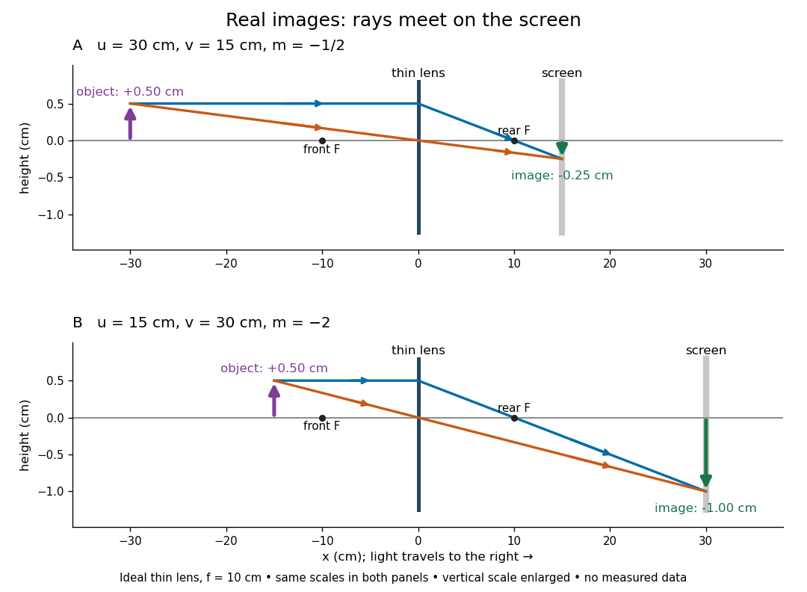

# Real image

↑ **Parent:** [Image formation](image-formation.md)  
ⓦ [Wiki](https://en.wikipedia.org/wiki/Real_image)

A [real image](real-image.md) lies where the outgoing [light rays](light-ray.md) from each object point actually intersect in [geometrical optics](geometrical-optics.md). A screen or detector placed at that image plane receives the focused pattern. The screen reveals the [real image](real-image.md); it does not create the intersection. A viewer can also see a [real image](real-image.md) without a screen if their eye receives the diverging [light rays](light-ray.md) beyond the intersection. [Urone and Hinrichs, College Physics 2e, §25.7: Real images and their observation](https://openstax.org/books/college-physics-2e/pages/25-7-image-formation-by-mirrors).

For a converging [thin lens](thin-lens.md) and real object with $u>f>0$, the [real image](real-image.md) has $v>0$ and signed [transverse magnification](transverse-magnification.md) $m<0$. Inversion is a property of this particular setup, not the definition of a [real image](real-image.md). With $f=10\,\mathrm{cm}$ and $h_o=0.50\,\mathrm{cm}$, the following are predictions:

| Object distance $u$ | Image distance $v$ | [Transverse magnification](transverse-magnification.md) $m$ | Signed image height $h_i$ |
| --- | --- | --- | --- |
| $30\,\mathrm{cm}$ | $15\,\mathrm{cm}$ | $-1/2$ | $-0.25\,\mathrm{cm}$ |
| $20\,\mathrm{cm}$ | $20\,\mathrm{cm}$ | $-1$ | $-0.50\,\mathrm{cm}$ |
| $15\,\mathrm{cm}$ | $30\,\mathrm{cm}$ | $-2$ | $-1.00\,\mathrm{cm}$ |

**[Figure 9](#image-a-converging-thin-lens-forms-reduced-and-enlarged-real-images). A converging thin lens forms reduced and enlarged real images**. Original ideal-model [ray tracing](ray-tracing.md) for $f=10\,\mathrm{cm}$ and $h_o=0.50\,\mathrm{cm}$. Solid coloured [light rays](light-ray.md) travel rightward and meet at the image tip on the screen. Both panels use the same coordinate scales, with the vertical scale enlarged for readability. Values are predictions, not measured data.

To test both image position and [transverse magnification](transverse-magnification.md), use an [optical bench](optical-bench.md) with an illuminated arrow or millimetre target, a converging [optical lens](lens-optics.md) of nominal [focal length](focal-length.md) $10\,\mathrm{cm}$, a movable white screen and a ruler. Measure corresponding target and image intervals, rather than guessing the whole image size when it exceeds the screen. PASCO's Experiment 12 compares distance-based and size-based [magnification](magnification.md); the following procedure uses several object distances, as in the Northern Virginia laboratory. [PASCO, Basic Optics System manual, Experiment 12, pp. 33–36](https://tecnoedu.com/recursos/UNLCHidrologia/ManualesOriginalesPasco/Basic-Optics-System-Manual-OS-8515C.pdf); [PASCO, Object and Image Distances Thin Lens](https://www.pasco.com/resources/lab-experiments/484).

- Align target centre, [optical lens](lens-optics.md) centre and screen along one [optical axis](optical-axis.md), with target and screen perpendicular to it. Record bench positions of the actual target plane, [optical lens](lens-optics.md) plane and screen surface; distances between holder edges introduce an offset.
- Start at $u=30\,\mathrm{cm}$. Move the screen through the expected $v=15\,\mathrm{cm}$ region until the target's central detail is sharpest. Record $u$, measured $v$, the corresponding target and image intervals, and whether the arrow is inverted. Give the measured size ratio a negative sign if inverted.
- Repeat at $u=20\,\mathrm{cm}$ and $u=15\,\mathrm{cm}$. Compare the measured signed size ratio with $-v/u$, and calculate $f_{\mathrm{est}}=uv/(u+v)$ for each pair. The three ideal rows above are predictions to compare against, not entries to copy into the measurement record. [Northern Virginia Community College, Physics 242 Lab 11, pp. 2–4: screen focusing, orientation and size measurements](https://sites.nvcc.edu/alphy/_files/Manuals/Physics%20242%20Lab%2011%20-%20Thin%20Lenses.pdf).

Keep the [optical lens](lens-optics.md), illumination and central target detail fixed between trials. Approach best focus from both sides and record the interval over which sharpness is difficult to distinguish; repeat focusing to estimate its reproducibility. A modest central [aperture stop](aperture-stop.md) tests whether peripheral [light rays](light-ray.md) change the result, but also reduces brightness. [Spherical aberration](spherical-aberration.md), [chromatic aberration](chromatic-aberration.md) and [diffraction](diffraction.md) can broaden the optimum; a thick [optical lens](lens-optics.md) also makes the chosen reference plane imperfect. Treat nominal $f$ as an initial prediction, and report position and interval-reading limits instead of forcing exact agreement. [Feynman, Leighton and Sands, §§27-5–27-7: principal planes and imaging limits](https://www.feynmanlectures.caltech.edu/I_27.html).

Moving the object toward the front [optical focus](focus-optics.md) from outside makes the [real image](real-image.md) larger and farther away. A failed screen search near $u=f$ can therefore mean that the [real image](real-image.md) is beyond the bench, rather than that a [virtual image](virtual-image.md) has formed. At exactly $u=f$, the outgoing bundle from each point is parallel and no finite screen position focuses it.

## ↑ Ancestors (5)

1. [Image formation](image-formation.md)
2. [Optics](optics-split.md)
3. [Branches of physics](branches-of-physics.md)
4. [Physics](physics-split.md)
5. [Codex Wiki](split.md)

## ← Incoming links (6)

- [Image formation](image-formation.md)
- [Magnification](magnification.md)
- [Real image](real-image.md)
- [Thin lens](thin-lens.md)
- [Transverse magnification](transverse-magnification.md)
- [Virtual image](virtual-image.md)
