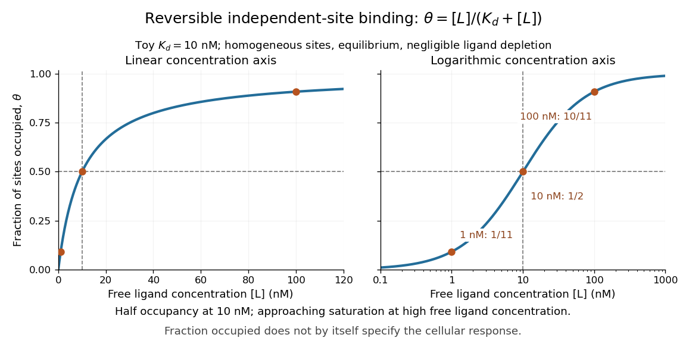

# Receptor binding occupancy

↑ **Parent:** [Receptor (biochemistry)](receptor-biochemistry.md)

[Receptor binding occupancy](receptor-binding-occupancy.md) is the fraction of binding sites occupied by a [ligand](ligand-biochemistry.md). Consider reversible, noncooperative binding at [chemical equilibrium](chemical-equilibrium.md), with homogeneous independent sites: every site has the same binding properties, and binding at one site does not change binding at another. Let $L$ denote free [ligand](ligand-biochemistry.md), $R$ an unoccupied [receptor](receptor-biochemistry.md) site and $RL$ the bound complex. In this dilute [concentration](concentration.md) model,

$$
L+R\rightleftharpoons RL,\qquad K_d=\frac{[L][R]}{[RL]},\qquad R_T=[R]+[RL],\qquad \theta=\frac{[RL]}{R_T}=\frac{[L]}{K_d+[L]}.
$$

Square brackets denote [concentrations](concentration.md); $R_T$ is the total site [concentration](concentration.md). Here the [dissociation constant](dissociation-constant.md) $K_d$ has [concentration](concentration.md) units. Use free [ligand](ligand-biochemistry.md) in excess so binding negligibly depletes it; only under that approximation may the supplied total [ligand](ligand-biochemistry.md) [concentration](concentration.md) substitute for $[L]$. See [Analysis of Receptor–Ligand Interactions: equilibrium binding and saturation](https://pmc.ncbi.nlm.nih.gov/articles/PMC5521016/).

For an illustrative [dissociation constant](dissociation-constant.md) $K_d=10\,\mathrm{nM}$, where $1\,\mathrm{nM}=10^{-9}\,\mathrm{mol\,L^{-1}}$, free [ligand](ligand-biochemistry.md) [concentrations](concentration.md) $1$, $10$ and $100\,\mathrm{nM}$ give $\theta=1/11\approx0.091$, $\theta=1/2=0.5$ and $\theta=10/11\approx0.909$, respectively. At $[L]=K_d$, exactly half the sites are occupied in this model. Raising $[L]$ tenfold from $10$ to $100\,\mathrm{nM}$ raises occupancy from $50\%$ to about $91\%$, rather than tenfold: the finite pool of sites causes saturation.

**[Figure 42](#image-receptor-binding-occupancy-for-a-toy-dissociation-constant-of-10-mathrm-nm). Receptor binding occupancy for a toy dissociation constant of $10\,\mathrm{nM}$**. The same independent-site [chemical equilibrium](chemical-equilibrium.md) model on linear and logarithmic [ligand](ligand-biochemistry.md) [concentration](concentration.md) axes. Marked examples are $1/11$, $1/2$ and $10/11$. The logarithmic axis changes the apparent curve shape without introducing cooperative binding. The vertical axis is fraction occupied, not cellular response.

A short derivation uses the [law of mass action](law-of-mass-action.md): at [chemical equilibrium](chemical-equilibrium.md), association balances dissociation, giving $[RL]=[L][R]/K_d$. Substitute this into $\theta=[RL]/([R]+[RL])$ and cancel $[R]$ to obtain the displayed formula. The limiting values follow directly: zero free [ligand](ligand-biochemistry.md) gives zero occupancy, and increasing $[L]$ far above $K_d$ drives occupancy toward one.

[Receptor binding occupancy](receptor-binding-occupancy.md) is not automatically the fraction of maximal response. [Signal amplification](signal-amplification.md), differing effects of bound [ligands](ligand-biochemistry.md), and downstream saturation can change the relationship. Consequently, $[L]=K_d$ specifies half occupancy here; it does not universally specify either half-maximal or maximal cellular response. These numbers describe a toy binding model, not measured responses of every [receptor](receptor-biochemistry.md). See [Higham and Colquhoun, 2024: the affinity–efficacy problem](https://pmc.ncbi.nlm.nih.gov/articles/PMC11267233/).

## ↑ Ancestors (4)

1. [Receptor (biochemistry)](receptor-biochemistry.md)
2. [Protein](protein.md)
3. [Biology](biology-split.md)
4. [Codex Wiki](split.md)

## ← Incoming links (5)

- [Antibody equilibrium occupancy](antibody-equilibrium-occupancy.md)
- [Morphogen](morphogen.md)
- [Receptor binding occupancy](receptor-binding-occupancy.md)
- [Receptor (biochemistry)](receptor-biochemistry.md)
- [Receptor phosphorylation assay](receptor-phosphorylation-assay.md)
