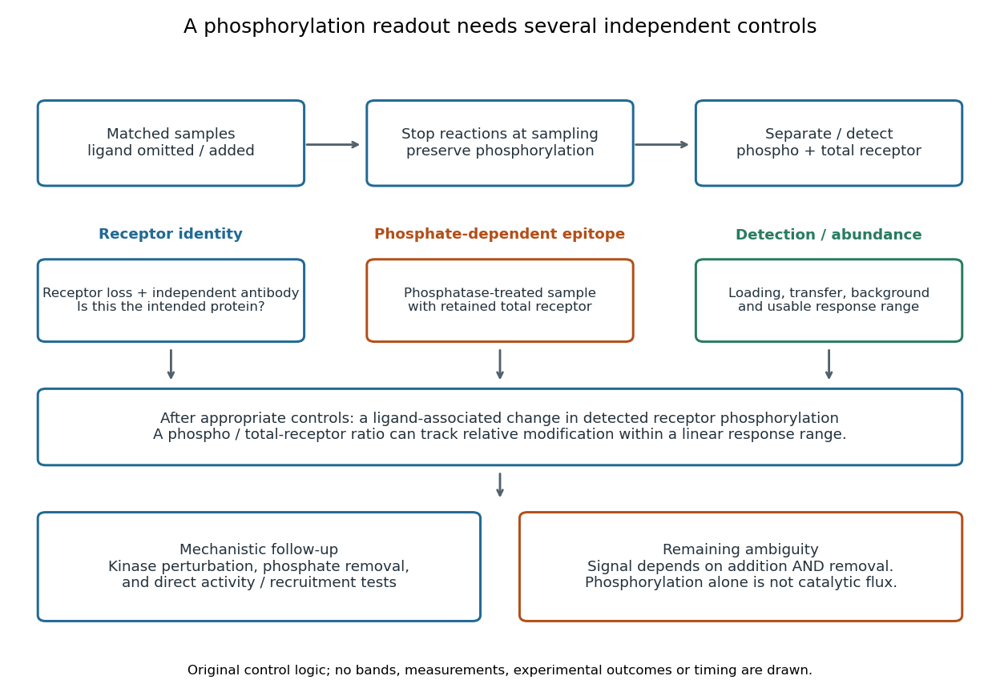

# Receptor phosphorylation assay

↑ **Parent:** [Receptor tyrosine kinase](receptor-tyrosine-kinase.md)

A [receptor phosphorylation assay](receptor-phosphorylation-assay.md) asks whether, and how much, a specified [receptor](receptor-biochemistry.md) is modified by [phosphorylation](phosphorylation.md) under defined conditions. It is distinct from a binding assay for [receptor binding occupancy](receptor-binding-occupancy.md), a test of [protein kinase](protein-kinase.md) activity on a supplied [substrate](substrate-biochemistry.md), and a test of downstream [signal transduction](signal-transduction-split.md). Those measurements answer related but different questions.

For a [Western blot](western-blot.md) implementation, compare matched samples with [ligand](ligand-biochemistry.md) omitted or added, detect a specified phosphorylated [epitope](epitope.md), and separately detect total [receptor](receptor-biochemistry.md) abundance. Preserve the sampled state by stopping further [enzyme](enzyme-split.md) reactions during sample preparation; otherwise [protein kinase](protein-kinase.md) or [protein phosphatase](protein-phosphatase.md) activity after sampling can change the result. A general anti-[phosphotyrosine residue](phosphotyrosine-residue.md) [antibody](antibody.md) recognizes many modified [proteins](protein-split.md); a site-selective [antibody](antibody.md) gives a narrower readout, but still needs [Western blot antibody specificity controls](western-blot-antibody-specificity-control.md).

Reason through the controls before interpreting the difference. Loss of the proposed signal after receptor-specific [gene deletion](gene-deletion.md) supports [protein](protein-split.md) identity. Treatment with a [protein phosphatase](protein-phosphatase.md), alongside preservation of the total-[receptor](receptor-biochemistry.md) signal, tests phosphate-dependent recognition. [Western blot loading controls](western-blot-loading-control.md) and [Western blot transfer controls](western-blot-transfer-control.md) address sample recovery; a usable detection range addresses [Western blot response saturation](western-blot-response-saturation.md). Lower signal after perturbing [protein kinase](protein-kinase.md) activity supports dependence on that perturbation, but alternative targets and altered [receptor](receptor-biochemistry.md) abundance can complicate the inference. These are proposed assay comparisons, not outcomes attributed to the historical membrane experiment.

**[Figure 19](#image-controls-connecting-a-receptor-phosphorylation-assay-to-a-defensible-inference). Controls connecting a receptor phosphorylation assay to a defensible inference**. Original reasoning diagram for a [Western blot](western-blot.md) implementation. Separate comparisons address [protein](protein-split.md) identity, phosphate-dependent [epitope](epitope.md) recognition, recovery and detection response. Boxes prescribe questions; they contain no measured bands, observed experimental outcomes or synthetic time course.

An original idealized measurement model explains the normalization. Let $N$ be the retained number of [receptor](receptor-biochemistry.md) [molecules](molecule-split.md), $f$ the fraction carrying the selected modified [epitope](epitope.md), and $c_p,c_t>0$ fixed detection gains. After subtracting their respective backgrounds, suppose the phosphorylated and total-[receptor](receptor-biochemistry.md) signals lie in a linear response range:

$$
A=c_pNf,\qquad B=c_tN,\qquad \frac{A}{B}=\frac{c_p}{c_t}f.
$$

Dividing by total [receptor](receptor-biochemistry.md) cancels $N$ under these assumptions. It differs from total-[protein](protein-split.md) [Western blot normalization](western-blot-normalization.md), whose denominator includes many other [proteins](protein-split.md). For invented values $c_p=c_t=1$, samples with $(N,f)=(100,0.2)$ and $(200,0.2)$ give $A=20$ and $40$, but both give $A/B=0.2$. Twice the phospho signal here means twice the retained [receptor](receptor-biochemistry.md) amount, with no change in fractional modification. Unequal recovery, changed [epitope](epitope.md) accessibility, nonzero uncorrected background or [Western blot response saturation](western-blot-response-saturation.md) invalidates the cancellation. Unknown relative gains prevent reading an absolute modified fraction directly from the [ratio](ratio.md).

**Table of contents**

- [Ligand-dependent membrane phosphorylation experiment](ligand-dependent-membrane-phosphorylation-experiment.md)

## ↑ Ancestors (6)

1. [Receptor tyrosine kinase](receptor-tyrosine-kinase.md)
2. [Cell-surface receptor](cell-surface-receptor.md)
3. [Receptor (biochemistry)](receptor-biochemistry.md)
4. [Protein](protein-split.md)
5. [Biology](biology-split.md)
6. [Codex Wiki](split.md)

## ← Incoming links (3)

- [Receptor phosphorylation assay](receptor-phosphorylation-assay.md)
- [Receptor tyrosine kinase](receptor-tyrosine-kinase.md)
- [Reversible receptor phosphorylation model](reversible-receptor-phosphorylation-model.md)
