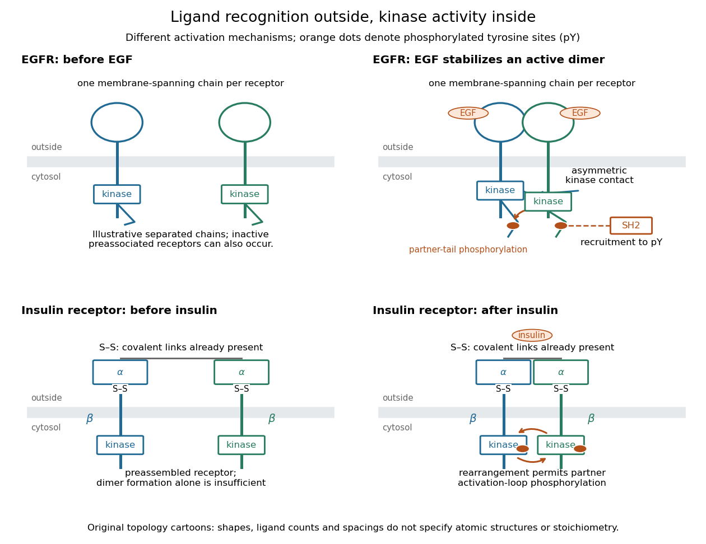

# Receptor tyrosine kinase

↑ **Parent:** [Cell-surface receptor](cell-surface-receptor.md)  
ⓦ [Wiki](https://en.wikipedia.org/wiki/Receptor_tyrosine_kinase)

A [receptor tyrosine kinase](receptor-tyrosine-kinase.md) combines extracellular [ligand](ligand-biochemistry.md) recognition with an intracellular [protein kinase](protein-kinase.md) [protein domain](protein-domain.md). A membrane-spanning segment connects these parts across the [cell membrane](cell-membrane.md): the signal changes the intracellular machinery without requiring the [ligand](ligand-biochemistry.md) to enter the [cytosol](cytosol.md). The [protein kinase](protein-kinase.md) transfers a [phosphate](phosphate.md) group from [ATP](adenosine-triphosphate.md) to selected [tyrosine residues](tyrosine-residue.md) on [proteins](protein.md), including the [receptor](receptor-biochemistry.md) itself.[“Activated Receptor Tyrosine Kinases Phosphorylate Themselves”: extracellular binding, intracellular catalytic domains and ATP-dependent phosphate transfer](molecular-biology-of-the-cell-4th-edition-by-bruce-alberts-and-others/signaling-through-enzyme-linked-cell-surface-receptors.md)

This architecture makes a reception event useful in two ways: it can change catalytic activity and assemble a local group of signaling [proteins](protein.md). [Trans-autophosphorylation](trans-autophosphorylation.md) can create [phosphotyrosine residues](phosphotyrosine-residue.md) recognized by [SH2 domains](sh2-domain.md). Recruitment positions a downstream [enzyme](enzyme.md) or relay [protein](protein.md) near its partners. Neither every modified site nor every recruited [protein](protein.md) has the same effect; association is a specific molecular connection, rather than a universal command to activate everything nearby.[“Phosphorylated Tyrosines Serve as Docking Sites For Proteins With SH2 Domains”, Figure 15-53: signaling enzymes, adaptors and negative regulators](molecular-biology-of-the-cell-4th-edition-by-bruce-alberts-and-others/signaling-through-enzyme-linked-cell-surface-receptors.md)

Compare the [epidermal growth factor receptor](epidermal-growth-factor-receptor.md) with the [insulin receptor](insulin-receptor.md). Their common topology does not impose one activation geometry or make assembly equivalent to activity. The [receptor phosphorylation assay](receptor-phosphorylation-assay.md) consequently needs more than evidence that two [protein](protein.md) chains associate.

**[Figure 40](#image-receptor-tyrosine-kinase-architecture-and-distinct-activation-mechanisms). Receptor tyrosine kinase architecture and distinct activation mechanisms**. Original topology cartoons contrasting [EGFR](epidermal-growth-factor-receptor.md) with the preassembled [insulin receptor](insulin-receptor.md). Orange dots mark [phosphotyrosine residues](phosphotyrosine-residue.md); S–S marks [protein disulfide bonds](protein-disulfide-bond.md). The [EGFR](epidermal-growth-factor-receptor.md) panel separates asymmetric catalytic contact from partner-tail [phosphorylation](phosphorylation.md). Shapes, distances and drawn [ligand](ligand-biochemistry.md) counts are explanatory, rather than atomic structures or binding stoichiometry.

**Table of contents**

- [Epidermal growth factor receptor](epidermal-growth-factor-receptor.md)
- [Insulin receptor](insulin-receptor.md)
  - [Insulin receptor substrate](insulin-receptor-substrate.md)
- [Receptor phosphorylation assay](receptor-phosphorylation-assay.md)
  - [Ligand-dependent membrane phosphorylation experiment](ligand-dependent-membrane-phosphorylation-experiment.md)
- [Reversible receptor phosphorylation model](reversible-receptor-phosphorylation-model.md)

## ↑ Ancestors (5)

1. [Cell-surface receptor](cell-surface-receptor.md)
2. [Receptor (biochemistry)](receptor-biochemistry.md)
3. [Protein](protein.md)
4. [Biology](biology-split.md)
5. [Codex Wiki](split.md)

## ← Incoming links (4)

- [Insulin](insulin.md)
- [Protein kinase](protein-kinase.md)
- [Receptor tyrosine kinase](receptor-tyrosine-kinase.md)
- [Tyrosine residue](tyrosine-residue.md)
