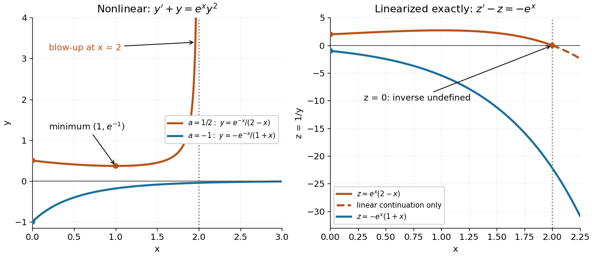
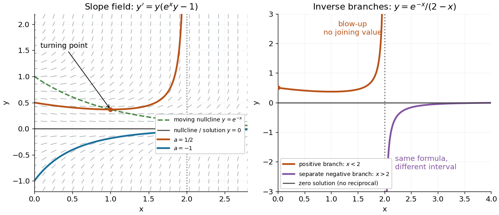

# Reciprocal Bernoulli equation with finite-time blowup

↑ **Parent:** [Bernoulli differential equation](bernoulli-differential-equation.md)

Consider the original analytic [initial value problem](initial-value-problem.md)

$$
y'+y=e^xy^2,\qquad y(0)=a.
$$

Here $x$ and $y$ are dimensionless variables in a stipulated mathematical model. The trajectories below are exact [solutions of a differential equation](solution-of-a-differential-equation.md), with no measured data or empirical parameter fit. For $a\ne0$, the [Bernoulli power substitution](bernoulli-power-substitution.md) $z=1/y$ gives

$$
z'-z=-e^x,\qquad (e^{-x}z)'=-1,\qquad z(x)=e^x(C-x),\qquad y(x)=\frac{e^{-x}}{C-x},\qquad C=\frac1a.
$$

The [integrating factor](integrating-factor.md) is $e^{-x}$. Direct [differentiation](differentiation.md) gives $y'=-y+e^xy^2$, independently checking the transformation. The linear $z$ exists for every real $x$, while the nonlinear [solution of a differential equation](solution-of-a-differential-equation.md) uses only the [interval](interval-mathematics.md) containing $0$ where $z\ne0$:

$$
\begin{array}{c|c|c}
\text{initial value}&\text{maximal interval}&\text{forward behavior}\\
a>0&(-\infty,1/a)&y\to+\infty\text{ as }x\uparrow1/a\\
a<0&(1/a,\infty)&y\to0\text{ from below as }x\to\infty\\
a=0&\mathbb R&y\equiv0.
\end{array}
$$

For $a<0$, $y'>0$, so its absolute value decreases toward zero. The lost zero [solution of a differential equation](solution-of-a-differential-equation.md) is recovered by substitution into the original equation. Since $f(x,y)=-y+e^xy^2$ is [locally Lipschitz](locally-lipschitz-function.md) in $y$ everywhere, the [Picard-Lindelöf theorem](picard-lindelof-theorem.md) ensures uniqueness through every finite point, including $y=0$. Thus a nonzero trajectory never meets or crosses zero at a finite $x$.

**[Figure 11](#image-two-bernoulli-trajectories-and-their-exact-linearized-coordinates). Two Bernoulli trajectories and their exact linearized coordinates**. The [initial conditions](initial-condition.md) are $y(0)=1/2$ in orange and $y(0)=-1$ in blue. Left: the positive trajectory reaches [finite-time blowup](finite-time-blowup.md) at $x=2$, while the negative trajectory approaches zero. The vertical axis clips the positive curve at $4$; this is a display limit. Right: the corresponding $z=1/y$ trajectories satisfy $z'-z=-e^x$. The dashed orange continuation past $z=0$ solves the [first-order linear differential equation](first-order-linear-differential-equation.md) but cannot extend the original positive [initial value problem](initial-value-problem.md) across blowup.

For $a=1/2$, the exact [solution of a differential equation](solution-of-a-differential-equation.md) is $y=e^{-x}/(2-x)$ on $(-\infty,2)$. It first decreases, reaches a [local minimum](local-minimum.md) $y(1)=e^{-1}$, then increases without bound. At the endpoint,

$$
\lim_{x\uparrow2}(2-x)y(x)=e^{-2}.
$$

The [finite-time blowup](finite-time-blowup.md) comes from a simple zero of $z$ at $2$, where $z'(2)=-e^2$, rather than from a singular coefficient in the [first-order linear differential equation](first-order-linear-differential-equation.md). The same algebraic expression for $y$ is negative on $(2,\infty)$, but that is a separate [solution of a differential equation](solution-of-a-differential-equation.md) on a disjoint [interval](interval-mathematics.md); infinity supplies no finite joining value. For $a=-1$, $y=-e^{-x}/(1+x)$ on $(-1,\infty)$, giving a distinct decaying branch whose finite blowup is instead in the past.

The [direction field](direction-field.md) also explains the positive turning point. Its [nullclines](nullcline.md) are $y=0$ and $y=e^{-x}$, because

$$
y'=y(e^xy-1).
$$

Above the positive [nullcline](nullcline.md), $y'>0$; between it and zero, $y'<0$; below zero, $y'>0$. The moving [nullcline](nullcline.md) $y=e^{-x}$ is not a [solution of a differential equation](solution-of-a-differential-equation.md): its [derivative](derivative.md) is $-e^{-x}$, whereas the prescribed [slope](slope.md) there is zero. The $a=1/2$ trajectory crosses it at $x=1$, exactly its [local minimum](local-minimum.md).

**[Figure 12](#image-the-bernoulli-direction-field-and-the-disconnected-inverse-branches-at-blowup). The Bernoulli direction field and the disconnected inverse branches at blowup**. Left: the [direction field](direction-field.md), its two [nullclines](nullcline.md), and the exact $a=1/2$ and $a=-1$ trajectories. Right: $y=e^{-x}/(2-x)$ has a positive branch on $x<2$ and a negative branch on $x>2$; the excluded point separates them. The zero [solution of a differential equation](solution-of-a-differential-equation.md) belongs to the original equation but has no finite reciprocal coordinate. The branches continue beyond the plotted vertical limits.

## ↑ Ancestors (7)

1. [Bernoulli differential equation](bernoulli-differential-equation.md)
2. [Ordinary differential equation](ordinary-differential-equation.md)
3. [Differential equation](differential-equation-split.md)
4. [Analysis](analysis-split.md)
5. [Area of mathematics](area-of-mathematics.md)
6. [Mathematics](mathematics-split.md)
7. [Codex Wiki](split.md)

## ← Incoming links (1)

- [Bernoulli differential equation](bernoulli-differential-equation.md)
