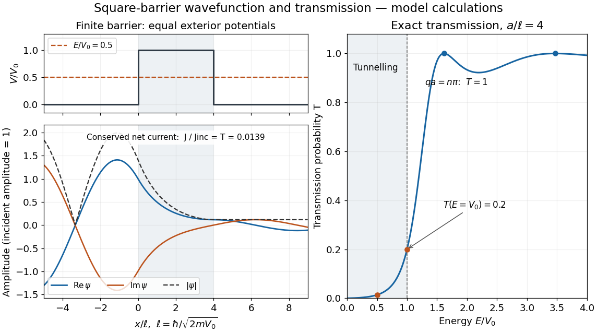

# Rectangular barrier transmission probability

↑ **Parent:** [Finite rectangular barrier matching](finite-rectangular-barrier-matching.md)

For equal exterior [potential energies](potential-energy.md) and constant [mass](mass.md), the exact [transmission probability](transmission-probability.md) is

$$
T(E,a)=\begin{cases}
\displaystyle\left[1+\frac{V_0^2}{4E(V_0-E)}\sinh^2(\kappa a)\right]^{-1},&0<E<V_0,\\[6pt]
\displaystyle\left[1+\frac{mV_0a^2}{2\hbar^2}\right]^{-1},&E=V_0,\\[6pt]
\displaystyle\left[1+\frac{V_0^2}{4E(E-V_0)}\sin^2(qa)\right]^{-1},&E>V_0,
\end{cases}
\qquad q=\frac{\sqrt{2m(E-V_0)}}{\hbar}.
$$

Below the barrier, the [hyperbolic sine](hyperbolic-sine.md) is positive for $a>0$, so $0<T<1$. At $E=V_0$, the interior [wavefunction](wave-function-split.md) is linear in $x$; either neighbouring formula has the displayed finite [limit](limit-of-a-function.md), since $\sinh z/z$ and $\sin z/z$ tend to one. Above the barrier, the interior [wavefunction](wave-function-split.md) oscillates: the [quantum reflection probability](quantum-reflection-probability.md) generally remains nonzero, but $qa=n\pi$ for a positive integer $n$ gives perfect [transmission probability](transmission-probability.md) $T=1$ through constructive [wave interference](interference-wave-propagation.md). These are [scattering resonances](scattering-resonance.md), not below-barrier [quantum tunnelling](quantum-tunnelling.md).

At half height, $E=V_0/2$, we have $k=\kappa$ and $T=\operatorname{sech}^2(\kappa a)$, consistent with [finite square barrier transmission at half barrier height](finite-square-barrier-transmission-at-half-barrier-height.md) after replacing this width $a$ by that example's width $2a$. In the illustration, the width is four times $\ell=\hbar/\sqrt{2mV_0}$ and $E/V_0=1/2$, giving $T\simeq0.01388$. The plotted [wavefunction](wave-function-split.md) comes from solving the four interface equations; the [transmission probability](transmission-probability.md) curve uses the closed formula.

**[Figure 15](#image-matched-square-barrier-wavefunction-and-transmission-below-and-above-the-barrier). Matched square-barrier wavefunction and transmission below and above the barrier**. Original model calculations with equal exterior [potential energies](potential-energy.md), constant [mass](mass.md) and incident [probability amplitude](probability-amplitude.md) one. The [real part](real-part.md) and [imaginary part](imaginary-part.md) of the [wavefunction](wave-function-split.md), its [modulus](modulus.md) and the exact [transmission probability](transmission-probability.md) are shown; these curves are not measurements. The conserved net [probability current](probability-current.md) is small but nonzero throughout the barrier.

**Table of contents**

- [Thick-barrier transmission prefactor](thick-barrier-transmission-prefactor.md)
- [Opaque barrier approximation](opaque-barrier-approximation.md)

## ↑ Ancestors (7)

1. [Finite rectangular barrier matching](finite-rectangular-barrier-matching.md)
2. [Quantum tunnelling](quantum-tunnelling.md)
3. [Potential barrier](potential-barrier.md)
4. [Quantum mechanics](quantum-mechanics-split.md)
5. [Branches of physics](branches-of-physics.md)
6. [Physics](physics-split.md)
7. [Codex Wiki](split.md)

## ← Incoming links (2)

- [Finite rectangular barrier matching](finite-rectangular-barrier-matching.md)
- [Opaque barrier approximation](opaque-barrier-approximation.md)
