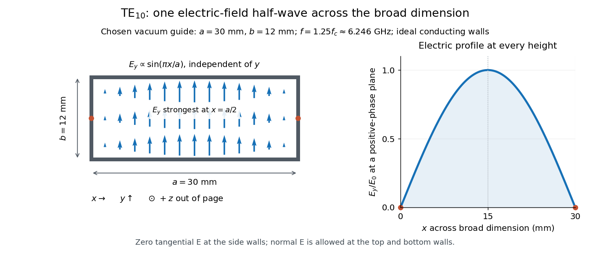

# Rectangular electromagnetic waveguide

↑ **Parent:** [Electromagnetic wave](electromagnetic-wave-split.md)

Take a straight hollow [rectangular electromagnetic waveguide](rectangular-electromagnetic-waveguide.md) with [vacuum](vacuum.md) interior $0<x<a$, $0<y<b$ and axis $z$, where $a>b>0$. Its four walls are ideal [perfect conductors](perfect-conductor.md). The time-dependent [Maxwell equations](maxwell-equations-split.md) require zero tangential [electric field](electric-field-split.md) and zero normal oscillating [magnetic field](magnetic-field-split.md) at these walls. Real metal has finite [electrical conductivity](electrical-conductivity.md), so real guides lose [electromagnetic energy](electromagnetic-energy.md) by [Joule heating](joule-heating.md); the perfect-wall model isolates confinement and [wave dispersion](wave-dispersion.md) from that loss.

The simplest propagating [transverse electric mode of a rectangular waveguide](transverse-electric-mode-of-a-rectangular-waveguide.md) is $\mathrm{TE}_{10}$. “Transverse electric” means $E_z=0$, not that the [magnetic field](magnetic-field-split.md) is also wholly transverse. With real peak scale $E_0$, its [complex amplitudes](complex-amplitude.md), including the common axial factor, can be written

$$
\begin{aligned}
E_y&=E_0\sin(\pi x/a)e^{i\beta z},& E_x&=E_z=0,\\
B_x&=-\frac{\beta}{\omega}E_0\sin(\pi x/a)e^{i\beta z},&B_y&=0,\\
B_z&=-\frac{i\pi}{a\omega}E_0\cos(\pi x/a)e^{i\beta z}.&&
\end{aligned}
$$

The physical fields are the [real parts](real-part.md) after multiplication by $e^{-i\omega t}$. In particular, $E_y$ is zero at $x=0,a$, maximal at $x=a/2$, and independent of $y$. At $y=0,b$ it is normal to the metal, so it need not vanish there. The $\mathrm{TE}_{10}$ [electric field](electric-field-split.md) crosses the narrow gap, while its strength varies across the broad dimension.

**[Figure 2](#image-original-vacuum-filled-rectangular-guide-the-te10-electric-field-profile-across-a-30-mm-by-12-mm-cross-section). Original vacuum-filled rectangular guide: the TE10 electric-field profile across a 30 mm by 12 mm cross-section**. The arrows show the [electric field](electric-field-split.md) at an axial plane and time where its common [wave phase](phase-waves.md) factor is positive; their length follows $\sin(\pi x/a)$. They are field directions, not particle trajectories. The profile is uniform along $y$ and vanishes at the side walls. The guide axis $+z$ points out of the cross-section. All dimensions and the operating [frequency](frequency.md) are chosen model values.

For an original example choose $a=30\,\mathrm{mm}$, $b=12\,\mathrm{mm}$ and $f=1.25f_c$, where $f_c=c/(2a)$. With $c=299792458\,\mathrm{m/s}$, this gives

$$
\begin{aligned}
f_c&=4.99654097\,\mathrm{GHz},& f&=6.24567621\,\mathrm{GHz},\\
\lambda_0&=48\,\mathrm{mm},&\beta&=25\pi\,\mathrm{m}^{-1},&\lambda_g&=80\,\mathrm{mm}.
\end{aligned}
$$

Here $\lambda_0=c/f$ is [vacuum](vacuum.md) [wavelength](wavelength.md) and $\lambda_g=2\pi/\beta$ is [guided wavelength](guided-wavelength.md). The next cutoff is $\mathrm{TE}_{20}$ at $2f_c$; $\mathrm{TE}_{01}$ starts at $(a/b)f_c=2.5f_c$. Thus only $\mathrm{TE}_{10}$ can propagate at the chosen [frequency](frequency.md), although a source or discontinuity can additionally excite local [evanescent waves](evanescent-wave.md). These are calculated values, not specifications or measurements of a commercial guide.

**Table of contents**

- [Transverse magnetic mode of a rectangular waveguide](transverse-magnetic-mode-of-a-rectangular-waveguide.md)
- [Waveguide cutoff frequency](waveguide-cutoff-frequency.md)
  - [Waveguide phase and group velocities](waveguide-phase-and-group-velocities.md)
- [Transverse electric mode of a rectangular waveguide](transverse-electric-mode-of-a-rectangular-waveguide.md)
  - [Evanescent transverse electric mode in a rectangular waveguide](evanescent-transverse-electric-mode-in-a-rectangular-waveguide.md)
- [Guided wavelength](guided-wavelength.md)
- [Slotted-line waveguide measurement](slotted-line-waveguide-measurement.md)

## ↑ Ancestors (5)

1. [Electromagnetic wave](electromagnetic-wave-split.md)
2. [Electromagnetism](electromagnetism-split.md)
3. [Branches of physics](branches-of-physics.md)
4. [Physics](physics-split.md)
5. [Codex Wiki](split.md)

## ← Incoming links (12)

- [Electromagnetic waveguide](electromagnetic-waveguide.md)
- [Guided wavelength](guided-wavelength.md)
- [Solution](past-exam-of-the-physics-b-course-of-the-university-of-cambridge/2012/paper-1/section-a/a3/solution.md)
- [Solution](past-exam-of-the-physics-b-course-of-the-university-of-cambridge/2018/paper-2/section-a/a1/solution.md)
- [Solution](past-exam-of-the-physics-b-course-of-the-university-of-cambridge/2021/paper-2/section-a/a3/solution.md)
- [Solution](past-exam-of-the-physics-b-course-of-the-university-of-cambridge/2022/paper-1/section-a/a5/solution.md)
- [Rectangular electromagnetic waveguide](rectangular-electromagnetic-waveguide.md)
- [Slotted-line waveguide measurement](slotted-line-waveguide-measurement.md)
- [Transverse electric mode of a rectangular waveguide](transverse-electric-mode-of-a-rectangular-waveguide.md)
- [Transverse magnetic mode of a rectangular waveguide](transverse-magnetic-mode-of-a-rectangular-waveguide.md)
- [Waveguide cutoff frequency](waveguide-cutoff-frequency.md)
- [Waveguide phase and group velocities](waveguide-phase-and-group-velocities.md)
