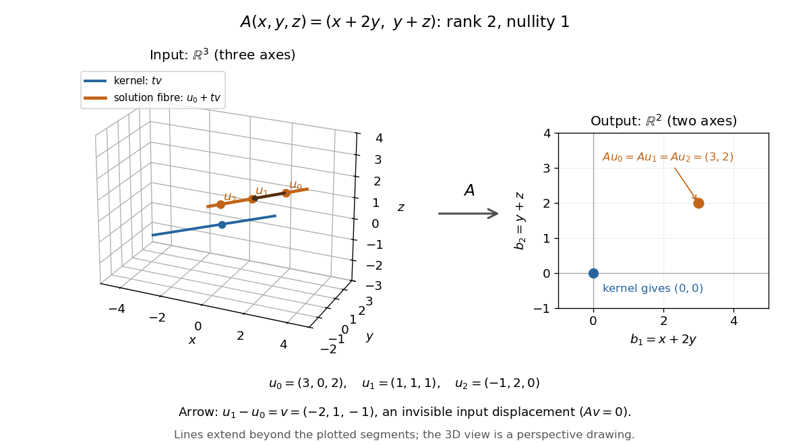

# Rectangular kernel and solution-fibre example

↑ **Parent:** [Kernel of a linear map](kernel-of-a-linear-map-split.md)

Consider the [linear map](linear-map.md) $A:\mathbb R^3\to\mathbb R^2$ represented by the rectangular [matrix](matrix.md)

$$
A=\begin{pmatrix}1&2&0\\0&1&1\end{pmatrix},\qquad
A\begin{pmatrix}x\\y\\z\end{pmatrix}=\begin{pmatrix}x+2y\\y+z\end{pmatrix}.
$$

To compute its [kernel](kernel-of-a-linear-map-split.md), solve the [homogeneous linear system](homogeneous-linear-system.md) $x+2y=0$, $y+z=0$. Taking $y=t$ gives $x=-2t$, $z=-t$, so

$$
\ker A=\left\{t\begin{pmatrix}-2\\1\\-1\end{pmatrix}:t\in\mathbb R\right\},\qquad
v=\begin{pmatrix}-2\\1\\-1\end{pmatrix},\qquad Av=\begin{pmatrix}-2+2\\1-1\end{pmatrix}=0.
$$

Thus $v$ represents a [null direction of a linear map](null-direction-of-a-linear-map.md): decreasing the first input by two, increasing the second by one, and decreasing the third by one changes neither output. Solving the [homogeneous linear system](homogeneous-linear-system.md) is the concrete computation behind a [kernel](kernel-of-a-linear-map-split.md); the [column space](column-space.md) instead decides which outputs are attainable.[Gilbert Strang, Lecture 6: Column space and nullspace, opening lecture description: the distinct roles of Ax=0 and Ax=b](linear-algebra-mit-18-06-spring-2010/lecture-6-column-space-and-nullspace.md)

Now prescribe the nonzero output $b=(3,2)^T$. The [linear system](system-of-linear-equations.md) $Au=b$ becomes $x+2y=3$, $y+z=2$. Again take $y=t$:

$$
u=\begin{pmatrix}3-2t\\t\\2-t\end{pmatrix}
=\underbrace{\begin{pmatrix}3\\0\\2\end{pmatrix}}_{u_0}
+t\underbrace{\begin{pmatrix}-2\\1\\-1\end{pmatrix}}_{v},\qquad t\in\mathbb R.
$$

Direct substitution gives $Au_0=(3,2)^T$, and $A(u_0+tv)=Au_0+tAv=b$. Conversely, the two [linear equations](linear-equation.md) force exactly this form, so no solutions have been omitted. This [fiber](fiber-of-a-function.md) is an [affine subspace](affine-subspace.md) of [dimension](dimension-vector-space.md) one in the three-dimensional input [vector space](vector-space-split.md). It is parallel to the [kernel](kernel-of-a-linear-map-split.md), but does not pass through the origin. For instance, $u_0=(3,0,2)^T$ and $u_1=(1,1,1)^T$ both give $b$, while their difference $u_1-u_0=v$ gives zero. Adding $u_0$ and $u_1$ gives output $2b$, which is another way to see that this nonzero-output [fiber](fiber-of-a-function.md) is not a [vector subspace](vector-subspace.md).

**[Figure 2](#image-three-dimensional-inputs-along-one-null-direction-give-the-same-two-dimensional-output). Three-dimensional inputs along one null direction give the same two-dimensional output**. The blue [straight line](straight-line.md) is the [kernel](kernel-of-a-linear-map-split.md) in the actual three-dimensional input [vector space](vector-space-split.md). The orange solution [straight line](straight-line.md) is its [translation](translation-geometry.md) by $u_0$. Three marked inputs map to the single orange output $(3,2)$ in the two-dimensional output [vector space](vector-space-split.md); the blue [kernel](kernel-of-a-linear-map-split.md) maps to zero. Finite plotted segments represent infinite [straight lines](straight-line.md).

The first and third columns of $A$ are $(1,0)^T$ and $(0,1)^T$, a [basis](basis.md) of the output [vector space](vector-space-split.md). Hence $A$ has [matrix rank](matrix-rank.md) two and reaches every output. The [rank-nullity theorem](rank-nullity-theorem.md) predicts [nullity](nullity-of-a-linear-map.md) $3-2=1$ before we solve any [linear system](system-of-linear-equations.md). It provides a useful completeness check: one nonzero [kernel](kernel-of-a-linear-map-split.md) [vector](vector.md) already forms a [basis](basis.md) here, so a second independent [null direction of a linear map](null-direction-of-a-linear-map.md) would signal a calculation error. In general, [matrix rank](matrix-rank.md) $r$ for an $m\times n$ [matrix](matrix.md) leaves $n-r$ independent [kernel](kernel-of-a-linear-map-split.md) directions, rather than $m-r$.[Margalit and Rabinoff, Interactive Linear Algebra, §2.9, Rank Theorem: column count equals rank plus nullity](interactive-linear-algebra-by-dan-margalit-and-others/the-rank-theorem.md)

## ↑ Ancestors (6)

1. [Kernel of a linear map](kernel-of-a-linear-map-split.md)
2. [Linear algebra](linear-algebra-split.md)
3. [Algebra](algebra-split.md)
4. [Area of mathematics](area-of-mathematics.md)
5. [Mathematics](mathematics-split.md)
6. [Codex Wiki](split.md)

## ← Incoming links (1)

- [Noninjective linear measurement](noninjective-linear-measurement.md)
