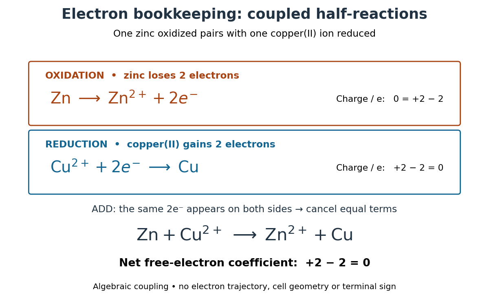
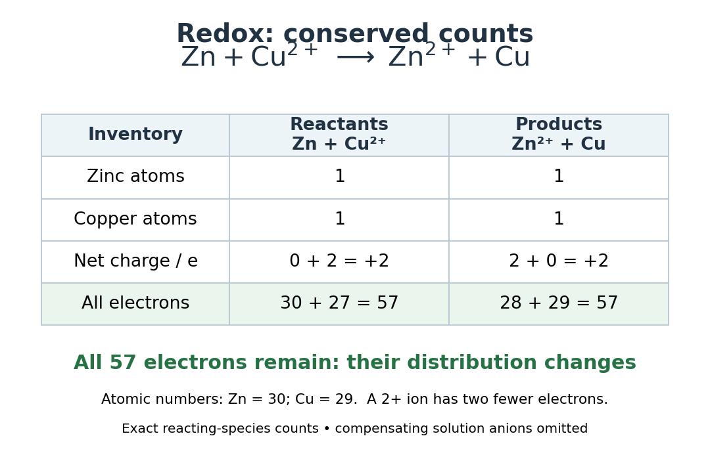

# Redox electron balance

↑ **Parent:** [Redox](redox.md)

Consider the reacting [zinc](zinc.md) and [copper](copper.md) species in the [zinc-copper displacement experiment](zinc-copper-displacement-experiment.md). Split the net [chemical equation](chemical-equation.md) into two [half-reactions](half-reaction.md):

$$
\begin{aligned}
\text{oxidation:}\quad&\mathrm{Zn}(s)\longrightarrow\mathrm{Zn}^{2+}(aq)+2e^-,\\
\text{reduction:}\quad&\mathrm{Cu}^{2+}(aq)+2e^-\longrightarrow\mathrm{Cu}(s).
\end{aligned}
$$

The [zinc](zinc.md) [oxidation state](oxidation-state.md) rises from $0$ to $+2$; the [copper](copper.md) [oxidation state](oxidation-state.md) falls from $+2$ to $0$. Add the [half-reactions](half-reaction.md): two released [electrons](electron.md) match two accepted [electrons](electron.md). Cancelling $2e^-$ from both sides gives[§4.2, “Balancing Redox Reactions via the Half-Reaction Method”, steps 6–7: matching and cancelling exchanged electrons](chemistry-2e-by-paul-flowers-and-others.md)

$$
\boxed{\mathrm{Zn}(s)+\mathrm{Cu}^{2+}(aq)\longrightarrow\mathrm{Zn}^{2+}(aq)+\mathrm{Cu}(s).}
$$

Thus the closed net [chemical reaction](chemical-reaction-split.md) has zero net production of free [electrons](electron.md). Cancellation does not destroy [electrons](electron.md): it removes a matched internal exchange from the written [chemical equation](chemical-equation.md). The [half-reactions](half-reaction.md) alone are incomplete descriptions of the whole reacting system. In a [galvanic cell](galvanic-cell.md), the exchange can pass through a wire; in the [zinc-copper displacement experiment](zinc-copper-displacement-experiment.md), the reacting materials meet at the same metal surface. The equations do not require a reservoir of free [electrons](electron.md) in the bulk [chemical solution](solution-chemistry.md).

**[Figure 5](#image-redox-coupled-half-reaction-ledger). Electron bookkeeping with coupled half-reactions for zinc and copper**. Original algebraic diagram: both [half-reactions](half-reaction.md) exchange two [electrons](electron.md), so their sum has matching $2e^-$ terms. The cancellation indicates internal accounting, not an [electron](electron.md) trajectory or an [elementary reaction](elementary-reaction.md). No cell geometry or terminal polarity is implied.

Check both kinds of balance. The [oxidation](oxidation.md) line has net [electric charge](electric-charge-split.md) $0$ on the left and $(+2-2)e=0$ on the right; the [reduction](reduction-chemistry.md) line has $(+2-2)e=0$ on the left and $0$ on the right. The net [chemical equation](chemical-equation.md) contains one [zinc](zinc.md) and one [copper](copper.md) [chemical atom](atom-physics.md) on each side and has net [electric charge](electric-charge-split.md) $+2e$ on each side, where $e$ is the positive [elementary charge](elementary-charge.md). The written reacting species need not be electrically neutral as a group: the bulk [chemical solution](solution-chemistry.md) also contains compensating [anions](anion.md).

There is an even more literal check. [Zinc](zinc.md) has [atomic number](atomic-number.md) $30$ and [copper](copper.md) $29$, so the initial pair contains $30+(29-2)=57$ [electrons](electron.md). The final pair contains $(30-2)+29=57$ [electrons](electron.md). Only their distribution has changed. Conserved [chemical element](chemical-element.md) counts give the usual chemical [mass conservation](mass-conservation.md) inventory; changing the counts of neutral and charged species does not create or remove their [atomic nuclei](atomic-nucleus-split.md).

**[Figure 6](#image-redox-zinc-copper-conserved-counts). Conserved chemical atom, electric charge and total electron counts in zinc/copper redox**. Original exact count table for one net [chemical reaction](chemical-reaction-split.md) as written. The [electron](electron.md) row counts all [electrons](electron.md) assigned to the reacting species, not only [valence electrons](valence-electron.md). The charge row is in units of the positive [elementary charge](elementary-charge.md). Omitted [anions](anion.md) would make the bulk [chemical solution](solution-chemistry.md) neutral. These are counts, not measured amounts or a drawing of localized [electrons](electron.md).

Matching [electrons](electron.md) is necessary but does not replace balancing every [chemical element](chemical-element.md). The [acidic permanganate-iron balance](acidic-permanganate-iron-balance.md) illustrates unequal one- and five-[electron](electron.md) exchanges, with [water](water.md) and [protons](proton.md) also needed. Conversely, a balanced [chemical equation](chemical-equation.md) alone establishes neither a [reaction rate](reaction-rate.md) nor a detailed mechanism. Its usefulness is that it fixes the [stoichiometry](stoichiometry.md) even when those additional questions remain open.

## ↑ Ancestors (4)

1. [Redox](redox.md)
2. [Chemical reaction](chemical-reaction-split.md)
3. [Chemistry](chemistry-split.md)
4. [Codex Wiki](split.md)

## ← Incoming links (1)

- [Aerobic respiration](aerobic-respiration.md)
