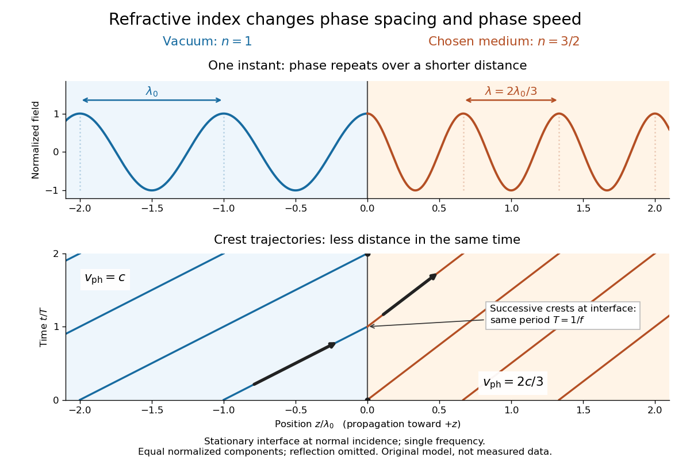

# Refractive index

↑ **Parent:** [Electromagnetic wave](electromagnetic-wave-split.md)  
ⓦ [Wiki](https://en.wikipedia.org/wiki/Refractive_index)

The [refractive index](refractive-index.md) compares the [phase velocity](phase-velocity.md) of [light](light.md) in a medium with the [vacuum](vacuum.md) [speed of light](speed-of-light.md) $c$. For a transparent, uniform medium with [isotropy](isotropy.md) and a positive-index propagation branch,

$$
n(\omega)=\frac{c}{v_{\rm ph}(\omega)}=\frac{ck(\omega)}{\omega}.
$$

Here $\omega>0$ is the [angular frequency](angular-frequency.md), $k>0$ is the [wavenumber](wavenumber.md), and $v_{\rm ph}=\omega/k$ is the speed of a surface of constant [wave phase](phase-waves.md). The [refractive index](refractive-index.md) is a [dimensionless quantity](dimensionless-quantity.md); it is a property of a specified material response at a specified [frequency](frequency.md), rather than a universal number attached to the word “glass”. More general absorbing or negative-index media require the conventions discussed in [refractive index and electromagnetic response](refractive-index-and-electromagnetic-response.md). [RP Photonics Encyclopedia, Rüdiger Paschotta, Refractive Index: What is a Refractive Index?](rp-photonics-encyclopedia-by-rudiger-paschotta/refractive-index.md)

For an original model example, choose $n=3/2$ at [vacuum](vacuum.md) [wavelength](wavelength.md) $\lambda_0=600\,\mathrm{nm}$. The [phase velocity](phase-velocity.md) is $v_{\rm ph}=2c/3\simeq1.999\times10^8\,\mathrm{m/s}$, the [frequency](frequency.md) is $f=c/\lambda_0\simeq4.997\times10^{14}\,\mathrm{Hz}$, and the medium [wavelength](wavelength.md) is $400\,\mathrm{nm}$. These are stipulated model values, not measured properties of glass or water. A value at this single [frequency](frequency.md) does not determine a pulse's [group velocity](group-velocity.md).

The usefulness of [refractive index](refractive-index.md) is that one measured response connects several different observations: [Snell's law](snell-s-law.md) predicts [refraction](refraction.md), [optical path length](optical-path-length.md) predicts accumulated [wave phase](phase-waves.md), and changes with [frequency](frequency.md) describe [optical dispersion](dispersion-optics.md). Even at [normal incidence](normal-incidence.md), where a [light ray](light-ray.md) does not bend, a changed [refractive index](refractive-index.md) changes [wavelength](wavelength.md) and [wave phase](phase-waves.md). The following comparison isolates that effect; the oblique geometry is developed in [wavefront](wavefront.md).

**[Figure 4](#image-chosen-refractive-index-n-3-2-shorter-wavelength-slower-wavefronts-unchanged-interface-frequency). Chosen refractive index $n=3/2$: shorter wavelength, slower wavefronts, unchanged interface frequency**. The top panel compares equal normalized [electric field](electric-field-split.md) components at one time on either side of a stationary interface at [normal incidence](normal-incidence.md). The lower panel tracks constant-[wave phase](phase-waves.md) crests in space and time. Curves represent incident and transmitted components, with their amplitudes normalized separately; reflected [light](light.md) and interface amplitude matching are omitted. The chosen single-[frequency](frequency.md) model contains no measured material data.

**Table of contents**

- [Phase refractive index](phase-refractive-index.md)
- [Complex refractive index](complex-refractive-index.md)
  - [Optical extinction coefficient](optical-extinction-coefficient.md)
- [Relative refractive index](relative-refractive-index.md)
- [Refractive index and wavelength](refractive-index-and-wavelength.md)
- [Refractive index and electromagnetic response](refractive-index-and-electromagnetic-response.md)
- [Prism minimum-deviation index measurement](prism-minimum-deviation-index-measurement.md)
- [Inverse-square refractive-index profile](inverse-square-refractive-index-profile.md)

## ↑ Ancestors (5)

1. [Electromagnetic wave](electromagnetic-wave-split.md)
2. [Electromagnetism](electromagnetism-split.md)
3. [Branches of physics](branches-of-physics.md)
4. [Physics](physics-split.md)
5. [Codex Wiki](split.md)

## ← Incoming links (180)

- [Abbe diagram](abbe-diagram.md)
- [Angle of refraction](angle-of-refraction.md)
- [Angular fringe spacing of a transparent film](angular-fringe-spacing-of-a-transparent-film.md)
- [Antibody surface plasmon resonance experiment](antibody-surface-plasmon-resonance-experiment.md)
- [Apparent depth](apparent-depth.md)
- [Area-angle tradeoff](area-angle-tradeoff.md)
- [Atmospheric refraction](atmospheric-refraction.md)
- [Atmospheric turbulence](atmospheric-turbulence.md)
- [Basic radiance](basic-radiance.md)
- [Birefringence](birefringence.md)
- [Birefringent walk-off](birefringent-walk-off.md)
- [Born non-scattering contrasts at one incident direction](born-non-scattering-contrasts-at-one-incident-direction.md)
- [Brewster reflection from a tangentially moving dielectric](brewster-reflection-from-a-tangentially-moving-dielectric.md)
- [Brewster reflection from an ionospheric interface](brewster-reflection-from-an-ionospheric-interface.md)
- [Brewster's angle](brewster-s-angle.md)
- [Brewster solar elevation](brewster-solar-elevation.md)
- [Calcite double-image experiment](calcite-double-image-experiment.md)
- [Catenary light ray in a linear refractive index](catenary-light-ray-in-a-linear-refractive-index.md)
- [Cherenkov cone angle](cherenkov-cone-angle.md)
- [Cherenkov radiation](cherenkov-radiation.md)
- [Chromatic aberration](chromatic-aberration.md)
- [Circular birefringence](circular-birefringence.md)
- [Coblentz's cavity-radiation spectrum measurement](coblentz-s-cavity-radiation-spectrum-measurement.md)
- [Cold-plasma radio dispersion](cold-plasma-radio-dispersion.md)
- [Conservation of etendue](conservation-of-etendue.md)
- [Conserved transverse optical momentum](conserved-transverse-optical-momentum.md)
- [Critical angle for total internal reflection](critical-angle-for-total-internal-reflection.md)
- [Diffraction-limited resolution](diffraction-limited-resolution.md)
- [Dispersion (optics)](dispersion-optics.md)
- [Double heterostructure laser](double-heterostructure-laser.md)
- [Electromagnetic waveguide](electromagnetic-waveguide.md)
- [Empty magnification](empty-magnification.md)
- [Etendue](etendue.md)
- [Etendue concentration limit](etendue-concentration-limit.md)
- [Etendue of a circular aperture and cone](etendue-of-a-circular-aperture-and-cone.md)
- [Evanescent penetration depth](evanescent-penetration-depth.md)
- [Extraordinary wave](extraordinary-wave.md)
- [Fabry–Pérot transmission from multiple reflections](fabry-perot-transmission-from-multiple-reflections.md)
- [Faraday effect](faraday-effect.md)
- [Faraday rotation from circular phases](faraday-rotation-from-circular-phases.md)
- [Finite-band Cherenkov yield model](finite-band-cherenkov-yield-model.md)
- [Finite-layer model of Lippmann reflection](finite-layer-model-of-lippmann-reflection.md)
- [Finite-well confinement in a semiconductor heterostructure](finite-well-confinement-in-a-semiconductor-heterostructure.md)
- [Fizeau experiment worked example](fizeau-experiment-worked-example.md)
- [Fluorescent bead experiment for confocal microscopy](fluorescent-bead-experiment-for-confocal-microscopy.md)
- [Form birefringence](form-birefringence.md)
- [Förster distance](forster-distance.md)
- [Frank-Tamm formula](frank-tamm-formula.md)
- [Free spectral range](free-spectral-range.md)
- [Fresnel drag coefficient](fresnel-drag-coefficient.md)
- [Full-cycle phase-plate invisibility](full-cycle-phase-plate-invisibility.md)
- [Geometrical optics](geometrical-optics-split.md)
- [Graded-index optical fiber](graded-index-optical-fiber.md)
- [Grazing-incidence X-ray optics](grazing-incidence-x-ray-optics.md)
- [Helical rays in a radially graded refractive index](helical-rays-in-a-radially-graded-refractive-index.md)
- [IceCube ice-transparency calibration experiment](icecube-ice-transparency-calibration-experiment.md)
- [Ideal-solution vapor-liquid equilibrium test](ideal-solution-vapor-liquid-equilibrium-test.md)
- [Kerr effect](kerr-effect.md)
- [Kerr lens](kerr-lens.md)
- [Lens (optics)](lens-optics.md)
- [Lensmaker's equation](lensmaker-s-equation.md)
- [Linear birefringence](linear-birefringence.md)
- [Lippmann colour-recording experiment](lippmann-colour-recording-experiment.md)
- [Lippmann fringe spacing](lippmann-fringe-spacing.md)
- [Measuring refraction with a rectangular block](measuring-refraction-with-a-rectangular-block.md)
- [Minimum deviation](minimum-deviation.md)
- [Mirage](mirage.md)
- [Mixture measurements and the Gibbs-Duhem constraint](mixture-measurements-and-the-gibbs-duhem-constraint.md)
- [Newton's rings](newton-s-rings.md)
- [Normal dispersion](normal-dispersion.md)
- [Normal incidence](normal-incidence.md)
- [Numerical aperture](numerical-aperture.md)
- [Optic axis](optic-axis.md)
- [Optical fiber](optical-fiber.md)
- [Optical fiber acceptance angle](optical-fiber-acceptance-angle.md)
- [Optical fiber attenuation](optical-fiber-attenuation.md)
- [Optical fiber cladding](optical-fiber-cladding.md)
- [Optical fiber core](optical-fiber-core.md)
- [Optical gradient force](optical-gradient-force.md)
- [Optical Kerr effect](optical-kerr-effect.md)
- [Optical momentum of a ray](optical-momentum-of-a-ray.md)
- [Optical path length](optical-path-length.md)
- [Optical rays in a reciprocal-height refractive index](optical-rays-in-a-reciprocal-height-refractive-index.md)
- [Optical tweezers](optical-tweezers.md)
- [Ordinary wave](ordinary-wave.md)
- [Solution](past-exam-of-the-mathematics-course-of-the-university-of-cambridge/2010/iii/paper-70/4/b/solution.md)
- [Solution](past-exam-of-the-mathematics-course-of-the-university-of-cambridge/2012/iii/paper-78/3/c/solution.md)
- [Solution](past-exam-of-the-mathematics-course-of-the-university-of-cambridge/2014/iii/paper-72/1/a/solution.md)
- [Solution](past-exam-of-the-mathematics-course-of-the-university-of-cambridge/2014/iii/paper-72/1/c/i/solution.md)
- [Solution](past-exam-of-the-mathematics-course-of-the-university-of-cambridge/2014/iii/paper-72/1/c/ii/solution.md)
- [Solution](past-exam-of-the-mathematics-course-of-the-university-of-cambridge/2018/iii/paper-335/1/i/solution.md)
- [Solution](past-exam-of-the-mathematics-course-of-the-university-of-cambridge/2018/iii/paper-335/1/ii/solution.md)
- [Solution](past-exam-of-the-mathematics-course-of-the-university-of-cambridge/2018/iii/paper-335/3/i/solution.md)
- [Solution](past-exam-of-the-mathematics-course-of-the-university-of-cambridge/2019/iii/paper-338/1/d/solution.md)
- [Solution](past-exam-of-the-mathematics-course-of-the-university-of-cambridge/2019/iii/paper-338/3/b/iv/solution.md)
- [Solution](past-exam-of-the-mathematics-course-of-the-university-of-cambridge/2019/iii/paper-338/3/c/iii/solution.md)
- [Solution](past-exam-of-the-mathematics-course-of-the-university-of-cambridge/2020/ii/paper-4/36d/b/iii/solution.md)
- [Solution](past-exam-of-the-mathematics-course-of-the-year-2-of-the-natural-sciences-course-of-the-university-of-cambridge/2001/paper-1/10/solution.md)
- [Solution](past-exam-of-the-mathematics-course-of-the-year-2-of-the-natural-sciences-course-of-the-university-of-cambridge/2003/paper-1/9/solution.md)
- [Solution](past-exam-of-the-mathematics-course-of-the-year-2-of-the-natural-sciences-course-of-the-university-of-cambridge/2012/paper-1/9/ii/a/solution.md)
- [Solution](past-exam-of-the-mathematics-course-of-the-year-2-of-the-natural-sciences-course-of-the-university-of-cambridge/2012/paper-1/9/ii/c/solution.md)
- [Solution](past-exam-of-the-mathematics-course-of-the-year-2-of-the-natural-sciences-course-of-the-university-of-cambridge/2012/paper-1/9/ii/solution.md)
- [Solution](past-exam-of-the-mathematics-course-of-the-year-2-of-the-natural-sciences-course-of-the-university-of-cambridge/2018/paper-1/9/b/i/solution.md)
- [Solution](past-exam-of-the-mathematics-course-of-the-year-2-of-the-natural-sciences-course-of-the-university-of-cambridge/2022/paper-1/9/a/solution.md)
- [Solution](past-exam-of-the-mathematics-course-of-the-year-2-of-the-natural-sciences-course-of-the-university-of-cambridge/2023/paper-1/9/a/i/solution.md)
- [Solution](past-exam-of-the-mphil-in-micro-and-nanotechnology-enterprise-course-of-the-university-of-cambridge/2019/paper-1/section-a-ii/4/ii/solution.md)
- [Solution](past-exam-of-the-mphil-in-micro-and-nanotechnology-enterprise-course-of-the-university-of-cambridge/2019/paper-1/section-b/9/ii/a/solution.md)
- [Solution](past-exam-of-the-mphil-in-micro-and-nanotechnology-enterprise-course-of-the-university-of-cambridge/2023/paper-2/section-a-iii/19/ii/solution.md)
- [Solution](past-exam-of-the-mphil-in-micro-and-nanotechnology-enterprise-course-of-the-university-of-cambridge/2023/paper-2/section-a-iii/19/iv/solution.md)
- [Solution](past-exam-of-the-nonlinear-optics-and-quantum-states-of-light-course-of-the-university-of-cambridge/2014/paper-1/1/solution.md)
- [Solution](past-exam-of-the-optics-and-electrodynamics-course-of-the-university-of-cambridge/2012/paper-1/1/a/solution.md)
- [Solution](past-exam-of-the-optics-and-electrodynamics-course-of-the-university-of-cambridge/2012/paper-1/3/solution.md)
- [Solution](past-exam-of-the-optics-and-electrodynamics-course-of-the-university-of-cambridge/2014/paper-1/1/c/solution.md)
- [Solution](past-exam-of-the-optics-and-electrodynamics-course-of-the-university-of-cambridge/2015/paper-1/2/a/solution.md)
- [Solution](past-exam-of-the-optics-and-electrodynamics-course-of-the-university-of-cambridge/2015/paper-1/4/solution.md)
- [Retardation mechanism](past-exam-of-the-optics-and-electrodynamics-course-of-the-university-of-cambridge/2019/section-a/a2/retardation-mechanism.md)
- [Solution](past-exam-of-the-optics-and-electrodynamics-course-of-the-university-of-cambridge/2022/section-b/4/a/solution.md)
- [Solution](past-exam-of-the-optics-and-electrodynamics-course-of-the-university-of-cambridge/2022/section-b/4/b/solution.md)
- [Solution](past-exam-of-the-physics-a-course-of-the-university-of-cambridge/2013/paper-1/section-d/d13/c/solution.md)
- [Solution](past-exam-of-the-physics-a-course-of-the-university-of-cambridge/2014/paper-2/section-a/2/solution.md)
- [Solution](past-exam-of-the-physics-a-course-of-the-university-of-cambridge/2014/paper-2/section-d/d12/b/solution.md)
- [Propagation and reflection phases](past-exam-of-the-physics-a-course-of-the-university-of-cambridge/2017/paper-2/section-b/b9/propagation-and-reflection-phases.md)
- [Solution](past-exam-of-the-physics-a-course-of-the-university-of-cambridge/2018/paper-2/section-d/d13/b/solution.md)
- [Solution](past-exam-of-the-physics-a-course-of-the-university-of-cambridge/2019/paper-1/section-a/5/solution.md)
- [Solution](past-exam-of-the-physics-a-course-of-the-university-of-cambridge/2019/paper-1/section-d/d13/b/solution.md)
- [Solution](past-exam-of-the-physics-a-course-of-the-university-of-cambridge/2019/paper-2/section-a/3/solution.md)
- [Solution](past-exam-of-the-physics-a-course-of-the-university-of-cambridge/2019/paper-2/section-b/b6/a/solution.md)
- [Solution](past-exam-of-the-physics-a-course-of-the-university-of-cambridge/2019/paper-2/section-b/b9/a/solution.md)
- [Solution](past-exam-of-the-physics-a-course-of-the-university-of-cambridge/2019/paper-2/section-d/d12/solution.md)
- [Solution](past-exam-of-the-physics-a-course-of-the-university-of-cambridge/2021/paper-2/section-a/2/solution.md)
- [Solution](past-exam-of-the-physics-b-course-of-the-university-of-cambridge/2017/paper-2/section-b/b6/b/solution.md)
- [Solution](past-exam-of-the-physics-b-course-of-the-university-of-cambridge/2021/paper-2/section-b/b7/solution.md)
- [Solution](past-exam-of-the-physics-b-course-of-the-university-of-cambridge/2022/paper-2/section-b/b7/d/solution.md)
- [Solution](past-exam-of-the-physics-course-of-the-year-1-of-the-natural-sciences-course-of-the-university-of-cambridge/2018/section-d/12/solution.md)
- [Solution](past-exam-of-the-physics-course-of-the-year-1-of-the-natural-sciences-course-of-the-university-of-cambridge/2019/section-a/3/solution.md)
- [Solution](past-exam-of-the-physics-course-of-the-year-1-of-the-natural-sciences-course-of-the-university-of-cambridge/2021/section-b/9/b/solution.md)
- [Solution](past-exam-of-the-physics-course-of-the-year-4-of-the-natural-sciences-course-of-the-university-of-cambridge/2014/paper-1/b7/d/solution.md)
- [Solution](past-exam-of-the-quantum-condensed-matter-course-of-the-university-of-cambridge/2012/4/solution.md)
- [Solution](past-exam-of-the-quantum-condensed-matter-course-of-the-university-of-cambridge/2022/section-b/4/d/solution.md)
- [Solution](past-exam-of-the-soft-matter-and-biological-physics-course-of-the-university-of-cambridge/2012/paper-1/3/a/solution.md)
- [Solution](past-exam-of-the-systems-biology-course-of-the-university-of-cambridge/2024/paper-2/6/i/solution.md)
- [Permittivity tensor](permittivity-tensor.md)
- [Perrin sedimentation experiment](perrin-sedimentation-experiment.md)
- [Phase-conjugate ray retracing](phase-conjugate-ray-retracing.md)
- [Phase conjugation](phase-conjugation.md)
- [Phase covariance in the first Rytov approximation](phase-covariance-in-the-first-rytov-approximation.md)
- [Phase matching in second-harmonic generation](phase-matching-in-second-harmonic-generation.md)
- [Phase object](phase-object.md)
- [Phase retardation](phase-retardation.md)
- [Precision displacement measurement with a Michelson interferometer](precision-displacement-measurement-with-a-michelson-interferometer.md)
- [Prism minimum-deviation index measurement](prism-minimum-deviation-index-measurement.md)
- [Quadratic refractive-index shift in the coherent field](quadratic-refractive-index-shift-in-the-coherent-field.md)
- [Rayleigh optical gradient force](rayleigh-optical-gradient-force.md)
- [Rayleigh scattering](rayleigh-scattering.md)
- [Rayleigh scattering by a small sphere](rayleigh-scattering-by-a-small-sphere.md)
- [Rayleigh scattering wavelength dependence](rayleigh-scattering-wavelength-dependence.md)
- [Refraction](refraction.md)
- [Refractive index](refractive-index.md)
- [Refractive index and wavelength](refractive-index-and-wavelength.md)
- [Refractive index detector](refractive-index-detector.md)
- [Relative refractive index](relative-refractive-index.md)
- [Scattering efficiency](scattering-efficiency.md)
- [Schlieren photography](schlieren-photography.md)
- [SEC detector response](sec-detector-response.md)
- [SEC protein conformation experiment](sec-protein-conformation-experiment.md)
- [Second-harmonic generation](second-harmonic-generation.md)
- [Seidel coma pupil mapping](seidel-coma-pupil-mapping.md)
- [Self-focusing](self-focusing.md)
- [Self-phase modulation](self-phase-modulation.md)
- [Spatial optical soliton](spatial-optical-soliton.md)
- [Step-index optical fiber](step-index-optical-fiber.md)
- [Thin-film interference](thin-film-interference.md)
- [Thin lens](thin-lens.md)
- [Total internal reflection](total-internal-reflection.md)
- [Two optical rays in a square-root refractive-index profile](two-optical-rays-in-a-square-root-refractive-index-profile.md)
- [Uniaxial optical medium](uniaxial-optical-medium.md)
- [Water Cherenkov neutrino reconstruction](water-cherenkov-neutrino-reconstruction.md)
- [Wavefront](wavefront.md)
- [Wavelength](wavelength.md)
- [Waveplate](waveplate.md)
