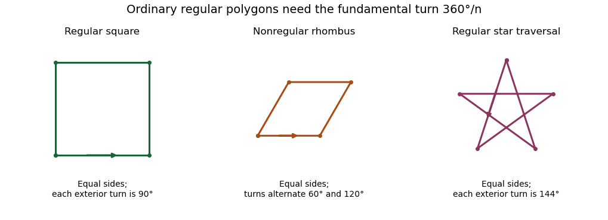

# Regular polygon edge rotation criterion

↑ **Parent:** [Regular polygon](regular-polygon.md)

For $n\geq3$ cyclically ordered planar [vertices](vertex-graph-theory.md), let $e_j=v_{j+1}-v_j$, with indices modulo $n$. They describe a convex [regular polygon](regular-polygon.md) exactly when $e_0\ne0$ and there is a single choice of sign for which every successive [edge vector](edge-vector.md) is obtained by a [rotation](rotation-mathematics.md) through $2\pi/n$ in that orientation. Necessity follows from equal sides and equal exterior angles. Conversely, the edge vectors have the form $R^je_0$. Their sum is zero because the corresponding [geometric series](geometric-series.md) runs through the $n$ distinct [roots of unity](root-of-unity.md). Summing its partial series shows that the vertices are a translated and scaled copy of those roots, so they form a convex regular polygon. A larger turn such as $4\pi/5$ can instead trace a star, which is why merely checking a constant turning angle is insufficient.

**[Figure 8](#image-equal-sides-equal-turns-and-the-fundamental-turn-distinguish-an-ordinary-regular-polygon). Equal sides, equal turns and the fundamental turn distinguish an ordinary regular polygon**. Original constructions: a square satisfies the edge-rotation criterion; a nonsquare rhombus has unequal turns; a five-point star uses the wrong turn, $144^\circ$ instead of $72^\circ$. Arrows indicate traversal direction.

## ↑ Ancestors (6)

1. [Regular polygon](regular-polygon.md)
2. [Euclidean geometry](euclidean-geometry-split.md)
3. [Geometry and topology](geometry-and-topology-split.md)
4. [Area of mathematics](area-of-mathematics.md)
5. [Mathematics](mathematics-split.md)
6. [Codex Wiki](split.md)

## ← Incoming links (1)

- [Solution](past-exam-of-the-year-1-of-the-computer-science-course-of-the-university-of-oxford/2016/functional-programming-design-and-analysis-of-algorithms-resit/4/e/solution.md)
