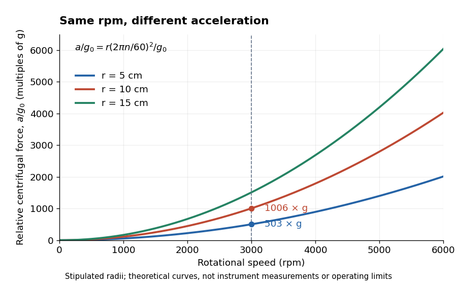

# Relative centrifugal force

↑ **Parent:** [Centrifuge rotor](centrifuge-rotor.md)

[Relative centrifugal force](relative-centrifugal-force.md) is the [dimensionless](dimensionless-quantity.md) ratio of the local [centrifugal acceleration](centrifugal-acceleration.md) magnitude $a$ to the conventional gravitational reference $g_0=9.80665\,\mathrm{m\,s^{-2}}$. Despite its name, it is an acceleration ratio: the actual [force](force.md) on a specified [mass](mass.md) $m$ is $ma$. With [angular speed](angular-speed.md) $\omega$ and [rotor radius](rotor-radius.md) $r$, $a=\omega^2r$. If $n$ is the numerical rotational speed in revolutions per minute and $r_{\mathrm{cm}}$ the numerical [rotor radius](rotor-radius.md) in centimetres, unit conversion gives

$$
\omega=\frac{2\pi n}{60}\,\mathrm{s^{-1}},\qquad
\mathrm{RCF}=\frac{(r_{\mathrm{cm}}/100)(2\pi n/60)^2}{9.80665}
\simeq1.118\times10^{-5}r_{\mathrm{cm}}n^2.
$$

Thus rpm alone does not specify the [centrifugal acceleration](centrifugal-acceleration.md).[Important definitions, Rcm vs rpm, and How to calculate relative centrifugal force: radius dependence and acceleration ratio](basics-centrifugal-force-and-centrifuge-type-by-eppendorf.md)

**[Figure 9](#image-relative-centrifugal-force-for-stipulated-rotor-radii-and-rotational-speeds). Relative centrifugal force for stipulated rotor radii and rotational speeds**. Original theoretical curves calculated from $a=\omega^2r$ with $g_0=9.80665\,\mathrm{m\,s^{-2}}$. The [rotor radii](rotor-radius.md) of $5$, $10$ and $15\,\mathrm{cm}$ are chosen examples, not specifications of real [centrifuge rotors](centrifuge-rotor.md). The plotted range is not an instrument operating limit or a recommendation.

For a stipulated $3000\,\mathrm{rpm}$, [rotor radii](rotor-radius.md) of $5$ and $10\,\mathrm{cm}$ give approximately $503$ and $1006$ times $g_0$. Doubling the [rotor radius](rotor-radius.md) doubles [relative centrifugal force](relative-centrifugal-force.md); doubling rpm quadruples it. Even equal [relative centrifugal forces](relative-centrifugal-force.md) do not guarantee equal separation: travel distance, elapsed time, [viscosity](dynamic-viscosity.md), sample [density](density.md) and particle shape still matter. These are comparisons of a [mathematical model](mathematical-model.md), not instructions for running an instrument.

## ↑ Ancestors (4)

1. [Centrifuge rotor](centrifuge-rotor.md)
2. [Centrifugation](centrifugation.md)
3. [Biology](biology-split.md)
4. [Codex Wiki](split.md)

## ← Incoming links (2)

- [Relative centrifugal force](relative-centrifugal-force.md)
- [Rotor radius](rotor-radius.md)
