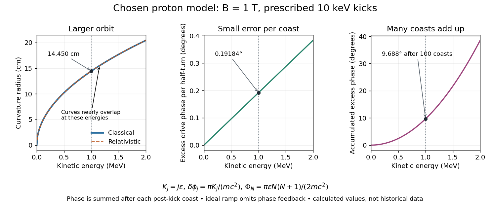

# Relativistic detuning of a cyclotron

↑ **Parent:** [Cyclotron](cyclotron.md)

At larger [kinetic energy](kinetic-energy.md), [special relativity](special-relativity-split.md) changes the relation between [momentum](momentum-split.md) and [velocity](velocity.md). With $m$ the invariant [mass](mass.md), the [Lorentz factor](lorentz-factor.md) is $\gamma=1+K/(mc^2)$, and a [relativistic cyclotron orbit](relativistic-cyclotron-orbit.md) in a fixed uniform [magnetic field](magnetic-field-split.md) satisfies

$$
p=\gamma mv=|q|Br,\qquad
\omega(K)=\frac{|q|B}{\gamma m},\qquad
r(K)=\frac{\sqrt{K(K+2mc^2)}}{|q|Bc}.
$$

The [cyclotron frequency](cyclotron-frequency.md) decreases as the [kinetic energy](kinetic-energy.md) increases. If the drive stays at the classical value $\omega_0=|q|B/m$, the half-turn time is $\pi\gamma/\omega_0$. During it the drive advances through $\pi\gamma$ rather than $\pi$ radians. Its excess [phase](phase-waves.md) per half-turn is therefore

$$
\delta\phi=\omega_0\tau_{1/2}-\pi=\pi(\gamma-1)=\frac{\pi K}{mc^2},\qquad
\frac{\omega(K)-\omega_0}{\omega_0}=-\frac{K}{mc^2+K}.
$$

Even a small fractional [frequency](frequency.md) mismatch accumulates across many turns. A particle eventually reaches a weak or decelerating gap [phase](phase-waves.md), so the classical fixed-field, fixed-frequency design has a practical [kinetic energy](kinetic-energy.md) limit. The limit depends on the kick size and acceptable accumulated [phase](phase-waves.md) error, rather than one universal cutoff [energy](energy-split.md). Changing drive [frequency](frequency.md) or shaping the [magnetic field](magnetic-field-split.md) can restore synchronism; the argument does not forbid relativistic circular accelerators.

For the illustrative [proton](proton.md) at $1.00\,\mathrm{MeV}$, $\gamma-1\simeq0.00106579$: the [frequency](frequency.md) is lower by about $0.1065\%$, and the next half-turn adds about $0.19184^\circ$ of drive [phase](phase-waves.md) excess. To see cumulative sensitivity, prescribe an ideal ramp $K_j=j\epsilon$ with $\epsilon=10\,\mathrm{keV}$ and sum the errors of the first $N$ coasts after kicks:

$$
\Phi_N=\sum_{j=1}^N\frac{\pi K_j}{mc^2}
=\frac{\pi\epsilon N(N+1)}{2mc^2}.
$$

This gives $\Phi_{100}\simeq9.688^\circ$ after the coast following kick $100$; the arrival at kick $100$ instead has $\Phi_{99}\simeq9.496^\circ$. The prescribed ramp diagnoses detuning but does not feed the resulting [phase](phase-waves.md) error back into the kicks. A self-consistent thin-gap model uses the [cyclotron gap energy gain](cyclotron-gap-energy-gain.md) with $\cos\phi_n$, then advances the [phase](phase-waves.md) with the new [kinetic energy](kinetic-energy.md) during the following coast.

**[Figure 2](#image-orbit-radius-and-accumulating-timing-error-for-a-chosen-proton-cyclotron-model). Orbit radius and accumulating timing error for a chosen proton cyclotron model**. Original calculations for B = 1 T and prescribed 10 keV kicks, not historical data. Left: classical and relativistic curvature radius. Middle: excess drive phase during one half-turn at the indicated kinetic energy. Right: accumulated excess after N coasts for K\_j = j times 10 keV. At 1 MeV the single-coast error is small but its accumulated value is already nearly ten degrees. The prescribed ramp omits feedback of timing error on energy gain.

## ↑ Ancestors (5)

1. [Cyclotron](cyclotron.md)
2. [Particle accelerator](particle-accelerator-split.md)
3. [Experimental apparatus](experimental-apparatus.md)
4. [Physics](physics-split.md)
5. [Codex Wiki](split.md)

## ← Incoming links (1)

- [Electrostatic acceleration energy gain](electrostatic-acceleration-energy-gain.md)
