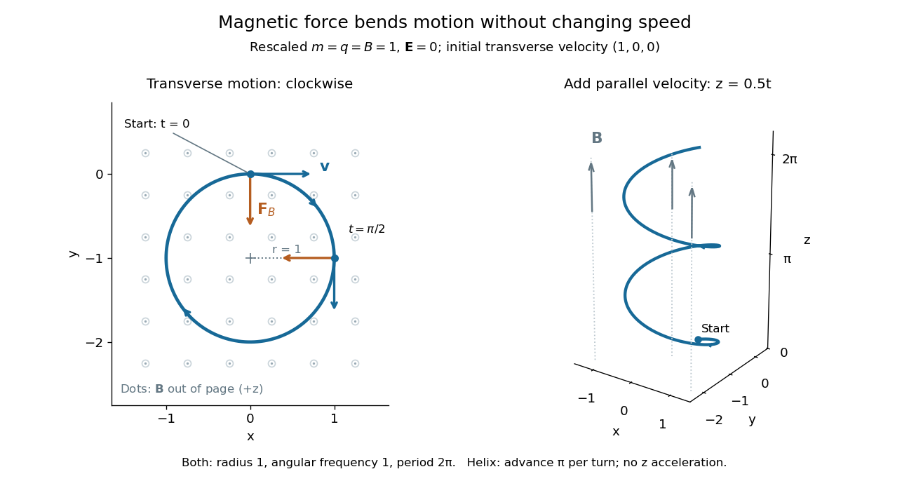
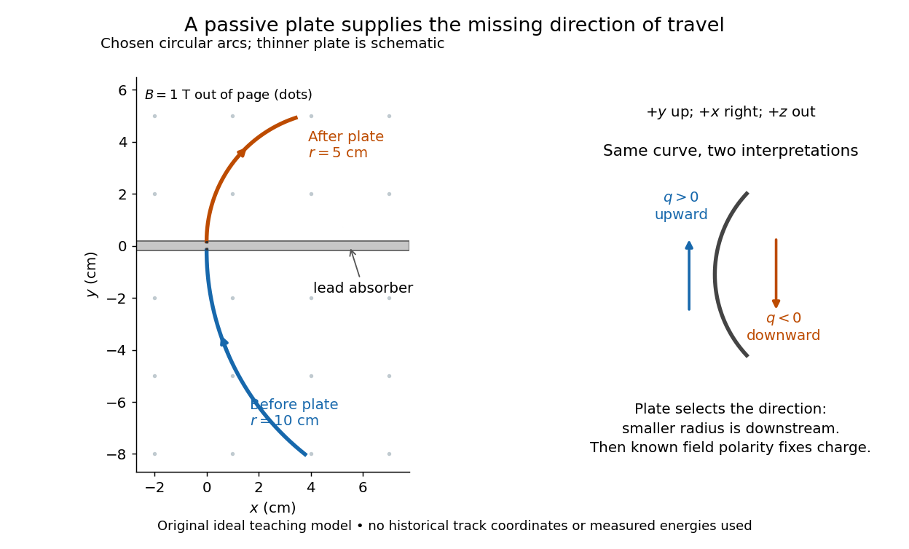
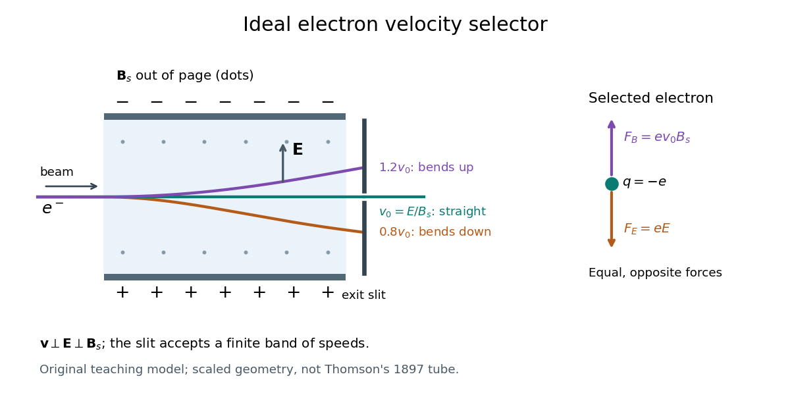
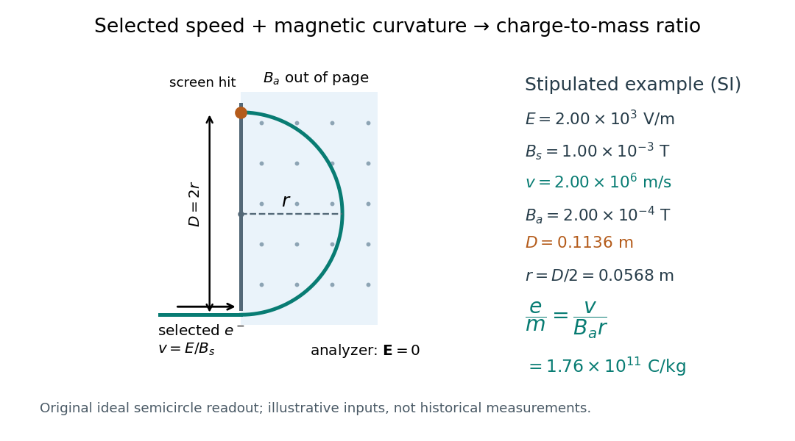
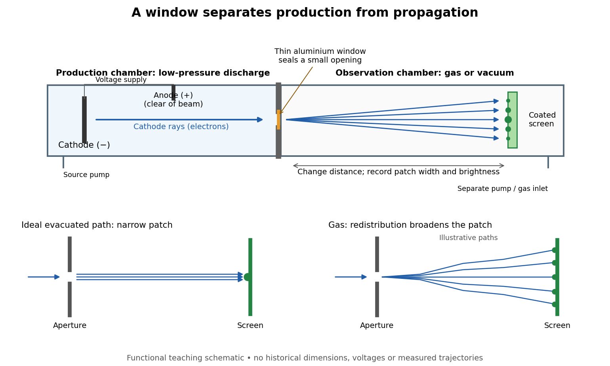
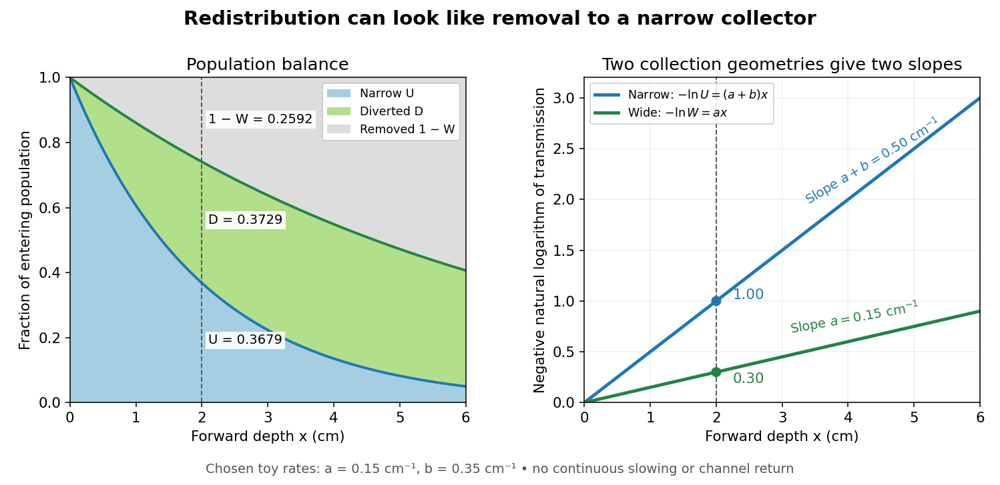
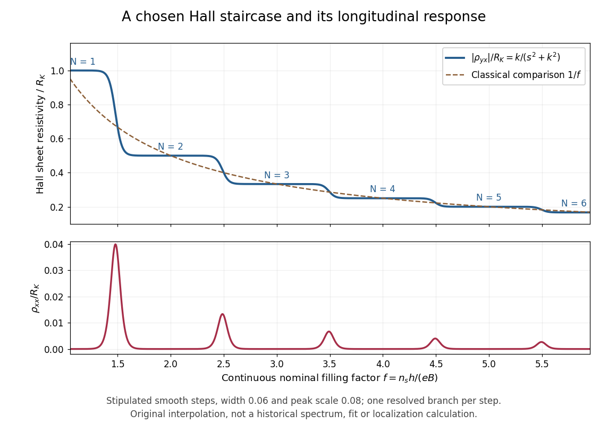
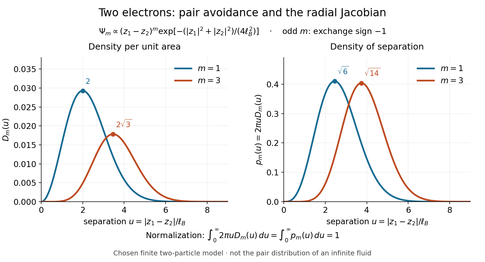

# Relativistic electromagnetism

↑ **Parent:** [Electromagnetism](electromagnetism.md)  
ⓦ [Wiki](https://en.wikipedia.org/wiki/Relativistic_electromagnetism)

Relativistic electromagnetism combines electric and magnetic fields into Lorentz tensors.

**Table of contents**

- [Boosted uniform line charge](#boosted-uniform-line-charge)
  - [Neutral current filament in a boosted frame](#neutral-current-filament-in-a-boosted-frame)
- [Polarization-magnetization tensor](#polarization-magnetization-tensor)
- [Relativistic charged-particle action](#relativistic-charged-particle-action)
  - [Electromagnetic minimal coupling](#electromagnetic-minimal-coupling)
  - [Gauge invariance of the charged-particle worldline action](#gauge-invariance-of-the-charged-particle-worldline-action)
  - [Lorentz-force equation from the worldline action](#lorentz-force-equation-from-the-worldline-action)
- [Electromagnetic four-potential](#electromagnetic-four-potential)
  - [Electromagnetic multipole expansion](#electromagnetic-multipole-expansion)
  - [Retarded potential](#retarded-potential)
    - [Retarded vector potential](#retarded-vector-potential)
      - [Switched infinite-wire retarded potential](#switched-infinite-wire-retarded-potential)
        - [Radial energy flow after switching a line current](#radial-energy-flow-after-switching-a-line-current)
        - [Abrupt line-current wavefront singularity](#abrupt-line-current-wavefront-singularity)
    - [Retarded time](#retarded-time)
      - [Uniqueness of retarded time for a subluminal source](#uniqueness-of-retarded-time-for-a-subluminal-source)
    - [Liénard–Wiechert potential](#lienard-wiechert-potential)
      - [Liénard-Wiechert field](#lienard-wiechert-field)
        - [Electric field of a uniformly moving point charge](#electric-field-of-a-uniformly-moving-point-charge)
  - [Lorenz gauge condition](#lorenz-gauge-condition)
    - [Residual Lorenz gauge symmetry](#residual-lorenz-gauge-symmetry)
  - [Electromagnetic field tensor](#electromagnetic-field-tensor)
    - [Index conventions for the electromagnetic field tensor](#index-conventions-for-the-electromagnetic-field-tensor)
    - [Dual electromagnetic field tensor](#dual-electromagnetic-field-tensor)
      - [Normalization of the electromagnetic dual tensor](#normalization-of-the-electromagnetic-dual-tensor)
    - [Maxwell Lagrangian](#maxwell-lagrangian)
      - [Maxwell action](#maxwell-action)
        - [First-order Maxwell action](#first-order-maxwell-action)
    - [Electromagnetic Bianchi identity](#electromagnetic-bianchi-identity)
    - [Lorentz force](#lorentz-force)
      - [Magnetic force](#magnetic-force)
      - [Force on a current loop in a bilinear magnetic field](#force-on-a-current-loop-in-a-bilinear-magnetic-field)
      - [Cyclotron radius](#cyclotron-radius)
      - [Magnetic rigidity](#magnetic-rigidity)
        - [Anderson positron track experiment](#anderson-positron-track-experiment)
          - [Charge-sign ambiguity of a curved track](#charge-sign-ambiguity-of-a-curved-track)
          - [Proton exclusion by magnetic rigidity and range](#proton-exclusion-by-magnetic-rigidity-and-range)
      - [Charge-to-mass ratio](#charge-to-mass-ratio)
      - [Velocity selector](#velocity-selector)
      - [Thomson charge-to-mass experiment](#thomson-charge-to-mass-experiment)
      - [Lenard cathode-ray window experiment](#lenard-cathode-ray-window-experiment)
        - [Cathode-ray attenuation with finite detector acceptance](#cathode-ray-attenuation-with-finite-detector-acceptance)
      - [Hall effect](#hall-effect)
        - [Hall angle](#hall-angle)
        - [Hall voltage](#hall-voltage)
        - [Hall conductivity](#hall-conductivity)
        - [Hall coefficient](#hall-coefficient)
          - [Free-electron count from a Hall coefficient](#free-electron-count-from-a-hall-coefficient)
          - [Hall scattering factor](#hall-scattering-factor)
          - [Hall carrier count versus valence](#hall-carrier-count-versus-valence)
          - [Two-carrier Hall coefficient](#two-carrier-hall-coefficient)
        - [Quantum Hall effect](#quantum-hall-effect)
          - [Landau filling factor](#landau-filling-factor)
          - [Integer quantum Hall effect](#integer-quantum-hall-effect)
            - [von Klitzing constant](#von-klitzing-constant)
            - [von Klitzing-Dorda-Pepper quantum Hall experiment](#von-klitzing-dorda-pepper-quantum-hall-experiment)
              - [Hall bar](#hall-bar)
                - [Longitudinal resistance in a Hall bar](#longitudinal-resistance-in-a-hall-bar)
            - [Quantum Hall plateau](#quantum-hall-plateau)
            - [Quantum Hall conductivity tensor inversion](#quantum-hall-conductivity-tensor-inversion)
            - [Chern number and integer Hall conductivity](#chern-number-and-integer-hall-conductivity)
            - [Quantum Hall edge state](#quantum-hall-edge-state)
              - [Skipping orbit](#skipping-orbit)
              - [Spin separation at a smooth quantum Hall edge](#spin-separation-at-a-smooth-quantum-hall-edge)
              - [Screened quantum Hall edge strips](#screened-quantum-hall-edge-strips)
                - [Incompressible quantum Hall edge strip](#incompressible-quantum-hall-edge-strip)
                - [Compressible quantum Hall edge strip](#compressible-quantum-hall-edge-strip)
              - [Quantum Hall antidot](#quantum-hall-antidot)
                - [Quantum-dot versus antidot resonance topology](#quantum-dot-versus-antidot-resonance-topology)
                - [Resonant antidot backscattering](#resonant-antidot-backscattering)
                  - [Antidot resonance conductance bounds](#antidot-resonance-conductance-bounds)
                - [Coulomb-dominated antidot oscillation](#coulomb-dominated-antidot-oscillation)
                - [Aharonov-Bohm antidot period](#aharonov-bohm-antidot-period)
          - [Fractional quantum Hall effect](#fractional-quantum-hall-effect)
            - [Composite fermion](#composite-fermion)
              - [Composite-fermion geometric resonance](#composite-fermion-geometric-resonance)
              - [Signed two-flux composite-fermion filling](#signed-two-flux-composite-fermion-filling)
              - [Jain sequence](#jain-sequence)
            - [Tsui-Störmer-Gossard fractional Hall experiment](#tsui-stormer-gossard-fractional-hall-experiment)
            - [Laughlin wavefunction](#laughlin-wavefunction)
              - [Two-electron Laughlin relative probability](#two-electron-laughlin-relative-probability)
              - [Fractionally charged Laughlin quasihole](#fractionally-charged-laughlin-quasihole)
            - [Incompressible quantum Hall fluid](#incompressible-quantum-hall-fluid)
      - [Gyroradius](#gyroradius)
      - [Larmor theorem](#larmor-theorem)
      - [Radial escape in an inverse-radius axial magnetic field](#radial-escape-in-an-inverse-radius-axial-magnetic-field)
      - [Velocity rotation in a time-dependent axial magnetic field](#velocity-rotation-in-a-time-dependent-axial-magnetic-field)
      - [Magnetic forces do no work](#magnetic-forces-do-no-work)
        - [Tangential circulation work versus particle work](#tangential-circulation-work-versus-particle-work)
      - [Geometrization of the Lorentz force by an affine connection](#geometrization-of-the-lorentz-force-by-an-affine-connection)
      - [Electric drift in crossed uniform fields](#electric-drift-in-crossed-uniform-fields)
      - [Lorentz four-force](#lorentz-four-force)
      - [Magnetic force on a current-carrying wire](#magnetic-force-on-a-current-carrying-wire)
        - [Electrostatic-frame derivation of parallel-wire forces](#electrostatic-frame-derivation-of-parallel-wire-forces)
      - [Relativistic cyclotron orbit](#relativistic-cyclotron-orbit)
        - [Charged-particle action over one relativistic cyclotron orbit](#charged-particle-action-over-one-relativistic-cyclotron-orbit)
      - [Lorentz force density](#lorentz-force-density)
      - [E-cross-B drift](#e-cross-b-drift)
      - [Relativistic electromagnetic work-energy theorem](#relativistic-electromagnetic-work-energy-theorem)
      - [Coordinate acceleration of a relativistic charged particle](#coordinate-acceleration-of-a-relativistic-charged-particle)
    - [Electromagnetic field invariants](#electromagnetic-field-invariants)
      - [Null electromagnetic field](#null-electromagnetic-field)
    - [Electromagnetic stress-energy tensor](#electromagnetic-stress-energy-tensor)
      - [Mixed electromagnetic energy-flux signs](#mixed-electromagnetic-energy-flux-signs)
      - [Electromagnetic stress-energy divergence identity](#electromagnetic-stress-energy-divergence-identity)
      - [Gauge-compensated time translation in electromagnetism](#gauge-compensated-time-translation-in-electromagnetism)
      - [Null energy condition for the electromagnetic field](#null-energy-condition-for-the-electromagnetic-field)
- [Lorentz transformation of electromagnetic fields](#lorentz-transformation-of-electromagnetic-fields)
  - [Longitudinal solenoid field under an axial boost](#longitudinal-solenoid-field-under-an-axial-boost)
  - [Longitudinal capacitor field under a normal boost](#longitudinal-capacitor-field-under-a-normal-boost)
  - [Relativistic charge density of counterstreaming beams](#relativistic-charge-density-of-counterstreaming-beams)
  - [Electromagnetic jump conditions across a normally moving plane](#electromagnetic-jump-conditions-across-a-normally-moving-plane)

## Boosted uniform line charge

↑ **Parent:** [Relativistic electromagnetism](relativistic-electromagnetism.md)

An infinite uniform line with proper charge per unit [length](physics.md#length) $\lambda_0$ moving axially at [speed](classical-mechanics.md#speed) $u$ has Lorentz-contracted [density](fluid-mechanics.md#density) $\lambda=\gamma\lambda_0$ and current $I=\lambda u$. Transverse distance $r$ is unchanged by the boost. The rest [electric field](electric-field.md) $\lambda_0\widehat{\mathbf r}/(2\pi\epsilon_0r)$ transforms into $\mathbf E=\lambda\widehat{\mathbf r}/(2\pi\epsilon_0r)$ and $\mathbf B=\mathbf u\times\mathbf E/c^2$. This equals the [magnetic field](magnetic-field.md) $\mu_0I\widehat{\boldsymbol\varphi}/(2\pi r)$ from [Ampère's law](maxwell-equations.md#ampere-s-circuital-law). The formulas concern a uniform stationary current pattern, not an accelerating finite filament's radiation.

### Neutral current filament in a boosted frame

↑ **Parent:** [Boosted uniform line charge](#boosted-uniform-line-charge)

For an ideal infinite filament with zero [line charge](electric-charge.md#line-charge) [density](fluid-mechanics.md#density) and current $I$ in a laboratory frame, the line-integrated [four-current](electric-charge.md#four-current) is $(0,I)$ in temporal/axial components. An axial boost of [speed](classical-mechanics.md#speed) $u$ gives the title [density](fluid-mechanics.md#density) and current. The laboratory [magnetic field](magnetic-field.md) $\mu_0I\widehat{\boldsymbol\varphi}/(2\pi r)$ therefore becomes both an [electric field](electric-field.md) from $\lambda'$ and a [magnetic field](magnetic-field.md) from $I'$. [Charge neutrality](electric-charge.md#charge-neutrality) is frame-dependent for a current-carrying system. A model built from oppositely charged moving and resting populations makes this result explicit; the charge of each fixed material particle set remains invariant.

## Polarization-magnetization tensor

↑ **Parent:** [Relativistic electromagnetism](relativistic-electromagnetism.md)

An [antisymmetric tensor](multilinear-algebra.md#antisymmetric-tensor) combines the [electric polarization](electromagnetism.md#polarization-density) and [magnetization](electromagnetism.md#magnetization) of a medium. For [Minkowski metric](special-relativity.md#minkowski-metric) $(-,+,+,+)$ and units with light speed one, choose $M^{i0}=P_i$ and $M^{ij}=\epsilon_{ijk}M_k$, together with $F_{i0}=E_i$ and $F_{ij}=\epsilon_{ijk}B_k$. Then the [Lorentz scalar](special-relativity.md#lorentz-scalar) interaction is $M^{\mu\nu}F_{\mu\nu}/2=\mathbf P\cdot\mathbf E+\mathbf M\cdot\mathbf B$. The [bound charge and bound current](electromagnetism.md#bound-charge-and-bound-current) have four-current $j_b^\mu=\partial_\nu M^{\mu\nu}$, giving $\rho_b=-\nabla\cdot\mathbf P$ and $\mathbf J_b=\partial_t\mathbf P+\nabla\times\mathbf M$. This current is identically conserved because partial derivatives commute and $M$ is antisymmetric.

## Relativistic charged-particle action

↑ **Parent:** [Relativistic electromagnetism](relativistic-electromagnetism.md)

For metric signature $(-,+,+,+)$, a particle of mass $m$ and charge $q$ coupled to a four-potential has the reparametrization-invariant action

$$
S=-mc\int\sqrt{-\dot x^2}\,d\lambda
+q\int A_\mu(x)\dot x^\mu\,d\lambda.
$$

### Electromagnetic minimal coupling

↑ **Parent:** [Relativistic charged-particle action](#relativistic-charged-particle-action)

Electromagnetic minimal coupling replaces the free kinetic momentum in an action or Hamiltonian by a combination involving the electromagnetic potential. For $L=-m\sqrt{\dot x^a\dot x_a}-qA_a\dot x^a$, the canonical covector is $P_a=-m\dot x_a/\sqrt{\dot x^2}-qA_a$, so $P_a+qA_a$ recovers the potential-independent covector. Under $A_a\mapsto A_a+\partial_a\chi$, the action changes by an endpoint term. The fixed-endpoint equations are the [relativistic Lorentz force](electromagnetism.md#relativistic-lorentz-force) equation and are gauge invariant.

### Gauge invariance of the charged-particle worldline action

↑ **Parent:** [Relativistic charged-particle action](#relativistic-charged-particle-action)

Under $A_\mu\mapsto A_\mu+\partial_\mu\chi$, the interaction changes by

$$
q\int\frac{d\chi(x(\lambda))}{d\lambda}\,d\lambda
=q\,[\chi]_{\rm endpoints}.
$$

Fixed-endpoint equations of motion are therefore gauge invariant.

### Lorentz-force equation from the worldline action

↑ **Parent:** [Relativistic charged-particle action](#relativistic-charged-particle-action)

Varying the [relativistic charged-particle action](#relativistic-charged-particle-action) with fixed endpoints gives

$$
m\frac{du_\mu}{d\tau}=qF_{\mu\nu}u^\nu,
$$

or the equivalent raised-index equation.

## Electromagnetic four-potential

↑ **Parent:** [Relativistic electromagnetism](relativistic-electromagnetism.md)

The four-potential combines the [electric potential](electric-field.md#electric-potential) and [magnetic vector potential](electromagnetism.md#magnetic-vector-potential) as $A^\mu=(\phi/c,\mathbf A)$. The electromagnetic four-potential $A_\mu$ transforms under

$$
A_\mu\mapsto A_\mu+\partial_\mu\chi,
$$

while the antisymmetric field tensor $F_{\mu\nu}=\partial_\mu A_\nu-\partial_\nu A_\mu$ is unchanged.

### Electromagnetic multipole expansion

↑ **Parent:** [Electromagnetic four-potential](#electromagnetic-four-potential)

An electromagnetic multipole expansion expresses the potentials or fields of a localized source as successively smaller monopole, dipole, quadrupole, and higher moments in the ratio of source size to observation distance.

### Retarded potential

↑ **Parent:** [Electromagnetic four-potential](#electromagnetic-four-potential)  
ⓦ [Wiki](https://en.wikipedia.org/wiki/Retarded_potential)

A retarded potential evaluates each source at the event on the source's past light cone. This accounts for propagation at the speed of light and enforces [causality](special-relativity.md#causality).

#### Retarded vector potential

↑ **Parent:** [Retarded potential](#retarded-potential)

The causal [magnetic vector potential](electromagnetism.md#magnetic-vector-potential) generated by a [current density](electric-charge.md#current-density) in the [Lorenz gauge](#lorenz-gauge-condition), with no additional incoming homogeneous field. Each source contribution is evaluated at its [retarded time](#retarded-time). The integral is a convolution with the retarded wave-equation [Green function](green-s-function.md); its validity includes the stated boundary and source conditions.

##### Switched infinite-wire retarded potential

↑ **Parent:** [Retarded vector potential](#retarded-vector-potential)

For a spatially uniform line current $I\Theta(t)$, the causal potential outside the line is $A_z=(\mu_0I/2\pi)\operatorname{arcosh}(ct/r)$ for $ct>r$, and zero before arrival. The finite causal integration length makes it finite at finite time, unlike an absolute magnetostatic potential for an infinite wire.

###### Radial energy flow after switching a line current

↑ **Parent:** [Switched infinite-wire retarded potential](#switched-infinite-wire-retarded-potential)

The induced [electric field](electric-field.md) opposes the increasing axial current, while the [magnetic field](magnetic-field.md) circles it. Their [Poynting vector](electromagnetic-wave.md#poynting-vector) points radially outward and transports energy into the growing magnetic-field region.

###### Abrupt line-current wavefront singularity

↑ **Parent:** [Switched infinite-wire retarded potential](#switched-infinite-wire-retarded-potential)

The ideal fields after instantaneous switching behave as $E_z,H_\phi\propto(t-r/c)^{-1/2}$ near arrival, and the radial [Poynting vector](electromagnetic-wave.md#poynting-vector) as $(t-r/c)^{-1}$. A finite switching rise time smooths the ideal front; the singular solution does not represent a finite-energy real pulse.

#### Retarded time

↑ **Parent:** [Retarded potential](#retarded-potential)  
ⓦ [Wiki](https://en.wikipedia.org/wiki/Retarded_time)

For a source point $y(s)$ and field event $(x,t)$, the retarded time solves

$$
t_{\rm ret}+\frac{|x-y(t_{\rm ret})|}{c}=t.
$$

##### Uniqueness of retarded time for a subluminal source

↑ **Parent:** [Retarded time](#retarded-time)

For $R(s)=|x-y(s)|$ and $|v|<c$, the function $F(s)=s+R(s)/c$ has

$$
F'(s)=1-\widehat R\cdot v/c>0.
$$

It is strictly increasing, so the retarded-time equation has at most one solution.

<h4 id="lienard-wiechert-potential">Liénard–Wiechert potential</h4>

↑ **Parent:** [Retarded potential](#retarded-potential)  
ⓦ [Wiki](https://en.wikipedia.org/wiki/Liénard–Wiechert_potential)

The potentials of a point charge $q$ are

$$
\phi=\frac{q}{4\pi\epsilon_0}
\frac1{R-\mathbf v\cdot\mathbf R/c},
\qquad
\mathbf A=\frac{\mathbf v}{c^2}\phi,
$$

with every source quantity evaluated at the [retarded time](#retarded-time).

<h5 id="lienard-wiechert-field">Liénard-Wiechert field</h5>

↑ **Parent:** [Liénard–Wiechert potential](#lienard-wiechert-potential)

The [Liénard-Wiechert field](#lienard-wiechert-field) is the [electric field](electric-field.md) and [magnetic field](magnetic-field.md) obtained from the retarded potentials of a moving point charge. In the nonrelativistic radiation zone, the electric radiation field is $\mathbf E_{\rm rad}=q\widehat{\mathbf n}\times(\widehat{\mathbf n}\times\mathbf a)/(4\pi\epsilon_0c^2R)$ at [retarded time](#retarded-time). Its outgoing [Poynting vector](electromagnetic-wave.md#poynting-vector) integrates to the [Larmor formula](electromagnetic-radiation.md#larmor-formula). Coulomb and induction fields must also be retained when a near-field calculation is required.

###### Electric field of a uniformly moving point charge

↑ **Parent:** [Liénard-Wiechert field](#lienard-wiechert-field)

Let $\mathbf R$ join the instantaneous position of charge q to the field point, with constant $\boldsymbol\beta=\mathbf v/c$. Transforming its rest-frame Coulomb field gives

$$
\mathbf E=\frac{q(1-\beta^2)\mathbf R}{4\pi\epsilon_0[R^2-|\boldsymbol\beta\times\mathbf R|^2]^{3/2}},\qquad
\mathbf B=\mathbf v\times\mathbf E/c^2.
$$

The [electric field](electric-field.md) is radial from the current position, reduced along the [velocity](classical-mechanics.md#velocity) and enhanced transversely. This present-position form is compatible with the causal retarded solution specifically because motion is uniform. There is no acceleration-dependent radiation field, although the moving charge has a [magnetic field](magnetic-field.md) and transports electromagnetic [energy](energy.md).

### Lorenz gauge condition

↑ **Parent:** [Electromagnetic four-potential](#electromagnetic-four-potential)  
ⓦ [Wiki](https://en.wikipedia.org/wiki/Lorenz_gauge_condition)

The Lorenz gauge condition is

$$
\frac1{c^2}\partial_t\phi+\nabla\cdot\mathbf A=0,
$$

or $\partial_\mu A^\mu=0$ in covariant notation.

#### Residual Lorenz gauge symmetry

↑ **Parent:** [Lorenz gauge condition](#lorenz-gauge-condition)

An Abelian [gauge transformation](electromagnetism.md#gauge-transformation) $A_a\mapsto A_a+\partial_a\lambda$ changes $\partial\cdot A$ by $\Box\lambda$. Consequently [gauge fixing](relativistic-quantum-field.md#gauge-fixing) by a quadratic function of $\partial\cdot A$ retains transformations satisfying $\Box\lambda=0$, subject to the same [boundary conditions](differential-equation.md#boundary-condition). Eliminating those residual transformations is part of specifying an inverse with a particular [Green function](green-s-function.md) prescription.

### Electromagnetic field tensor

↑ **Parent:** [Electromagnetic four-potential](#electromagnetic-four-potential)  
ⓦ [Wiki](https://en.wikipedia.org/wiki/Electromagnetic_field_tensor)

The electromagnetic field tensor is

$$
F^{\mu\nu}=\partial^\mu A^\nu-\partial^\nu A^\mu.
$$

It packages the electric and magnetic fields into an antisymmetric rank-two Lorentz tensor and transforms as

$$
F'^{\mu\nu}(x')
=\Lambda^\mu{}_\rho\Lambda^\nu{}_\sigma F^{\rho\sigma}(x).
$$

#### Index conventions for the electromagnetic field tensor

↑ **Parent:** [Electromagnetic field tensor](#electromagnetic-field-tensor)

Choose coordinates $x^\mu=(ct,\mathbf x)$ and [Minkowski metric](special-relativity.md#minkowski-metric) $\eta=\operatorname{diag}(1,-1,-1,-1)$. With the convention $F^{0i}=-E_i/c$ and $F^{ij}=-\epsilon_{ijk}B_k$, lowering both [tensor](multilinear-algebra.md#tensor) indices gives $F_{0i}=+E_i/c$ while leaving $F_{ij}=F^{ij}$. An array with all upper indices cannot be used unchanged as the corresponding array with all lower indices. The propagation [Lorentz four-vector](special-relativity.md#four-vector) $n^\mu=(1,\mathbf s)$ for unit spatial direction $\mathbf s$ similarly has $n_\mu=(1,-\mathbf s)$. These signs matter in contractions that encode [Maxwell equations](maxwell-equations.md).

#### Dual electromagnetic field tensor

↑ **Parent:** [Electromagnetic field tensor](#electromagnetic-field-tensor)

The dual electromagnetic field tensor is obtained by applying the [Hodge star operator](differential-form.md#hodge-star-operator) to the [electromagnetic field tensor](#electromagnetic-field-tensor). For metric signature $(+---)$ and $\epsilon^{0123}=+1$, define $\widetilde F^{\mu\nu}=\tfrac12\epsilon^{\mu\nu\rho\sigma}F_{\rho\sigma}$. With $F^{0i}=-E_i/c$ and $F^{ij}=-\epsilon_{ijk}B_k$, it has components $\widetilde F^{0i}=-B_i$ and $\widetilde F^{ij}=\epsilon_{ijk}E_k/c$. The homogeneous [Maxwell equations](maxwell-equations.md) become $\partial_\mu\widetilde F^{\mu\nu}=0$.

##### Normalization of the electromagnetic dual tensor

↑ **Parent:** [Dual electromagnetic field tensor](#dual-electromagnetic-field-tensor)

In oriented Minkowski coordinates with $(+---)$ signature and $\epsilon^{0123}=+1$, the conventional dual is $\widetilde F^{ab}=\tfrac12\epsilon^{abcd}F_{cd}$. For $F_{0i}=E_i$ and $F_{ij}=-\epsilon_{ijk}B_k$ in $c=1$ units, $\widetilde F^{ab}F_{ab}=-4\mathbf E\cdot\mathbf B$. A definition without the half produces twice this dual and contraction $-8\mathbf E\cdot\mathbf B$. The factor accounts for summing both orders of each antisymmetric index pair.

#### Maxwell Lagrangian

↑ **Parent:** [Electromagnetic field tensor](#electromagnetic-field-tensor)

The source-free electromagnetic [Lagrangian density](classical-field-theory.md#lagrangian-density) is quadratic in the [electromagnetic field tensor](#electromagnetic-field-tensor). Its [Euler-Lagrange field equation](classical-field-theory.md#euler-lagrange-field-equation) is $\partial_\mu F^{\mu\nu}=0$. Antisymmetry of $F$ makes the density invariant under [gauge transformations](electromagnetism.md#gauge-transformation), and contraction of its indices makes it a [Lorentz scalar](special-relativity.md#lorentz-scalar).

##### Maxwell action

↑ **Parent:** [Maxwell Lagrangian](#maxwell-lagrangian)

The source-free [Maxwell Lagrangian](#maxwell-lagrangian) gives $S=-\tfrac14\int F_{\mu\nu}F^{\mu\nu}\,d^4x$ in mostly-minus Lorentzian signature. Its [Euclidean action](perturbative-quantum-field-theory.md#euclidean-action) is the displayed positive quadratic functional of the [electromagnetic field tensor](#electromagnetic-field-tensor). Variation, with boundary terms vanishing, yields $\partial_\mu F_{\mu\nu}=0$.

###### First-order Maxwell action

↑ **Parent:** [Maxwell action](#maxwell-action)

Vary the antisymmetric auxiliary [electromagnetic field tensor](#electromagnetic-field-tensor) and the [electromagnetic four-potential](#electromagnetic-four-potential) independently. The first variation sets $F_{ab}=\nabla_aA_b-\nabla_bA_a$ algebraically, and variation of the potential gives $\nabla_bF^{ab}=0$. Substitution of the algebraic equation reduces the first-order action to the usual negative quadratic [Maxwell action](#maxwell-action). Metric variation gives the same stress tensor after eliminating the auxiliary field, because the chain-rule term multiplying its variational equation then vanishes.

#### Electromagnetic Bianchi identity

↑ **Parent:** [Electromagnetic field tensor](#electromagnetic-field-tensor)

Because the [electromagnetic field tensor](#electromagnetic-field-tensor) is the [exterior derivative](differential-form.md#exterior-derivative) $F=dA$ of a potential, $dF=d^2A=0$. For a torsion-free connection this is

$$
\nabla_aF_{bc}+\nabla_bF_{ca}+\nabla_cF_{ab}=0,
$$

which is the covariant form of the two homogeneous [Maxwell equations](maxwell-equations.md).

#### Lorentz force

↑ **Parent:** [Electromagnetic field tensor](#electromagnetic-field-tensor)  
ⓦ [Wiki](https://en.wikipedia.org/wiki/Lorentz_force)

The [Lorentz force](#lorentz-force) is the [force](force.md) exerted by an [electric field](electric-field.md) $\mathbf E$ and a [magnetic field](magnetic-field.md) $\mathbf B$ on a body with [electric charge](electric-charge.md) $q$ and [velocity](classical-mechanics.md#velocity) $\mathbf v$. In [SI](physics.md#international-system-of-units) units its form in nonrelativistic [classical mechanics](classical-mechanics.md), using [mass](classical-mechanics.md#mass) $m$ and [Newton's second law](force.md#newton-s-second-law), is

$$
\mathbf F=q(\mathbf E+\mathbf v\times\mathbf B),\qquad
m\frac{d\mathbf v}{dt}=q(\mathbf E+\mathbf v\times\mathbf B).
$$

Both fields are evaluated at the body's [position](classical-mechanics.md#position) at the current [time](classical-mechanics.md#time-in-physics). The [electric field](electric-field.md) contributes $q\mathbf E$ even at rest, whereas the magnetic [force](force.md) depends on [velocity](classical-mechanics.md#velocity) through a [cross product](vector-space.md#cross-product). [OpenStax, electric force and field](https://openstax.org/books/university-physics-volume-2/pages/5-4-electric-field); [OpenStax, magnetic force on moving charge](https://openstax.org/books/university-physics-volume-2/pages/11-2-magnetic-fields-and-lines).

For a concrete [charged particle in a uniform magnetic field](electromagnetism.md#charged-particle-in-a-uniform-magnetic-field), use [nondimensionalization](mathematical-physics.md#nondimensionalization) to stipulate $m=q=B=1$, [magnetic field](magnetic-field.md) $\mathbf B=(0,0,1)$, zero [electric field](electric-field.md), initial [position](classical-mechanics.md#position) $(0,0,0)$, and initial [velocity](classical-mechanics.md#velocity) $(1,0,0)$. These are rescaled quantities, not an assertion that the [mass](classical-mechanics.md#mass), [electric charge](electric-charge.md), and [magnetic field](magnetic-field.md) have the same physical units. At the start, $(1,0,0)\times(0,0,1)=(0,-1,0)$, so the magnetic [acceleration](classical-mechanics.md#acceleration) points toward $-y$. The resulting [circular motion](classical-mechanics.md#circular-motion) is

$$
\mathbf r(t)=(\sin t,\cos t-1,0),\qquad
\mathbf v(t)=(\cos t,-\sin t,0),\qquad
\mathbf a(t)=(-\sin t,-\cos t,0).
$$

At $t=\pi/2$ the [position](classical-mechanics.md#position) is $(1,-1,0)$ and the [velocity](classical-mechanics.md#velocity) is $(0,-1,0)$; at $t=\pi$ the [position](classical-mechanics.md#position) is $(0,-2,0)$ and the [velocity](classical-mechanics.md#velocity) is $(-1,0,0)$. Thus the [circle](topology.md#circle) has center $(0,-1,0)$ and [radius](topology.md#radius) one. Viewed from $+z$ toward the $xy$ [plane](geometry-and-topology.md#plane), the motion is clockwise. Changing only the [electric charge](electric-charge.md) to $q=-1$ gives [position](classical-mechanics.md#position) $(\sin t,1-\cos t,0)$ and reverses the bending to counterclockwise.

**[Figure 1](#image-lorentz-force-circular-motion-and-a-helix-in-the-same-uniform-magnetic-field). Lorentz force: circular motion and a helix in the same uniform magnetic field**. Stipulated rescaled $m=q=B=1$ and zero [electric field](electric-field.md). Left: positive [electric charge](electric-charge.md) follows the clockwise [circle](topology.md#circle) from initial [velocity](classical-mechanics.md#velocity) $(1,0,0)$; the [velocity](classical-mechanics.md#velocity) is tangent and the magnetic [force](force.md) points inward. Dots denote a [magnetic field](magnetic-field.md) out of the [plane](geometry-and-topology.md#plane). Right: adding parallel [velocity](classical-mechanics.md#velocity) $v_z=0.5$ gives [helical motion in a uniform magnetic field](electromagnetism.md#helical-motion-in-a-uniform-magnetic-field), with [position](classical-mechanics.md#position) $z=0.5t$ and the same transverse [radius](topology.md#radius) one. Straight arrows show [magnetic field lines](magnetic-field.md#magnetic-field-line), distinct from the curved path.

Adding initial [velocity](classical-mechanics.md#velocity) $v_z=0.5$ leaves the transverse [circular motion](classical-mechanics.md#circular-motion) unchanged and gives

$$
\mathbf r(t)=(\sin t,\cos t-1,0.5t),\qquad
\mathbf v(t)=(\cos t,-\sin t,0.5).
$$

This is a [helix](topology.md#helix) of transverse [radius](topology.md#radius) one, [cyclotron frequency](quantum-theory.md#cyclotron-frequency) $\omega_c=1$, and transverse [period](mathematics.md#period-of-a-function) $T=2\pi$; the advance along $z$ in one turn is $\pi$. The parallel component of [velocity](classical-mechanics.md#velocity) stays constant because the magnetic [force](force.md) has no parallel component: there is no magnetic [acceleration](classical-mechanics.md#acceleration) along the [magnetic field](magnetic-field.md). If the initial [velocity](classical-mechanics.md#velocity) were entirely parallel to the [magnetic field](magnetic-field.md), the magnetic [force](force.md) would vanish and the path would be straight. [OpenStax, circular and helical motion](https://openstax.org/books/university-physics-volume-2/pages/11-3-motion-of-a-charged-particle-in-a-magnetic-field).

More generally, with zero [electric field](electric-field.md), no other [forces](force.md), and a uniform constant [magnetic field](magnetic-field.md) of magnitude $B>0$, decompose [velocity](classical-mechanics.md#velocity) into perpendicular and parallel components. For nonzero [electric charge](electric-charge.md) $q$, the perpendicular [speed](classical-mechanics.md#speed) $v_\perp$ determines the [gyroradius](#gyroradius), while the [cyclotron frequency](quantum-theory.md#cyclotron-frequency) is an [angular frequency](lagrangian-mechanics.md#angular-frequency):

$$
r=\frac{mv_\perp}{|q|B},\qquad
\omega_c=\frac{|q|B}{m},\qquad
T=\frac{2\pi}{\omega_c}=\frac{2\pi m}{|q|B}.
$$

These are nonrelativistic formulas; see the [relativistic cyclotron orbit](#relativistic-cyclotron-orbit) for the correction. The beauty is that increasing perpendicular [speed](classical-mechanics.md#speed) increases the [radius](topology.md#radius) in exactly the proportion needed to leave the [period](mathematics.md#period-of-a-function) unchanged. Conversely, known [magnetic field](magnetic-field.md), perpendicular [speed](classical-mechanics.md#speed), and measured [radius](topology.md#radius) determine the magnitude of the [electric charge](electric-charge.md) divided by [mass](classical-mechanics.md#mass). This makes the same geometry useful for comparing bodies with different [electric charge](electric-charge.md) and [mass](classical-mechanics.md#mass).

Two short checks explain the result. First, the [cross product](vector-space.md#cross-product) gives $\mathbf v\times\mathbf B=(-\sin t,-\cos t,0)$ for both stipulated positive-[electric charge](electric-charge.md) paths, exactly their [acceleration](classical-mechanics.md#acceleration). Second, the transverse magnetic [force](force.md) supplies the [centripetal acceleration](classical-mechanics.md#centripetal-acceleration), so $mv_\perp^2/r=|q|v_\perp B$; for $v_\perp>0$ this gives the [gyroradius](#gyroradius), and $\omega_c=v_\perp/r$ gives the [cyclotron frequency](quantum-theory.md#cyclotron-frequency).

[Magnetic forces do no work](#magnetic-forces-do-no-work): the instantaneous [power](energy.md#power) of the magnetic part of the [Lorentz force](#lorentz-force) vanishes because a [cross product](vector-space.md#cross-product) is perpendicular to its first argument. The [work-energy theorem](energy.md#work-energy-theorem) therefore gives

$$
\frac{dK}{dt}=\mathbf F\cdot\mathbf v
=q\mathbf E\cdot\mathbf v
+q\mathbf v\cdot(\mathbf v\times\mathbf B)
=q\mathbf E\cdot\mathbf v,
\qquad K=\tfrac12m|\mathbf v|^2.
$$

The [dot product](inner-product.md#dot-product) $\mathbf v\cdot(\mathbf v\times\mathbf B)$ is zero at every instant, rather than only after a full turn. With zero [electric field](electric-field.md) and no other [forces](force.md), the [kinetic energy](energy.md#kinetic-energy) and [speed](classical-mechanics.md#speed) remain constant; the [electric field](electric-field.md) can increase or decrease [kinetic energy](energy.md#kinetic-energy) according to the sign of $q\mathbf E\cdot\mathbf v$. In the two stipulated examples the constant [kinetic energy](energy.md#kinetic-energy) is respectively $K=1/2$ and $K=5/8$ in rescaled units. The extra parallel [velocity](classical-mechanics.md#velocity) raises [kinetic energy](energy.md#kinetic-energy) without changing the [gyroradius](#gyroradius) or the [cyclotron frequency](quantum-theory.md#cyclotron-frequency).

For an electric example in rescaled units, stipulate $m=q=1$, zero [magnetic field](magnetic-field.md), constant [electric field](electric-field.md) $\mathbf E=(2,0,0)$, no other [forces](force.md), and rest at $t=0$. The [Lorentz force](#lorentz-force) gives [acceleration](classical-mechanics.md#acceleration) $(2,0,0)$ and [velocity](classical-mechanics.md#velocity) $(2t,0,0)$, hence [kinetic energy](energy.md#kinetic-energy) $K=2t^2$ and [power](energy.md#power) $dK/dt=4t=q\mathbf E\cdot\mathbf v$. At $t=1$, the [kinetic energy](energy.md#kinetic-energy) has risen from zero to two: the [electric field](electric-field.md) has done positive [work](energy.md#work).

The existing [electromagnetic field tensor](#electromagnetic-field-tensor) formulation expresses the same interaction covariantly. For [four-momentum](special-relativity.md#four-momentum) $p^\mu$ and [four-velocity](special-relativity.md#four-velocity) $u^\mu$, using [proper time](special-relativity.md#proper-time) $\tau$, the [Lorentz force law](#lorentz-force) is

$$
\frac{dp^\mu}{d\tau}=qF^{\mu\nu}u_\nu.
$$

Its spatial and temporal components are

$$
\frac{d\mathbf p}{dt}=q(\mathbf E+\mathbf v\times\mathbf B),
\qquad
\frac{d\mathcal E}{dt}=q\mathbf E\cdot\mathbf v.
$$

##### Magnetic force

↑ **Parent:** [Lorentz force](#lorentz-force)

The magnetic contribution to the [Lorentz force](#lorentz-force) on a [point charge](electric-field.md#point-charge). It is perpendicular to that charge's instantaneous [velocity](classical-mechanics.md#velocity), so its direct work on the charge is zero. Summing contributions in a conductor leads to the [magnetic force on a current-carrying wire](#magnetic-force-on-a-current-carrying-wire); mechanical work in moving circuits must also account for the electric fields and constraints that maintain the current.

##### Force on a current loop in a bilinear magnetic field

↑ **Parent:** [Lorentz force](#lorentz-force)

For a square spanning $0\leq x,y\leq a$, with current counterclockwise as seen from positive $z$, an applied field $B_z=\alpha xy$ vanishes on two edges. Integrating $I\,d\boldsymbol\ell\times\mathbf B$ on the other two gives the displayed force. Its direction reverses with the current. The formula concerns the loop, not unspecified supply leads, and cannot be replaced by a small-loop approximation without checking the field variation.

##### Cyclotron radius

↑ **Parent:** [Lorentz force](#lorentz-force)

The radius of a charged particle orbit perpendicular to a uniform [magnetic field](magnetic-field.md). In a parabolic band $r_c=m^*v_\perp/(|q|B)$, or $r_c=\hbar k_F/(e|B|)$ for a Fermi-level [electron](physics.md#electron). Charge sign sets the curvature direction, while the radius uses magnitudes.

##### Magnetic rigidity

↑ **Parent:** [Lorentz force](#lorentz-force)  
ⓦ [Wiki](https://en.wikipedia.org/wiki/Magnetic_rigidity)

[Magnetic rigidity](#magnetic-rigidity) measures the resistance of a [charged particle](electric-charge.md#charged-particle)'s [momentum](momentum.md) to bending by a [magnetic field](magnetic-field.md). The [relativistic cyclotron orbit](#relativistic-cyclotron-orbit) gives $p_\perp=|q|Br$, where $r$ is the transverse [gyroradius](#gyroradius). For motion perpendicular to a uniform [magnetic field](magnetic-field.md), $p_\perp=p$ is the whole [momentum](momentum.md). A measured [magnetic rigidity](#magnetic-rigidity) fixes [momentum](momentum.md) per magnitude of [electric charge](electric-charge.md); it does not by itself fix [mass](classical-mechanics.md#mass), [kinetic energy](energy.md#kinetic-energy), or the sign of the [electric charge](electric-charge.md). This distinction makes the [Anderson positron track experiment](#anderson-positron-track-experiment) an especially revealing application of the [Lorentz force](#lorentz-force).

###### Anderson positron track experiment

↑ **Parent:** [Magnetic rigidity](#magnetic-rigidity)

The [Anderson positron track experiment](#anderson-positron-track-experiment) identified a light positively [charged particle](electric-charge.md#charged-particle), now called the [Positron](physics.md#positron), by combining magnetic bending, loss of [kinetic energy](energy.md#kinetic-energy) in [lead](chemical-substance.md#lead), and [particle range](particle-detection.md#particle-range). Each observation answered a different question: bending constrained [momentum](momentum.md), the [lead](chemical-substance.md#lead) supplied a direction of travel, and [particle range](particle-detection.md#particle-range) tested the proposed [mass](classical-mechanics.md#mass).

[Carl David Anderson](physicist.md#carl-david-anderson)'s [The Positive Electron](https://journals.aps.org/pr/pdf/10.1103/PhysRev.43.491) (1933), pp. 491–493, describes the 1932 discovery in a vertical [cloud chamber](particle-detection.md#cloud-chamber) with a $15{,}000\,\mathrm{gauss}$ [magnetic field](magnetic-field.md). A $6\,\mathrm{mm}$ [lead](chemical-substance.md#lead) plate separated two photographed track segments. The effective viewing depth was $1\,\mathrm{cm}$ along the [magnetic field](magnetic-field.md), with $14\,\mathrm{cm}$ transverse diameter: this restricted out-of-plane motion. The photographic readout supplied [curvature](differential-geometry.md#curvature) on both sides. Comparisons with [electron](physics.md#electron) tracks under the same conditions constrained [ionization](atomic-physics.md#ionization); specific [ionization](atomic-physics.md#ionization) was not directly measured for these events. He tested accidental alignment of unrelated tracks and rejected a reversed [electron](physics.md#electron) interpretation requiring an increase of [kinetic energy](energy.md#kinetic-energy) in [lead](chemical-substance.md#lead). Assuming unit [electric charge](electric-charge.md), the [mass](classical-mechanics.md#mass) bound was about twenty [electron](physics.md#electron) masses, rather than an exact [mass](classical-mechanics.md#mass) determination. The paper credits [Robert Andrews Millikan](physicist.md#robert-andrews-millikan) with the design and [Seth Henry Neddermeyer](physicist.md#seth-henry-neddermeyer) with assistance.[pp. 491–493, Fig. 1 and charge/mass discussion; p. 494, acknowledgment](physics-bibliography.md#the-positive-electron-by-carl-david-anderson)

Preparation used rapid piston expansion and a [water](chemical-substance.md#water)–[alcohol](chemical-substance.md#alcohol) mixture in the [cloud chamber](particle-detection.md#cloud-chamber); cooling permitted droplets to form along [ionization](atomic-physics.md#ionization) trails. A camera photographed these droplets. Initially, expansions occurred at random, so many photographs contained no tracks. Later counter triggering improved the useful yield.[Biographical Memoirs: Volume 73; William H. Pickering, Carl David Anderson, pp. 27–28: preparation, photographs and timing](physics-bibliography.md#biographical-memoirs-volume-73/carl-david-anderson-by-william-hayward-pickering)

In [The Production and Properties of Positrons](https://www.nobelprize.org/uploads/2018/06/anderson-lecture.pdf), his 1936 lecture, [Carl David Anderson](physicist.md#carl-david-anderson) describes the chamber inside an [electromagnet](magnetic-field.md#electromagnet) and explains why the [lead](chemical-substance.md#lead) plate was decisive: after losing [kinetic energy](energy.md#kinetic-energy), a particle bent more sharply. He describes a [proton](physics.md#proton) hypothesis predicting only $5\,\mathrm{mm}$ of [particle range](particle-detection.md#particle-range), against an observed path longer than $50\,\mathrm{mm}$. These are historical values from the lecture, not the stipulated example below. The point was the incompatibility of [particle range](particle-detection.md#particle-range) with the [momentum](momentum.md) inferred from [curvature](differential-geometry.md#curvature), rather than positive [electric charge](electric-charge.md) alone.[Nobel Lectures, Physics 1922–1941; pp. 365–366, electromagnet, lead-plate direction test and proton range comparison](physics-bibliography.md#nobel-lectures-physics-1922-1941/the-production-and-properties-of-positrons-by-carl-david-anderson)

###### Charge-sign ambiguity of a curved track

↑ **Parent:** [Anderson positron track experiment](#anderson-positron-track-experiment)

A photograph records a path but supplies no arrow of [time](classical-mechanics.md#time-in-physics). The [Lorentz force](#lorentz-force) depends on $q\mathbf v\times\mathbf B$: reversing both [electric charge](electric-charge.md) and direction of travel leaves the spatial bending compatible with the same path. Thus a particular arc can represent a [Positron](physics.md#positron) travelling one way or an [electron](physics.md#electron) travelling the other. Knowing the [magnetic field](magnetic-field.md)'s polarity is necessary but insufficient. [Gravity](physics.md#gravity) does not justify assuming that every [cosmic ray](galaxy.md#cosmic-ray) track travels downward.

The [lead](chemical-substance.md#lead) plate adds a physical ordering. For a single particle crossing a passive absorber without an accelerating interaction, the outgoing [momentum](momentum.md) is smaller, so the outgoing [gyroradius](#gyroradius) is smaller in the same [magnetic field](magnetic-field.md). The less curved segment comes first. Once this direction is assigned, the [cross product](vector-space.md#cross-product) in the [Lorentz force](#lorentz-force) determines the sign of [electric charge](electric-charge.md). For the convention below, $\mathbf B=B\widehat{\mathbf z}$ points out of the page; at upward [velocity](classical-mechanics.md#velocity) $\mathbf v=v\widehat{\mathbf y}$, $\mathbf v\times\mathbf B=vB\widehat{\mathbf x}$. Bending to the right therefore means positive [electric charge](electric-charge.md).

**[Figure 2](#image-loss-of-momentum-in-lead-resolves-the-charge-sign-ambiguity-of-a-curved-track). Loss of momentum in lead resolves the charge-sign ambiguity of a curved track**. Original ideal planar teaching diagram with chosen radii $10\,\mathrm{cm}$ and $5\,\mathrm{cm}$ in a $1\,\mathrm T$ [magnetic field](magnetic-field.md). Dots denote [magnetic field](magnetic-field.md) out of the page. The plate thickness is schematic; each gas segment is a [circle](topology.md#circle), with negligible loss of [kinetic energy](energy.md#kinetic-energy) in the gas. The right panel shows two interpretations of the same unarrowed arc. This is a synthetic diagram, not a historical photograph or a fit to Anderson's data.

[Magnetic forces do no work](#magnetic-forces-do-no-work): the change of [kinetic energy](energy.md#kinetic-energy) occurs through interaction with the material, not through the bending [magnetic field](magnetic-field.md). The ideal construction suppresses [multiple scattering](wave.md#multiple-scattering), [kinetic energy](energy.md#kinetic-energy) fluctuations, and loss of [kinetic energy](energy.md#kinetic-energy) in the gas. In an actual analysis one compares arcs away from the plate and allows a change of tangent from [multiple scattering](wave.md#multiple-scattering); one cannot interpret every kink as a change of [electric charge](electric-charge.md). Short visible arcs, uncertain projection and small bending also limit a determination of [magnetic rigidity](#magnetic-rigidity).

###### Proton exclusion by magnetic rigidity and range

↑ **Parent:** [Anderson positron track experiment](#anderson-positron-track-experiment)

For a concrete independent example, stipulate perpendicular motion, $|q|=e$ with $e$ the [elementary charge](electric-charge.md#elementary-charge), uniform [magnetic field](magnetic-field.md) $B=1.00\,\mathrm T$, incoming [gyroradius](#gyroradius) $r_{\rm in}=0.100\,\mathrm m$ and outgoing [gyroradius](#gyroradius) $r_{\rm out}=0.0500\,\mathrm m$. These are invented teaching inputs. Converting [SI](physics.md#international-system-of-units) [momentum](momentum.md) to [electronvolt](electronegativity.md#electronvolt) units gives

$$
p[\mathrm{MeV}/c]=299.792458\,B[\mathrm T]r[\mathrm m]
\quad (|q|=e),
$$

so $p_{\rm in}=29.9792458\,\mathrm{MeV}/c$ and $p_{\rm out}=14.9896229\,\mathrm{MeV}/c$. Both a [Positron](physics.md#positron) and a [proton](physics.md#proton) with these [momenta](momentum.md) trace the same ideal arcs. Their [kinetic energies](energy.md#kinetic-energy) differ because the [relativistic energy-momentum relation](special-relativity.md#energy-momentum-relation) gives

$$
K=\sqrt{(pc)^2+(mc^2)^2}-mc^2
=\frac{(pc)^2}{\sqrt{(pc)^2+(mc^2)^2}+mc^2}.
$$

The second expression avoids subtracting nearly equal quantities when $pc\ll mc^2$. For this calculation stipulate rounded [rest energies](special-relativity.md#rest-energy) $m_ec^2=0.511\,\mathrm{MeV}$ and $m_pc^2=938.272\,\mathrm{MeV}$. The [Positron](physics.md#positron) interpretation gives $K_{\rm in}\simeq29.473\,\mathrm{MeV}$ and $K_{\rm out}\simeq14.487\,\mathrm{MeV}$; the [proton](physics.md#proton) interpretation gives only $0.479\,\mathrm{MeV}$ and $0.120\,\mathrm{MeV}$. The corresponding proposed losses of [kinetic energy](energy.md#kinetic-energy) are about $14.985\,\mathrm{MeV}$ and $0.359\,\mathrm{MeV}$.

**[Figure 3](#image-equal-magnetic-rigidity-permits-very-different-kinetic-energies-for-a-positron-and-a-proton). Equal magnetic rigidity permits very different kinetic energies for a Positron and a proton**. Original calculation for the stipulated $1\,\mathrm T$ [magnetic field](magnetic-field.md), rounded [rest energies](special-relativity.md#rest-energy), and radii used in the text. Lines use the exact [relativistic energy-momentum relation](special-relativity.md#energy-momentum-relation); the [kinetic energy](energy.md#kinetic-energy) axis is logarithmic. This is an energy comparison, not a measured spectrum or a historical [particle range](particle-detection.md#particle-range) curve.

The small [proton](physics.md#proton) [kinetic energy](energy.md#kinetic-energy) follows from $K\simeq p^2/(2m_p)$, whereas here the [Positron](physics.md#positron) has $pc\gg m_ec^2$ and $K\simeq pc-m_ec^2$. Consequently magnetic bending alone cannot reject the [proton](physics.md#proton). One needs an independent material constraint: could a [proton](physics.md#proton) at the proposed [kinetic energy](energy.md#kinetic-energy) penetrate the plate and then travel at least the observed visible distance in the specified gas? A [particle range](particle-detection.md#particle-range) shorter than that visible distance contradicts the hypothesis. The visible track need not include the stopping point: it already supplies a lower bound on [particle range](particle-detection.md#particle-range). No numerical [particle range](particle-detection.md#particle-range) is assigned to this teaching example; that would require stopping data for the actual material and gas conditions. The experimental insight is to combine a geometric [momentum](momentum.md) measurement with an independent test of penetration.

##### Charge-to-mass ratio

↑ **Parent:** [Lorentz force](#lorentz-force)

The [charge-to-mass ratio](#charge-to-mass-ratio) is a body's [electric charge](electric-charge.md) $q$ divided by its [mass](classical-mechanics.md#mass) $m$. Its [SI](physics.md#international-system-of-units) unit is the [coulomb](physics.md#coulomb) per kilogram, $\mathrm{C\,kg^{-1}}$. In a prescribed [electric field](electric-field.md) and [magnetic field](magnetic-field.md), nonrelativistic [acceleration](classical-mechanics.md#acceleration) depends on $q/m$ through the [Lorentz force](#lorentz-force). Two bodies with the same initial [position](classical-mechanics.md#position), [velocity](classical-mechanics.md#velocity), and [charge-to-mass ratio](#charge-to-mass-ratio) therefore have the same trajectory in this ideal model. For an [electron](physics.md#electron), write $q=-e$ with $e>0$ the [elementary charge](electric-charge.md#elementary-charge): $q/m=-e/m$, whereas the positive number $e/m$ is the magnitude of the [charge-to-mass ratio](#charge-to-mass-ratio).

##### Velocity selector

↑ **Parent:** [Lorentz force](#lorentz-force)

A [velocity selector](#velocity-selector) uses perpendicular [electric field](electric-field.md) and [magnetic field](magnetic-field.md) to transmit a narrow range of [speeds](classical-mechanics.md#speed) along a chosen beam direction. Assume uniform static [electric field](electric-field.md) $\mathbf E=E\widehat{\mathbf y}$ and [magnetic field](magnetic-field.md) $\mathbf B_s=B_s\widehat{\mathbf z}$, with $E,B_s>0$, and an incident [velocity](classical-mechanics.md#velocity) $\mathbf v=v\widehat{\mathbf x}$. The [cross product](vector-space.md#cross-product) gives $\mathbf v\times\mathbf B_s=-vB_s\widehat{\mathbf y}$, so the transverse [Lorentz force](#lorentz-force) is

$$
F_y=q(E-vB_s),\qquad F_y=0\ \Longrightarrow\ v_0=\frac{E}{B_s}.
$$

For an [electron](physics.md#electron), the electric [force](force.md) points downward and the magnetic [force](force.md) upward. A faster [electron](physics.md#electron) initially bends upward; a slower one initially bends downward. At the selected [speed](classical-mechanics.md#speed), both [forces](force.md) cancel along the whole straight trajectory. The cancellation is independent of [mass](classical-mechanics.md#mass) and nonzero [electric charge](electric-charge.md); it selects [velocity](classical-mechanics.md#velocity), not a particular [charge-to-mass ratio](#charge-to-mass-ratio). A component of [velocity](classical-mechanics.md#velocity) parallel to the [magnetic field](magnetic-field.md) is not constrained by the cancellation, so the incident beam must also have its direction restricted.

**[Figure 4](#image-an-ideal-velocity-selector-passes-electrons-with-speed-e-b-s). An ideal velocity selector passes electrons with speed $E/B_s$**. Original teaching geometry with upper negative and lower positive plates, upward [electric field](electric-field.md), and [magnetic field](magnetic-field.md) out of the page. The three trajectories solve the ideal nonrelativistic [Lorentz force](#lorentz-force) equations in rescaled units. The right panel shows the opposite [forces](force.md) on a selected [electron](physics.md#electron). This is not a drawing of the 1897 apparatus.

A real exit slit accepts a finite range of [speeds](classical-mechanics.md#speed) and incident directions. A zero displacement at one screen alone does not establish zero [force](force.md) throughout the path: a curved trajectory could return to that screen position. The ideal [velocity selector](#velocity-selector) interpretation requires a straight aligned beam, known overlapping [electric field](electric-field.md) and [magnetic field](magnetic-field.md), and sufficiently narrow entrance and exit slits. Its useful role in the [Thomson charge-to-mass experiment](#thomson-charge-to-mass-experiment) teaching model is to supply [speed](classical-mechanics.md#speed) independently of the subsequent magnetic bending.

##### Thomson charge-to-mass experiment

↑ **Parent:** [Lorentz force](#lorentz-force)

The [Thomson charge-to-mass experiment](#thomson-charge-to-mass-experiment) infers the magnitude of an [electron](physics.md#electron)'s [charge-to-mass ratio](#charge-to-mass-ratio) by combining electric and magnetic deflection of [cathode rays](physics.md#cathode-ray). The central idea is to determine [speed](classical-mechanics.md#speed) separately from magnetic curvature: a known [speed](classical-mechanics.md#speed) turns the observed [gyroradius](#gyroradius) into a measurement of $e/m$.

In 1897, [J. J. Thomson](physicist.md#joseph-john-thomson) used two grounded slits in an evacuated glass tube, then [aluminium](chemical-substance.md#aluminium) plates $5\,\mathrm{cm}$ long, $2\,\mathrm{cm}$ wide and $1.5\,\mathrm{cm}$ apart. A [battery](electrical-circuit.md#electric-battery) supplied their [electric potential difference](electric-field.md#electric-potential-difference). Deflected [cathode rays](physics.md#cathode-ray) produced a [phosphorescence](optics.md#phosphorescence) patch on the glass; an external scale and movable luminous pointer recorded its position in darkness. Greater evacuation reduced gas [electrical conductivity](electric-charge.md#electrical-conductivity) that screened the [electric field](electric-field.md); reversing plate polarity reversed deflection. External coils supplied the [magnetic field](magnetic-field.md), calibrated by induction against larger coils. He adjusted equal electric and magnetic deflections. [Cathode Rays (1897), Fig. 2; second m/e method, apparatus and calibration](physics-bibliography.md#cathode-rays-by-joseph-john-thomson)

His comparison included air, [hydrogen](chemical-substance.md#hydrogen), [carbon dioxide](chemical-substance.md#carbon-dioxide), and [aluminium](chemical-substance.md#aluminium) versus [platinum](chemical-substance.md#platinum) [cathodes](electrochemistry.md#cathode), supporting a common carrier. He explicitly noted uncorrected magnetic bending outside the plates. His tables give $m/e$, the reciprocal of the magnitude used here. The inferred ratio alone could not separate [electric charge](electric-charge.md) from [mass](classical-mechanics.md#mass). [Cathode Rays (1897), second m/e method: table, corrections and interpretation](physics-bibliography.md#cathode-rays-by-joseph-john-thomson)

To connect this readout with the [Lorentz force](#lorentz-force), derive a simple nonrelativistic model in modern [SI](physics.md#international-system-of-units) notation. Let the uniform deflecting region have [length](physics.md#length) $\ell$, followed by a field-free drift of [length](physics.md#length) $L$. Assume a narrow [speed](classical-mechanics.md#speed) distribution, small deflection [angles](geometry-and-topology.md#angle), negligible collisions, and matching electric and magnetic field profiles. For an [electron](physics.md#electron) with [speed](classical-mechanics.md#speed) $v$, the electric [acceleration](classical-mechanics.md#acceleration) has magnitude $eE/m$, the transit [time](classical-mechanics.md#time-in-physics) is approximately $\ell/v$, and the subsequent drift adds exit transverse [velocity](classical-mechanics.md#velocity) times $L/v$. Thus the displacement magnitudes measured separately with only [electric field](electric-field.md) or only [magnetic field](magnetic-field.md) are

$$
|y_E|=\frac{eE}{mv^2}\ell\left(L+\frac{\ell}{2}\right),\qquad
|y_B|\simeq\frac{eB}{mv}\ell\left(L+\frac{\ell}{2}\right).
$$

The electric expression follows from constant transverse [acceleration](classical-mechanics.md#acceleration); the magnetic expression uses its small-deflection approximation. Equal displacement magnitudes then give

$$
v\simeq\frac{E}{B},\qquad
\frac{e}{m}\simeq\frac{E|y_E|}{B^2\ell(L+\ell/2)}.
$$

This is an ideal derivation of the comparison principle, not a numerical reanalysis of the historical tube. Different exterior [magnetic field](magnetic-field.md) profiles invalidate cancellation of the common geometrical factor. The comparison determines $e/m$ through deflection and the known apparatus dimensions; it does not require a downstream semicircle.

For a second, deliberately different teaching geometry, combine a [velocity selector](#velocity-selector) with a separate region containing only a uniform [magnetic field](magnetic-field.md) $B_a$ perpendicular to the selected [velocity](classical-mechanics.md#velocity). Here $B_s$ belongs to the [velocity selector](#velocity-selector), while $B_a$ belongs to the analyzer: they need not be equal. The magnetic [Lorentz force](#lorentz-force) supplies the [centripetal acceleration](classical-mechanics.md#centripetal-acceleration), so

$$
\frac{mv^2}{r}=evB_a,\qquad
\frac{e}{m}=\frac{v}{B_a r}=\frac{E}{B_s B_a r}.
$$

If the analyzer turns the beam through a semicircle before it hits a screen in the entry plane, the separation $D$ between entrance and impact is the diameter: $r=D/2$. For a shorter observed arc, the screen displacement is not generally a [radius](topology.md#radius); fit the appropriate [circle](topology.md#circle) geometry. This two-stage [velocity selector](#velocity-selector) and curvature apparatus is an original ideal teaching model, not a claim that Thomson's Fig. 2 used a separate selector and semicircular analyzer.

**[Figure 5](#image-inferring-an-electron-s-charge-to-mass-ratio-from-selected-speed-and-magnetic-curvature). Inferring an electron's charge-to-mass ratio from selected speed and magnetic curvature**. Original ideal analyzer with zero [electric field](electric-field.md), [magnetic field](magnetic-field.md) out of the page, and negative [electric charge](electric-charge.md) bending upward. The semicircle has screen separation $D=2r$. All numerical inputs are stipulated teaching values, not historical measurements. The [magnetic field](magnetic-field.md) $B_a$ differs from the upstream [velocity selector](#velocity-selector) [magnetic field](magnetic-field.md) $B_s$.

For a worked example, stipulate $E=2.00\times10^3\,\mathrm{V\,m^{-1}}$, $B_s=1.00\times10^{-3}\,\mathrm T$, $B_a=2.00\times10^{-4}\,\mathrm T$, and $D=0.1136\,\mathrm m$. The selected [speed](classical-mechanics.md#speed) and inferred [charge-to-mass ratio](#charge-to-mass-ratio) magnitude are

$$
v=\frac{2.00\times10^3}{1.00\times10^{-3}}=2.00\times10^6\,\mathrm{m\,s^{-1}},\qquad
r=0.0568\,\mathrm m,
$$

$$
\frac{e}{m}=\frac{2.00\times10^6}{(2.00\times10^{-4})(0.0568)}
\simeq1.76\times10^{11}\,\mathrm{C\,kg^{-1}}.
$$

The [SI](physics.md#international-system-of-units) units provide an independent check: $(\mathrm{V/m})/\mathrm T=\mathrm{m/s}$ and $(\mathrm{m/s})/(\mathrm{T\,m})=\mathrm{C/kg}$, because $\mathrm T=\mathrm{kg/(C\,s)}$. The [charge-to-mass ratio](#charge-to-mass-ratio) of the [electron](physics.md#electron) is negative; this calculation gives its magnitude. The bending direction gives the sign of the [electric charge](electric-charge.md) once the [magnetic field](magnetic-field.md) direction is known. Scaling both $e$ and $m$ by the same positive factor preserves every displayed trajectory, so an independent [electric charge](electric-charge.md) measurement is required to determine [mass](classical-mechanics.md#mass) separately.

The curvature formula assumes nonrelativistic [momentum](momentum.md) $p=mv$. At higher [speeds](classical-mechanics.md#speed), the [relativistic cyclotron orbit](#relativistic-cyclotron-orbit) gives $p=\gamma mv=eB_a r$, hence $e/m=\gamma v/(B_a r)$, where $\gamma$ is the [Lorentz factor](special-relativity.md#lorentz-factor); the ideal straight-through selection $v=E/B_s$ still follows from vanishing [Lorentz force](#lorentz-force). The stipulated [speed](classical-mechanics.md#speed) is about $0.0067$ times the [speed of light](special-relativity.md#speed-of-light), making $\gamma-1$ about $2.2\times10^{-5}$. For this example the nonrelativistic approximation is adequate, but no massive particle can be selected at $E/B_s\geq c$. Finite slit widths, collisions with residual [gas](thermodynamics.md#gas), uncertain [magnetic field](magnetic-field.md) calibration, and fields outside the ideal boundaries limit a real inference; repeat at several selected [speeds](classical-mechanics.md#speed) and analyzer strengths to test consistency of $e/m$ rather than trusting one spot position.

##### Lenard cathode-ray window experiment

↑ **Parent:** [Lorentz force](#lorentz-force)

The [Lenard cathode-ray window experiment](#lenard-cathode-ray-window-experiment) lets [cathode rays](physics.md#cathode-ray) leave a [gas-discharge tube](electrical-circuit.md#gas-discharge-tube) through a thin [aluminium](chemical-substance.md#aluminium) foil while preserving the tube's [vacuum](physics.md#vacuum). This separates production from propagation.

[Philipp Lenard](physicist.md#philipp-lenard)'s lecture, delivered on 28 May 1906, describes sealing a small hole in a metal plate with [aluminium](chemical-substance.md#aluminium) foil. Luminous phosphor grains first rested on the window, then glowed above it in air. His improved tube separated production and observation chambers; coated paper served as a [fluorescent screen](fluorescence.md#fluorescent-screen). An aperture revealed spreading beyond a narrow straight beam. Evacuating the observation chamber reduced spreading and attenuation without interrupting production. Interposed layers and stepped foil stacks gave shadow comparisons; approximate scaling with mass had exceptions.[On cathode rays, title page p. 105; pp. 108–114, Figs. 3–8: foil window, phosphor readout, aperture, layer comparisons and evacuated observation chamber](physics-bibliography.md#on-cathode-rays-by-philipp-lenard)

**[Figure 6](#image-lenard-window-tube-and-observation-chamber). The Lenard window separates a cathode ray source from an observation chamber**. Original functional schematic, with component sizes and paths chosen for explanation. The seal sustains a pressure difference; transmission does not mean that air can leak through. The lower panels contrast ideal straight propagation with angular redistribution by [gas](thermodynamics.md#gas); these paths are illustrative, not reconstructed measurements. A [fluorescent screen](fluorescence.md#fluorescent-screen) converts incident [electron](physics.md#electron) [energy](energy.md) into visible [light](optics.md#light).

The experimental advantage is unusually clean: reducing the [gas](thermodynamics.md#gas) content in the observation chamber tests whether [gas](thermodynamics.md#gas) is needed to carry the [cathode rays](physics.md#cathode-ray), while retaining the conditions needed to generate them. The window is a boundary that transmits some [electrons](physics.md#electron) while confining the source environment. A spot outside establishes a transmitted effect; the aperture and changed observation environment provide additional ways to distinguish propagation from the source's behavior. This logic is useful whenever a complicated source would otherwise be changed by the very intervention intended to test the emitted beam.

Several inferences require care. A darker [fluorescent screen](fluorescence.md#fluorescent-screen) can mean fewer arriving [electrons](physics.md#electron), less deposited [energy](energy.md) per [electron](physics.md#electron), or redistribution by [electron scattering](physics.md#electron-scattering) beyond the observed area. A visible endpoint depends on the screen's sensitivity and background. It is not an intrinsic [electron](physics.md#electron) range independent of initial [kinetic energy](energy.md#kinetic-energy), [gas](thermodynamics.md#gas) [density](fluid-mechanics.md#density), and observation geometry. For a modern comparison, measure a reference at fixed source conditions, use [background subtraction](optical-instrument.md#background-subtraction), and compare the whole luminous patch as well as a small central region. A wider collection area tests redistribution; changing source-to-screen separation also changes collection geometry. These are proposed controls for interpreting a readout, not additional historical observations attributed to Lenard.

Nor is [fluorescence](fluorescence.md) a unique signature of [cathode rays](physics.md#cathode-ray): [X-rays](electromagnetic-radiation.md#x-ray) can also excite it. Lenard notes that a later tube could transmit both, and that slow [cathode rays](physics.md#cathode-ray) failed to pass its window.[On cathode rays, pp. 114–115 and 120–121: X-rays in the later tube; limited transmitted velocity range](physics-bibliography.md#on-cathode-rays-by-philipp-lenard) In modern terms, [cathode rays](physics.md#cathode-ray) are [electrons](physics.md#electron) carrying negative [electric charge](electric-charge.md), whereas [X-rays](electromagnetic-radiation.md#x-ray) are [photons](quantum-mechanics.md#photon) with zero [electric charge](electric-charge.md). Magnetic bending of the incident [electrons](physics.md#electron), interpreted through the [Lorentz force](#lorentz-force), supplies a discrimination that brightness alone cannot. Passage through foil alone determines neither the sign of [electric charge](electric-charge.md) nor its magnitude, and it does not measure [charge-to-mass ratio](#charge-to-mass-ratio). The separate [Thomson charge-to-mass experiment](#thomson-charge-to-mass-experiment) explains that inference. Even a measured [charge-to-mass ratio](#charge-to-mass-ratio) needs an independent [electric charge](electric-charge.md) measurement to determine [mass](classical-mechanics.md#mass).

###### Cathode-ray attenuation with finite detector acceptance

↑ **Parent:** [Lenard cathode-ray window experiment](#lenard-cathode-ray-window-experiment)

An original toy model separates two ways to lose a central [cathode ray](physics.md#cathode-ray) signal. Let $x$ be forward depth into a uniform [gas](thermodynamics.md#gas). Normalize the entering [electron](physics.md#electron) population to one. Write $U(x)$ for the fraction still in a narrow forward channel, and $D(x)$ for the fraction diverted into a wider collection channel. Assume constant removal rate $a$ per unit depth in both channels, and constant transfer rate $b$ from $U$ to $D$, with no return. Removal means that an [electron](physics.md#electron) stops or is trapped before reaching the collecting plane; it does not mean that its [electric charge](electric-charge.md) disappears. The wide ideal collector accepts all surviving members of both channels. This is a stipulated two-population [differential equation](differential-equation.md) model, not a general law of [electron](physics.md#electron) transport:

$$
\frac{dU}{dx}=-(a+b)U,\qquad
\frac{dD}{dx}=bU-aD,\qquad
U(0)=1,\quad D(0)=0.
$$

The first equation gives [exponential decay](analysis.md#exponential-decay). Adding the equations gives $W'= -aW$ for $W=U+D$, hence

$$
U(x)=e^{-(a+b)x},\qquad
W(x)=e^{-ax},\qquad
D(x)=e^{-ax}\left(1-e^{-bx}\right).
$$

These formulas also give a conservation check: $U+D+(1-W)=1$. The fraction $1-W$ has been removed before the plane, while $D$ remains present but misses the narrow collector. An exponential fit to the narrow signal therefore measures $a+b$, not the removal rate $a$ by itself. This is an [identifiability](statistical-model.md#identifiability) issue: one declining signal cannot distinguish the two unknown rates.

For a worked example, choose $a=0.15\,\mathrm{cm^{-1}}$ and $b=0.35\,\mathrm{cm^{-1}}$. These are invented teaching inputs, not measured coefficients for air or Lenard's apparatus. At $x=2.00\,\mathrm{cm}$,

$$
U=e^{-1}\simeq0.3679,\qquad
W=e^{-0.3}\simeq0.7408,\qquad
D\simeq0.3729,\qquad
1-W\simeq0.2592.
$$

Thus about $63.2\%$ misses the narrow collector, although only about $25.9\%$ has been removed in this model. Treating the whole narrow-signal deficit as stopping would confuse redistribution with removal.

**[Figure 7](#image-cathode-ray-attenuation-and-acceptance-model). Two collecting geometries distinguish redistribution from removal in a toy cathode ray model**. Original calculation with chosen constant rates $a=0.15\,\mathrm{cm^{-1}}$ and $b=0.35\,\mathrm{cm^{-1}}$. Left: fractions in the narrow channel, diverted channel, and removed population sum to one. Right: logarithmic plots of the narrow and wide surviving fractions have different slopes. The marked depth is $2\,\mathrm{cm}$. This model omits [electron](physics.md#electron) slowing and return between channels; neither panel contains historical measurements.

Suppose a calibrated readout is proportional to arriving [electron](physics.md#electron) number with the same response for either channel. Choose an empty-path signal $R_0=1020$ arbitrary units, of which $B=20$ is background; the two collection geometries have the same calibrated reference. The calculated readings at $2\,\mathrm{cm}$ are $R_{\rm n}=20+1000e^{-1}\simeq387.88$ and $R_{\rm w}=20+1000e^{-0.3}\simeq760.82$. After [background subtraction](optical-instrument.md#background-subtraction), define $T_j=(R_j-B)/(R_0-B)$ for each geometry. Then the original [inverse problem](inverse-problem.md) has the solution

$$
a=-\frac{\ln T_{\rm w}}{x}=0.15\,\mathrm{cm^{-1}},\qquad
b=-\frac{\ln T_{\rm n}}{x}-a=0.35\,\mathrm{cm^{-1}}.
$$

A single narrow reading would instead allow every nonnegative pair with $a+b=0.50\,\mathrm{cm^{-1}}$. Using the raw ratios without subtracting $B$ gives an erroneous narrow rate of about $0.4834\,\mathrm{cm^{-1}}$. In a real [fluorescent screen](fluorescence.md#fluorescent-screen), the assumed response must be tested: deposited [energy](energy.md) and conversion to [light](optics.md#light) need not remain constant as [electrons](physics.md#electron) slow. Repeating the comparison at several depths tests the constant slopes, although straight slopes alone do not establish the microscopic mechanism.

Actual [electrons](physics.md#electron) change [kinetic energy](energy.md#kinetic-energy) and direction. [Electron stopping power](physics.md#electron-stopping-power) $S(K)=-dK/ds>0$ describes mean [kinetic energy](energy.md#kinetic-energy) loss per travelled [path length](riemannian-geometry.md#arc-length) $s$; collisional losses include [ionization](atomic-physics.md#ionization), while radiative losses include [bremsstrahlung](electromagnetic-radiation.md#bremsstrahlung). The [continuous slowing-down approximation range](physics.md#continuous-slowing-down-approximation-range) integrates reciprocal total [electron stopping power](physics.md#electron-stopping-power), neglecting fluctuations. It approximates travelled [path length](riemannian-geometry.md#arc-length), not forward penetration depth.[Stopping-Power and Range Tables for Electrons, Protons, and Helium Ions by M. J. Berger and others; Appendix: Significance of Calculated Quantities, collision/radiative/total stopping power, CSDA range, projected range and detour factor](physics-bibliography.md#stopping-power-and-range-tables-for-electrons-protons-and-helium-ions-by-m-j-berger-and-others/appendix-significance-of-calculated-quantities)

$$
R_{\mathrm{CSDA}}(K_0)=\int_0^{K_0}\frac{dK}{S(K)}.
$$

As a separate original limiting example, stipulate a straight path, constant $S=2\,\mathrm{keV\,cm^{-1}}$, and entering [kinetic energy](energy.md#kinetic-energy) $K_0=6\,\mathrm{keV}$. Then $K(s)=6\,\mathrm{keV}-Ss$ until stopping, and $R_{\mathrm{CSDA}}=3\,\mathrm{cm}$. In that deterministic model every entering [electron](physics.md#electron) reaches each depth below $3\,\mathrm{cm}$ and none crosses a plane beyond it. There is no exponential population tail. Real fluctuations and [electron scattering](physics.md#electron-scattering) make the situation more complicated, but the example already proves that continuous [energy](energy.md) loss does not imply constant-rate removal.

The window also changes the entering population: source [kinetic energy](energy.md#kinetic-energy) before the foil need not equal $K_0$ just outside it. For an [electron](physics.md#electron) initially at rest, an ideal static accelerating [electric potential difference](electric-field.md#electric-potential-difference) $V>0$ supplies electrical [work](energy.md#work) $eV$, where $e$ is the [elementary charge](electric-charge.md#elementary-charge). If losses before and within the foil total $\Delta K\geq0$, a transmitted [electron](physics.md#electron) enters the observation chamber with $K_0=eV-\Delta K\leq eV$. A screen's brightness determines neither $V$ nor $\Delta K$. These formulas specify a modern ideal [work-energy theorem](energy.md#work-energy-theorem) argument; no numerical historical [voltage](random-walk.md#voltage) or foil thickness is inferred from the diagram.

##### Hall effect

↑ **Parent:** [Lorentz force](#lorentz-force)  
ⓦ [Wiki](https://en.wikipedia.org/wiki/Hall_effect)

The [Hall effect](#hall-effect) is a transverse [electric potential difference](electric-field.md#electric-potential-difference) produced when an [electric current](electric-charge.md#electric-current) flows through a material in a transverse [magnetic field](magnetic-field.md). The contact orientation fixes its measured sign. The [Drude conductivity and Hall experiment](electric-charge.md#drude-conductivity-and-hall-experiment) gives an explicit convention and the limitations of inferring a [number density](statistical-physics.md#number-density) from it.

###### Hall angle

↑ **Parent:** [Hall effect](#hall-effect)

In an isotropic single-carrier [Drude model](electric-charge.md#drude-model), let the [electric current density](electric-charge.md#current-density) point along $x$, with zero transverse current and [magnetic field](magnetic-field.md) along $z$. The [Hall coefficient](#hall-coefficient) is $R_H=1/(nq)$ and the longitudinal [electrical conductivity](electric-charge.md#electrical-conductivity) is $\sigma=n|q|\mu$, where the [charge carrier mobility](electric-charge.md#charge-carrier-mobility) $\mu$ is positive. Consequently $E_y/E_x=R_H\sigma B=\operatorname{sgn}(q)\mu B$. This signed Hall angle convention describes the angle of the electric field relative to the current; a convention measuring current relative to field has the opposite sign.

###### Hall voltage

↑ **Parent:** [Hall effect](#hall-effect)

A transverse [Hall voltage](#hall-voltage) develops when a longitudinal current flows through a sample in a perpendicular [magnetic field](magnetic-field.md). With $R_H=E_y/(j_xB_z)$, a uniform slab of thickness $t$ along the magnetic field has a signed transverse voltage magnitude set by $R_HIB_z/t$, with the final sign determined by the chosen voltage leads.

###### Hall conductivity

↑ **Parent:** [Hall effect](#hall-effect)

###### Hall coefficient

↑ **Parent:** [Hall effect](#hall-effect)

The [Hall coefficient](#hall-coefficient) relates a transverse [electric field](electric-field.md) to longitudinal [current density](electric-charge.md#current-density) and transverse [magnetic field](magnetic-field.md), with oriented axes as in the displayed formula. Its [SI](physics.md#international-system-of-units) unit is $\mathrm{m^3/C}$. For one isotropic [Drude model](electric-charge.md#drude-model) species it is $1/(nq)$; multiple [charge carriers](electric-charge.md#charge-carrier) need not follow that formula.

###### Free-electron count from a Hall coefficient

↑ **Parent:** [Hall coefficient](#hall-coefficient)

In a one-carrier [Drude model](electric-charge.md#drude-model), the [Hall coefficient](#hall-coefficient) is $R_H=1/(nq)$. Combining its inferred [electron density](chemistry.md#electron-density) with atomic density $\rho_mN_A/M$ gives the displayed number of mobile [electrons](physics.md#electron) per atom. The [molar mass](chemistry.md#molar-mass) and [mass density](fluid-mechanics.md#density) must be supplied independently. Multiple bands, anisotropic carrier motion and Hall factors limit this simple interpretation; field reversal helps distinguish the transverse response from voltage offsets.

###### Hall scattering factor

↑ **Parent:** [Hall coefficient](#hall-coefficient)

For one positive carrier population, define $r_H$ by $R_H=r_H/(ep)$ with $e>0$. Different statistical averages of energy-dependent scattering affect [hall conductivity](#hall-conductivity) and longitudinal [electrical conductivity](electric-charge.md#electrical-conductivity), so $r_H$ need not be one. The measured [Hall mobility](electric-charge.md#hall-mobility) is $\mu_H=\sigma R_H=r_H\mu_{\rm drift}$. Multiple [charge carriers](electric-charge.md#charge-carrier) require a more general model even before such a correction is made.

###### Hall carrier count versus valence

↑ **Parent:** [Hall coefficient](#hall-coefficient)

In a one-carrier isotropic [Drude model](electric-charge.md#drude-model), $R_H=1/(nq)$ and an inferred [carrier density](electric-charge.md#carrier-density) is $n_H=1/(e|R_H|)$. Dividing by the atomic [number density](statistical-physics.md#number-density) gives an effective Hall count per atom. A noninteger result need not mean a literal fractional count of [valence electrons](chemical-bond.md#valence-electron): multiple [energy bands](bloch-s-theorem.md#energy-band), anisotropic [Fermi surfaces](fermi-liquid.md#fermi-surface) and different [charge carrier mobilities](electric-charge.md#charge-carrier-mobility) can change the [Hall coefficient](#hall-coefficient). In a two-carrier isotropic approximation,

$$
R_H=\frac{p\mu_h^2-n\mu_e^2}{e(p\mu_h+n\mu_e)^2}.
$$

Its sign identifies the dominant Hall response rather than necessarily the most numerous [charge carrier](electric-charge.md#charge-carrier).

###### Two-carrier Hall coefficient

↑ **Parent:** [Hall coefficient](#hall-coefficient)

For isotropic [electrons](physics.md#electron) and [electron holes](quantum-mechanics.md#electron-hole) with positive mobilities, adding their weak-field [electrical conductivity](electric-charge.md#electrical-conductivity) tensors and imposing zero transverse total current gives

$$
R_H=\frac{p\mu_h^2-n\mu_e^2}{e(p\mu_h+n\mu_e)^2},\qquad
\sigma=e(n\mu_e+p\mu_h).
$$

The [Hall coefficient](#hall-coefficient) changes sign at $p\mu_h^2=n\mu_e^2$. Carrier abundance alone does not fix the sign; mobilities enter quadratically. The formula assumes $\mu_e B\ll1$, $\mu_h B\ll1$, independent semiclassical carriers, and no anomalous Hall contribution.

###### Quantum Hall effect

↑ **Parent:** [Hall effect](#hall-effect)  
ⓦ [Wiki](https://en.wikipedia.org/wiki/Quantum_Hall_effect)

The [quantum Hall effect](#quantum-hall-effect) connects an electrical measurement to a quantum counting rule: a [two-dimensional electron gas](quantum-ideal-gas-statistics.md#two-dimensional-electron-gas) in a perpendicular [magnetic field](magnetic-field.md) can exhibit plateaus of transverse [electrical resistance](electric-charge.md#electrical-resistance). The integer case supplies a resistance scale built from the [Planck constant](quantum-mechanics.md#planck-constant) and [elementary charge](electric-charge.md#elementary-charge), rather than the sample's dimensions. The [fractional quantum Hall effect](#fractional-quantum-hall-effect) involves additional many-[electron](physics.md#electron) physics.

###### Landau filling factor

↑ **Parent:** [Quantum Hall effect](#quantum-hall-effect)

The ratio $\nu_{\mathrm{fill}}=n_sh/(eB)$ for sheet carrier density $n_s$. Each resolved spin branch has degeneracy $eB/h$ per unit area; an unresolved orbital level can contain two spin branches. A plateau index need not equal total filling everywhere on a finite-width plateau.

###### Integer quantum Hall effect

↑ **Parent:** [Quantum Hall effect](#quantum-hall-effect)

On an ideal integer plateau, the magnitude of transverse [sheet conductivity](electric-charge.md#surface-conductivity) is $Ne^2/h$, where $N$ is a positive integer, while the longitudinal [sheet conductivity](electric-charge.md#surface-conductivity) vanishes. The measured transverse [electrical resistance](electric-charge.md#electrical-resistance) is then $h/(Ne^2)$. Both statements matter: inverting a [conductivity tensor](electric-charge.md#conductivity-tensor) mixes its longitudinal and transverse components, as the [quantum Hall conductivity tensor inversion](#quantum-hall-conductivity-tensor-inversion) shows.

###### von Klitzing constant

↑ **Parent:** [Integer quantum Hall effect](#integer-quantum-hall-effect)

The [von Klitzing constant](#von-klitzing-constant) is $R_K=h/e^2=25812.807459\ldots\,\Omega$. The current [SI](physics.md#international-system-of-units) fixes the [Planck constant](quantum-mechanics.md#planck-constant) $h=6.62607015\times10^{-34}\,\mathrm{J\,s}$ and [elementary charge](electric-charge.md#elementary-charge) $e=1.602176634\times10^{-19}\,\mathrm C$ exactly, so $R_K$ is exact; the displayed decimal is truncated. It differs from the historical conventional value $R_{K\text{-}90}=25812.807\,\Omega$.[2022 CODATA adjustment: Planck constant, elementary charge, von Klitzing constant and conventional-value rows](chemistry-bibliography.md#fundamental-physical-constants-complete-listing-by-national-institute-of-standards-and-technology-and-others)

As an original ideal example, $N=2$ and [electric current](electric-charge.md#electric-current) $I=1\,\mu\mathrm A$ give $|V_H|=IR_K/2\simeq12.9064\,\mathrm{mV}$. Changing the [Hall bar](#hall-bar)'s width changes the transverse [electric field](electric-field.md) required for this [electric potential difference](electric-field.md#electric-potential-difference), while the ideal ratio $|V_H|/I$ remains $R_K/2$.

###### von Klitzing-Dorda-Pepper quantum Hall experiment

↑ **Parent:** [Integer quantum Hall effect](#integer-quantum-hall-effect)

[Klaus von Klitzing](physicist.md#klaus-von-klitzing), [G. Dorda](physicist.md#gerhard-e-dorda) and [M. Pepper](physicist.md#michael-pepper) reported a silicon [MOSFET](semiconductor.md#mosfet) measurement in 1980. Its gate controlled an [semiconductor inversion layer](semiconductor.md#semiconductor-inversion-layer); transverse contacts measured the Hall voltage and separate longitudinal contacts measured dissipation. One sweep held $B=18\,\mathrm T$, $T=1.5\,\mathrm K$ and $I=1\,\mu\mathrm A$ fixed while varying gate voltage. Hall plateaus accompanied small longitudinal voltages. Device-geometry comparisons and high-input-impedance voltage measurements helped test whether contact placement or electrical loading produced the result.[pp. 494–496, Fig. 1 and precision-measurement discussion](physics-bibliography.md#new-method-for-high-accuracy-determination-of-the-fine-structure-constant-based-on-quantized-hall-resistance-by-klaus-von-klitzing-and-others)

**[Figure 8](#image-hall-bar-contacts-and-gate-controlled-channel). Hall-bar contacts and gate-controlled channel**.

This original functional diagram separates transverse and longitudinal readouts; it does not reproduce the historical device's dimensions. The gate inset explains how a [field-effect transistor](semiconductor.md#field-effect-transistor) provides an adjustable [two-dimensional electron gas](quantum-ideal-gas-statistics.md#two-dimensional-electron-gas). A longitudinal voltage close to zero is a useful check because accidental longitudinal separation between Hall contacts can otherwise contaminate the transverse measurement.

###### Hall bar

↑ **Parent:** [von Klitzing-Dorda-Pepper quantum Hall experiment](#von-klitzing-dorda-pepper-quantum-hall-experiment)

A [Hall bar](#hall-bar) is a strip with current contacts at its ends and additional voltage contacts along its sides. Opposite-side contacts measure a transverse [electric potential difference](electric-field.md#electric-potential-difference); same-side contacts at different longitudinal positions measure a longitudinal [electric potential difference](electric-field.md#electric-potential-difference). Separate voltage leads reduce the influence of current-contact [electrical resistance](electric-charge.md#electrical-resistance) when their input [electric currents](electric-charge.md#electric-current) are negligible.

###### Longitudinal resistance in a Hall bar

↑ **Parent:** [Hall bar](#hall-bar)

Voltage contacts separated along the current direction measure longitudinal resistance, even when the device is called a [Hall bar](#hall-bar). For an approximately uniform rectangular strip, $R_{xx}\simeq\rho_{xx}L/W$. Transverse contacts measure $R_{xy}$ instead. [Shubnikov-de Haas effect](bloch-s-theorem.md#shubnikov-de-haas-effect) oscillations in $R_{xx}$ need not be Hall-resistance plateaus; in the integer [quantum Hall effect](#quantum-hall-effect), longitudinal minima accompany quantized transverse plateaus.

###### Quantum Hall plateau

↑ **Parent:** [Integer quantum Hall effect](#integer-quantum-hall-effect)

The [degeneracy of a Landau level](quantum-theory.md#degeneracy-of-a-landau-level) is $eBA/h$ per resolved internal branch in [area](differential-geometry.md#surface-area) $A$. The [filling factor](quantum-theory.md#filling-factor-quantum-hall-effect) $f=n_sh/(eB)$ varies continuously. Additional [localized eigenstates](wave.md#localized-eigenstate) need not carry bulk transport, allowing an integer plateau over an interval of $f$; a [mobility gap](wave.md#mobility-gap) need not be an empty [spectral gap](linear-operator-theory.md#spectral-gap).[p. 405, gaps and localized tails](physics-bibliography.md#quantized-hall-conductance-in-a-two-dimensional-periodic-potential-by-d-j-thouless-and-others)

**[Figure 9](#image-chosen-quantum-hall-staircase-and-longitudinal-response). Chosen quantum Hall staircase and longitudinal response**.

The plot is an original phenomenological construction, not measured data or a calculation of [Anderson localization](wave.md#anderson-localization). It stipulates dimensionless transverse [sheet conductivity](electric-charge.md#surface-conductivity) $k(f)=1+\tfrac12\sum_{m=1}^5[1+\tanh((f-m-1/2)/w)]$ and longitudinal [sheet conductivity](electric-charge.md#surface-conductivity) $s(f)=a\sum_{m=1}^5\operatorname{sech}^2((f-m-1/2)/w)$, with chosen $w=0.06$, $a=0.08$. Both are measured in units $e^2/h$. The [quantum Hall conductivity tensor inversion](#quantum-hall-conductivity-tensor-inversion) produces $|\rho_{yx}|/R_K=k/(s^2+k^2)$ and $\rho_{xx}/R_K=s/(s^2+k^2)$. Regions near $k=N$, $s=0$ yield plateaus near $R_K/N$; the model alone does not explain their microscopic robustness. Each step represents one resolved branch, without assuming unresolved [spin](angular-momentum-operator.md#spin) or valley multiplicities.

###### Quantum Hall conductivity tensor inversion

↑ **Parent:** [Integer quantum Hall effect](#integer-quantum-hall-effect)

Choose conventional [surface current density](electric-charge.md#surface-current-density) along $+x$, [magnetic field](magnetic-field.md) along $+z$, and negative [electron](physics.md#electron) charge. An isotropic in-plane response has the following [sheet conductivity](electric-charge.md#surface-conductivity) and [sheet resistivity](electric-charge.md#sheet-resistivity) [tensors](multilinear-algebra.md#tensor) for $s\geq0$, $k>0$:

$$
\mathbf K=\frac{e^2}{h}\begin{pmatrix}s&-k\\k&s\end{pmatrix}\mathbf E,
\qquad
\mathbf E=R_K\frac1{s^2+k^2}\begin{pmatrix}s&k\\-k&s\end{pmatrix}\mathbf K.
$$

These are [matrix inverses](matrix-inverse.md), rather than componentwise reciprocals. The [sheet conductivity](electric-charge.md#surface-conductivity) has units [siemens](electric-charge.md#siemens-unit), the [sheet resistivity](electric-charge.md#sheet-resistivity) [ohms](electric-charge.md#ohm). With $K_y=0$, the sign is $E_y/K_x<0$, agreeing with the negative [Hall coefficient](#hall-coefficient) of a single [electron](physics.md#electron) species. Contact polarity can reverse the measured voltage sign, so quote the Hall magnitude. For a homogeneous strip of width $W$ and longitudinal probe separation $L$, $I=WK_x$ gives

$$
\boxed{\frac{|V_H|}{I}=R_K\frac{k}{s^2+k^2},\qquad
\frac{V_{xx}}{I}=R_K\frac{L}{W}\frac{s}{s^2+k^2}.}
$$

At $s=0$, $k=N$, these reduce to $R_K/N$ and zero. A nonzero transverse [sheet resistivity](electric-charge.md#sheet-resistivity) creates no local [Joule heating](electric-charge.md#joule-heating): the antisymmetric contribution cancels in $\mathbf E\cdot\mathbf K=(e^2/h)s|\mathbf E|^2$.

For an original nonideal example, choose $k=2$, $s=0.01$ and $L/W=2$. Then $V_{xx}/I\simeq129.061\,\Omega$, while the Hall magnitude is below $R_K/2$ by the relative amount $s^2/(k^2+s^2)\simeq25.0$ parts per million. An unwanted admixture $0.02V_{xx}$ in the Hall readout would instead introduce approximately $2.58\,\Omega$. The chosen calculation shows why a small intrinsic tensor correction does not by itself guarantee an accurate contact measurement.

###### Chern number and integer Hall conductivity

↑ **Parent:** [Integer quantum Hall effect](#integer-quantum-hall-effect)

For filled, separated, noninteracting magnetic Bloch bands, the [Berry curvature](quantum-mechanics.md#berry-curvature) integral over the magnetic [Brillouin zone](bloch-s-theorem.md#brillouin-zone) is an integer [Chern number](algebraic-geometry.md#chern-number) $C$, giving $|\sigma_{xy}|=|C|e^2/h$. Patches of [Berry connection](quantum-mechanics.md#berry-connection) meet through phases with integer windings; continuous gap-preserving changes cannot change $C$. [D. J. Thouless](physicist.md#david-james-thouless), [M. Kohmoto](physics-author.md#m-kohmoto), [M. P. Nightingale](physics-author.md#m-p-nightingale) and [M. den Nijs](physics-author.md#m-den-nijs) developed this band argument; it does not establish the interacting fractional case.[pp. 405–407, Kubo formula and phase winding](physics-bibliography.md#quantized-hall-conductance-in-a-two-dimensional-periodic-potential-by-d-j-thouless-and-others)

###### Quantum Hall edge state

↑ **Parent:** [Integer quantum Hall effect](#integer-quantum-hall-effect)

A [quantum Hall edge state](#quantum-hall-edge-state) is confined across a boundary but can extend along it and carry [electric current](electric-charge.md#electric-current). [B. I. Halperin](physics-author.md#b-i-halperin) related these current-carrying boundary states to quantized Hall transport in a disordered two-dimensional system.[Publisher abstract: transverse confinement, perimeter extension and current](physics-bibliography.md#quantized-hall-conductance-current-carrying-edge-states-and-the-existence-of-extended-states-in-a-two-dimensional-disordered-potential-by-b-i-halperin)

###### Skipping orbit

↑ **Parent:** [Quantum Hall edge state](#quantum-hall-edge-state)

A [skipping orbit](#skipping-orbit) is the semiclassical path of a charged particle whose cyclotron arcs are repeatedly interrupted by a reflecting boundary. The centre of successive arcs advances along the edge. For [electrons](physics.md#electron) in a perpendicular positive $B_z$, the opposite sides of a strip carry opposite directed motion. A smooth boundary replaces hard reflections by guiding-centre drift; the quantum counterpart is a [quantum Hall edge state](#quantum-hall-edge-state).

###### Spin separation at a smooth quantum Hall edge

↑ **Parent:** [Quantum Hall edge state](#quantum-hall-edge-state)

For locally linear [electron](physics.md#electron) [confinement](standard-model.md#confinement) [potential energy](energy.md#potential-energy) $U(y)$, two [Zeeman splitting](atomic-physics.md#zeeman-splitting) branches cross the same [Fermi energy](quantum-ideal-gas-statistics.md#fermi-energy) at positions differing by the [energy](energy.md) splitting divided by $|U'|$. The expression neglects self-consistent [electrostatic screening](electrostatics.md#electrostatic-screening) and [exchange interaction](electromagnetism.md#exchange-interaction) enhancement. If the quoted slope is an electrostatic [voltage](random-walk.md#voltage) gradient instead of an electron-energy gradient, its magnitude must be multiplied by the [elementary charge](electric-charge.md#elementary-charge). A screened [compressible quantum Hall edge strip](#compressible-quantum-hall-edge-strip) is not a single sharp crossing with an imposed bare slope.

###### Screened quantum Hall edge strips

↑ **Parent:** [Quantum Hall edge state](#quantum-hall-edge-state)

Self-consistent electrostatics allows a partially filled edge [Landau level](quantum-theory.md#landau-level) to screen strongly and flatten its effective energy. Such compressible regions alternate with incompressible strips whose [chemical potential](chemical-potential.md) lies in a gap and across which the potential changes. An externally prescribed unscreened smooth edge misses this redistribution. Temperature, disorder and interactions beyond the electrostatic approximation can change the strip profile.

###### Incompressible quantum Hall edge strip

↑ **Parent:** [Screened quantum Hall edge strips](#screened-quantum-hall-edge-strips)

###### Compressible quantum Hall edge strip

↑ **Parent:** [Screened quantum Hall edge strips](#screened-quantum-hall-edge-strips)

###### Quantum Hall antidot

↑ **Parent:** [Quantum Hall edge state](#quantum-hall-edge-state)

A depleted potential hill inside a [two-dimensional electron gas](quantum-ideal-gas-statistics.md#two-dimensional-electron-gas). In a strong perpendicular [magnetic field](magnetic-field.md), closed [quantum Hall edge states](#quantum-hall-edge-state) circulate around it. Coupling these states to propagating edge channels can produce resonant backscattering; [Coulomb blockade](quantum-mechanics.md#coulomb-blockade) can substantially alter the single-particle resonance pattern.

###### Quantum-dot versus antidot resonance topology

↑ **Parent:** [Quantum Hall antidot](#quantum-hall-antidot)

A [quantum dot](semiconductor.md#quantum-dot) is an electron-confining potential well, whereas an [antidot](#quantum-hall-antidot) is a depleted potential hill. At the same [magnetic field](magnetic-field.md), their closed guiding-centre drift has opposite circulation. A series dot needs transmission through two barriers; a side-coupled [antidot](#quantum-hall-antidot) can connect already propagating [quantum Hall edge states](#quantum-hall-edge-state) and induce backscattering. Both can have discrete energies and charging effects, but a [electrical conductance](electric-charge.md#electrical-conductance) peak or dip depends on lead connectivity rather than solely on the existence of a closed orbit.

###### Resonant antidot backscattering

↑ **Parent:** [Quantum Hall antidot](#quantum-hall-antidot)

A closed [antidot](#quantum-hall-antidot) edge orbit can tunnel-couple extended channels on opposite edges. When its electrochemical energy aligns with the reservoirs, resonant backscattering reduces conductance from an otherwise transmitting integer plateau. Different connectivity can instead add a transmission path and produce peaks. Gate [voltage](random-walk.md#voltage) changes both the orbit and tunnel couplings; charging and [spin](angular-momentum-operator.md#spin) alter the simplest fixed-area Aharonov-Bohm resonance sequence.

###### Antidot resonance conductance bounds

↑ **Parent:** [Resonant antidot backscattering](#resonant-antidot-backscattering)

A spin-resolved resonant path adds at most $e^2/h$ to the [electrical conductance](electric-charge.md#electrical-conductance) of directly transmitted spectator channels. Conversely, resonant transfer into a returning edge removes at most $e^2/h$ from an otherwise open channel. For an isolated level, $T(E)=\Gamma_L\Gamma_R/[(E-\epsilon_d)^2+(\Gamma_L+\Gamma_R)^2/4]$ reaches one only for equal couplings. Integer offsets follow the channel connectivity and do not follow from a local [filling factor](quantum-theory.md#filling-factor-quantum-hall-effect) alone. [temperature](temperature.md), asymmetry, coherent background paths and inelastic processes can change the apparent resonance height and shape.

###### Coulomb-dominated antidot oscillation

↑ **Parent:** [Quantum Hall antidot](#quantum-hall-antidot)

In an integer-filling charging model, $f$ occupied spin-resolved branches can drive approximately $f$ charge rearrangements per added $h/e$ flux. Two coupled spin branches can therefore yield near-$h/(2e)$ oscillations. This does not change the elementary single-electron flux quantum and is not guaranteed by counting two independent noninteracting spin spectra alone.

###### Aharonov-Bohm antidot period

↑ **Parent:** [Quantum Hall antidot](#quantum-hall-antidot)

For a fixed effective enclosed [area](differential-geometry.md#surface-area) $S$, changing the magnetic flux by $h/e$ changes the single-electron [Aharonov-Bohm phase](topological-quantum-matter.md#aharonov-bohm-effect) by $2\pi$. Gate-dependent orbit area, spin branches and charging can modify the observed conductance-resonance pattern; the lithographic depleted area need not equal the exact enclosed edge-orbit area.

###### Fractional quantum Hall effect

↑ **Parent:** [Quantum Hall effect](#quantum-hall-effect)  
ⓦ [Wiki](https://en.wikipedia.org/wiki/Fractional_quantum_Hall_effect)

The [fractional quantum Hall effect](#fractional-quantum-hall-effect) is quantized transverse [sheet conductivity](electric-charge.md#surface-conductivity) at fractional [filling factors](quantum-theory.md#filling-factor-quantum-hall-effect), produced by interacting [electrons](physics.md#electron). The [Laughlin wavefunction](#laughlin-wavefunction) describes the sequence $\nu=1/m$, with odd $m$, including $\nu=1/3$.[pp. 1395–1396, ground-state construction](physics-bibliography.md#anomalous-quantum-hall-effect-an-incompressible-quantum-fluid-with-fractionally-charged-excitations-by-robert-laughlin)

For an original ideal readout example, take a [Hall bar](#hall-bar) on the $\nu=1/3$ plateau with negligible longitudinal [sheet conductivity](electric-charge.md#surface-conductivity). The [quantum Hall conductivity tensor inversion](#quantum-hall-conductivity-tensor-inversion) gives

$$
R_H=\frac{|V_H|}{I}=\frac{h}{\nu e^2}=3R_K,
\qquad I=10\,\mathrm{nA}\quad\Longrightarrow\quad |V_H|\simeq0.774384\,\mathrm{mV}.
$$

Here $R_K$ is the [von Klitzing constant](#von-klitzing-constant); $R_H$ denotes transverse [electrical resistance](electric-charge.md#electrical-resistance), rather than the bulk [Hall coefficient](#hall-coefficient). Thus a fractional [sheet conductivity](electric-charge.md#surface-conductivity) corresponds to a larger transverse [electrical resistance](electric-charge.md#electrical-resistance). The fraction labels a collective [quantum state](quantum-system.md#quantum-state): it does not mean that each [electron](physics.md#electron) has acquired one third of its usual [electric charge](electric-charge.md).

###### Composite fermion

↑ **Parent:** [Fractional quantum Hall effect](#fractional-quantum-hall-effect)

An emergent description of correlated [electrons](physics.md#electron) in which an even number of statistical flux quanta is attached to each electron. The resulting effective field can turn selected fractional electronic fillings into integer effective fillings. Flux attachment encodes correlations; it is not attachment of literal external magnetic solenoids to individual electrons.

###### Composite-fermion geometric resonance

↑ **Parent:** [Composite fermion](#composite-fermion)

A fully spin-polarized sea of [composite fermions](#composite-fermion) has a [Fermi wavevector](quantum-ideal-gas-statistics.md#fermi-wavevector) $\sqrt{4\pi n_s}$. Near half filling its semiclassical orbit [radius](topology.md#radius) depends on the residual effective field, not the full applied field. Matching an orbit diameter to a patterned [length](physics.md#length) can produce transport [resonances](dynamical-systems.md#resonance) outside an incompressible fractional Hall state. Multiple pattern periods and random/unpatterned controls test that geometric interpretation. Density inhomogeneity and a soft potential can shift or broaden the response.[pp.3598–3600, Eq.(1) and Figs.1–3](physics-bibliography.md#composite-fermions-in-periodic-and-random-antidot-lattices-by-j-h-smet-and-others)

###### Signed two-flux composite-fermion filling

↑ **Parent:** [Composite fermion](#composite-fermion)

Attach two statistical flux quanta $\Phi_0=h/e$ per [electron](physics.md#electron) at density $n_s$. For $B>0$, $B^*=B-2n_s\Phi_0=B(1-2\nu)$ and the signed effective filling is $\nu^*=n_s\Phi_0/B^*=\nu/(1-2\nu)$. Inversion gives $\nu=\nu^*/(2\nu^*+1)$. Integer $\nu^*=p$ gives $p/(2p+1)$, while $\nu^*=-p$ gives $p/(2p-1)$. Using nonnegative effective filling instead requires explicitly tracking the effective-field sign. At half filling the mean effective field vanishes.

###### Jain sequence

↑ **Parent:** [Composite fermion](#composite-fermion)

A family of [fractional quantum Hall effect](#fractional-quantum-hall-effect) fillings obtained by attaching $2p$ flux quanta and filling $q$ effective [Landau levels](quantum-theory.md#landau-level) of [composite fermions](#composite-fermion). Positive integers $p,q$ and the relative effective-field direction specify the branch.

<h6 id="tsui-stormer-gossard-fractional-hall-experiment">Tsui-Störmer-Gossard fractional Hall experiment</h6>

↑ **Parent:** [Fractional quantum Hall effect](#fractional-quantum-hall-effect)

[Daniel Tsui](physicist.md#daniel-chee-tsui), [Horst Störmer](physicist.md#horst-stormer) and [Arthur Gossard](engineering.md#arthur-gossard) reported the effect in 1982. They grew [gallium arsenide](chemical-substance.md#gallium-arsenide)–[aluminium gallium arsenide](chemical-substance.md#aluminium-gallium-arsenide) layers by [molecular beam epitaxy](engineering.md#molecular-beam-epitaxy), separating the [two-dimensional electron gas](quantum-ideal-gas-statistics.md#two-dimensional-electron-gas) from its [semiconductor doping](semiconductor.md#semiconductor-doping). They cut [Hall bars](#hall-bar) and made [indium](chemical-substance.md#indium) contacts. Low-field measurements established [number density](statistical-physics.md#number-density) and [charge carrier mobility](electric-charge.md#charge-carrier-mobility). A perpendicular [magnetic field](magnetic-field.md) sweep measured transverse and longitudinal [sheet resistivities](electric-charge.md#sheet-resistivity) at several [temperatures](temperature.md). Cooling sharpened the plateau near $3h/e^2$ and the longitudinal minimum at [filling factor](quantum-theory.md#filling-factor-quantum-hall-effect) $1/3$; integer plateaus provided an internal comparison. The longitudinal minimum remained finite at the lowest [temperature](temperature.md): zero-temperature vanishing was unresolved. This established anomalous transport, without directly measuring excitation [electric charge](electric-charge.md).[pp. 1559–1561, sample preparation, Figs. 1–2 and finite longitudinal minimum](physics-bibliography.md#two-dimensional-magnetotransport-in-the-extreme-quantum-limit-by-daniel-chee-tsui-and-others)

**[Figure 10](#image-separate-transverse-and-longitudinal-readouts-of-a-fractional-quantum-hall-effect-experiment). Separate transverse and longitudinal readouts of a fractional quantum Hall effect experiment**. Original functional [Hall bar](#hall-bar) schematic, with chosen contact labels and no historical dimensions. The inset separates the [two-dimensional electron gas](quantum-ideal-gas-statistics.md#two-dimensional-electron-gas) from [semiconductor doping](semiconductor.md#semiconductor-doping); the two meters distinguish transverse [electrical resistance](electric-charge.md#electrical-resistance) from longitudinal dissipation. No trace or measured value is reconstructed.

The two readouts test different statements. A single intersection with $R_H=3R_K$ would also occur on the smooth classical relation $R_H=B/(n_se)$ at $n_sh/(eB)=1/3$. A [quantum Hall plateau](#quantum-hall-plateau) instead persists over a [magnetic field](magnetic-field.md) interval. Comparing transverse and longitudinal signals helps distinguish that plateau from a contact-placement artefact; the [quantum Hall conductivity tensor inversion](#quantum-hall-conductivity-tensor-inversion) quantifies the contamination when longitudinal [sheet resistivity](electric-charge.md#sheet-resistivity) is nonzero.

Later, 1997 [shot noise](electrical-engineering.md#shot-noise) measurements associated with [quantum tunnelling](quantum-mechanics.md#quantum-tunnelling) at [filling factor](quantum-theory.md#filling-factor-quantum-hall-effect) $1/3$ tested the excitation [electric charge](electric-charge.md) separately, finding $e/3$. That is a different observable from a Hall plateau.[Publisher abstract: tunnelling noise and inferred quasiparticle charge](physics-bibliography.md#observation-of-the-e⁄3-fractionally-charged-laughlin-quasiparticle-by-l-saminadayar-and-others)

###### Laughlin wavefunction

↑ **Parent:** [Fractional quantum Hall effect](#fractional-quantum-hall-effect)  
ⓦ [Wiki](https://en.wikipedia.org/wiki/Laughlin_wavefunction)

[Robert Laughlin](physicist.md#robert-laughlin)'s 1983 [variational method](quantum-theory.md#variational-method) uses pairwise zeros to suppress close [electron](physics.md#electron) encounters within the [lowest Landau level](quantum-theory.md#lowest-landau-level). For aligned [spin](angular-momentum-operator.md#spin), odd $m$ gives [fermionic exchange symmetry](tensor-product-of-quantum-systems.md#fermi-dirac-statistics).[pp. 1395–1396, Eqs. (5)–(7)](physics-bibliography.md#anomalous-quantum-hall-effect-an-incompressible-quantum-fluid-with-fractionally-charged-excitations-by-robert-laughlin)

Here $\mathcal N$ enforces [wavefunction normalization](wave-function.md#wavefunction-normalization), $\ell_B$ is the [magnetic length](quantum-theory.md#magnetic-length), and [complex coordinates](complex-analysis.md#complex-coordinate) $z_j=x_j-iy_j$ describe [electrons](physics.md#electron) in a [magnetic field](magnetic-field.md) $B\widehat{\mathbf z}$, $B>0$, with the [symmetric gauge](quantum-theory.md#symmetric-gauge). Reversing the orientation conjugates the [polynomial](polynomial.md) without changing [probability densities](wave-function.md#probability-density). The [Gaussian function](calculus.md#gaussian-function) confines the [wavefunction](wave-function.md).

The exchange check is especially simple for two [electrons](physics.md#electron). Writing $w=z_1-z_2$, exchange sends $w\mapsto-w$, so $w^m\mapsto(-1)^mw^m$. An aligned two-[electron](physics.md#electron) [spin](angular-momentum-operator.md#spin) state is symmetric, requiring the spatial [wavefunction](wave-function.md) to change sign. Hence $m=1,3,5,\ldots$ works, whereas $m=2$ would give the wrong sign. At a close encounter, the [probability density](wave-function.md#probability-density) vanishes as $|w|^{2m}$: $m=3$ imposes a sixth-order zero, stronger than the quadratic zero at $m=1$. This is the local geometric mechanism for avoiding a large repulsive [Coulomb potential energy](electrostatics.md#coulomb-potential-energy).

A useful large-$N$ counting outline follows directly from the [polynomial](polynomial.md). Each [complex coordinate](complex-analysis.md#complex-coordinate) has maximum degree $m(N-1)$. A [lowest Landau level](quantum-theory.md#lowest-landau-level) orbital proportional to $z^k e^{-|z|^2/(4\ell_B^2)}$ has its areal [probability density](wave-function.md#probability-density) maximum at $r^2=2k\ell_B^2$, by differentiating its logarithm. This suggests droplet [area](differential-geometry.md#surface-area) $A\simeq2\pi mN\ell_B^2$, neglecting the boundary correction. Dividing $N/A$ by the [degeneracy of a Landau level](quantum-theory.md#degeneracy-of-a-landau-level) per [area](differential-geometry.md#surface-area), $1/(2\pi\ell_B^2)$, gives [filling factor](quantum-theory.md#filling-factor-quantum-hall-effect) $\nu\simeq1/m$. This counting is a motivation for the fraction, not an independent proof that the [wavefunction](wave-function.md) minimizes the interacting [Hamiltonian](hamiltonian-mechanics.md#hamiltonian).

###### Two-electron Laughlin relative probability

↑ **Parent:** [Laughlin wavefunction](#laughlin-wavefunction)

Consider the original two-[electron](physics.md#electron) example obtained by taking $N=2$ in the [Laughlin wavefunction](#laughlin-wavefunction), with no additional [polynomial](polynomial.md) for the [centre of mass](classical-mechanics.md#center-of-mass). Introduce $Z=(z_1+z_2)/2$, relative [complex coordinate](complex-analysis.md#complex-coordinate) $w=z_1-z_2$, separation $r=|w|$, and dimensionless separation $u=r/\ell_B$. Since $|z_1|^2+|z_2|^2=2|Z|^2+|w|^2/2$, the [probability density](wave-function.md#probability-density) factorizes:

$$
|\Psi_m|^2\propto e^{-|Z|^2/\ell_B^2}\,r^{2m}e^{-r^2/(4\ell_B^2)}.
$$

Integrating out $Z$ leaves an isotropic relative [probability density](wave-function.md#probability-density). Define $D_m(u)$ per unit dimensionless [area](differential-geometry.md#surface-area) and $p_m(u)$ per unit dimensionless separation:

$$
D_m(u)=\frac{u^{2m}e^{-u^2/4}}{\pi4^{m+1}m!},
\qquad p_m(u)=2\pi uD_m(u),
\qquad \int_0^\infty p_m(u)\,du=1.
$$

The physical areal [probability density](wave-function.md#probability-density) is $D_m(r/\ell_B)/\ell_B^2$. The probability of a separation between $r$ and $r+dr$ is $p_m(r/\ell_B)\,dr/\ell_B$. The extra $u$ comes from the [Jacobian determinant](multivariable-calculus.md#jacobian-determinant) in [polar coordinates](multivariable-calculus.md#polar-coordinates): a thin annulus has [area](differential-geometry.md#surface-area) $2\pi r\,dr$. Omitting that factor changes the question being answered.

**[Figure 11](#image-pair-avoidance-and-the-annular-jacobian-determinant-in-a-two-electron-laughlin-wavefunction). Pair avoidance and the annular Jacobian determinant in a two-electron Laughlin wavefunction**. Original normalized model curves for chosen odd exponents $m=1$ and $m=3$. Left: relative [probability density](wave-function.md#probability-density) per unit dimensionless [area](differential-geometry.md#surface-area). Right: [probability density](wave-function.md#probability-density) of dimensionless separation, including the annular factor $2\pi u$. Markers identify the respective maxima. These finite two-particle curves are not measured data or the pair distribution of an infinite fluid.

Both [wavefunction normalization](wave-function.md#wavefunction-normalization) and the peak shift can be checked exactly. The substitution $t=u^2/4$ gives the [Gamma function](complex-analysis.md#gamma-function) integral

$$
\int_0^\infty u^{2m+1}e^{-u^2/4}\,du
=2^{2m+1}\int_0^\infty t^me^{-t}\,dt
=2^{2m+1}m!.
$$

For $m>0$, logarithmic differentiation gives

$$
\frac{d}{du}\log D_m=\frac{2m}{u}-\frac u2,
\qquad
\frac{d}{du}\log p_m=\frac{2m+1}{u}-\frac u2.
$$

Consequently the areal maximum lies at $u=2\sqrt m$, while the most probable separation lies farther out, at $u=\sqrt{4m+2}$. For $m=1$ these are $2$ and $\sqrt6\simeq2.449$; for $m=3$, $\sqrt{12}\simeq3.464$ and $\sqrt{14}\simeq3.742$. The same substitution gives $\langle u^2\rangle=4(m+1)$, so the [root mean square](analysis.md#root-mean-square) separations are $\sqrt8$ and $4$ respectively. The distinction between a [probability density](wave-function.md#probability-density) maximum and a radial maximum therefore has a directly calculable geometric origin.

This two-[electron](physics.md#electron) model explains exchange and pair avoidance. It does not establish a nonzero many-particle [spectral gap](linear-operator-theory.md#spectral-gap), an extended [quantum Hall plateau](#quantum-hall-plateau), or the topological properties of a fluid in the [thermodynamic limit](statistical-physics.md#thermodynamic-limit). Those require additional many-[electron](physics.md#electron) reasoning and experimental tests.

###### Fractionally charged Laughlin quasihole

↑ **Parent:** [Laughlin wavefunction](#laughlin-wavefunction)

A quasihole adds one zero at $\eta$ per [electron](physics.md#electron); its local deficit carries positive [electric charge](electric-charge.md) $e/m$.[pp. 1396–1397, Eqs. (13), (15) and screening argument](physics-bibliography.md#anomalous-quantum-hall-effect-an-incompressible-quantum-fluid-with-fractionally-charged-excitations-by-robert-laughlin)

Here is a transport counting outline, conditional on an [incompressible quantum Hall fluid](#incompressible-quantum-hall-fluid). Inserting one [magnetic flux](magnetic-field.md#magnetic-flux) quantum $\Delta\Phi=h/e$ slowly compared with $\hbar/\Delta$, where $\Delta$ is the excitation [energy](energy.md) gap, produces a circulating [electric field](electric-field.md) by [Faraday's law](maxwell-equations.md#faraday-s-law-of-induction). The transverse [sheet conductivity](electric-charge.md#surface-conductivity) sends a radial [electric current](electric-charge.md#electric-current) whose time integral has magnitude

$$
|\Delta Q|=|\sigma_{xy}|\Delta\Phi
=\frac{e^2}{mh}\frac he=\frac em.
$$

The opposite [electric charge](electric-charge.md) moves to the boundary, so the total [electric charge](electric-charge.md) remains conserved. The counted deficit belongs to a collective [quasiparticle](quantum-mechanics.md#quasiparticle); no individual [electron](physics.md#electron) has been cut into pieces. The argument assumes the gapped fluid and its Hall response, and is not a consequence of the finite two-[electron](physics.md#electron) normalization integral.

###### Incompressible quantum Hall fluid

↑ **Parent:** [Fractional quantum Hall effect](#fractional-quantum-hall-effect)

An [incompressible quantum Hall fluid](#incompressible-quantum-hall-fluid) has a bulk [spectral gap](linear-operator-theory.md#spectral-gap) against charged excitations; disorder can localize excess [quasiparticles](quantum-mechanics.md#quasiparticle).[pp. 1397–1398, incompressibility and impurity localization](physics-bibliography.md#anomalous-quantum-hall-effect-an-incompressible-quantum-fluid-with-fractionally-charged-excitations-by-robert-laughlin)

##### Gyroradius

↑ **Parent:** [Lorentz force](#lorentz-force)

The [gyroradius](#gyroradius) is the [radius](topology.md#radius) of the transverse [circular motion](classical-mechanics.md#circular-motion) of a [charged particle in a uniform magnetic field](electromagnetism.md#charged-particle-in-a-uniform-magnetic-field). In nonrelativistic [classical mechanics](classical-mechanics.md), with zero [electric field](electric-field.md) and no other [forces](force.md), it is $mv_\perp/(|q|B)$, where $v_\perp$ is the [speed](classical-mechanics.md#speed) perpendicular to the [magnetic field](magnetic-field.md). The parallel component of [velocity](classical-mechanics.md#velocity) changes the advance of the [helix](topology.md#helix), rather than its transverse [radius](topology.md#radius).

##### Larmor theorem

↑ **Parent:** [Lorentz force](#lorentz-force)

For particles with the same charge-to-mass ratio, rotationally invariant mutual [central forces](mathematical-physics.md#central-force), and a weak uniform [magnetic field](magnetic-field.md), a frame with the displayed [angular velocity](rigid-body-dynamics.md#angular-velocity) cancels the velocity-dependent magnetic [Lorentz force](#lorentz-force) against the [Coriolis force](mathematical-physics.md#coriolis-force). The remaining rotational and magnetic terms are quadratic in $\mathbf B$. Thus, to first order in the field, the rotating-frame equations coincide with the zero-field equations. This is the classical dynamical basis of [Larmor precession](angular-momentum-operator.md#larmor-precession); equality is an approximation rather than an exact removal of the magnetic field.

##### Radial escape in an inverse-radius axial magnetic field

↑ **Parent:** [Lorentz force](#lorentz-force)

For an axial [magnetic field](magnetic-field.md) $\mathbf B=(B_0/r)\mathbf e_z$, let $L=mr^2\dot\theta$. The [Lorentz force](#lorentz-force) gives $\dot L=-qB_0\dot r$, so $\ell=(L+qB_0r)/m$ is constant. Since [magnetic forces do no work](#magnetic-forces-do-no-work) and $\dot z$ is constant, the transverse speed $v_\perp$ is constant and $\dot r^2=v_\perp^2-(\ell/r-c)^2$. If $c\ell>0$ and $0<v_\perp<|c|$, two finite radial [turning points](energy.md#turning-point) confine the motion. If $v_\perp>|c|$, an outward branch escapes to infinite radius. At equality a marginal escaping branch exists when $c\ell>0$, but $\ell=0$ gives a circular orbit instead. The transverse [escape velocity](energy.md#escape-velocity) threshold is $|qB_0|/m$; motion parallel to the [magnetic field](magnetic-field.md) cannot provide transverse escape energy.

##### Velocity rotation in a time-dependent axial magnetic field

↑ **Parent:** [Lorentz force](#lorentz-force)

Under the magnetic-only [Lorentz force](#lorentz-force), planar velocity has constant magnitude and an accumulated phase determined by the time integral of the axial field. For $B_z(t)=\beta t$, the planar position involves [Fresnel integrals](fourier-transform.md#fresnel-integral). With initial planar velocity $(1,0)$ and zero initial position, its limit is $(\sqrt{\pi m/(4q\beta)},-\sqrt{\pi m/(4q\beta)})$. The model prescribes a magnetic-only force; a physical time-dependent field may also produce an induced electric field.

// Target: number-theory.bigb

##### Magnetic forces do no work

↑ **Parent:** [Lorentz force](#lorentz-force)

The magnetic part of the [Lorentz force](#lorentz-force) is perpendicular to the particle [velocity](classical-mechanics.md#velocity). Its power is therefore zero, so with no other forces the [kinetic energy](energy.md#kinetic-energy) remains constant. This remains true relativistically because $dE/dt=\mathbf F\cdot\mathbf v$; a magnetic force can change momentum direction without changing total energy.

###### Tangential circulation work versus particle work

↑ **Parent:** [Magnetic forces do no work](#magnetic-forces-do-no-work)

A tangential [force](force.md) [integral](integral.md) around an instantaneous moving loop is not generally the [force](force.md) [work](energy.md#work) along the actual particle trajectory. For an expanding circular guide, the particle has both radial and tangential [velocity](classical-mechanics.md#velocity); the magnetic radial and tangential [powers](energy.md#power) cancel exactly even when the tangential [circulation](vorticity.md#circulation-physics) is nonzero.

##### Geometrization of the Lorentz force by an affine connection

↑ **Parent:** [Lorentz force](#lorentz-force)

For smooth stationary fields on $\mathbb R^3$, set $\Gamma^i{}_{tt}=-E^i$ and $\Gamma^i{}_{tj}=\Gamma^i{}_{jt}=\epsilon^i{}_{jk}B^k$, with all other [Christoffel symbols](riemannian-geometry.md#christoffel-symbol) zero. This [torsion-free connection](vector-bundle.md#torsion-free-connection) makes the equation $\ddot{\mathbf x}=\mathbf E+2\mathbf B\times\dot{\mathbf x}$ a [geodesic equation](riemannian-geometry.md#geodesic-equation) with time as [affine parameter](riemannian-geometry.md#affine-parameter). Arbitrary smooth fields suffice; a metric realization imposes additional potential conditions.

##### Electric drift in crossed uniform fields

↑ **Parent:** [Lorentz force](#lorentz-force)

In uniform perpendicular electric and [magnetic fields](magnetic-field.md), the guiding centre of a charged particle drifts with $\mathbf v_D=\mathbf E\times\mathbf B/|\mathbf B|^2$. This [velocity](classical-mechanics.md#velocity) is independent of the charge and mass; cyclotron motion is superposed on it.

##### Lorentz four-force

↑ **Parent:** [Lorentz force](#lorentz-force)

The covariant force on a charged particle is its charge times the electromagnetic field-strength tensor contracted with its [four-velocity](special-relativity.md#four-velocity). Antisymmetry keeps the four-force orthogonal to that velocity and preserves the rest mass.

##### Magnetic force on a current-carrying wire

↑ **Parent:** [Lorentz force](#lorentz-force)

A wire carrying current $I$ in a magnetic field experiences

$$
d\mathbf F=I\,d\boldsymbol\ell\times\mathbf B.
$$

This follows by summing the magnetic part of the [Lorentz force](#lorentz-force) over the moving charge carriers.

###### Electrostatic-frame derivation of parallel-wire forces

↑ **Parent:** [Magnetic force on a current-carrying wire](#magnetic-force-on-a-current-carrying-wire)

Consider lab-neutral parallel wires with stationary positive line density $+\lambda$ and electron line density $-\lambda$. Let wire 1's electrons move at $v_1$ along the wire and wire 2's at $v_2$. The conventional currents are $I_j=-\lambda v_j$. In the rest frame of wire 2's electrons, wire 1's transformed total [linear charge density](electric-charge.md#linear-charge-density) is $\lambda_1'=\gamma_2[0-v_2I_1/c^2]=\gamma_2\lambda v_1v_2/c^2$. Its radial [electric field](electric-field.md) is $\lambda_1'/(2\pi\epsilon_0d)$.

A wire-2 electron at rest there feels only an electric force. Transforming its transverse force back to the lab divides it by $\gamma_2$, and multiplying by the lab electron count per length $\lambda/e$ gives

$$
f_\perp/\ell=-\frac{\lambda^2v_1v_2}{2\pi\epsilon_0c^2d}=-\frac{\mu_0I_1I_2}{2\pi d},
$$

with positive radial direction away from wire 1. The lab-stationary positive charges feel zero net electric force because wire 1 is neutral in their frame. Equal current directions attract; opposite directions repel. Transforming force on each carrier and then counting carriers in the specified frame avoids an incorrect extra length-contraction factor in force per unit length.

##### Relativistic cyclotron orbit

↑ **Parent:** [Lorentz force](#lorentz-force)

In a constant [magnetic field](magnetic-field.md) $B\widehat z$ with no [electric field](electric-field.md), a charged relativistic particle moves in a circle in the perpendicular plane. Its angular frequency with respect to [proper time](special-relativity.md#proper-time) is

$$
\omega_\tau=\frac{qB}{m},
$$

whereas its angular frequency in an inertial coordinate time is $\omega_t=qB/(\gamma m)$. The orbit radius at speed $v$ is

$$
R=\frac{\gamma mv}{|q|B}.
$$

###### Charged-particle action over one relativistic cyclotron orbit

↑ **Parent:** [Relativistic cyclotron orbit](#relativistic-cyclotron-orbit)

For $qB>0$, choose $A_y=Bx$ and parametrize one clockwise orbit by $x=R\cos(\omega_\tau\tau)$ and $y=-R\sin(\omega_\tau\tau)$. Over $\Delta\tau=2\pi/\omega_\tau$, the [relativistic charged-particle action](#relativistic-charged-particle-action) is

$$
S=-mc^2\Delta\tau+q\oint A\mathbin\cdot dx
=-\frac{\pi mc^2}{\omega_\tau}(1+\gamma^2).
$$

The same formula with $|\omega_\tau|$ applies for either orbit orientation.

##### Lorentz force density

↑ **Parent:** [Lorentz force](#lorentz-force)

The Lorentz force per unit volume is $\mathbf f_{\rm L}=\rho_e\mathbf E+\mathbf j\times\mathbf B/c$ in Gaussian units.

##### E-cross-B drift

↑ **Parent:** [Lorentz force](#lorentz-force)  
ⓦ [Wiki](https://en.wikipedia.org/wiki/E-cross-B_drift)

In uniform perpendicular electric and magnetic fields, a charged particle's cyclotron orbit has guiding-centre velocity

$$
\mathbf v_D=\frac{\mathbf E\times\mathbf B}{B^2},
$$

independent of its charge and mass.

##### Relativistic electromagnetic work-energy theorem

↑ **Parent:** [Lorentz force](#lorentz-force)

For $\mathcal E=\gamma mc^2$, the temporal component of the covariant Lorentz-force equation gives

$$
\frac{d\mathcal E}{dt}=q\mathbf E\cdot\mathbf v.
$$

The magnetic field does no work because $\mathbf v\cdot(\mathbf v\times\mathbf B)=0$.

##### Coordinate acceleration of a relativistic charged particle

↑ **Parent:** [Lorentz force](#lorentz-force)

Combining $d(\gamma m\mathbf v)/dt=q(\mathbf E+\mathbf v\times\mathbf B)$ with $mc^2\,d\gamma/dt=q\mathbf E\cdot\mathbf v$ gives

$$
\frac{d\mathbf v}{dt}
=\frac q{m\gamma}
\left[
\mathbf E+\mathbf v\times\mathbf B
-\frac{\mathbf v(\mathbf v\cdot\mathbf E)}{c^2}
\right].
$$

#### Electromagnetic field invariants

↑ **Parent:** [Electromagnetic field tensor](#electromagnetic-field-tensor)  
ⓦ [Wiki](https://en.wikipedia.org/wiki/Electromagnetic_field_invariants)

For signature $(-,+,+,+)$ and a consistent orientation,

$$
F_{\mu\nu}F^{\mu\nu}
=2\left(B^2-\frac{E^2}{c^2}\right),
\qquad
F_{\mu\nu}\widetilde F^{\mu\nu}
=-\frac4c\mathbf E\cdot\mathbf B.
$$

Overall signs depend on tensor and orientation conventions, while their vanishing does not.

##### Null electromagnetic field

↑ **Parent:** [Electromagnetic field invariants](#electromagnetic-field-invariants)  
ⓦ [Wiki](https://en.wikipedia.org/wiki/Null_electromagnetic_field)

A null field has both electromagnetic invariants zero:

$$
\mathbf E\cdot\mathbf B=0,
\qquad
E^2=c^2B^2.
$$

For a nonzero constant null field, the mixed tensor is nilpotent of index three,

$$
F^\mu{}_\rho F^\rho{}_\sigma F^\sigma{}_\nu=0.
$$

#### Electromagnetic stress-energy tensor

↑ **Parent:** [Electromagnetic field tensor](#electromagnetic-field-tensor)  
ⓦ [Wiki](https://en.wikipedia.org/wiki/Electromagnetic_stress–energy_tensor)

For metric signature $(-,+,+,+)$,

$$
T^{\mu\nu}=\frac1{\mu_0}
\left(F^{\mu\rho}F^\nu{}_{\rho}
-\frac14\eta^{\mu\nu}F^{\rho\sigma}F_{\rho\sigma}\right).
$$

In particular, $T^{00}=\tfrac12(\epsilon_0E^2+B^2/\mu_0)$.

##### Mixed electromagnetic energy-flux signs

↑ **Parent:** [Electromagnetic stress-energy tensor](#electromagnetic-stress-energy-tensor)

With $(+---)$ signature and $c=1$, $T^0{}_0=(E^2+B^2)/(2\mu_0)$ while $T^0{}_i=-(\mathbf E\times\mathbf B)_i/\mu_0$. Raising the second index gives $T^{0i}=S_i$, where $\mathbf S$ is the [Poynting vector](electromagnetic-wave.md#poynting-vector), and symmetry gives the physical energy-flux components $T^{i0}$. The negative mixed component is a metric-sign effect, not reversed [energy](energy.md) transport. In SI coordinates $x^0=ct$, $T^{i0}=S_i/c$.

##### Electromagnetic stress-energy divergence identity

↑ **Parent:** [Electromagnetic stress-energy tensor](#electromagnetic-stress-energy-tensor)

For signature $(+---)$ in Gaussian electromagnetic units, $T^{ab}=(4\pi)^{-1}[-F^a{}_cF^{bc}+g^{ab}F_{cd}F^{cd}/4]$. The [Electromagnetic Bianchi identity](#electromagnetic-bianchi-identity) gives $F^{bc}\nabla_bF^a{}_c=\nabla^a(F_{cd}F^{cd})/4$, so differentiating the stress tensor proves the displayed identity. Stress conservation implies the source-free [Maxwell equations](maxwell-equations.md) if the matrix $F^a{}_c$ is invertible; otherwise it only forces the field divergence into that matrix's kernel. Conversely source-free Maxwell equations always imply stress conservation.

##### Gauge-compensated time translation in electromagnetism

↑ **Parent:** [Electromagnetic stress-energy tensor](#electromagnetic-stress-energy-tensor)

With signature $(+,-,-,-)$ and $\mathcal L=-F_{\mu\nu}F^{\mu\nu}/4$, combine a time translation $\alpha\partial_0A_\nu$ with the [gauge transformation](electromagnetism.md#gauge-transformation) of parameter $-\alpha A_0$. Its [Noether current](classical-field-theory.md#noether-current) is $J^\mu=-F^{\mu\nu}F_{0\nu}-\delta^\mu_0\mathcal L$, the gauge-invariant energy current. The density is $(|\mathbf E|^2+|\mathbf B|^2)/2$. On the source-free field equations it differs from the canonical translation current by $\partial_\nu(A_0F^{\mu\nu})$, an antisymmetric superpotential divergence, so total energies agree when the boundary term vanishes.

##### Null energy condition for the electromagnetic field

↑ **Parent:** [Electromagnetic stress-energy tensor](#electromagnetic-stress-energy-tensor)

For every null vector $k$, put $q^\rho=k_\mu F^{\mu\rho}$. Antisymmetry gives $q\cdot k=0$, so $q$ has nonnegative norm and

$$
T^{\mu\nu}k_\mu k_\nu=\frac1{\mu_0}q^\rho q_\rho\geq0.
$$

## Lorentz transformation of electromagnetic fields

↑ **Parent:** [Relativistic electromagnetism](relativistic-electromagnetism.md)  
ⓦ [Wiki](https://en.wikipedia.org/wiki/Lorentz_transformation_of_electromagnetic_fields)

Lorentz boosts mix transverse electric and magnetic field components.

### Longitudinal solenoid field under an axial boost

↑ **Parent:** [Lorentz transformation of electromagnetic fields](#lorentz-transformation-of-electromagnetic-fields)

An ideal long [solenoid](magnetic-field.md#solenoid) has $B=\mu_0nI$, with axial turn [density](fluid-mechanics.md#density) n. Under an axial boost, turn [density](fluid-mechanics.md#density) becomes $n'=\gamma n$. The transverse circulation path is unchanged while a turn's charge-circulation rate, measured relative to its moving material, becomes $I'=I/\gamma$. Thus $n'I'=nI$ and the axial [magnetic field](magnetic-field.md) remains unchanged. Equivalently, the ideal transverse current-sheet [density](fluid-mechanics.md#density) is invariant under this boost. End effects are excluded.

### Longitudinal capacitor field under a normal boost

↑ **Parent:** [Lorentz transformation of electromagnetic fields](#lorentz-transformation-of-electromagnetic-fields)

For ideal oppositely charged parallel plates, the normal [electric field](electric-field.md) is $\sigma/\epsilon_0$. A boost along that normal leaves each transverse plate area unchanged. Invariance of total charge therefore preserves [surface charge density](electrostatics.md#surface-charge-density) and the normal [electric field](electric-field.md). The plate separation contracts, but the large-plate field does not depend on that separation. Including longitudinal contraction in a [voltage](random-walk.md#voltage) argument while holding [voltage](random-walk.md#voltage) fixed would impose an unsupported extra assumption.

### Relativistic charge density of counterstreaming beams

↑ **Parent:** [Lorentz transformation of electromagnetic fields](#lorentz-transformation-of-electromagnetic-fields)

Two equal opposite line charge densities moving in opposite directions have zero net line charge but a nonzero total current $I$. Under a longitudinal [Lorentz boost](special-relativity.md#lorentz-boost), the charge-current four-vector gives $\lambda'=\gamma(\lambda-vI/c^2)=-\gamma vI/c^2$. Equivalently, for lab densities $n$ and speeds $\pm u$, their separate boosted number densities are $\gamma n(1\mp vu/c^2)$. Their imbalance creates the boosted radial [electric field](electric-field.md), consistently with [Lorentz transformation of electromagnetic fields](#lorentz-transformation-of-electromagnetic-fields) and [Gauss's law](maxwell-equations.md#gauss-s-law).

### Electromagnetic jump conditions across a normally moving plane

↑ **Parent:** [Lorentz transformation of electromagnetic fields](#lorentz-transformation-of-electromagnetic-fields)

If a plane is stationary in one frame and an observer moves normally to it with velocity $\mathbf v$, then

$$
[B'_n]=0,
\qquad
[\mathbf E'_t]=\mathbf v\mathbin\times[\mathbf B'_t].
$$

The second relation accounts for the magnetic-field discontinuity moving through the observer's frame.

## ↑ Ancestors (4)

1. [Electromagnetism](electromagnetism.md)
2. [Branches of physics](physics.md#branches-of-physics)
3. [Physics](physics.md)
4. [Codex Wiki](README.md)
