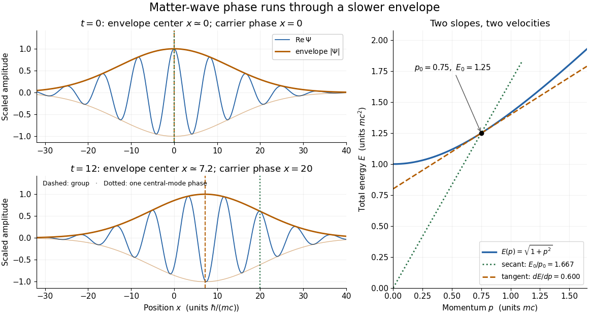

# Relativistic matter-wave velocities

↑ **Parent:** [Matter wave](matter-wave.md)

For a one-dimensional [free particle](free-particle.md) with $m>0$ and $p>0$, take the positive total [energy](energy-split.md) from the [relativistic energy-momentum relation](energy-momentum-relation.md):

$$
E(p)=\sqrt{m^2c^4+p^2c^2},\qquad
\omega=E/\hbar,\qquad k=p/\hbar.
$$

A fixed [plane wave](plane-wave.md) [quantum phase](quantum-phase.md) obeys $kx-\omega t=\text{constant}$. Its [phase velocity](phase-velocity.md) is therefore

$$
v_{\mathrm{ph}}=\frac{\omega}{k}=\frac{E}{p}=\frac{c^2}{v}>c.
$$

For a narrow [wave packet](wave-packet.md) centered at $p_0$, expand its [dispersion relation](dispersion-relation-split.md) as $E(p)\simeq E(p_0)+E'(p_0)(p-p_0)$. In the [Fourier inversion](fourier-inversion-theorem.md) [integral](integral-split.md) building the [wave packet](wave-packet.md), the envelope then depends on $x-E'(p_0)t$. Thus its [group velocity](group-velocity.md) is

$$
v_{\mathrm g}=\frac{d\omega}{dk}=\frac{dE}{dp}=\frac{pc^2}{E}=v<c,\qquad
v_{\mathrm{ph}}v_{\mathrm g}=c^2.
$$

The superluminal [phase velocity](phase-velocity.md) follows a repeating phase marker; it does not describe a localized signal or superluminal transport of [energy](energy-split.md). Higher derivatives of the [dispersion relation](dispersion-relation-split.md) produce [wave packet](wave-packet.md) spreading, so the translated-envelope argument is a narrow-band approximation. For $v=0.6c$, the [Lorentz factor](lorentz-factor.md) is $1.25$, $p=0.75mc$ and $E=1.25mc^2$: the [group velocity](group-velocity.md) is $0.6c$ while the [phase velocity](phase-velocity.md) is $5c/3$.

**[Figure 1](#image-a-matter-wave-s-phase-velocity-and-group-velocity-are-different-slopes). A matter wave's phase velocity and group velocity are different slopes**. [Source](matter-wave-phase-and-group-velocity.py). Original one-dimensional [Fourier inversion](fourier-inversion-theorem.md) model with $m=c=\hbar=1$, central [momentum](momentum-split.md) $p_0=0.75$ and [Gaussian function](gaussian-function.md) momentum amplitude $a(p)\propto\exp[-(p-p_0)^2/(4\sigma_p^2)]$, $\sigma_p=0.055$. The blue curve is the real part of $\Psi(x,t)=\int a(p)e^{i(px-E(p)t)}\,dp$ and the orange curves bound its amplitude. Dashed lines mark $v_{\mathrm g}t$; dotted lines track one phase of the central [plane wave](plane-wave.md), $x=Et/p$. The right panel compares the secant and tangent slopes. This scalar model illustrates the [dispersion relation](dispersion-relation-split.md), without representing [electron](electron.md) [spin](spin.md) or measured particle paths.

The total-[energy](energy-split.md) convention matters. Define $\psi=e^{imc^2t/\hbar}\Psi$ to remove the common [rest energy](rest-energy.md) from a [wavefunction](wave-function-split.md) $\Psi$ with total-[energy](energy-split.md) time dependence. Then

$$
K=E-mc^2\simeq\frac{p^2}{2m},\qquad
\omega_{\mathrm{NR}}=K/\hbar,\qquad
\frac{\omega_{\mathrm{NR}}}{k}\simeq\frac{p}{2m},\qquad
\frac{d\omega_{\mathrm{NR}}}{dk}\simeq\frac{p}{m}.
$$

This is exactly the [free-particle momentum convention](free-particle-momentum-convention.md) used by the [Schrödinger equation](schrodinger-equation.md) here. Removing a common time-dependent [global phase](global-phase.md) changes the reported [phase velocity](phase-velocity.md), while leaving the [de Broglie wavelength](de-broglie-wavelength.md), relative spatial [quantum phases](quantum-phase.md) and [group velocity](group-velocity.md) unchanged. Adding $mc^2$ again to a total [energy](energy-split.md) would count the [rest energy](rest-energy.md) twice.

## ↑ Ancestors (6)

1. [Matter wave](matter-wave.md)
2. [Wave function](wave-function-split.md)
3. [Quantum mechanics](quantum-mechanics-split.md)
4. [Branches of physics](branches-of-physics.md)
5. [Physics](physics-split.md)
6. [Codex Wiki](split.md)

## ← Incoming links (1)

- [Matter wave](matter-wave.md)
