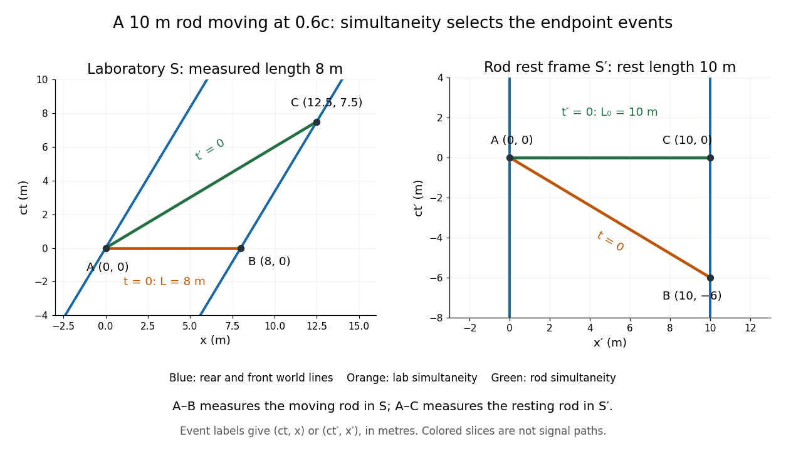

# Relativity of simultaneity

↑ **Parent:** [Lorentz transformation](lorentz-transformation.md)  
ⓦ [Wiki](https://en.wikipedia.org/wiki/Relativity_of_simultaneity)

Spatially separated simultaneous events in one [inertial frame](inertial-frame.md) are generally not simultaneous in a relatively moving frame. The [Lorentz transformation](lorentz-transformation.md) explicitly mixes position into time. This is essential when comparing distances between moving light pulses: one must compare their positions at the same time in the measuring frame.

At $v=0.6c$, the rod's simultaneous laboratory endpoint measurements in [length contraction](length-contraction.md) have $(ct,x)=(0,0)$ and $(0,8\,\mathrm m)$. They become $(ct',x')=(0,0)$ and $(-6\,\mathrm m,10\,\mathrm m)$. In contrast, simultaneous rod-frame measurements at $t'=0$ use $(ct,x)=(0,0)$ and $(7.5\,\mathrm m,12.5\,\mathrm m)$. The latter front-end event occurs later in the laboratory, after the front has moved. The sloping $t'=0$ line in the figure is a set of simultaneous [spacetime events](event-relativity.md), not a signal's trajectory. [Joe Wolfe, UNSW: Lorentz transformations and spacetime](https://newt.phys.unsw.edu.au/einsteinlight/jw/module4_Lorentz_transforms.htm).

**[Figure 7](#image-the-same-moving-rod-measured-on-laboratory-and-rod-frame-simultaneity-slices-length-measurements-use-different-endpoint-events). The same moving rod measured on laboratory and rod-frame simultaneity slices; length measurements use different endpoint events**.

**Table of contents**

- [Ladder paradox](ladder-paradox.md)
- [Tunnel photon timing in two inertial frames](tunnel-photon-timing-in-two-inertial-frames.md)
- [Simultaneity](simultaneity.md)
- [Minkowski simultaneity relative to an inertial observer](minkowski-simultaneity-relative-to-an-inertial-observer.md)
  - [Failure of transitivity for mixed-frame simultaneity](failure-of-transitivity-for-mixed-frame-simultaneity.md)
- [Rod containment and simultaneity](rod-containment-and-simultaneity.md)
- [Photon separation under a collinear Lorentz boost](photon-separation-under-a-collinear-lorentz-boost.md)

## ↑ Ancestors (5)

1. [Lorentz transformation](lorentz-transformation.md)
2. [Special relativity](special-relativity-split.md)
3. [Branches of physics](branches-of-physics.md)
4. [Physics](physics-split.md)
5. [Codex Wiki](split.md)

## ← Incoming links (29)

- [Ladder paradox](ladder-paradox.md)
- [Lorentz transformation](lorentz-transformation.md)
- [Solution](past-exam-of-the-mathematics-course-of-the-university-of-cambridge/2002/ib/paper-4/18d/b/solution.md)
- [Solution](past-exam-of-the-mathematics-course-of-the-university-of-cambridge/2005/ib/paper-2/7g/solution.md)
- [Solution](past-exam-of-the-mathematics-course-of-the-university-of-cambridge/2006/ib/paper-4/17b/d/solution.md)
- [Solution](past-exam-of-the-mathematics-course-of-the-university-of-cambridge/2008/ib/paper-4/17c/d/solution.md)
- [Solution](past-exam-of-the-mathematics-course-of-the-university-of-cambridge/2012/ia/paper-4/4b/solution.md)
- [Solution](past-exam-of-the-philosophy-of-space-time-and-philosophy-of-quantum-mechanics-paper-of-parts-a-and-b-of-the-physics-course-of-the-university-of-oxford/2019/5/solution.md)
- [Solution](past-exam-of-the-philosophy-of-space-time-course-of-the-university-of-oxford/2021/2/solution.md)
- [Solution](past-exam-of-the-philosophy-of-space-time-course-of-the-university-of-oxford/2021/3/solution.md)
- [Solution](past-exam-of-the-philosophy-of-space-time-course-of-the-university-of-oxford/2022/2/solution.md)
- [Solution](past-exam-of-the-philosophy-of-space-time-course-of-the-university-of-oxford/2022/4/solution.md)
- [Solution](past-exam-of-the-philosophy-of-space-time-course-of-the-university-of-oxford/2022/6/solution.md)
- [Solution](past-exam-of-the-physics-1-paper-of-the-university-of-oxford/2013/10/b/solution.md)
- [Solution](past-exam-of-the-physics-1-paper-of-the-university-of-oxford/2014/6/solution.md)
- [B](past-exam-of-the-physics-1-paper-of-the-university-of-oxford/2015/11/b.md)
- [Solution](past-exam-of-the-physics-1-paper-of-the-university-of-oxford/2019-resit/7/solution.md)
- [Solution](past-exam-of-the-physics-1-paper-of-the-university-of-oxford/2022/7/b/solution.md)
- [Solution](past-exam-of-the-physics-course-of-the-year-1-of-the-natural-sciences-course-of-the-university-of-cambridge/2018/section-a/2/solution.md)
- [Solution](past-exam-of-the-short-options-paper-shared-by-prelims-and-parts-a-and-b-of-the-physics-course-of-the-university-of-oxford/2016/s27/3/solution.md)
- [Solution](past-exam-of-the-short-options-paper-shared-by-prelims-and-parts-a-and-b-of-the-physics-course-of-the-university-of-oxford/2016/s27/4/solution.md)
- [Solution](past-exam-of-the-short-options-paper-shared-by-prelims-and-parts-a-and-b-of-the-physics-course-of-the-university-of-oxford/2017/s27/1/solution.md)
- [Solution](past-exam-of-the-symmetry-and-relativity-course-of-the-university-of-oxford/2019/2/a/solution.md)
- [Special relativity](special-relativity-split.md)
- [Tunnel photon timing in two inertial frames](tunnel-photon-timing-in-two-inertial-frames.md)
- [Twin paradox](twin-paradox.md)
- [Twin paradox simultaneity change](twin-paradox-simultaneity-change.md)
- [Twin paradox with finite acceleration](twin-paradox-with-finite-acceleration.md)
- [Velocity-addition formula](velocity-addition-formula.md)
