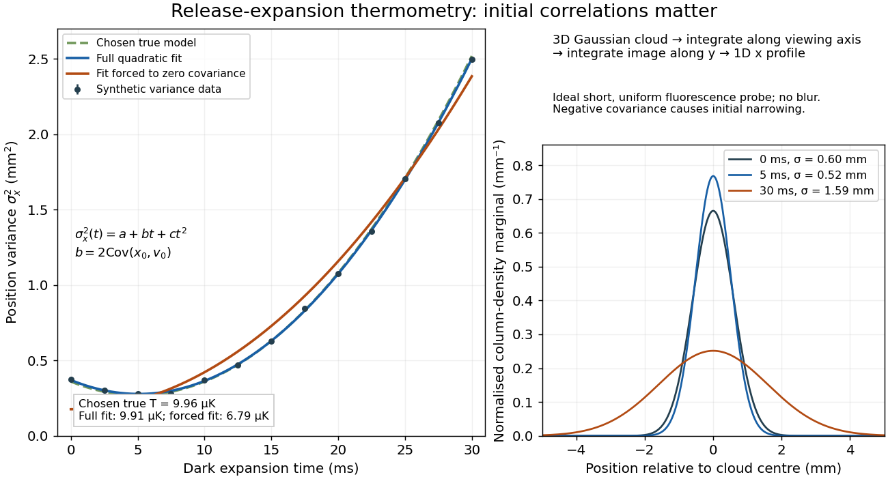

# Release-expansion thermometry

↑ **Parent:** [Sub-Doppler cooling](sub-doppler-cooling.md)

A spatial image after a chosen dark interval is a different readout from continuously recording arrivals at a fixed probe. Here is an original idealised [fluorescence](fluorescence-split.md) imaging model: release a dilute cloud, let it move freely, then apply a short uniform probe pulse. Neglect [collisions](collision.md), residual [forces](force-split.md), attenuation and motion during the pulse. Use each image's cloud centre to remove mean drift. Uniform [gravity](gravity.md) shifts that centre without changing the centred [variance](variance-split.md).

For each atom let $x(t)=x_0+v_0t$ along a horizontal imaging axis. Expanding the square about the [expected values](expected-value-split.md) gives exactly

$$
\sigma_x^2(t)=\sigma_{x0}^2+2C_{xv}t+\sigma_v^2t^2,\qquad
C_{xv}=\operatorname{Cov}(x_0,v_0).
$$

No [Gaussian distribution](normal-distribution.md) is needed for this [variance](variance-split.md) identity. A jointly [Gaussian distribution](normal-distribution.md) of initial positions and [velocities](velocity.md) does make the later density [Gaussian](normal-distribution.md). For a separable three-dimensional cloud viewed along $z$, integration along the viewing direction gives the column density

$$
n_{\rm col}(x,y;t)=\int n(x,y,z;t)\,dz
=\frac{N}{2\pi\sigma_x(t)\sigma_y(t)}
\exp\left[-\frac{(x-\bar x(t))^2}{2\sigma_x^2(t)}-\frac{(y-\bar y(t))^2}{2\sigma_y^2(t)}\right].
$$

Here $N$ is atom number. Integrating this image along $y$ leaves a one-dimensional [Gaussian distribution](normal-distribution.md) with [standard deviation](standard-deviation.md) $\sigma_x(t)$. This is a projected density measurement, not a three-dimensional radius or a direct [velocity](velocity.md) histogram. Under the uniform, optically thin probe assumptions, expected [fluorescence](fluorescence-split.md) is proportional to this column density. A known, independent [point spread function](point-spread-function-split.md) with finite [variance](variance-split.md) adds its own [variance](variance-split.md) to the measured width; probe duration and intensity gradients need separate treatment.

For a [Maxwell-Boltzmann distribution](maxwell-boltzmann-distribution.md), $T_x=m\sigma_v^2/k_B$, where $m$ is atomic [mass](mass.md) and $k_B$ the [Boltzmann constant](boltzmann-constant.md). For a nonthermal distribution this defines a directional second-moment [temperature](temperature-split.md), which need not describe every feature of the distribution. A [covariance](covariance.md) between position and [velocity](velocity.md) can initially narrow the cloud even though $\sigma_v^2$ is positive. The physical [covariance matrix](covariance-matrix.md) requires $C_{xv}^2\le\sigma_{x0}^2\sigma_v^2$.

Choose $\sigma_{x0}=0.60\ \mathrm{mm}$, $\sigma_v=0.060\ \mathrm{m\,s^{-1}}$ and $C_{xv}=-0.018\ \mathrm{mm^2\,ms^{-1}}$, giving [correlation coefficient](pearson-correlation-coefficient.md) $-1/2$. With $t$ in milliseconds, the numerical [variance](variance-split.md) in square millimetres is $0.36-0.036t+0.0036t^2$. Its minimum occurs at $5\ \mathrm{ms}$, with [standard deviation](standard-deviation.md) $\sqrt{0.27}\ \mathrm{mm}$. These chosen values satisfy the [covariance matrix](covariance-matrix.md) constraint; early contraction is compatible with free motion.

Generate thirteen synthetic [variance](variance-split.md) observations at equally spaced times from $0$ to $30\ \mathrm{ms}$, adding independent [Gaussian noise](gaussian-noise.md) of [standard deviation](standard-deviation.md) $0.012\ \mathrm{mm^2}$. [Linear least squares](linear-least-squares.md) fits all three coefficients in $a+bt+ct^2$. The example yields $a\simeq0.37026\ \mathrm{mm^2}$, $b\simeq-0.036413\ \mathrm{mm^2\,ms^{-1}}$ and $c\simeq0.0035820\ \mathrm{mm^2\,ms^{-2}}$. With the chosen approximate [sodium](sodium.md) [mass](mass.md) $m=3.82\times10^{-26}\ \mathrm{kg}$, the true $T_x$ is $9.96\ \mathrm{\mu K}$ and the fitted value is $9.91\ \mathrm{\mu K}$. This is a fit to generated width data, not historical observations.

**[Figure 15](#image-cloud-expansion-with-an-initial-position-velocity-covariance). Cloud expansion with an initial position–velocity covariance**. Original synthetic variance observations and ideal column-density marginals. All parameters and noise are chosen here. The three-dimensional Gaussian is integrated along the viewing axis and then along the image's other axis. The profiles omit imaging blur.

If the same data are fitted to $a+ct^2$, forcing $C_{xv}=0$, the inferred $T_x$ falls to $6.79\ \mathrm{\mu K}$. The omitted term is partly absorbed into both fitted coefficients. In noiseless [linear least squares](linear-least-squares.md) with a free intercept, its precise effect on the quadratic coefficient is

$$
c_{\rm forced}=\sigma_v^2+2C_{xv}\frac{\operatorname{Cov}_{t}(t^2,t)}{\operatorname{Var}_{t}(t^2)},
$$

where the subscript denotes equal-weight moments over the chosen observation times, using one consistent unit system. Since the ratio is positive for distinct nonnegative times, negative $C_{xv}$ biases this estimate downwards. An incorrect release-time origin can also generate a linear term, so fitting it does not by itself identify a physical initial [covariance](covariance.md). Timing calibration, spatial resolution, residual [magnetic fields](magnetic-field-split.md) and probe-induced [recoil energy](recoil-energy.md) remain separate controls. Neither a cold-looking image nor a single long expansion time identifies all three coefficients.

## ↑ Ancestors (6)

1. [Sub-Doppler cooling](sub-doppler-cooling.md)
2. [Laser cooling](laser-cooling.md)
3. [Atomic measurement methods](atomic-measurement-methods.md)
4. [Atomic physics](atomic-physics-split.md)
5. [Physics](physics-split.md)
6. [Codex Wiki](split.md)
