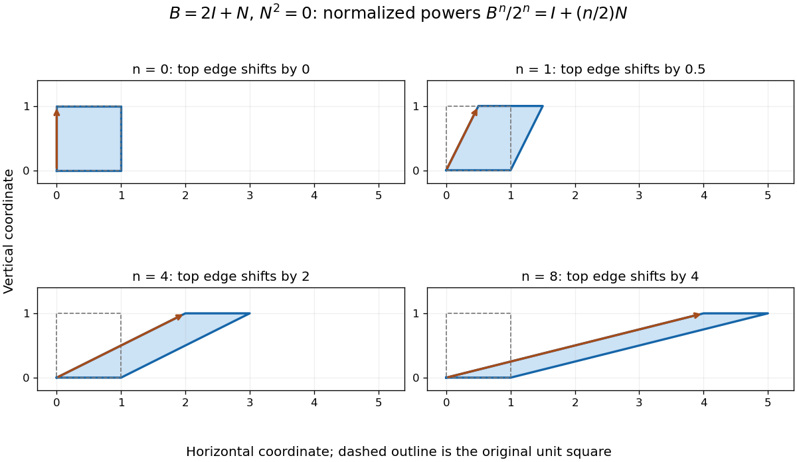

# Repeated eigenvalues in the Cayley-Hamilton theorem

↑ **Parent:** [Cayley-Hamilton theorem](cayley-hamilton-theorem-split.md)

Take a different real [matrix](matrix.md),

$$
B=\begin{pmatrix}2&1\\0&2\end{pmatrix}=2I+N,
\qquad N=\begin{pmatrix}0&1\\0&0\end{pmatrix}.
$$

Its only [eigenvalue](eigenvalue.md) is $2$, with [algebraic multiplicity](algebraic-multiplicity.md) two. However, the [polynomial](polynomial-split.md) $q(t)=t-2$, which vanishes at that [eigenvalue](eigenvalue.md), gives $q(B)=N\ne0$. Merely checking values at [eigenvalues](eigenvalue.md) cannot prove a matrix identity. The full [characteristic polynomial](characteristic-polynomial.md) does work:

$$
\chi_B(t)=(t-2)^2,\qquad \chi_B(B)=N^2=0.
$$

The [matrix](matrix.md) is a [Jordan block](jordan-block.md), and its [minimal polynomial](minimal-polynomial.md) is also $(t-2)^2$.

The [binomial theorem](binomial-theorem.md) gives, for positive [integers](integer-split.md) $n$,

$$
\boxed{B^n=2^nI+n2^{n-1}N.}
$$

Terms containing $N^2$ or a higher [matrix power](matrix-power.md) vanish. After removing the common growth factor $2^n$, the remaining [linear map](linear-map.md) is the [shear mapping](shear-mapping.md) $I+(n/2)N$. It moves $(x,y)$ to $(x+ny/2,y)$. The single [eigenvalue](eigenvalue.md) controls the exponential scale, while the [nilpotent matrix](nilpotent-matrix.md) adds a factor growing linearly in $n$.

**[Figure 2](#image-normalized-powers-of-a-jordan-block-retain-a-growing-shear-despite-having-only-one-eigenvalue-equal-axes-scales-show-the-top-edge-moving-by-n-2). Normalized powers of a Jordan block retain a growing shear despite having only one eigenvalue; equal axes scales show the top edge moving by n/2**.

In terms of [polynomial interpolation](polynomial-interpolation.md), reduction modulo $(t-2)^2$ retains both a value and a [derivative](derivative.md):

$$
f(B)=f(2)I+f'(2)N.
$$

Indeed, [polynomial division](polynomial-division.md) gives $f(t)=f(2)+f'(2)(t-2)+(t-2)^2h(t)$. This is a simple [Hermite interpolation](hermite-interpolation.md) condition. For $f(t)=t^n$, it gives exactly the displayed [matrix power](matrix-power.md). Repeated [eigenvalues](eigenvalue.md) retain information about how a [polynomial](polynomial-split.md) changes, not just where it vanishes.

## ↑ Ancestors (8)

1. [Cayley-Hamilton theorem](cayley-hamilton-theorem-split.md)
2. [Minimal polynomial](minimal-polynomial.md)
3. [Operator theory](linear-operator-theory-split.md)
4. [Linear algebra](linear-algebra-split.md)
5. [Algebra](algebra-split.md)
6. [Area of mathematics](area-of-mathematics.md)
7. [Mathematics](mathematics-split.md)
8. [Codex Wiki](split.md)

## ← Incoming links (1)

- [Minimal polynomial](minimal-polynomial.md)
