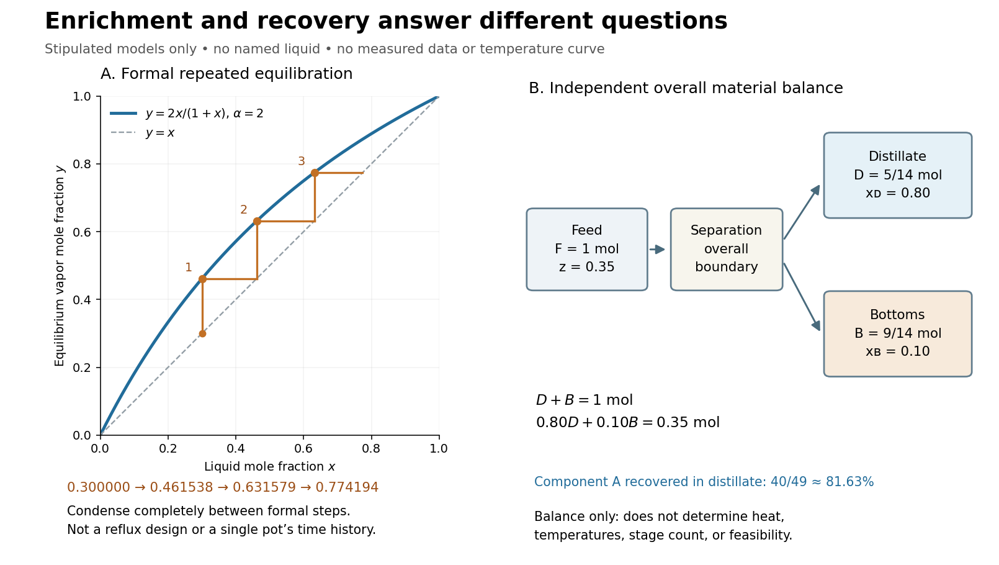

# Repeated ideal-stage enrichment

↑ **Parent:** [Relative volatility](relative-volatility.md)

Stipulate a constant [relative volatility](relative-volatility.md) $\alpha=2$. The [vapor-liquid equilibrium](vapor-liquid-equilibrium.md) model then becomes

$$
y=\frac{2x}{1+x},\qquad y-x=\frac{x(1-x)}{1+x}>0\quad(0<x<1).
$$

An initial [liquid](liquid.md) [mole fraction](mole-fraction.md) $x_0=3/10$ gives an equilibrium [vapor](vapor.md) [mole fraction](mole-fraction.md) $y_0=6/13\approx0.461538$. Now imagine completely condensing a small sample of that [vapor](vapor.md) and using this condensate as a fresh [liquid](liquid.md) for another equilibration. Repeating this formal operation gives

$$
x_0=\frac3{10}=0.300000
\;\longmapsto\;
x_1=\frac6{13}\approx0.461538
\;\longmapsto\;
x_2=\frac{12}{19}\approx0.631579
\;\longmapsto\;
x_3=\frac{24}{31}\approx0.774194.
$$

These are original model calculations of ideal-stage enrichment. They are not measured compositions, a [reflux](reflux.md) design, or successive compositions of one pot undergoing [simple distillation](simple-distillation.md). That pot loses the more volatile component and becomes depleted; each step here instead starts from the previous enriched condensate. The displayed sequence specifies compositions, not the recoverable amount at each step.

**[Figure 28](#image-distillation-ideal-enrichment-and-material-balance). Stipulated vapor-liquid equilibrium enrichment and a separate distillation material balance**. Left: the model $y=2x/(1+x)$ and formal repeated equilibration from $x_0=0.30$, using complete condensation between steps. The staircase is not a [reflux](reflux.md) design or one-pot time history. Right: an independent product split with feed [amount of substance](amount-of-substance.md) $F=1\,\mathrm{mol}$ and specified [mole fractions](mole-fraction.md). Neither panel contains measured data or a [boiling](boiling.md)-[temperature](temperature-split.md) curve.

The algebra makes the enrichment especially transparent. With composition odds $r_n=x_n/(1-x_n)$, every formal step doubles the odds, so

$$
r_n=2^n\frac37,\qquad x_n=\frac{3\,2^n}{7+3\,2^n}.
$$

For every finite $n$, $x_n<1$, although $x_n\to1$ as $n\to\infty$. This explains why repeated ideal equilibration can improve composition without making finite-step perfect separation a consequence of the model.

## ↑ Ancestors (4)

1. [Relative volatility](relative-volatility.md)
2. [Distillation](distillation.md)
3. [Chemistry](chemistry-split.md)
4. [Codex Wiki](split.md)

## ← Incoming links (1)

- [Fractional distillation](fractional-distillation.md)
