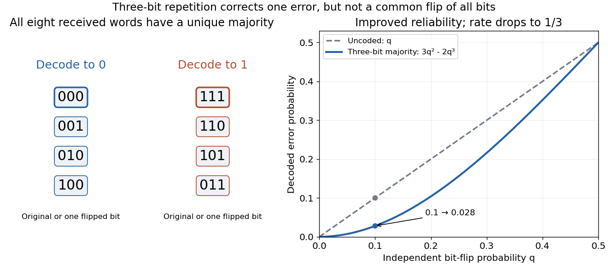

# Repetition code

↑ **Parent:** [Error-correcting code](error-correcting-code.md)  
ⓦ [Wiki](https://en.wikipedia.org/wiki/Repetition_code)

A binary repetition code represents one [bit](bit.md) by repeating it $n$ times, using [codewords](codeword.md) $0^n$ and $1^n$. Their [Hamming distance](hamming-distance.md) is $n$, and the [code rate](code-rate.md) is $1/n$. For odd $n$, the [majority function](majority-function.md) recovers the input whenever fewer than half the positions have flipped. Even $n$ allows a tied vote, so a decoder must specify how it handles that case.

For $n=3$, the received words $000,001,010,100$ decode to zero; $111,110,101,011$ decode to one. The decoder therefore corrects every single flip. This guarantee concerns the number of flipped positions, independent of any probabilistic model.

If each position passes independently through a [binary symmetric channel](binary-symmetric-channel.md) with crossover [probability](probability.md) $q$, a decoded error requires at least two flips. The [binomial distribution](binomial-distribution.md) gives

$$
P_{\mathrm{error}}=3q^2(1-q)+q^3=3q^2-2q^3.
$$

At $q=0.1$, the uncoded error [probability](probability.md) is $0.1$, while the three-bit code's decoded error [probability](probability.md) is $0.028$. This improvement costs three transmitted [bits](bit.md) per message [bit](bit.md). For $0<q<1/2$, $3q^2-2q^3<q$; for $q>1/2$, one should first exploit the known tendency to invert symbols rather than applying the same majority rule blindly.

**[Figure 1](#image-three-bit-majority-decoding-corrects-one-flip-and-lowers-the-error-probability-at-the-cost-of-rate). Three-bit majority decoding corrects one flip and lowers the error probability at the cost of rate**.

Independent flips are an essential assumption for the displayed formula. If a single common disturbance flips all three positions together with [probability](probability.md) $q$, repetition provides no improvement. More efficient [error-correcting codes](error-correcting-code.md) distribute redundancy across larger message blocks; repetition is useful as a transparent example of the geometry and the reliability–rate tradeoff.

## ↑ Ancestors (8)

1. [Error-correcting code](error-correcting-code.md)
2. [Binary block code](binary-block-code.md)
3. [Block code](block-code.md)
4. [Coding theory](coding-theory-split.md)
5. [Algebra](algebra-split.md)
6. [Area of mathematics](area-of-mathematics.md)
7. [Mathematics](mathematics-split.md)
8. [Codex Wiki](split.md)

## ← Incoming links (5)

- [Coding theory](coding-theory-split.md)
- [Solution](past-exam-of-the-mathematics-course-of-the-university-of-cambridge/2007/iii/paper-31/4/solution.md)
- [Solution](past-exam-of-the-mathematics-course-of-the-university-of-cambridge/2011/ii/paper-3/4g/solution.md)
- [Solution](past-exam-of-the-mathematics-course-of-the-university-of-cambridge/2015/ii/paper-4/3g/solution.md)
- [Solution](past-exam-of-the-mathematics-course-of-the-university-of-cambridge/2018/ii/paper-2/3h/solution.md)
