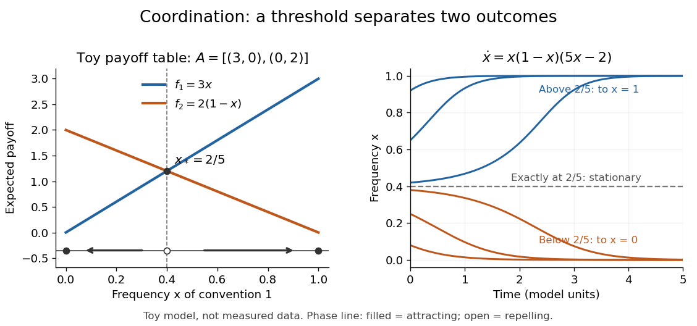
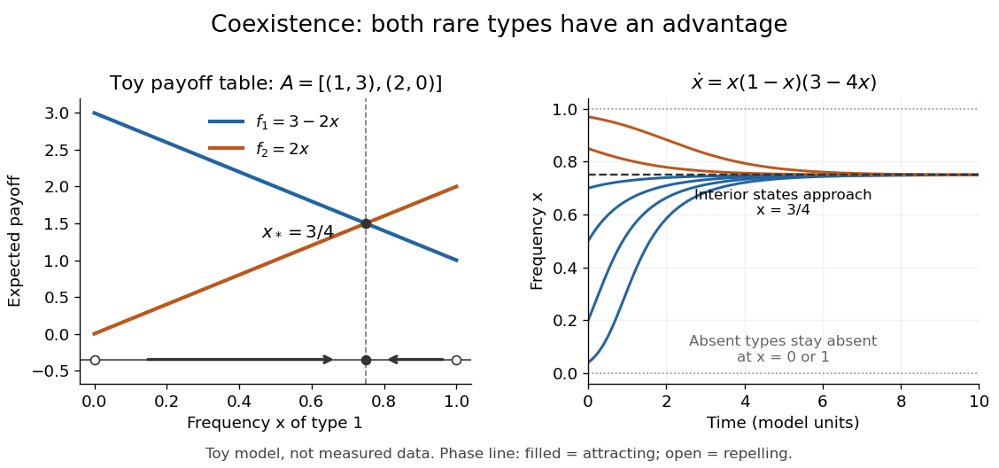

# Replicator equation

↑ **Parent:** [Evolutionary game theory](evolutionary-game-theory.md)

The [replicator equation](replicator-equation.md) says that a strategy grows in frequency when its [expected payoff](expected-payoff.md) exceeds the population's current [mean](expected-value-split.md) [payoff](payoff.md). It is an [ordinary differential equation](ordinary-differential-equation.md) for a composition, rather than for total population size. The subtraction of the [mean](expected-value-split.md) is what makes relative success matter: even a type growing in absolute number can shrink as a fraction if other types grow faster.

Let $x_i(t)$ be the frequency of [pure strategy](pure-strategy.md) $i$, with $n$ available [pure strategies](pure-strategy.md) and

$$
x\in\Delta_n=\left\{x\in\mathbb R^n:x_i\ge0,\ \sum_{i=1}^n x_i=1\right\}.
$$

In a [symmetric bimatrix game](symmetric-bimatrix-game.md), let the [payoff matrix](payoff-matrix.md) $A$ have entry $a_{ij}$ equal to the [payoff](payoff.md) to strategy $i$ against $j$. The other player's [payoff](payoff.md) in that encounter is $a_{ji}$: symmetry between player roles does not require $A=A^T$. Uniform random encounters give the [expected payoffs](expected-payoff.md) and their population [mean](expected-value-split.md)

$$
f_i(x)=(Ax)_i=\sum_j a_{ij}x_j,\qquad \bar f(x)=\sum_i x_if_i(x)=x^TAx.
$$

After choosing the time unit so that the growth-rate scale is one, the continuous-time [replicator equation](replicator-equation.md) is

$$
\dot x_i=x_i\bigl(f_i(x)-\bar f(x)\bigr)=x_i\bigl((Ax)_i-x^TAx\bigr),\qquad i=1,\ldots,n.
$$

Here a [payoff](payoff.md) is measured on a scale proportional to net growth per unit time, not merely as an arbitrary preference ranking. More generally one can specify [locally Lipschitz](locally-lipschitz-function.md) [frequency-dependent payoffs](frequency-dependent-payoff.md) $f_i(x)$ directly; the same equation with $\bar f=\sum_i x_if_i$ then defines a unique frequency trajectory. The linear pairwise model and its reproductive interpretation are given in [Taylor and Jonker (1978), sections 2–3](https://static1.squarespace.com/static/5dc9917c4cdb1467e1e54c4c/t/6526a5647942e33b89ab7af1/1697031525653/1978%2Bevolutionarily%2Bstable%2Bstrategies%2Band%2Bgame%2Bdynamics.pdf); the formulas here also follow by the following direct normalization.

Suppose the number $N_i$ of type $i$ obeys $\dot N_i=N_i[b(t)+f_i(x)]$, where the baseline $b(t)$ is identical for all types. Set $N=\sum_iN_i>0$ and $x_i=N_i/N$. The [quotient rule](quotient-rule.md) gives

$$
\dot N=N[b(t)+\bar f(x)],\qquad \dot x_i=\frac{\dot N_iN-N_i\dot N}{N^2}=x_i(f_i-\bar f).
$$

Thus the common baseline cancels. Adding the same constant to every entry of $A$ leaves the [replicator equation](replicator-equation.md) unchanged; multiplying $A$ by a positive constant changes only the speed along trajectories. The same [payoff matrix](payoff-matrix.md) can therefore describe frequency evolution at different growth-rate baselines and time scales.

The [probability simplex](probability-simplex.md) is invariant in forward time. On $\sum_i x_i=1$,

$$
\sum_i\dot x_i=\sum_i x_if_i-\bar f\sum_i x_i=0.
$$

Normalization alone would not exclude negative frequencies. Nonnegativity follows as well: along a solution,

$$
x_i(t)=x_i(0)\exp\left(\int_0^t [f_i(x(s))-\bar f(x(s))]\,ds\right).
$$

An absent type remains absent, and a positive frequency remains positive at every finite time. For the fixed [payoff matrix](payoff-matrix.md) model, bounded rates on the compact [probability simplex](probability-simplex.md) give global forward solutions. Frequencies can still tend to zero as $t\to\infty$. Each face is invariant, so this model has no spontaneous introduction of new [pure strategies](pure-strategy.md); [mutation](mutation.md) or outside introductions would require additional terms. For two present types the [logarithm](logarithm.md) of their frequency ratio satisfies $\frac{d}{dt}\log(x_i/x_j)=f_i-f_j$, directly expressing the accumulated [payoff](payoff.md) advantage.

For two [pure strategies](pure-strategy.md), write the composition as $(x,1-x)$, where $x$ is the frequency of strategy 1, and let

$$
A=\begin{pmatrix}a&b\\c&d\end{pmatrix},\qquad f_1=ax+b(1-x),\qquad f_2=cx+d(1-x).
$$

Their [payoff](payoff.md) difference and the resulting scalar [ordinary differential equation](ordinary-differential-equation.md) are

$$
\Delta f(x)=f_1-f_2=(b-d)+(a-b-c+d)x,\qquad \dot x=F(x)=x(1-x)\Delta f(x).
$$

In the interior $0<x<1$, the sign of the [payoff](payoff.md) difference determines the direction of motion. The endpoints are always [equilibrium points](equilibrium-point-of-a-dynamical-system.md), and an additional interior [equilibrium point](equilibrium-point-of-a-dynamical-system.md) exists precisely when the affine [payoff](payoff.md) difference has a zero strictly between them. At a simple interior zero $x_*$, $F'(x_*)=x_*(1-x_*)\Delta f'(x_*)$: a negative value gives [asymptotic stability](asymptotic-stability.md), a positive value gives [instability](instability.md). At the endpoints $F'(0)=b-d$ and $F'(1)=c-a$, with stability understood relative to $[0,1]$. A zero [derivative](derivative.md) requires examining the actual flow rather than this strict sign test.

For an original [coordination game](coordination-game.md), imagine two conventions that reward matching, with convention 1 giving the larger matching reward. Choose

$$
A_{\mathrm{coord}}=\begin{pmatrix}3&0\\0&2\end{pmatrix},\qquad f_1=3x,\quad f_2=2(1-x),\quad \dot x=x(1-x)(5x-2).
$$

The crossing is $x_*=2/5$. Below it, convention 1 loses frequency; above it, convention 1 gains frequency. The endpoint [equilibrium points](equilibrium-point-of-a-dynamical-system.md) $0$ and $1$ have one-sided [asymptotic stability](asymptotic-stability.md), while $2/5$ is unstable: the corresponding [derivatives](derivative.md) are $-2,-3$ and $6/5$, respectively. Every initial $0<x(0)<2/5$ tends to $0$, every initial $2/5<x(0)<1$ tends to $1$, and exactly $x(0)=2/5$ stays there. Even the convention with the larger matching reward can disappear if it starts below the threshold. This is [bistability](bistability.md), not selection of a universally best convention.

**[Figure 3](#image-toy-coordination-model-an-unstable-frequency-threshold-separates-attraction-to-the-two-pure-conventions). Toy coordination model: an unstable frequency threshold separates attraction to the two pure conventions**.

The compositions giving a [symmetric Nash equilibrium](symmetric-nash-equilibrium.md) in this [coordination game](coordination-game.md) are the two pure conventions and the mixed composition $(2/5,3/5)$. Both pure conventions are [evolutionarily stable strategies](evolutionarily-stable-strategy.md) because a mutant convention has strictly lower [payoff](payoff.md) against the pure resident. The mixed [symmetric Nash equilibrium](symmetric-nash-equilibrium.md) is not an [evolutionarily stable strategy](evolutionarily-stable-strategy.md): against that resident both conventions tie, but after a pure convention-1 mutant is introduced its [payoff](payoff.md) advantage is $5(x-2/5)>0$. Equal [payoffs](payoff.md) at a [symmetric Nash equilibrium](symmetric-nash-equilibrium.md) need not provide resistance to invasion or [asymptotic stability](asymptotic-stability.md).

For an original coexistence model, choose [payoffs](payoff.md) making each convention advantageous when sufficiently rare:

$$
A_{\mathrm{coex}}=\begin{pmatrix}1&3\\2&0\end{pmatrix},\qquad f_1=3-2x,\quad f_2=2x,\quad \dot x=x(1-x)(3-4x).
$$

Here $x_*=3/4$ attracts every initial composition with both types present: $\dot x>0$ below it and $\dot x<0$ above it. The interior [derivative](derivative.md) is $F'(3/4)=-3/4$, while $F'(0)=3$ and $F'(1)=1$ make both endpoints unstable to introduction of the other type. The endpoints nevertheless remain stationary if the other type is exactly absent; the attraction statement excludes those boundary initial states.

**[Figure 4](#image-toy-coexistence-model-both-rare-types-can-invade-and-every-interior-composition-approaches-frequency-three-quarters). Toy coexistence model: both rare types can invade, and every interior composition approaches frequency three quarters**.

The sole [symmetric Nash equilibrium](symmetric-nash-equilibrium.md) in this coexistence model is $p=(3/4,1/4)$. It is also an [evolutionarily stable strategy](evolutionarily-stable-strategy.md). For any different [mixed strategy](mixed-strategy.md) $q=(y,1-y)$, the first comparison in the [two-condition criterion for evolutionary stability](two-condition-criterion-for-evolutionary-stability.md) ties because $Ap=(3/2,3/2)$. Its second comparison is strictly positive:

$$
p^TAq-q^TAq=(p-q)^TAq=(3/4-y)(3-4y)=4(y-3/4)^2>0.
$$

Thus restoring frequency feedback can protect a mixture even though all present types earn equal [payoffs](payoff.md) at the mixture. Coexistence here means different individuals using different [pure strategies](pure-strategy.md); it does not require every individual to randomize with a [mixed strategy](mixed-strategy.md).

Frequency evolution need not increase the [mean](expected-value-split.md) [payoff](payoff.md). In the coexistence example $\bar f=5x-4x^2$, whose maximum occurs at $x=5/8$, whereas the attracting composition is $3/4$. For $5/8<x<3/4$, the frequency $x$ increases while $\frac{d}{dt}\bar f=(5-8x)\dot x<0$. Individual [payoff](payoff.md) advantages drive the equation; maximizing collective [mean](expected-value-split.md) [payoff](payoff.md) is a different [optimization](mathematical-optimization-split.md) problem.

More generally, a rest point only equalizes [payoffs](payoff.md) among present types: $x_i>0$ implies $(Ax)_i=x^TAx$. A [symmetric Nash equilibrium](symmetric-nash-equilibrium.md) additionally requires $(Ax)_i\le x^TAx$ for every absent type. All vertices are rest points even when an absent type could invade. For finite [symmetric bimatrix games](symmetric-bimatrix-game.md), a rest point with [Lyapunov stability](lyapunov-stability.md) on the full [probability simplex](probability-simplex.md) is a [symmetric Nash equilibrium](symmetric-nash-equilibrium.md); an interior trajectory that converges has a [symmetric Nash equilibrium](symmetric-nash-equilibrium.md) as its limit. These are conditional results, not a convergence theorem for every trajectory. See [Cressman and Tao (2014), Theorem 1](https://pmc.ncbi.nlm.nih.gov/articles/PMC4113915/).

The [rock paper scissors](rock-paper-scissors.md) [payoff matrix](payoff-matrix.md) gives an explicit obstruction to universal convergence:

$$
A=\begin{pmatrix}0&-1&1\\1&0&-1\\-1&1&0\end{pmatrix}.
$$

Since $A^T=-A$, $x^TAx=0$, and in the interior $\frac{d}{dt}\log(x_1x_2x_3)=\sum_i(Ax)_i=0$. Thus $x_1x_2x_3$ is conserved. Its maximum on the [probability simplex](probability-simplex.md) occurs only at $(1/3,1/3,1/3)$, the unique [symmetric Nash equilibrium](symmetric-nash-equilibrium.md), so an interior trajectory starting elsewhere cannot converge to that composition. Every other interior product level is a closed curve without a rest point, giving a [periodic orbit](periodic-orbit.md). The existence of these cycles is also discussed in [Cressman and Tao (2014), Example 1](https://pmc.ncbi.nlm.nih.gov/articles/PMC4113915/). The useful lesson is to inspect the specified [payoff](payoff.md) feedback and [dynamical system](dynamical-system.md), rather than infer convergence from the existence of an [evolutionarily stable strategy](evolutionarily-stable-strategy.md) or a [Nash equilibrium](nash-equilibrium.md).

## ↑ Ancestors (6)

1. [Evolutionary game theory](evolutionary-game-theory.md)
2. [Game theory](game-theory-split.md)
3. [Mathematical optimization](mathematical-optimization-split.md)
4. [Area of mathematics](area-of-mathematics.md)
5. [Mathematics](mathematics-split.md)
6. [Codex Wiki](split.md)

## ← Incoming links (4)

- [Evolutionary game theory](evolutionary-game-theory.md)
- [Frequency-dependent payoff](frequency-dependent-payoff.md)
- [Solution](past-exam-of-the-mathematics-course-of-the-university-of-cambridge/2001/iii/paper-52/6/b/solution.md)
- [Replicator equation](replicator-equation.md)
