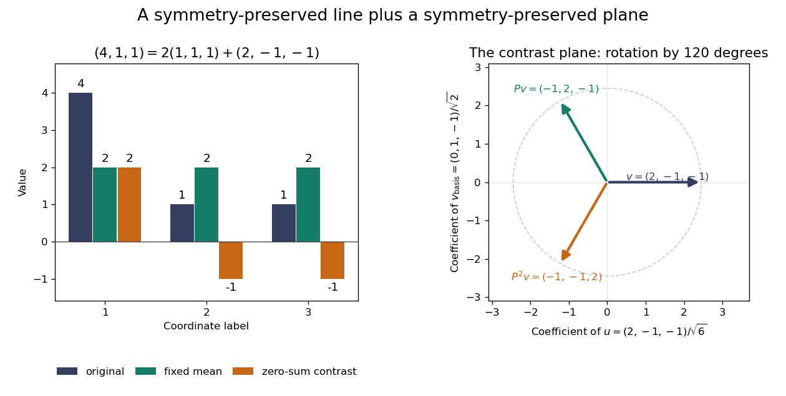
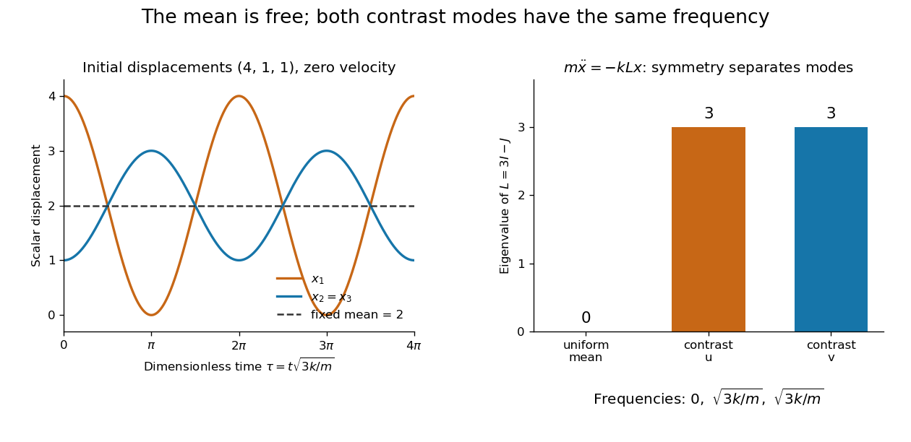

# Representation theory

↑ **Parent:** [Algebra](algebra-split.md)  
ⓦ [Wiki](https://en.wikipedia.org/wiki/Representation_theory)

Representation theory describes abstract symmetries by [linear maps](linear-map.md) on [vector spaces](vector-space-split.md). A [group representation](group-representation.md) assigns an invertible [linear map](linear-map.md) to each [group](group-split.md) element, respecting multiplication. The payoff is that a symmetry problem becomes a problem about [matrices](matrix.md), [invariant subspaces](invariant-subspace.md), and [eigenvalues](eigenvalue.md). Decomposing the action can reveal combinations of variables that a symmetric system cannot mix.

Take the [cyclic group](cyclic-group.md) $C_3=\{e,g,g^2\}$, with $g^3=e$. On three real coordinates, let $g$ send $(a,b,c)$ to $(c,a,b)$:

$$
\rho(g)=P=\begin{pmatrix}0&0&1\\1&0&0\\0&1&0\end{pmatrix},\qquad P^3=I.
$$

This [permutation representation](permutation-representation.md) does more than relabel a list: it acts linearly on every possible assignment of values to the three positions. The [vector](vector.md) $(1,1,1)$ stays fixed. The [vector subspace](vector-subspace.md) $W=\{(a,b,c):a+b+c=0\}$ is also preserved, since a permutation does not change the sum.

Every [vector](vector.md) separates uniquely into these two types:

$$
(a,b,c)=\bar a(1,1,1)+(a-\bar a,b-\bar a,c-\bar a),\qquad
\bar a=\frac{a+b+c}{3}.
$$

For example, $(4,1,1)=2(1,1,1)+(2,-1,-1)$. The first term belongs to a [trivial representation](trivial-representation.md); the second is a contrast with zero coordinate sum. This is a [direct sum](direct-sum.md) decomposition $\mathbb R^3=\mathbb R(1,1,1)\oplus W$. The symmetry preserves the mean and rotates the contrasts.

**[Figure 1](#image-three-coordinate-cyclic-symmetry-preserves-the-mean-and-rotates-the-zero-sum-contrasts-by-120-degrees). Three-coordinate cyclic symmetry preserves the mean and rotates the zero-sum contrasts by 120 degrees**.

The rotation is literal after choosing the [orthonormal basis](orthonormal-basis.md) $u=(2,-1,-1)/\sqrt6$, $v=(0,1,-1)/\sqrt2$ of $W$. In this basis,

$$
P|_W=\begin{pmatrix}-1/2&-\sqrt3/2\\\sqrt3/2&-1/2\end{pmatrix}.
$$

It is a rotation through $120$ degrees, and three applications return to the starting point. There is no nonzero invariant real line, because this rotation has no real [eigenvector](eigenvector.md). Thus the two-dimensional action is an [irreducible representation](irreducible-representation.md) over the [real numbers](real-number.md). Over the [complex numbers](complex-number.md) it instead splits into two [eigenlines](eigenline.md) with [eigenvalues](eigenvalue.md) $e^{2\pi i/3}$ and $e^{-2\pi i/3}$. The coefficient [field](field.md) is part of an irreducibility claim.

Why would this decomposition matter for a physical calculation? Consider three equal masses with scalar displacements $x_i$ and the symmetric quadratic coupling energy

$$
V(x)=\frac{k}{2}\left[(x_1-x_2)^2+(x_2-x_3)^2+(x_3-x_1)^2\right],\qquad k>0.
$$

The [equations of motion](equation-of-motion.md) are $m\ddot x=-kLx$, where

$$
L=\begin{pmatrix}2&-1&-1\\-1&2&-1\\-1&-1&2\end{pmatrix}=3I-J
$$

is a [graph Laplacian](laplacian-matrix.md) and $J$ is the all-ones [matrix](matrix.md). The constant [vector](vector.md) has [eigenvalue](eigenvalue.md) zero: translating all coordinates equally costs no coupling energy. On $W$, $J$ vanishes and $L=3I$, so both independent contrast directions have [angular frequency](angular-frequency.md) $\sqrt{3k/m}$. A three-coordinate coupled problem reduces to a free mean and two identical [harmonic oscillators](simple-harmonic-motion.md).

**[Figure 2](#image-equal-pair-couplings-leave-the-mean-fixed-and-make-two-independent-zero-sum-modes-oscillate-at-the-same-frequency). Equal pair couplings leave the mean fixed and make two independent zero-sum modes oscillate at the same frequency**.

For initial displacement $x(0)=(4,1,1)$ and initial [velocity](velocity.md) zero, the exact solution is $x(t)=2(1,1,1)+\cos(\sqrt{3k/m}\,t)(2,-1,-1)$. The fixed mean and oscillating contrast can be read directly from the decomposition. More generally, a [linear operator](linear-operator.md) commuting with the group action carries its fixed-vector subspace into itself; with an invariant [inner product](inner-product-split.md), it preserves the corresponding orthogonal complement too.

For a [finite group](finite-group.md), averaging over the action constructs an invariant [inner product](inner-product-split.md) over the [real numbers](real-number.md) or [complex numbers](complex-number.md). The resulting invariant complements explain [Maschke's theorem](maschke-s-theorem.md): a finite-dimensional [group representation](group-representation.md) decomposes into [irreducible representations](irreducible-representation.md). [Characters](character-of-a-representation.md) compress the action into traces and help identify those pieces. The assumptions matter; in [modular representation theory](modular-representation-theory-split.md) the coefficient [field](field.md) can have [characteristic](characteristic-of-a-field.md) dividing the group order, and such decompositions can fail. Chapter 4 of Pavel Etingof and coauthors' notes develops these mechanisms. [Etingof and coauthors: Introduction to representation theory](https://math.mit.edu/~etingof/reprbook.pdf).

**Table of contents**

- [Representation ring of a compact group](representation-ring-of-a-compact-group.md)
  - [Representation ring of an odd-dimensional special orthogonal group](representation-ring-of-an-odd-dimensional-special-orthogonal-group.md)
- [Subrepresentation](subrepresentation.md)
  - [Quotient representation](quotient-representation.md)
- [Group representation](group-representation.md)
  - [Character projection operator](character-projection-operator.md)
  - [Quarter-turn action on diagonal quadratic forms](quarter-turn-action-on-diagonal-quadratic-forms.md)
  - [Equivalence of group representations](equivalence-of-group-representations.md)
  - [Inverse-adjoint representation](inverse-adjoint-representation.md)
  - [One-dimensional representation](one-dimensional-representation.md)
  - [Projective representation](projective-representation.md)
  - [Orthogonal representation](orthogonal-representation.md)
  - [Representation over the rational numbers](representation-over-the-rational-numbers.md)
  - [Scalar endomorphisms obstruct a split extension](scalar-endomorphisms-obstruct-a-split-extension.md)
  - [Distinct-character extensions of an abelian group split](distinct-character-extensions-of-an-abelian-group-split.md)
  - [Smooth representation of a locally profinite group](smooth-representation-of-a-locally-profinite-group.md)
    - [Smooth vector](smooth-vector.md)
    - [Smooth character](smooth-character.md)
    - [Jacquet module](jacquet-module.md)
    - [Smooth right regular representation](smooth-right-regular-representation.md)
    - [Admissible representation of a locally profinite group](admissible-representation-of-a-locally-profinite-group.md)
      - [Contraction and admissible fixed spaces](contraction-and-admissible-fixed-spaces.md)
    - [Fixed-vector space](fixed-vector-space.md)
  - [Galois representation](galois-representation.md)
    - [Tate module](tate-module.md)
      - [CM Tate module stabilizer](cm-tate-module-stabilizer.md)
      - [Rational Tate module](rational-tate-module.md)
    - [Galois character](galois-character.md)
    - [Cyclotomic character](cyclotomic-character.md)
      - [Tate twist](tate-twist.md)
  - [Invariant theory](invariant-theory.md)
    - [Geometric invariant theory](geometric-invariant-theory.md)
      - [Hilbert-Mumford criterion for projective stability](hilbert-mumford-criterion-for-projective-stability.md)
        - [Root-multiplicity criterion for stable binary forms](root-multiplicity-criterion-for-stable-binary-forms.md)
      - [Stable projective point in geometric invariant theory](stable-projective-point-in-geometric-invariant-theory.md)
      - [Affine null cone](affine-null-cone.md)
        - [Nilpotent cone for conjugation of matrices](nilpotent-cone-for-conjugation-of-matrices.md)
      - [Semistable projective point in geometric invariant theory](semistable-projective-point-in-geometric-invariant-theory.md)
      - [Linearization of a line bundle](linearization-of-a-line-bundle.md)
    - [Symbolic method for binary-form invariants](symbolic-method-for-binary-form-invariants.md)
      - [Transvectant of binary forms](transvectant-of-binary-forms.md)
    - [Polynomial invariant ring](polynomial-invariant-ring.md)
      - [Determinant-one cyclic quotient of the affine plane](determinant-one-cyclic-quotient-of-the-affine-plane.md)
      - [Hilbert finite generation for reductive invariants](hilbert-finite-generation-for-reductive-invariants.md)
      - [Reynolds operator on a polynomial invariant ring](reynolds-operator-on-a-polynomial-invariant-ring.md)
      - [Binary dihedral invariant hypersurface](binary-dihedral-invariant-hypersurface.md)
      - [Quadratic cone invariant ring](quadratic-cone-invariant-ring.md)
      - [Factorial invariant ring with no linear characters](factorial-invariant-ring-with-no-linear-characters.md)
      - [Orbit product of polynomial factors](orbit-product-of-polynomial-factors.md)
      - [Alternating-group polynomial invariants](alternating-group-polynomial-invariants.md)
  - [Restriction of a representation](restriction-of-a-representation.md)
    - [Restriction multiplicity bound](restriction-multiplicity-bound.md)
  - [Sum of squares of irreducible representation dimensions](sum-of-squares-of-irreducible-representation-dimensions.md)
  - [Intertwiner](intertwiner.md)
  - [Matrix coefficient](matrix-coefficient.md)
    - [Schur orthogonality relations](schur-orthogonality-relations.md)
      - [Character orthogonality for compact groups](character-orthogonality-for-compact-groups.md)
      - [Schur averaging of rectangular matrices](schur-averaging-of-rectangular-matrices.md)
  - [Cyclic vector for a group representation](cyclic-vector-for-a-group-representation.md)
    - [Cyclic eigenvector obstruction to invariant vectors](cyclic-eigenvector-obstruction-to-invariant-vectors.md)
  - [Multiplicity-free restriction](multiplicity-free-restriction.md)
  - [Pseudoreal representation](pseudoreal-representation.md)
  - [Splitting field for finite group representations](splitting-field-for-finite-group-representations.md)
  - [Tensor product of group representations](tensor-product-of-group-representations.md)
    - [Symmetric square of a group representation](symmetric-square-of-a-group-representation.md)
    - [Trivial representation in a tensor square](trivial-representation-in-a-tensor-square.md)
    - [External tensor product of group representations](external-tensor-product-of-group-representations.md)
    - [Fundamental-antifundamental decomposition for SU(N)](fundamental-antifundamental-decomposition-for-su-n.md)
    - [SU(n) tensor transformation](su-n-tensor-transformation.md)
    - [Invariant tensor](invariant-tensor.md)
    - [Octet and singlet in a fundamental SU3 tensor product](octet-and-singlet-in-a-fundamental-su3-tensor-product.md)
  - [Conjugation representation](conjugation-representation.md)
  - [Trivial representation](trivial-representation.md)
    - [Fully symmetric representation](fully-symmetric-representation.md)
    - [Gauge singlet](gauge-singlet.md)
    - [Scalar representation](scalar-representation.md)
  - [Vector representation](vector-representation.md)
  - [Matrix representation](matrix-representation.md)
  - [Invariant subspace](invariant-subspace.md)
    - [Fixed-point subspace of a group action](fixed-point-subspace-of-a-group-action.md)
    - [Reducible representation](reducible-representation.md)
  - [Semisimple representation](semisimple-representation.md)
- [Maschke's theorem](maschke-s-theorem.md)
- [Modular representation theory](modular-representation-theory.md)
  - [p-local module](modular-representation-theory.md#p-local-module)
  - [Splitting p-modular system](modular-representation-theory.md#splitting-p-modular-system)
  - [Indecomposable modules for a cyclic p-group](modular-representation-theory.md#indecomposable-modules-for-a-cyclic-p-group)
  - [Modular representation ring](modular-representation-theory.md#modular-representation-ring)
  - [Indecomposable modules of a cyclic p-group in characteristic p](modular-representation-theory.md#indecomposable-modules-of-a-cyclic-p-group-in-characteristic-p)
  - [Group algebra of a p-group in characteristic p is local](modular-representation-theory.md#group-algebra-of-a-p-group-in-characteristic-p-is-local)
  - [p-modular system](modular-representation-theory.md#p-modular-system)
    - [Integral form of a group representation](modular-representation-theory.md#integral-form-of-a-group-representation)
      - [Reduction of Hom from a projective group-algebra lattice](modular-representation-theory.md#reduction-of-hom-from-a-projective-group-algebra-lattice)
  - [p-regular element](modular-representation-theory.md#p-regular-element)
  - [Brauer character](modular-representation-theory.md#brauer-character)
    - [Brauer–Nesbitt theorem](modular-representation-theory.md#brauer-nesbitt-theorem)
      - [Brauer character basis theorem](modular-representation-theory.md#brauer-character-basis-theorem)
    - [Projective character](modular-representation-theory.md#projective-character)
    - [Brauer character inner product](modular-representation-theory.md#brauer-character-inner-product)
      - [Duality of simple and projective Brauer characters](modular-representation-theory.md#duality-of-simple-and-projective-brauer-characters)
        - [Column orthogonality for Brauer characters](modular-representation-theory.md#column-orthogonality-for-brauer-characters)
  - [Symmetric algebra (Frobenius algebra)](modular-representation-theory.md#symmetric-algebra-frobenius-algebra)
    - [Head-socle identity for a symmetric algebra](modular-representation-theory.md#head-socle-identity-for-a-symmetric-algebra)
    - [Group algebra is a symmetric algebra](modular-representation-theory.md#group-algebra-is-a-symmetric-algebra)
      - [Projective modules over a finite group algebra are injective](modular-representation-theory.md#projective-modules-over-a-finite-group-algebra-are-injective)
        - [Head and socle of an indecomposable projective group-algebra module](modular-representation-theory.md#head-and-socle-of-an-indecomposable-projective-group-algebra-module)
          - [Dual of a projective cover over a group algebra](modular-representation-theory.md#dual-of-a-projective-cover-over-a-group-algebra)
        - [Group norm element detects the trivial projective cover](modular-representation-theory.md#group-norm-element-detects-the-trivial-projective-cover)
  - [Relative projective module](modular-representation-theory.md#relative-projective-module)
    - [Relative trace](modular-representation-theory.md#relative-trace)
      - [Transfer ideal of conjugation-fixed elements](modular-representation-theory.md#transfer-ideal-of-conjugation-fixed-elements)
      - [D. Higman criterion](modular-representation-theory.md#d-higman-criterion)
        - [Projectivity detected on a subgroup of invertible index](modular-representation-theory.md#projectivity-detected-on-a-subgroup-of-invertible-index)
    - [Vertex of an indecomposable module](modular-representation-theory.md#vertex-of-an-indecomposable-module)
      - [Full-vertex modules for a noncyclic p-group](modular-representation-theory.md#full-vertex-modules-for-a-noncyclic-p-group)
      - [Green correspondence](modular-representation-theory.md#green-correspondence)
        - [Green correspondence from Mackey multiplicity](modular-representation-theory.md#green-correspondence-from-mackey-multiplicity)
        - [Green correspondent of a module](modular-representation-theory.md#green-correspondent-of-a-module)
        - [Green correspondence for blocks](modular-representation-theory.md#green-correspondence-for-blocks)
      - [Source of an indecomposable module](modular-representation-theory.md#source-of-an-indecomposable-module)
        - [Trivial source module](modular-representation-theory.md#trivial-source-module)
          - [Inflated quotient projectives have trivial source](modular-representation-theory.md#inflated-quotient-projectives-have-trivial-source)
          - [Permutation homomorphisms lift through modular reduction](modular-representation-theory.md#permutation-homomorphisms-lift-through-modular-reduction)
  - [Finite representation type of a group algebra](modular-representation-theory.md#finite-representation-type-of-a-group-algebra)
    - [Parameter family for an elementary abelian p-group](modular-representation-theory.md#parameter-family-for-an-elementary-abelian-p-group)
    - [Higman criterion for finite representation type of a group algebra](modular-representation-theory.md#higman-criterion-for-finite-representation-type-of-a-group-algebra)
  - [Defect-zero representation](modular-representation-theory.md#defect-zero-representation)
  - [Block of a group algebra](modular-representation-theory.md#block-of-a-group-algebra)
    - [Residue-content criterion for symmetric-group blocks](modular-representation-theory.md#residue-content-criterion-for-symmetric-group-blocks)
      - [Nakayama block theorem](modular-representation-theory.md#nakayama-block-theorem)
    - [Central character of a block](modular-representation-theory.md#central-character-of-a-block)
    - [Fong–Reynolds matrix decomposition](modular-representation-theory.md#fong-reynolds-matrix-decomposition)
    - [Principal block](modular-representation-theory.md#principal-block)
    - [Modular reduction of block idempotents](modular-representation-theory.md#modular-reduction-of-block-idempotents)
    - [Blocks and Cartan matrices under central p-quotients](modular-representation-theory.md#blocks-and-cartan-matrices-under-central-p-quotients)
    - [Block of S3 in characteristic three](modular-representation-theory.md#block-of-s3-in-characteristic-three)
      - [Indecomposable projectives of S3 in characteristic three](modular-representation-theory.md#indecomposable-projectives-of-s3-in-characteristic-three)
    - [2-modular blocks of S3](modular-representation-theory.md#2-modular-blocks-of-s3)
    - [Defect group of a block](modular-representation-theory.md#defect-group-of-a-block)
      - [Regular defect-group bimodule inside a block](modular-representation-theory.md#regular-defect-group-bimodule-inside-a-block)
      - [Defect groups are centralizer-conjugate Sylow intersections](modular-representation-theory.md#defect-groups-are-centralizer-conjugate-sylow-intersections)
      - [Modules in a block are projective relative to its defect group](modular-representation-theory.md#modules-in-a-block-are-projective-relative-to-its-defect-group)
      - [Central defect blocks are matrix algebras](modular-representation-theory.md#central-defect-blocks-are-matrix-algebras)
      - [Inertial quotient of a block](modular-representation-theory.md#inertial-quotient-of-a-block)
        - [Inertial index of a block](modular-representation-theory.md#inertial-index-of-a-block)
      - [Defect of a block](modular-representation-theory.md#defect-of-a-block)
      - [Brauer pair](modular-representation-theory.md#brauer-pair)
      - [Block with cyclic defect group](modular-representation-theory.md#block-with-cyclic-defect-group)
        - [Brauer tree algebra](modular-representation-theory.md#brauer-tree-algebra)
          - [Uniserial branch of a Brauer tree algebra](modular-representation-theory.md#uniserial-branch-of-a-brauer-tree-algebra)
          - [Brauer tree path presentation](modular-representation-theory.md#brauer-tree-path-presentation)
          - [Indecomposable count for a cyclic defect block](modular-representation-theory.md#indecomposable-count-for-a-cyclic-defect-block)
      - [2-modular defect groups of A5](modular-representation-theory.md#2-modular-defect-groups-of-a5)
      - [Trace criterion for defect groups](modular-representation-theory.md#trace-criterion-for-defect-groups)
      - [Brauer morphism](modular-representation-theory.md#brauer-morphism)
        - [Block idempotents centralize a normal p-subgroup](modular-representation-theory.md#block-idempotents-centralize-a-normal-p-subgroup)
        - [Brauer quotient of a module](modular-representation-theory.md#brauer-quotient-of-a-module)
        - [Brauer morphism on a defect transfer ideal](modular-representation-theory.md#brauer-morphism-on-a-defect-transfer-ideal)
        - [Brauer morphism and relative trace](modular-representation-theory.md#brauer-morphism-and-relative-trace)
      - [Brauer correspondence](modular-representation-theory.md#brauer-correspondence)
        - [Brauer correspondent of a block](modular-representation-theory.md#brauer-correspondent-of-a-block)
        - [Brauer third main theorem](modular-representation-theory.md#brauer-third-main-theorem)
        - [Block induction](modular-representation-theory.md#block-induction)
          - [Block induction requires the block's defect centralizer](modular-representation-theory.md#block-induction-requires-the-block-s-defect-centralizer)
        - [Nagao module theorem](modular-representation-theory.md#nagao-module-theorem)
          - [Juhász induction refinement](modular-representation-theory.md#juhasz-induction-refinement)
        - [Brauer first main theorem](modular-representation-theory.md#brauer-first-main-theorem)
          - [Brauer extended first main theorem](modular-representation-theory.md#brauer-extended-first-main-theorem)
        - [5-modular blocks of A5](modular-representation-theory.md#5-modular-blocks-of-a5)
    - [Decomposition matrix (modular representation theory)](modular-representation-theory.md#decomposition-matrix-modular-representation-theory)
      - [Dominance triangularity of modular symmetric-group decomposition](modular-representation-theory.md#dominance-triangularity-of-modular-symmetric-group-decomposition)
      - [Cartan matrix of a group algebra](modular-representation-theory.md#cartan-matrix-of-a-group-algebra)
  - [2-modular representation theory of GL3 of F2](modular-representation-theory.md#2-modular-representation-theory-of-gl3-of-f2)
- [Complex representation](complex-representation.md)
  - [Continuous representation of a topological group](continuous-representation-of-a-topological-group.md)
  - [Degree of a representation](degree-of-a-representation.md)
  - [Isomorphic representations](isomorphic-representations.md)
  - [Nonsemisimple translation representation of the infinite cyclic group](nonsemisimple-translation-representation-of-the-infinite-cyclic-group.md)
  - [Faithful representation](faithful-representation.md)
    - [Regular representation](regular-representation.md)
      - [Four-point regular representation of the Klein four-group](four-point-regular-representation-of-the-klein-four-group.md)
      - [Sum of squares of irreducible degrees](sum-of-squares-of-irreducible-degrees.md)
      - [Faithful irreducible representation of a finite simple group](faithful-irreducible-representation-of-a-finite-simple-group.md)
    - [Spectrum orbit bound for a faithful symmetric-group representation](spectrum-orbit-bound-for-a-faithful-symmetric-group-representation.md)
    - [Finite-dimensional representation obstruction from elementary abelian subgroups](finite-dimensional-representation-obstruction-from-elementary-abelian-subgroups.md)
    - [Real Heisenberg quotient has no faithful finite-dimensional representation](real-heisenberg-quotient-has-no-faithful-finite-dimensional-representation.md)
  - [One-dimensional representation kills the commutator subgroup](one-dimensional-representation-kills-the-commutator-subgroup.md)
  - [Inflation of a group representation](inflation-of-a-group-representation.md)
  - [Irreducible representation of a finite abelian group](irreducible-representation-of-a-finite-abelian-group.md)
    - [Complex irreducible representations of a finite cyclic group](complex-irreducible-representations-of-a-finite-cyclic-group.md)
- [Real representation](real-representation.md)
  - [Realification of a complex representation](realification-of-a-complex-representation.md)
  - [Irreducible real representations of a finite cyclic group](irreducible-real-representations-of-a-finite-cyclic-group.md)
  - [Real regular representation of a finite cyclic group](real-regular-representation-of-a-finite-cyclic-group.md)
- [Representation theory of SU(2)](representation-theory-of-su-2.md)
  - [Conjugate fundamental spinor of SU(2)](conjugate-fundamental-spinor-of-su-2.md)
  - [Homogeneous polynomial representation of SU2](homogeneous-polynomial-representation-of-su2.md)
    - [Character of the homogeneous polynomial representation of SU2](character-of-the-homogeneous-polynomial-representation-of-su2.md)
  - [Classification of finite-dimensional representations of SU2](classification-of-finite-dimensional-representations-of-su2.md)
  - [Self-duality of finite-dimensional SU2 representations](self-duality-of-finite-dimensional-su2-representations.md)
  - [Central parity on SU2 tensor products](central-parity-on-su2-tensor-products.md)
  - [Clebsch-Gordan coefficients](clebsch-gordan-coefficients.md)
    - [Ladder recurrence for Clebsch-Gordan coefficients](ladder-recurrence-for-clebsch-gordan-coefficients.md)
    - [3-j symbol](3-j-symbol.md)
    - [Clebsch-Gordan decomposition for SU2](clebsch-gordan-decomposition-for-su2.md)
      - [Tensor contractions in the SU2 Clebsch-Gordan decomposition](tensor-contractions-in-the-su2-clebsch-gordan-decomposition.md)
        - [Decomposition of three SU(2) spinors](decomposition-of-three-su-2-spinors.md)
      - [Flip parity in the SU2 tensor square](flip-parity-in-the-su2-tensor-square.md)
        - [Exterior square of an SU2 irreducible representation](exterior-square-of-an-su2-irreducible-representation.md)
          - [Second and third exterior powers of V4 of SU2](second-and-third-exterior-powers-of-v4-of-su2.md)
- [Character of an exterior square](character-of-an-exterior-square.md)
- [Character of an exterior cube](character-of-an-exterior-cube.md)
- [Averaging over a finite group](averaging-over-a-finite-group.md)
- [Unitary representation](unitary-representation.md)
  - [Triviality of finite-dimensional unitary representations of SL2R](triviality-of-finite-dimensional-unitary-representations-of-sl2r.md)
  - [Integrated unitary representation](integrated-unitary-representation.md)
  - [Positive energy unitary representation of the circle](positive-energy-unitary-representation-of-the-circle.md)
  - [Stone theorem for the circle group](stone-theorem-for-the-circle-group.md)
  - [Peter-Weyl theorem](peter-weyl-theorem.md)
    - [Finite faithful representation from point-separating representations](finite-faithful-representation-from-point-separating-representations.md)
    - [Convolution proof of uniform Peter-Weyl approximation](convolution-proof-of-uniform-peter-weyl-approximation.md)
    - [Frobenius reciprocity for compact groups](frobenius-reciprocity-for-compact-groups.md)
  - [Unitary irreducible representation](unitary-irreducible-representation.md)
  - [Unitarization of a finite-group representation](unitarization-of-a-finite-group-representation.md)
  - [Unitarization of a compact-group representation](unitarization-of-a-compact-group-representation.md)
    - [Complete reducibility of compact-group representations](complete-reducibility-of-compact-group-representations.md)
    - [Orthogonalization of a compact-group representation](orthogonalization-of-a-compact-group-representation.md)
  - [Representation of the circle group](representation-of-the-circle-group.md)
    - [Central circle weight-space decomposition](central-circle-weight-space-decomposition.md)
- [Class function](class-function.md)
  - [Conjugation averaging on a compact group](conjugation-averaging-on-a-compact-group.md)
- [Character orthogonality](character-orthogonality.md)
  - [Irreducible characters separate conjugacy classes](irreducible-characters-separate-conjugacy-classes.md)
  - [Character expansion of the identity delta](character-expansion-of-the-identity-delta.md)
  - [Row orthogonality relations for a character table](row-orthogonality-relations-for-a-character-table.md)
  - [Central character value of a conjugacy-class sum](central-character-value-of-a-conjugacy-class-sum.md)
    - [Irreducible character degree divides the group order](irreducible-character-degree-divides-the-group-order.md)
      - [No finite simple group has an irreducible character of degree two](no-finite-simple-group-has-an-irreducible-character-of-degree-two.md)
      - [Irreducible character degrees of a group of order two p](irreducible-character-degrees-of-a-group-of-order-two-p.md)
      - [Irreducible characters of a nonabelian group of order p q](irreducible-characters-of-a-nonabelian-group-of-order-p-q.md)
  - [Character inner product](character-inner-product.md)
- [Character table](character-table.md)
  - [Integral character reconstruction from column orthogonality](integral-character-reconstruction-from-column-orthogonality.md)
  - [Irreducible representations of G6n](irreducible-representations-of-g6n.md)
    - [Character table of G6n](character-table-of-g6n.md)
  - [Irreducible character degree](irreducible-character-degree.md)
    - [Irreducible characters of degree coprime to p](irreducible-characters-of-degree-coprime-to-p.md)
    - [Linear character](linear-character.md)
      - [Trivial character](trivial-character.md)
    - [Nonlinear irreducible character](nonlinear-irreducible-character.md)
- [Character theory](character-theory.md)
  - [Brauer's permutation lemma](brauer-s-permutation-lemma.md)
  - [Artin induction](artin-induction.md)
  - [Brauer induction](brauer-induction.md)
  - [Character of a representation](character-of-a-representation.md)
    - [Character of a localized orbital basis](character-of-a-localized-orbital-basis.md)
    - [Ordinary character](ordinary-character.md)
    - [Determinant character](determinant-character.md)
      - [Central commutator has no torsion from an abelian Sylow subgroup](central-commutator-has-no-torsion-from-an-abelian-sylow-subgroup.md)
    - [Kernel of a character](kernel-of-a-character.md)
    - [Characters distinguish finite-dimensional complex semisimple representations](characters-distinguish-finite-dimensional-complex-semisimple-representations.md)
    - [Character value of a representation](character-value-of-a-representation.md)
    - [Irreducible character](irreducible-character.md)
      - [Frobenius-Schur indicator](frobenius-schur-indicator.md)
        - [Central average of representation matrices at squares](central-average-of-representation-matrices-at-squares.md)
        - [Odd-order group conjugacy-class congruence](odd-order-group-conjugacy-class-congruence.md)
      - [Odd-order groups have no nontrivial real irreducible characters](odd-order-groups-have-no-nontrivial-real-irreducible-characters.md)
    - [Character constituent](character-constituent.md)
    - [Restriction of a character](restriction-of-a-character.md)
      - [Character extension](character-extension.md)
        - [Thompson's coprime character extension theorem](thompson-s-coprime-character-extension-theorem.md)
        - [Gluing determinant-normalized character extensions](gluing-determinant-normalized-character-extensions.md)
        - [Coprime-degree determinant extension theorem](coprime-degree-determinant-extension-theorem.md)
      - [Inertia group of a character](inertia-group-of-a-character.md)
        - [Clifford correspondence](clifford-correspondence.md)
      - [Character restriction norm bound](character-restriction-norm-bound.md)
        - [Index-two character restriction dichotomy](index-two-character-restriction-dichotomy.md)
    - [Virtual character](virtual-character.md)
      - [Brauer's characterization of characters](brauer-s-characterization-of-characters.md)
        - [Generalized character separating complementary prime elements](generalized-character-separating-complementary-prime-elements.md)
      - [Positive-degree norm-one virtual characters are irreducible](positive-degree-norm-one-virtual-characters-are-irreducible.md)
- [Burnside's lemma](burnside-s-lemma.md)
  - [Cycle index](cycle-index.md)
    - [Pattern inventory](pattern-inventory.md)
  - [Weighted Burnside lemma](weighted-burnside-lemma.md)
  - [Permutation representation of a two-transitive action](permutation-representation-of-a-two-transitive-action.md)
    - [Steinberg representation of GL2 over a finite field](steinberg-representation-of-gl2-over-a-finite-field.md)
- [Permutation representation](permutation-representation.md)
  - [Rank of a permutation action](rank-of-a-permutation-action.md)
  - [Permutation module](permutation-module.md)
  - [Deleted permutation module in characteristic two](deleted-permutation-module-in-characteristic-two.md)
  - [Permutation character](permutation-character.md)
  - [Gassmann equivalence](gassmann-equivalence.md)
    - [Point and hyperplane stabilizers are almost conjugate](point-and-hyperplane-stabilizers-are-almost-conjugate.md)
    - [Order-sixteen Gassmann pair](order-sixteen-gassmann-pair.md)
    - [Nonisomorphic Gassmann equivalent regular subgroups](nonisomorphic-gassmann-equivalent-regular-subgroups.md)
  - [Permutation character of a coset action](permutation-character-of-a-coset-action.md)
  - [Augmentation subrepresentation of a permutation representation](augmentation-subrepresentation-of-a-permutation-representation.md)
    - [Irreducible augmentation criterion for a transitive group action](irreducible-augmentation-criterion-for-a-transitive-group-action.md)
  - [Character norm of a permutation representation](character-norm-of-a-permutation-representation.md)
  - [Symmetric-group subset permutation representation](symmetric-group-subset-permutation-representation.md)
    - [Inclusion map between subset permutation modules](inclusion-map-between-subset-permutation-modules.md)
  - [Standard representation of the symmetric group](standard-representation-of-the-symmetric-group.md)
    - [Gelfand–Tsetlin basis of the standard representation](gelfand-tsetlin-basis-of-the-standard-representation.md)
    - [Three-dimensional irreducible representation of the alternating group on four letters](three-dimensional-irreducible-representation-of-the-alternating-group-on-four-letters.md)
- [Representation theory of the symmetric group](representation-theory-of-the-symmetric-group.md)
  - [Induction ring of symmetric-group characters](representation-theory-of-the-symmetric-group.md#induction-ring-of-symmetric-group-characters)
  - [Symmetric-group characters are integer-valued](representation-theory-of-the-symmetric-group.md#symmetric-group-characters-are-integer-valued)
  - [Young subgroup](representation-theory-of-the-symmetric-group.md#young-subgroup)
  - [Skew representation of a symmetric group](representation-theory-of-the-symmetric-group.md#skew-representation-of-a-symmetric-group)
  - [Deletion projection for a symmetric group](representation-theory-of-the-symmetric-group.md#deletion-projection-for-a-symmetric-group)
  - [Gelfand–Tsetlin algebra](representation-theory-of-the-symmetric-group.md#gelfand-tsetlin-algebra)
    - [Jucys–Murphy element](representation-theory-of-the-symmetric-group.md#jucys-murphy-element)
      - [Jucys–Murphy description of the center of a symmetric-group algebra](representation-theory-of-the-symmetric-group.md#jucys-murphy-description-of-the-center-of-a-symmetric-group-algebra)
      - [Cycle-sum identity for Young–Jucys–Murphy elements](representation-theory-of-the-symmetric-group.md#cycle-sum-identity-for-young-jucys-murphy-elements)
      - [Local spectral rules for Young–Jucys–Murphy elements](representation-theory-of-the-symmetric-group.md#local-spectral-rules-for-young-jucys-murphy-elements)
      - [Olshanskii centralizer lemma](representation-theory-of-the-symmetric-group.md#olshanskii-centralizer-lemma)
    - [Gelfand–Tsetlin basis](representation-theory-of-the-symmetric-group.md#gelfand-tsetlin-basis)
      - [Young seminormal form](representation-theory-of-the-symmetric-group.md#young-seminormal-form)
        - [Young orthogonal form](representation-theory-of-the-symmetric-group.md#young-orthogonal-form)
  - [Sign representation](representation-theory-of-the-symmetric-group.md#sign-representation)
  - [Tensor identity for an induced character](representation-theory-of-the-symmetric-group.md#tensor-identity-for-an-induced-character)
    - [Prime-degree irreducible Kronecker product criterion for a symmetric group](representation-theory-of-the-symmetric-group.md#prime-degree-irreducible-kronecker-product-criterion-for-a-symmetric-group)
    - [Induced-tensor decomposition for the symmetric group on four points](representation-theory-of-the-symmetric-group.md#induced-tensor-decomposition-for-the-symmetric-group-on-four-points)
  - [Partition of an integer](representation-theory-of-the-symmetric-group.md#partition-of-an-integer)
    - [Reverse lexicographic order on partitions](representation-theory-of-the-symmetric-group.md#reverse-lexicographic-order-on-partitions)
    - [Glaisher partition bijection](representation-theory-of-the-symmetric-group.md#glaisher-partition-bijection)
    - [Dictionary order on integer partitions](representation-theory-of-the-symmetric-group.md#dictionary-order-on-integer-partitions)
    - [Young's lattice](representation-theory-of-the-symmetric-group.md#young-s-lattice)
      - [Young branching graph](representation-theory-of-the-symmetric-group.md#young-branching-graph)
        - [Oscillating path in the Young lattice](representation-theory-of-the-symmetric-group.md#oscillating-path-in-the-young-lattice)
    - [Generating function for partitions with bounded parts](representation-theory-of-the-symmetric-group.md#generating-function-for-partitions-with-bounded-parts)
    - [Self-conjugate partition and distinct odd parts](representation-theory-of-the-symmetric-group.md#self-conjugate-partition-and-distinct-odd-parts)
    - [Young diagram](representation-theory-of-the-symmetric-group.md#young-diagram)
      - [Durfee square](representation-theory-of-the-symmetric-group.md#durfee-square)
      - [Jeu de taquin](representation-theory-of-the-symmetric-group.md#jeu-de-taquin)
      - [Skew Young diagram](representation-theory-of-the-symmetric-group.md#skew-young-diagram)
        - [Standard skew Young tableau](representation-theory-of-the-symmetric-group.md#standard-skew-young-tableau)
          - [Standard skew tableau determinant](representation-theory-of-the-symmetric-group.md#standard-skew-tableau-determinant)
        - [Horizontal strip](representation-theory-of-the-symmetric-group.md#horizontal-strip)
        - [Totally disconnected skew Young diagram](representation-theory-of-the-symmetric-group.md#totally-disconnected-skew-young-diagram)
      - [Hook partition](representation-theory-of-the-symmetric-group.md#hook-partition)
      - [Addable node of a Young diagram](representation-theory-of-the-symmetric-group.md#addable-node-of-a-young-diagram)
      - [Removable node of a Young diagram](representation-theory-of-the-symmetric-group.md#removable-node-of-a-young-diagram)
      - [Conjugate partition](representation-theory-of-the-symmetric-group.md#conjugate-partition)
      - [Hook of a Young diagram](representation-theory-of-the-symmetric-group.md#hook-of-a-young-diagram)
        - [Arm of a Young-diagram cell](representation-theory-of-the-symmetric-group.md#arm-of-a-young-diagram-cell)
        - [Leg of a Young-diagram cell](representation-theory-of-the-symmetric-group.md#leg-of-a-young-diagram-cell)
        - [Hook length](representation-theory-of-the-symmetric-group.md#hook-length)
          - [Hook graph of a partition](representation-theory-of-the-symmetric-group.md#hook-graph-of-a-partition)
            - [Hook product of a partition](representation-theory-of-the-symmetric-group.md#hook-product-of-a-partition)
        - [Hook-interval decomposition at a Young-diagram cell](representation-theory-of-the-symmetric-group.md#hook-interval-decomposition-at-a-young-diagram-cell)
        - [Divisor closure of hook lengths](representation-theory-of-the-symmetric-group.md#divisor-closure-of-hook-lengths)
        - [Rim hook](representation-theory-of-the-symmetric-group.md#rim-hook)
          - [Border-strip tableau](representation-theory-of-the-symmetric-group.md#border-strip-tableau)
      - [Content of a Young-diagram cell](representation-theory-of-the-symmetric-group.md#content-of-a-young-diagram-cell)
      - [Principal hook lengths of a partition](representation-theory-of-the-symmetric-group.md#principal-hook-lengths-of-a-partition)
    - [Beta set of a partition](representation-theory-of-the-symmetric-group.md#beta-set-of-a-partition)
      - [Beta number of a partition](representation-theory-of-the-symmetric-group.md#beta-number-of-a-partition)
      - [Beta-set hook-product identity](representation-theory-of-the-symmetric-group.md#beta-set-hook-product-identity)
        - [Square-sum identity for shifted partition coordinates](representation-theory-of-the-symmetric-group.md#square-sum-identity-for-shifted-partition-coordinates)
      - [Hook criterion in a beta set](representation-theory-of-the-symmetric-group.md#hook-criterion-in-a-beta-set)
      - [Abacus of a partition](representation-theory-of-the-symmetric-group.md#abacus-of-a-partition)
        - [Core-quotient bijection for partitions](representation-theory-of-the-symmetric-group.md#core-quotient-bijection-for-partitions)
        - [Core of a partition](representation-theory-of-the-symmetric-group.md#core-of-a-partition)
          - [Weight of a partition](representation-theory-of-the-symmetric-group.md#weight-of-a-partition)
          - [Odd-minus-even hook count of a partition](representation-theory-of-the-symmetric-group.md#odd-minus-even-hook-count-of-a-partition)
        - [Quotient of a partition](representation-theory-of-the-symmetric-group.md#quotient-of-a-partition)
          - [Hooks divisible by the abacus modulus](representation-theory-of-the-symmetric-group.md#hooks-divisible-by-the-abacus-modulus)
        - [Quotient tower of a partition](representation-theory-of-the-symmetric-group.md#quotient-tower-of-a-partition)
          - [Four-quotient of the partition three-one](representation-theory-of-the-symmetric-group.md#four-quotient-of-the-partition-three-one)
          - [Two-quotient tower of the partition three-one](representation-theory-of-the-symmetric-group.md#two-quotient-tower-of-the-partition-three-one)
          - [Iterated quotient equals a power quotient up to permutation](representation-theory-of-the-symmetric-group.md#iterated-quotient-equals-a-power-quotient-up-to-permutation)
        - [Core tower of a partition](representation-theory-of-the-symmetric-group.md#core-tower-of-a-partition)
          - [Power-core truncation of a prime-core tower](representation-theory-of-the-symmetric-group.md#power-core-truncation-of-a-prime-core-tower)
          - [P-adic valuation of a symmetric-group character degree from the core tower](representation-theory-of-the-symmetric-group.md#p-adic-valuation-of-a-symmetric-group-character-degree-from-the-core-tower)
            - [Character degree coprime to p from the core tower](representation-theory-of-the-symmetric-group.md#character-degree-coprime-to-p-from-the-core-tower)
            - [Character-degree valuation does not increase on taking the p-core](representation-theory-of-the-symmetric-group.md#character-degree-valuation-does-not-increase-on-taking-the-p-core)
        - [Residue content of a partition](representation-theory-of-the-symmetric-group.md#residue-content-of-a-partition)
    - [Young tableau](representation-theory-of-the-symmetric-group.md#young-tableau)
      - [Young symmetrizer](representation-theory-of-the-symmetric-group.md#young-symmetrizer)
        - [Row-column collision lemma](representation-theory-of-the-symmetric-group.md#row-column-collision-lemma)
      - [Robinson–Schensted correspondence](representation-theory-of-the-symmetric-group.md#robinson-schensted-correspondence)
        - [Robinson-Schensted-Knuth correspondence](representation-theory-of-the-symmetric-group.md#robinson-schensted-knuth-correspondence)
          - [RSK insertion shape](representation-theory-of-the-symmetric-group.md#rsk-insertion-shape)
          - [RSK growth-diagram local rule](representation-theory-of-the-symmetric-group.md#rsk-growth-diagram-local-rule)
            - [Trace and odd columns in symmetric RSK](representation-theory-of-the-symmetric-group.md#trace-and-odd-columns-in-symmetric-rsk)
        - [Dual Robinson–Schensted–Knuth correspondence](representation-theory-of-the-symmetric-group.md#dual-robinson-schensted-knuth-correspondence)
      - [Row insertion](representation-theory-of-the-symmetric-group.md#row-insertion)
        - [Row-insertion bumping-path monotonicity](representation-theory-of-the-symmetric-group.md#row-insertion-bumping-path-monotonicity)
      - [Near Young tableau](representation-theory-of-the-symmetric-group.md#near-young-tableau)
      - [Standard Young tableau](representation-theory-of-the-symmetric-group.md#standard-young-tableau)
        - [Column-reading order of standard Young tableaux](representation-theory-of-the-symmetric-group.md#column-reading-order-of-standard-young-tableaux)
          - [Triangular vanishing of Young-symmetrizer products](representation-theory-of-the-symmetric-group.md#triangular-vanishing-of-young-symmetrizer-products)
        - [Admissible adjacent swap of a standard Young tableau](representation-theory-of-the-symmetric-group.md#admissible-adjacent-swap-of-a-standard-young-tableau)
        - [Content vector of a standard Young tableau](representation-theory-of-the-symmetric-group.md#content-vector-of-a-standard-young-tableau)
          - [Axial distance in a Young tableau](representation-theory-of-the-symmetric-group.md#axial-distance-in-a-young-tableau)
      - [Semistandard Young tableau](representation-theory-of-the-symmetric-group.md#semistandard-young-tableau)
        - [Bender-Knuth involution](representation-theory-of-the-symmetric-group.md#bender-knuth-involution)
        - [Lattice word](representation-theory-of-the-symmetric-group.md#lattice-word)
      - [Row and column stabilizers of a Young tableau](representation-theory-of-the-symmetric-group.md#row-and-column-stabilizers-of-a-young-tableau)
      - [Tabloid](representation-theory-of-the-symmetric-group.md#tabloid)
        - [Young permutation module](representation-theory-of-the-symmetric-group.md#young-permutation-module)
          - [Character of a Young permutation module](representation-theory-of-the-symmetric-group.md#character-of-a-young-permutation-module)
          - [Signed Young permutation module](representation-theory-of-the-symmetric-group.md#signed-young-permutation-module)
          - [Young's rule](representation-theory-of-the-symmetric-group.md#young-s-rule)
            - [Vershik linear relations](representation-theory-of-the-symmetric-group.md#vershik-linear-relations)
            - [Two-row Young permutation module decomposition](representation-theory-of-the-symmetric-group.md#two-row-young-permutation-module-decomposition)
            - [Kostka number](representation-theory-of-the-symmetric-group.md#kostka-number)
          - [Specht filtration of the ordered-pair permutation module](representation-theory-of-the-symmetric-group.md#specht-filtration-of-the-ordered-pair-permutation-module)
        - [Polytabloid](representation-theory-of-the-symmetric-group.md#polytabloid)
          - [Column antisymmetrizer of a Young tableau](representation-theory-of-the-symmetric-group.md#column-antisymmetrizer-of-a-young-tableau)
            - [Dominance from a nonzero column antisymmetrizer](representation-theory-of-the-symmetric-group.md#dominance-from-a-nonzero-column-antisymmetrizer)
            - [Nonzero column antisymmetrizer criterion](representation-theory-of-the-symmetric-group.md#nonzero-column-antisymmetrizer-criterion)
          - [Specht module](representation-theory-of-the-symmetric-group.md#specht-module)
            - [Standard polytabloid basis](representation-theory-of-the-symmetric-group.md#standard-polytabloid-basis)
              - [Garnir relation](representation-theory-of-the-symmetric-group.md#garnir-relation)
            - [Semistandard homomorphism theorem](representation-theory-of-the-symmetric-group.md#semistandard-homomorphism-theorem)
            - [Kernel intersection theorem for Specht modules](representation-theory-of-the-symmetric-group.md#kernel-intersection-theorem-for-specht-modules)
              - [Invariant vector criterion for a Specht module](representation-theory-of-the-symmetric-group.md#invariant-vector-criterion-for-a-specht-module)
            - [Alternating-group restriction of Specht modules](representation-theory-of-the-symmetric-group.md#alternating-group-restriction-of-specht-modules)
              - [Smallest non-linear ordinary degree of an alternating group](representation-theory-of-the-symmetric-group.md#smallest-non-linear-ordinary-degree-of-an-alternating-group)
            - [Generalized Specht module](representation-theory-of-the-symmetric-group.md#generalized-specht-module)
              - [Pair of partitions for a generalized Specht module](representation-theory-of-the-symmetric-group.md#pair-of-partitions-for-a-generalized-specht-module)
                - [Good-letter matching in a tableau word](representation-theory-of-the-symmetric-group.md#good-letter-matching-in-a-tableau-word)
            - [Specht filtration](representation-theory-of-the-symmetric-group.md#specht-filtration)
              - [Littlewood–Richardson rule](representation-theory-of-the-symmetric-group.md#littlewood-richardson-rule)
                - [Littlewood–Richardson coefficient](representation-theory-of-the-symmetric-group.md#littlewood-richardson-coefficient)
                - [Pieri rule](representation-theory-of-the-symmetric-group.md#pieri-rule)
            - [Specht modules as minimal left ideals](representation-theory-of-the-symmetric-group.md#specht-modules-as-minimal-left-ideals)
            - [James submodule theorem](representation-theory-of-the-symmetric-group.md#james-submodule-theorem)
            - [Conjugate Specht module as a sign-twisted dual](representation-theory-of-the-symmetric-group.md#conjugate-specht-module-as-a-sign-twisted-dual)
            - [Restriction branching rule for a symmetric group](representation-theory-of-the-symmetric-group.md#restriction-branching-rule-for-a-symmetric-group)
              - [Standard-character multiplicity in a Specht self-product](representation-theory-of-the-symmetric-group.md#standard-character-multiplicity-in-a-specht-self-product)
            - [Linear independence of standard polytabloids](representation-theory-of-the-symmetric-group.md#linear-independence-of-standard-polytabloids)
            - [Hook-length formula](representation-theory-of-the-symmetric-group.md#hook-length-formula)
              - [Least non-linear ordinary degree of a symmetric group](representation-theory-of-the-symmetric-group.md#least-non-linear-ordinary-degree-of-a-symmetric-group)
              - [Trace computation of Specht module dimension](representation-theory-of-the-symmetric-group.md#trace-computation-of-specht-module-dimension)
              - [Determinant formula for Specht module dimension](representation-theory-of-the-symmetric-group.md#determinant-formula-for-specht-module-dimension)
              - [Greene–Nijenhuis–Wilf hook walk](representation-theory-of-the-symmetric-group.md#greene-nijenhuis-wilf-hook-walk)
                - [Hook walk terminal probability](representation-theory-of-the-symmetric-group.md#hook-walk-terminal-probability)
            - [Murnaghan–Nakayama rule](representation-theory-of-the-symmetric-group.md#murnaghan-nakayama-rule)
              - [Power-sum border-strip multiplication](representation-theory-of-the-symmetric-group.md#power-sum-border-strip-multiplication)
                - [Staircase Schur functions use only odd power sums](representation-theory-of-the-symmetric-group.md#staircase-schur-functions-use-only-odd-power-sums)
              - [Maximal p-hook character formula](representation-theory-of-the-symmetric-group.md#maximal-p-hook-character-formula)
              - [Sign of an abacus hook-removal sequence](representation-theory-of-the-symmetric-group.md#sign-of-an-abacus-hook-removal-sequence)
              - [Two-row alternating character cancellation](representation-theory-of-the-symmetric-group.md#two-row-alternating-character-cancellation)
              - [Principal-hook character value of a symmetric group](representation-theory-of-the-symmetric-group.md#principal-hook-character-value-of-a-symmetric-group)
              - [Staircase-character vanishing criterion](representation-theory-of-the-symmetric-group.md#staircase-character-vanishing-criterion)
              - [Conjugate Specht character](representation-theory-of-the-symmetric-group.md#conjugate-specht-character)
              - [Straightening of a symmetric-group character indexed by a composition](representation-theory-of-the-symmetric-group.md#straightening-of-a-symmetric-group-character-indexed-by-a-composition)
            - [Modular Specht module](representation-theory-of-the-symmetric-group.md#modular-specht-module)
              - [Tabloid bilinear form](representation-theory-of-the-symmetric-group.md#tabloid-bilinear-form)
              - [Regular partition](representation-theory-of-the-symmetric-group.md#regular-partition)
                - [Regular label of the modular sign representation](representation-theory-of-the-symmetric-group.md#regular-label-of-the-modular-sign-representation)
                - [Simple symmetric-group module from a regular partition](representation-theory-of-the-symmetric-group.md#simple-symmetric-group-module-from-a-regular-partition)
                  - [Absolute irreducibility of the Specht radical quotient](representation-theory-of-the-symmetric-group.md#absolute-irreducibility-of-the-specht-radical-quotient)
                - [Endomorphism theorem for a regular Specht module](representation-theory-of-the-symmetric-group.md#endomorphism-theorem-for-a-regular-specht-module)
    - [Dominance order on partitions](representation-theory-of-the-symmetric-group.md#dominance-order-on-partitions)
      - [Single-box up-move](representation-theory-of-the-symmetric-group.md#single-box-up-move)
  - [Brauer defect-zero vanishing theorem](representation-theory-of-the-symmetric-group.md#brauer-defect-zero-vanishing-theorem)
  - [Symmetric-group character co-degree vanishing criterion](representation-theory-of-the-symmetric-group.md#symmetric-group-character-co-degree-vanishing-criterion)
- [Intertwining operator](intertwining-operator.md)
  - [Reduced matrix element](reduced-matrix-element.md)
    - [Wigner-Eckart theorem](wigner-eckart-theorem.md)
    - [Two reduced octet matrix elements](two-reduced-octet-matrix-elements.md)
- [Schur's lemma](schur-s-lemma.md)
  - [Proof of Schur lemma](proof-of-schur-lemma.md)
  - [Failure of the scalar conclusion of Schur lemma over the real numbers](failure-of-the-scalar-conclusion-of-schur-lemma-over-the-real-numbers.md)
  - [Cyclic-center obstruction to a faithful irreducible representation](cyclic-center-obstruction-to-a-faithful-irreducible-representation.md)
- [Dual representation](dual-representation.md)
  - [Algebraic contragredient representation](algebraic-contragredient-representation.md)
    - [Conjugate contragredient representation](conjugate-contragredient-representation.md)
    - [Smooth dual](smooth-dual.md)
      - [Conductors force finite support in a smooth dual](conductors-force-finite-support-in-a-smooth-dual.md)
  - [Character of a Hom representation](character-of-a-hom-representation.md)
    - [Two-sided regular representation decomposition](two-sided-regular-representation-decomposition.md)
  - [Invariant bilinear form as an intertwiner](invariant-bilinear-form-as-an-intertwiner.md)
    - [Symmetric-or-alternating dichotomy for invariant forms](symmetric-or-alternating-dichotomy-for-invariant-forms.md)
- [Induced representation](induced-representation.md)
  - [Extension of a faithful representation from an open normal subgroup](extension-of-a-faithful-representation-from-an-open-normal-subgroup.md)
  - [Unnormalized parabolic induction](unnormalized-parabolic-induction.md)
    - [Evaluation adjunction for unnormalized induction](evaluation-adjunction-for-unnormalized-induction.md)
    - [Local principal series of GL2](local-principal-series-of-gl2.md)
      - [Local Steinberg representation of GL2](local-steinberg-representation-of-gl2.md)
      - [Equal-character Jacquet self-extension for GL2](equal-character-jacquet-self-extension-for-gl2.md)
  - [Monomiality of irreducible representations of finite p-groups](monomiality-of-irreducible-representations-of-finite-p-groups.md)
  - [Induced character](induced-character.md)
    - [Monomial character](monomial-character.md)
    - [Character induction norm bound](character-induction-norm-bound.md)
    - [Irreducible characters across an index-two subgroup](irreducible-characters-across-an-index-two-subgroup.md)
  - [Rotation content of induced Lorentz representations](rotation-content-of-induced-lorentz-representations.md)
  - [Conjugate subgroup representation](conjugate-subgroup-representation.md)
  - [Character formula for an induced representation](character-formula-for-an-induced-representation.md)
  - [Induction from an abelian normal subgroup with a free character orbit](induction-from-an-abelian-normal-subgroup-with-a-free-character-orbit.md)
    - [Irreducible characters of the affine semidirect product of orders eleven and five](irreducible-characters-of-the-affine-semidirect-product-of-orders-eleven-and-five.md)
  - [Tensor identity for induced representations](tensor-identity-for-induced-representations.md)
  - [Frobenius reciprocity](frobenius-reciprocity.md)
  - [Mackey theory](mackey-theory.md)
    - [Mackey restriction formula](mackey-restriction-formula.md)
      - [Mackey irreducibility criterion](mackey-irreducibility-criterion.md)
      - [Bruhat decomposition of SL2 over a finite field](bruhat-decomposition-of-sl2-over-a-finite-field.md)
        - [Mackey inner product for the finite SL2 principal series](mackey-inner-product-for-the-finite-sl2-principal-series.md)
          - [Irreducible principal series of finite SL2](irreducible-principal-series-of-finite-sl2.md)
  - [Square orbits of additive characters of a finite field](square-orbits-of-additive-characters-of-a-finite-field.md)
    - [Induction from the diagonal subgroup of upper-triangular SL2](induction-from-the-diagonal-subgroup-of-upper-triangular-sl2.md)
- [Irreducible representation](irreducible-representation.md)
  - [Totally symmetric representation](totally-symmetric-representation.md)
  - [Absolute irreducibility of a group representation](absolute-irreducibility-of-a-group-representation.md)
  - [Absolutely irreducible real representation](absolutely-irreducible-real-representation.md)
  - [Eigenvalue orbit under conjugation](eigenvalue-orbit-under-conjugation.md)
  - [Irreducible complex representations of a finite dihedral group](irreducible-complex-representations-of-a-finite-dihedral-group.md)
    - [Two-dimensional representations of a finite dihedral group](two-dimensional-representations-of-a-finite-dihedral-group.md)
      - [Faithful irreducible representation of D8](faithful-irreducible-representation-of-d8.md)
- [Infinite dihedral group](infinite-dihedral-group.md)
  - [Representation of the infinite dihedral group](representation-of-the-infinite-dihedral-group.md)
    - [Nonfaithful representations of the infinite dihedral group](nonfaithful-representations-of-the-infinite-dihedral-group.md)
    - [Quadratic-polynomial representation of the infinite dihedral group](quadratic-polynomial-representation-of-the-infinite-dihedral-group.md)
    - [Induced two-dimensional dihedral representation](induced-two-dimensional-dihedral-representation.md)
- [One-dimensional character](one-dimensional-character.md)
  - [One-dimensional characters factor through the abelianization](one-dimensional-characters-factor-through-the-abelianization.md)
- [Finite quotient representation](finite-quotient-representation.md)
- [Indecomposable representation](indecomposable-representation.md)
  - [Nonsplit extension of representations](nonsplit-extension-of-representations.md)
    - [Split extension as a degeneration](split-extension-as-a-degeneration.md)
  - [Unipotent representation](unipotent-representation.md)

## ↑ Ancestors (4)

1. [Algebra](algebra-split.md)
2. [Area of mathematics](area-of-mathematics.md)
3. [Mathematics](mathematics-split.md)
4. [Codex Wiki](split.md)

## ← Incoming links (4)

- [Ferdinand Georg Frobenius](ferdinand-georg-frobenius.md)
- [Solution](past-exam-of-the-mathematics-course-of-the-university-of-cambridge/2016/iii/paper-111/3/solution.md)
- [Solution](past-exam-of-the-mathematics-course-of-the-university-of-cambridge/2016/iii/paper-111/4/i/solution.md)
- [Solution](past-exam-of-the-mathematics-course-of-the-university-of-cambridge/2017/iii/paper-302/1/solution.md)
