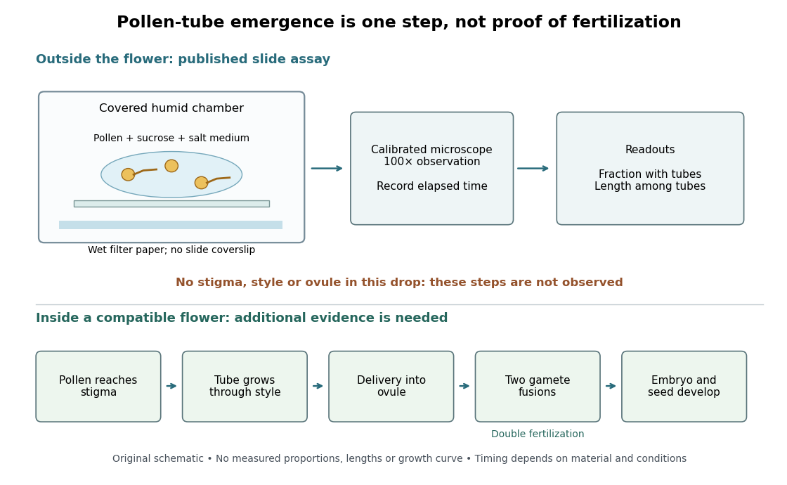

# Reproduction

↑ **Parent:** [Biology](biology.md)

**Table of contents**

- [Ovulation](#ovulation)
- [Live birth](#live-birth)
- [Semen](#semen)
- [Menopause](#menopause)
- [Plant reproduction](#plant-reproduction)
  - [Seed dispersal](#seed-dispersal)
- [Menstruation](#menstruation)
- [Gestation](#gestation)
- [Oviposition](#oviposition)
- [Asexual reproduction](#asexual-reproduction)
- [Budding](#budding)
- [Sexual reproduction](#sexual-reproduction)
  - [Hermaphrodite](#hermaphrodite)
  - [Outcrossing](#outcrossing)
  - [Self-fertilization](#self-fertilization)
  - [Autogamy](#autogamy)
  - [Reproductive assurance](#reproductive-assurance)
  - [Monoecy](#monoecy)
  - [Spore](#spore)
    - [Heterospory](#heterospory)
      - [Megaspore](#megaspore)
      - [Microspore](#microspore)
    - [Homospory](#homospory)
    - [Sporopollenin](#sporopollenin)
    - [Spore dispersal](#spore-dispersal)
  - [Alternation of generations](#alternation-of-generations)
    - [Sporophyte](#sporophyte)
      - [Sporangium](#sporangium)
        - [Microsporangium](#microsporangium)
  - [Gamete](#gamete)
    - [Ovum](#ovum)
    - [Sperm](#sperm)
  - [Fertilization](#fertilization)
    - [Double fertilization](#double-fertilization)
    - [Zygote](#zygote)
  - [Pollination](#pollination)
    - [Self-incompatibility](#self-incompatibility)
    - [Cross-pollination](#cross-pollination)
    - [Self-pollination](#self-pollination)
    - [Pollen](#pollen)
      - [Pollen analysis](#pollen-analysis)
      - [Pollen tube](#pollen-tube)
        - [Pollen tube germination assay](#pollen-tube-germination-assay)
  - [Oogenesis](#oogenesis)
    - [Nurse cell](#nurse-cell)
    - [Follicle cell](#follicle-cell)
    - [Polar body](#polar-body)
  - [Oocyte](#oocyte)
  - [Gametophyte](#gametophyte)
    - [Prothallus](#prothallus)
    - [Archegonium](#archegonium)
    - [Antheridium](#antheridium)

## Ovulation

↑ **Parent:** [Reproduction](reproduction.md)

## Live birth

↑ **Parent:** [Reproduction](reproduction.md)

## Semen

↑ **Parent:** [Reproduction](reproduction.md)

## Menopause

↑ **Parent:** [Reproduction](reproduction.md)

## Plant reproduction

↑ **Parent:** [Reproduction](reproduction.md)

### Seed dispersal

↑ **Parent:** [Plant reproduction](#plant-reproduction)

## Menstruation

↑ **Parent:** [Reproduction](reproduction.md)

## Gestation

↑ **Parent:** [Reproduction](reproduction.md)

## Oviposition

↑ **Parent:** [Reproduction](reproduction.md)

Egg laying, including choice of timing and substrate. Plant choice by an adult can determine the conditions experienced by its offspring.

## Asexual reproduction

↑ **Parent:** [Reproduction](reproduction.md)

[Asexual reproduction](#asexual-reproduction) produces offspring without fusion of [gametes](#gamete). An operational [species concept](biology.md#species-concept) for such [organisms](organism.md) needs evidence other than interbreeding.

## Budding

↑ **Parent:** [Reproduction](reproduction.md)  
ⓦ [Wiki](https://en.wikipedia.org/wiki/Budding)

[Budding](#budding) produces a new individual from an outgrowth of its parent. In [Saccharomyces cerevisiae](organism.md#saccharomyces-cerevisiae), the daughter [biological cell](biological-cell.md) grows while attached to the mother and later separates; see the Burgess, Powers and Mell account cited there. [Budding](#budding) describes [reproduction](reproduction.md), not [fermentation](metabolism.md#fermentation).

## Sexual reproduction

↑ **Parent:** [Reproduction](reproduction.md)

### Hermaphrodite

↑ **Parent:** [Sexual reproduction](#sexual-reproduction)

An organism with male and female reproductive functions.

### Outcrossing

↑ **Parent:** [Sexual reproduction](#sexual-reproduction)

Mating between different individuals; its consequences depend on population structure and the compatibility of their alleles.

### Self-fertilization

↑ **Parent:** [Sexual reproduction](#sexual-reproduction)

Sexual reproduction in which male and female gametes derive from the same individual.

### Autogamy

↑ **Parent:** [Sexual reproduction](#sexual-reproduction)

A sexual nuclear cycle involving fusion of pronuclei derived within one individual. In some Paramecium it renews the nuclear apparatus without outcrossing and produces pronounced homozygosity.

### Reproductive assurance

↑ **Parent:** [Sexual reproduction](#sexual-reproduction)

Maintenance of reproductive output when access to compatible partners or pollen is unreliable. Autonomous self-fertilization can provide it in suitable self-compatible plants, but bisexuality alone does not guarantee that outcome.

### Monoecy

↑ **Parent:** [Sexual reproduction](#sexual-reproduction)

Occurrence of separate male and female reproductive structures on one individual. It does not mean that each [flower](organism.md#flower) is bisexual.

### Spore

↑ **Parent:** [Sexual reproduction](#sexual-reproduction)

A reproductive or dispersal cell capable of initiating growth without fusion with another cell. In the ordinary land-plant sexual cycle, [haploid](genetics.md#haploid) [spores](#spore) formed by [meiosis](genetics.md#meiosis) initiate [gametophytes](#gametophyte); they are distinct from fusing [gametes](#gamete).

#### Heterospory

↑ **Parent:** [Spore](#spore)

Production of distinct [microspores](#microspore) and [megaspores](#megaspore) that give rise to male and female [gametophytes](#gametophyte). Retention of developmental stages within spore walls changes protection and provisioning without itself removing the need for water-dependent sperm movement in heterosporous ferns.

##### Megaspore

↑ **Parent:** [Heterospory](#heterospory)

The spore type developing into a female [gametophyte](#gametophyte).

##### Microspore

↑ **Parent:** [Heterospory](#heterospory)

The spore type developing into a male [gametophyte](#gametophyte). Its production is distinct from the later production of [sperm](#sperm).

#### Homospory

↑ **Parent:** [Spore](#spore)

Production of one principal spore type, as in many [ferns](organism.md#fern). The resulting [gametophytes](#gametophyte) may produce both kinds of [gametes](#gamete), with their actual sexual development depending on the species and conditions.

#### Sporopollenin

↑ **Parent:** [Spore](#spore)

A resistant wall material in [spores](#spore) and [pollen](#pollen). It helps protect dispersal stages without eliminating the environmental requirements of later development.

#### Spore dispersal

↑ **Parent:** [Spore](#spore)

Movement of [spores](#spore) away from their source. Resistant walls and elevated release can improve dispersal without guaranteeing germination or successful [fertilization](#fertilization) in the next generation.

### Alternation of generations

↑ **Parent:** [Sexual reproduction](#sexual-reproduction)

Alternation between a multicellular [haploid](genetics.md#haploid) [gametophyte](#gametophyte) and a multicellular [diploid](genetics.md#diploid) [sporophyte](#sporophyte). [meiosis](genetics.md#meiosis) produces [spores](#spore), whereas [fertilization](#fertilization) restores the diploid condition; the generations grow by [mitosis](cell-cycle.md#mitosis).

#### Sporophyte

↑ **Parent:** [Alternation of generations](#alternation-of-generations)

The generation developing from a [zygote](#zygote) and producing [spores](#spore) through [meiosis](genetics.md#meiosis). In the usual land-plant cycle it is [diploid](genetics.md#diploid). Its nutritional independence and stature differ markedly between [bryophytes](organism.md#bryophyte) and [vascular plants](organism.md#vascular-plant).

##### Sporangium

↑ **Parent:** [Sporophyte](#sporophyte)

A structure in which [spores](#spore) are produced. One unbranched bryophyte [sporophyte](#sporophyte) bears a single sporangium; branching sporophytes can distribute several sporangia on one body.

###### Microsporangium

↑ **Parent:** [Sporangium](#sporangium)

A spore-producing structure associated with the male developmental lineage in [heterospory](#heterospory).

### Gamete

↑ **Parent:** [Sexual reproduction](#sexual-reproduction)

A gamete is a reproductive [biological cell](biological-cell.md) that can fuse with another [gamete](#gamete) during [fertilization](#fertilization). In the ordinary [diploid](genetics.md#diploid) inheritance model, a [haploid](genetics.md#haploid) [gamete](#gamete) carries one copy at each [genetic locus](genetics.md#genetic-locus).

#### Ovum

↑ **Parent:** [Gamete](#gamete)

An [ovum](#ovum) is a female [gamete](#gamete).

#### Sperm

↑ **Parent:** [Gamete](#gamete)  
ⓦ [Wiki](https://en.wikipedia.org/wiki/Sperm)

A male [gamete](#gamete).

### Fertilization

↑ **Parent:** [Sexual reproduction](#sexual-reproduction)

[Fertilization](#fertilization) is fusion of [gametes](#gamete). Fusion of two [haploid](genetics.md#haploid) [gametes](#gamete) restores the [diploid](genetics.md#diploid) state in the inheritance model used for [Mendelian segregation](genetics.md#mendelian-segregation).

#### Double fertilization

↑ **Parent:** [Fertilization](#fertilization)  
ⓦ [Wiki](https://en.wikipedia.org/wiki/Double_fertilization)

In the common [angiosperm](organism.md#angiosperm) arrangement, one [sperm](#sperm) fuses with the [ovum](#ovum) to form a [diploid](genetics.md#diploid) [zygote](#zygote); another fuses with the central [biological cell](biological-cell.md)'s two polar [cell nuclei](biological-cell.md#cell-nucleus), initiating [endosperm](organism.md#endosperm) with three [chromosome](genetics.md#chromosome) sets. The [zygote](#zygote) develops into a [plant embryo](organism.md#plant-embryo), and the [ovule](organism.md#ovule) develops into a [seed](organism.md#seed).[Biology 2e, §32.2 Double Fertilization, Figure 32.18](biology-bibliography.md#biology-2e-by-mary-ann-clark-and-others/32-2-pollination-and-fertilization)

For an original counting example, stipulate a [plant](organism.md#plant) with $2n=14$ [chromosomes](genetics.md#chromosome) and the common two-polar-nucleus arrangement. Each [haploid](genetics.md#haploid) [sperm](#sperm) and [ovum](#ovum) contributes $n=7$. The [zygote](#zygote) therefore has $7+7=14$ [chromosomes](genetics.md#chromosome), while the initiating [endosperm](organism.md#endosperm) [cell nucleus](biological-cell.md#cell-nucleus) has $7+7+7=21$. The maternal [seed coat](organism.md#seed-coat) remains derived from $2n=14$ [plant tissue](organism.md#plant-tissue); the whole [seed](organism.md#seed) has no single uniform [chromosome](genetics.md#chromosome) count. This is bookkeeping for a stipulated example, not identification of a particular [species](biology.md#species). It follows by counting the [chromosome](genetics.md#chromosome) sets entering each fusion, rather than assigning one count to everything enclosed by a [seed coat](organism.md#seed-coat).

#### Zygote

↑ **Parent:** [Fertilization](#fertilization)  
ⓦ [Wiki](https://en.wikipedia.org/wiki/Zygote)

The [biological cell](biological-cell.md) formed by fusion of [gametes](#gamete).

### Pollination

↑ **Parent:** [Sexual reproduction](#sexual-reproduction)

In [angiosperms](organism.md#angiosperm), [pollination](#pollination) transfers [pollen](#pollen) from an [anther](organism.md#anther) to a [stigma](organism.md#stigma-botany). [Fertilization](#fertilization) is a later fusion of [gametes](#gamete); [seed](organism.md#seed) development follows. [Pollination](#pollination) may use animals, wind or water, so an insect visit is neither required for every [flower](organism.md#flower) nor sufficient evidence of [fertilization](#fertilization).[Biology 2e, §32.2 opening definition, Pollination by Wind and Pollination by Water](biology-bibliography.md#biology-2e-by-mary-ann-clark-and-others/32-2-pollination-and-fertilization)

#### Self-incompatibility

↑ **Parent:** [Pollination](#pollination)

A recognition system preventing some self or genetically incompatible pollinations from completing fertilization. Its presence and mechanism must be tested rather than inferred from bisexual floral structure.

#### Cross-pollination

↑ **Parent:** [Pollination](#pollination)

Transfer of [pollen](#pollen) between different individuals of the same [species](biology.md#species); compare [self-pollination](#self-pollination).[Biology 2e, §32.2 opening paragraphs: self-pollination and cross-pollination](biology-bibliography.md#biology-2e-by-mary-ann-clark-and-others/32-2-pollination-and-fertilization)

A [flower](organism.md#flower) can contain both reproductive groups and still receive [pollen](#pollen) from another individual. Conversely, transfer between two [flowers](organism.md#flower) on one [plant](organism.md#plant) does not by itself imply [cross-pollination](#cross-pollination). Following the donor and recipient individuals makes [pollination](#pollination) useful for studying [genetics](genetics.md): organ position alone cannot identify whose [alleles](genetics.md#allele) meet at [fertilization](#fertilization).

#### Self-pollination

↑ **Parent:** [Pollination](#pollination)  
ⓦ [Wiki](https://en.wikipedia.org/wiki/Self-pollination)

Transfer of [pollen](#pollen) within one [plant](organism.md#plant), including between its [flowers](organism.md#flower).

#### Pollen

↑ **Parent:** [Pollination](#pollination)

An [angiosperm](organism.md#angiosperm) [pollen](#pollen) grain is a small male [gametophyte](#gametophyte), not itself a [seed](organism.md#seed) or a single [gamete](#gamete). Its tube-forming [biological cell](biological-cell.md) supports delivery of [sperm](#sperm).[Teaching notes: pollen grain and tube as male gametophyte](plant-biology-bibliography.md#observing-the-growth-of-pollen-tubes-practical-biology)

##### Pollen analysis

↑ **Parent:** [Pollen](#pollen)

Use of identified pollen in sediments or other material to reconstruct vegetation and environmental change. Production, transport and preservation affect the relationship between counts and vegetation.

##### Pollen tube

↑ **Parent:** [Pollen](#pollen)  
ⓦ [Wiki](https://en.wikipedia.org/wiki/Pollen_tube)

A growing extension from a [pollen](#pollen) grain. In a compatible [flower](organism.md#flower), the [pollen tube](#pollen-tube) provides a route for [sperm](#sperm) to the [angiosperm female gametophyte](organism.md#angiosperm-female-gametophyte).[Biology 2e, §32.2 Double Fertilization, Figure 32.18](biology-bibliography.md#biology-2e-by-mary-ann-clark-and-others/32-2-pollination-and-fertilization)

###### Pollen tube germination assay

↑ **Parent:** [Pollen tube](#pollen-tube)

A [pollen tube germination assay](#pollen-tube-germination-assay) makes tube emergence visible outside a [flower](organism.md#flower). The published Practical Biology experiment, [Observing the growth of pollen tubes (Practical Biology)](plant-biology-bibliography.md#observing-the-growth-of-pollen-tubes-practical-biology), Technical note 3, lists florist [lilies](organism.md#lilium) among successful materials without specifying a [species](biology.md#species). Record the actual identification; success with one sample cannot establish a universal growth rate.[Technical note 3 and Teaching notes: material dependence and contorted versus straight tubes](plant-biology-bibliography.md#observing-the-growth-of-pollen-tubes-practical-biology)

Pearson's [Core practical 4: Investigate the effect of sucrose concentration on pollen tube growth by Pearson Education Ltd](plant-biology-bibliography.md#core-practical-4-investigate-the-effect-of-sucrose-concentration-on-pollen-tube-growth-by-pearson-education-ltd), Teacher sheet, pp. 1–2, describes an inspectable experiment. Mix equal volumes of [sucrose](chemical-substance.md#sucrose) solution and mineral-[salt](ionic-bonding.md#salt-chemistry) medium on clean cavity slides. Dust in [pollen](#pollen) from mature [anthers](organism.md#anther) with a mounted needle, record the addition time, and incubate without coverslips in covered dishes containing wet filter paper. The moist chamber reduces drying; the uncovered drops avoid oxygen limitation. Brief observations with an [optical microscope](optical-instrument.md#optical-microscope) at $100\times$, using an [eyepiece graticule](optical-instrument.md#ocular-micrometer) calibrated against a [stage micrometer](optical-instrument.md#stage-micrometer), reveal tube emergence and length. Return slides to the chambers and switch off the lamp between observations to reduce heating and drying. For comparisons of [sucrose](chemical-substance.md#sucrose) [concentration](mathematical-physics.md#concentration), use the same [flower](organism.md#flower) across treatments to control maturity, then repeat with other [flowers](organism.md#flower).[Teacher sheet, pp. 1–2, steps 3–8 and answer 1; Technician sheet, p. 1, equipment and plant materials](plant-biology-bibliography.md#core-practical-4-investigate-the-effect-of-sucrose-concentration-on-pollen-tube-growth-by-pearson-education-ltd)

**[Figure 1](#image-what-a-pollen-tube-germination-assay-observes-and-what-remains-to-reach-fertilization). What a pollen tube germination assay observes, and what remains to reach fertilization**. Original apparatus and evidence schematic. A drop contains [pollen](#pollen) with and without emerged [pollen tubes](#pollen-tube); these are cartoons, not measured tube lengths or experimental success proportions. The separate lower route shows the additional stages inside a compatible [flower](organism.md#flower). No time or length scale is implied.

An additional proposed [experimental design](design-of-experiments.md) check is a medium-only slide: it tests whether debris is being mistaken for [pollen tubes](#pollen-tube). Compare matched [pollen](#pollen) samples at different final [sucrose](chemical-substance.md#sucrose) [concentrations](mathematical-physics.md#concentration), keeping [temperature](temperature.md), elapsed time and observation rules fixed. A sample known to produce [pollen tubes](#pollen-tube) in a previously successful medium would test whether an apparent failure comes from handling or the tested condition. These controls are questions to test, not guaranteed outcomes. A negative result cannot distinguish dead [pollen](#pollen) from an unsuitable medium without further comparisons.

Two original calculations clarify the readout. First, take $0.40\,\mathrm{mL}$ of $0.80\,\mathrm{mol\,L^{-1}}$ [sucrose](chemical-substance.md#sucrose) solution and $0.40\,\mathrm{mL}$ of [sucrose](chemical-substance.md#sucrose)-free medium. Assuming additive [volumes](geometry-and-topology.md#volume), conservation of the [amount of substance](physics.md#amount-of-substance) gives

$$
c_{\mathrm{final}}=\frac{c_{\mathrm{stock}}V_{\mathrm{stock}}}{V_{\mathrm{stock}}+V_{\mathrm{medium}}}=0.40\,\mathrm{mol\,L^{-1}}.
$$

This [dilution](mixture.md#dilution) also halves the medium's original component [concentrations](mathematical-physics.md#concentration). Label the final [molar concentration](mathematical-physics.md#molar-concentration), not the starting bottle.

Second, stipulate a toy field containing $40$ [pollen](#pollen) grains, of which $12$ have emerged [pollen tubes](#pollen-tube). Its emergence fraction is $12/40=0.30$. If those twelve [pollen tubes](#pollen-tube) have total measured length $960\,\mathrm{\mu m}$, their [arithmetic mean](arithmetic.md#arithmetic-mean) length is $80\,\mathrm{\mu m}$. Assigning length zero to the other grains instead gives $960/40=24\,\mathrm{\mu m}$ per grain. These invented numbers show why emergence fraction and mean length among emerged tubes answer different questions. Specify the denominator and the emergence criterion before counting, and avoid selecting only conspicuous long [pollen tubes](#pollen-tube).

Tube emergence in a drop demonstrates growth under that medium's conditions. It observes no [stigma](organism.md#stigma-botany) interaction, passage through a [style](organism.md#style-botany), delivery into an [ovule](organism.md#ovule), [gamete](#gamete) fusion, or [seed](organism.md#seed) development. Thus a positive [pollen tube germination assay](#pollen-tube-germination-assay) does not demonstrate successful [fertilization](#fertilization) in a living [flower](organism.md#flower). Its beauty is making one otherwise hidden part of [sexual reproduction](#sexual-reproduction) directly observable.[Teaching notes: steps between pollen germination and seed formation; prepared style slides as a separate observation](plant-biology-bibliography.md#observing-the-growth-of-pollen-tubes-practical-biology)

### Oogenesis

↑ **Parent:** [Sexual reproduction](#sexual-reproduction)

[Oogenesis](#oogenesis) is development of female [gametes](#gamete); the unequal divisions of human [meiosis](genetics.md#meiosis) produce [polar bodies](#polar-body) alongside the developing [ovum](#ovum).

#### Nurse cell

↑ **Parent:** [Oogenesis](#oogenesis)

A [germline](biological-cell.md#germline)-associated [cell](biological-cell.md) supplying macromolecules to an [oocyte](#oocyte) in systems such as [Drosophila](organism.md#drosophila). Maternal [RNA](polymer.md#ribonucleic-acid) synthesis and its eventual localization are distinct processes.

#### Follicle cell

↑ **Parent:** [Oogenesis](#oogenesis)

A somatic cell surrounding an [oocyte](#oocyte). In [Drosophila melanogaster](organism.md#drosophila-melanogaster), ovarian follicle cells interpret oocyte signals and contribute to eggshell pattern and later embryonic positional information.

#### Polar body

↑ **Parent:** [Oogenesis](#oogenesis)

A [polar body](#polar-body) is a small product of an unequal division during [oogenesis](#oogenesis).

### Oocyte

↑ **Parent:** [Sexual reproduction](#sexual-reproduction)

An [oocyte](#oocyte) is a female germ [biological cell](biological-cell.md) developing toward an [ovum](#ovum).

### Gametophyte

↑ **Parent:** [Sexual reproduction](#sexual-reproduction)  
ⓦ [Wiki](https://en.wikipedia.org/wiki/Gametophyte)

The [plant](organism.md#plant) life-cycle generation that produces [gametes](#gamete). In an [angiosperm](organism.md#angiosperm), male [gametophytes](#gametophyte) are [pollen](#pollen) grains and the female [gametophyte](#gametophyte) is the [embryo sac](organism.md#angiosperm-female-gametophyte).

#### Prothallus

↑ **Parent:** [Gametophyte](#gametophyte)

A name commonly used for a fern [gametophyte](#gametophyte). A small photosynthetic free-living body is a useful example, but not a description of every fern gametophyte.

#### Archegonium

↑ **Parent:** [Gametophyte](#gametophyte)

An egg-bearing reproductive structure in relevant land-plant lineages. The young [sporophyte](#sporophyte) can be retained on the maternal [gametophyte](#gametophyte) after [fertilization](#fertilization).

#### Antheridium

↑ **Parent:** [Gametophyte](#gametophyte)

A male gamete-producing structure in relevant plant lineages. In [bryophytes](organism.md#bryophyte) and many [ferns](organism.md#fern), it produces motile [sperm](#sperm) whose movement to an egg requires a suitable water connection.

## ↑ Ancestors (2)

1. [Biology](biology.md)
2. [Codex Wiki](README.md)

## ← Incoming links (14)

- [Biological species concept](biology.md#biological-species-concept)
- [Budding](#budding)
- [Charles Darwin](evolution.md#charles-darwin)
- [Solution](past-exam-of-the-history-of-science-supplementary-subject-of-the-university-of-oxford/2018.md#6/solution)
- [Solution](past-exam-of-the-history-of-science-supplementary-subject-of-the-university-of-oxford/2021.md#5/solution)
- [Solution](past-exam-of-the-history-of-science-supplementary-subject-of-the-university-of-oxford/2021.md#6/solution)
- [Solution](past-exam-of-the-history-of-science-supplementary-subject-of-the-university-of-oxford/2021.md#7/solution)
- [Solution](past-exam-of-the-history-of-science-supplementary-subject-of-the-university-of-oxford/2022.md#5/solution)
- [Solution](past-exam-of-the-history-of-science-supplementary-subject-of-the-university-of-oxford/2022.md#6/solution)
- [Solution](past-exam-of-the-history-of-science-supplementary-subject-of-the-university-of-oxford/2022.md#8/solution)
- [Solution](past-exam-of-the-zoology-course-of-the-university-of-cambridge/2024/paper-zm5.md#1/solution)
- [Postmating reproductive isolation](evolution.md#postmating-reproductive-isolation)
- [Struggle for existence](evolution.md#struggle-for-existence)
- [Unicellular organism](organism.md#unicellular-organism)
