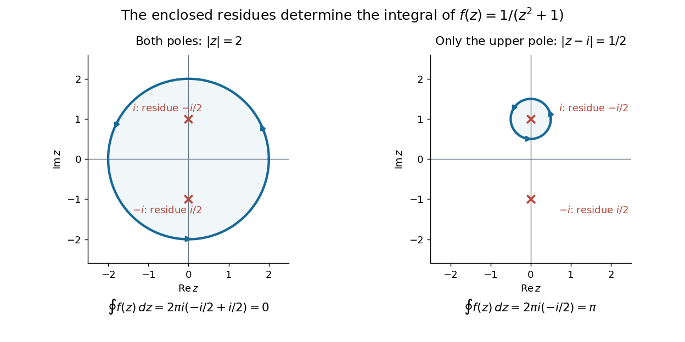
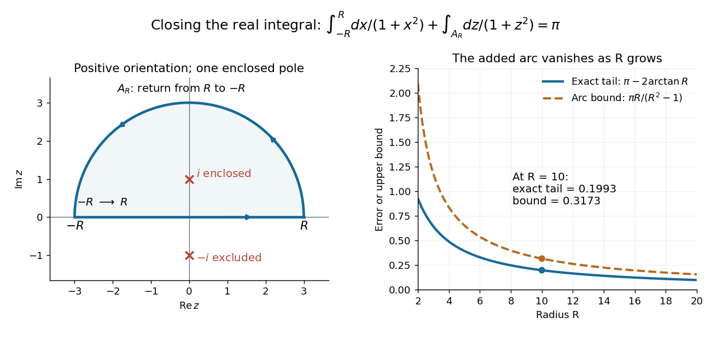

# Residue theorem

↑ **Parent:** [Analysis](analysis-split.md)  
ⓦ [Wiki](https://en.wikipedia.org/wiki/Residue_theorem)

Let $\Gamma$ be a piecewise smooth [contour](complex-integration-contour.md) forming a [simple closed curve](simple-closed-curve.md), positively oriented: travel counterclockwise, with the interior on the left. Suppose $f$ is [holomorphic](holomorphic-function-split.md) on an [open set](open-set.md) containing $\Gamma$ and its interior, except at finitely many [isolated singularities](isolated-singularity-split.md) $a_1,\ldots,a_m$ strictly inside. Then

$$
\oint_\Gamma f(z)\,dz=2\pi i\sum_{j=1}^m\operatorname{Res}(f,a_j).
$$

No [isolated singularity](isolated-singularity-split.md) may lie on $\Gamma$: the ordinary [contour integral](contour-integral.md) must be defined there. Reversing the direction of the [contour](complex-integration-contour.md) reverses the sign of the answer. The theorem applies to [essential singularities](essential-singularity.md) as well as [poles](pole.md). [Orloff, MIT Topic 8, section 8.5](https://ocw.mit.edu/courses/18-04-complex-variables-with-applications-spring-2018/3c58ce71ec6f7573804221d76158a0bd_MIT18_04S18_topic8.pdf)

Return to $f(z)=1/(z^2+1)$. A counterclockwise [circle](circle.md) $|z|=2$ encloses both [simple poles](simple-pole.md), so

$$
\oint_{|z|=2}\frac{dz}{z^2+1}
=2\pi i\left(-\frac{i}{2}+\frac{i}{2}\right)=0.
$$

Yet $f$ is nonzero everywhere it is defined. A zero [contour integral](contour-integral.md) does not imply a zero [function](function-split.md), or even absence of [poles](pole.md): the enclosed [residues](residue.md) can cancel. By contrast, the counterclockwise [circle](circle.md) $|z-i|=1/2$ encloses only $i$, giving

$$
\oint_{|z-i|=1/2}\frac{dz}{z^2+1}
=2\pi i\left(-\frac{i}{2}\right)=\pi.
$$

The picture compares these two selections. Changing the shape of a [contour](complex-integration-contour.md) while keeping the same enclosed [poles](pole.md) leaves the [contour integral](contour-integral.md) unchanged, provided the [contour deformation](contour-deformation.md) stays where $f$ is [holomorphic](holomorphic-function-split.md).

**[Figure 6](#image-two-contour-choices-for-1-z-2-plus-1-cancellation-around-both-poles-and-integral-pi-around-i). Two contour choices for $1/(z^2+1)$: cancellation around both poles, and integral $\pi$ around $i$**.

This is the practical appeal of the [residue theorem](residue-theorem.md): local [Laurent coefficients](laurent-coefficient.md) determine a global [contour integral](contour-integral.md). For a [rational function](rational-function.md), a few [simple pole](simple-pole.md) computations can replace a long parametrized calculation. It also makes real [improper integrals](improper-integral.md) accessible by treating the [real line](real-line.md) as part of a closed [contour](complex-integration-contour.md) in the [complex plane](complex-plane.md).

To compute $I=\int_{-\infty}^{\infty}dx/(1+x^2)$, take $R>1$ and travel along the [real line](real-line.md) from $-R$ to $R$, then return along the upper [semicircle](semicircle.md) $A_R$, parametrized by $z=Re^{it}$ for $0\leq t\leq\pi$. This [contour](complex-integration-contour.md) is positively oriented and encloses the [simple pole](simple-pole.md) $i$ only; $-i$ is outside. Hence

$$
\int_{-R}^{R}\frac{dx}{1+x^2}
+\int_{A_R}\frac{dz}{1+z^2}=\pi.
$$

The added arc must be controlled before taking a limit. On $A_R$, the [reverse triangle inequality](reverse-triangle-inequality.md) gives $|z^2+1|\geq R^2-1$, and the [arc length](arc-length.md) is $\pi R$. The [estimation lemma](estimation-lemma.md) therefore yields

$$
\left|\int_{A_R}\frac{dz}{1+z^2}\right|
\leq\frac{\pi R}{R^2-1}\longrightarrow0.
$$

The denominator grows quadratically while the [arc length](arc-length.md) grows only linearly. This quantitative comparison, rather than a sketch alone, explains why closing the [contour](complex-integration-contour.md) does not alter the limiting real [improper integral](improper-integral.md). It even supplies an error bound: the difference between $\pi$ and the finite real [integral](integral-split.md) is at most $\pi R/(R^2-1)$.

For a numerical check, $R=10$ gives the finite real [integral](integral-split.md) $2\arctan(10)\approx2.94226$, leaving about $0.19934$ to reach $\pi$. The arc bound is $10\pi/99\approx0.31733$, comfortably larger than that error. The graph shows both quantities approaching zero. The exact tail here can be checked with the [antiderivative](antiderivative.md) $\arctan x$; the [residue theorem](residue-theorem.md) method remains useful for [improper integrals](improper-integral.md) where a convenient real [antiderivative](antiderivative.md) is unavailable.

**[Figure 7](#image-upper-semicircle-orientation-and-convergence-of-the-real-integral-with-the-bound-pi-r-r-2-1). Upper semicircle orientation and convergence of the real integral, with the bound $\pi R/(R^2-1)$**.

Finally, both one-sided [improper integrals](improper-integral.md) converge absolutely: for $|x|\geq1$, $0<1/(1+x^2)\leq1/x^2$, whose tails are integrable. Thus the symmetric limit computes the ordinary [improper integral](improper-integral.md), not merely a [Cauchy principal value](cauchy-principal-value.md), and

$$
\int_{-\infty}^{\infty}\frac{dx}{1+x^2}=\pi.
$$

Closing below instead would enclose the [simple pole](simple-pole.md) $-i$. With the same left-to-right traversal of the [real line](real-line.md), that [contour](complex-integration-contour.md) is clockwise, so its [contour integral](contour-integral.md) is $-2\pi i\operatorname{Res}(f,-i)=\pi$ again. This provides a useful sign check: the opposite [residue](residue.md) is accompanied by the opposite direction around the enclosed region.

The same strategy extends to many other [rational functions](rational-function.md): choose a [contour](complex-integration-contour.md), identify its enclosed [isolated singularities](isolated-singularity-split.md), compute their [residues](residue.md), and bound the added pieces. The choice of [contour](complex-integration-contour.md) and the bound are as much part of the calculation as the [residues](residue.md). [Orloff, MIT Topic 9, sections 9.1–9.3](https://ocw.mit.edu/courses/18-04-complex-variables-with-applications-spring-2018/f69bc227ae476839819fb18e5b283072_MIT18_04S18_topic9.pdf)

**Table of contents**

- [Cosine-difference inverse-square integral](cosine-difference-inverse-square-integral.md)
- [Cotangent contour summation](cotangent-contour-summation.md)
- [Logarithmic beta integral from a sector contour](logarithmic-beta-integral-from-a-sector-contour.md)
- [Fourier integral of a rational function with simple nonreal poles](fourier-integral-of-a-rational-function-with-simple-nonreal-poles.md)
- [Rectangular contour for an exponential beta integral](rectangular-contour-for-an-exponential-beta-integral.md)
- [Contour integral for a sine-squared trigonometric quotient](contour-integral-for-a-sine-squared-trigonometric-quotient.md)
- [Upper-half-plane contour for square-root logarithmic integrals](upper-half-plane-contour-for-square-root-logarithmic-integrals.md)
- [Upper-half-plane indentation rule](upper-half-plane-indentation-rule.md)
- [Residue cancellation by symmetry](residue-cancellation-by-symmetry.md)
- [Symmetric residue summation](symmetric-residue-summation.md)

## ↑ Ancestors (4)

1. [Analysis](analysis-split.md)
2. [Area of mathematics](area-of-mathematics.md)
3. [Mathematics](mathematics-split.md)
4. [Codex Wiki](split.md)

## ← Incoming links (142)

- [Argument principle](argument-principle.md)
- [Bilateral exponential forcing of an overdamped oscillator](bilateral-exponential-forcing-of-an-overdamped-oscillator.md)
- [Complex analysis](complex-analysis-split.md)
- [Complex contour](complex-contour.md)
- [Contour shifting](contour-shifting.md)
- [Cosecant partial-fraction identity](cosecant-partial-fraction-identity.md)
- [Cotangent contour summation](cotangent-contour-summation.md)
- [Cotangent partial-fraction expansion](cotangent-partial-fraction-expansion.md)
- [Exponential moment of the hyperbolic secant](exponential-moment-of-the-hyperbolic-secant.md)
- [Fourier transform of the hyperbolic secant](fourier-transform-of-the-hyperbolic-secant.md)
- [Fractional-power integral from an upper-half-plane contour](fractional-power-integral-from-an-upper-half-plane-contour.md)
- [Gaussian pole integral](gaussian-pole-integral.md)
- [Half-plane decomposition by Cauchy integrals](half-plane-decomposition-by-cauchy-integrals.md)
- [Keyhole contour](keyhole-contour.md)
- [Logarithmic beta integral from a sector contour](logarithmic-beta-integral-from-a-sector-contour.md)
- [Mellin integral of a reciprocal binomial](mellin-integral-of-a-reciprocal-binomial.md)
- [Solution](past-exam-of-the-mathematics-course-of-the-university-of-cambridge/2001/ib/paper-2/16e/solution.md)
- [Solution](past-exam-of-the-mathematics-course-of-the-university-of-cambridge/2001/ib/paper-4/17f/solution.md)
- [Solution](past-exam-of-the-mathematics-course-of-the-university-of-cambridge/2002/ib/paper-2/16b/c/solution.md)
- [Solution](past-exam-of-the-mathematics-course-of-the-university-of-cambridge/2002/iii/paper-13/2/solution.md)
- [Solution](past-exam-of-the-mathematics-course-of-the-university-of-cambridge/2002/iii/paper-13/4/solution.md)
- [Solution](past-exam-of-the-mathematics-course-of-the-university-of-cambridge/2002/iii/paper-5/6/solution.md)
- [Solution](past-exam-of-the-mathematics-course-of-the-university-of-cambridge/2003/ib/paper-2/7b/a/solution.md)
- [Solution](past-exam-of-the-mathematics-course-of-the-university-of-cambridge/2003/ib/paper-4/13e/a/solution.md)
- [Solution](past-exam-of-the-mathematics-course-of-the-university-of-cambridge/2003/ib/paper-4/17b/a/solution.md)
- [Solution](past-exam-of-the-mathematics-course-of-the-university-of-cambridge/2003/iii/paper-44/1/solution.md)
- [Solution](past-exam-of-the-mathematics-course-of-the-university-of-cambridge/2003/iii/paper-74/1/solution.md)
- [Solution](past-exam-of-the-mathematics-course-of-the-university-of-cambridge/2004/ib/paper-1/16a/solution.md)
- [Solution](past-exam-of-the-mathematics-course-of-the-university-of-cambridge/2004/iii/paper-15/1/solution.md)
- [Solution](past-exam-of-the-mathematics-course-of-the-university-of-cambridge/2005/ii/paper-2/8a/solution.md)
- [Solution](past-exam-of-the-mathematics-course-of-the-university-of-cambridge/2005/iii/paper-28/2/ii/solution.md)
- [Solution](past-exam-of-the-mathematics-course-of-the-university-of-cambridge/2006/ib/paper-1/13d/solution.md)
- [Solution](past-exam-of-the-mathematics-course-of-the-university-of-cambridge/2006/ii/paper-1/8e/solution.md)
- [Solution](past-exam-of-the-mathematics-course-of-the-university-of-cambridge/2006/iii/paper-18/2/solution.md)
- [Solution](past-exam-of-the-mathematics-course-of-the-university-of-cambridge/2007/ib/paper-4/15f/ii/solution.md)
- [Solution](past-exam-of-the-mathematics-course-of-the-university-of-cambridge/2007/ii/paper-2/14b/solution.md)
- [Solution](past-exam-of-the-mathematics-course-of-the-university-of-cambridge/2008/ib/paper-1/13c/a/solution.md)
- [Solution](past-exam-of-the-mathematics-course-of-the-university-of-cambridge/2008/ib/paper-1/13c/b/solution.md)
- [Solution](past-exam-of-the-mathematics-course-of-the-university-of-cambridge/2008/ib/paper-3/5c/a/solution.md)
- [Solution](past-exam-of-the-mathematics-course-of-the-university-of-cambridge/2008/ii/paper-1/8c/solution.md)
- [Solution](past-exam-of-the-mathematics-course-of-the-university-of-cambridge/2009/ib/paper-1/13d/solution.md)
- [Solution](past-exam-of-the-mathematics-course-of-the-university-of-cambridge/2009/ib/paper-3/5d/i/solution.md)
- [Solution](past-exam-of-the-mathematics-course-of-the-university-of-cambridge/2009/ib/paper-3/5d/ii/solution.md)
- [Solution](past-exam-of-the-mathematics-course-of-the-university-of-cambridge/2009/ii/paper-1/14b/solution.md)
- [Solution](past-exam-of-the-mathematics-course-of-the-university-of-cambridge/2009/iii/paper-11/1/solution.md)
- [Solution](past-exam-of-the-mathematics-course-of-the-university-of-cambridge/2009/iii/paper-18/6/solution.md)
- [Solution](past-exam-of-the-mathematics-course-of-the-university-of-cambridge/2009/iii/paper-44/1/solution.md)
- [Solution](past-exam-of-the-mathematics-course-of-the-university-of-cambridge/2009/iii/paper-7/3/b/solution.md)
- [Solution](past-exam-of-the-mathematics-course-of-the-university-of-cambridge/2010/ii/paper-2/14e/solution.md)
- [Solution](past-exam-of-the-mathematics-course-of-the-university-of-cambridge/2013/ib/paper-2/13d/i/solution.md)
- [Solution](past-exam-of-the-mathematics-course-of-the-university-of-cambridge/2013/ib/paper-2/13d/ii/solution.md)
- [Solution](past-exam-of-the-mathematics-course-of-the-university-of-cambridge/2013/iii/paper-60/2/solution.md)
- [Solution](past-exam-of-the-mathematics-course-of-the-university-of-cambridge/2013/iii/paper-8/4/b/solution.md)
- [Solution](past-exam-of-the-mathematics-course-of-the-university-of-cambridge/2014/ib/paper-1/13b/solution.md)
- [Solution](past-exam-of-the-mathematics-course-of-the-university-of-cambridge/2014/ib/paper-2/13b/solution.md)
- [Solution](past-exam-of-the-mathematics-course-of-the-university-of-cambridge/2015/ii/paper-1/6b/solution.md)
- [Solution](past-exam-of-the-mathematics-course-of-the-university-of-cambridge/2015/ii/paper-3/6b/solution.md)
- [Solution](past-exam-of-the-mathematics-course-of-the-university-of-cambridge/2015/iii/paper-77/2/b/solution.md)
- [Solution](past-exam-of-the-mathematics-course-of-the-university-of-cambridge/2016/ib/paper-2/13a/solution.md)
- [Solution](past-exam-of-the-mathematics-course-of-the-university-of-cambridge/2016/ib/paper-3/4a/solution.md)
- [Solution](past-exam-of-the-mathematics-course-of-the-university-of-cambridge/2016/iii/paper-126/1/solution.md)
- [Solution](past-exam-of-the-mathematics-course-of-the-university-of-cambridge/2016/iii/paper-301/3/solution.md)
- [Solution](past-exam-of-the-mathematics-course-of-the-university-of-cambridge/2017/ib/paper-1/13a/b/i/solution.md)
- [Solution](past-exam-of-the-mathematics-course-of-the-university-of-cambridge/2017/ib/paper-1/13a/b/ii/solution.md)
- [Solution](past-exam-of-the-mathematics-course-of-the-university-of-cambridge/2017/ib/paper-2/13a/solution.md)
- [Solution](past-exam-of-the-mathematics-course-of-the-university-of-cambridge/2017/ii/paper-1/13e/solution.md)
- [Solution](past-exam-of-the-mathematics-course-of-the-university-of-cambridge/2017/iii/paper-137/3/a/solution.md)
- [Solution](past-exam-of-the-mathematics-course-of-the-university-of-cambridge/2017/iii/paper-301/4/c/solution.md)
- [Solution](past-exam-of-the-mathematics-course-of-the-university-of-cambridge/2018/ib/paper-1/13a/a/solution.md)
- [Solution](past-exam-of-the-mathematics-course-of-the-university-of-cambridge/2018/ib/paper-2/13a/d/solution.md)
- [Solution](past-exam-of-the-mathematics-course-of-the-university-of-cambridge/2018/iii/paper-336/1/b/a/solution.md)
- [Solution](past-exam-of-the-mathematics-course-of-the-university-of-cambridge/2018/iii/paper-336/1/c/solution.md)
- [Solution](past-exam-of-the-mathematics-course-of-the-university-of-cambridge/2019/ib/paper-1/13f/solution.md)
- [Solution](past-exam-of-the-mathematics-course-of-the-university-of-cambridge/2019/ib/paper-3/13f/solution.md)
- [Solution](past-exam-of-the-mathematics-course-of-the-university-of-cambridge/2019/ib/paper-4/14d/a/solution.md)
- [Solution](past-exam-of-the-mathematics-course-of-the-university-of-cambridge/2019/ii/paper-2/7a/solution.md)
- [Solution](past-exam-of-the-mathematics-course-of-the-university-of-cambridge/2019/iii/paper-327/1/solution.md)
- [Solution](past-exam-of-the-mathematics-course-of-the-university-of-cambridge/2020/ib/paper-1/12g/solution.md)
- [Solution](past-exam-of-the-mathematics-course-of-the-university-of-cambridge/2020/ib/paper-2/12b/iii/solution.md)
- [Solution](past-exam-of-the-mathematics-course-of-the-university-of-cambridge/2020/ii/paper-2/7e/solution.md)
- [Solution](past-exam-of-the-mathematics-course-of-the-university-of-cambridge/2021/ib/paper-1/3b/solution.md)
- [Solution](past-exam-of-the-mathematics-course-of-the-university-of-cambridge/2021/ii/paper-1/14e/c/solution.md)
- [Solution](past-exam-of-the-mathematics-course-of-the-university-of-cambridge/2021/ii/paper-1/24f/b/solution.md)
- [Solution](past-exam-of-the-mathematics-course-of-the-university-of-cambridge/2021/ii/paper-1/7e/solution.md)
- [Solution](past-exam-of-the-mathematics-course-of-the-university-of-cambridge/2022/ib/paper-2/12a/a/solution.md)
- [Solution](past-exam-of-the-mathematics-course-of-the-university-of-cambridge/2022/ib/paper-3/3a/solution.md)
- [Solution](past-exam-of-the-mathematics-course-of-the-university-of-cambridge/2022/ii/paper-1/7e/solution.md)
- [Solution](past-exam-of-the-mathematics-course-of-the-university-of-cambridge/2022/ii/paper-2/24f/c/solution.md)
- [Solution](past-exam-of-the-mathematics-course-of-the-university-of-cambridge/2023/ib/paper-1/12g/c/solution.md)
- [Solution](past-exam-of-the-mathematics-course-of-the-university-of-cambridge/2023/ii/paper-1/14e/iii/solution.md)
- [Solution](past-exam-of-the-mathematics-course-of-the-university-of-cambridge/2024/iii/paper-337/1/d/solution.md)
- [Solution](past-exam-of-the-mathematics-course-of-the-university-of-cambridge/2025/ib/paper-2/12/12-2a/a/solution.md)
- [Solution](past-exam-of-the-mathematics-course-of-the-year-2-of-the-natural-sciences-course-of-the-university-of-cambridge/2001/paper-2/4/solution.md)
- [Solution](past-exam-of-the-mathematics-course-of-the-year-2-of-the-natural-sciences-course-of-the-university-of-cambridge/2001/paper-2/5/solution.md)
- [Solution](past-exam-of-the-mathematics-course-of-the-year-2-of-the-natural-sciences-course-of-the-university-of-cambridge/2002/paper-2/4/solution.md)
- [Solution](past-exam-of-the-mathematics-course-of-the-year-2-of-the-natural-sciences-course-of-the-university-of-cambridge/2002/paper-2/5/a/solution.md)
- [Solution](past-exam-of-the-mathematics-course-of-the-year-2-of-the-natural-sciences-course-of-the-university-of-cambridge/2003/paper-2/3/solution.md)
- [Solution](past-exam-of-the-mathematics-course-of-the-year-2-of-the-natural-sciences-course-of-the-university-of-cambridge/2004/paper-2/4/solution.md)
- [Solution](past-exam-of-the-mathematics-course-of-the-year-2-of-the-natural-sciences-course-of-the-university-of-cambridge/2005/paper-2/4/solution.md)
- [Solution](past-exam-of-the-mathematics-course-of-the-year-2-of-the-natural-sciences-course-of-the-university-of-cambridge/2006/paper-2/4/solution.md)
- [Solution](past-exam-of-the-mathematics-course-of-the-year-2-of-the-natural-sciences-course-of-the-university-of-cambridge/2007/paper-2/4/solution.md)
- [Solution](past-exam-of-the-mathematics-course-of-the-year-2-of-the-natural-sciences-course-of-the-university-of-cambridge/2008/paper-2/4/solution.md)
- [Solution](past-exam-of-the-mathematics-course-of-the-year-2-of-the-natural-sciences-course-of-the-university-of-cambridge/2008/paper-2/5/solution.md)
- [Solution](past-exam-of-the-mathematics-course-of-the-year-2-of-the-natural-sciences-course-of-the-university-of-cambridge/2010/paper-1/4/solution.md)
- [Solution](past-exam-of-the-mathematics-course-of-the-year-2-of-the-natural-sciences-course-of-the-university-of-cambridge/2010/paper-2/4/solution.md)
- [Solution](past-exam-of-the-mathematics-course-of-the-year-2-of-the-natural-sciences-course-of-the-university-of-cambridge/2011/paper-2/4/solution.md)
- [Solution](past-exam-of-the-mathematics-course-of-the-year-2-of-the-natural-sciences-course-of-the-university-of-cambridge/2013/paper-2/4/i/solution.md)
- [Solution](past-exam-of-the-mathematics-course-of-the-year-2-of-the-natural-sciences-course-of-the-university-of-cambridge/2013/paper-2/4/ii/solution.md)
- [Solution](past-exam-of-the-mathematics-course-of-the-year-2-of-the-natural-sciences-course-of-the-university-of-cambridge/2013/paper-2/4/iii/solution.md)
- [Solution](past-exam-of-the-mathematics-course-of-the-year-2-of-the-natural-sciences-course-of-the-university-of-cambridge/2014/paper-2/4/i/solution.md)
- [Solution](past-exam-of-the-mathematics-course-of-the-year-2-of-the-natural-sciences-course-of-the-university-of-cambridge/2014/paper-2/4/ii/solution.md)
- [Solution](past-exam-of-the-mathematics-course-of-the-year-2-of-the-natural-sciences-course-of-the-university-of-cambridge/2015/paper-2/4/a/i/solution.md)
- [Solution](past-exam-of-the-mathematics-course-of-the-year-2-of-the-natural-sciences-course-of-the-university-of-cambridge/2015/paper-2/4/a/iii/solution.md)
- [Solution](past-exam-of-the-mathematics-course-of-the-year-2-of-the-natural-sciences-course-of-the-university-of-cambridge/2015/paper-2/4/b/solution.md)
- [Solution](past-exam-of-the-mathematics-course-of-the-year-2-of-the-natural-sciences-course-of-the-university-of-cambridge/2016/paper-2/4/b/ii/solution.md)
- [Solution](past-exam-of-the-mathematics-course-of-the-year-2-of-the-natural-sciences-course-of-the-university-of-cambridge/2016/paper-2/5/c/solution.md)
- [Solution](past-exam-of-the-mathematics-course-of-the-year-2-of-the-natural-sciences-course-of-the-university-of-cambridge/2017/paper-2/4/c/solution.md)
- [Solution](past-exam-of-the-mathematics-course-of-the-year-2-of-the-natural-sciences-course-of-the-university-of-cambridge/2018/paper-2/4/c/solution.md)
- [Solution](past-exam-of-the-mathematics-course-of-the-year-2-of-the-natural-sciences-course-of-the-university-of-cambridge/2018/paper-2/5/d/i/solution.md)
- [Solution](past-exam-of-the-mathematics-course-of-the-year-2-of-the-natural-sciences-course-of-the-university-of-cambridge/2018/paper-2/5/d/ii/solution.md)
- [Solution](past-exam-of-the-mathematics-course-of-the-year-2-of-the-natural-sciences-course-of-the-university-of-cambridge/2019/paper-2/4/c/solution.md)
- [Solution](past-exam-of-the-mathematics-course-of-the-year-2-of-the-natural-sciences-course-of-the-university-of-cambridge/2019/paper-2/4/d/i/solution.md)
- [Solution](past-exam-of-the-mathematics-course-of-the-year-2-of-the-natural-sciences-course-of-the-university-of-cambridge/2019/paper-2/4/d/ii/solution.md)
- [Solution](past-exam-of-the-mathematics-course-of-the-year-2-of-the-natural-sciences-course-of-the-university-of-cambridge/2020/paper-1/7/c/solution.md)
- [Solution](past-exam-of-the-mathematics-course-of-the-year-2-of-the-natural-sciences-course-of-the-university-of-cambridge/2021/paper-2/4/b/solution.md)
- [Solution](past-exam-of-the-mathematics-course-of-the-year-2-of-the-natural-sciences-course-of-the-university-of-cambridge/2021/paper-2/4/c/solution.md)
- [Solution](past-exam-of-the-mathematics-course-of-the-year-2-of-the-natural-sciences-course-of-the-university-of-cambridge/2022/paper-2/4/b/ii/solution.md)
- [Solution](past-exam-of-the-mathematics-course-of-the-year-2-of-the-natural-sciences-course-of-the-university-of-cambridge/2023/paper-2/4/d/solution.md)
- [Solution](past-exam-of-the-mathematics-course-of-the-year-2-of-the-natural-sciences-course-of-the-university-of-cambridge/2024/paper-2/4/b/solution.md)
- [Solution](past-exam-of-the-mathematics-course-of-the-year-2-of-the-natural-sciences-course-of-the-university-of-cambridge/2024/paper-2/4/d/solution.md)
- [Solution](past-exam-of-the-mathematics-course-of-the-year-2-of-the-natural-sciences-course-of-the-university-of-cambridge/2025/paper-2/4/b/solution.md)
- [Solution](past-exam-of-the-theoretical-physics-i-course-of-the-university-of-cambridge/2018/4/d/solution.md)
- [Reciprocal affine sine integral](reciprocal-affine-sine-integral.md)
- [Rectangular contour for an exponential beta integral](rectangular-contour-for-an-exponential-beta-integral.md)
- [Residue](residue.md)
- [Residue theorem](residue-theorem.md)
- [Retarded fundamental solution of a constant-coefficient ordinary differential operator](retarded-fundamental-solution-of-a-constant-coefficient-ordinary-differential-operator.md)
- [Scalar Feynman propagator pole prescription](scalar-feynman-propagator-pole-prescription.md)
- [Square-root endpoint integrals by an upper-half-plane contour](square-root-endpoint-integrals-by-an-upper-half-plane-contour.md)
- [Topic 11: Argument Principle by Jeremy Orloff](topic-11-argument-principle-by-jeremy-orloff.md)
- [Weighted argument principle](weighted-argument-principle.md)
- [Zero-pole sum of an elliptic function](zero-pole-sum-of-an-elliptic-function.md)
